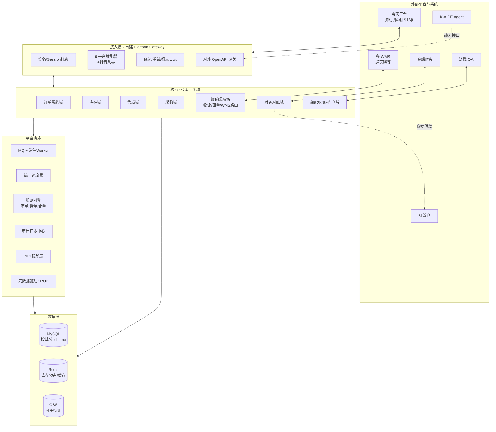
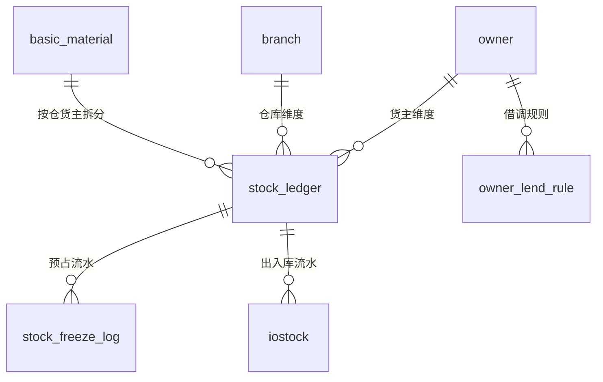

# 凯淳自研 OMS · 新架构设计书（V0.1）

> 路线：**路径 B — 新架构自研**（Jason 2026-10-23 拍板；V2.1 技术栈 2026-10-24 修订为 **Python/FastAPI + Vue3**，原 PHP 方案见变更记录）
> 输入：商派 ONEX OMS 逆向文档 00-05 + 41 问需求澄清（阶段3-需求澄清答题记录.md）+ 差距分析表 06
> 原则：商派代码为「参考实现」，**只继承业务模型与 7 大机制，不 fork、不复制代码**
> 状态：架构骨架已定，标注 `【待确认】` 项需业务/技术补充
> 编写：小凯 · 2026-10-23

---

## 0. 设计目标与约束（来自需求澄清）

| 维度 | 决策 | 对架构的硬约束 |
|---|---|---|
| 范围 | 分阶段：先 OMS+库存中台，后 WMS 库内作业 | 履约执行外置到 WMS，OMS 做「决策+记账+集成」 |
| 库存 | 隔离+可借调 | **三元记账 `仓×SKU×货主`** + 借调规则引擎 |
| 货权 | 凯淳买断 + 品牌代销 双类 | 货主维度贯穿全域；代销货不入凯淳存货账 |
| 财务 | 金蝶记账，OMS 出统计+明细+排查 | 财务域裁剪为「对账/核销/供给」，凭证外推金蝶 |
| 规模 | 中规模 日均 3千-2万单，大促 10 倍 | 全链路异步化；Redis+Lua 库存预占；暂不分库分表但预留 |
| 平台 | 淘/京/抖/拼/红/唯 6 家 | 自建 gateway（替代商派矩阵中心）；抖音从零 |
| 仓网 | 多仓 + 多 WMS 路由 | WMS 适配层，按仓路由（通天晓为主） |
| 合规 | 容器化 + PIPL + 品牌方多租户门户 | 租户级行隔离；消费者字段加密脱敏 |
| 性能 | 大促可扛级 | 拉单≤1min、库存同步≤10s、审单≥500单/min、页面≤1s |
| 扩展 | SaaS化 + AI Agent + OpenAPI 预留 | 首期即多租户；能力接口规范化 |
| 迁移 | 期初+近3年订单，按品牌灰度 | 异构迁移工具 + 库存期初对齐 + 品牌级切换 |

---

## 1. 总体架构

### 1.1 分层视图



### 1.2 架构风格决策

**首期：模块化单体（Modular Monolith），不微服务。**

理由：
1. 4-6 人团队，微服务的运维复杂度（服务发现/分布式事务/链路追踪）会吃掉本就紧张的人力。
2. 7 个域边界清晰，用「模块 + 显式接口 + 领域事件」隔离，未来任一域可独立拆出。
3. 中规模（≤2万单/日）单体 + 异步 worker 完全撑得住，商派本身就是单体（ome 大内核），但其问题是**模块边界糊**——我们用严格的域边界避免。

**演进路径**：单体分模块 → （大促瓶颈出现时）库存域/gateway 域优先拆出为独立服务 → 完整微服务。域边界从第一天就按可拆标准设计。

### 1.3 技术栈

> **V2.1 变更（2026-10-24）**：后端语言 PHP(Hyperf)→**Python(FastAPI)**，动因与商派机制→Python 等价物映射见《技术栈变更决策报告V2.1.md》。路径 B「自研不 fork」决策不变。前端 Vue3 原方案已含，本次确认 Element Plus。

| 层 | 选型 | 备选 | 决策依据 |
|---|---|---|---|
| 后端框架 | **FastAPI（Python 3.11+，asyncio + uvloop）** | Django+DRF | 大促可扛级性能（IO 密集异步）+ 常驻进程适配 MQ worker + Pydantic 契合 canonical/事件契约 + 自动 OpenAPI（D02.07 省力）；团队 Python 主技能 |
| 语言 | **Python 3.11+** | — | V2.1 变更；AI 销量预测/K-AIDE Agent 同栈；团队主技能；招聘面大 |
| ORM/迁移 | **SQLAlchemy 2.0（async）+ Alembic** | — | 数据权限行级过滤（with_loader_criteria/ORM 事件）；373 表版本化迁移 |
| 校验/契约 | **Pydantic v2** | — | canonical 模型/事件信封/API 契约单一事实源 |
| 数据库 | MySQL 8.0 | — | 沿用；按域分 schema；预留分库分表开关 |
| 缓存/库存 | Redis 7 + Lua（redis-py） | — | 库存预占原子操作（照搬商派机制，语言无关） |
| 消息队列 | RabbitMQ（Celery/arq worker） | Redis Stream / Kafka | 中规模 RabbitMQ 足够；审单/库存同步/回传全异步 |
| 调度 | APScheduler 或 Celery Beat（声明式任务白名单） | — | 借鉴商派 taskmgr 的 threadNum/timeout/retry 声明式配置 |
| 插件/规则 | pluggy / 自研责任链 + importlib 注册表 | — | 承载审单插件链/拆单 16 策略/售后审核规则 |
| 前端 | **Vue3 + TypeScript + Element Plus**（Vite/Pinia） | Ant Design Vue | 业界主流后台风格（Q39）；团队 Vue 主技能；品牌色 #185FA5 |
| 可观测性 | Sentry + Prometheus + Grafana + structlog/OpenTelemetry | — | 替代商派 console 55 表运维面板 |
| 部署 | Docker + K8s（Helm） | — | Q8 容器化；Python 镜像更轻 |

---

## 2. 七大业务域划分

> 每域标注：职责 / 吸收的商派模块 / 核心实体 / 关键机制 / 对外接口

### 2.1 平台 Gateway 域（自建，替代商派矩阵中心）

- **职责**：统一所有平台 API 的签名、授权托管、限流、重试、报文日志；对外提供 OpenAPI 网关。
- **吸收**：erpapi 的**五层框架机制**（config 签名 / channel 通道 / caller 调用 / errcode 错误码 / api_log+api_fail 双表），但**传输出口改为直连平台开放 API**（不走商派 matrix）。
- **核心实体**：`platform_config`（平台应用配置）、`shop_auth`（店铺授权/session 托管，PIPL 加密）、`api_log`（请求日志）、`api_fail`（失败重试队列）、`api_mapping`（报文映射规则）。
- **6 平台适配器**：淘系（taobao/tmall）、京东（jd）、拼多多（pdd）、小红书（xhs）、唯品会（vop）、**抖音（从零开发）**。每适配器 = 签名实现 + 报文映射（订单/商品/库存/发货/售后）+ 平台特有规则。
- **关键机制（照搬商派）**：
  - 拉单三保险：平台消息推送（TMC/抖音 webhook）+ 定时增量（水位 last_download_time）+ 单拉补偿；幂等键防重。
  - api_fail 分级重试：按错误码正则分级（可重试/需人工/永久失败），minute/hour 级退避重试。
  - 发货回传事件驱动 + 可配置回传时机（发货/打印/校验）。
- **对外接口**：`GatewayService::call(platform, shop, api, params)`；OpenAPI 网关（鉴权+限流+审计，二期）。

### 2.2 订单履约域（系统心脏）

- **职责**：订单全生命周期（接入→审单→拆单→合单→分仓→生成发货单→推仓→回传→完成/归档）。
- **吸收**：ome（订单部分 196 表拆分）、omeauto（审单/拆单/合单全套机制）、presale、billcenter、o2o。
- **核心实体**：`order`（主表，三套状态+货主维度）、`order_item`（行，含 split_num）、`order_object`（包裹单元）、`order_receiver`（收货人，PIPL 加密）、`delivery`（发货单，拆单产物）、`delivery_item`、`order_audit_reason`（**审单不通过原因，替代商派位标记**）、`order_combine`（合单组）。
- **三大改造点**：
  1. 全单据携带 `owner_id`（货主）+ `tenant_id`（租户）。
  2. 状态收敛：商派 process_status 混用「审核进度+拆单进度」，拆分为 `audit_status`（待审/已审/驳回）+ `fulfill_status`（待履约/履约中/完成）+ 拆单进度作为发货单派生视图。
  3. 审单位标记（auto_status 位运算）→ 结构化 `order_audit_reason` 子表（可读、可检索、可统计）。
- **关键机制（照搬 7 大机制中的 4 个）**：
  - **审单插件链**：规则按「仓→拆→库存→物流→校验」依赖顺序执行；决策与执行分离（决策产出履约方案，引擎统一落库，便于重算/回放）。
  - **拆单策略注册表**：16 种策略全实现为可插拔插件（sku/仓库/货主/客户分类/重量/体积/赠品/商品类型…），策略为纯函数（输入订单明细→输出分配方案），**满足 Q16「全保留+灵活插拔」**。
  - **合单指纹**：combine_hash 预计算 + 缓冲时间窗，**按店铺可开关**（Q17 选 B）。
  - **预售/O2O 履约分支**：预售先收款后履约；O2O 门店仓发货/自提。
- **对外接口**：`OrderService`、领域事件 `OrderAudited`/`OrderSplited`/`DeliveryCreated`/`OrderShipped`。

### 2.3 库存域（三元记账，最核心改造）

- **职责**：多仓多货主库存记账、预占/扣减/释放、调拨、盘点、成本核算、可售计算与平台同步。
- **吸收**：material（三层物料+BOM）、iostock+siso（出入库流水）、inventorydepth（库存深度）、tgstockcost（成本）、warehouse、调拨盘点单。
- **核心实体（三层主体 + 三元记账）**：
  ```
  销售物料 sales_material（SKU，可组合装）
    ↓ BOM 拆解
  基础物料 basic_material（最小管理单元，货号）
    ↓ 按仓×货主拆分
  库存记账行 stock_ledger（仓 branch × SKU × 货主 owner）★三元
    字段：实际 store / 冻结 freeze / 在途 arrive / 次品 defective / 单位成本 unit_cost
    + 效期批次 batch_no/expire_date（Q24）+ 序列号 serial（Q24）
  预占流水 stock_freeze_log（订单/仓/货主/售后）★独立表，不落主字段
  出入库流水 iostock（+ iostock_type 单据类型）
  借调规则 owner_lend_rule（货主A借给货主B的比例/上限）★新增
  ```
- **五口径库存**：实际/可用/锁定/在途/次品（照搬商派语义，加货主维度）。
- **关键机制（照搬）**：
  - **预占走独立流水表 + Redis Lua 原子扣减**（不落 stock_ledger.freeze 主字段），miss 降级 DB，定时对账兜底——这是商派高并发核心，大促可扛级（Q37）依赖此设计。
  - 成本核算：移动加权平均（tgstockcost），**按货主分别核算**（买断货算凯淳存货成本，代销货不算存货只记代管）。
  - 在途库存：采购审核 +、入库 -。
- **可售同步策略（按店铺可配置，Q22 选 D）**：
  - 策略链：`分平台独立` / `共享池按比例分配` / `全量共享-安全库存预留`，每店铺独立配置。
  - 共享池场景需多平台超卖防护（实时扣减 + 水位预警）。
- **对外接口**：`StockService::reserve/release/deduct`、`AvailableStockService::calc(shop)`、领域事件 `StockChanged`/`StockReserved`。

### 2.4 售后域（三段式）

- **职责**：仅退款 / 退货退款 / 换货补发 三链路。
- **吸收**：ome（refund/return/reship 部分）。
- **核心实体（三段式，照搬商派验证模型）**：
  - 申请单 `return_apply`（统一，平台差异用 **JSON 扩展列** 替代商派 15 张平台镜像表）
  - 执行单 `reship`（仓内退货入库/换货作业，良/不良分仓）
  - 退款单 `refund`（钱：refund_apply→refunds）
- **关键机制**：
  - 平台售后单自动同步 + 规则内自动审核退款（Q20 选全链路自动化）。
  - 换货 = 退货链路 + 0 元新订单复用正向履约（不单独造换货履约）。
  - 退货入库按良/不良质检分别入正品/次品库存，触发退款或二次销售。
- **改造点**：镜像表模式 → JSON 扩展列（平台特有字段），大幅减表。

### 2.5 采购域

- **职责**：采购申请→审批→采购单→到货入库→采购对账→（应付推金蝶）。
- **吸收**：purchase（38 表精简）。
- **核心实体**：`purchase_request`、`purchase_order`（**5 状态分离**：审核/入库/采购/结算/残损）、`purchase_order_item`、`purchase_receipt`（入库）、`purchase_statement`（供应商台账：期初/增加/已付/期末）。
- **关键机制（照搬）**：现购按单挂账、赊购按入库挂账 → 抽象为「应付单生成策略」；补货提醒公式（安全库存+冻结-现货-在途）。
- **货主维度**：采购单归属货主（凯淳买断才产生存货；代销不采购）。
- **审批**：采购审批推泛微 OA（Q27/Q39）。

### 2.6 财务对账域（裁剪改造）

- **职责**：对账单/核销/账期 + 金蝶数据供给 + 排查核对工具（**不做记账，记账在金蝶**）。
- **吸收**：finance、financebase、invoice、logisticsaccounts（裁剪改造）。
- **核心实体**：`receivable`（应收）、`bill`（账单流水）、`write_off`（核销，正常/差异/强制三档 + 误差表 + 差异借贷科目映射）、`settlement`（结算单，含**客户实付 vs 平台承担双口径**）、`freight_bill`（运费对账：预估/实际双账单）、`invoice`（发票）。
- **关键改造（补齐商派最大缺口）**：**所有财务单据携带货主维度**——商派财务单据无货主，多品牌代运营下无法分账，这是必须补的。
- **金蝶集成层（新增）**：统计数据 + 明细数据供给金蝶记账；OMS 侧保留排查核对工具（Q5）；接口可插拔（首个对接金蝶，预留其他财务系统）。
- **【待确认】**：金蝶版本（K3/EAS/云星空）与开放接口形态，需财务部门确认。

### 2.7 履约集成域

- **职责**：物流分单、电子面单、多 WMS 路由与推仓/回传。
- **吸收**：logisticsmanager、logistics、wmsmgr。
- **核心实体**：`logistics_corp`（物流公司）、`area_router`（区域路由分单规则）、`waybill_account`（面单账号，**三类并存**：菜鸟/平台系/快递直客，Q31）、`print_template`、`print_queue`、`wms_binding`（仓库↔WMS 绑定路由）。
- **多 WMS 路由（新增）**：按仓路由到对应 WMS 适配器（通天晓为主，预留其他）；推仓指令状态机（推送/叫回/恢复/确认，替代商派订单级 pause 布尔）。
- **电子面单适配层**：菜鸟 + 拼多多/抖音/京东平台系 + 顺丰/京东物流直客，三类账号体系统一抽象。

### 2.8 组织权限 + 门户域（多租户）

- **职责**：组织架构、多维数据权限、租户隔离、品牌方门户、审计、审批流。
- **吸收**：organization（树形组织+权限继承）、desktop、pam、flowctrl。
- **核心实体**：`org_node`（组织树：集团/品牌/**货主公司**/店铺/仓，货主类型含凯淳买断/品牌代销/预留经销商）、`tenant`（租户）、`account`、`role`、`data_permission`（店铺/品牌/仓库/货主多维 + **行级隔离**）、`audit_log`（字段级旧值新值，独立存储）、`approval_flow`（敏感操作审批）。
- **关键改造（新增，商派无）**：
  - **多租户行隔离**：品牌方门户只能看自己货主/店铺数据；SaaS 化预留（Q41）。
  - 权限模型：节点授权→展开到仓库/店铺→与直接授权合并→新增子节点自动继承（照搬商派四步）。
  - 敏感操作审批（改价/超额退款/手工改库存/跳过审单）推泛微 OA（Q39）。
- **审计日志中心**：全量操作审计（Q39），量大需独立存储（可 ClickHouse/独立库）。

---

## 3. 三大模型地基改造（相对商派的核心创新）

### 3.1 三元库存记账

商派 `branch_product`（仓×SKU）→ 凯淳 `stock_ledger`（仓×SKU×**货主**）。



- 借调：货主 A 的可用库存按规则借给货主 B 售卖，扣减时记借调流水，结算时区分归属。
- 影响面：所有库存读写点（审单预占、发货扣减、取消释放、调拨、盘点、同步）都要带 owner 维度。

### 3.2 货主维度贯穿全域

订单/发货/售后/采购/库存/财务**所有业务单据**携带 `owner_id`。财务单据带货主是补齐商派最大缺口（逆向文档 04 明确指出）。转单按货权主体分组拆单（商派 dealer 机制前置到订单域保留）。

### 3.3 租户级行隔离

`tenant_id` 贯穿全域；品牌方门户按 tenant + owner + shop 行级过滤；数据权限中心统一拦截。SaaS 化预留（未来对外输出给其他代运营/品牌）。

---

## 4. 继承商派 7 大机制的落地方案

| 机制 | 商派实现 | 凯淳落地（新栈） |
|---|---|---|
| 审单插件链 | omeauto lib/auto/plugin，23 插件位 + 位标记 | 责任链模式（pluggy/自研注册表）；位标记→结构化 audit_reason 表 |
| 合单指纹 | combine_hash + 缓冲窗 | 同思路，店铺级开关；指纹算法可配置 |
| 拆单策略注册表 | lib/split 16 策略 + router | 策略接口 + DI 标签注册；纯函数输出分配方案；16 策略全实现可插拔 |
| 预占独立流水+Redis Lua | basic_material_stock_freeze + Lua | 照搬；Redis Lua 原子脚本 + 流水异步落库 + 定时对账 |
| api_log/api_fail 双表分级重试 | erpapi | 照搬机制，gateway 域实现；错误码分级退避 |
| 售后三段式 | return_product/reship/refunds | 照搬；镜像表改 JSON 扩展列 |
| 元数据驱动 CRUD | dbschema DSL | SQLAlchemy 声明式 + Pydantic Schema + 前端 schema 渲染，不绑定任何后端 DSL |

---

## 5. 数据架构

- **按域分 schema**：`oms_order`/`oms_stock`/`oms_aftersale`/`oms_purchase`/`oms_finance`/`oms_gateway`/`oms_org`（逻辑隔离，物理同库，预留拆分）。
- **表数预估**：商派 711 → 凯淳 **~335**（压缩 53%）。压缩来源：archive 36 镜像表→分表/冷热分离；15 平台售后镜像表→JSON 扩展；console 55 运维表→可观测性工具；裁剪模块（goldentra/dealer/sales/pos/tbo2o/跨境等）。
- **归档与分表**：近 3 年订单迁移（330万-2200万单），首期设计冷热分离（热数据主表 + 归档表/分表），预留 sharding 开关。
- **PIPL**：消费者字段（收货人姓名/电话/地址）加密存储 + 展示脱敏 + 授权留痕（商派仅 modifier 脱敏，需强化）。

---

## 6. 集成架构

| 外部系统 | 方向 | 集成方式 | 备注 |
|---|---|---|---|
| 6 电商平台 | 双向 | 自建 gateway（签名/授权/限流/重试） | 抖音从零；资质需申请 |
| 多 WMS（通天晓等） | 双向 | WMS 适配层 + 按仓路由 | 推仓指令状态机 |
| 金蝶财务 | 单向出 | 统计+明细数据供给；凭证外推 | 【待确认】版本与接口 |
| 泛微 OA | 双向 | 审批流（敏感操作/采购）推 OA，接收结果 | |
| BI 数仓 | 单向出 | 宽表/数据订阅 | 自助分析不做 |
| K-AIDE Agent | 双向 | OpenAPI 能力接口（自然语言查单/异常处理/规则建议） | 接口规范先行 |

---

## 7. 关键风险与应对

| 风险 | 等级 | 应对 |
|---|---|---|
| 抖音适配从零 + 资质审核周期 | 高 | 本周启动资质申请；抖音适配器 M2 优先排期 |
| 近 3 年订单迁移量级大 | 高 | 迁移工具 M1 并行设计；先迁期初+在途，历史订单分批 |
| 三元库存改造复杂（相比商派单货主） | 高 | 库存域最先开发+充分压测；预占 Redis Lua 是难点 |
| 金蝶接口形态未知 | 中 | 尽快与财务确认版本；集成层做可插拔适配 |
| 多 WMS 路由抽象 | 中 | 尽早拿通天晓+第二家 WMS 接口文档定抽象 |
| 品牌灰度切换库存双扣 | 中 | 切换单元内店铺全旧或全新；库存期初对齐脚本前置 |
| FastAPI/SQLAlchemy async 团队熟悉度 | 低（团队 Python 主技能，异步 ORM 需验证） | 1 周 spike 验证数据权限全局过滤与审单吞吐；不达标退 Django+DRF 同步栈 |

---

## 8. 待确认清单（不阻塞 M1 启动）

1. ~~框架最终选型（Hyperf vs Laravel）~~ **已定：Python FastAPI（V2.1）**；spike 验证内容=异步 ORM 数据权限过滤 + 审单吞吐 + Celery/arq worker 选型
2. 金蝶版本与开放接口形态 — 财务部门
3. 仓库清单（名称/类型/归属货主/对接 WMS）— 运营
4. 品牌数/店铺数/SKU 数具体值 — 运营
5. 期望上线时间窗 — 管理层
6. 通天晓 + 第二家 WMS 接口文档 — 供应链/IT
7. 各平台开放平台资质现状 — 运营/电商
8. 打印位置（仓内 vs 集中）— 仓储

---

*本文档为架构骨架，随 spike 验证与待确认项补充迭代。详细设计（各域类图/接口/表 DDL）在 MVP 实施计划批准后逐域产出。*

*版本：V0.1（2026-10-23 首版，PHP/Hyperf 方案）→ **V2.1（2026-10-24 技术栈修订：Python/FastAPI + Vue3/Element Plus**，依据《技术栈变更决策报告V2.1.md》，Jason 决策；路径 B 自研与全部业务架构不变）。*
