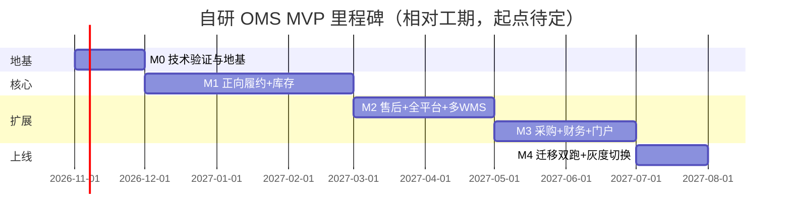

# 凯淳自研 OMS · MVP 实施计划（V0.1）

> 路线：路径 B — 新架构自研（**V2.1：Python/FastAPI + Vue3/Element Plus**）· 团队 4-6 人 · 范围 4 条链路（正向履约/多货主库存/售后/采购入库）
> 依据：07-新架构设计书.md（7 域）+ 06-差距分析表.md + 41 问需求决策
> 说明：期望上线时间窗【待确认】，本计划按 4-6 人给出 M0-M4 里程碑与相对工期，可据实压缩/拉长
> 编写：小凯 · 2026-10-23

---

## 0. 范围与分期总览

**MVP 四链路**（Q6 全选）：① 正向履约主链路 ② 多货主库存记账与同步 ③ 售后 ④ 采购入库
**后置**：经销 B2B、跨境申报、自助分析、WMS 库内作业、pos/wap/tbo2o

| 里程碑 | 主题 | 相对工期 | 交付即可验证的业务 |
|---|---|---|---|
| **M0** | 技术验证与地基 | 2-4 周 | 框架 spike 定型、gateway 打通 1 平台拉单、三元库存原型、CI/CD |
| **M1** | 正向履约 + 库存（核心） | 第 1-3 月 | 拉单→审单→拆合单→分仓→推通天晓→发货回传 + 三元库存记账/预占/同步 |
| **M2** | 售后 + 全平台 + 多 WMS | 第 3-5 月 | 售后三段式 + 6 平台全适配（含抖音）+ 多 WMS 路由 + 电子面单 |
| **M3** | 采购 + 财务对账 + 门户 | 第 5-7 月 | 采购入库全链路 + 金蝶对账 + 品牌方多租户门户 + 审批/审计 |
| **M4** | 迁移双跑 + 灰度切换 | 第 7-8 月 | 近 3 年订单迁移 + 按品牌灰度切换 + 稳定化 |

> 4 条链路 × 4-6 人无法一次并行，按 M1→M2→M3 串行推进核心，M0/M4 与主体搭接。总周期约 **7-8 个月**（含迁移）。

---

## M0 · 技术验证与地基（2-4 周，最先启动）

**目标**：把最大不确定性前置消除，定型技术栈与最难的两个机制。

| 任务 | 产出 | 负责 | 关键点 |
|---|---|---|---|
| 框架 spike | FastAPI + Vue3 最小骨架验证（技术栈已定，无需框架对比） | 后端 lead | 测审单吞吐≥500单/min、库存预占并发（Redis Lua）、SQLAlchemy async 数据权限过滤、页面≤1s；异步 ORM 不达标退 Django+DRF |
| gateway 原型 | 打通淘宝拉单+发货回传 | 后端 ×1 | 自建签名/session托管/限流/api_log+api_fail；**验证脱离商派矩阵中心可行** |
| 抖音资质申请 | 开放平台入驻提交 | 运营+后端 | **审核周期长，M0 第一周必须启动** |
| 三元库存原型 | stock_ledger + Redis Lua 预占 | 后端 ×1 | 仓×SKU×货主记账 + 原子扣减 + miss降级 + 对账兜底 |
| 基础设施 | Docker/K8s(Helm) + CI/CD + Sentry/Prometheus | 后端/运维 | 容器化底座（Q8） |
| 数据模型设计 | 7 域核心表 DDL V1（~335表） | 架构+后端 | 按域分schema；货主/租户维度贯穿 |

**M0 出口标准**：框架定型、gateway 能从淘宝拉一笔真实订单落库、Redis Lua 预占压测通过、抖音资质已提交。

---

## M1 · 正向履约 + 库存（第 1-3 月，核心）

**目标**：打通「平台拉单→审单→拆合单→分仓→推通天晓→发货回传」主链路 + 三元库存记账与同步。这是整个系统的心脏，也是与「OMS先行过渡期方案-ShopeX对接通天晓WMS」的衔接点。

### 1.1 平台 Gateway 域（M1 先做淘系+拼多多）
- 6 平台适配器框架 + 淘系（taobao/tmall）、拼多多适配器
- 拉单三保险（消息推送+定时增量+单拉补偿）、幂等防重
- 发货回传（事件驱动+可配置时机）、api_fail 分级重试
- 店铺授权（shop_auth，PIPL 加密）

### 1.2 订单履约域
- 订单模型（三套状态收敛为 audit_status+fulfill_status，货主/租户维度）
- **审单插件链**（仓→拆→库存→物流→校验顺序）+ 结构化 audit_reason（替代位标记）
- **拆单策略注册表**（16 策略可插拔，先实现：按仓/按货主/按商品类型/按重量体积，其余占位）
- **合单指纹**（店铺级开关，默认关）
- 生成发货单（拆单产物，一单多发货单）
- 人工审单工作台（批量审核/按店铺品牌分组，Q18 选 C）
- 预售/O2O 履约分支

### 1.3 库存域（与订单并行，最核心）
- 三层物料（销售物料→基础物料→仓×SKU×货主）+ BOM 拆解（组合装）
- **三元记账 stock_ledger** + 五口径库存
- **预占独立流水 + Redis Lua 原子扣减**（照搬商派机制）
- 出入库流水 iostock + 单据类型
- 借调规则（货主间可借调，Q2 选 B）
- **可售同步策略按店铺可配置**（独立/比例/共享-安全库存，Q22 选 D）+ 超卖防护
- 效期批次 + 序列号（Q24）
- 移动加权成本核算（按货主分别核算）
- 调拨单 + 盘点单

### 1.4 履约集成域（M1 先做通天晓单 WMS）
- 通天晓 WMS 适配（推仓指令状态机：推送/叫回/恢复/确认）
- 物流分单 + 区域路由
- 电子面单（菜鸟先行）+ 打印模板/队列

**M1 出口标准**：一个真实品牌的淘系订单能全自动走完「拉单→审单→分仓→推通天晓→发货回传→库存扣减→平台库存同步」，库存账实一致，大促级压测通过。

---

## M2 · 售后 + 全平台 + 多 WMS（第 3-5 月）

| 模块 | 内容 |
|---|---|
| **售后域** | 三段式（申请单 return_apply + 执行单 reship + 退款单 refund）；平台售后单自动同步 + 规则内自动审核退款（Q20）；退货入库良/不良分仓；换货=退货+0元新单；平台差异用 JSON 扩展列（替代商派15张镜像表） |
| **Gateway 补全** | 京东、**抖音（从零，重点）**、小红书、唯品会适配器；6 平台全打通 |
| **多 WMS 路由** | wms_binding 按仓路由；第二家 WMS 适配（【待确认】哪家）；多 WMS 库存回传归集 |
| **电子面单补全** | 平台系面单（拼多多/抖音/京东）+ 快递直客面单（顺丰/京东物流），三类账号统一抽象 |
| **订单补全** | 团购/福袋特殊单型（Q19）；异常单/缺货单/复审快照机制 |

**M2 出口标准**：6 平台全部能拉单+回传+售后；多 WMS 按仓正确路由；售后全链路自动化跑通。

---

## M3 · 采购 + 财务对账 + 门户（第 5-7 月）

| 模块 | 内容 |
|---|---|
| **采购域** | 采购申请→审批（推泛微OA）→采购单（5状态分离）→到货入库（在途-）→采购对账（供应商台账）；补货提醒；货主维度（买断才采购） |
| **财务对账域** | 应收/账单/核销（正常/差异/强制三档）/结算单（客户实付vs平台承担双口径）；运费对账（预估/实际双账单）；发票；**所有单据带货主维度**（补商派缺口） |
| **金蝶集成层** | 统计+明细数据供给金蝶；凭证外推；OMS侧排查核对工具（Q5）；可插拔适配 |
| **组织权限+门户** | 组织树（货主类型）；多维数据权限（店铺/品牌/仓库/货主+行级隔离）；**品牌方多租户门户**；审计日志中心（字段级）；敏感操作审批流（推泛微OA） |
| **报表** | 固定报表内置（销售/库存/履约时效/售后率）；宽表/订阅给 BI |

**M3 出口标准**：采购入库全链路通；财务对账单能供给金蝶并支持排查；品牌方登录门户只看到自己数据；敏感操作走 OA 审批；审计可追溯。

---

## M4 · 迁移双跑 + 灰度切换（第 7-8 月）

| 任务 | 内容 |
|---|---|
| 迁移工具 | 异构迁移（源系统→凯淳 OMS）；期初库存对齐（含货主维度）；近 3 年订单迁移+清洗（330万-2200万单，分批） |
| 数据校验 | 迁移后对账脚本（订单数/金额/库存账实） |
| 灰度切换 | **按品牌分批**（Q34 选 A）：切换单元内店铺全旧或全新，避免库存双扣；先切 1 个品牌验证→逐品牌推进 |
| 双跑对账 | 过渡期新旧系统并行，每日对账一致后切流 |
| 稳定化 | 大促演练、性能调优、故障预案 |

**M4 出口标准**：首个品牌成功灰度切换并稳定运行；迁移数据对账一致；具备逐品牌推全量的能力。

---

## 人力配比建议（4-6 人）

| 角色 | 人数 | 职责 |
|---|---|---|
| 架构/后端 lead | 1 | 架构定型、核心域（库存/订单）、技术攻坚 |
| 后端 | 2-3 | gateway/售后/采购/财务/集成各域 |
| 前端 | 1 | 审单工作台/门户/报表（Vue3） |
| 测试（可兼） | 0.5-1 | 用例、压测、迁移对账 |
| 产品/需求（你+业务） | 兼 | 需求确认、验收、灰度协调 |

> 4 人配置：lead+2后端+1前端，测试与产品由团队兼；周期偏 8 个月上限。
> 6 人配置：可 M1/M2 部分并行，周期压到 6-7 个月。

---

## 关键路径与并行策略

**关键路径**：gateway（拉单）→ 订单审单 → 库存预占 → 推仓回传。库存域的三元记账 + Redis Lua 预占是技术难点，M0 必须原型验证，M1 充分压测。

**可并行**：前端工作台、财务对账、门户权限可与核心链路并行开发（依赖数据模型定型，不依赖链路跑通）。

---

## 立即行动项（本周）

1. **抖音开放平台资质申请**（审核周期长，最优先）+ 核查其余 5 平台授权现状
2. **框架 spike 启动**（FastAPI + Vue3 最小骨架 + Celery/arq worker 选型，1 周出结论）
3. **金蝶版本与接口形态确认**（财务部门）
4. **仓库清单 + 通天晓/第二家 WMS 接口文档收集**（供应链/IT）
5. **业务量级数据补齐**（品牌数/店铺数/SKU/日均峰值单量）— 运营
6. **期望上线时间窗确认** — 管理层（决定人力投入与是否压缩范围）

---

## 待确认项对计划的影响

| 待确认 | 影响 | 默认假设 |
|---|---|---|
| 上线时间窗 | 决定人力/范围压缩 | 按 7-8 个月、4-6 人 |
| 框架选型 | M0 出口 | **Python FastAPI（V2.1 已定）**；spike 验证异步 ORM/吞吐/worker 库 |
| 金蝶版本 | M3 集成层设计 | 可插拔适配，不绑定 |
| 第二家 WMS | M2 多 WMS 路由 | 适配层抽象，具体后接 |
| 业务量级 | 容量设计 | 日均2万、大促10倍 |

---

*本计划 V0.1（2026-10-23，PHP 方案）→ **V2.1（2026-10-24 技术栈修订：Python/FastAPI + Vue3**，依据《技术栈变更决策报告V2.1.md》；里程碑/范围/人力不变，仅框架 spike 内容与语言调整）。M0 spike 结论与待确认项补充后细化为各域详细设计 + 排期甘特。批准后进入 M0。*
