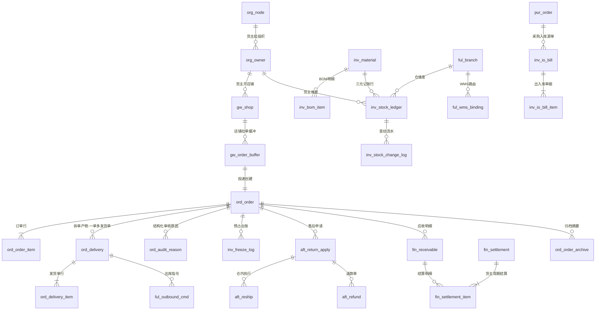

# DB-00 数据库设计总册

> 文档编号：DB-00 · 版本 V1.2 · 2026-10-24 · 编写：小凯 · 状态：待审阅（批次⑥；V1.2 友商对标增补）
> 定位：全系统数据库设计的**统一约定与契约**。分域数据字典（DB-D01~D11）必须遵守本册；冲突以本册为准，修订需变更登记。
> 依据：SRS-00 总纲 · SRS-D01~D11 全部 66 份模块 SRS 的数据字段章节 · 商派 711 表逆向成果（01-数据库实体字典）

---

## 1. 总体架构

### 1.1 数据库拓扑

| 库 | 内容 | 说明 |
|---|---|---|
| MySQL 8.0 主库 | 全部业务 schema | 单实例起步，按域分 schema |
| MySQL 从库 ×1 | 只读复制 | 报表（D11.01）与查询分流 |
| 归档库（独立 schema 或独立实例） | 历史订单/流水 | D03.13 归档、流水分表冷数据 |
| Redis 7 | 库存缓存账本/预占额度/事件计数/序号发号 | 非权威存储，DB 为准（对账修复） |
| OSS | 导入导出文件/审计附件/迁移备份 | |

### 1.2 按域分 schema（模块化单体的数据边界）

```
oms_org        D10 组织权限门户（组织树/租户/账户/角色/权限/审批登记）
oms_base       D01 平台底座（事件outbox/调度任务/规则/元数据/导入导出任务/通知）
oms_gateway    D02 平台Gateway（平台配置/店铺授权/api_log/api_fail/订单缓冲）
oms_order      D03 订单履约（订单/审单/拆合单/发货单/异常/归档摘要）
oms_stock      D04 库存（物料/BOM/记账行/流水/预占/单据/调拨借调/批次SN/成本/建议）
oms_aftersale  D05 售后（申请单/执行单/退款单/SN核销）
oms_purchase   D06 采购（申请/采购单/到货/台账/发票匹配）
oms_finance    D08 财务对账（应收/账单/结算/核销/运费/发票台账/金蝶供数）
oms_fulfill    D09 履约集成（仓库/WMS绑定/指令/物流/面单/打印）
oms_report     D11 报表（快照/汇总/指标字典）
oms_dealer     D07 经销（P2 占位建库，表结构随 P2 启动）
oms_audit      D10.06 审计（独立 schema：量大、只增、保留策略独立）
```

**跨 schema 访问规则**：
1. 业务代码不跨 schema JOIN——跨域数据通过服务接口（IF-）或事件获取；
2. 报表（D11）与 BI 宽表（D11.02）例外：从库上可跨 schema 只读 JOIN（明确豁免，仅 oms_report 的快照/宽表任务）；
3. 外键：**不建物理外键**（互联网惯例：高并发写入性能+分表演进自由），关系完整性靠应用层校验+对账任务；关系在字典中以逻辑外键（LFK）标注。

### 1.3 容量与分表策略

| 数据类 | 量级预估 | 策略 |
|---|---|---|
| 订单 | 330万-2200万（3年）+ 日增 3千-2万 | 主表不分表；完结满 N 月归档（D03.13）；预留 order_id 段式发号支持未来水平拆分 |
| 库存流水 | ~18万条/日 | 按月分表（stock_change_log_YYYYMM），在线 3 个月+归档 |
| api_log / 报文日志 | 大 | 按月分表，在线 3 个月；大报文截断（>2KB 存 OSS 引用） |
| 审计日志 | 大 | 按月分表，在线 1 年（D10.06） |
| 预占/记账行/单据 | 中（≤50万行级） | 不分表 |
| 其余业务表 | 小 | 不分表 |

分表统一约定：分表后缀 `_YYYYMM`；查询走路由视图或服务封装；归档表后缀 `_arc`。

---

## 2. 命名规范（Jason 已确认：域前缀）

### 2.1 表命名

```
{域缩写}_{实体名}[_{子实体}]
```

| 域 | 缩写 | 示例 |
|---|---|---|
| oms_order | ord | ord_order, ord_order_item, ord_delivery, ord_audit_reason |
| oms_stock | inv | inv_stock_ledger, inv_freeze_log, inv_io_bill, inv_material |
| oms_gateway | gw | gw_shop_auth, gw_api_log, gw_order_buffer |
| oms_aftersale | aft | aft_return_apply, aft_reship, aft_refund |
| oms_purchase | pur | pur_request, pur_order, pur_statement |
| oms_finance | fin | fin_receivable, fin_settlement, fin_write_off |
| oms_fulfill | ful | ful_branch, ful_wms_binding, ful_waybill |
| oms_org | org | org_node, org_owner, org_account, org_approval |
| oms_base | bas | bas_event_outbox, bas_schedule_task, bas_rule |
| oms_report | rpt | rpt_sales_daily, rpt_stock_snapshot |
| oms_dealer | dlr | dlr_dealer（P2） |
| oms_audit | aud | aud_operation_log |

规则：全小写下划线；单数名词；≤30 字符；禁用 MySQL 保留字；字典表后缀 `_dict`；关联表 `A_B`；日志/流水表 `_log`；快照表 `_snapshot`。

### 2.2 字段命名

- 主键：`id`（BIGINT UNSIGNED AUTO_INCREMENT）；对外单号：`{实体}_bn`（VARCHAR，业务唯一键）
- 逻辑外键：`{关联实体}_id`（如 order_id/owner_id/branch_id）
- 状态：`status` 或 `{限定}status`（如 audit_status）；类型：`type` 或 `{限定}_type`
- 数量：`{语义}_num`；金额：`{语义}_amount`（DECIMAL(18,2)）；单价：`{语义}_price`（DECIMAL(18,4)）
- 时间：`{动作}_time`（DATETIME(3) 毫秒）；布尔：`is_{形容词}`（TINYINT(1) 0/1）
- JSON 扩展列统一名：`ext_json`；平台特有：`platform_extra`

### 2.3 索引命名

```
pk_{表}          主键
uk_{表}_{字段组}  唯一索引
idx_{表}_{字段组} 普通索引
```

---

## 3. 公共字段约定（所有业务表必含）

| 字段 | 类型 | 说明 |
|---|---|---|
| id | BIGINT UNSIGNED AI | 物理主键（内部用，不对外） |
| tenant_id | BIGINT UNSIGNED | 租户（SRS-00 契约；内部租户=1 固定值也要写入） |
| owner_id | BIGINT UNSIGNED | 货主（业务单据必填；纯配置表可免，字典中标注） |
| create_time | DATETIME(3) | 创建时间 |
| update_time | DATETIME(3) | 更新时间（ON UPDATE） |
| version | INT UNSIGNED DEFAULT 0 | 乐观锁（高频竞争表必备：记账行/预占/单据） |
| is_deleted | TINYINT(1) DEFAULT 0 | 软删标记（流水/审计/单据类**禁用软删**——只增不改） |

补充约定：
1. 单号 `{实体}_bn` 生成：Redis 发号器（日期+域码+序列，对齐 SRS-D03.01 订单号规则，防遍历）。
2. 敏感字段（姓名/电话/地址/身份证/token）：`{字段}_enc`（VARBINARY 密文）+ 需要检索的加 `{字段}_hash`（盲索引 HMAC）——对齐 D01.05 信封加密与 D02.06 凭证加密。
3. 枚举：字典表或代码常量（各域字典声明），**不用 MySQL ENUM 类型**（演进不友好）；字段注释必须写全枚举值。
4. 字符集 utf8mb4 / 排序 utf8mb4_0900_ai_ci / 引擎 InnoDB / 时区 Asia/Shanghai（应用层统一 UTC+8）。
5. 每表每列必须有 COMMENT（中文，含枚举值说明——继承商派 schema 注释传统）。

---

## 4. 全局 ER 总览（跨域主链）



> 完整分域 ER 见各 DB-D 册。三元记账键 `(branch_id, bm_id, owner_id)` 与货主维度贯穿是全图两大主线（SRS-00 §4.4 契约）。

---

## 5. 表规模总控（实测：MySQL 8.0 全量建库 373 张表，零错误）

> 2026-10-24 V1.2 已在真实 MySQL 8.0 容器（8.0.46）逐文件执行全部 11 个建库脚本全量回归验证通过，`information_schema` 实测各 schema 表数如下（含审计独立 schema）。V1.1 复查增补：oms_order 53→58（促销引擎 5 表，SRS-D03.14）。**V1.2 友商对标增补：oms_order 58→61（DOM 路由决策日志+即时零售 2 表，SRS-D03.06/03.15）、oms_stock 48→50（活动锁定池+AI 销量预测，SRS-D04.08/04.10）、oms_fulfill 32→41（同城运力 9 表，SRS-D09.06），合计 352→366**。

| schema | 实测表数 | 大头 |
|---|---|---|
| oms_order | 62 | 订单族/发货单族/审单/异常/特殊单型/归档摘要/促销赠品（V1.1）/DOM路由决策日志+即时零售（V1.2） |
| oms_stock | 55 | 物料/BOM/记账/流水/预占/单据/调拨/批次SN/成本/建议/价格管理（V1.5）/活动锁定池+销量预测（V1.2） |
| oms_finance | 42 | 应收/账单/结算/核销/运费/发票/金蝶供数 |
| oms_fulfill | 41 | 仓库/WMS/指令/物流/面单/打印/同城骑手运力聚合（V1.2） |
| oms_base | 29 | outbox/调度/规则/元数据/PIPL/导入导出/通知告警 |
| oms_org | 28 | 组织/租户/账户/权限/审批 |
| oms_purchase | 25 | 申请/采购单/到货/台账/发票匹配 |
| oms_gateway | 24 | 平台配置/授权/日志/缓冲/回传/对账 |
| oms_report | 24 | 快照/汇总/宽表/指标字典/监控 |
| oms_aftersale | 23 | 申请/执行/退款/换货/SN核销（JSON扩展替代镜像表）/跨店铺退货画像（V1.3） |
| oms_dealer | 14 | P2 占位建库 |
| oms_audit | 6 | 操作日志/访问日志（独立 schema） |
| **合计** | **373** | 较商派 711 表压缩 47% |

> 与 §1.2 schema 清单一致（12 个）；预估 ~330 与实测 366 的差异来自审计独立成 schema、字典表、BI 宽表与 V1.1 促销/V1.2 友商对标增补计入。V1.2 另有增列不增表项：ord_order 增 8 列（fulfill_channel/promise_time 等）、ord_store_profile 增 6 列（即时零售属性）、ord_abnormal_type_dict/ord_reason_code_dict 各补 2 条字典数据（ADDR_FAKE/PURCHASE_LIMIT）、ord_risk_list 观察名单由 gray 码值承载（仅注释）、inv_sync_strategy 补 activity_lock 码值（仅注释）。分域明细见各 DB-DXX 字典与 sql/DB-DXX-*.sql。

---

## 6. 分域字典编写约定（对 DB-D01~D11 的约束）

每域字典（DB-DXX.md + DB-DXX.sql）必须包含：
1. **表清单**（表名/中文名/所属模块 SRS 编号/分期 P0-P2/预估行量级）
2. **逐表定义**：表用途、字段表（字段/类型/约束/默认/注释——注释含枚举值）、索引（含唯一键业务含义）、逻辑外键（LFK→目标表）
3. **域内 ER 图**（Mermaid erDiagram）
4. **与其他域的关系点**（跨域 LFK 清单——只标关系不建物理外键）
5. **配套 SQL**：可执行建表脚本（含 COMMENT/索引/初始字典数据 INSERT），文件头注明 schema 与执行顺序
6. 溯源标注：借鉴商派表时注明（如 `inv_stock_ledger ← 商派 ome_branch_product + material_basic_material_stock 改造：+owner_id 三元键`）

字段类型基线：
- ID/BIGINT UNSIGNED；单号 VARCHAR(32)；名称 VARCHAR(128)；长文本 TEXT（限备注类）
- 金额 DECIMAL(18,2)；单价/成本 DECIMAL(18,4)；比例 DECIMAL(9,4)；数量 INT（库存允许负卖场景用 INT 非 UNSIGNED）
- 时间 DATETIME(3)；日期 DATE；JSON 用 JSON 类型（MySQL8 原生）
- 状态/类型 TINYINT 或 VARCHAR(32)（值多且可能扩展时用字符串码）

---

## 7. 迁移与兼容约定（M4 支撑）

1. 期初导入：全部业务表支持 `source` 字段标记数据来源（api/local/import/migration）；迁移数据 source=migration。
2. 近 3 年历史订单直接入归档库（D03.13 期初通道），在线库只留摘要行。
3. 商派→凯淳字段映射表：迁移工具专用（M4 编制，本册预留 `migration_mapping` 登记表于 oms_base）。
4. ID 策略：迁移数据保留原单号（platform_order_bn/历史 order_bn）于业务唯一键，新 id 重新发号。

---

## 变更记录

| 日期 | 版本 | 变更 | 原因 |
|---|---|---|---|
| 2026-10-24 | V1.0 | 首版 | 批次⑥启动，先定全局契约 |
| 2026-10-24 | V1.2 | §5 表规模总控 352→366（oms_order+3/oms_stock+2/oms_fulfill+9），MySQL 8.0 容器 11 脚本全量回归零错误 | 友商对标 7 项决策落地：G1（SRS-D03.15 即时零售+SRS-D09.06 同城运力新模块）/G2（限购+地图校验字典数据）/G3（活动锁定库存池）/G4（DOM 路由决策埋点）/G7（AI 销量预测） |
| 2026-10-24 | V1.3 | §5 表规模 366→367（oms_aftersale +aft_buyer_profile 跨店铺退货画像），MySQL 8.0 全量回归 11 脚本零错误 | 行业适配校验 H4（Jason 决策A：高额分级+跨店铺退货画像）；其余行业缺口走 DESIGN-IND-01 预留位（零表成本） |
| 2026-10-24 | V1.4 | §5 表规模 367→368（oms_order +ord_flag_change_log 旗帜留痕，ord_order +4 协同标记列；oms_aftersale 补发类型字典），MySQL 8.0 全量回归 11 脚本零错误 | 业务完整性仿真 S1/S3（Jason 决策A） |
| 2026-10-24 | V1.5 | §5 表规模 368→373（oms_stock +5 价格管理表：archive/version/adjust_plan/adjust_item/sync_task），MySQL 8.0 全量回归 11 脚本零错误 | S4 决策修正（Jason：价格要管，B档：SRS-D04.11） |
