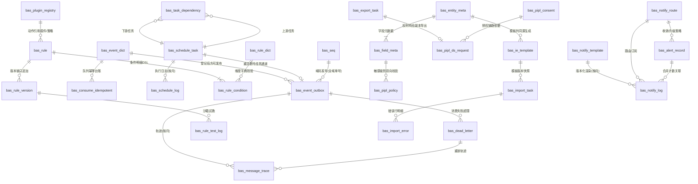

# DB-D01 平台底座域数据字典（oms_base）

> 文档编号：DB-D01 · 版本 V1.0 · 2026-10-24 · 编写：小凯 · 状态：待审阅（批次⑥）
> 上游契约：DB-00 数据库设计总册（schema=oms_base、表前缀 bas_、公共字段、命名/索引/类型基线、§6 六项必备、§7 migration_mapping 预留、流水/日志按月分表）
> 需求依据：SRS-D01.01 ~ SRS-D01.07 全部 7 份 §6 数据字段章节 + SRS-00 §4.4 事件字典契约
> 参考溯源：商派 base（queue/task/rpcpoll/kvstore）/ desktop（export_template/filter/recycle/user_logs）/ omecsv / taoexlib_queue / taskmgr whitelist / dbeav 元数据模块（机制语义参考，不照抄结构）

---

## 1. 总体说明

### 1.1 域定位

平台底座域是**全系统机制层唯一承载方**（不含业务逻辑），七个模块的持久化落点：

1. **MQ 与异步任务（D01.01）**：事务性 outbox（业务落库+事件写入同事务，防「先提交后发消息」时序缺口丢事件）、领域事件字典（SRS-00 §4.4 契约登记表）、消费幂等台账、死信、消息轨迹；
2. **统一调度（D01.02）**：任务白名单声明（继承商派 taskmgr threadNum/timeout/retry/rule 四要素）、执行日志、DAG 依赖；
3. **规则引擎框架（D01.03）**：规则/条件 DSL/版本快照/沙箱试跑/插件与策略注册表/字典；
4. **元数据驱动 CRUD（D01.04）**：实体与字段元数据（注册中心 DB 镜像，前端 schema 契约数据源）；
5. **PIPL 隐私合规（D01.05）**：分级字典/留存策略/授权留痕/数据主体权利请求；
6. **导入导出中心（D01.06）**：模板/导入导出任务/错误行明细；
7. **通知与告警（D01.07）**：模板/路由订阅/发送日志/告警记录（分级收敛认领闭环）；
8. **基础支撑**：发号器序列（DB-00 §3 单号生成）、迁移映射登记（DB-00 §7.3 预留）。

### 1.2 公共字段与例外（对齐 DB-00 §3）

所有业务表默认包含公共字段：`id`(BIGINT UNSIGNED AI 主键)、`tenant_id`(BIGINT UNSIGNED NOT NULL DEFAULT 1，底座机制表多为全局表，内部租户=1 写入)、`owner_id`(BIGINT UNSIGNED NOT NULL DEFAULT 0)、`create_time`(DATETIME(3))、`update_time`(DATETIME(3) ON UPDATE)、`version`(INT UNSIGNED DEFAULT 0)、`is_deleted`(TINYINT(1) DEFAULT 0)。**下文逐表定义只列业务字段**，例外在表头标注：

- **底座机制/配置/字典表**（本域绝大多数）：owner_id 免填（DEFAULT 0）——底座服务全租户，行隔离主维为 tenant_id 或不隔离（全局机制）；
- **流水/日志类**（bas_consume_idempotent、bas_message_trace、bas_schedule_log、bas_notify_log、bas_import_error、bas_pipl_consent）：只增不改——**无 is_deleted、无 version、无 update_time**；
- **高频竞争表**必备 version：bas_event_outbox（投递器 SKIP LOCKED 认领+状态 CAS）、bas_rule（缓存版本核对）、bas_import_task/bas_export_task（进度并发更新）、bas_alert_record（收敛计数并发）、bas_seq（发号 CAS）；
- **敏感字段**：通道凭证不落本域明文（企微/短信/OA/KMS 凭据引用 D01.05 加密存储，本域只存 `_ref` 引用）；通知/轨迹内容脱敏形态留存；
- 全库：InnoDB / utf8mb4 / utf8mb4_0900_ai_ci / 不建物理外键（LFK 标注）/ 枚举不用 MySQL ENUM，注释写全枚举值。

### 1.3 分表与归档（对齐 DB-00 §1.3）

| 表 | 策略 |
|---|---|
| bas_message_trace | **按月分表** `_YYYYMM`（日均 ~200 万条），在线 3 个月+归档 |
| bas_schedule_log | 按月分表 `_YYYYMM`（日均 ~5 万条），在线 90 天+归档；高频任务成功日志抽样降级（失败全量+成功 1/10） |
| bas_notify_log | 按月分表 `_YYYYMM`（日均 ~5000 条收敛后），在线 90 天+归档 |
| bas_consume_idempotent | 单表 30 天滚动清理（Redis 主存+DB 兜底，~5000 万行峰值→按 create_time 批量删除任务） |
| bas_event_outbox | 单表+已投递记录 7 天留存后归档删除（日均 ~50 万，在线 ≈350 万；未来量大按日分区演进） |
| 其余 | 不分表 |

---

## 2. 表清单（29 张）

| # | 表名 | 中文名 | 所属模块 | 分期 | 预估行量级 |
|---|---|---|---|---|---|
| 1 | bas_event_outbox | 事务性发件箱 | D01.01 | P0 | 350万滚动 |
| 2 | bas_event_dict | 领域事件字典 | D01.01/SRS-00 | P0 | 千 |
| 3 | bas_consume_idempotent | 消费幂等台账【辅助§6.2】 | D01.01 | P0 | 5000万滚动 |
| 4 | bas_dead_letter | 死信 | D01.01 | P0 | 万/年 |
| 5 | bas_message_trace | 消息轨迹（按月分表）【辅助§6.4】 | D01.01 | P0 | 200万/日 |
| 6 | bas_schedule_task | 调度任务白名单 | D01.02 | P0 | ≤500 |
| 7 | bas_schedule_log | 调度执行日志（按月分表） | D01.02 | P0 | 5万/日 |
| 8 | bas_task_dependency | 任务 DAG 依赖 | D01.02 | P0 | 千 |
| 9 | bas_rule | 规则主表 | D01.03 | P0 | ≤5000 |
| 10 | bas_rule_condition | 规则条件明细（DSL） | D01.03 | P0 | 5万 |
| 11 | bas_rule_version | 规则版本/快照/灰度 | D01.03 | P0 | 500/月增 |
| 12 | bas_rule_test_log | 沙箱试跑记录 | D01.03 | P0 | 万/年 |
| 13 | bas_plugin_registry | 插件/策略注册表 | D01.03 | P0 | 千 |
| 14 | bas_rule_dict | 规则维度/枚举字典【辅助§6.3】 | D01.03 | P0 | 千 |
| 15 | bas_entity_meta | 实体元数据 | D01.04 | P0 | ≤300 |
| 16 | bas_field_meta | 字段元数据 | D01.04 | P0 | ≤6000 |
| 17 | bas_pipl_policy | PIPL 分级/脱敏/留存/字段登记字典 | D01.05 | P0 | 千 |
| 18 | bas_pipl_consent | PIPL 授权留痕 | D01.05 | P0 | 十万/年 |
| 19 | bas_pipl_ds_request | 数据主体权利请求 | D01.05 | P0 | 千/年 |
| 20 | bas_ie_template | 导入模板【辅助§6.1】 | D01.06 | P0 | 百 |
| 21 | bas_import_task | 导入任务 | D01.06 | P0 | 200/日 |
| 22 | bas_import_error | 导入错误行明细 | D01.06 | P0 | 万/日峰值 |
| 23 | bas_export_task | 导出任务（含 PIPL 台账字段组） | D01.06 | P0 | 300/日 |
| 24 | bas_notify_template | 通知模板 | D01.07 | P0 | 千 |
| 25 | bas_notify_route | 通知路由订阅规则 | D01.07 | P0 | 千 |
| 26 | bas_notify_log | 发送日志（按月分表） | D01.07 | P0 | 5000/日 |
| 27 | bas_alert_record | 告警记录（收敛/升级/认领） | D01.07 | P0 | ≤1万活跃 |
| 28 | bas_seq | 发号器序列 | DB-00 §3 | P0 | 百 |
| 29 | bas_migration_mapping | 迁移字段映射登记（M4 预留） | DB-00 §7.3 | P2 | 万 |

> 标注【辅助】的 4 张为 SRS §6 明列实体；其余 SRS §6 实体合并落点见 §5.2 映射表（sched_task_stat→D11 报表库、rule_hit_log/plugin_perf→D11 报表库、user_list_pref→Redis 用户偏好、entity_meta_change_log→oms_audit 审计事件、pipl_field_registry→bas_pipl_policy、pipl_anonymize_log→oms_audit.aud_destroy_log、pipl_export_ledger→bas_export_task、ie_task_batch→bas_import_task.progress_json、notify_duty_roster→bas_notify_route 值班解析器配置）。

---

## 3. 逐表定义

> 表格只列业务字段；公共字段见 §1.2 约定。类型基线：单号 VARCHAR(32)（event_id ULID 例外 VARCHAR(26) 注明）、名称 VARCHAR(128)、时间 DATETIME(3)、JSON 用原生 JSON 类型。

### 3.1 D01.01 消息队列与异步任务中心

#### 3.1.1 bas_event_outbox 事务性发件箱（P0）★核心

用途：outbox 模式防丢事件（FR-03）：业务变更+事件写入**同一本地事务**（模块化单体单库天然支持）；投递器（白名单任务 outbox_dispatcher）轮询+事务提交即时唤醒双触发，`SELECT ... FOR UPDATE SKIP LOCKED` 多实例分片认领，批量发 RabbitMQ（publisher confirm）→置已投递；指数退避（1s/5s/30s/2min/10min 封顶 30min），超 20 次置投递失败告警；broker 不可用时 publishDirect 降级也写本表兜底补投；已投递保留 7 天（轨迹查询窗口）后归档删除。**流水类扩展**（状态可更新但只增不删，无 is_deleted）。
溯源：凯淳新增（商派无发布可靠性机制，事件丢失靠对账兜底——机制层根治）。

| 字段 | 类型 | 约束 | 默认 | 注释 |
|---|---|---|---|---|
| event_id | VARCHAR(26) | NOT NULL | | 消息唯一ID（ULID，时间有序；轨迹查询主键）【加宽注明：ULID 26位】 |
| event_name | VARCHAR(64) | NOT NULL | | 事件名=路由键（域.实体.动作,如order.delivery.shipped；须在bas_event_dict登记,CI校验） |
| reliability | VARCHAR(16) | NOT NULL | 'reliable' | 可靠性等级:reliable=强制outbox(驱动业务状态联动),best-effort=可publishDirect(通知/埋点类) |
| idempotent_key | VARCHAR(128) | NOT NULL | | 业务幂等键（发布方定义:order_id+动作/bill_type+bill_item_id+action,同事件名内唯一） |
| aggregate_type | VARCHAR(32) | NOT NULL | '' | 聚合类型（ord_order/inv_io_bill等,轨迹与排障定位） |
| aggregate_id | VARCHAR(64) | NOT NULL | '' | 聚合ID（业务主键/单号,payload摘要索引检索用） |
| owner_id | BIGINT UNSIGNED | NOT NULL | 0 | 货主（SRS-00契约,事件携带消费方免回查） |
| trace_id | VARCHAR(64) | NOT NULL | '' | 全链路追踪ID（HTTP/调度/上游消息继承透传） |
| partition_key | VARCHAR(64) | NOT NULL | '' | 分区键（partitioned事件必填:审单=订单组键/订单创建=shop_id/流水=三元键hash/指令=发货单ID） |
| payload | JSON | NOT NULL | | 业务数据（瘦事件原则:只带ID与关键状态,明细消费方回查;≤64KB超限走OSS引用;禁敏感明文D01.05） |
| schema_version | VARCHAR(16) | NOT NULL | 'v1' | payload结构版本（消费方兼容解析依据） |
| delay_seconds | INT | NOT NULL | 0 | 延迟秒数（>0为延迟消息:RabbitMQ延迟插件为主TTL+DLX兜底,上限7天,如delivery.timeout.accept=900） |
| status | TINYINT | NOT NULL | 0 | 投递状态:0=待投递,1=已投递(confirm确认),2=投递失败(超20次,告警人工) |
| retry_count | INT | NOT NULL | 0 | 投递重试次数 |
| next_retry_time | DATETIME(3) | NULL | NULL | 下次重试时间（指数退避节奏,投递器扫描条件） |
| publish_time | DATETIME(3) | NULL | NULL | 投递成功时间（轨迹依据;事务提交→broker可见P95≤1s） |

索引：`uk_bas_event_outbox_event(event_id)` 唯一；`idx_bas_event_outbox_pending(status, next_retry_time, id)` 投递器扫描（SKIP LOCKED 分片）；`idx_bas_event_outbox_idem(event_name, idempotent_key)` 幂等查重；`idx_bas_event_outbox_agg(aggregate_type, aggregate_id)` 业务单号轨迹检索；`idx_bas_event_outbox_time(create_time)` 7天清理。
LFK：event_name→bas_event_dict。

#### 3.1.2 bas_event_dict 领域事件字典（P0，字典表 owner_id 免填）

用途：DB-00 附录/SRS-00 §4.4 事件登记表的持久化载体：全部领域事件的名称/payload 结构/发布方/订阅方/可靠性等级/分区键/SLA 统一登记；事件名必须在字典登记后方可发布（CI 校验扫描代码事件名与字典比对，防拼写漂移）；消费 SLA 驱动积压告警阈值（如 stock.change.logged ≤5 分钟=D04.02 对账窗口）。初始 INSERT 含核心事件样例（跨域主链）。

| 字段 | 类型 | 约束 | 默认 | 注释 |
|---|---|---|---|---|
| event_name | VARCHAR(64) | NOT NULL | | 事件名,全局唯一（域.实体.动作小写点分,SRS-00 §4.2命名契约） |
| event_desc | VARCHAR(255) | NOT NULL | '' | 事件说明 |
| domain_code | VARCHAR(16) | NOT NULL | | 发布域:D01~D11（交换机oms.{域}.events路由） |
| publisher_module | VARCHAR(32) | NOT NULL | | 发布方模块（D03.07等） |
| subscribers_json | JSON | NOT NULL | | 订阅方清单[{"module":"D08.01","queue":"q.finance.order_completed"}]（一订阅方一队列,topic广播互不影响） |
| payload_schema_json | JSON | NULL | NULL | payload结构定义（JSON Schema,字段/类型/必填;瘦事件原则校验） |
| reliability | VARCHAR(16) | NOT NULL | 'reliable' | 可靠性等级:reliable=强制outbox,best-effort=可直发（CI校验代码调用方式匹配） |
| partitioned | TINYINT(1) | NOT NULL | 0 | 分区保序:0=否,1=是（分区数默认8高频域16;partition_key声明见partition_key_field） |
| partition_key_field | VARCHAR(64) | NOT NULL | '' | 分区键字段（order_group_key/shop_id/triple_hash/delivery_id） |
| blocking_flag | TINYINT(1) | NOT NULL | 1 | 分区内失败阻塞:1=阻塞后续(强保序默认),0=旁路重试(放弃跨消息顺序,登记时显式选择) |
| sla_minutes | INT | NOT NULL | 5 | 消费延迟SLA分钟（occurred_at→消费完成P95;超限告警D01.07） |
| status | TINYINT | NOT NULL | 1 | 状态:1=生效,2=废弃（下线事件禁发布） |

索引：`uk_bas_event_dict_name(event_name)`；`idx_bas_event_dict_domain(domain_code, status)`。

#### 3.1.3 bas_consume_idempotent 消费幂等台账（P0，辅助表，流水类无软删）

用途：框架级消费幂等双层台账的 DB 慢路径（FR-04c）：Redis SETNX 快路径（idem:{queue}:{key}，TTL 30 天）+ 本表持久化兜底（Redis 丢失以 DB 为准）；`(queue_name, idempotent_key)` 联合唯一；at-least-once+幂等台账=业务视角 exactly-once；台账仅防「同消息重复消费」，业务级幂等（余额校验/状态机 CAS）仍是消费方责任。30 天滚动清理。

| 字段 | 类型 | 约束 | 默认 | 注释 |
|---|---|---|---|---|
| queue_name | VARCHAR(128) | NOT NULL | | 消费队列名（q.{消费域}.{用途}） |
| idempotent_key | VARCHAR(128) | NOT NULL | | 业务幂等键（信封携带） |
| status | TINYINT | NOT NULL | 1 | 台账状态:1=PROCESSING(在途,重复到达延迟重投防并发双跑),2=SUCCESS(已成功,直接ack跳过) |
| event_id | VARCHAR(26) | NOT NULL | '' | 首次成功消费消息ID（溯源） |
| consumer_name | VARCHAR(128) | NOT NULL | '' | 消费方名称 |
| consume_time | DATETIME(3) | NULL | NULL | 消费成功时间 |
| cost_ms | INT | NOT NULL | 0 | 处理耗时毫秒 |
| tenant_id | BIGINT UNSIGNED | NOT NULL | 1 | 租户 |
| create_time | DATETIME(3) | NOT NULL | CURRENT_TIMESTAMP(3) | 创建时间（30天滚动清理键） |

索引：`uk_bas_consume_idempotent(queue_name, idempotent_key)` 联合唯一；`idx_bas_consume_idempotent_time(create_time)` 滚动清理。

#### 3.1.4 bas_dead_letter 死信（P0，单据类扩展无软删）

用途：消费失败达重试上限（x-retry-count≥retry 声明）投递死信队列 dlq.{queue} 后落库：信封全文/失败原因/异常堆栈摘要（脱敏）；即时告警 D01.07（聚类摘要：队列×错误指纹 TOP）；死信工作台（按队列/时间/错误聚类筛选、单条/批量重放=重投原队列走原链路幂等台账防重、标记已处理）；重放操作写审计（D10.06 高危权限点）；积压 >24h 未处理升级告警。
溯源：← 商派 taskmgr 失败告警+errmsg 字段人工查表改造：死信表+工作台+聚类告警+审计重放。

| 字段 | 类型 | 约束 | 默认 | 注释 |
|---|---|---|---|---|
| dead_bn | VARCHAR(32) | NOT NULL | | 死信编号,唯一（DL+日期+序列,bas_seq发号） |
| source_queue | VARCHAR(128) | NOT NULL | | 来源队列名 |
| consumer_name | VARCHAR(128) | NOT NULL | '' | 消费方名称 |
| event_id | VARCHAR(26) | NOT NULL | '' | 消息ID（轨迹互查） |
| event_name | VARCHAR(64) | NOT NULL | '' | 事件名（聚类维度） |
| idempotent_key | VARCHAR(128) | NOT NULL | '' | 业务幂等键 |
| envelope | JSON | NOT NULL | | 信封全文（FR-02a契约结构;敏感字段已脱敏形态） |
| fail_reason | VARCHAR(512) | NOT NULL | '' | 最后一次失败原因 |
| exception_digest | VARCHAR(1024) | NOT NULL | '' | 异常堆栈摘要（脱敏,D01.05出口过滤;错误指纹=hash(异常类+首行)聚类用） |
| error_fingerprint | CHAR(64) | NOT NULL | '' | 错误指纹（聚类摘要TOP统计键） |
| retry_count | INT | NOT NULL | 0 | 累计重试次数 |
| dead_time | DATETIME(3) | NOT NULL | | 死信时间（>24h未处理升级告警P0） |
| handle_status | TINYINT | NOT NULL | 0 | 处理状态:0=未处理,1=已重放(重投原队列),2=已作废(无效消息),3=已修复关闭 |
| handle_op | VARCHAR(64) | NOT NULL | '' | 处理人（重放/作废写审计D10.06） |
| handle_time | DATETIME(3) | NULL | NULL | 处理时间 |
| handle_remark | VARCHAR(255) | NOT NULL | '' | 处理说明 |
| trace_id | VARCHAR(64) | NOT NULL | '' | 全链路追踪ID |

索引：`uk_bas_dead_letter_bn(dead_bn)`；`idx_bas_dead_letter_status(handle_status, dead_time)` 工作台与升级扫描；`idx_bas_dead_letter_queue(source_queue, event_name, error_fingerprint)` 聚类；`idx_bas_dead_letter_event(event_id)`。

#### 3.1.5 bas_message_trace 消息轨迹（P0，辅助表，按月分表 _YYYYMM，流水类）

用途：全链路轨迹（FR-08）：发布（outbox 写入/投递/confirm）与消费（各订阅方开始/结束/结果/重试/死信/重放）各环节流水；按 event_id/idempotent_key/trace_id/业务单号检索；单消息轨迹=时间线（发布→broker→N 订阅方各自状态）；trace_id 视图=一次业务动作触发的全部消息链（跨事件级联）；含消费实例（pod/进程）与耗时——「哪个订阅方拖垮链路」快速定位。在线 3 个月。

| 字段 | 类型 | 约束 | 默认 | 注释 |
|---|---|---|---|---|
| event_id | VARCHAR(26) | NOT NULL | | 消息ID（检索键双索引） |
| trace_id | VARCHAR(64) | NOT NULL | '' | 全链路追踪ID（跨事件级联视图键） |
| stage | VARCHAR(32) | NOT NULL | | 环节:outbox_write=outbox写入,dispatch=投递,confirm=broker确认,consume_start=消费开始,consume_success=消费成功,consume_fail=消费失败,retry=重试,dead=死信,replay=重放 |
| node_id | VARCHAR(128) | NOT NULL | '' | 实例标识（pod/进程,消费方定位） |
| queue_name | VARCHAR(128) | NOT NULL | '' | 归属队列 |
| consumer_name | VARCHAR(128) | NOT NULL | '' | 消费方名称 |
| cost_ms | INT | NOT NULL | 0 | 环节耗时毫秒 |
| detail | VARCHAR(512) | NOT NULL | '' | 摘要（无敏感明文;失败原因/重试次数/confirm结果） |
| tenant_id | BIGINT UNSIGNED | NOT NULL | 1 | 租户 |
| create_time | DATETIME(3) | NOT NULL | CURRENT_TIMESTAMP(3) | 轨迹时间 |

索引：`idx_bas_message_trace_event(event_id, create_time)`；`idx_bas_message_trace_trace(trace_id)`；`idx_bas_message_trace_time(create_time)` 分表归档。

### 3.2 D01.02 统一调度器

#### 3.2.1 bas_schedule_task 调度任务白名单（P0，配置表 owner_id 免填）★核心

用途：任务白名单声明式注册（FR-01b，继承商派 taskmgr whitelist：threadNum→thread_num/concurrency、timeout、retry、rule 四要素并扩展）：task_name 全局唯一（{域}.{任务}）；调度模式 cron/fixed_rate/once/dag；并发=1 串行（重叠跳过）/N 分片并行；启停规则（enabled+生效时段窗口+互斥组+misfire 策略）；配置热更 ≤10s 全实例感知+变更审计；大促模式批量切换预设参数组；执行方式 inline 直跑（<10s）/mq 委托 D01.01 任务通道。初始 INSERT 含核心白名单样例（对齐 SRS-D01.02 FR-08 清单节选）。
溯源：← 商派 base_task（minute/hour/day/week/month 五档时间列）+ taskmgr whitelist.php（threadNum/timeout/retry/rule）+ timer_list 秒级 crontab 改造：三代收敛一代+声明项扩展（backoff/alarm/owner/misfire）。

| 字段 | 类型 | 约束 | 默认 | 注释 |
|---|---|---|---|---|
| task_name | VARCHAR(64) | NOT NULL | | 任务名,全局唯一（{域}.{任务},如stock.reconcile_sample/gateway.pull_orders） |
| task_desc | VARCHAR(255) | NOT NULL | '' | 任务说明 |
| domain_code | VARCHAR(16) | NOT NULL | | 归属域:D01~D11（治理与告警寻址） |
| owner_name | VARCHAR(64) | NOT NULL | '' | 任务Owner负责人（治理必填） |
| schedule_type | VARCHAR(16) | NOT NULL | 'cron' | 调度模式:cron=5位表达式(时区Asia/Shanghai,支持多表达式),fixed_rate=固定频率(≥10s,首轮对齐整点可配偏移),once=一次性(执行后置完成),dag=依赖触发(bas_task_dependency) |
| expression | VARCHAR(128) | NOT NULL | '' | 调度表达式（cron串或频率秒数;多表达式逗号分隔;once=ISO时间） |
| thread_num | INT | NOT NULL | 1 | 并发实例数:1=串行(skip_if_running重叠跳过,连续≥3轮告警),N=分片并行(shard_count=N分片号注入handler) |
| shard_count | INT | NOT NULL | 1 | 分片数（concurrency=N时分片协调:各分片独立锁,分配稳定） |
| timeout_sec | INT | NOT NULL | 30 | 单次执行超时秒（超时终止记失败不阻塞下一轮;直跑协程级取消/委托发终止信号双保险） |
| retry_times | INT | NOT NULL | 0 | 失败自动重试次数（默认0;重试仍失败才告警） |
| retry_interval_sec | INT | NOT NULL | 60 | 重试间隔秒 |
| rule_json | JSON | NULL | NULL | 启停规则{enabled,window:"02:00-05:00",mutex_group,misfire:"skip|fire_once",skip_if_running}（归档仅凌晨窗口;misfire:高频=skip日结=fire_once） |
| alarm_json | JSON | NULL | NULL | 告警策略{level:"P0|P1|P2",continuous_fail_threshold:3,receivers}（缺省按域值班表D01.07路由） |
| exec_mode | VARCHAR(8) | NOT NULL | 'inline' | 运行方式:inline=调度进程内协程直跑(<10s轻任务),mq=委托D01.01任务通道worker池运行(重活;触发≠完成,完成态以handler回报为准) |
| param_schema_json | JSON | NULL | NULL | 补跑参数schema（plan_time/period/店铺范围等,表单化输入依据,防注入校验） |
| promo_preset_json | JSON | NULL | NULL | 大促模式预设参数组（如拉单30秒/归档暂停;模式切换热更≤10s） |
| task_config_version | INT UNSIGNED | NOT NULL | 1 | 配置版本（热更与审计依据,变更写D10.06） |
| status | TINYINT | NOT NULL | 1 | 状态:1=启用,2=停用（未注册任务名手动触发被拒） |

索引：`uk_bas_schedule_task_name(task_name)`；`idx_bas_schedule_task_domain(domain_code, status)`。

#### 3.2.2 bas_schedule_log 调度执行日志（P0，按月分表 _YYYYMM，流水类）

用途：每次触发一条执行留痕（FR-05a）：任务/plan_time/触发方式/实例/分片/起止耗时/结果/错误摘要/业务摘要 JSON（扫描量/处理量/差异数）；补跑关联原失败记录（related_exec_id 溯源）；统计视图（成功率/耗时 P50/P95/连续失败）由 D11 报表任务从本表日聚合计算（sched_task_stat 不落本域，见 §5.2 映射）；在线 90 天，高频任务成功日志抽样降级（失败全量+成功 1/10 可配）。

| 字段 | 类型 | 约束 | 默认 | 注释 |
|---|---|---|---|---|
| exec_id | VARCHAR(32) | NOT NULL | | 执行标识,唯一（SE+日期+序列） |
| task_name | VARCHAR(64) | NOT NULL | | 任务名 LFK→bas_schedule_task |
| plan_time | DATETIME(3) | NOT NULL | | 计划时间（补跑=业务时间参数;分布式锁键成分sched:lock:{task}:{plan_time}） |
| trigger_type | VARCHAR(16) | NOT NULL | 'auto' | 触发方式:auto=自动,manual=手动(高危任务二次确认+权限点+审计),dag=依赖触发,retry=自动重试,backfill=批量补跑 |
| instance_id | VARCHAR(128) | NOT NULL | '' | 执行实例（pod标识;锁值含实例ID可观测谁在执行） |
| shard_index | INT | NOT NULL | 0 | 分片号（0=非分片） |
| start_time | DATETIME(3) | NULL | NULL | 开始时间 |
| end_time | DATETIME(3) | NULL | NULL | 结束时间 |
| cost_ms | INT | NOT NULL | 0 | 耗时毫秒 |
| result | VARCHAR(24) | NOT NULL | | 结果:success=成功,failed=失败,timeout=超时,skipped_overlapping=重叠跳过,skipped_window=窗口外跳过,cancelled=取消 |
| error_digest | VARCHAR(1024) | NOT NULL | '' | 错误摘要（脱敏） |
| biz_summary_json | JSON | NULL | NULL | 业务摘要（如{"scanned":1200,"fixed_diff":3}） |
| operator | VARCHAR(64) | NOT NULL | '' | 手动触发人（trigger_type=manual/backfill必填,审计D10.06） |
| related_exec_id | VARCHAR(32) | NOT NULL | '' | 关联原失败记录（补跑溯源） |
| sampled | TINYINT(1) | NOT NULL | 0 | 抽样标记:0=全量(失败/手动),1=成功抽样(高频任务1/10降级) |
| trace_id | VARCHAR(64) | NOT NULL | '' | 全链路追踪ID（贯穿D01.01消息与业务日志） |
| tenant_id | BIGINT UNSIGNED | NOT NULL | 1 | 租户 |
| create_time | DATETIME(3) | NOT NULL | CURRENT_TIMESTAMP(3) | 创建时间 |

索引：`uk_bas_schedule_log_exec(exec_id)`；`idx_bas_schedule_log_task(task_name, plan_time)`；`idx_bas_schedule_log_result(result, create_time)` 失败检索；`idx_bas_schedule_log_time(create_time)` 分表归档。

#### 3.2.3 bas_task_dependency 任务 DAG 依赖（P0，配置表）

用途：简单 DAG 依赖编排（FR-06）：dag_after 多上游 AND 语义（全部成功才触发）；注册期拓扑校验成环拒绝；同 plan_date 维度对齐（上游今日成功→下游携带同 plan_date 触发；上游失败→下游 blocked+连带告警；上游补跑成功→下游按声明自动/手动补触发）；首批 DAG：stock.daily_snapshot→finance.settle_daily_check→bi.wide_table_refresh。不做复杂工作流引擎（分支/条件/并行网关不在范围）。

| 字段 | 类型 | 约束 | 默认 | 注释 |
|---|---|---|---|---|
| task_name | VARCHAR(64) | NOT NULL | | 下游任务名 LFK→bas_schedule_task |
| after_task_name | VARCHAR(64) | NOT NULL | | 上游任务名 LFK→bas_schedule_task（多上游=多行,AND语义;注册期无环校验） |
| plan_date_align | TINYINT(1) | NOT NULL | 1 | 业务日期对齐:0=否,1=是（同plan_date维度,上游成功才触发下游） |
| auto_trigger | TINYINT(1) | NOT NULL | 1 | 上游补跑成功后下游:0=手动补触发,1=自动补触发 |
| status | TINYINT | NOT NULL | 1 | 状态:1=生效,2=停用 |
| tenant_id | BIGINT UNSIGNED | NOT NULL | 1 | 租户 |
| create_time | DATETIME(3) | NOT NULL | CURRENT_TIMESTAMP(3) | 创建时间 |
| update_time | DATETIME(3) | NOT NULL | CURRENT_TIMESTAMP(3) ON UPDATE CURRENT_TIMESTAMP(3) | 更新时间 |

索引：`uk_bas_task_dependency(task_name, after_task_name)` 唯一；`idx_bas_task_dependency_after(after_task_name)` 下游反查（传递闭包 blocked 标记）。

### 3.3 D01.03 规则引擎基础框架

#### 3.3.1 bas_rule 规则主表（P0）★核心

用途：通用「条件→动作」规则实体（FR-01a）：五个消费方共用（order.audit 18 维审单/aftersale.audit 12 维售后/logistics.route 物流分单/branch.route 配货仓序/audit.dispatch 人工分派）；命中语义框架统一：规则集内 weight DESC+同 weight 按 id ASC，首个全命中即返回，无命中返回缺省兜底规则（defaulted=1 不可删不可停）；生效范围（全局/租户/货主/店铺集）+生效/排除时段（大促停自动审单）+灰度（比例+分流键稳定 hash）；变更全走版本机制（bas_rule_version）+缓存失效广播（rule.config.changed，全 worker ≤5s 重载）。
溯源：← 商派 omeauto_order_type（17 维分组条件+autoconfirm+weight 首命中+缺省兜底+confirmStartTime 时间窗）改造：维度字典化+版本灰度+动作 schema 校验（商派改配置即生效无版本，误配置=生产事故）。

| 字段 | 类型 | 约束 | 默认 | 注释 |
|---|---|---|---|---|
| rule_name | VARCHAR(128) | NOT NULL | | 规则名称（rule_group内唯一） |
| rule_group | VARCHAR(64) | NOT NULL | | 规则集:order.audit=审单(18维),aftersale.audit=售后审核(12维),logistics.route=物流分单,branch.route=配货仓序,audit.dispatch=人工分派（动作schema按组注册校验） |
| weight | INT | NOT NULL | 0 | 优先级（DESC排序首个全命中生效;同weight按id ASC稳定命中） |
| scope_json | JSON | NULL | NULL | 生效范围{"scope_type":"global|tenant|owner|shop_set","owner_ids":[],"shop_ids":[]}（SRS-00货主维度契约） |
| effective_window | VARCHAR(128) | NOT NULL | '' | 生效时段（如09:00-21:00;空=不限） |
| exclude_window | VARCHAR(128) | NOT NULL | '' | 排除时段（大促停自动审单D03.02 SC-07） |
| gray_ratio | TINYINT | NOT NULL | 0 | 灰度比例%（0=不灰度;分流=hash(分流键)%100<ratio稳定分流,同键同路径） |
| gray_key_field | VARCHAR(64) | NOT NULL | '' | 灰度分流键（order_id/apply_id尾号hash,rule_group声明） |
| actions_json | JSON | NULL | NULL | 动作配置（结构由rule_group注册schema校验:审单=autoConfirm+插件参数+路由表;拆单=策略链+config;物流=优先级序列;当前生效版本快照在bas_rule_version） |
| current_version_id | BIGINT UNSIGNED | NOT NULL | 0 | 生效版本指针 LFK→bas_rule_version（同规则同时只有一个生效版+至多一个灰度中版） |
| gray_version_id | BIGINT UNSIGNED | NOT NULL | 0 | 灰度版本指针 LFK→bas_rule_version |
| defaulted | TINYINT(1) | NOT NULL | 0 | 系统缺省规则:0=否,1=是（兜底不可删/不可停/不可改动作;缺省兜底命中率过高=规则覆盖不足信号） |
| status | TINYINT | NOT NULL | 1 | 启停:1=启用,2=停用（停用即缓存失效广播） |
| remark | VARCHAR(255) | NOT NULL | '' | 备注 |

索引：`uk_bas_rule_group_name(rule_group, rule_name, tenant_id)` 组内唯一；`idx_bas_rule_group(rule_group, status, weight)` 匹配排序缓存加载；`idx_bas_rule_version(current_version_id)`。

#### 3.3.2 bas_rule_condition 规则条件明细·DSL（P0）

用途：条件 DSL 行级明细（FR-02a 两层模型：条件项 AND 组合、同维度多值 OR）：dim 维度键（rule_group 维度字典注册，保存期校验合法/类型匹配/值域有效）、op 操作符（数值 eq/neq/gt/gte/lt/lte/between；集合 in/not_in/any_in/all_in；字符串 eq/neq/contains/starts_with/regex——regex 保存期复杂度校验+执行超时防 ReDoS；布尔 is_true/is_false；空值 is_null/not_null；时间 in_window/before/after）；维度取值由消费方上下文装载注入（框架不查库，求值纯内存单规则 20 项 ≤1ms）；同步冗余存 bas_rule_version.content_json（快照回放用），本表为在线编辑与校验的规范化载体。明确不做：跨维度运算表达式、嵌套多层 OR/AND（消费方拆多条规则或注入预计算维度）。

| 字段 | 类型 | 约束 | 默认 | 注释 |
|---|---|---|---|---|
| rule_id | BIGINT UNSIGNED | NOT NULL | | 规则 LFK→bas_rule |
| condition_version_id | BIGINT UNSIGNED | NOT NULL | 0 | 所属版本 LFK→bas_rule_version（0=当前编辑草稿态;版本固化后行随版本只读） |
| dim_key | VARCHAR(64) | NOT NULL | | 维度键（如order.amount_paid/shop_id/order.items.category;rule_group维度字典注册） |
| op_code | VARCHAR(16) | NOT NULL | | 操作符:eq/neq/gt/gte/lt/lte/between/in/not_in/any_in(明细行任一命中)/all_in/contains/starts_with/regex/is_true/is_false/is_null/not_null/in_window/before/after |
| value_json | JSON | NOT NULL | | 条件值（标量/数组/区间{"from":x,"to":y};类型与维度字典value_type匹配校验） |
| sort_no | INT | NOT NULL | 0 | 条件项顺序（items全AND,短路求值首项不命中即止） |
| tenant_id | BIGINT UNSIGNED | NOT NULL | 1 | 租户 |
| create_time | DATETIME(3) | NOT NULL | CURRENT_TIMESTAMP(3) | 创建时间 |
| update_time | DATETIME(3) | NOT NULL | CURRENT_TIMESTAMP(3) ON UPDATE CURRENT_TIMESTAMP(3) | 更新时间 |

索引：`idx_bas_rule_condition_rule(rule_id, condition_version_id, sort_no)`；`idx_bas_rule_condition_dim(dim_key)` 维度覆盖分析（从未命中维度=冗余规则识别）。

#### 3.3.3 bas_rule_version 规则版本/快照/灰度（P0）

用途：版本化/灰度发布/回滚（FR-05）：每次变更生成新版本（旧版本只读留存）；状态机 草稿→待发布→灰度中→已生效→已废弃/已回滚；**版本快照不可变**：content_json 全量固化（条件+动作+维度值引用）——决策留痕引用 snapshot（D03.02 plan.rule_snapshot_id / D05.05 decision 数据源），「为什么当时这么判」可完整回放不受后续变更影响；回滚=新建版本指向历史快照（版本链只追加不改）；全部版本操作写 D10.06（diff+操作人+原因备注必填）；Agent 草案（D02.07）仅落草稿状态（沙箱可试跑不生效，无旁路生效通道）。

| 字段 | 类型 | 约束 | 默认 | 注释 |
|---|---|---|---|---|
| rule_id | BIGINT UNSIGNED | NOT NULL | | 规则 LFK→bas_rule |
| rule_version_no | INT UNSIGNED | NOT NULL | 1 | 版本号（递增,版本链只追加） |
| content_json | JSON | NOT NULL | | 规则全量固化快照{conditions,actions,scope,windows,gray,dim_value_refs}（不可变;回放一致性根基） |
| content_hash | CHAR(64) | NOT NULL | '' | 内容哈希（快照不可变校验:直接改库被版本校验检出） |
| status | TINYINT | NOT NULL | 1 | 版本状态:1=草稿(可沙箱),2=待发布,3=灰度中,4=已生效(唯一),5=已废弃,6=已回滚 |
| publish_type | VARCHAR(16) | NOT NULL | '' | 发布方式:full=全量,gray=灰度,rollback=回滚(指向历史快照的新版本) |
| gray_ratio | TINYINT | NOT NULL | 0 | 灰度比例%快照 |
| rollback_from_version | INT UNSIGNED | NOT NULL | 0 | 回滚来源版本号（publish_type=rollback时记录） |
| agent_draft | TINYINT(1) | NOT NULL | 0 | Agent草案:0=人工,1=K-AIDE生成(D02.07;必须附沙箱报告才允许提交人工评审,硬约束) |
| sandbox_run_id | BIGINT UNSIGNED | NOT NULL | 0 | 关联沙箱试跑记录 LFK→bas_rule_test_log（发布评审引用;未做沙箱验证灰度前软约束提示） |
| publish_op | VARCHAR(64) | NOT NULL | '' | 发布人（灰度/回滚为高危权限点+审计） |
| publish_time | DATETIME(3) | NULL | NULL | 发布时间 |
| note | VARCHAR(512) | NOT NULL | '' | 变更原因备注（必填,审计要素） |
| tenant_id | BIGINT UNSIGNED | NOT NULL | 1 | 租户 |
| create_time | DATETIME(3) | NOT NULL | CURRENT_TIMESTAMP(3) | 创建时间 |
| update_time | DATETIME(3) | NOT NULL | CURRENT_TIMESTAMP(3) ON UPDATE | 更新时间 |

索引：`uk_bas_rule_version(rule_id, rule_version_no)` 唯一；`idx_bas_rule_version_status(rule_id, status)`。

#### 3.3.4 bas_rule_test_log 沙箱试跑记录（P0）

用途：规则测试沙箱留痕（FR-06）：指定规则版本（草稿/灰度/任意历史版）对样本 dry-run 试跑完整链路（规则匹配+插件链/策略执行）；**零副作用铁律**（dry_run 标记贯穿，DB/Redis/MQ/HTTP 四层代理拦截写尝试，违例入报告「副作用尝试」清单=插件违规证据）；对比模式（新版 vs 当前生效版）输出决策变化清单/命中率 diff/异常清单；批量试跑走 D01.01 异步任务、单样本同步 P95≤2s；试跑历史供发布评审引用（Agent 草案硬约束必附）。

| 字段 | 类型 | 约束 | 默认 | 注释 |
|---|---|---|---|---|
| run_bn | VARCHAR(32) | NOT NULL | | 试跑编号,唯一（SB+日期+序列） |
| rule_group | VARCHAR(64) | NOT NULL | | 规则集 LFK→bas_rule.rule_group |
| rule_id | BIGINT UNSIGNED | NOT NULL | 0 | 规则（0=整组试跑） |
| rule_version_id | BIGINT UNSIGNED | NOT NULL | | 试跑版本 LFK→bas_rule_version |
| compare_version_id | BIGINT UNSIGNED | NOT NULL | 0 | 对比基准版本（0=当前生效版;对比模式=决策变化清单数据源） |
| sample_source | VARCHAR(16) | NOT NULL | 'manual' | 样本来源:biz_no=指定业务单号,filter=按条件圈选历史数据(店铺+时间段,上限默认5000),manual=手工构造(表单造数边界场景) |
| sample_ref_json | JSON | NULL | NULL | 样本引用（单号集/圈选条件;装载器SampleLoader按rule_group注册,外部依赖以快照替代） |
| sample_count | INT | NOT NULL | 0 | 样本量 |
| run_mode | TINYINT | NOT NULL | 1 | 模式:1=单跑,2=对比(vs基准版) |
| exec_mode | TINYINT | NOT NULL | 1 | 执行方式:1=同步(单样本,配置界面即时反馈P95≤2s),2=异步(批量,D01.01任务通道资源隔离) |
| change_summary_json | JSON | NULL | NULL | 变化摘要{decision_changed:37,hit_rate_diff:-0.02,exception_count:0,side_effect_violations:0}（决策变化数/命中率diff/异常数/副作用尝试数） |
| report_ref | VARCHAR(512) | NOT NULL | '' | 报告存储引用（OSS:逐样本决策+逐项求值明细+插件trace） |
| run_status | TINYINT | NOT NULL | 1 | 状态:1=运行中,2=完成,3=失败 |
| operator | VARCHAR(64) | NOT NULL | '' | 发起人（发布评审引用依据） |
| tenant_id | BIGINT UNSIGNED | NOT NULL | 1 | 租户 |
| create_time | DATETIME(3) | NOT NULL | CURRENT_TIMESTAMP(3) | 创建时间 |
| update_time | DATETIME(3) | NOT NULL | CURRENT_TIMESTAMP(3) ON UPDATE CURRENT_TIMESTAMP(3) | 更新时间 |

索引：`uk_bas_rule_test_log_bn(run_bn)`；`idx_bas_rule_test_log_version(rule_version_id)` 发布评审引用；`idx_bas_rule_test_log_group(rule_group, create_time)`。

#### 3.3.5 bas_plugin_registry 插件/策略注册表（P0，配置表）

用途：插件链与策略注册表**统一承载**（FR-03b/04b，registry_type 区分）：插件=DI 标签注册 DB 镜像（chain_id 隔离消费方链：order.audit 五段 19 插件/aftersale.audit 七插件；phase 段序+段内 order 编排；短路策略按段声明配置化——审单 CHECK 段全收集/售后风控段短路；异常策略 strict/dual；单插件超时默认 500ms）；策略=拆单 16 策略族（registry_id=split；config_schema 统一托管供动态表单+保存期校验；启停语义框架统一：停用→引用规则保存报错+执行返回 STRATEGY_DISABLED）；新增插件/策略=实现接口+DI 注册，零引擎代码改动；代码注册启动时同步本表镜像（一致性校验）。
溯源：← 商派 omeauto_auto_group::getPluginNames 硬编码链（加插件=改内核）+ lib/split 静态数组注册表 + services.xml servicelist 多播改造：注册表化+DI 标签+schema 托管。

| 字段 | 类型 | 约束 | 默认 | 注释 |
|---|---|---|---|---|
| registry_type | VARCHAR(16) | NOT NULL | 'plugin' | 注册类型:plugin=插件链,strategy=策略注册表 |
| chain_id | VARCHAR(64) | NOT NULL | '' | 链归属（plugin用:order.audit/aftersale.audit;strategy为空） |
| registry_id | VARCHAR(64) | NOT NULL | '' | 策略族（strategy用:split=拆单16策略;后续可扩展赠品/分仓策略族） |
| item_name | VARCHAR(64) | NOT NULL | | 插件名/策略类型码（chain或registry内唯一,如blacklist_check/owner_split） |
| item_desc | VARCHAR(255) | NOT NULL | '' | 说明（describe元信息:name/description） |
| phase | VARCHAR(32) | NOT NULL | '' | 阶段标识（plugin用:ADMIT/WAREHOUSE/STOCK/LOGISTICS/CHECK五段;段间依赖固定不可调,段内可插拔;风控段=RISK） |
| phase_order | INT | NOT NULL | 0 | 段内顺序（编排排序键） |
| short_circuit | TINYINT(1) | NOT NULL | 1 | 段级短路策略:0=不短路全收集(CHECK段),1=短路终止（配置而非代码） |
| error_policy | VARCHAR(16) | NOT NULL | 'strict' | 异常策略:strict=异常整链HOLD转人工(售后唯一模式),dual=严格+宽松可逐插件配(审单FR-01f);异常必留痕入reasons |
| timeout_ms | INT | NOT NULL | 500 | 单插件超时毫秒（超时按异常策略处理） |
| config_schema_json | JSON | NULL | NULL | 配置schema（strategy=describe().config_schema托管,动态表单+validateConfig保存期校验;schema变更需升版本,向后兼容校验） |
| class_ref | VARCHAR(255) | NOT NULL | '' | 实现类引用（DI定位） |
| item_version | VARCHAR(16) | NOT NULL | 'v1' | 插件/策略版本（升版→规则引用记录版本,历史决策按当时快照回放） |
| enabled | TINYINT(1) | NOT NULL | 1 | 启停:0=停用(引用规则保存报错+执行STRATEGY_DISABLED),1=启用（全局默认,规则actions.plugin_config可覆盖） |
| tenant_id | BIGINT UNSIGNED | NOT NULL | 1 | 租户 |
| create_time | DATETIME(3) | NOT NULL | CURRENT_TIMESTAMP(3) | 创建时间 |
| update_time | DATETIME(3) | NOT NULL | CURRENT_TIMESTAMP(3) ON UPDATE CURRENT_TIMESTAMP(3) | 更新时间 |
| is_deleted | TINYINT(1) | NOT NULL | 0 | 软删标记:0=否,1=是 |

索引：`uk_bas_plugin_registry(chain_id, registry_id, item_name)` 唯一；`idx_bas_plugin_registry_chain(chain_id, phase, phase_order)` 链编排加载；`idx_bas_plugin_registry_type(registry_type, enabled)`。

#### 3.3.6 bas_rule_dict 规则维度/枚举字典（P0，辅助字典表）

用途：维度字典+枚举字典合并承载（FR-02c/08，dict_category 区分）：**维度字典**=每个 rule_group 注册可用维度（dim 键/值类型/操作符候选/取值来源：枚举字典 ID 或档案服务 URL 或自由输入）——条件保存期校验与可视化构建器数据契约（GET /rule-meta/{rule_group}/dims）同源；**枚举字典**=原因码/决策码统一登记（audit_reason_code/aftersale_reason_code/decision_code/suggest_action…；字典项含级别+扩展属性 JSON——原因码绑定默认路由与审核组建议 D03.02 FR-04b）；系统预置项不可删、租户可扩展、**后台增项不发版即生效**；变更审计+缓存失效广播。

| 字段 | 类型 | 约束 | 默认 | 注释 |
|---|---|---|---|---|
| dict_category | VARCHAR(16) | NOT NULL | 'enum' | 字典类别:dim=维度字典,enum=枚举字典 |
| dict_type | VARCHAR(64) | NOT NULL | | 字典类型（dim用=rule_group;enum用=audit_reason_code/aftersale_reason_code/decision_code/suggest_action等） |
| item_code | VARCHAR(64) | NOT NULL | | 项编码（dim=维度键如order.amount_paid;enum=原因码如BLACKLIST_HIT） |
| item_name | VARCHAR(128) | NOT NULL | | 项名称/中文标签 |
| value_type | VARCHAR(16) | NOT NULL | 'string' | 值类型（dim用:string/int/decimal/bool/enum/ref/time;决定操作符候选集） |
| ops_allowed_json | JSON | NULL | NULL | 允许操作符子集（dim用;空=按value_type默认全集） |
| value_source | VARCHAR(255) | NOT NULL | '' | 取值来源（dim用:enum:{dict_type}=枚举字典引用/ref:{entity}=档案服务/free=自由输入） |
| level | VARCHAR(16) | NOT NULL | '' | 级别（enum用:BLOCK=阻断/WARN=提示;原因码级别） |
| ext_json | JSON | NULL | NULL | 扩展属性（enum用:原因码绑定默认路由/审核组建议{"default_route":"manual","audit_group":"risk"}） |
| preset_flag | TINYINT(1) | NOT NULL | 0 | 系统预置:0=租户扩展,1=预置（不可删） |
| sort_no | INT | NOT NULL | 0 | 排序 |
| status | TINYINT | NOT NULL | 1 | 状态:1=生效,2=停用（插件产出未登记code运行期校验拦截留痕） |

索引：`uk_bas_rule_dict(dict_category, dict_type, item_code, tenant_id)` 唯一；`idx_bas_rule_dict_type(dict_category, dict_type, status)`。

### 3.4 D01.04 元数据驱动 CRUD 基础

#### 3.4.1 bas_entity_meta 实体元数据（P0，配置表）

用途：实体元数据注册中心 DB 镜像（FR-01b：内存注册表+本表供跨进程与前端契约服务读取）：元数据扫描注册（SQLAlchemy 声明式模型 + Pydantic），启动期与物理表一致性校验 fail-fast（防元数据漂移）；实体级声明（行级过滤维度=D10.03 注入依据、软删/回收站开关、权限点前缀自动注册推送、默认排序、列表/表单契约 JSON）；元数据版本化（代码版本+内容 hash，前端契约响应携带版本=缓存失效依据，304 协商）；覆盖 60% 配置类/档案类后台页面零前端开发；**元数据不生成 DDL**（建表权归 DB-Dxx 数据字典与迁移文件——与商派 dbschema 安装自动建表的关键差异）。
溯源：← 商派 ECOS dbschema PHP 数组+desktop.xml 菜单权限+dbeav EAV 改造：SQLAlchemy 声明式+Pydantic JSON 契约+版本化 CI 兼容检查（EAV 值表→JSON 扩展列）。

| 字段 | 类型 | 约束 | 默认 | 注释 |
|---|---|---|---|---|
| entity_name | VARCHAR(64) | NOT NULL | | 实体名,全局唯一（如inv_brand） |
| entity_label | VARCHAR(128) | NOT NULL | | 中文标签（品牌档案） |
| domain_code | VARCHAR(16) | NOT NULL | | 归属域:D01~D11 |
| schema_name | VARCHAR(64) | NOT NULL | | 所属schema（oms_stock等） |
| table_name | VARCHAR(64) | NOT NULL | | 物理表名（启动期一致性校验:注解与物理表不一致fail-fast报错） |
| row_scope_json | JSON | NULL | NULL | 行级过滤维度["tenant_id","owner_id"]（D10.03中间件注入依据;与org_filterable_entity双向一致校验） |
| soft_delete | TINYINT(1) | NOT NULL | 1 | 软删开关:0=否(流水/单据类),1=是 |
| recycle_bin | TINYINT(1) | NOT NULL | 0 | 回收站开关（回收站视图独立权限点） |
| perm_prefix | VARCHAR(64) | NOT NULL | '' | 权限点前缀（自动生成{prefix}.list/.create/.update/.delete/.export+敏感字段明文点推送D10.03,同源防漏） |
| actions_json | JSON | NULL | NULL | 自定义动作声明[{code,name,perm_code,param_schema,confirm_tip,danger_level,handler_ref}]（DI标签EntityAction路由到消费方服务方法,业务编排留在各域） |
| list_config_json | JSON | NULL | NULL | 列表契约（列顺序/宽度/可排序/渲染修饰:enum_label/ref_name/mask/format;默认筛选器集;批量与行操作） |
| form_config_json | JSON | NULL | NULL | 表单契约（字段分组tab/分节;控件类型;联动显隐规则;编辑态差异:新建可填编辑只读） |
| default_sort | VARCHAR(64) | NOT NULL | '-create_time' | 默认排序 |
| meta_version | INT UNSIGNED | NOT NULL | 1 | 元数据版本（兼容检查与前端缓存依据;变更分级:兼容自动通过/受限影响报告/破坏性CI阻断强制三步流程） |
| content_hash | CHAR(64) | NOT NULL | '' | 内容哈希（版本协商） |
| code_version | VARCHAR(32) | NOT NULL | '' | 代码版本（发布追踪） |
| crud_enabled | TINYINT(1) | NOT NULL | 1 | 通用CRUD:0=定制页面仅局部复用元数据(审单工作台等FR-07b清单),1=走通用骨架 |
| status | TINYINT | NOT NULL | 1 | 状态:1=生效,2=停用 |

索引：`uk_bas_entity_meta(entity_name)`；`idx_bas_entity_meta_domain(domain_code, status)`。

#### 3.4.2 bas_field_meta 字段元数据（P0，配置表）

用途：字段级元数据（FR-01a）：值类型/必填/长度范围/默认值/枚举字典引用（**一律引用 D01.03 字典禁私定义**，启动期校验）/档案引用（目标实体+显示字段+过滤条件，服务端校验存在性）/敏感级别（D01.05 分级 L0-L3，通用列表/表单/导出/详情四处行为一致自动脱敏）/只读场景（如 owner_id 建档后不可改）；通用表单服务端校验（安全底线）与 D01.06 导入模板列生成的同源数据。

| 字段 | 类型 | 约束 | 默认 | 注释 |
|---|---|---|---|---|
| entity_name | VARCHAR(64) | NOT NULL | | 所属实体 LFK→bas_entity_meta |
| field_name | VARCHAR(64) | NOT NULL | | 字段名（与物理表一致性启动校验） |
| field_label | VARCHAR(128) | NOT NULL | | 中文标签（列表表头/表单label/导入模板表头同源） |
| value_type | VARCHAR(16) | NOT NULL | 'string' | 值类型:string/int/decimal/datetime/date/bool/enum/json/ref(档案引用) |
| required_flag | TINYINT(1) | NOT NULL | 0 | 必填:0=否,1=是 |
| length_max | INT | NOT NULL | 0 | 长度上限（0=不限） |
| range_min | DECIMAL(18,4) | NULL | NULL | 数值范围下限 |
| range_max | DECIMAL(18,4) | NULL | NULL | 数值范围上限 |
| default_val | VARCHAR(255) | NOT NULL | '' | 默认值 |
| enum_dict_type | VARCHAR(64) | NOT NULL | '' | 枚举字典引用（bas_rule_dict.dict_type;禁实体私定义枚举,启动期校验拒绝） |
| ref_entity | VARCHAR(64) | NOT NULL | '' | 档案引用目标实体（value_type=ref用:owner_id→org_owner） |
| ref_display_field | VARCHAR(64) | NOT NULL | '' | 档案引用显示字段（owner_name;列表修饰批量预取防N+1） |
| ref_filter_json | JSON | NULL | NULL | 档案引用过滤条件（选择器数据源收窄） |
| sensitive_level | VARCHAR(8) | NOT NULL | 'L0' | 敏感级别:L0=公开,L1=内部,L2=敏感(加密+默认脱敏),L3=高敏(全脱敏);与bas_pipl_policy字段登记双向一致校验 |
| readonly_scene | VARCHAR(32) | NOT NULL | '' | 只读场景:空=可编辑,create_only=建档后不可改(owner_id),edit=编辑态只读 |
| unique_flag | TINYINT(1) | NOT NULL | 0 | 唯一约束声明:0=否,1=是（保存期唯一性校验） |
| sort_no | INT | NOT NULL | 0 | 字段顺序 |
| status | TINYINT | NOT NULL | 1 | 状态:1=生效,2=废弃（破坏性变更三步流程:新增替代字段→迁移→废弃标记,下个大版本物理清理） |
| tenant_id | BIGINT UNSIGNED | NOT NULL | 1 | 租户 |
| create_time | DATETIME(3) | NOT NULL | CURRENT_TIMESTAMP(3) | 创建时间 |
| update_time | DATETIME(3) | NOT NULL | CURRENT_TIMESTAMP(3) ON UPDATE CURRENT_TIMESTAMP(3) | 更新时间 |

索引：`uk_bas_field_meta(entity_name, field_name)` 唯一；`idx_bas_field_meta_dict(enum_dict_type)` 字典引用反查（枚举删值影响清单）。

### 3.5 D01.05 PIPL 隐私合规组件

#### 3.5.1 bas_pipl_policy PIPL 分级/脱敏/留存/字段登记字典（P0，字典表）

用途：PIPL 组件驱动核心的**统一字典表**（policy_type 区分四类）：①level_dict=敏感数据分级字典（L0 公开/L1 内部/L2 敏感/L2P 平台密文/L3 高敏——级别声明一次，加密/脱敏/授权/审计/留存/导出六环节自动按级别执行）；②mask_rule=脱敏规则字典（姓名首字+*/手机前3后4/地址省市+***/身份证前1后1/银行卡后4/token 前4+长度掩码——不可逆且同值稳定）；③retention=留存策略（按实体登记：订单履约 3 年+归档期满匿名化/申报明文放行后 90 天/申报密文≥3 年海关稽查/风控统计滚动 30 天/凭证旧版本 7 天；PIA 评审确认+版本化）；④field_registry=敏感字段登记（实体.字段/级别/脱敏规则/明文访问模式/盲索引开关/留存策略引用/采集必要性——与 D01.04 元数据 sensitive 声明同源双向校验，CI 扫描疑似敏感字段名模式强制申报防漏登记）。

| 字段 | 类型 | 约束 | 默认 | 注释 |
|---|---|---|---|---|
| policy_type | VARCHAR(16) | NOT NULL | | 策略类型:level_dict=分级字典,mask_rule=脱敏规则,retention=留存策略,field_registry=敏感字段登记 |
| policy_code | VARCHAR(64) | NOT NULL | | 策略编码（level_dict=L0/L1/L2/L2P/L3;mask_rule=phone/name/address/id_card/bank_card/token/open_id;retention/field_registry=实体名或自定义码） |
| policy_name | VARCHAR(128) | NOT NULL | '' | 策略名称 |
| entity_name | VARCHAR(64) | NOT NULL | '' | 实体名（retention/field_registry用:ord_order/order_receiver/shop_auth等） |
| field_name | VARCHAR(64) | NOT NULL | '' | 字段名（field_registry用:receiver_mobile;与D01.04元数据sensitive声明双向一致校验,不一致启动报错） |
| level | VARCHAR(8) | NOT NULL | '' | 敏感级别（level_dict=级别定义;field_registry=字段级别:L0/L1/L2/L2P(平台密文原样保存不解密)/L3） |
| mask_rule_code | VARCHAR(64) | NOT NULL | '' | 脱敏规则引用（field_registry→mask_rule.policy_code;脱敏值不可逆且同值稳定支撑人工比对） |
| plain_access_mode | VARCHAR(32) | NOT NULL | '' | 明文访问模式（field_registry用:perm_point=字段权限点(L2),service_whitelist=服务账号白名单(L3,申报组装账号逐次审计),forbidden=禁止） |
| blind_index_flag | TINYINT(1) | NOT NULL | 0 | 盲索引开关（field_registry用:HMAC独立索引密钥前缀哈希辅助列,等值/前缀检索;加密字段禁like） |
| retention_json | JSON | NULL | NULL | 留存配置（retention用:{"online_years":3,"archive":true,"anonymize_after_months":36,"necessity":"contract"};level_dict用=级别默认策略） |
| necessity | VARCHAR(16) | NOT NULL | '' | 采集必要性（field_registry用:contract=履约必需,legal=法定要求,convenience=业务便利(L2+需合规评审通过,源头控制)） |
| policy_version | INT UNSIGNED | NOT NULL | 1 | 策略版本（留存期变更走合规评审+登记版本化,变更审计） |
| reviewer | VARCHAR(64) | NOT NULL | '' | 合规评审人（L2+字段登记必填） |
| status | TINYINT | NOT NULL | 1 | 状态:1=生效,2=历史/停用 |

索引：`uk_bas_pipl_policy(policy_type, policy_code, entity_name, field_name, policy_version)` 唯一；`idx_bas_pipl_policy_entity(policy_type, entity_name, status)`。

#### 3.5.2 bas_pipl_consent PIPL 授权留痕（P0，流水类只增：append-only+哈希链）

用途：处理合法性基础留痕（FR-04）：平台订单默认授权链路登记（合法性基础=履行合同所必需 PIPL 第 13 条：数据来源平台×授权依据×处理目的=订单履约；凯淳=受托处理者）；**单独授权场景**（跨境申报身份证：独立勾选/明示用途/不与通用协议合并/授权记录不可篡改——文本版本号+时间+主体标识+渠道+证据快照）；授权撤回（撤回后停止新增处理，已处理数据按留存策略）；告知文本版本化（「当时同意的是哪份文本」可回放）；按主体查询授权链路完整性（监管问询与内审响应数据源）；row_hash 哈希链防篡改（对齐 D10.06 机制）。

| 字段 | 类型 | 约束 | 默认 | 注释 |
|---|---|---|---|---|
| consent_bn | VARCHAR(32) | NOT NULL | | 授权记录编号,唯一（CS+日期+序列） |
| subject_key | VARCHAR(128) | NOT NULL | | 数据主体标识（open_id+平台/买家标识;密文或盲索引形态,禁明文） |
| subject_platform | VARCHAR(32) | NOT NULL | '' | 主体所属平台（taobao/douyin/pdd等） |
| scene | VARCHAR(64) | NOT NULL | | 授权场景:order_fulfill=平台订单履约默认链路(登记说明性),cross_border_declare=跨境申报身份证单独授权,marketing=营销(P2预留),portal_register=门户注册协议(D10.02),wecom_oauth=企微OAuth授权 |
| legal_basis | VARCHAR(32) | NOT NULL | 'contract' | 合法性基础:contract=履行合同所必需(PIPL第13条),separate_consent=单独授权,legal=法定义务 |
| consent_text_version | VARCHAR(32) | NOT NULL | '' | 告知/授权文本版本（版本化留档,关联记录可回放当时文本） |
| channel | VARCHAR(32) | NOT NULL | '' | 授权渠道（采集页/客服/门户注册页/企微） |
| consent_time | DATETIME(3) | NOT NULL | | 授权时间 |
| revoke_time | DATETIME(3) | NULL | NULL | 撤回时间（撤回后停止新增处理;append-only:撤回=新增事件行不改原记录） |
| evidence_json | JSON | NULL | NULL | 授权证据快照{checked:true,ip,session_ref,page_ref}（勾选状态/IP/会话引用,不可篡改） |
| row_hash | CHAR(64) | NOT NULL | '' | 记录哈希=SHA256(内容+prev记录hash)（append-only哈希链,篡改可检出——D10.02注册协议/D03.12申报授权共用） |
| prev_hash | CHAR(64) | NOT NULL | '' | 前条哈希（链序） |
| tenant_id | BIGINT UNSIGNED | NOT NULL | 1 | 租户 |
| create_time | DATETIME(3) | NOT NULL | CURRENT_TIMESTAMP(3) | 创建时间 |

索引：`uk_bas_pipl_consent_bn(consent_bn)`；`idx_bas_pipl_consent_subject(subject_key, scene)` 授权链路完整性查询；`idx_bas_pipl_consent_time(consent_time)`。

#### 3.5.3 bas_pipl_ds_request 数据主体权利请求（P0，单据类无软删）

用途：DSR 权利响应工作台（FR-05）：请求登记（来源渠道=平台客服/邮件/电话；类型=查询/复制/更正/删除/撤回授权；主体定位+身份核验依据）；数据定位扫描（盲索引+主体标识扫描全域登记实体生成数据清单）；分类处置（查询=脱敏副本/明文副本需合规审批；更正=路由域工单跟踪闭环；删除=留存期内**限制处理**打标 restricted 封锁营销画像+可匿名部分立即匿名化，留存期满自动完成；撤回=同删除逻辑）；SLA 15 个工作日（超期告警 D01.07）；拒绝需合规负责人双人复核；全程审计。

| 字段 | 类型 | 约束 | 默认 | 注释 |
|---|---|---|---|---|
| dsr_bn | VARCHAR(32) | NOT NULL | | 请求编号,唯一（DSR+日期+序列） |
| request_type | VARCHAR(16) | NOT NULL | | 请求类型:query=查询,copy=复制,correct=更正,delete=删除,revoke=撤回授权 |
| subject_locator | VARCHAR(255) | NOT NULL | | 主体定位信息（买家open_id/收货手机盲索引/订单号;密文形态） |
| verify_evidence | VARCHAR(512) | NOT NULL | '' | 身份核验依据（平台渠道默认已核验登记依据;直接渠道核验步骤记录） |
| source_channel | VARCHAR(32) | NOT NULL | | 来源渠道:platform_cs=平台客服,email=邮件,phone=电话记录 |
| deadline | DATETIME(3) | NOT NULL | | SLA截止（15个工作日;超期告警D01.07） |
| scan_result_ref | VARCHAR(512) | NOT NULL | '' | 数据清单引用（FR-05b扫描产物OSS:域/实体/记录数/敏感级别） |
| restricted_flag | TINYINT(1) | NOT NULL | 0 | 限制处理打标:0=否,1=是（restricted主体:封锁营销触达/画像/推荐/BI明细层;保留履约必需存量查询与法定留存;解除需合规负责人+双人复核+审计） |
| handle_status | TINYINT | NOT NULL | 0 | 处置状态:0=待受理,1=扫描中,2=处置中,3=已办结,4=已拒绝(双人复核),5=超期升级 |
| handle_result | VARCHAR(1024) | NOT NULL | '' | 处理结果摘要（响应内容/时间,供渠道答复消费者） |
| handler | VARCHAR(64) | NOT NULL | '' | 经办人（客服/合规专员） |
| reject_reason | VARCHAR(512) | NOT NULL | '' | 拒绝理由（留存义务/司法要求/公共利益） |
| approver | VARCHAR(64) | NOT NULL | '' | 合规负责人确认（拒绝决定双人复核必填） |
| finish_time | DATETIME(3) | NULL | NULL | 办结时间 |
| tenant_id | BIGINT UNSIGNED | NOT NULL | 1 | 租户 |
| create_time | DATETIME(3) | NOT NULL | CURRENT_TIMESTAMP(3) | 登记时间 |
| update_time | DATETIME(3) | NOT NULL | CURRENT_TIMESTAMP(3) ON UPDATE | 更新时间 |
| version | INT UNSIGNED | NOT NULL | 0 | 乐观锁版本 |

索引：`uk_bas_pipl_ds_request_bn(dsr_bn)`；`idx_bas_pipl_ds_request_status(handle_status, deadline)` SLA 看板；`idx_bas_pipl_ds_request_subject(subject_locator)`。

### 3.6 D01.06 导入导出中心

#### 3.6.1 bas_ie_template 导入模板（P0，辅助配置表）

用途：导入模板管理（FR-01）：模板=列集（**默认由 D01.04 实体元数据驱动生成**：表头=中文标签/必填标记/枚举说明自动出，可人工增删调整如「货主编码」映射列）+校验规则声明+目标导入器引用；版本化（列 diff 登记，文件按内嵌版本标识/表头指纹自动识别；旧版兼容窗口默认 30 天，窗口后拒绝引导下载新模板）；模板下载按用户权限裁剪列（无敏感字段权限不含该列——导入同理管控）。
溯源：← 商派 omecsv 列定义散落各处+desktop_export_template 改造：统一登记+元数据同源生成+版本化。

| 字段 | 类型 | 约束 | 默认 | 注释 |
|---|---|---|---|---|
| template_code | VARCHAR(64) | NOT NULL | | 模板编码（全局唯一,如material_import/order_import） |
| template_name | VARCHAR(128) | NOT NULL | | 模板名称 |
| domain_code | VARCHAR(16) | NOT NULL | | 归属域:D03/D04/D06/D08/D09等 |
| entity_ref | VARCHAR(64) | NOT NULL | '' | 元数据实体引用 LFK→bas_entity_meta（列集同源生成依据） |
| importer_ref | VARCHAR(128) | NOT NULL | '' | 导入器实现引用（ImporterInterface DI定位,templateCode绑定） |
| columns_json | JSON | NOT NULL | | 列定义[{col_name,field_map,required,value_type,enum_dict,example,desc}]（表头/映射/必填/枚举值域/示例/说明） |
| validate_rules_json | JSON | NULL | NULL | 框架层校验规则（格式/值域,零业务代码;业务校验在导入器rowValidate） |
| sensitive_columns_json | JSON | NULL | NULL | 敏感列清单["receiver_mobile"]（L2+:模板下载裁剪+导入落库即加密依据） |
| template_version | INT UNSIGNED | NOT NULL | 1 | 模板版本（变更生成新版本,列diff登记;文件内嵌版本标识/表头指纹自动识别） |
| compat_until | DATE | NULL | NULL | 旧版兼容截止（默认发布+30天,窗口后拒绝导入提示下载新模板） |
| header_fingerprint | CHAR(64) | NOT NULL | '' | 表头指纹（版本自动识别辅助） |
| perm_point | VARCHAR(128) | NOT NULL | '' | 使用权限点（D10.03注册） |
| status | TINYINT | NOT NULL | 1 | 状态:1=生效,2=停用 |

索引：`uk_bas_ie_template(template_code, template_version)` 唯一；`idx_bas_ie_template_domain(domain_code, status)`。

#### 3.6.2 bas_import_task 导入任务（P0，单据类无软删）

用途：导入任务编排（FR-03）：分片上传文件（>5MB 分片直传/MD5 完整性/上限 200MB/100 万行/病毒宏安检/源文件 OSS 留存 90 天）→D01.01 worker 池流式解析（批 1000 行内存恒定）→框架校验+业务校验（逐行独立**错误行不阻塞正确行**，D04.01 AC-10 全系统口径：5 万行 ≤10 分钟）→批次提交（批=事务边界：批内原子批间独立，批失败只回滚该批后续继续）→错误报告+聚类摘要；行级幂等键（任务+行号）+checkpoint 断点续跑+业务唯一约束三层防重；协作式取消（当前批完成后停，已提交批保留=部分成功明示）；重试 ≤3 次；进度停滞 10 分钟告警、僵尸任务 30 分钟扫描置失败；批次明细（ie_task_batch）由 progress_json 承载（批数 ≤百级 JSON 数组足够，不单表化）。

| 字段 | 类型 | 约束 | 默认 | 注释 |
|---|---|---|---|---|
| task_bn | VARCHAR(32) | NOT NULL | | 任务号,唯一（IM+日期+序列,用户可见;bas_seq发号） |
| template_code | VARCHAR(64) | NOT NULL | | 模板编码 LFK→bas_ie_template |
| template_version | INT UNSIGNED | NOT NULL | 1 | 模板版本快照（文件解析按版本列映射） |
| entity_ref | VARCHAR(64) | NOT NULL | '' | 目标实体 |
| source_file_ref | VARCHAR(512) | NOT NULL | '' | 源文件OSS引用（留存90天,审计与重跑依据;含L2+数据下载需权限点） |
| file_md5 | CHAR(32) | NOT NULL | '' | 文件指纹（同MD5 24h内重复创建任务警告确认） |
| row_count_total | INT | NOT NULL | 0 | 总行数 |
| status | TINYINT | NOT NULL | 0 | 状态机:0=待执行,1=执行中,2=成功(全部行),3=部分成功(有错误行报告可下载,合法终态),4=失败(系统级:解析失败/导入器异常),5=已取消(当前批完成后停,已提交批保留) |
| progress_json | JSON | NULL | NULL | 进度{processed,success,fail,percent,checkpoint_batch,est_remain,batches:[{batch_no,row_range,success,fail,status,error_digest,commit_time}]}（批次粒度更新;checkpoint=断点续跑幂等;批次明细承载） |
| result_json | JSON | NULL | NULL | 结果{success_rows,fail_rows,error_report_ref,cluster_summary:[{error_code,count,sample_rows}]}（错误聚类摘要TOP:600行=货号重复,帮用户批量修表） |
| error_report_ref | VARCHAR(512) | NOT NULL | '' | 错误报告OSS引用（标准Excel:sheet1错误明细(原行全列+行号+错误阶段format/business/commit+错误码+人读消息)/sheet2聚类摘要/sheet3成功统计;错误报告可直接作为重导文件幂等防重） |
| retry_count | INT | NOT NULL | 0 | 重试次数（≤3;断点续跑/整任务重跑按导入器supportMode声明） |
| cancel_flag | TINYINT(1) | NOT NULL | 0 | 取消请求标记（协作式终止） |
| fail_reason | VARCHAR(512) | NOT NULL | '' | 失败原因摘要 |
| creator | VARCHAR(64) | NOT NULL | '' | 发起人（数据权限:普通用户见本人任务,域管理员见本域） |
| start_time | DATETIME(3) | NULL | NULL | 开始时间 |
| end_time | DATETIME(3) | NULL | NULL | 结束时间 |
| cost_ms | INT | NOT NULL | 0 | 耗时毫秒（性能契约统计:5万行≤10分钟/1万行≤5分钟） |
| trace_id | VARCHAR(64) | NOT NULL | '' | 全链路追踪ID |

索引：`uk_bas_import_task_bn(task_bn)`；`idx_bas_import_task_status(status, create_time)` 任务中心与僵尸扫描；`idx_bas_import_task_creator(creator, create_time)`；`idx_bas_import_task_md5(file_md5)` 重复文件警告。

#### 3.6.3 bas_import_error 导入错误行明细（P0，流水类只增）

用途：错误行明细持久化（错误报告 Excel 的数据源+修正重导幂等依据）：原行数据快照+行号+错误阶段+错误码+人读消息（含定位信息「第 3 列货号 BM1001 已存在」，禁裸异常堆栈）；错误码登记模板级字典（可统计可聚类）；任务在线 90 天随任务归档清理。

| 字段 | 类型 | 约束 | 默认 | 注释 |
|---|---|---|---|---|
| task_id | BIGINT UNSIGNED | NOT NULL | | 导入任务 LFK→bas_import_task |
| row_no | INT | NOT NULL | | 源文件行号（幂等键成分:任务+行号,断点续跑/修正重导不重复提交） |
| error_stage | VARCHAR(16) | NOT NULL | | 错误阶段:format=框架格式校验(必填/类型/长度/枚举),business=业务校验(rowValidate),commit=批次提交 |
| error_code | VARCHAR(64) | NOT NULL | | 错误码（模板级字典登记,聚类统计键） |
| error_message | VARCHAR(512) | NOT NULL | | 人读错误消息（含定位信息:列名+值;禁裸异常堆栈） |
| row_snapshot | JSON | NOT NULL | | 原行数据全列快照（错误报告sheet1数据源;敏感列脱敏形态） |
| tenant_id | BIGINT UNSIGNED | NOT NULL | 1 | 租户 |
| create_time | DATETIME(3) | NOT NULL | CURRENT_TIMESTAMP(3) | 创建时间 |

索引：`uk_bas_import_error(task_id, row_no)` 唯一（幂等）；`idx_bas_import_error_code(task_id, error_code)` 聚类。

#### 3.6.4 bas_export_task 导出任务·含 PIPL 台账（P0，单据类无软删）

用途：导出任务编排（FR-04）+**导出台账字段组**（pipl_export_ledger §6.6 合并承载）：管控前置（D01.05 ExportGuard 创建任务时判定**无法绕过**：L2 默认脱敏直通/明文申请→OA 审批绑定审批单/L3 批量明文直接拒绝）；流式生成（fetchBatch 游标分批 ≤5000 行/批，只读从库+限速，内存恒定 ≤256MB；>10 万行自动低优先级队列）；水印（明水印平铺+暗水印追溯码，参数不可关闭红线）；明文文件加密压缩（密码另通道送达：链接站内信/密码企微短信）；一次性令牌链接（默认 24h，下载次数记录超限失效）；文件 OSS 留存 7 天生命周期清理；10 万行 ≤15 分钟/100 万行 ≤2 小时。

| 字段 | 类型 | 约束 | 默认 | 注释 |
|---|---|---|---|---|
| task_bn | VARCHAR(32) | NOT NULL | | 任务号,唯一（EX+日期+序列） |
| exporter_ref | VARCHAR(128) | NOT NULL | '' | 导出器引用（ExporterInterface DI定位;档案类复用D01.04通用列表查询契约框架代理实现零代码） |
| entity_ref | VARCHAR(64) | NOT NULL | '' | 导出实体 |
| filter_digest | VARCHAR(512) | NOT NULL | '' | 筛选条件摘要（台账与重跑依据;参数快照脱敏存储） |
| columns_snapshot | JSON | NULL | NULL | 导出列快照（用户列配置+修饰口径与列表一致:枚举中文/档案名称/脱敏同源渲染） |
| sensitive_flag | TINYINT(1) | NOT NULL | 0 | 含敏感列:0=否,1=是（L2+触发管控链路） |
| plain_apply | TINYINT(1) | NOT NULL | 0 | 明文导出申请:0=脱敏直通,1=申请明文（需审批） |
| approval_ref | VARCHAR(32) | NOT NULL | '' | OA审批单号（明文导出必填,绑定后任务转可执行;拒绝则终止 LFK→oms_org.org_approval_instance） |
| watermark_params | VARCHAR(512) | NOT NULL | '' | 水印参数（明水印=操作人+时间+审批单号平铺;暗水印=文件指纹+追溯码;不可配置关闭） |
| status | TINYINT | NOT NULL | 0 | 状态机:0=待审批,1=待执行,2=执行中,3=成功,4=失败,5=已取消,6=审批拒绝终止 |
| progress_json | JSON | NULL | NULL | 进度{exported_rows,total,percent,cursor} |
| file_ref | VARCHAR(512) | NOT NULL | '' | 结果文件OSS引用（生命周期7天自动清理;明文文件加密压缩） |
| file_digest | CHAR(64) | NOT NULL | '' | 文件指纹（台账登记+泄露溯源;导出完成通知含指纹） |
| row_count | INT | NOT NULL | 0 | 导出行数 |
| download_token | VARCHAR(64) | NOT NULL | '' | 一次性下载令牌 |
| download_expire | DATETIME(3) | NULL | NULL | 链接时效（默认24h,可配1-72h;失效前2h提醒） |
| download_count | INT | NOT NULL | 0 | 下载次数（超限链接失效） |
| applicant | VARCHAR(64) | NOT NULL | '' | 申请人（台账:人/时间/实体/筛选/列/敏感/审批/指纹/下载次数全量登记,供D10.06检索与月度合规复盘） |
| purpose | VARCHAR(255) | NOT NULL | '' | 导出用途（审批要素） |
| fail_reason | VARCHAR(512) | NOT NULL | '' | 失败原因 |
| retry_count | INT | NOT NULL | 0 | 重试次数（≤3） |
| start_time | DATETIME(3) | NULL | NULL | 开始时间 |
| end_time | DATETIME(3) | NULL | NULL | 结束时间 |
| cost_ms | INT | NOT NULL | 0 | 耗时毫秒 |
| trace_id | VARCHAR(64) | NOT NULL | '' | 全链路追踪ID |

索引：`uk_bas_export_task_bn(task_bn)`；`idx_bas_export_task_status(status, create_time)`；`idx_bas_export_task_applicant(applicant, create_time)` 台账检索；`idx_bas_export_token(download_token)` 下载校验。

### 3.7 D01.07 通知与告警中心

#### 3.7.1 bas_notify_template 通知模板（P0，配置表）

用途：通知模板治理（§6.1）：template_code `{域}.{场景}` 全局唯一；多通道同源变量（企微卡片/短信/邮件 HTML/站内信 channel_contents JSON）；变量声明（名称/类型/必填/示例/**敏感标记**——缺必填变量拒发报错不产生「null」内容；敏感变量按 D01.05 规约：服务商通道明文发送、本地记录与日志脱敏形态留存）；版本化+审计（历史记录关联旧版本可回放渲染内容）；C 端模板变更需合规确认（短信模板报备）。

| 字段 | 类型 | 约束 | 默认 | 注释 |
|---|---|---|---|---|
| template_code | VARCHAR(64) | NOT NULL | | 模板编码,全局唯一（{域}.{场景},如d08.settle.pending/d04.stock.red_alert） |
| template_name | VARCHAR(128) | NOT NULL | | 模板名称 |
| domain_code | VARCHAR(16) | NOT NULL | | 归属域 |
| msg_class | VARCHAR(16) | NOT NULL | 'notify' | 消息类别:alert=告警(P0/P1/P2分级通道),notify=业务通知(内部),consumer=C端消费者(平台通道优先短信兜底,时段8:00-21:00),external=外发(供应商/品牌方邮件,退信→短信联系人) |
| channel_contents_json | JSON | NOT NULL | | 通道模板集{wecom_card,sms,email_html,inbox}（多通道同源变量渲染） |
| variables_json | JSON | NOT NULL | | 变量声明[{name,type,required,example,sensitive}]（缺必填变量拒发报错;敏感变量D01.05规约） |
| template_version | INT UNSIGNED | NOT NULL | 1 | 版本（变更版本化+审计;发送记录关联版本可回放） |
| compliance_confirmed | TINYINT(1) | NOT NULL | 0 | 合规确认:0=未确认(C端模板无法发布),1=已确认（短信模板报备） |
| owner_name | VARCHAR(64) | NOT NULL | '' | 模板Owner |
| locale | VARCHAR(16) | NOT NULL | 'zh-CN' | 多语言（P2预留） |
| sender_ref | VARCHAR(64) | NOT NULL | '' | 发送主体引用（短信签名/邮件发件人,P2预留） |
| status | TINYINT | NOT NULL | 1 | 状态:1=启用,2=停用 |

索引：`uk_bas_notify_template(template_code, template_version)` 唯一；`idx_bas_notify_template_domain(domain_code, msg_class, status)`。

#### 3.7.2 bas_notify_route 通知路由订阅规则（P0，配置表）

用途：订阅规则（§6.2）：事件匹配（alert_key 模式支持通配）+条件维度（域/级别/店铺/货主/仓/WMS）→接收人解析器集（role=角色/owner_manager=货主负责人/shop_binder=店铺授权负责人/org_manager.up=组织树上溯/fixed=固定/initiator=发起人/duty=值班表——**值班表数据由 duty 解析器配置承载**（role_code+班次成员，日期滚动解析，notify_duty_roster 合并落点见 §5.2））+通道集+级别覆写+静默/升级策略（可按 key 覆写默认）+降噪声明；无规则命中走**域缺省值班规则**（default_flag=1 兜底不可删，禁止静默丢弃）；风暴保护（单事件源 1 分钟 >100 条强制收敛+源治理告警）。

| 字段 | 类型 | 约束 | 默认 | 注释 |
|---|---|---|---|---|
| route_name | VARCHAR(128) | NOT NULL | | 规则名称 |
| event_pattern | VARCHAR(128) | NOT NULL | | 事件匹配模式（alert_key/事件名,支持通配mq.*/sched.task.*） |
| condition_json | JSON | NULL | NULL | 条件维度{"domain":"D04","level":"P1","shop_ids":[],"owner_ids":[]} |
| receiver_resolvers_json | JSON | NOT NULL | | 接收人解析器集[{type:"role|owner_manager|shop_binder|org_manager_up|fixed|initiator|duty",params}]（duty含值班配置{role_code,shift,members,contact_snapshot}） |
| channels_json | JSON | NOT NULL | | 通道集["wecom","sms","inbox","email","voice"]（分级通道策略:P0=电话+企微穿透免打扰,P1=企微,P2=日报池零条不发;降级矩阵:企微故障→短信,全故障→元告警） |
| level_override | VARCHAR(8) | NOT NULL | '' | 级别覆写（空=用消息声明级别） |
| silence_json | JSON | NULL | NULL | 静默策略{silence_minutes:30,escalate_count:10}（同类合并计数;计数超升级阈值突破静默发摘要;到期发累计摘要×N） |
| escalate_json | JSON | NULL | NULL | 升级策略{ack_timeout_minutes:30,max_level:3,up_resolvers}（P0/P1未ack持续超阈→接收人up+通道提升≤3级;升级链入审计） |
| denoise_flag | TINYINT(1) | NOT NULL | 0 | 降噪声明:0=正常,1=仅计数进日报/阈值触发即时发（FR-04g） |
| priority | INT | NOT NULL | 0 | 优先级（多条规则命中全执行;缺省规则最低） |
| default_flag | TINYINT(1) | NOT NULL | 0 | 域缺省规则:0=否,1=是（兜底不可删,禁止静默丢弃） |
| status | TINYINT | NOT NULL | 1 | 状态:1=启用,2=停用（手工操作全审计） |

索引：`idx_bas_notify_route_event(event_pattern, status)`；`idx_bas_notify_route_default(default_flag, status)` 兜底规则检索。

#### 3.7.3 bas_notify_log 发送日志（P0，按月分表 _YYYYMM，流水类）

用途：触达留痕（§6.3）：受理即落库（发送记录不丢）；模板版本与渲染内容（敏感变量脱敏形态留存）；接收人解析结果快照；通道/状态（受理/提交/送达/失败）/服务商回执；重试与换通道记录（短信空号→站内信+邮件重试；催办类送达凭证可查——「品牌方声称没收到」对账场景）；合并计数（收敛摘要关联）；按人/事件/业务对象三维检索；在线 90 天+归档；触达率 100% 承诺监控口径。

| 字段 | 类型 | 约束 | 默认 | 注释 |
|---|---|---|---|---|
| msg_bn | VARCHAR(32) | NOT NULL | | 消息编号,唯一（NT+日期+序列） |
| msg_class | VARCHAR(16) | NOT NULL | 'notify' | 消息类别:alert/notify/consumer/external（同模板msg_class） |
| biz_event | VARCHAR(64) | NOT NULL | '' | 业务事件名（触发源:finance.settle.drafted等） |
| alert_key | VARCHAR(128) | NOT NULL | '' | 告警键（收敛关联bas_alert_record） |
| template_code | VARCHAR(64) | NOT NULL | '' | 模板编码 LFK→bas_notify_template |
| template_version | INT UNSIGNED | NOT NULL | 0 | 模板版本快照（历史记录关联旧版本可回放渲染） |
| rendered_content | TEXT | NULL | NULL | 渲染内容（敏感变量脱敏形态留存,本地零明文） |
| receiver_raw | VARCHAR(255) | NOT NULL | '' | 接收人原始声明（角色/解析器） |
| receiver_resolved | VARCHAR(255) | NOT NULL | '' | 接收人解析结果快照（账户ID/手机脱敏形态138****0000） |
| channel | VARCHAR(16) | NOT NULL | | 通道:wecom=企微,sms=短信,email=邮件,inbox=站内信,voice=电话,platform=平台通道 |
| send_status | TINYINT | NOT NULL | 0 | 状态:0=受理,1=已提交服务商,2=送达(回执确认),3=失败 |
| receipt | VARCHAR(512) | NOT NULL | '' | 服务商回执（短信状态报告/邮件退信） |
| retry_count | INT | NOT NULL | 0 | 重试次数（失败重试+换通道,令牌桶限流排队削峰不丢弃:P0>P1>通知>P2） |
| fail_reason | VARCHAR(255) | NOT NULL | '' | 失败原因（空号/超限/通道故障） |
| fallback_channel | VARCHAR(16) | NOT NULL | '' | 换通道记录（sms→inbox,email等） |
| merged_count | INT | NOT NULL | 0 | 合并计数（收敛摘要消息关联的原始条数,可下钻明细） |
| silence_ref | VARCHAR(32) | NOT NULL | '' | 静默关联（摘要消息引用的alert_key状态） |
| biz_ref | VARCHAR(64) | NOT NULL | '' | 关联业务对象（订单/店铺/任务号,三维检索键） |
| link_task_bn | VARCHAR(32) | NOT NULL | '' | 分通道交付关联（D01.06:链接=站内信/密码=企微,双通道关联同任务） |
| trace_id | VARCHAR(64) | NOT NULL | '' | 全链路追踪ID |
| tenant_id | BIGINT UNSIGNED | NOT NULL | 1 | 租户 |
| create_time | DATETIME(3) | NOT NULL | CURRENT_TIMESTAMP(3) | 受理时间 |

索引：`uk_bas_notify_log_bn(msg_bn)`；`idx_bas_notify_log_receiver(receiver_resolved, create_time)` 按人检索；`idx_bas_notify_log_event(biz_event, alert_key, create_time)` 按事件；`idx_bas_notify_log_biz(biz_ref)` 按业务对象；`idx_bas_notify_log_time(create_time)` 分表归档。

#### 3.7.4 bas_alert_record 告警记录·收敛状态（P0）

用途：告警收敛/升级/认领闭环运行态（§6.4 notify_alert_state 合并承载）：per alert_key 收敛状态机（首条即时发送→静默期同类计数不发送→计数超升级阈值突破静默发摘要→到期发累计摘要→恢复事件发恢复通知清零解除）；P0/P1 未 ack 持续超阈升级（接收人 up+通道提升 ≤3 级，升级链入审计复盘）；认领（ack）止升级（企微卡片 ack 回调/值班台）；恢复闭环标记；活跃 key ≤1 万。告警源：mq.deadletter.created/mq.backlog.exceeded/sched.task.failed/pipl.access.anomaly/wms.circuit 等全域事件（FR-06 清单）。

| 字段 | 类型 | 约束 | 默认 | 注释 |
|---|---|---|---|---|
| alert_key | VARCHAR(128) | NOT NULL | | 告警键,唯一（收敛维度:{域}.{对象}.{类型},如mq.q.finance.order_completed.backlog） |
| alert_level | VARCHAR(8) | NOT NULL | 'P1' | 当前级别:P0=电话+企微穿透免打扰(60s拨出),P1=企微(2分钟送达),P2=日报池(次日9:00聚合,零条不发) |
| first_time | DATETIME(3) | NOT NULL | | 首次告警时间 |
| last_time | DATETIME(3) | NOT NULL | | 末次告警时间 |
| merged_count | INT | NOT NULL | 1 | 静默期合并计数（风暴保护:单源1分钟>100条强制收敛） |
| silence_until | DATETIME(3) | NULL | NULL | 静默截止（默认30分钟同任务同原因不重复发;到期发累计摘要×N） |
| ack_by | VARCHAR(64) | NOT NULL | '' | 认领/确认人（企微卡片ack回调;ack后止升级） |
| ack_time | DATETIME(3) | NULL | NULL | 认领时间 |
| escalate_level | TINYINT | NOT NULL | 0 | 升级层级（≤3;P0/P1未ack持续超阈→接收人up+通道提升;升级链记录何时升给谁入审计） |
| escalate_time | DATETIME(3) | NULL | NULL | 最后升级时间 |
| recovered | TINYINT(1) | NOT NULL | 0 | 恢复状态:0=活跃,1=已恢复（恢复事件→原接收人发恢复通知,静默/升级状态清零解除闭环） |
| recover_time | DATETIME(3) | NULL | NULL | 恢复时间 |
| last_vars_json | JSON | NULL | NULL | 最近一次告警变量快照（摘要渲染与下钻明细） |
| tenant_id | BIGINT UNSIGNED | NOT NULL | 1 | 租户 |
| create_time | DATETIME(3) | NOT NULL | CURRENT_TIMESTAMP(3) | 创建时间 |
| update_time | DATETIME(3) | NOT NULL | CURRENT_TIMESTAMP(3) ON UPDATE | 更新时间 |
| version | INT UNSIGNED | NOT NULL | 0 | 乐观锁版本（收敛计数并发 CAS） |

索引：`uk_bas_alert_record_key(alert_key)` 唯一；`idx_bas_alert_record_active(recovered, alert_level, last_time)` 活跃告警看板；`idx_bas_alert_record_escalate(escalate_level, ack_time)` 升级链检索。

### 3.8 基础支撑

#### 3.8.1 bas_seq 发号器序列（P0，配置表）★DB-00 §3 单号生成

用途：全域单号 `{实体}_bn` 发号器 DB 兜底序列（主发号走 Redis INCR：日期+域码+序列，对齐 SRS-D03.01 订单号规则防遍历；本表为 Redis 故障降级与序列对账修复的权威持久化）：域码+日期+当前值，CAS 更新（update ... where current_value=old）；号段模式（一次取 100 减少竞争）；每日按 seq_date 新行（自然日重置序列）。

| 字段 | 类型 | 约束 | 默认 | 注释 |
|---|---|---|---|---|
| seq_domain | VARCHAR(32) | NOT NULL | | 域码（单号前缀:AP=审批单,ST=换货主,DL=死信,SE=调度执行,SB=沙箱,IM=导入,EX=导出,NT=通知,CS=授权,DSR=权利请求,OD=订单,GW/D03约定等） |
| seq_date | DATE | NOT NULL | | 序列日期（每日重置;单号=前缀+yyyyMMdd+序列,防遍历） |
| current_value | BIGINT UNSIGNED | NOT NULL | 0 | 当前值（CAS更新;Redis主发号,本表兜底与对账修复权威） |
| step_size | INT | NOT NULL | 100 | 号段步长（一次取号段减少竞争） |
| max_value | BIGINT UNSIGNED | NOT NULL | 99999999 | 序列上限（超限告警） |
| remark | VARCHAR(255) | NOT NULL | '' | 说明 |
| tenant_id | BIGINT UNSIGNED | NOT NULL | 1 | 租户 |
| create_time | DATETIME(3) | NOT NULL | CURRENT_TIMESTAMP(3) | 创建时间 |
| update_time | DATETIME(3) | NOT NULL | CURRENT_TIMESTAMP(3) ON UPDATE | 更新时间 |
| version | INT UNSIGNED | NOT NULL | 0 | 乐观锁版本（CAS 发号） |

索引：`uk_bas_seq(seq_domain, seq_date, tenant_id)` 唯一。

#### 3.8.2 bas_migration_mapping 迁移字段映射登记（P2/M4 预留，DB-00 §7.3）

用途：商派→凯淳字段映射表登记（迁移工具专用，M4 编制）：源表/源字段→目标 schema/表/字段+转换规则；迁移数据 source=migration 标记的依据登记；期初导入（DB-00 §7）与近 3 年历史订单归档通道（D03.13）的映射单一事实源。本期只落结构。

| 字段 | 类型 | 约束 | 默认 | 注释 |
|---|---|---|---|---|
| source_module | VARCHAR(64) | NOT NULL | | 商派源模块（ome/material/finance等） |
| source_table | VARCHAR(64) | NOT NULL | | 源表名 |
| source_field | VARCHAR(64) | NOT NULL | '' | 源字段（空=表级映射） |
| target_schema | VARCHAR(64) | NOT NULL | | 目标schema（oms_order等） |
| target_table | VARCHAR(64) | NOT NULL | | 目标表 |
| target_field | VARCHAR(64) | NOT NULL | '' | 目标字段 |
| transform_rule | VARCHAR(512) | NOT NULL | '' | 转换规则（枚举值映射/单位换算/拼接拆分表达式;迁移数据保留原单号于业务唯一键,新id重新发号DB-00 §7.4） |
| mapping_version | INT UNSIGNED | NOT NULL | 1 | 映射版本 |
| status | TINYINT | NOT NULL | 1 | 状态:1=生效,2=废弃 |
| tenant_id | BIGINT UNSIGNED | NOT NULL | 1 | 租户 |
| create_time | DATETIME(3) | NOT NULL | CURRENT_TIMESTAMP(3) | 创建时间 |
| update_time | DATETIME(3) | NOT NULL | CURRENT_TIMESTAMP(3) ON UPDATE | 更新时间 |

索引：`idx_bas_migration_mapping_source(source_module, source_table)`；`idx_bas_migration_mapping_target(target_schema, target_table)`。

---

## 4. 域内 ER 图

---

## 5. 与其他域的关系点

### 5.1 跨域 LFK（只标关系不建物理外键）

| 本域字段 | 目标域.表 | 关系说明 |
|---|---|---|
| bas_event_outbox（全域写入方） | 全域业务事务 | reliable 事件强制同事务写入（D03.07 发货确认/D04.02 流水/D08.01 应收等） |
| bas_event_dict.subscribers_json | 全域消费方队列 | 事件字典登记（SRS-00 §4.4 契约：名称/payload/发布方/订阅方） |
| bas_schedule_task.task_name | 全域调度任务（SRS-D01.02 FR-08 清单 40+ 任务） | 白名单声明注册（触发归 D01.02、重活运行归 D01.01 任务通道） |
| bas_rule.rule_group=order.audit/aftersale.audit | oms_order（D03.02 审单）/ oms_aftersale（D05.05） | 插件链承载（决策留痕 plan.rule_snapshot_id 引用 bas_rule_version） |
| bas_plugin_registry(registry_id=split) | oms_order（D03.04 拆单 16 策略） | 策略注册表承载 |
| bas_entity_meta / bas_field_meta | 全域 335 表（配置/档案类实体） | 通用 CRUD 契约源（D10.03 行级过滤/D10.06 审计/D01.05 脱敏接线） |
| bas_field_meta.sensitive_level | oms_org.org_field_perm / 全域 _enc+_hash 字段 | PIPL 分级同源（双向一致校验，不一致启动报错） |
| bas_pipl_consent | oms_order（D03.12 跨境申报单独授权）/ oms_org（D10.02 门户注册协议） | 授权留痕（申报前置校验：授权缺失阻断） |
| bas_import_task / bas_export_task | 全域导入器/导出器（D04.01 物料/D03.01 建单/D06.01 采购/D08.04 运费账单） | 任务通道承载（性能契约：5 万行 ≤10 分钟） |
| bas_export_task.approval_ref | oms_org.org_approval_instance | 明文导出 OA 审批绑定（D01.05 FR-08 管控内置不可绕过） |
| bas_notify_route.receiver_resolvers | oms_org.org_account / org_role / org_node | 接收人解析数据源（角色/货主负责人/组织树上溯/值班） |
| bas_alert_record | oms_audit.aud_operation_log | 高危运维操作（死信重放/紧急旁路/告警手工静默）审计留痕 |
| bas_seq | 全域单号（approval_bn/transfer_bn/task_bn/order_bn 等） | 发号域码登记（Redis 主发号+DB 兜底对账） |
| bas_migration_mapping | 商派源库→全域目标表 | M4 迁移工具映射单一事实源（DB-00 §7） |
| bas_dead_letter.handle_op / bas_schedule_log.operator | oms_org.org_account | 运维操作人解析（高危权限点+审计） |

### 5.2 SRS §6 实体 → 本域承载映射（合并决策登记）

| SRS §6 实体 | 本域落点 | 合并理由 |
|---|---|---|
| D01.02 §6.3 sched_task_stat（日聚合统计） | 不落本域——D11 报表任务从 bas_schedule_log 日聚合计算写 oms_report | 纯派生视图数据，避免双份存储漂移（DB-00 报表域职责） |
| D01.03 §6.4 rule_hit_log / rule_hit_stat / rule_plugin_perf | 命中流水经 best-effort 事件上报 D11 报表库落档（rpt 域按月）；插件耗时随消费方决策留痕（D03.02 plan/D05.05 decision）持久化 | 日均 10 万命中+40 万 perf 为报表类数据，归口 D11；本域只留沙箱试跑记录 |
| D01.04 §6.2 user_list_pref（用户列配置） | Redis Hash（user:pref:{account}:{entity}）承载，P1 需持久化时建 bas_user_list_pref | 用户级轻量 UI 偏好，非业务数据（≤10 万行 Redis 足够） |
| D01.04 §6.3 entity_meta_change_log | oms_audit.aud_operation_log（action=config_change，diff_json 入 field_diffs）+ bas_entity_meta.meta_version | 审计唯一存储原则（D10.06），不双份留痕 |
| D01.05 §6.1 pipl_field_registry | bas_pipl_policy（policy_type=field_registry） | 分级/脱敏/留存/登记四类字典统一载体（同 inv_stock_config 模式） |
| D01.05 §6.4 访问审计事件 | oms_audit.aud_data_access_log（D10 域，本字典 DB-D10 §3.6.2） | 审计独立 schema 契约（DB-00 §1.2） |
| D01.05 §6.5 pipl_anonymize_log | oms_audit.aud_destroy_log（method=anonymize） | 销毁/匿名化双确认留痕统一表 |
| D01.05 §6.6 pipl_export_ledger | bas_export_task 台账字段组（approval_ref/watermark_params/file_digest/download_token/download_count） | 导出任务=台账行 1:1，不拆表 |
| D01.06 §6.3 ie_task_batch | bas_import_task.progress_json.batches 数组 | 批数 ≤百级，JSON 数组承载断点与审计足够 |
| D01.07 §6.5 notify_duty_roster | bas_notify_route.receiver_resolvers_json（type=duty 配置：role_code/shift/members/contact_snapshot） | 值班为接收人解析器数据源之一；量大时 P1 独立建表 |
| D01.07 §6.4 notify_alert_state | bas_alert_record（合并承载：告警记录+收敛运行态 1:1） | 同 alert_key 单行状态机，不拆表 |

---

## 6. 配套 SQL 说明

1. **文件**：`需求文档/sql/DB-D01-oms_base.sql`（MySQL 8.0 可执行 DDL，CREATE DATABASE oms_base）。
2. **执行顺序**：`CREATE DATABASE oms_base` → MQ 族（event_dict→event_outbox→consume_idempotent→dead_letter→message_trace）→ 调度族（schedule_task→schedule_log→task_dependency）→ 规则族（rule_dict→rule→rule_condition→rule_version→rule_test_log→plugin_registry）→ 元数据族（entity_meta→field_meta）→ PIPL 族（pipl_policy→pipl_consent→pipl_ds_request）→ 导入导出族（ie_template→import_task→import_error→export_task）→ 通知族（notify_template→notify_route→notify_log→alert_record）→ 基础（seq→migration_mapping）→ 初始字典数据 INSERT。
3. **初始字典数据**：bas_event_dict 核心事件样例（跨域主链 12 条：order.raw.received / order.delivery.shipped / order.completed / stock.changed / stock.shortage / approval.finished / rule.config.changed / org.node.moved / auth.role_changed / finance.settle.drafted / ie.task.completed / mq.deadletter.created）；bas_schedule_task 白名单样例（SRS-D01.02 FR-08 清单节选 14 条：拉单/对账/快照/归档/outbox 心跳/死信升级/hash 链校验/PIPL 留存扫描等）；bas_pipl_policy 分级字典（L0/L1/L2/L2P/L3）+脱敏规则 7 条+留存策略样例+敏感字段登记样例；bas_plugin_registry 审单五段链样例+拆单策略样例；bas_rule_dict 操作符/原因码样例；bas_seq 域码初始行；bas_notify_template/route 样例；bas_task_dependency 首批 DAG（stock.daily_snapshot→finance.settle_daily_check→bi.wide_table_refresh）。
4. **依赖**：仅本 schema；跨域 LFK 不建物理外键（DB-00 §1.2）。
5. **按月分表**：bas_message_trace / bas_schedule_log / bas_notify_log 的 DDL 为**结构基线表**，`_YYYYMM` 月度表由调度任务 `CREATE TABLE ... LIKE` 创建（自举：本域调度机制服务本域分表维护）。
6. **枚举**：全部 TINYINT/VARCHAR 码值+COMMENT 写全枚举；字符串码用于值可能扩展处（event_name/stage/result/dict 类编码）。
7. **保留字规避**：避开 MySQL8 保留字——不用 `system`（用 domain_code/exec_mode）、不用 `rank`（用 priority/weight）、不用 `groups`（用 rule_group/mutex_group 入 JSON）、不用 `condition`（用 condition_version_id/dim_condition 形态）、不用 `read`（用 read_status 归 D10 门户表）。

## 7. 商派溯源标注汇总（DB-00 §6.6）

| 本域表 | 商派来源 | 关键改造 |
|---|---|---|
| bas_event_outbox | base_queue 伪队列（worker/cursor_id/total/remaining 游标分批）+ taoexlib_queue 三级队列 | **事务性 outbox 为凯淳新增**（商派无发布可靠性机制）：同事务写入+SKIP LOCKED 分片投递+指数退避+统一信封契约（event_id/idempotent_key/tenant_id/trace_id） |
| bas_event_dict | （商派 push_params 各任务自定结构，无事件登记） | SRS-00 §4.4 事件字典契约持久化：可靠性等级/分区键/SLA/订阅方登记+CI 命名校验 |
| bas_consume_idempotent | 业务侧 is_repeat/set_repeat 散落实现 | 框架级双层台账（Redis SETNX+DB 持久化），业务级幂等责任仍在消费方（口径显式化） |
| bas_dead_letter | taskmgr 企业微信失败告警+errmsg 字段人工查表 | 死信表+工作台+错误指纹聚类告警+审计重放（幂等台账防重复生效） |
| bas_message_trace | taskmgr 结构化文本日志（task/url/spend/code） | 全链路轨迹表（发布→broker→N 订阅方时间线+trace_id 跨事件级联，商派全新能力） |
| bas_schedule_task | base_task（minute/hour/day/week/month 五档）+ taskmgr whitelist.php（threadNum/timeout/retry/rule）+ timer_list 秒级 crontab | 三代收敛一代：白名单声明扩展（backoff/alarm/owner/misfire/promo_preset）+配置热更 ≤10s+DAG 依赖 |
| bas_schedule_log | taskmgr 执行文本日志 | DB 表化：触发方式/分片/业务摘要/补跑溯源+90 天治理+成功抽样降级 |
| bas_task_dependency | （商派任务依赖靠 crontab 时间点人肉错开） | 显式 DAG（AND 语义+plan_date 对齐+成环校验+阻断连带告警） |
| bas_rule / bas_rule_condition / bas_rule_version | omeauto_order_type（17 维条件+weight 首命中+缺省兜底+时间窗） | 维度字典化 DSL（18 维扩展）+版本/快照/灰度/回滚（商派改配置即生效无版本）+动作 schema 保存期校验 |
| bas_rule_test_log | （商派无试算能力，规则验证靠生产试错） | 沙箱 dry-run 四层副作用守护+对比报告+发布评审引用（Agent 草案硬约束） |
| bas_plugin_registry | omeauto_auto_group::getPluginNames 硬编码链 + lib/split 静态数组注册表 + services.xml servicelist 多播 | 插件+策略统一注册表：chain_id 隔离/段级短路配置化/config_schema 托管/DI 标签（新增插件零引擎改动） |
| bas_rule_dict | omeauto 条件维度硬编码 SQL 拼接 | 维度字典+枚举字典（原因码可扩展不发版+级别+默认路由扩展属性） |
| bas_entity_meta / bas_field_meta | ECOS dbschema PHP 数组+desktop.xml+dbeav EAV/modifier | SQLAlchemy声明式+Pydantic描述既有表（**不生成 DDL**，DBA 治理解耦）+JSON 契约+版本化 CI 兼容检查+权限点同源生成 |
| bas_pipl_policy | shop.config AES 凭证加密（单一密钥硬编码）+modifier 展示脱敏 | 分级字典驱动全链路保护（L0-L3+L2P 平台密文）+信封加密 KMS+盲索引+留存策略版本化（商派无 PIPL 体系） |
| bas_pipl_consent | （商派无授权管理） | append-only 哈希链+文本版本化+单独授权硬阻断（跨境申报） |
| bas_pipl_ds_request | （商派无权利响应） | DSR 工作台：扫描/限制处理 restricted/匿名化/15 工作日 SLA/双人复核 |
| bas_ie_template | omecsv 列定义散落+desktop_export_template | 元数据同源生成+版本化+兼容窗口 30 天+权限裁剪列 |
| bas_import_task / bas_import_error | omecsv 同步导入+taoexlib_queue 承载批量任务 | 异步 worker 池+流式解析+批事务边界+checkpoint 断点续跑+**错误行不阻塞正确行**（D04.01 AC-10 全系统口径）+错误报告规范化可重导 |
| bas_export_task | desktop_export_template+商派导出明文直出无管控 | 管控内置不可绕过（审批+明暗水印+加密压缩+一次性令牌+密码分离通道）+台账字段组合并承载 pipl_export_ledger |
| bas_notify_template / bas_notify_route / bas_notify_log | 商派告警散落（taskmgr 企微 webhook 硬编码+库存接口告警风暴无收敛） | 模板多通道同源+变量敏感标记+订阅规则解析器化（7 类）+收敛状态机+升级链+风暴保护+触达率 100% 兜底规则 |
| bas_alert_record | （商派无告警状态管理） | per alert_key 收敛/升级/认领/恢复闭环运行态 |
| bas_seq | （商派单号规则散落各模块） | 统一发号域码登记（Redis 主+DB 兜底对账，DB-00 §3 契约） |
| bas_migration_mapping | （迁移无映射登记） | DB-00 §7.3 预留：M4 商派→凯淳字段映射单一事实源 |

---

## 变更记录

| 日期 | 版本 | 变更 | 原因 |
|---|---|---|---|
| 2026-10-24 | V1.0 | 首版：29 张表（24 核心+5 辅助），对齐 SRS-D01.01~07 §6 全部字段（合并落点见 §5.2 映射表） | 批次⑥ |

> 自检说明：① SRS §6 字段逐一映射核对（差异仅命名规范化：outbox_event→bas_event_outbox、dead_message→bas_dead_letter、sched_task→bas_schedule_task、sched_exec_log→bas_schedule_log、rule_plugin+rule_strategy→bas_plugin_registry 统一（registry_type 区分）、notify_subscription→bas_notify_route、notify_alert_state→bas_alert_record 合并、ie_template→bas_ie_template、ie_task→bas_import_task/bas_export_task 拆分（导入导出状态机与管控字段差异大，合表反致稀疏）；均在逐表定义标注 SRS 原名）；② 表数 29 超 DB-00 预估 ~20 与任务书预估 18-24：因 D01 含 7 个 SRS 模块为全域最多，5 张辅助表均为 SRS §6 明列实体（consume_idempotent/message_trace/rule_dict/ie_template/migration_mapping 为 DB-00 §7 指令），其余 11 个 §6 实体合并落点已在 §5.2 逐一登记理由；③ 流水/日志类无软删例外逐表核对 DB-00 §3；④ 避开 MySQL8 保留字（groups/rank/system/condition/read 等，§6.7 登记）；⑤ event_id 用 VARCHAR(26)（ULID）为类型基线例外，已加宽注明。
