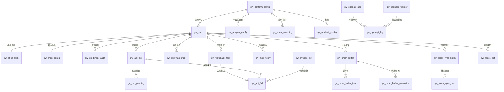

# DB-D02 平台 Gateway 域数据字典（oms_gateway）

> 文档编号：DB-D02 · 版本 V1.0 · 2026-10-24 · 编写：小凯 · 状态：待审阅（批次⑥）
> 上位契约：DB-00 数据库设计总册（命名/公共字段/分表/加密约定冲突时以 DB-00 为准）
> 需求来源：SRS-D02.01~D02.07 §6 数据字段 · 商派 711 表逆向（ome.shop / ome.api_log / ome.api_fail / ome.sync_task）

---

## 1. 域定位与总体约定

- schema：`oms_gateway`，表前缀 `gw_`，共 **24 张**（含 1 张按月分表基表、P2 占位 3 张）。
- 职责：平台应用配置、店铺档案与授权凭证、API 调用日志与失败重试、订单/消息缓冲（canonical 标准模型落地）、回传任务、对账差异、对外 OpenAPI（P2）。
- 边界：**店铺业务档案在 gateway（gw_shop），组织挂载关系在 org 域**（org_node ↔ gw_shop 跨域 LFK，不建物理外键，DB-00 §1.2 规则 3）。
- 分表：`gw_api_log`、`gw_openapi_log` 按月分表（后缀 `_YYYYMM`），在线 3 个月（DB-00 §1.3）；建表脚本仅建基表模板，分表由调度任务按模板滚动创建。
- 加密：appkey/secret、access_token/session 等凭证与收件人敏感字段一律 `{字段}_enc`（VARBINARY 密文，KMS 信封加密，D01.05/D02.06 契约）；需检索的加 `{字段}_hash`（HMAC 盲索引）。
- 日志/流水类表（api_log、credential_audit、recon_diff、openapi_log）**只增不改、禁用软删**（DB-00 §3）。

### 公共字段（DB-00 §3，所有业务表必含，下文逐表定义中省略）

| 字段 | 类型 | 说明 |
|---|---|---|
| id | BIGINT UNSIGNED AUTO_INCREMENT | 物理主键 |
| tenant_id | BIGINT UNSIGNED NOT NULL DEFAULT 1 | 租户（内部租户=1） |
| owner_id | BIGINT UNSIGNED NULL | 货主（纯配置/日志表可空，逐表标注） |
| create_time / update_time | DATETIME(3) | 创建/更新时间（ON UPDATE） |
| version | INT UNSIGNED DEFAULT 0 | 乐观锁（流水表省略） |
| is_deleted | TINYINT(1) DEFAULT 0 | 软删（只增表省略） |

---

## 2. 表清单

| # | 表名 | 中文名 | SRS 模块 | 分期 | 预估行量级 |
|---|---|---|---|---|---|
| 1 | gw_platform_config | 平台应用配置 | D02.01 | P0 | 百级 |
| 2 | gw_adapter_config | 适配器注册配置 | D02.02 | P0 | 百级 |
| 3 | gw_enum_mapping | 状态与编码映射 | D02.02 | P0 | 千级 |
| 4 | gw_ratelimit_config | 接口限流配置 | D02.01 | P0 | 百级 |
| 5 | gw_shop | 店铺档案 | D02.06 | P0 | 千级 |
| 6 | gw_shop_auth | 店铺授权凭证 | D02.06 | P0 | 千级 |
| 7 | gw_shop_config | 店铺履约参数配置 | D02.06 | P0 | 千级 |
| 8 | gw_credential_audit | 凭证审计流水 | D02.06 | P0 | 十万级/年 |
| 9 | gw_api_log | API 调用日志（按月分表） | D02.01 | P0 | 千万级/月 |
| 10 | gw_rpc_pending | 在途调用登记 | D02.01 | P0 | 万级（滚动清理） |
| 11 | gw_api_fail | 失败重试登记 | D02.05 | P0 | 十万级 |
| 12 | gw_errcode_dict | 错误码字典 | D02.01/D02.05 | P0 | 千级 |
| 13 | gw_order_buffer | 订单缓冲头（canonical） | D02.03 | P0 | 百万级/年（滚动归档） |
| 14 | gw_order_buffer_item | 订单缓冲行 | D02.03 | P0 | 数百万级/年 |
| 15 | gw_order_buffer_promotion | 订单优惠分摊明细 | D02.03 | P0 | 百万级/年 |
| 16 | gw_msg_notify | 平台消息缓冲（TMC/webhook） | D02.03 | P0 | 百万级/月（滚动清理） |
| 17 | gw_pull_watermark | 店铺拉单水位 | D02.03 | P0 | 千级 |
| 18 | gw_writeback_task | 回传任务台账 | D02.04 | P0 | 百万级/年 |
| 19 | gw_stock_sync_batch | 库存同步批次 | D02.04 | P0 | 十万级/年 |
| 20 | gw_stock_sync_item | 库存同步批次明细 | D02.04 | P0 | 千万级/年（滚动清理） |
| 21 | gw_recon_diff | 对账反查差异流水 | D02.05 | P0 | 十万级/年 |
| 22 | gw_openapi_app | 对外应用档案（P2） | D02.07 | P2 | 百级 |
| 23 | gw_openapi_register | 对外接口注册（P2） | D02.07 | P2 | 百级 |
| 24 | gw_openapi_log | 对外调用审计（P2，按月分表） | D02.07 | P2 | 百万级/月 |

---

## 3. 逐表定义

### 3.1 gw_platform_config 平台应用配置（SRS-D02.01 §6.1 platform_app）

用途：一个平台应用（appkey）一行；沙箱/生产用 status 区分两套。溯源：新建（商派 shop.config 内嵌应用配置抽出独立成表）。

| 字段 | 类型 | 约束/默认 | 注释 |
|---|---|---|---|
| platform | VARCHAR(32) | NOT NULL | 平台标识：taobao/jd/pdd/xhs/vop/douyin/wechat/kuaishou |
| app_bn | VARCHAR(64) | NOT NULL | 应用 ID（平台侧 AppKey 标识，业务键） |
| app_key | VARCHAR(128) | NOT NULL | 平台应用 key（非敏感，明文） |
| app_secret_enc | VARBINARY(1024) | NOT NULL | 应用 secret 密文（KMS 信封加密，D02.06 契约） |
| key_version | VARCHAR(32) | NOT NULL DEFAULT 'v1' | 加密密钥版本（轮换支持） |
| gateway_url | VARCHAR(256) | NOT NULL | 生产网关地址 |
| sandbox_gateway_url | VARCHAR(256) | NULL | 沙箱网关地址 |
| api_version | VARCHAR(32) | NOT NULL DEFAULT '2.0' | API 版本 |
| sign_strategy | VARCHAR(32) | NOT NULL | 签名策略：md5-top/hmac-sha256/bearer/jd-3des |
| rate_limit_json | JSON | NULL | 平台级默认频控：{qps, daily_quota, method_override:{...}} |
| callback_url | VARCHAR(256) | NULL | 授权/消息回调地址（D02.06/D02.03 用） |
| status | VARCHAR(16) | NOT NULL DEFAULT 'enabled' | 状态：enabled 启用/disabled 停用/sandbox 沙箱 |
| source | VARCHAR(16) | NOT NULL DEFAULT 'local' | 数据来源：api/local/import/migration（DB-00 §7） |

索引：`uk_gw_platform_config_platform_app_bn(platform, app_bn)` 唯一=平台内应用唯一；`idx_gw_platform_config_status(status)`。owner_id 免填（纯配置表）。

### 3.2 gw_adapter_config 适配器注册配置（SRS-D02.02 §6.3 capability）

用途：平台适配器代码注册表，能力白名单落库（原配置文件形态入库化，便于灰度与版本追溯）。溯源：新建。

| 字段 | 类型 | 约束/默认 | 注释 |
|---|---|---|---|
| adapter_code | VARCHAR(64) | NOT NULL | 适配器编码（唯一，如 taobao-adapter） |
| platform | VARCHAR(32) | NOT NULL | 平台标识（枚举同 gw_platform_config.platform） |
| adapter_version | VARCHAR(32) | NOT NULL | 适配器版本（转换追溯用，写入 order_buffer） |
| capability_json | JSON | NOT NULL | 能力组与方法级白名单：{groups:[], methods:[]} |
| native_method_json | JSON | NOT NULL | 统一方法名→平台原生 API 名映射（注册进 D02.01 字典） |
| special_flags_json | JSON | NULL | 特殊能力开关：设备指纹头/京配判断/面单前置校验等 |
| status | VARCHAR(16) | NOT NULL DEFAULT 'enabled' | 状态：enabled 启用/disabled 停用/gray 灰度 |

索引：`uk_gw_adapter_config_adapter_code(adapter_code)`；`idx_gw_adapter_config_platform(platform)`。

### 3.3 gw_enum_mapping 状态与编码映射（SRS-D02.02 §6.2 enum_mapping）

用途：平台原生值→canonical 标准值映射，变更留版本。溯源：新建（商派散落于代码的常量映射入库化）。

| 字段 | 类型 | 约束/默认 | 注释 |
|---|---|---|---|
| platform | VARCHAR(32) | NOT NULL | 平台标识 |
| map_type | VARCHAR(32) | NOT NULL | 映射类型：order_status/logistics_code/aftersale_status/aftersale_reason |
| native_value | VARCHAR(128) | NOT NULL | 平台原生值（保留原样字符串） |
| canonical_value | VARCHAR(128) | NOT NULL | 标准值（对应 canonical 枚举） |
| map_version | INT UNSIGNED | NOT NULL DEFAULT 1 | 映射版本（变更递增留痕） |
| status | VARCHAR(16) | NOT NULL DEFAULT 'enabled' | 状态：enabled 启用/disabled 停用 |

索引：`uk_gw_enum_mapping_key(platform, map_type, native_value, map_version)` 唯一=平台×类型×原生值×版本。

### 3.4 gw_ratelimit_config 接口限流配置（SRS-D02.01 FR-06 频控）

用途：平台/应用/店铺/方法四级频控配置，运行时加载进 Redis 令牌桶。溯源：新建。

| 字段 | 类型 | 约束/默认 | 注释 |
|---|---|---|---|
| scope_type | VARCHAR(16) | NOT NULL | 作用域类型：platform/app/shop/method |
| scope_key | VARCHAR(64) | NOT NULL | 作用域键（平台码/应用ID/shop_id/统一方法名） |
| method | VARCHAR(128) | NULL | 限定方法（空=作用域内全部方法） |
| qps_limit | INT UNSIGNED | NOT NULL DEFAULT 10 | QPS 上限 |
| daily_quota | INT UNSIGNED | NULL | 日配额（空=不限） |
| concurrency_limit | INT UNSIGNED | NULL | 并发上限（空=不限） |
| status | VARCHAR(16) | NOT NULL DEFAULT 'enabled' | 状态：enabled/disabled |

索引：`uk_gw_ratelimit_config_scope(scope_type, scope_key, method)`（method 空值以 '' 存储保证唯一）。

### 3.5 gw_shop 店铺档案（SRS-D02.06 §6.1 档案部分）

用途：店铺业务主档；授权状态冗余便于列表查询（权威状态在 gw_shop_auth）。**边界**：组织挂载关系（org_node 树）在 oms_org 域，本表仅存 org_node_id 跨域 LFK。溯源：← 商派 ome.shop 改造：拆出授权凭证与配置，+tenant_id/owner_id/org_node_id。

| 字段 | 类型 | 约束/默认 | 注释 |
|---|---|---|---|
| shop_bn | VARCHAR(32) | NOT NULL | 店铺编码（Redis 发号，全域引用键 shop_id=本表 id） |
| shop_name | VARCHAR(128) | NOT NULL | 店铺名称 |
| platform | VARCHAR(32) | NOT NULL | 平台标识（枚举同 3.1） |
| platform_shop_id | VARCHAR(64) | NOT NULL | 平台侧店铺标识（sellerId/店铺 sid） |
| app_id | BIGINT UNSIGNED | NOT NULL | LFK→gw_platform_config.id（所属应用） |
| owner_id | BIGINT UNSIGNED | NOT NULL | 货主（LFK→oms_org.org_owner，跨域） |
| org_node_id | BIGINT UNSIGNED | NOT NULL | 组织节点（LFK→oms_org.org_node，跨域；挂载关系归 org 域） |
| shop_type | VARCHAR(16) | NOT NULL DEFAULT 'direct' | 店铺类型：direct 直营/flagship 旗舰店/franchise 加盟/store 门店(O2O)/dealer 经销(预留) |
| business_type | VARCHAR(16) | NOT NULL DEFAULT 'direct_sale' | 业务类型：direct_sale 直销/distribution 分销/dealer 经销(预留) |
| auth_status | VARCHAR(16) | NOT NULL DEFAULT 'pending' | 授权状态冗余：pending 待授权/normal 正常/expired 过期/disabled 停用（权威=gw_shop_auth.status） |
| seller_info_json | JSON | NULL | 平台店铺信息快照（店铺名/主体名回填校验） |
| auth_mode | VARCHAR(16) | NULL | 授权模式：self 自助/agent 代授权 |
| auth_url_track | VARCHAR(16) | NULL | 授权链接追踪：sent 已发送/clicked 已点击/done 已完成 |
| status | VARCHAR(16) | NOT NULL DEFAULT 'enabled' | 档案状态：enabled 启用/disabled 停用 |
| source | VARCHAR(16) | NOT NULL DEFAULT 'local' | 数据来源：api/local/import/migration |

索引：`uk_gw_shop_shop_bn(shop_bn)`；`uk_gw_shop_platform_shop(platform, platform_shop_id)` 唯一=平台内店铺唯一；`idx_gw_shop_owner(owner_id)`；`idx_gw_shop_auth_status(auth_status)`。

### 3.6 gw_shop_auth 店铺授权凭证（SRS-D02.06 §6.1 shop_auth 凭证部分）

用途：一店一行凭证，状态机 pending→normal→expired→disabled（§4.1）。溯源：← 商派 ome.shop.config/serialize 凭证字段独立成表+加密改造。

| 字段 | 类型 | 约束/默认 | 注释 |
|---|---|---|---|
| shop_id | BIGINT UNSIGNED | NOT NULL | LFK→gw_shop.id（唯一，一店一凭证行） |
| access_token_enc | VARBINARY(2048) | NULL | access_token 密文（KMS 信封加密，禁止明文） |
| refresh_token_enc | VARBINARY(2048) | NULL | refresh_token 密文 |
| session_enc | VARBINARY(2048) | NULL | session/cookie 凭证密文（部分平台用） |
| key_version | VARCHAR(32) | NOT NULL DEFAULT 'v1' | 加密密钥版本（轮换支持，7 天双版本保留） |
| token_expires_at | DATETIME(3) | NULL | access_token 有效期（巡检依据） |
| refresh_expires_at | DATETIME(3) | NULL | refresh_token 有效期 |
| last_refresh_time | DATETIME(3) | NULL | 最近续期成功时间 |
| refresh_fail_times | INT UNSIGNED | NOT NULL DEFAULT 0 | 连续续期失败次数（超限告警转人工） |
| status | VARCHAR(16) | NOT NULL DEFAULT 'pending' | 状态机：pending 待授权/normal 正常/expired 过期/disabled 停用 |

索引：`uk_gw_shop_auth_shop(shop_id)` 唯一；`idx_gw_shop_auth_expires(status, token_expires_at)`（到期巡检）。

### 3.7 gw_shop_config 店铺履约参数配置（SRS-D02.06 §6.2 shop_binding/shop_config）

用途：一店一行运行参数：仓绑定（LFK→oms_fulfill.ful_branch 跨域）、物流默认、回传时机、轮询覆写。溯源：新建（商派 shop.bind_conf/area_conf longtext 结构化改造）。

| 字段 | 类型 | 约束/默认 | 注释 |
|---|---|---|---|
| shop_id | BIGINT UNSIGNED | NOT NULL | LFK→gw_shop.id（唯一） |
| branch_bind_json | JSON | NULL | 店铺-仓绑定有序数组：[{branch_id(LFK→ful_branch 跨域), priority}] |
| default_logistics_code | VARCHAR(32) | NULL | 默认物流编码（LFK→oms_fulfill.ful_dly_corp.corp_code 跨域） |
| platform_waybill_flag | TINYINT(1) | NOT NULL DEFAULT 0 | 平台管控面单标识：0 否/1 是（D09.05 消费） |
| sender_address_json | JSON | NULL | 发货地址（多地址）：[{province,city,district,address,contact,mobile_enc}] |
| back_node | VARCHAR(16) | NOT NULL DEFAULT 'shipped' | 回传时机：shipped 发货时/print 打印时/verify 验货时（D02.04 消费） |
| poll_override_json | JSON | NULL | 拉单轮询参数覆写：{poll_interval, overlap, safety_delay}（空=用 gw_pull_watermark 默认） |
| sync_strategy_ref | VARCHAR(64) | NULL | 库存同步策略引用（D04.08 策略编码） |

索引：`uk_gw_shop_config_shop(shop_id)` 唯一。

### 3.8 gw_credential_audit 凭证审计流水（SRS-D02.06 §6.3）

用途：凭证取用/续期/重授权/吊销全留痕，只增不改、禁软删。溯源：新建（PIPL/D01.05 合规要求）。

| 字段 | 类型 | 约束/默认 | 注释 |
|---|---|---|---|
| shop_id | BIGINT UNSIGNED | NOT NULL | LFK→gw_shop.id |
| action | VARCHAR(16) | NOT NULL | 动作：use 取用/refresh 续期/reauth 重授权/revoke 吊销 |
| caller | VARCHAR(64) | NOT NULL | 调用方（服务名/任务名/操作人） |
| method | VARCHAR(128) | NULL | 使用场景（统一方法名） |
| request_time | DATETIME(3) | NOT NULL | 请求时间 |
| result | VARCHAR(16) | NOT NULL | 结果：succ 成功/fail 失败/denied 拒绝 |
| old_key_version | VARCHAR(32) | NULL | 旧凭证密钥版本（7 天保留期标记） |

索引：`idx_gw_credential_audit_shop_time(shop_id, request_time)`；`idx_gw_credential_audit_time(request_time)`（按月清理）。

### 3.9 gw_api_log API 调用日志（SRS-D02.01 §6.2，按月分表 gw_api_log_YYYYMM）

用途：所有平台出入向调用留痕；大报文（>2KB）截断+OSS 引用；只增不改、禁软删；在线 3 个月。溯源：← 商派 ome.api_log 改造：+平台/店铺/单号索引、报文截断策略、错误分级。

| 字段 | 类型 | 约束/默认 | 注释 |
|---|---|---|---|
| log_bn | VARCHAR(32) | NOT NULL | 日志 ID（雪花 ID 字符串，跨分表引用键） |
| direction | TINYINT | NOT NULL DEFAULT 1 | 方向：1 出向(OMS→平台)/2 入向(平台→OMS 消息/回调) |
| method | VARCHAR(128) | NOT NULL | 统一方法名 |
| native_method | VARCHAR(128) | NULL | 平台原生方法名 |
| platform | VARCHAR(32) | NOT NULL | 平台标识 |
| shop_id | BIGINT UNSIGNED | NOT NULL DEFAULT 0 | 店铺（0=平台级调用） |
| primary_bn | VARCHAR(64) | NULL | 业务单号（订单号/发货单号，贯穿排查） |
| request_params | TEXT | NULL | 请求参数（>2KB 截断，is_truncated=1） |
| response_body | TEXT | NULL | 响应报文摘要（超阈值截断） |
| is_truncated | TINYINT(1) | NOT NULL DEFAULT 0 | 截断标记：0 否/1 是 |
| oss_ref | VARCHAR(256) | NULL | 大报文 OSS 原文引用（bucket/key） |
| http_status | INT | NULL | HTTP 状态码 |
| err_code | VARCHAR(64) | NULL | 统一错误码（gw_errcode_dict 归一后） |
| err_level | VARCHAR(16) | NULL | 错误分级：RETRYABLE 可重试/RATE_LIMITED 退避/AUTH 需授权/MANUAL 需人工/FATAL 停重试 |
| spendtime_ms | INT UNSIGNED | NULL | 耗时（毫秒） |
| msg_id | VARCHAR(64) | NULL | 平台消息号（平台侧对账用） |
| source | VARCHAR(16) | NOT NULL | 调用来源：pull 拉单/writeback 回传/retry 重试/passthrough 透传/reconcile 对账 |
| retry_of | BIGINT UNSIGNED | NULL | 重试关联的原日志 id（LFK→本表） |
| operator | VARCHAR(64) | NULL | 操作人（透传/人工重放时，审计） |

索引：`idx_gw_api_log_shop_time(shop_id, create_time)`；`idx_gw_api_log_primary_bn(primary_bn)`；`idx_gw_api_log_msg_id(msg_id)`；`uk_gw_api_log_log_bn(log_bn)`（分表内唯一）。

### 3.10 gw_rpc_pending 在途调用登记（SRS-D02.01 §6.3 rpc_pending）

用途：写类调用超时后"结果未知"的在途登记，扫描反查后转已核实或转 gw_api_fail。溯源：新建。

| 字段 | 类型 | 约束/默认 | 注释 |
|---|---|---|---|
| method | VARCHAR(128) | NOT NULL | 统一方法名 |
| shop_id | BIGINT UNSIGNED | NOT NULL | LFK→gw_shop.id |
| primary_bn | VARCHAR(64) | NOT NULL | 业务单号（定位键） |
| params_snapshot | TEXT | NULL | 参数快照（重放依据，>2KB 存 oss_ref） |
| oss_ref | VARCHAR(256) | NULL | 大参数 OSS 引用 |
| timeout_at | DATETIME(3) | NOT NULL | 超时时间（到期触发扫描反查） |
| scan_times | INT UNSIGNED | NOT NULL DEFAULT 0 | 已扫描次数 |
| status | VARCHAR(16) | NOT NULL DEFAULT 'pending' | 状态：pending 在途/verified 已核实/to_fail 已转失败 |
| source_log_id | BIGINT UNSIGNED | NULL | 关联 gw_api_log.id |

索引：`idx_gw_rpc_pending_status_timeout(status, timeout_at)`；`idx_gw_rpc_pending_bn(primary_bn)`。

### 3.11 gw_api_fail 失败重试登记（SRS-D02.05 §6.1 api_fail）

用途：可重试失败统一登记与退避重试；死信标记后转人工工作台；写类重试前强制反查。溯源：← 商派 ome.api_fail 改造：从仅订单引用扩展为通用单据类型+分级重试+死信。

| 字段 | 类型 | 约束/默认 | 注释 |
|---|---|---|---|
| obj_type | VARCHAR(32) | NOT NULL | 单据类型：delivery/stock_batch/aftersale/order_pull/order_buffer/writeback… |
| primary_bn | VARCHAR(64) | NOT NULL | 业务单号 |
| sub_bn | VARCHAR(64) | NULL | 子单号 |
| method | VARCHAR(128) | NOT NULL | 统一方法名 |
| native_method | VARCHAR(128) | NULL | 平台原生方法 |
| platform | VARCHAR(32) | NOT NULL | 平台标识 |
| shop_id | BIGINT UNSIGNED | NOT NULL | 店铺（熔断与挂起按店铺操作） |
| replay_ref | VARCHAR(128) | NULL | 重放引用：业务引用 ID 优先（writeback_task_id/buffer_id），非全量报文 |
| replay_params | TEXT | NULL | 参数快照（无业务引用时兜底，>2KB 截断+oss_ref） |
| oss_ref | VARCHAR(256) | NULL | 大参数 OSS 引用 |
| err_code | VARCHAR(64) | NOT NULL | 错误码（字典归一后） |
| err_msg | VARCHAR(512) | NULL | 错误原文（截断） |
| err_level | VARCHAR(16) | NOT NULL | 框架分级：RETRYABLE/RATE_LIMITED/AUTH/MANUAL/FATAL |
| write_flag | TINYINT(1) | NOT NULL DEFAULT 0 | 写类标记：0 读/1 写（写类重试前强制反查） |
| fail_times | INT UNSIGNED | NOT NULL DEFAULT 0 | 重放失败次数 |
| probe_fail_times | INT UNSIGNED | NOT NULL DEFAULT 0 | 反查失败次数（与重放分开计数） |
| next_retry_time | DATETIME(3) | NULL | 下次重试时间（分级退避计算） |
| is_dead | TINYINT(1) | NOT NULL DEFAULT 0 | 死信标记：0 否/1 是（超限转人工，不再自动重试） |
| status | VARCHAR(16) | NOT NULL DEFAULT 'waiting' | 状态：waiting 等待/retrying 重试中/succ 成功/manual 转人工/dead 死信/suspended 店铺挂起/deleted 终态清理 |
| resolved_by | VARCHAR(16) | NULL | 解决方式：retry 重试成功/reconcile 反查已生效/manual 人工/biz_closed 业务关闭 |
| advice | VARCHAR(512) | NULL | 处置建议（来自 gw_errcode_dict，工作台展示） |
| source_log_id | BIGINT UNSIGNED | NULL | 关联 gw_api_log.id（追溯链） |
| writeback_task_id | BIGINT UNSIGNED | NULL | 关联 gw_writeback_task.id |
| last_retry_time | DATETIME(3) | NULL | 最近重试时间 |
| finish_time | DATETIME(3) | NULL | 终态时间（重试时效统计） |

索引：`idx_gw_api_fail_status_retry(status, next_retry_time)`（重试调度）；`idx_gw_api_fail_shop(shop_id, status)`（店铺熔断）；`idx_gw_api_fail_bn(primary_bn)`；`idx_gw_api_fail_cluster(platform, method, err_code)`（死信聚类视图，D02.05 §6.3）。

### 3.12 gw_errcode_dict 错误码字典（SRS-D02.01 §6.4 gateway_errcode）

用途：平台原生错误码/错误文本正则→统一分级与处置建议；驱动重试策略。溯源：新建（商派 error_lv 代码常量入库化）。

| 字段 | 类型 | 约束/默认 | 注释 |
|---|---|---|---|
| platform | VARCHAR(32) | NOT NULL | 平台标识（common=全平台通用） |
| native_code | VARCHAR(64) | NULL | 平台原生错误码（与 err_pattern 二选一或并用） |
| err_pattern | VARCHAR(256) | NULL | 错误文本正则匹配模式 |
| err_level | VARCHAR(16) | NOT NULL | 分级：RETRYABLE 可重试/RATE_LIMITED 退避限流/AUTH 需重新授权/MANUAL 需人工/FATAL 停止重试 |
| advice | VARCHAR(512) | NULL | 处置建议（人工工作台展示） |
| note | VARCHAR(256) | NULL | 备注 |
| status | VARCHAR(16) | NOT NULL DEFAULT 'enabled' | 状态：enabled 启用/disabled 停用 |

索引：`idx_gw_errcode_dict_platform_code(platform, native_code)`；匹配顺序：精确 native_code 优先，其次 err_pattern 正则。

### 3.13 gw_order_buffer 订单缓冲头（SRS-D02.03 §6.1 order_buffer，D02→D03 投递契约）

用途：canonical 标准订单模型落地；幂等键 (shop_id, platform_order_bn)；投递成功后滚动归档。溯源：新建（商派 orders 直接落库模式改造为缓冲投递模式）。

| 字段 | 类型 | 约束/默认 | 注释 |
|---|---|---|---|
| buffer_bn | VARCHAR(32) | NOT NULL | 缓冲单号（Redis 发号） |
| platform | VARCHAR(32) | NOT NULL | 平台标识 |
| shop_id | BIGINT UNSIGNED | NOT NULL | LFK→gw_shop.id |
| platform_order_bn | VARCHAR(64) | NOT NULL | 平台订单号（与 shop_id 组成幂等键） |
| order_type | VARCHAR(16) | NOT NULL DEFAULT 'normal' | 订单类型：normal 普通/presale 预售/group 团购/jit JIT采购(唯品会)/virtual 虚拟/exchange0 换货0元单 |
| platform_status | VARCHAR(32) | NULL | 平台原始状态（保留原样） |
| canonical_status | VARCHAR(16) | NOT NULL | 标准状态：unpaid 待付款/unshipped 待发货/shipped 已发货/closed 已关闭/finished 已完成 |
| platform_modified | DATETIME(3) | NOT NULL | 平台最后修改时间（版本收敛依据，旧版本丢弃） |
| pay_time | DATETIME(3) | NULL | 平台付款时间（时效考核基准） |
| platform_create_time | DATETIME(3) | NULL | 平台下单时间 |
| total_amount | DECIMAL(18,2) | NOT NULL DEFAULT 0 | 商品总额 |
| customer_paid | DECIMAL(18,2) | NOT NULL DEFAULT 0 | 客户实付（双口径必填） |
| platform_bear_total | DECIMAL(18,2) | NOT NULL DEFAULT 0 | 平台承担合计 |
| freight | DECIMAL(18,2) | NOT NULL DEFAULT 0 | 运费 |
| buyer_message | VARCHAR(512) | NULL | 买家留言 |
| seller_memo | VARCHAR(512) | NULL | 卖家备注（含改单指令语义时由 D03 解析） |
| receiver_name_enc | VARBINARY(512) | NULL | 收货人姓名密文（PIPL，D01.05） |
| receiver_mobile_enc | VARBINARY(512) | NULL | 收货人手机密文 |
| receiver_mobile_hash | VARBINARY(64) | NULL | 手机盲索引（HMAC，检索用） |
| receiver_province | VARCHAR(32) | NULL | 省 |
| receiver_city | VARCHAR(32) | NULL | 市 |
| receiver_district | VARCHAR(32) | NULL | 区 |
| receiver_address_enc | VARBINARY(1024) | NULL | 详细地址密文 |
| receiver_zip | VARCHAR(16) | NULL | 邮编 |
| oaid_json | JSON | NULL | 平台密文单收件人标识（oaid/密文通道原文，单存不解密） |
| receiver_encrypted_channel | VARCHAR(16) | NOT NULL DEFAULT 'none' | 收件人加密通道：none 明文/oaid 平台密文/virtual 虚拟号（决定面单与解密路径） |
| warehouse_hint | VARCHAR(64) | NULL | 平台指定仓提示（如天猫国际保税仓） |
| logistics_hint | VARCHAR(64) | NULL | 平台物流提示（如京东京配） |
| platform_extra | JSON | NULL | 平台特有字段：{platform:{...}}（关键字段生成列索引） |
| convert_warnings | JSON | NULL | 转换告警数组：未知状态/比例分摊/字段缺失降级 |
| adapter_version | VARCHAR(32) | NULL | 适配器版本（追溯） |
| mapping_version | VARCHAR(32) | NULL | 映射规则版本（追溯） |
| deliver_status | VARCHAR(16) | NOT NULL DEFAULT 'pending' | 投递状态：pending 待投递/delivered 已投递/accepted 已接收(D03 建档回执)/waiting 建档等待/fail 投递失败/manual 人工处理/closed 已关闭 |
| deliver_times | INT UNSIGNED | NOT NULL DEFAULT 0 | 投递次数（退避重试依据） |
| last_deliver_time | DATETIME(3) | NULL | 最近投递时间 |
| source | VARCHAR(16) | NOT NULL DEFAULT 'api' | 数据来源：api/local/import/migration |

索引：`uk_gw_order_buffer_idem(shop_id, platform_order_bn)` 唯一=幂等键；`idx_gw_order_buffer_status(deliver_status, create_time)`；`idx_gw_order_buffer_modified(shop_id, platform_modified)`；`idx_gw_order_buffer_mobile_hash(receiver_mobile_hash)`。

### 3.14 gw_order_buffer_item 订单缓冲行（SRS-D02.03 §6.1 order_buffer_item）

| 字段 | 类型 | 约束/默认 | 注释 |
|---|---|---|---|
| buffer_id | BIGINT UNSIGNED | NOT NULL | LFK→gw_order_buffer.id |
| line_no | INT UNSIGNED | NOT NULL | 行号 |
| oid | VARCHAR(64) | NULL | 平台子单号（售后对账键） |
| platform_sku_id | VARCHAR(64) | NOT NULL | 平台 SKU ID（outer_id） |
| platform_item_id | VARCHAR(64) | NULL | 平台商品 ID |
| goods_name | VARCHAR(256) | NULL | 商品名（平台侧） |
| sku_spec | VARCHAR(256) | NULL | 规格（平台侧） |
| local_sku_id | BIGINT UNSIGNED | NULL | 映射后本地 SKU（LFK→oms_stock.inv_sku 跨域；未映射为空） |
| num | INT | NOT NULL DEFAULT 1 | 数量 |
| sale_price | DECIMAL(18,4) | NOT NULL DEFAULT 0 | 成交单价 |
| customer_paid_line | DECIMAL(18,2) | NOT NULL DEFAULT 0 | 行客户实付（分摊后） |
| platform_bear_line | DECIMAL(18,2) | NOT NULL DEFAULT 0 | 行平台承担 |
| merchant_bear_line | DECIMAL(18,2) | NOT NULL DEFAULT 0 | 行商家承担 |
| refund_status | VARCHAR(16) | NOT NULL DEFAULT 'none' | 行级退款标识：none 无/refunding 退款中/refunded 已退款 |
| gift_flag | TINYINT(1) | NOT NULL DEFAULT 0 | 赠品标记：0 否/1 是 |
| platform_extra | JSON | NULL | 平台特有行字段 |

索引：`uk_gw_order_buffer_item_line(buffer_id, line_no)` 唯一；`idx_gw_order_buffer_item_oid(oid)`。

### 3.15 gw_order_buffer_promotion 订单优惠分摊明细（SRS-D02.03 §6.1 order_buffer_promotion）

| 字段 | 类型 | 约束/默认 | 注释 |
|---|---|---|---|
| buffer_id | BIGINT UNSIGNED | NOT NULL | LFK→gw_order_buffer.id |
| promotion_id | VARCHAR(64) | NOT NULL | 平台优惠活动 ID |
| promotion_type | VARCHAR(32) | NOT NULL | 类型：platform_coupon 平台券/shop_coupon 店铺券/full_reduce 满减/subsidy 补贴 |
| amount | DECIMAL(18,2) | NOT NULL DEFAULT 0 | 优惠金额 |
| bear_by | VARCHAR(16) | NOT NULL | 承担方：platform 平台/merchant 商家/mixed 混合 |
| line_allocations | JSON | NULL | 行分摊：[{line_no, amount}] |

索引：`idx_gw_order_buffer_promotion_buffer(buffer_id)`。

### 3.16 gw_msg_notify 平台消息缓冲（SRS-D02.03 §6.2 msg_buffer）

用途：TMC/webhook 原始消息统一落地（**订单/售后/商品消息共用本表，msg_type 区分**）；幂等键 (platform, shop_id, msg_id)。溯源：新建（商派消息直处理模式改造为先落地后消费）。

| 字段 | 类型 | 约束/默认 | 注释 |
|---|---|---|---|
| platform | VARCHAR(32) | NOT NULL | 平台标识 |
| shop_id | BIGINT UNSIGNED | NOT NULL DEFAULT 0 | 店铺（0=平台级消息） |
| msg_id | VARCHAR(64) | NOT NULL | 平台消息号（幂等键成分） |
| msg_type | VARCHAR(32) | NOT NULL | 消息类型：trade 订单/trade_close/aftersale 售后/product 商品/other 其他 |
| route_target | VARCHAR(16) | NOT NULL DEFAULT 'unknown' | 路由目标：order 订单域/aftersale 售后域/product 商品域/unknown 未知(人工) |
| payload | TEXT | NULL | 原始报文（>2KB 截断） |
| is_truncated | TINYINT(1) | NOT NULL DEFAULT 0 | 截断标记 |
| oss_ref | VARCHAR(256) | NULL | 原始报文 OSS 引用 |
| status | VARCHAR(16) | NOT NULL DEFAULT 'pending' | 消费状态：pending 待消费/processing 消费中/succ 成功/fail 失败/dead 死信 |
| fail_times | INT UNSIGNED | NOT NULL DEFAULT 0 | 失败次数 |
| next_retry_time | DATETIME(3) | NULL | 下次重试时间 |
| received_time | DATETIME(3) | NOT NULL | 接收时间 |
| consumed_time | DATETIME(3) | NULL | 消费完成时间（延迟指标=consumed-received） |

索引：`uk_gw_msg_notify_idem(platform, shop_id, msg_id)` 唯一=幂等；`idx_gw_msg_notify_status(status, next_retry_time)`；`idx_gw_msg_notify_type_time(msg_type, received_time)`。

### 3.17 gw_pull_watermark 店铺拉单水位（SRS-D02.03 §6.3 pull_watermark）

用途：店铺×业务通道各自水位；last_download_time 只进不退（CAS 用 version）。溯源：← 商派 ome.shop.last_download_time 独立成表+通道粒度改造。

| 字段 | 类型 | 约束/默认 | 注释 |
|---|---|---|---|
| shop_id | BIGINT UNSIGNED | NOT NULL | LFK→gw_shop.id |
| channel | VARCHAR(16) | NOT NULL | 通道：order 订单/aftersale 售后/refund 退款 |
| last_download_time | DATETIME(3) | NOT NULL | 已成功窗口终点（只进不退，CAS 更新） |
| overlap_sec | INT UNSIGNED | NOT NULL DEFAULT 300 | 窗口重叠秒数（默认 5min） |
| safety_delay_sec | INT UNSIGNED | NOT NULL DEFAULT 60 | 安全延迟秒数（默认 1min） |
| poll_interval_sec | INT UNSIGNED | NOT NULL DEFAULT 60 | 轮询间隔秒数（默认 1min，店铺级可配） |
| lag_alert_threshold_sec | INT UNSIGNED | NOT NULL DEFAULT 1800 | 落后告警阈值（默认 30min） |

索引：`uk_gw_pull_watermark_shop_channel(shop_id, channel)` 唯一；version 公共字段承担 CAS。

### 3.18 gw_writeback_task 回传任务台账（SRS-D02.04 §6.1 sync_task）

用途：发货/库存/售后/生命周期回传统一台账；back_node 决定时机；幂等键唯一防重。溯源：← 商派 ome.sync_task 改造：+幂等键/时机/分级失败关联。

| 字段 | 类型 | 约束/默认 | 注释 |
|---|---|---|---|
| sync_type | VARCHAR(16) | NOT NULL | 回传类型：delivery 发货/stock 库存/aftersale 售后/lifecycle 生命周期 |
| biz_ref | VARCHAR(128) | NOT NULL | 业务单据引用：delivery_id/订单号/平台售后单号/批次#sku |
| platform | VARCHAR(32) | NOT NULL | 平台标识 |
| shop_id | BIGINT UNSIGNED | NOT NULL | LFK→gw_shop.id |
| action | VARCHAR(64) | NOT NULL | 动作：send/resend(改单)/agree_refund/confirm_receive/cancel… |
| payload_snapshot | JSON | NULL | canonical 指令快照（重试与审计依据） |
| trigger_event_id | VARCHAR(64) | NULL | 触发事件 ID（oms_base.bas_event_outbox 跨域 LFK） |
| back_node | VARCHAR(16) | NOT NULL DEFAULT 'shipped' | 实际时机：shipped 发货/print 打印/verify 验货（读 gw_shop_config.back_node） |
| status | VARCHAR(16) | NOT NULL DEFAULT 'pending' | 状态：pending 待处理/processing 处理中/succ 成功/fail_pending 失败待重试/retrying 重试中/manual 转人工/skipped 跳过 |
| skip_reason | VARCHAR(64) | NULL | 跳过原因（结构化枚举：平台管控/无物流编码/店铺停用/业务关闭…） |
| err_code | VARCHAR(64) | NULL | 失败码（失败时必填） |
| err_level | VARCHAR(16) | NULL | 错误分级 |
| api_fail_id | BIGINT UNSIGNED | NULL | LFK→gw_api_fail.id（重试关联） |
| platform_msg_id | VARCHAR(64) | NULL | 平台回执消息号（对账依据） |
| platform_receipt | VARCHAR(512) | NULL | 平台回执原文摘要 |
| retry_count | INT UNSIGNED | NOT NULL DEFAULT 0 | 重试次数 |
| spendtime_ms | INT UNSIGNED | NULL | 最近一次耗时 |
| idempotent_key | VARCHAR(128) | NOT NULL | 幂等键（sync_type+biz_ref+action+轮次派生） |

索引：`uk_gw_writeback_task_idem(idempotent_key)` 唯一；`idx_gw_writeback_task_status(status, create_time)`；`idx_gw_writeback_task_shop(shop_id, sync_type)`；`idx_gw_writeback_task_biz(biz_ref)`。

### 3.19 gw_stock_sync_batch 库存同步批次（SRS-D02.04 §6.2）

| 字段 | 类型 | 约束/默认 | 注释 |
|---|---|---|---|
| batch_bn | VARCHAR(32) | NOT NULL | 批次号（Redis 发号） |
| shop_id | BIGINT UNSIGNED | NOT NULL | LFK→gw_shop.id |
| source_task_ref | VARCHAR(64) | NULL | 来源（D04.08 可售同步任务号，跨域引用） |
| total_num | INT UNSIGNED | NOT NULL DEFAULT 0 | 批次总数 |
| succ_num | INT UNSIGNED | NOT NULL DEFAULT 0 | 成功数 |
| fail_num | INT UNSIGNED | NOT NULL DEFAULT 0 | 失败数 |
| skipped_num | INT UNSIGNED | NOT NULL DEFAULT 0 | 跳过数 |
| status | VARCHAR(16) | NOT NULL DEFAULT 'running' | 状态：running 进行中/done 完成/partial 部分失败 |
| finish_time | DATETIME(3) | NULL | 完成时间 |

索引：`uk_gw_stock_sync_batch_bn(batch_bn)`；`idx_gw_stock_sync_batch_shop(shop_id, create_time)`。

### 3.20 gw_stock_sync_item 库存同步批次明细（SRS-D02.04 §6.2 _item）

| 字段 | 类型 | 约束/默认 | 注释 |
|---|---|---|---|
| batch_id | BIGINT UNSIGNED | NOT NULL | LFK→gw_stock_sync_batch.id |
| sku_id | BIGINT UNSIGNED | NOT NULL | 本地 SKU（LFK→oms_stock.inv_sku 跨域） |
| platform_sku_id | VARCHAR(64) | NOT NULL | 平台 SKU ID |
| sellable_num | INT | NOT NULL DEFAULT 0 | 同步的可售数 |
| status | VARCHAR(16) | NOT NULL DEFAULT 'pending' | 状态：pending/succ/fail/skipped |
| err_msg | VARCHAR(512) | NULL | 失败原因（回写 D04.08 同步水位） |

索引：`idx_gw_stock_sync_item_batch(batch_id, status)`；`uk_gw_stock_sync_item_sku(batch_id, sku_id)` 唯一。

### 3.21 gw_recon_diff 对账反查差异流水（SRS-D02.05 §6.2 reconcile_log）

用途：定时对账/写类重试前反查的差异证据留存；只增不改。溯源：新建。

| 字段 | 类型 | 约束/默认 | 注释 |
|---|---|---|---|
| reconcile_type | VARCHAR(16) | NOT NULL | 类型：delivery 发货/stock 库存/aftersale 售后/order_missing 漏单 |
| shop_id | BIGINT UNSIGNED | NOT NULL | LFK→gw_shop.id |
| biz_ref | VARCHAR(128) | NOT NULL | 本地对账对象（单号/引用） |
| platform_ref | VARCHAR(128) | NULL | 平台侧对象（平台单号） |
| local_snapshot | JSON | NULL | 本地值快照（差异证据） |
| platform_snapshot | JSON | NULL | 平台值快照 |
| result | VARCHAR(16) | NOT NULL | 结果：consistent 一致/fixed 差异已修正/to_manual 差异转人工/repull 漏单补拉 |
| action_taken | VARCHAR(64) | NULL | 处置动作（补推/重放/登记 api_fail…） |
| alert_id | VARCHAR(64) | NULL | 关联告警 ID（oms_base 通知中心，跨域） |

索引：`idx_gw_recon_diff_shop_time(shop_id, create_time)`；`idx_gw_recon_diff_biz(biz_ref)`；`idx_gw_recon_diff_result(result, reconcile_type)`。

### 3.22 gw_openapi_app 对外应用档案（SRS-D02.07 §6.1 open_app，P2）

| 字段 | 类型 | 约束/默认 | 注释 |
|---|---|---|---|
| app_bn | VARCHAR(64) | NOT NULL | 应用编号（对外 appkey） |
| app_name | VARCHAR(128) | NOT NULL | 应用名称 |
| app_secret_enc | VARBINARY(1024) | NOT NULL | 应用 secret 密文（KMS，规约同 gw_shop_auth） |
| key_version | VARCHAR(32) | NOT NULL DEFAULT 'v1' | 密钥版本 |
| app_type | VARCHAR(16) | NOT NULL | 类型：brand 品牌方系统/isv ISV/kaide K-AIDE/portal 门户内部 |
| owner_scope_json | JSON | NULL | 数据范围（货主 ID 集合；空=租户全量） |
| api_whitelist_json | JSON | NULL | 接口白名单（method 数组；空=按配额等级默认集） |
| quota_level | VARCHAR(16) | NOT NULL DEFAULT 'standard' | 配额等级：basic/standard/premium |
| ip_whitelist | VARCHAR(512) | NULL | IP 白名单（逗号分隔，空=不限） |
| status | VARCHAR(16) | NOT NULL DEFAULT 'disabled' | 启停：enabled/disabled |
| audit_status | VARCHAR(16) | NOT NULL DEFAULT 'pending' | 接入审核状态：pending 待审/approved 通过/rejected 驳回 |

索引：`uk_gw_openapi_app_bn(app_bn)` 唯一。P2 启动时建表生效。

### 3.23 gw_openapi_register 对外接口注册（SRS-D02.07 §6.2 open_api，P2）

| 字段 | 类型 | 约束/默认 | 注释 |
|---|---|---|---|
| method | VARCHAR(128) | NOT NULL | 接口方法名（如 oms.order.get） |
| api_version | VARCHAR(16) | NOT NULL DEFAULT 'v1' | 版本 |
| domain | VARCHAR(32) | NOT NULL | 域：order/stock/aftersale/shop |
| rw_type | VARCHAR(8) | NOT NULL | 读写类型：read/write |
| perm_point | VARCHAR(64) | NOT NULL | 权限点编码（D10 权限体系，跨域） |
| quota_level | VARCHAR(16) | NOT NULL DEFAULT 'standard' | 最低配额等级 |
| status | VARCHAR(16) | NOT NULL DEFAULT 'enabled' | 状态：enabled/disabled |

索引：`uk_gw_openapi_register_method(method, api_version)` 唯一。

### 3.24 gw_openapi_log 对外调用审计（SRS-D02.07 §6.2 audit，P2，按月分表 gw_openapi_log_YYYYMM）

只增不改、禁软删。

| 字段 | 类型 | 约束/默认 | 注释 |
|---|---|---|---|
| request_id | VARCHAR(32) | NOT NULL | 请求 ID（雪花，应答回带） |
| app_id | BIGINT UNSIGNED | NOT NULL | LFK→gw_openapi_app.id |
| operator | VARCHAR(64) | NULL | 操作人（应用侧透传） |
| on_behalf_of | VARCHAR(64) | NULL | 代理对象（K-AIDE 代操作场景） |
| method | VARCHAR(128) | NOT NULL | 接口方法名 |
| params_digest | VARCHAR(64) | NULL | 参数摘要（SHA-256，不留原文） |
| result | VARCHAR(16) | NOT NULL | 结果：succ/fail/denied |
| err_code | VARCHAR(64) | NULL | 错误码 |
| spendtime_ms | INT UNSIGNED | NULL | 耗时 |
| ip | VARCHAR(64) | NULL | 来源 IP |
| confirmation_token_ref | VARCHAR(128) | NULL | 写类二次确认令牌引用 |

索引：`idx_gw_openapi_log_app_time(app_id, create_time)`；`idx_gw_openapi_log_request(request_id)`。

---

## 4. 域内 ER 图

## 5. 与其他域的关系点（跨域 LFK 清单，不建物理外键）

| 本域表.字段 | 目标域.表 | 关系说明 |
|---|---|---|
| gw_shop.owner_id | oms_org.org_owner | 货主开店铺（DB-00 §4 主链） |
| gw_shop.org_node_id | oms_org.org_node | 组织挂载关系归 org 域，本域仅存引用 |
| gw_order_buffer.local_sku_id（item） | oms_stock.inv_sku | 平台 SKU→本地 SKU 映射（D04.01 维护映射） |
| gw_order_buffer（投递） | oms_order.ord_order | buffer 投递→D03.01 建档；accepted 状态由 D03 回执驱动 |
| gw_writeback_task.biz_ref | oms_order.ord_delivery 等 | 回传业务引用（delivery_id/售后单号） |
| gw_writeback_task.trigger_event_id | oms_base.bas_event_outbox | 事件触发溯源 |
| gw_shop_config.branch_bind_json | oms_fulfill.ful_branch | 店铺-仓绑定（服务接口读取） |
| gw_shop_config.default_logistics_code | oms_fulfill.ful_dly_corp | 店铺默认物流 |
| gw_stock_sync_item.sku_id / batch.source_task_ref | oms_stock（D04.08） | 可售同步任务与水位回写 |
| gw_recon_diff.alert_id | oms_base（D01.07 通知中心） | 差异告警 |
| gw_openapi_register.perm_point | oms_org（D10 权限） | 对外接口权限点 |

## 6. 配套 SQL 说明

- 文件：`需求文档/sql/DB-D02-oms_gateway.sql`；执行顺序：先本册（建 schema+24 表+初始字典），后各业务域。
- `CREATE SCHEMA IF NOT EXISTS oms_gateway`；utf8mb4 / utf8mb4_0900_ai_ci / InnoDB（DB-00 §3.4）。
- 分表基表 `gw_api_log`、`gw_openapi_log` 为模板结构；`_YYYYMM` 月表由调度器 `CREATE TABLE ... LIKE` 滚动创建，脚本内附 1 个月表示例（注释态）。
- 初始字典 INSERT：gw_errcode_dict 错误码分级样例（各平台典型码）、gw_platform_config 平台枚举样例（沙箱态）、gw_enum_mapping 订单状态映射样例。
- 不建物理外键（DB-00 §1.2）；唯一索引业务含义见各表定义。

## 7. 商派溯源标注汇总

| 本域表 | 商派来源 | 改造要点 |
|---|---|---|
| gw_shop | ome.shop | 拆出凭证/配置；+tenant_id/owner_id/org_node_id；平台店铺唯一键 |
| gw_shop_auth | ome.shop.config（serialize 凭证） | 独立成表；token _enc 加密+key_version 轮换；状态机四态 |
| gw_api_log | ome.api_log | +primary_bn/msg_id/err_level 索引化；报文>2KB 截断+OSS 引用；按月分表 |
| gw_api_fail | ome.api_fail（仅 order_id+type） | 通用化 obj_type；+分级重试/反查计数/死信标记/店铺挂起 |
| gw_writeback_task | ome.sync_task | +幂等键唯一索引/back_node 时机/平台回执/失败关联 |
| gw_pull_watermark | ome.shop.last_download_time | 独立成表；店铺×通道粒度；CAS version |
| gw_msg_notify | （商派消息直处理，无落地表） | 新建：先落地后消费+幂等+死信 |
| gw_openapi_* | ome.openapi 模块理念 | P2 重建：配额等级/白名单/审计摘要化 |

---

## 变更记录

| 日期 | 版本 | 变更 | 原因 |
|---|---|---|---|
| 2026-10-24 | V1.0 | 首版：24 表定义+ER+跨域关系 | 批次⑥ D02 域字典 |
