# DB-D03 订单履约域数据字典（oms_order）

> 文档编号：DB-D03 · 版本 V1.0 · 2026-10-24 · 编写：小凯 · 状态：待审阅（批次⑥）
> 上位契约：DB-00 数据库设计总册（命名/公共字段/分表/加密约定冲突时以 DB-00 为准）
> 需求来源：SRS-D03.01~D03.13 全部 13 份 §6 数据字段 · 商派 711 表逆向（ome.orders / order_items / order_objects / order_receiver / order_pmt / delivery / delivery_items / delivery_package / order_abnormal / order_retrial / reship / order_extend）
> 状态机契约：**四套状态枚举以 SRS-D03.01 §4.1/§5.1 为唯一权威定义源**，本册只引用；发货单指令状态机以 SRS-D03.07 §4.1 为权威。

---

## 1. 域定位与总体约定

- schema：`oms_order`，表前缀 `ord_`，共 **53 张**（含 P2 预留 1 张：ord_declare）。
- 职责：订单聚合根（头/行/收货人/优惠分摊/发票/状态日志）、审单引擎（规则/plan/结构化原因）、人工审单（分派/任务）、拆单合单（策略/追溯/组台账）、配货分仓（方案/选仓规则）、发货单族（指令状态机/行/明细溯源/包裹/差异）、改单复审（单据/快照/日志/复审单）、异常与缺货、特殊单型（预售/团购/福袋/虚拟卡密）、O2O 门店履约、跨境申报（P2）、归档台账。
- **不设 process_status**：拆单进度为发货单派生视图（订单行 split_num/sendnum 聚合计算），对齐 SRS-D03.01 §4.1 收敛决策（07 架构书）。
- **PIPL（D01.05 契约）**：收货人独立 `ord_receiver` 加密表——姓名/电话/详址 `{字段}_enc`（VARBINARY 密文，KMS 信封加密）+ `{字段}_hash`（HMAC 盲索引，供检索）；订单主表**不落任何收货人明文**。平台密文单（抖音/拼多多）原样保存密文（is_cipher + cipher_blob），不解密存储。卡密、跨境申报原文同规。
- 日志/流水/追溯类表（status_log、audit_work_log、split_trace、delivery_log、modify_log、luckybag_alloc、pause_command_log、archive_log、plugin_perf、batch_log）**只增不改、禁用软删、无 update 通道**（DB-00 §3）。
- 金额双口径（SRS-D03.01 FR-06 契约）：`list_amount` 原价 / `shop_discount` 商家优惠 / `platform_subsidy` 平台承担 / `paid_amount` 客户实付 / `freight` 运费；恒等式 `paid = list − shop_discount − platform_subsidy + freight`；订单头与行两级同构，Σ行=单（分毫不差，尾差归最大金额行）。
- 归档（SRS-D03.13）：在线摘要行**复用 ord_order 主表**（archive_flag 区分，明细子表数据删除）；`ord_order_archive` 为归档单元台账（分片定位/计数勾稽/回捞标记）；历史全量在归档库 `oms_archive`（独立 schema，同构表 `_archive` 后缀，按完结年月分片，DB-00 §1.3）。
- 分表：本域主表不分表（DB-00 §1.3：订单 330 万-2200 万/3 年，完结满 N 月归档）；ord_order 按 create_time 月度 RANGE 分区（预留）；order_id 段式发号支持未来水平拆分。
- 单号规则（Redis 发号，DB-00 §3.1）：order_bn=前缀(1)+yyMMdd(6)+店铺码(3)+混淆序列(7) 共 17 位，前缀 P平台/L手工/I导入/C换货/B补发/R-B2B；delivery_bn=DLV+日期+序列；plan_bn=PL+…；modify_bn=MO+…；abnormal_bn=EX+…；retrial_bn=RT+…；pickup_bn=PK+…。

### 公共字段（DB-00 §3，所有业务表必含，逐表定义中省略）

| 字段 | 类型 | 说明 |
|---|---|---|
| id | BIGINT UNSIGNED AUTO_INCREMENT | 物理主键 |
| tenant_id | BIGINT UNSIGNED NOT NULL DEFAULT 1 | 租户（内部租户=1） |
| owner_id | BIGINT UNSIGNED NULL | 货主（业务单据必填；纯配置/字典表可空，逐表标注；多货主订单头级为空、行级归属） |
| create_time / update_time | DATETIME(3) | 创建/更新时间（ON UPDATE） |
| version | INT UNSIGNED DEFAULT 0 | 乐观锁（流水表省略） |
| is_deleted | TINYINT(1) DEFAULT 0 | 软删（只增表省略） |

---

## 2. 表清单（62 张，V1.1 增补促销 5 张，V1.2 增补路由决策日志+即时零售 3 张，V1.4 增补旗帜变更留痕 1 张）

| # | 表名 | 中文名 | SRS 模块 | 分期 | 预估行量级 |
|---|---|---|---|---|---|
| 1 | ord_order | 订单主表 | D03.01 | P0 | 千万级（3年在线） |
| 2 | ord_order_item | 订单行（BOM 展开快照） | D03.01 | P0 | 数千万级 |
| 3 | ord_receiver | 收货人（PIPL 加密） | D03.01 | P0 | 千万级 |
| 4 | ord_order_pmt | 优惠分摊明细（双口径） | D03.01 | P0 | 数千万级 |
| 5 | ord_order_invoice | 发票申请信息 | D03.01 | P0 | 百万级 |
| 6 | ord_status_log | 四套状态变迁日志 | D03.01 | P0 | 亿级（只增，随单归档） |
| 7 | ord_order_fail | 接入失败单 | D03.01 | P0 | 十万级 |
| 8 | ord_audit_rule | 审单规则配置 | D03.02 | P0 | 千级 |
| 9 | ord_fulfill_plan | 履约方案（plan 四要素） | D03.02 | P0 | 千万级 |
| 10 | ord_audit_reason | 结构化审核原因 | D03.02 | P0 | 千万级 |
| 11 | ord_audit_batch_log | 审单批次日志 | D03.02 | P0 | 百万级/年 |
| 12 | ord_audit_plugin_perf | 插件耗时日志 | D03.02 | P0 | 亿级（滚动清理） |
| 13 | ord_dispatch_rule | 人工审单分派规则 | D03.03 | P0 | 百级 |
| 14 | ord_audit_group | 审核组（含成员） | D03.03 | P0 | 百级 |
| 15 | ord_audit_task | 人工审单任务 | D03.03 | P0 | 百万级/年 |
| 16 | ord_audit_work_log | 审单作业埋点流水 | D03.03 | P0 | 千万级/年 |
| 17 | ord_split_rule | 拆单策略规则 | D03.04 | P0 | 千级 |
| 18 | ord_split_trace | 拆分追溯轨迹 | D03.04 | P0 | 千万级 |
| 19 | ord_combine_group | 合单组台账 | D03.05 | P0 | 百万级/年 |
| 20 | ord_combine_blacklist | 平台合单黑名单 | D03.05 | P0 | 百级 |
| 21 | ord_dispatch_plan | 分仓方案 | D03.06 | P0 | 千万级 |
| 22 | ord_branch_dispatch_rule | 选仓分仓规则 | D03.06 | P0 | 千级 |
| 23 | ord_branch_change_log | 手工改仓记录 | D03.06 | P0 | 十万级/年 |
| 24 | ord_delivery | 发货单（指令状态机） | D03.07 | P0 | 千万级 |
| 25 | ord_delivery_item | 发货单行 | D03.07 | P0 | 数千万级 |
| 26 | ord_delivery_item_detail | 发货单行明细溯源 | D03.07 | P0 | 数千万级 |
| 27 | ord_delivery_package | 包裹/称重/面单 | D03.07 | P0 | 千万级 |
| 28 | ord_delivery_log | 发货单状态机日志 | D03.07 | P0 | 亿级（只增） |
| 29 | ord_delivery_diff | 发货差异登记 | D03.07 | P0 | 十万级/年 |
| 30 | ord_order_modify | 改单单据 | D03.08 | P0 | 百万级/年 |
| 31 | ord_order_snapshot | 改单前订单快照 | D03.08 | P0 | 百万级/年 |
| 32 | ord_modify_log | 改单操作记录 | D03.08 | P0 | 百万级/年 |
| 33 | ord_retrial | 复审单 | D03.08 | P0 | 十万级/年 |
| 34 | ord_abnormal | 异常单 | D03.09 | P0 | 百万级/年 |
| 35 | ord_abnormal_type_dict | 异常类型字典 | D03.09 | P0 | 百级 |
| 36 | ord_stockout | 缺货明细与策略记录 | D03.09 | P0 | 百万级/年 |
| 37 | ord_oversold_batch | 超卖应急批次 | D03.09 | P0 | 万级/年 |
| 38 | ord_pause_command_log | 暂停/恢复指令记录 | D03.09 | P0 | 十万级/年 |
| 39 | ord_risk_list | 风控名单库 | D03.09 | P0 | 万级 |
| 40 | ord_presale | 预售单扩展 | D03.10 | P0 | 百万级/年 |
| 41 | ord_groupon | 团购单扩展 | D03.10 | P0 | 百万级/年 |
| 42 | ord_luckybag_alloc | 福袋分配日志 | D03.10 | P0 | 十万级/年 |
| 43 | ord_virtual_delivery | 虚拟发货核销记录 | D03.10 | P0 | 百万级/年 |
| 44 | ord_card_secret | 卡密库（加密） | D03.10 | P0 | 百万级 |
| 45 | ord_store_profile | 门店履约属性 | D03.11 | P1 | 千级 |
| 46 | ord_store_order | 门店履约路由扩展 | D03.11 | P1 | 百万级/年 |
| 47 | ord_pickup | 自提单（自提码/核销） | D03.11 | P1 | 百万级/年 |
| 48 | ord_declare | 跨境申报单（P2 建表预留） | D03.12 | P2 | 十万级/年 |
| 49 | ord_order_archive | 归档单元台账 | D03.13 | P1 | 千万级（累积） |
| 50 | ord_archive_log | 归档/回捞流水 | D03.13 | P1 | 百万级/年 |
| 51 | ord_archive_config | 归档策略配置 | D03.13 | P1 | 十级 |
| 52 | ord_shop_fulfill_config | 店铺履约参数配置 | D03.05/06/08/10/11 | P0 | 千级 |
| 53 | ord_reason_code_dict | 审单原因码字典 | D03.02 | P0 | 百级 |
| 54 | ord_promotion_activity | 促销活动 | D03.14 | P1 | 万级 |
| 55 | ord_promotion_rule | 促销规则动作 | D03.14 | P1 | 万级 |
| 56 | ord_promotion_gift | 促销赠品明细 | D03.14 | P1 | 十万级 |
| 57 | ord_promotion_scope | 活动商品范围 | D03.14 | P1 | 十万级 |
| 58 | ord_gift_log | 加赠日志（只增，可回放可撤销） | D03.14 | P1 | 千万级/年 |
| 59 | ord_routing_decision_log | 路由决策日志（DOM 埋点，按月分表） | D03.06 V1.2 | P0 | 千万级/年（随分仓决策） |
| 60 | ord_instant_delivery | 即时零售发货单扩展 | D03.15 | P1 | 百万级/年 |
| 61 | ord_instant_track | 即时零售时效台账（8 节点） | D03.15 | P1 | 百万级/年（随单归档） |
| 62 | ord_flag_change_log | 订单旗帜变更留痕（V1.4 S1） | D03.01 | P1 | 千万级/年（按月归档） |

> V1.2 增补说明（2026-10-24，友商对标 7 项决策落地）：
> ① **ord_routing_decision_log**（SRS-D03.06 V1.2 FR-08a，G4 决策A）：DOM 路由决策埋点，只增、按月分表 `_YYYYMM`（基表模板+调度 `CREATE TABLE ... LIKE`，在线 3 个月+归档）——Gartner DOM 多目标优化寻源的训练数据地基；
> ② **即时零售 2 表 + 增列**（SRS-D03.15 §6，G1 决策）：ord_order 增列 8（fulfill_channel/promise_time/promise_type/receiver_lng/receiver_lat/delivery_fee/fee_bearer/instant_platform，§6.1 canonical 冗余+扩展列）；ord_store_profile 增列 6（instant_enabled/instant_platforms/pick_time_limit/accept_timeout_instant/self_delivery_enabled/courier_pool，§6.4）；新增 ord_instant_delivery（§6.2 发货单扩展 1:1）+ ord_instant_track（§6.3 时效台账）。§6.5 售后扩展挂 oms_aftersale.aft_return_apply（DB-D05 侧）；骑手呼叫/交接/台账表在 oms_fulfill（SRS-D09.06 §6，DB-D09 侧）。
> ③ **ord_abnormal_type_dict** 补 ADDR_FAKE（虚假/不可达地址，data 类）+ PURCHASE_LIMIT（限购命中，risk 类）两条字典数据（SRS-D03.09 V1.2，G2 决策A），联动 ord_reason_code_dict 补 ADDRESS_FAKE/PURCHASE_LIMIT 两原因码（D03.02 V1.2 插件 address_check 地图 API 增强/purchase_limit 新增）；
> ④ **ord_risk_list**（D03.02 V1.2 限购）：list_type 为 VARCHAR(8) 字符串码（black/gray/white），已具扩展性（DB-00 §3.3 值可扩展用字符串码）——「风控观察名单」由 **gray 灰名单**码值承载（限购命中/虚假地址观察对象），仅补列注释说明，**无新表无结构变更**；限购规则本体承载于 oms_base.bas_rule（D01.03 规则框架）。

> V1.1 增补说明（2026-10-24，复查缺口1）：ord_order 增补 promotion_source/promotion_pid/promotion_id 三个推广来源列（SRS-D03.01 V1.1 FR-04g，淘客佣金归因，佣金登记在 D08.01 FR-06e）；新增促销引擎 5 表（SRS-D03.14，P1·M3，P0 期建表预留）。促销规则条件 DSL 与版本快照承载于 oms_base.bas_rule（D01.03），本域只存业务档案与加赠事实。

> 结构收敛说明（对 SRS §6 的物理化调整，均已在本册对应表标注）：
> ① SRS-D03.01 §6.5 order_extend、§6.1 buyer 标识 → 并入 ord_order（platform_extra JSON + router_num + buyer_id_enc 等列），减少 1:1 窄表 JOIN；
> ② 商派 order_objects（平台子单行）→ 并入 ord_order_item.platform_oid 字段（拆单 order_host 策略按此分组）；
> ③ SRS-D03.10 §6.1 order_special → 拆入 ord_presale / ord_groupon 两张实体表 + ord_order.special_tags 标签列；
> ④ SRS-D03.03 §6.2 audit_group_member → 并入 ord_audit_group.members JSON（成员量小、随组装载）；
> ⑤ SRS-D03.05 §6.3 combine_config + D03.06 §6.3 dispatch_shop_config + D03.08 §6.4 retrial_monitor_config + D03.10/11 店铺级参数 → 统一 ord_shop_fulfill_config（店铺一行）；
> ⑥ SRS-D03.09 §6.1 timeline 子表 → ord_abnormal.timeline JSON；§6.4 compensation_log → ord_oversold_batch.compensation JSON；§6.5 名单命中日志 → 命中事实写 ord_abnormal.source_ref + 审计域（D10.06），本域不建独立表；
> ⑦ SRS-D03.03 §6.4 audit_performance 绩效日结 → 由 D11 报表域物化（源数据=ord_audit_work_log），本域不建；
> ⑧ SRS-D03.01 FR-03c 订单号号段表 → 归 D01 底座发号器组件（oms_base），本域不建；
> ⑨ SRS-D03.12 §6.2/6.3 商品备案档案、账册与账册流水 → P2 启动时建表（备案要素 P0 期存物料扩展 JSON 字段位，D04.01），本册仅建 ord_declare。

---

## 3. 逐表定义

### 3.1 ord_order 订单主表（SRS-D03.01 §6.1）

用途：订单聚合根头表，五类来源统一落库；四套状态 + 总开关并行持有；含在线摘要行形态（archive_flag）。溯源：← 商派 ome.orders（117 列）改造：process_status 拆为 audit_status+fulfill_status（拆单进度降级派生视图）、auto_status 位图废弃（结构化原因表替代）、收货人字段全部移出（PIPL 独立加密表）、+owner_id/tenant_id 契约列、+双口径金额组、+归档摘要列。

| 字段 | 类型 | 约束/默认 | 注释 |
|---|---|---|---|
| order_bn | VARCHAR(32) | NOT NULL | OMS 订单号（17 位：前缀 P/L/I/C/B/R + yyMMdd + 店铺码3 + 混淆序列7），全局唯一 |
| platform_order_bn | VARCHAR(64) | NULL | 平台单号原文（手工/导入单可空） |
| external_bn | VARCHAR(64) | NULL | 外部单号（导入单幂等键成分） |
| platform_msg_id | VARCHAR(128) | NULL | 平台消息 ID（二级防重） |
| shop_id | BIGINT UNSIGNED | NOT NULL | 店铺 ID（LFK→gw_shop） |
| brand_id | BIGINT UNSIGNED | NULL | 品牌（LFK→org 域；数据权限四维之一） |
| createway | VARCHAR(16) | NOT NULL | 来源：platform平台/local手工/import导入/exchange换货/b2b经销(P2)/after补发 |
| order_type | VARCHAR(16) | NOT NULL DEFAULT 'normal' | 订单类型：normal普通/exchange换货/reship补发/presale预售/groupon团购/luckybag福袋/virtual虚拟 |
| special_tags | VARCHAR(128) | NULL | 特殊单型多标签（逗号分隔：presale,groupon,luckybag,virtual；D03.10 detect 写入） |
| order_status | VARCHAR(16) | NOT NULL DEFAULT 'processing' | 总开关：processing进行中/finished已完成/cancelled已取消（取消/完成时四套状态冻结现值） |
| audit_status | VARCHAR(16) | NOT NULL DEFAULT 'pending' | 审核状态：pending待审核/passed已审核/rejected驳回/retrial复审中（SRS-D03.01 §4.1 契约） |
| fulfill_status | VARCHAR(16) | NOT NULL DEFAULT 'pending' | 履约状态：pending待履约/fulfilling履约中/partial_shipped部分发货/shipped已发货/finished完成 |
| pay_status | VARCHAR(16) | NOT NULL DEFAULT 'unpaid' | 支付状态：unpaid未支付/partial部分支付(预售定金)/paid已支付/refunding退款中/partial_refund部分退款/full_refund全额退款 |
| ship_status | VARCHAR(16) | NOT NULL DEFAULT 'unshipped' | 发货状态：unshipped未发货/partial部分发货/shipped已发货/partial_return部分退货/returned已退货 |
| list_amount | DECIMAL(18,2) | NOT NULL DEFAULT 0 | 原价合计（双口径恒等式见 §1） |
| shop_discount | DECIMAL(18,2) | NOT NULL DEFAULT 0 | 商家承担优惠合计 |
| platform_subsidy | DECIMAL(18,2) | NOT NULL DEFAULT 0 | 平台承担优惠合计（不摊薄行实付口径） |
| paid_amount | DECIMAL(18,2) | NOT NULL DEFAULT 0 | 客户实付（=list−shop_discount−platform_subsidy+freight） |
| freight | DECIMAL(18,2) | NOT NULL DEFAULT 0 | 运费（客户实付口径，不参与优惠分摊） |
| is_cod | TINYINT(1) | NOT NULL DEFAULT 0 | 货到付款：0否/1是（COD 未支付可审） |
| buyer_id_enc | VARBINARY(512) | NULL | 买家标识密文（平台 open_id，PIPL） |
| buyer_nick | VARCHAR(128) | NULL | 买家昵称（平台原文，展示脱敏） |
| order_time | DATETIME(3) | NOT NULL | 下单时间 |
| pay_time | DATETIME(3) | NULL | 付款时间（缓冲池排序基准；COD 用 order_time） |
| combine_hash | CHAR(32) | NULL | 合单指纹 md5（收货人密文标识+区划+COD+店铺参数；空=不参与聚组；改址后重算） |
| combine_idx | INT UNSIGNED | NULL | 同店同指纹序号（D03.05 口径） |
| combine_group_id | BIGINT UNSIGNED | NULL | 当前所属合单组（LFK→ord_combine_group；封窗写入，拆回清空） |
| batch_no | VARCHAR(32) | NULL | 投审批次号（防重复投审；回池清空） |
| splited_num | INT UNSIGNED | NOT NULL DEFAULT 0 | 拆单轮次计数（每轮落库成功+1；发货单取消不回退） |
| router_num | INT UNSIGNED | NOT NULL DEFAULT 0 | 审单路由次数（D03.02 回池累加，超限强制人工） |
| is_fail | TINYINT(1) | NOT NULL DEFAULT 0 | 接入失败标记（硬失败单不进缓冲池；原始报文在 ord_order_fail） |
| fail_code | VARCHAR(32) | NULL | 失败码 |
| is_pause | TINYINT(1) | NOT NULL DEFAULT 0 | 暂停标记（D03.09 编排结果：全部发货单叫回处置完成后才置位） |
| cancel_reason_code | VARCHAR(32) | NULL | 取消原因码（结构化字典） |
| cancel_time | DATETIME(3) | NULL | 取消时间 |
| warehouse_memo | VARCHAR(512) | NULL | 商家备注（敏感词打标供审单 memo_flag 插件） |
| buyer_memo | VARCHAR(512) | NULL | 买家留言 |
| logi_id | BIGINT UNSIGNED | NULL | 物流公司（LFK→ful 域；首发货单回写） |
| logi_no | VARCHAR(64) | NULL | 运单号（多运单存包裹表） |
| delivery_time | DATETIME(3) | NULL | 发货时间（全部出库确认时点） |
| finish_time | DATETIME(3) | NULL | 完结时间（fulfill=finished 时点；归档时滞基准） |
| self_delivery | TINYINT(1) | NOT NULL DEFAULT 0 | 自发货店铺标记 |
| cross_border_type | VARCHAR(16) | NULL | 跨境类型（P2 预留）：NULL无/bonded保税/direct直邮 |
| declare_status | VARCHAR(16) | NOT NULL DEFAULT 'none' | 申报状态（P0 预留独立字段，SRS-D03.12 §4.2）：none无需申报/wait待申报/declaring申报中/released放行/failed申报失败/returned已退单/exported已出区/refund_declare退单申报 |
| declare_id | BIGINT UNSIGNED | NULL | 申报单引用（LFK→ord_declare，P2） |
| platform_extra | JSON | NULL | 平台扩展属性（source_status/step_trade_status/orderhost 达人/store_code 指定仓/promised 时效等原始报文关键属性留档） |
| archive_flag | VARCHAR(16) | NOT NULL DEFAULT 'online' | 归档标记：online在线/archived已归档/recalled已回捞（摘要行形态，SRS-D03.13 §4.3） |
| archive_locator | JSON | NULL | 归档库定位键：{shard_table, unit_id}（明细删除后凭此读归档库） |
| archive_time | DATETIME(3) | NULL | 归档时间 |
| recall_flag | TINYINT(1) | NOT NULL DEFAULT 0 | 回捞标记（冷却期判定） |
| recall_time | DATETIME(3) | NULL | 最近回捞时间 |
| source | VARCHAR(16) | NOT NULL DEFAULT 'api' | 数据来源：api/local/import/migration（DB-00 §7） |

索引：`uk_ord_order_order_bn(order_bn)` 业务唯一；`uk_ord_order_shop_platform(shop_id, platform_order_bn)` 平台幂等键（FR-02a，插入冲突捕获→查询返回）；`idx_ord_order_shop_ext(shop_id, external_bn)` 导入幂等；`idx_ord_order_status(audit_status, order_status, pay_time)` 缓冲池捞单/待审队列；`idx_ord_order_combine(shop_id, combine_hash, combine_idx)` 聚组；`idx_ord_order_batch(batch_no)`；`idx_ord_order_fulfill(fulfill_status, finish_time)` 归档扫描；`idx_ord_order_paytime(pay_time)`；`idx_ord_order_archive(archive_flag)`。
LFK：shop_id→gw_shop（oms_gateway）；brand_id→org 域；owner_id→org_owner（多货主单头级 NULL、行级归属）。

### 3.2 ord_order_item 订单行（SRS-D03.01 §6.2）

用途：订单行 = BOM 展开后的基础物料快照行（组合装展开为多子行挂父行）；行级双口径分摊；拆单/发货/退货进度计数。溯源：← 商派 ome.order_items（35 列）+ order_objects 合并改造：+bm_id/bom_version 快照固化、+owner_id 行级货主（按货主拆单依据）、+双口径分摊三列、divide_order_fee/platform_amount 等收敛入 platform_extra。

| 字段 | 类型 | 约束/默认 | 注释 |
|---|---|---|---|
| order_id | BIGINT UNSIGNED | NOT NULL | 归属订单（LFK→ord_order） |
| sm_id | BIGINT UNSIGNED | NULL | 销售物料 ID（LFK→inv_material；快照留档） |
| platform_sku_code | VARCHAR(64) | NULL | 平台商品/SKU 编码原文 |
| platform_oid | VARCHAR(64) | NULL | 平台子单号 oid（order_host 拆单策略分组键；商派 order_objects.oid） |
| bm_id | BIGINT UNSIGNED | NULL | **BOM 展开快照**：基础物料 ID（落库固化，档案变更不回溯；未绑定时 NULL+parse_status=pending） |
| bm_number | VARCHAR(64) | NULL | 基础物料编码快照 |
| bm_name | VARCHAR(256) | NULL | 基础物料名称快照 |
| owner_id | BIGINT UNSIGNED | NULL | 行级货主（BOM 展开取基础物料货主；跨货主同单允许，按货主拆单依据） |
| parent_item_id | BIGINT UNSIGNED | NULL | 组合装父行引用（展开子行必填；金额按 rate/fixed_price 分摊继承） |
| nums | INT | NOT NULL DEFAULT 0 | 购买数量 |
| split_num | INT | NOT NULL DEFAULT 0 | 已拆数量（发货单落库累加/取消打回扣减；≤nums 强校验） |
| sendnum | INT | NOT NULL DEFAULT 0 | 已发数量（出库回传 settle 聚合，ship_status 派生依据） |
| refund_num | INT | NOT NULL DEFAULT 0 | 已退数量（D05.02 退货入库回写） |
| list_price | DECIMAL(18,4) | NOT NULL DEFAULT 0 | 行原价单价 |
| list_amount | DECIMAL(18,2) | NOT NULL DEFAULT 0 | 行原价金额 |
| shop_discount | DECIMAL(18,2) | NOT NULL DEFAULT 0 | 行分摊商家优惠（Σ行=单，尾差归最大行） |
| platform_subsidy | DECIMAL(18,2) | NOT NULL DEFAULT 0 | 行分摊平台承担优惠（双口径二次拆分） |
| paid_amount | DECIMAL(18,2) | NOT NULL DEFAULT 0 | 行客户实付（=list−shop−platform；退款计算基数，D05 取数口径） |
| bom_version | INT UNSIGNED | NULL | BOM 快照版本（追溯用） |
| bom_candidates | JSON | NULL | 多选一候选集（审单择一后回填 bm_id） |
| is_virtual | TINYINT(1) | NOT NULL DEFAULT 0 | 虚拟行（免推仓，走 D03.10 自动发货分支） |
| is_gift | TINYINT(1) | NOT NULL DEFAULT 0 | 赠品行（gift_separate 拆单策略识别） |
| parse_status | VARCHAR(16) | NOT NULL DEFAULT 'parsed' | 行解析状态：parsed已解析/pending待解析(未绑定)/failed解析失败 |
| estimate_con_time | DATETIME(3) | NULL | 预售预计发货时间（行级，D03.10 用） |
| weight | DECIMAL(18,4) | NULL | 行重量 kg（weight 拆单策略输入快照） |
| tax_amount | DECIMAL(18,2) | NULL | 行税费（P2 跨境预留，SRS-D03.12 §6.4） |
| platform_extra | JSON | NULL | 平台行级扩展（divide_order_fee 平台行级分摊原值/promotion_id/达人信息等） |

索引：`idx_ord_order_item_order(order_id)`；`idx_ord_order_item_bm(bm_id, owner_id)`；`idx_ord_order_item_sm(sm_id)`；`idx_ord_order_item_parse(parse_status)`（重解析扫描）。

### 3.3 ord_receiver 收货人（SRS-D03.01 §6.3，PIPL 对齐 D01.05）

用途：订单 1:1 收货人，敏感字段密文+盲索引；平台密文单原样保存密文。溯源：← 商派 ome.order_receiver（12 列，仅平台密文区划）改造：全字段 _enc+_hash 信封加密（商派明文 ship_* 在 orders 主表，为本册 PIPL 合规重构点）。

| 字段 | 类型 | 约束/默认 | 注释 |
|---|---|---|---|
| order_id | BIGINT UNSIGNED | NOT NULL | 1:1 关联订单（LFK→ord_order） |
| name_enc | VARBINARY(512) | NOT NULL | 收货人姓名密文（KMS 信封加密） |
| name_hash | CHAR(64) | NULL | 姓名盲索引（HMAC-SHA256，等值检索；密文单用平台稳定串） |
| mobile_enc | VARBINARY(512) | NOT NULL | 手机密文 |
| mobile_hash | CHAR(64) | NULL | 手机盲索引（列表检索「手机后四位」经 hash 前缀方案/末四位另列 tail4） |
| mobile_tail4 | CHAR(4) | NULL | 手机末四位（脱敏检索辅助，非敏感） |
| phone_enc | VARBINARY(512) | NULL | 固定电话密文 |
| province | VARCHAR(32) | NULL | 省（地址库标准名，非敏感明文） |
| city | VARCHAR(32) | NULL | 市 |
| district | VARCHAR(32) | NULL | 区/县 |
| town | VARCHAR(64) | NULL | 街道/镇 |
| area_code | VARCHAR(16) | NULL | 标准行政区划码（解析失败 NULL+「地址待清洗」标） |
| address_enc | VARBINARY(1024) | NOT NULL | 详址密文 |
| address_hash | CHAR(64) | NULL | 详址盲索引（合单指纹成分） |
| zip | VARCHAR(16) | NULL | 邮编 |
| is_cipher | TINYINT(1) | NOT NULL DEFAULT 0 | 平台密文单标识（抖音/拼多多：打单必须用原密文，商派 is_encrypt 机制） |
| cipher_blob | JSON | NULL | 平台密文原文包（姓名/电话/地址密文串+密文标识，原样保存不解密） |
| key_version | VARCHAR(32) | NOT NULL DEFAULT 'v1' | 加密密钥版本（轮换支持） |

索引：`uk_ord_receiver_order(order_id)` 1:1 唯一；`idx_ord_receiver_mobile_hash(mobile_hash)`；`idx_ord_receiver_name_hash(name_hash)`；`idx_ord_receiver_addr_hash(address_hash)`。明文查看需授权点+留痕（D01.05/D10.06）。

### 3.4 ord_order_pmt 优惠分摊明细（SRS-D03.01 §6.4）

用途：优惠分摊两层记录（item_id 空=单级、非空=行级），双口径核心维度 bearer；供 D08.01 应收（客户实付口径）与平台结算（平台承担口径）分别取数。溯源：← 商派 ome.order_pmt（6 列）改造：+bearer 承担方、+item_id 行级、+pmt_type 字典化。

| 字段 | 类型 | 约束/默认 | 注释 |
|---|---|---|---|
| order_id | BIGINT UNSIGNED | NOT NULL | 归属订单 |
| item_id | BIGINT UNSIGNED | NULL | 归属订单行（NULL=单级分摊，非空=行级） |
| pmt_type | VARCHAR(32) | NOT NULL | 优惠类型（字典可扩展）：platform_coupon平台券/shop_full_reduce店铺满减/item_discount单品直降/freight_coupon运费券/other其他 |
| bearer | VARCHAR(16) | NOT NULL | 承担方：platform平台/shop商家（双口径核心维度） |
| amount | DECIMAL(18,2) | NOT NULL | 优惠金额（>0；行级 Σ=单级） |
| platform_pmt_id | VARCHAR(64) | NULL | 平台优惠流水号（D08 对账用） |
| pmt_memo | VARCHAR(256) | NULL | 优惠说明（平台原文） |

索引：`idx_ord_order_pmt_order(order_id)`；`idx_ord_order_pmt_item(item_id)`。

### 3.5 ord_order_invoice 发票申请信息（SRS-D03.01 §6.4）

用途：落库时保存开票申请要素；开票状态流转归 D08.05，本表只记申请与当前状态快照。溯源：← 商派 ome.order_invoice 改造。

| 字段 | 类型 | 约束/默认 | 注释 |
|---|---|---|---|
| order_id | BIGINT UNSIGNED | NOT NULL | 归属订单（1:1） |
| invoice_type | VARCHAR(16) | NOT NULL | 发票类型：e_normal电子普票/special专票/paper纸质普票 |
| title_type | VARCHAR(16) | NOT NULL | 抬头类型：personal个人/company企业（企业必填税号） |
| title | VARCHAR(256) | NOT NULL | 发票抬头 |
| tax_no | VARCHAR(32) | NULL | 税号（格式校验；审单 invoice_check 插件用） |
| register_no | VARCHAR(64) | NULL | 工商注册号 |
| amount | DECIMAL(18,2) | NULL | 开票金额 |
| invoice_status | VARCHAR(16) | NOT NULL DEFAULT 'applied' | 状态快照：applied已申请/issuing开票中/issued已开票/failed开票失败（权威流转在 D08.05） |
| invoice_extra | JSON | NULL | 扩展要素（开户行/账号/地址电话/收票邮箱等） |

索引：`uk_ord_order_invoice_order(order_id)`。

### 3.6 ord_status_log 状态变迁日志（SRS-D03.01 FR-05b）

用途：`OrderStatusService::transit` 每次变迁写一行（前值/后值/触发源/操作者），状态机审计与排障依据；只增不改，随订单归档。溯源：新建（商派状态散写无日志，为状态机腐化根因，本表为治理手段）。

| 字段 | 类型 | 约束/默认 | 注释 |
|---|---|---|---|
| order_id | BIGINT UNSIGNED | NOT NULL | 归属订单 |
| order_bn | VARCHAR(32) | NOT NULL | 订单号冗余（免 JOIN 检索） |
| status_domain | VARCHAR(16) | NOT NULL | 状态域：audit/fulfill/pay/ship/order |
| from_value | VARCHAR(16) | NOT NULL | 前值（枚举同 ord_order 对应列） |
| to_value | VARCHAR(16) | NOT NULL | 后值 |
| trigger_source | VARCHAR(32) | NOT NULL | 触发方：D03.02/D03.03/D03.07/D03.08/D05.02/D05.03/D09.02/D01.02/schedule 等 |
| trigger_ref | VARCHAR(64) | NULL | 触发单据引用（发货单号/退款单号/复审单号等） |
| operator | VARCHAR(64) | NOT NULL | 操作者（system 或账户 ID） |
| memo | VARCHAR(256) | NULL | 备注 |

索引：`idx_ord_status_log_order(order_id, status_domain)`；`idx_ord_status_log_time(create_time)`。无 update_time/version/is_deleted（只增表）。

### 3.7 ord_order_fail 接入失败单（SRS-D03.01 §5.5 硬失败）

用途：硬失败拒单（店铺无效/金额勾稽超差/行空/必填缺失）原始报文落库，独立列表人工修复重推，不进订单表。溯源：沿袭商派 is_fail/api_fail 失败单机制，结构化重写。

| 字段 | 类型 | 约束/默认 | 注释 |
|---|---|---|---|
| fail_bn | VARCHAR(32) | NOT NULL | 失败单号（FAIL+日期+序列） |
| shop_id | BIGINT UNSIGNED | NULL | 店铺（可解析时填） |
| platform_order_bn | VARCHAR(64) | NULL | 平台单号（可解析时填） |
| platform_msg_id | VARCHAR(128) | NULL | 平台消息 ID |
| createway | VARCHAR(16) | NOT NULL DEFAULT 'platform' | 来源（枚举同 ord_order.createway） |
| fail_code | VARCHAR(32) | NOT NULL | 失败码：SHOP_INVALID/AUTH_EXPIRED/AMOUNT_MISMATCH/ITEM_EMPTY/REQUIRED_MISSING 等 |
| fail_reason | VARCHAR(512) | NULL | 失败原因（人读） |
| raw_payload | JSON | NULL | canonical 原始报文（>2KB 存 OSS 引用，DB-00 §1.3） |
| handle_status | VARCHAR(16) | NOT NULL DEFAULT 'pending' | 处理状态：pending待处理/repushed已修复重推/ignored已忽略 |
| retry_count | INT UNSIGNED | NOT NULL DEFAULT 0 | 重推次数 |
| operator | VARCHAR(64) | NULL | 处理人 |
| handle_time | DATETIME(3) | NULL | 处理时间 |

索引：`uk_ord_order_fail_bn(fail_bn)`；`idx_ord_order_fail_status(handle_status, create_time)`；`idx_ord_order_fail_shop(shop_id, platform_order_bn)`。

### 3.8 ord_audit_rule 审单规则配置（SRS-D03.02 §6.1）

用途：三层规则（条件 18 维 AND/插件开关参数/动作路由），weight DESC 首个全命中生效，末尾系统内置缺省规则兜底。溯源：沿袭商派 order_type→autoconfirm 模型，D01.03 规则框架承载，结构化重写。

| 字段 | 类型 | 约束/默认 | 注释 |
|---|---|---|---|
| rule_name | VARCHAR(128) | NOT NULL | 规则名称（租户内唯一） |
| conditions | JSON | NOT NULL | 条件层：18 维度数组[{dim,op,values}]（店铺/品牌/货主/平台/金额区间/订单类型/商品分类/SKU含指定/物料类型/SKU种类数/明细件数/重量/COD/收货地区/有无备注/买家标签/达人/客户分类），AND 组合、同维度多值 OR |
| weight | INT | NOT NULL DEFAULT 0 | 优先级（DESC 排序首个命中） |
| plugin_config | JSON | NULL | 插件层：逐插件 {name, enable, params} 覆盖（未配置走全局默认参数） |
| auto_confirm | TINYINT(1) | NOT NULL DEFAULT 0 | 自动通过开关：0=决策草稿转人工确认/1=自动产出 plan |
| pass_action | VARCHAR(32) | NOT NULL DEFAULT 'exec_plan' | 通过动作：exec_plan生成plan执行/draft_confirm仅决策转人工确认 |
| fail_route | JSON | NULL | 不通过路由表：{原因码→manual人工/shortage缺货/retrial复审/requeue回池}（缺省用原因码字典默认路由） |
| effective_window | JSON | NULL | 生效时段（周期时段表达式） |
| exclude_window | JSON | NULL | 排除时段（大促夜间停审） |
| default_audit_group | BIGINT UNSIGNED | NULL | 缺省审核组（LFK→ord_audit_group；D03.03 分派规则优先） |
| router_num_limit | INT UNSIGNED | NOT NULL DEFAULT 5 | 路由次数上限（防回池死循环） |
| status | VARCHAR(16) | NOT NULL DEFAULT 'enabled' | 启停：enabled/disabled |
| is_default | TINYINT(1) | NOT NULL DEFAULT 0 | 系统内置缺省规则（不可删，autoConfirm=关全转人工） |

索引：`uk_ord_audit_rule_name(tenant_id, rule_name)`；`idx_ord_audit_rule_weight(weight)`。owner_id 可空（规则可按货主隔离时填）。

### 3.9 ord_fulfill_plan 履约方案（SRS-D03.02 §6.2）

用途：审单决策产物（plan 四要素：仓库分配/拆单方案/物流方案/合单组 + 溯源），决策与执行分离——plan 落库先于执行、执行失败不回改 plan；可重算（version 链）可回放（规则快照+插件明细）。溯源：新建（商派无 plan 概念，决策散落于 mkDelivery 双路径，本表为 07 架构书核心决策落地）。

| 字段 | 类型 | 约束/默认 | 注释 |
|---|---|---|---|
| plan_bn | VARCHAR(32) | NOT NULL | 方案号（PL+日期+序列），唯一 |
| order_ids | JSON | NOT NULL | 覆盖订单集（合单组多单共享一 plan）；首单冗余 order_id 列 |
| order_id | BIGINT UNSIGNED | NOT NULL | 首订单（检索用） |
| plan_version | INT UNSIGNED | NOT NULL DEFAULT 1 | 版本（按 order_id 递增；同单唯一非终态） |
| warehouse_alloc | JSON | NOT NULL | 仓库分配：组→{branch_id, 候选快照, 选择依据} |
| split_matrix | JSON | NOT NULL | 拆单方案：行→发货单组分配矩阵[{item_id, num, group_key, strategy_id}] |
| logistics_alloc | JSON | NOT NULL | 物流方案：组→{logi_id, 区域/重量/费用匹配依据快照} |
| combine_group | JSON | NULL | 合单组：母子单结构标记{group_id, parent_order_id, members} |
| rule_snapshot_id | VARCHAR(64) | NULL | 规则快照 ID（D01.03 快照库，回放依据） |
| plugin_trace | JSON | NULL | 插件决策明细：各插件输出/耗时/原因（MUTATE 结果） |
| decision_by | VARCHAR(64) | NOT NULL | 决策者：auto 或账户 ID（人工同源，FR-05f） |
| decision_time | DATETIME(3) | NOT NULL | 决策时间 |
| plan_status | VARCHAR(16) | NOT NULL DEFAULT 'draft' | 决策状态：draft草稿(转人工确认)/pending待执行/discarded已废弃(打回重审) |
| exec_status | VARCHAR(16) | NOT NULL DEFAULT 'waiting' | 执行状态：waiting待执行/executing执行中/success成功/partial部分成功/failed_compensated失败已补偿 |
| delivery_ids | JSON | NULL | 执行产物发货单 ID 集 |
| fail_code | VARCHAR(32) | NULL | 执行失败码：STOCK_RACE库存竞态/DELIVERY_CREATE_FAIL/RESERVE_FAIL |
| shop_id | BIGINT UNSIGNED | NOT NULL | 店铺（四维过滤） |
| brand_id | BIGINT UNSIGNED | NULL | 品牌 |

索引：`uk_ord_fulfill_plan_bn(plan_bn)`；`uk_ord_fulfill_plan_order_ver(order_id, plan_version)` 同单版本唯一；`idx_ord_fulfill_plan_exec(exec_status, plan_status)`（执行器消费）；`idx_ord_fulfill_plan_shop(shop_id)`。owner_id 必填（组内订单货主一致才可 merge）。

### 3.10 ord_audit_reason 结构化审核原因（SRS-D03.02 §6.3）

用途：替代商派 auto_status 位图——每次审单为一单写 0..N 条原因（插件/原因码/级别/建议动作/路由结果），支持按码/插件/店铺聚合统计；重审按 order_id+batch_no 归档旧记录再写新。溯源：新建（商派位标记不可运营分析，07 架构书决策）。

| 字段 | 类型 | 约束/默认 | 注释 |
|---|---|---|---|
| order_id | BIGINT UNSIGNED | NOT NULL | 归属订单 |
| batch_no | VARCHAR(32) | NULL | 审单批次（重审按批次归档旧记录） |
| plugin_name | VARCHAR(64) | NOT NULL | 插件名（19 插件位：admit_special/admit_status/admit_pay/blacklist/branch_select/split/stock_check/logi_match/combine_check/goods_match/price_check/address_check/memo_flag/gift_check/invoice_check/amount_check/routernum/label_mark/auto_pass） |
| reason_code | VARCHAR(64) | NOT NULL | 原因码（D01.03 字典登记；初始集见 SQL INSERT：HOLD_SPECIAL/ABNORMAL_*/PAY_UNPAID/REFUND_PENDING/BLACKLIST/NO_BRANCH/SPLIT_FAIL/GIFT_ONLY/STOCK_SHORTAGE/NO_LOGISTICS/LOGI_SUSPEND/LOGI_UNREACHED/COMBINE_WAIT/COMBINE_CONFLICT/GOODS_UNBOUND/PRICE_ABNORMAL/ADDRESS_INVALID/ADDRESS_FORBIDDEN/MEMO_HOLD/GIFT_INVALID/INVOICE_INVALID/BIG_AMOUNT/ROUTE_LIMIT/STOCK_RACE） |
| level | VARCHAR(8) | NOT NULL | 级别：BLOCK拦截(触发路由)/WARN提示(不拦截随单流转) |
| description | VARCHAR(1024) | NULL | 人读描述（含数据快照文本：缺口数量/命中关键字/候选仓列表） |
| detail | JSON | NULL | 决策明细结构化（工作台渲染与统计下钻） |
| suggest_action | VARCHAR(32) | NULL | 建议动作字典：change_branch换仓/modify_address改地址/contact_buyer联系买家/wait_restock等补货/to_retrial转复审/reship补发 |
| route_target | VARCHAR(16) | NULL | 路由结果：manual人工/shortage缺货/retrial复审/requeue回池/suspend挂起 |
| handle_status | VARCHAR(16) | NOT NULL DEFAULT 'open' | 原因状态：open未处理/handled已处理（人工处理后回填处理方式） |
| handle_way | VARCHAR(64) | NULL | 处理方式回填 |
| shop_id | BIGINT UNSIGNED | NOT NULL | 店铺（统计维度冗余） |

索引：`idx_ord_audit_reason_order(order_id, batch_no)`；`idx_ord_audit_reason_code(reason_code, create_time)`（运营分析）；`idx_ord_audit_reason_shop(shop_id, create_time)`。

### 3.10b ord_reason_code_dict 审单原因码字典（SRS-D03.02 FR-04b）

用途：原因码统一登记（D01.03 枚举管理的本域落地视图）——每码绑定级别（BLOCK/WARN）、默认路由（人工/缺货/复审/回池/挂起）、默认建议动作与异常类型映射（need_abnormal_bill=1 的类型自动落 ord_abnormal）；字典可扩展不发版。初始 30 码见配套 SQL INSERT（19 插件位的失败动作全集 + WARN 提示类）。

字段：reason_code VARCHAR(64) 原因码（租户内唯一）；reason_name VARCHAR(128) 名称；plugin_name VARCHAR(64) 产出插件；level VARCHAR(8)（BLOCK/WARN）；default_route VARCHAR(16)（manual/shortage/retrial/requeue/suspend）；default_suggest VARCHAR(32) 建议动作（change_branch/modify_address/contact_buyer/wait_restock/to_retrial/reship）；exc_type VARCHAR(32) 映射异常类型（LFK→ord_abnormal_type_dict.type_code）；is_system/disabled。索引：`uk_ord_reason_code_dict_code(tenant_id, reason_code)`。owner_id 免填（字典表）。

### 3.11 ord_audit_batch_log 审单批次日志（SRS-D03.02 §6.4）

用途：批次规模与结果分布，吞吐指标上报 D11.03 的源数据；只增。溯源：沿袭商派 batch_log（log_type=ordertaking）。

字段：batch_no VARCHAR(32) 批次号（唯一）；group_count INT 组数；order_count INT 单数；result_dist JSON 结果分布{passed,manual,shortage,requeue,retrial}；total_cost_ms INT 批次总耗时；worker_id VARCHAR(64) 消费实例。索引：`uk_ord_audit_batch_log_bn(batch_no)`；`idx_..._time(create_time)`。

### 3.12 ord_audit_plugin_perf 插件耗时日志（SRS-D03.02 FR-01e）

用途：插件级耗时与结果（TOP 慢插件分析源；单插件 P99>500ms 告警）；只增，滚动清理（在线 3 个月）。

字段：batch_no VARCHAR(32)；order_id BIGINT UNSIGNED；plugin_name VARCHAR(64)；phase VARCHAR(16) 段（ADMIT/WAREHOUSE/STOCK/LOGISTICS/CHECK）；cost_ms INT UNSIGNED；result VARCHAR(16)（PASS/HOLD/SHORT_CIRCUIT/MUTATE/ERROR）；reason_codes VARCHAR(512) 原因码集（逗号分隔）。索引：`idx_ord_audit_plugin_perf_order(order_id)`；`idx_..._plugin(plugin_name, create_time)`。

### 3.13 ord_dispatch_rule 人工审单分派规则（SRS-D03.03 §6.1）

用途：多维分派（店铺/品牌/货主/平台/金额区间/订单分类/原因码集/商品分类/买家标签 AND 组合），weight DESC 首命中→目标组→组内负载策略选人。溯源：新建（商派 op_id 手工指派，无规则引擎）。

| 字段 | 类型 | 约束/默认 | 注释 |
|---|---|---|---|
| rule_name | VARCHAR(128) | NOT NULL | 规则名（租户内唯一） |
| conditions | JSON | NOT NULL | 条件维度数组（9 类，AND 组合） |
| weight | INT | NOT NULL DEFAULT 0 | 优先级 DESC 首命中 |
| target_group_id | BIGINT UNSIGNED | NOT NULL | 目标审核组（LFK→ord_audit_group） |
| target_op_id | BIGINT UNSIGNED | NULL | 直接指定人（跳过负载均衡） |
| strategy | VARCHAR(16) | NOT NULL DEFAULT 'round_robin' | 负载策略：round_robin轮询/least_task最少任务 |
| filter_on_duty | TINYINT(1) | NOT NULL DEFAULT 1 | 在班过滤开关 |
| status | VARCHAR(16) | NOT NULL DEFAULT 'enabled' | 启停：enabled/disabled |

索引：`uk_ord_dispatch_rule_name(tenant_id, rule_name)`；`idx_ord_dispatch_rule_weight(weight)`。owner_id 免填（配置表）。

### 3.14 ord_audit_group 审核组（SRS-D03.03 §6.2）

用途：审核组档案+成员集（JSON 收敛，成员量小随组装载）；组长为回收/指派权限载体。

| 字段 | 类型 | 约束/默认 | 注释 |
|---|---|---|---|
| group_name | VARCHAR(128) | NOT NULL | 组名（租户内唯一） |
| org_id | BIGINT UNSIGNED | NULL | 归属组织（LFK→org_node） |
| leader_op_id | BIGINT UNSIGNED | NULL | 组长账户（LFK→org_account） |
| default_shop_scope | JSON | NULL | 默认数据范围：店铺/品牌/货主集合（分派候选过滤） |
| members | JSON | NOT NULL | 成员集[{op_id, duty_status(在班on/离班off/请假leave), task_limit(默认50), skill_tags[]}] |
| status | VARCHAR(16) | NOT NULL DEFAULT 'enabled' | 启停 |

索引：`uk_ord_audit_group_name(tenant_id, group_name)`。owner_id 免填。

### 3.15 ord_audit_task 人工审单任务（SRS-D03.03 §6.3）

用途：一单一活跃任务（驳回重提生成新任务，历史留档）；分派/认领/软锁/SLA/终态结果。溯源：新建（商派 orders.op_id+dispatch_time 单字段分派，无任务实体）。

| 字段 | 类型 | 约束/默认 | 注释 |
|---|---|---|---|
| order_id | BIGINT UNSIGNED | NOT NULL | 归属订单 |
| batch_no | VARCHAR(32) | NULL | 审单批次 |
| assign_group | BIGINT UNSIGNED | NULL | 分派组（LFK→ord_audit_group） |
| assign_op | BIGINT UNSIGNED | NULL | 分派审核员（LFK→org_account） |
| assign_time | DATETIME(3) | NULL | 分派时间 |
| assign_way | VARCHAR(16) | NULL | 分派方式：rule规则/manual手动指派/transfer转派/recycle回收重分 |
| task_status | VARCHAR(16) | NOT NULL DEFAULT 'wait_assign' | 任务状态（SRS-D03.03 §4.2 状态机）：wait_assign待分派/assigned已分派/processing处理中/executing执行中/rejected已驳回/skip_approving跳过审批中/finished已完结/transferred转出 |
| lock_op | BIGINT UNSIGNED | NULL | 处理中软锁人 |
| lock_expire | DATETIME(3) | NULL | 软锁过期时间（默认 30 分钟自动释放） |
| sla_deadline | DATETIME(3) | NULL | SLA 截止 |
| overtime_level | TINYINT | NOT NULL DEFAULT 0 | 超时级别：0正常/1组长/2运营负责人（50%提醒→100%升级组长→150%负责人） |
| result | VARCHAR(16) | NULL | 终态结果：passed通过/rejected驳回/skipped跳过/transferred转出 |
| result_reason_code | VARCHAR(64) | NULL | 驳回原因码（结构化字典，必填校验在应用层） |
| plan_id | BIGINT UNSIGNED | NULL | 关联人工 plan（通过/跳过时必填，LFK→ord_fulfill_plan） |
| approval_id | VARCHAR(64) | NULL | OA 审批单号（跳过审单必填，LFK→org_approval） |
| shop_id | BIGINT UNSIGNED | NOT NULL | 店铺（队列过滤） |
| is_active | TINYINT(1) | NOT NULL DEFAULT 1 | 活跃任务标记（一单一活跃） |

索引：`idx_ord_audit_task_op(assign_op, task_status, is_active)`（待办队列）；`idx_ord_audit_task_group(assign_group, task_status)`（组公共池）；`idx_ord_audit_task_order(order_id)`；`idx_ord_audit_task_sla(task_status, sla_deadline)`（升级扫描）。owner_id 必填。

### 3.16 ord_audit_work_log 审单作业埋点流水（SRS-D03.03 §6.3）

用途：分派/指派/转派/回收/打开/通过/驳回/跳过/批量项动作流水，绩效统计源（D11 物化日结）；只增。

字段：task_id BIGINT UNSIGNED；order_id BIGINT UNSIGNED；op_id BIGINT UNSIGNED 操作人；action VARCHAR(32) 动作（assign/dispatch/transfer/recycle/open/pass/reject/skip/batch_pass/batch_item）；from_op BIGINT UNSIGNED 转出人；to_op BIGINT UNSIGNED 转入人；batch_flag TINYINT(1) 批量单列标记；memo VARCHAR(256)。索引：`idx_ord_audit_work_log_op(op_id, create_time)`；`idx_..._task(task_id)`。owner_id 必填。

### 3.17 ord_split_rule 拆单策略规则（SRS-D03.04 §6.1）

用途：16 种可插拔策略的类型码+JSON 配置（按策略注册 schema 保存期校验）+ 三级级联；停用后引用报错。溯源：继承商派 split_config/confirm_source/preSaveSdf 强校验思想，策略注册表化重构。

| 字段 | 类型 | 约束/默认 | 注释 |
|---|---|---|---|
| rule_name | VARCHAR(128) | NOT NULL | 规则名（唯一） |
| split_type | VARCHAR(32) | NOT NULL | 一级策略类型码（16 选 1）：branch按仓/owner按货主/sku按SKU/goods_type实物虚拟/customer_classify客户分类/sku_category商品分类/weight重量/volume体积/store门店/gift_separate赠品分离/presale预售现货/order_host平台子单/stock_depth库存深度/channel渠道/virtual_sku虚拟SKU/cascade级联编排器 |
| split_config | JSON | NOT NULL | 一级策略配置（按注册 schema 校验） |
| split_type_2 | VARCHAR(32) | NULL | 二级级联策略（≠一级） |
| split_config_2 | JSON | NULL | 二级配置 |
| split_type_3 | VARCHAR(32) | NULL | 三级级联策略（≠一二级，须在一级 getSpecial 兼容清单内） |
| split_config_3 | JSON | NULL | 三级配置 |
| scope_type | VARCHAR(16) | NOT NULL DEFAULT 'global' | 生效范围：global全局/shop店铺/order_group订单分组（D03.02 审单配置引用） |
| scope_ref | JSON | NULL | 范围引用（店铺 ID 集等） |
| confirm_source | VARCHAR(16) | NOT NULL DEFAULT 'all' | 适用审单来源：auto自动/manual手工/all全部 |
| status | VARCHAR(16) | NOT NULL DEFAULT 'enabled' | 启停（停用后引用报错） |

索引：`uk_ord_split_rule_name(tenant_id, rule_name)`；`idx_ord_split_rule_type(split_type)`。owner_id 必填（货主隔离）。

### 3.18 ord_split_trace 拆分追溯轨迹（SRS-D03.04 §6.2）

用途：每轮拆单一条（策略链快照+输入快照+分组结果），不可变只追加；订单详情「拆单历史」时间线与拆单质量分析源。溯源：新建（商派就地改内存组无追溯，逆向文档 02 §11.5 教训）。

| 字段 | 类型 | 约束/默认 | 注释 |
|---|---|---|---|
| order_id | BIGINT UNSIGNED | NOT NULL | 归属订单 |
| round_no | INT UNSIGNED | NOT NULL | 拆单轮次（=splited_num 递增值） |
| split_rule_id | BIGINT UNSIGNED | NOT NULL | 拆单规则（LFK→ord_split_rule） |
| rule_snapshot | JSON | NOT NULL | 规则快照：策略链+各级 config（不可变追溯依据） |
| input_snapshot | JSON | NOT NULL | 输入明细快照：行/数量/货主/关键属性 |
| group_result | JSON | NOT NULL | 分组结果：组键/行分配/组属性（branch/owner/virtual…；SRS 字段名 groups，因 MySQL8 保留字更名） |
| source | VARCHAR(16) | NOT NULL DEFAULT 'auto' | 执行来源：auto/manual手工(含操作人) |
| result_status | VARCHAR(16) | NOT NULL | 结果：success成功/fail失败 |
| delivery_ids | JSON | NULL | 成功产物发货单 ID 列表 |
| err_code | VARCHAR(32) | NULL | 失败错误码族：NO_STOCK/CONFIG_INVALID/PRECONDITION_UNMET/CONSERVATION_VIOLATION |
| err_detail | JSON | NULL | 失败明细 |
| cost_ms | INT UNSIGNED | NULL | 耗时（策略性能观测，D11.03） |
| operator | VARCHAR(64) | NOT NULL DEFAULT 'system' | 操作人（auto=system/manual=真实账号） |
| shop_id | BIGINT UNSIGNED | NOT NULL | 店铺 |

索引：`uk_ord_split_trace_order_round(order_id, round_no)`；`idx_ord_split_trace_rule(split_rule_id, create_time)`。owner_id 必填。只增表。

### 3.19 ord_combine_group 合单组台账（SRS-D03.05 §6.2）

用途：合单组生命周期（聚组中→封窗→merge 母发货单/拆回/作废）；成员订单经 ord_order.combine_group_id 反向关联，母子发货单经 parent_delivery_id。溯源：← 商派 order_combine_hash/idx + auto_combine 机制，组台账实体化。

| 字段 | 类型 | 约束/默认 | 注释 |
|---|---|---|---|
| group_bn | VARCHAR(32) | NOT NULL | 合单组号（CB+日期+序列），唯一 |
| combine_hash | CHAR(32) | NOT NULL | 合单指纹 |
| shop_id | BIGINT UNSIGNED | NOT NULL | 店铺（同店约束） |
| member_order_ids | JSON | NOT NULL | 成员订单集（封窗后锁定） |
| window_start | DATETIME(3) | NOT NULL | 窗口起点（=最早付款时间） |
| window_end | DATETIME(3) | NULL | 窗口终点 |
| status | VARCHAR(16) | NOT NULL DEFAULT 'grouping' | 组状态：grouping聚组中/hold等待/sealed已封窗/merged已merge/split_back已拆回/voided已作废 |
| seal_result | JSON | NULL | 封箱结果：切组明细/被切出订单与原因 |
| parent_delivery_id | BIGINT UNSIGNED | NULL | 母发货单（merge 后写入，LFK→ord_delivery） |
| source | VARCHAR(16) | NOT NULL DEFAULT 'auto' | 来源：auto自动/manual手工（含操作人） |
| operator | VARCHAR(64) | NULL | 手工操作人 |

索引：`uk_ord_combine_group_bn(group_bn)`；`idx_ord_combine_group_hash(shop_id, combine_hash, status)`；`idx_ord_combine_group_status(status, window_end)`（封窗扫描）。owner_id 必填（组内订单货主一致才可 merge，发货单 owner 唯一约束传导）。

### 3.20 ord_combine_blacklist 平台合单黑名单（SRS-D03.05 §6.4）

用途：三级（平台/店铺类型/标签）禁合与仅同标签合规则，变更留审计。

字段：level VARCHAR(16) 级别（platform/shop_type/tag）；match_key VARCHAR(64) 匹配键（平台码/店铺类型/标签码）；rule VARCHAR(16) 规则（forbid禁合/same_tag_only仅同标签合）；reason VARCHAR(256)；effective_start DATETIME(3)/effective_end DATETIME(3) 生效期。索引：`idx_ord_combine_blacklist_key(level, match_key)`。owner_id 免填。

### 3.21 ord_dispatch_plan 分仓方案（SRS-D03.06 §6.1）

用途：一轮分仓一份不可变快照（行级仓分配+满足度+缺货明细+规则命中），供拆单（D03.04 branch 策略）与缺货策略链（D03.09）消费、人工改仓界面数据源。溯源：新建（商派 branch 插件就地写 orders，无方案实体）。

| 字段 | 类型 | 约束/默认 | 注释 |
|---|---|---|---|
| order_id | BIGINT UNSIGNED | NOT NULL | 归属订单 |
| round_no | INT UNSIGNED | NOT NULL | 分仓轮次 |
| alloc | JSON | NOT NULL | 行级分配：{item_id→branch_id→分配量} |
| mode | VARCHAR(16) | NOT NULL | 分配模式：single整仓/multi多仓/lack缺货/appointed指定仓(平台store_code) |
| split_required | TINYINT(1) | NOT NULL DEFAULT 0 | 需拆单标记（multi 时 1，D03.04 消费） |
| fulfill_snapshot | JSON | NULL | 满足度快照：各候选仓满足率/可用量明细 |
| lack_detail | JSON | NULL | 缺货明细：行/SKU/需求量/最佳可用/候选分布（D03.09 消费） |
| rule_hit | JSON | NULL | 规则命中记录：规则ID/策略类型/仓序（可回放） |
| source | VARCHAR(16) | NOT NULL DEFAULT 'auto' | 来源：auto/retry换仓重试/manual改仓(含操作人)/platform平台指定仓 |
| status | VARCHAR(16) | NOT NULL DEFAULT 'effective' | 状态：effective生效/superseded已被替代 |
| lack_route | VARCHAR(16) | NULL | 缺货路径：retry_branch换仓重试中/lend_suggest借调建议/to_shortage转缺货 |
| shop_id | BIGINT UNSIGNED | NOT NULL | 店铺 |

索引：`uk_ord_dispatch_plan_order_round(order_id, round_no)`；`idx_ord_dispatch_plan_status(order_id, status)`。owner_id 必填。

### 3.22 ord_branch_dispatch_rule 选仓分仓规则（SRS-D03.06 §6.2）

用途：条件集→选仓策略→输出仓序；weight DESC 首命中；缺省规则兜底唯一。

| 字段 | 类型 | 约束/默认 | 注释 |
|---|---|---|---|
| rule_name | VARCHAR(128) | NOT NULL | 规则名（租户内唯一） |
| conditions | JSON | NOT NULL | 条件集：店铺/平台/区域(省市区)/订单类型/货主/物料分类/重量体积/标签 |
| strategy_type | VARCHAR(32) | NOT NULL | 选仓策略：binding_priority店铺绑定优先/region_route区域路由/stock_depth库存深度/owner_assign货主指定/store_o2o门店分单/round_robin轮询 |
| branch_seq | JSON | NULL | 输出仓序（绑定/区域策略显式仓序；region_route 附区域→仓映射表引用） |
| weight | INT | NOT NULL DEFAULT 0 | 匹配权重 DESC 首命中 |
| effective_period | JSON | NULL | 生效时间段（大促临时切仓） |
| exclude_period | JSON | NULL | 排除时间段 |
| default_flag | TINYINT(1) | NOT NULL DEFAULT 0 | 缺省规则（兜底唯一） |
| status | VARCHAR(16) | NOT NULL DEFAULT 'enabled' | 启停 |

索引：`uk_ord_branch_dispatch_rule_name(tenant_id, rule_name)`；`idx_..._weight(weight)`。owner_id 可空。

### 3.23 ord_branch_change_log 手工改仓记录（SRS-D03.06 §6.4）

用途：改仓审计（改前后满足度对比/强制低满足度审批/叫回引用）；只增，投递 D10.06。

字段：order_id BIGINT UNSIGNED；plan_round INT 产生轮次；old_branch/new_branch BIGINT UNSIGNED 旧仓/新仓（LFK→ful_branch）；old_fulfill/new_fulfill DECIMAL(9,4) 改前后满足度；reason VARCHAR(256) 必填；forced TINYINT(1) 是否强制；approval_id VARCHAR(64) OA 审批单号（强制时）；recall_ref VARCHAR(64) 叫回引用（已推仓场景）；operator VARCHAR(64)；shop_id BIGINT UNSIGNED。索引：`idx_ord_branch_change_log_order(order_id)`；`idx_..._time(create_time)`。owner_id 必填。

### 3.24 ord_delivery 发货单（SRS-D03.07 §6.1）

用途：履约执行单据，指令状态机（推送/叫回/恢复/确认）唯一载体；母子单（合单 merge：母单 is_bind=1 唯一推仓对象，子单 parent_id 跟随）；虚拟单免推仓；hold 暂缓推仓（预售）。溯源：← 商派 ome.delivery（92 列）改造：stock_status/deliv_status/expre_status/bool_status 等混杂状态收敛为单一 status 指令状态机（SRS-D03.07 §4.1）、收货人明文列改密文引用、+wms_bill_no/wms_channel_id（D09 路由）、+plan 溯源列。

| 字段 | 类型 | 约束/默认 | 注释 |
|---|---|---|---|
| delivery_bn | VARCHAR(32) | NOT NULL | 发货单号（DLV+日期+序列），唯一 |
| order_id | BIGINT UNSIGNED | NOT NULL | 首关联订单（单订单场景=唯一订单；合单母单覆盖多单见 combine_group_id） |
| order_ids | JSON | NULL | 覆盖订单集（合单母单必填） |
| combine_group_id | BIGINT UNSIGNED | NULL | 合单组引用（LFK→ord_combine_group） |
| status | VARCHAR(20) | NOT NULL DEFAULT 'draft' | 指令状态（SRS-D03.07 §4.1 契约）：draft草稿/pushed已推送/push_failed推送失败/processing作业中/partial_outbound部分出库/outbound已出库/shipped已发货确认/finished已完结/recalling叫回中/recalled已叫回/rejected已打回/cancelled已取消 |
| sync_status | VARCHAR(16) | NOT NULL DEFAULT 'init' | 推仓同步状态：init未推/success成功/fail失败/no_need无需推仓(虚拟/门店) |
| sync_msg | VARCHAR(512) | NULL | 推仓失败原因 |
| branch_id | BIGINT UNSIGNED | NOT NULL | 发货仓（LFK→ful_branch；门店仓时=门店） |
| wms_channel_id | BIGINT UNSIGNED | NULL | WMS 通道（LFK→ful_wms_binding，D09.01 路由依据） |
| wms_bill_no | VARCHAR(64) | NULL | WMS 侧单号（回执落库，反查对账键） |
| logi_id | BIGINT UNSIGNED | NULL | 物流公司（LFK→ful 域物流档案） |
| logi_no | VARCHAR(64) | NULL | 运单号（多运单存包裹表） |
| is_bind | TINYINT(1) | NOT NULL DEFAULT 0 | 母单标记（合单 merge 后=1，唯一推仓对象） |
| parent_id | BIGINT UNSIGNED | NULL | 子单→母单引用（LFK→ord_delivery） |
| is_virtual | TINYINT(1) | NOT NULL DEFAULT 0 | 虚拟发货单（免推仓直发，D03.10） |
| hold_flag | TINYINT(1) | NOT NULL DEFAULT 0 | 暂缓推仓（预售到期放行指令触发推送） |
| hold_until | DATETIME(3) | NULL | 暂缓截止（预计发货日） |
| receiver_name_enc | VARBINARY(512) | NULL | 收货人姓名密文快照（打单用，自 ord_receiver 复制；密文单存平台密文标识于 receiver_cipher） |
| receiver_mobile_enc | VARBINARY(512) | NULL | 手机密文快照 |
| receiver_address_enc | VARBINARY(1024) | NULL | 详址密文快照（含省市区明文前缀） |
| receiver_cipher | JSON | NULL | 平台密文包快照（is_cipher 单原样透传 WMS/面单） |
| weight | DECIMAL(18,4) | NULL | 预估重量 kg（实际以回传称重为准，D08.04 对账） |
| volume | DECIMAL(18,4) | NULL | 预估体积 m³ |
| est_freight | DECIMAL(18,2) | NULL | 预估运费 |
| plan_id | BIGINT UNSIGNED | NULL | 履约方案溯源（LFK→ord_fulfill_plan） |
| split_trace_id | BIGINT UNSIGNED | NULL | 拆单轨迹溯源（LFK→ord_split_trace） |
| source | VARCHAR(16) | NOT NULL DEFAULT 'auto' | 来源：auto自动/manual人工/virtual虚拟/store门店 |
| delivery_time | DATETIME(3) | NULL | 发货确认时间 |
| finish_time | DATETIME(3) | NULL | 完结时间（收货确认/超时） |
| memo | VARCHAR(512) | NULL | 发货备注 |
| shop_id | BIGINT UNSIGNED | NOT NULL | 店铺 |
| brand_id | BIGINT UNSIGNED | NULL | 品牌 |

索引：`uk_ord_delivery_bn(delivery_bn)`；`idx_ord_delivery_order(order_id, status)`；`idx_ord_delivery_status(status, sync_status)`（推仓/回传扫描）；`idx_ord_delivery_parent(parent_id)`（母子级联）；`idx_ord_delivery_wms(wms_bill_no)`；`idx_ord_delivery_logi(logi_no)`；`idx_ord_delivery_branch(branch_id, status)`；`idx_ord_delivery_hold(hold_flag, hold_until)`（预售放行扫描）。owner_id 必填（按货主拆单传导：一单一货主，落库强校验行不混货主）。version 乐观锁（状态机并发防护）。

### 3.25 ord_delivery_item 发货单行（SRS-D03.07 §6.2）

用途：发货单×基础物料行（行内货主唯一强校验）；核销进度 settled_num（≤num）。溯源：← 商派 ome.delivery_items 改造：+settled_num 核销口径、+借调标记（D04.05 台账引用）。

| 字段 | 类型 | 约束/默认 | 注释 |
|---|---|---|---|
| delivery_id | BIGINT UNSIGNED | NOT NULL | 归属发货单 |
| bm_id | BIGINT UNSIGNED | NOT NULL | 基础物料（快照自订单行） |
| bm_number | VARCHAR(64) | NULL | 物料编码快照 |
| sm_id | BIGINT UNSIGNED | NULL | 销售物料引用 |
| num | INT | NOT NULL | 指令数量 |
| settled_num | INT | NOT NULL DEFAULT 0 | 已核销量（出库回传 settle 累加；≤num） |
| owner_id | BIGINT UNSIGNED | NOT NULL | 货主（行内唯一；D08 分账与三元扣减依据） |
| lend_flag | TINYINT(1) | NOT NULL DEFAULT 0 | 借调标记（记账货主=借出方不变，业务归属看台账） |
| lend_ledger_id | BIGINT UNSIGNED | NULL | 借调台账引用（LFK→inv 域 D04.05） |
| price | DECIMAL(18,4) | NULL | 单价快照 |
| memo | VARCHAR(256) | NULL | 行备注 |

索引：`idx_ord_delivery_item_delivery(delivery_id)`；`idx_ord_delivery_item_bm(bm_id, owner_id)`。tenant_id 必填。

### 3.26 ord_delivery_item_detail 发货单行明细溯源（SRS-D03.07 §6.2 detail）

用途：发货单行↔订单行多对一映射（Σsplit_qty=item.num 守恒）；freeze_ref 预占台账引用为 settle 匹配依据（全链路库存足迹）。溯源：← 商派 ome.delivery_items_detail 改造。

字段：delivery_id BIGINT UNSIGNED NOT NULL；delivery_item_id BIGINT UNSIGNED NOT NULL；order_id BIGINT UNSIGNED NOT NULL；order_item_id BIGINT UNSIGNED NOT NULL（LFK→ord_order_item）；split_qty INT NOT NULL 分摊数量；freeze_ref VARCHAR(64) 预占台账引用（LFK→inv_freeze_log，settle 幂等键成分）；tenant_id。索引：`idx_ord_dli_detail_item(delivery_item_id)`；`idx_ord_dli_detail_order_item(order_item_id)`；`uk_ord_dli_detail_freeze(freeze_ref, delivery_item_id)`（settle 防重）。

### 3.27 ord_delivery_package 包裹（SRS-D03.07 §6.3）

用途：出库回传落库的包裹/称重/面单号（一发货单多包裹）；回传批次幂等与追溯。溯源：← 商派 ome.delivery_package 改造。

字段：delivery_id BIGINT UNSIGNED NOT NULL；package_no VARCHAR(64) 包裹号；waybill_no VARCHAR(64) 运单号（D09.05 面单关联）；logi_id BIGINT UNSIGNED 物流公司；weight DECIMAL(18,4) 实际称重 kg；volume DECIMAL(18,4) 体积；pack_items JSON 装箱明细[{delivery_item_id,num}]；batch_no VARCHAR(64) 回传批次号（幂等键成分）；callback_time DATETIME(3) 回传时间；sign_time DATETIME(3) 签收时间（物流轨迹回填，可空）；tenant_id。索引：`uk_ord_delivery_package_batch(delivery_id, batch_no, package_no)` 回传幂等；`idx_ord_delivery_package_waybill(waybill_no)`。

### 3.28 ord_delivery_log 发货单状态机日志（SRS-D03.07 §6.4 log）

用途：`DeliveryStateMachine::transit` 全留痕（命令/旧态新态/操作者/原因/关联引用），与状态落库同事务；只增。溯源：← 商派 ome.delivery_log 语义保留。

字段：delivery_id BIGINT UNSIGNED NOT NULL；command VARCHAR(32) 指令（push/recall/resume/cancel/confirm/outbound_callback/reject/finish）；from_status/to_status VARCHAR(20)；operator VARCHAR(64)（system/账号）；reason VARCHAR(512)；ref_id VARCHAR(64) 关联引用（改单单/异常单/WMS 回执号）；tenant_id。索引：`idx_ord_delivery_log_delivery(delivery_id, create_time)`。

### 3.29 ord_delivery_diff 发货差异登记（SRS-D03.07 §6.4 diff）

用途：出库回传差异（少发/多发/破损）登记与处置闭环（补发/退款/对账），关联售后单。溯源：新建（商派差异散落 remark）。

字段：delivery_id BIGINT UNSIGNED NOT NULL；delivery_item_id BIGINT UNSIGNED；order_id BIGINT UNSIGNED；diff_type VARCHAR(16) 类型（lack少发/over多发/damage破损/mismatch行不匹配）；diff_num INT 差异数量；liability VARCHAR(16) 责任（wms/logistics物流/brand品牌方/unknown待判）；handle_way VARCHAR(16) 处理（reship补发/refund退款/reconcile对账挂账/pending待定）；handle_status VARCHAR(16)（open待处理/handled已处理/closed已闭环）；rel_aftersale_id BIGINT UNSIGNED 关联售后单（LFK→aft 域）；memo VARCHAR(512)；operator VARCHAR(64)；tenant_id；owner_id 必填。索引：`idx_ord_delivery_diff_delivery(delivery_id)`；`idx_ord_delivery_diff_status(handle_status, diff_type)`。

### 3.30 ord_order_modify 改单单据（SRS-D03.08 §6.1）

用途：改单状态机单据（编辑中→冻结中→叫回中→待审批→待确认→已生效/已回滚/已关闭/挂起），涉库存冻结（D04.03）与发货单叫回（D03.07）编排载体；平台改地址消息通道同源。溯源：← 商派 orders.is_modify/edit_status 标记 + console 改单流程，单据实体化重构。

| 字段 | 类型 | 约束/默认 | 注释 |
|---|---|---|---|
| modify_bn | VARCHAR(32) | NOT NULL | 改单单号（MO+日期+序列），唯一 |
| order_id | BIGINT UNSIGNED | NOT NULL | 目标订单 |
| order_bn | VARCHAR(32) | NOT NULL | 订单号冗余 |
| modify_type | VARCHAR(16) | NOT NULL | 改单类型：address地址/item_add加商品/item_sub减商品/item_swap换商品/price价格/invoice发票/remark备注 |
| source | VARCHAR(16) | NOT NULL | 发起来源：manual人工(客服/运营)/platform平台消息/system系统 |
| snapshot_id | BIGINT UNSIGNED | NOT NULL | 改单前快照（LFK→ord_order_snapshot，必填） |
| status | VARCHAR(16) | NOT NULL DEFAULT 'editing' | 改单状态（SRS-D03.08 §4.3 状态机）：editing编辑中/freezing冻结中/recalling叫回中/wait_approval待审批/wait_confirm待确认/suspended挂起/effective已生效/rolled_back已回滚/closed已关闭 |
| need_recall | TINYINT(1) | NOT NULL DEFAULT 0 | 是否需叫回发货单 |
| recall_status | VARCHAR(16) | NULL | 叫回结果：recalling/success/fail/timeout（关联指令引用列表 recall_refs JSON） |
| recall_refs | JSON | NULL | 涉及发货单指令引用[{delivery_id, ref_id}] |
| approval_id | VARCHAR(64) | NULL | OA 审批单号（改价必填-生效后） |
| diff_summary | JSON | NULL | 差异摘要：字段路径/旧值引用/新值引用（敏感字段存密文引用） |
| saga_log | JSON | NULL | 冻结补偿日志（排障用） |
| operator | VARCHAR(64) | NOT NULL | 发起人 |
| effective_time | DATETIME(3) | NULL | 生效时间 |
| shop_id | BIGINT UNSIGNED | NOT NULL | 店铺 |
| brand_id | BIGINT UNSIGNED | NULL | 品牌 |

索引：`uk_ord_order_modify_bn(modify_bn)`；`idx_ord_order_modify_order(order_id, status)`；`idx_ord_order_modify_status(status, create_time)`。owner_id 必填。version 乐观锁（回滚冲突检测）。

### 3.31 ord_order_snapshot 改单前订单快照（SRS-D03.08 §6.2）

用途：改单前四实体业务快照（JSON 不可变）+ 预占流水集合 + 四态值，复审对比与回滚恢复依据；收货人快照字段加密存储。溯源：新建（商派无快照，回滚靠 old_amount 单字段，本表为完整回滚能力重构）。

字段：snapshot_bn VARCHAR(32) 快照号唯一；order_id BIGINT UNSIGNED NOT NULL；modify_bn VARCHAR(32) 关联改单单；snap_order JSON 订单头快照；snap_items JSON 明细行快照；snap_receiver JSON 收货人快照（**字段值加密后存**，PIPL D01.05）；snap_extend JSON 扩展快照；freeze_ids JSON 快照时点预占流水集合（回滚恢复依据）；status_snap JSON 四态值{audit,fulfill,pay,ship,order}；tenant_id；owner_id 必填；create_time（无 update：不可变）。索引：`uk_ord_order_snapshot_bn(snapshot_bn)`；`idx_ord_order_snapshot_order(order_id)`。

### 3.32 ord_modify_log 改单操作记录（SRS-D03.08 §6.1 审计要求）

用途：改单全过程字段级操作流水（发起/冻结/叫回/审批/确认/生效/回滚/撤销），投递 D10.06 字段级审计的本域留痕；只增。

字段：order_id BIGINT UNSIGNED NOT NULL；modify_bn VARCHAR(32)；action VARCHAR(32) 动作（create/freeze/recall/approval_submit/approval_pass/approval_reject/confirm/effect/rollback/cancel/suspend）；field_path VARCHAR(128) 变更字段路径；old_value_ref VARCHAR(512) 旧值引用（敏感字段存密文引用）；new_value_ref VARCHAR(512) 新值引用；operator VARCHAR(64)；source VARCHAR(16)（manual/platform/system）；memo VARCHAR(256)；tenant_id。索引：`idx_ord_modify_log_order(order_id, create_time)`；`idx_ord_modify_log_modify(modify_bn)`。owner_id 必填。

### 3.33 ord_retrial 复审单（SRS-D03.08 §6.3）

用途：价格/大额/黑名单/人工四类复审；命中明细结构化（替代商派字符串拼接）；快照对比与回滚依据；分派机制复用 D03.03。溯源：← 商派 ome.order_retrial（10 列）改造：+hit_detail JSON、+snapshot_id、+SLA、+四维。

| 字段 | 类型 | 约束/默认 | 注释 |
|---|---|---|---|
| retrial_bn | VARCHAR(32) | NOT NULL | 复审单号（RT+日期+序列），唯一 |
| order_id | BIGINT UNSIGNED | NOT NULL | 关联订单 |
| modify_bn | VARCHAR(32) | NULL | 触发改单单（自动触发时为空） |
| retrial_type | VARCHAR(16) | NOT NULL | 复审类型：audit价格/amount大额/blacklist黑名单/normal人工发起 |
| status | VARCHAR(20) | NOT NULL DEFAULT 'wait' | 复审状态（SRS-D03.08 §4.2 状态机）：wait待复审/passed复审通过/rejected_rollback驳回-回滚/rejected_cancel驳回-取消/closed_by_cancel已取消收口 |
| hit_detail | JSON | NULL | 命中明细结构化：{rule, 实付, 基准价, 倍数}（价格类）/{名单ID, 维度, 匹配值}（黑名单类） |
| snapshot_id | BIGINT UNSIGNED | NULL | 对比与回滚依据（价格复审触发时生成，LFK→ord_order_snapshot） |
| assign_group | BIGINT UNSIGNED | NULL | 复审组（复用 D03.03 分派） |
| assign_op | BIGINT UNSIGNED | NULL | 复审员 |
| handle_opinion | VARCHAR(512) | NULL | 处理意见（通过或驳回必填） |
| handle_time | DATETIME(3) | NULL | 处理时间 |
| handle_op | BIGINT UNSIGNED | NULL | 处理人 |
| sla_deadline | DATETIME(3) | NULL | 复审时限（超时升级提醒） |
| shop_id | BIGINT UNSIGNED | NOT NULL | 店铺 |
| brand_id | BIGINT UNSIGNED | NULL | 品牌 |

索引：`uk_ord_retrial_bn(retrial_bn)`；`idx_ord_retrial_order(order_id, status)`；`idx_ord_retrial_op(assign_op, status)`（工作台队列）；`idx_ord_retrial_sla(status, sla_deadline)`。owner_id 必填。
> 复审触发联动：订单 audit_status 置 retrial（复审中），冻结 fulfill 推进（SRS-D03.01 §5.1 联动规则 5）。

### 3.34 ord_abnormal 异常单（SRS-D03.09 §6.1）

用途：异常全生命周期（待分派→已分派→处理中→挂起→已解决/已取消），类型字典化+SLA 升级+处置动作+关联单据；timeline JSON 全留痕。溯源：← 商派 ome.order_abnormal（6 列仅类型+消息）改造：+状态机/分派/SLA/处置/时间线，abnormal_type 字典表独立（3.35）。

| 字段 | 类型 | 约束/默认 | 注释 |
|---|---|---|---|
| abnormal_bn | VARCHAR(32) | NOT NULL | 异常单号（EX+日期+序列），唯一 |
| order_id | BIGINT UNSIGNED | NOT NULL | 关联订单 |
| order_bn | VARCHAR(32) | NOT NULL | 订单号冗余 |
| shop_id | BIGINT UNSIGNED | NOT NULL | 店铺 |
| exc_type | VARCHAR(32) | NOT NULL | 异常类型编码（LFK→ord_abnormal_type_dict.type_code；初始 16 类见 SQL INSERT） |
| exc_category | VARCHAR(16) | NOT NULL | 分类冗余（data数据/risk风控/stock库存/fulfill履约/platform平台，便于统计） |
| source | VARCHAR(16) | NOT NULL | 识别来源：plugin审单插件/event事件/scan定时扫描/manual人工/linkage联动 |
| source_ref | VARCHAR(128) | NULL | 来源单据引用（reason_code/事件ID/任务ID/名单ID） |
| reason_detail | JSON | NULL | 结构化原因（对齐 ord_audit_reason 格式：原因码/字段/期望/实际） |
| status | VARCHAR(16) | NOT NULL DEFAULT 'wait_dispatch' | 状态（SRS-D03.09 §4.1 状态机）：wait_dispatch待分派/dispatched已分派/processing处理中/suspended已挂起/resolved已解决/cancelled已取消（订单取消收口，收口失败不阻断取消） |
| group_id | BIGINT UNSIGNED | NULL | 处理组（分派后必填） |
| op_id | BIGINT UNSIGNED | NULL | 处理人 |
| dispatch_time | DATETIME(3) | NULL | 分派时间 |
| sla_deadline | DATETIME(3) | NULL | SLA 截止（按类型字典 SLA 计算） |
| escalate_level | TINYINT | NOT NULL DEFAULT 0 | 升级级别：0正常/1组长(48h)/2运营负责人(72h) |
| resolve_action | VARCHAR(16) | NULL | 处置动作：reaudit重新审单/to_retrial转复审/cancel取消/suspend挂起/to_aftersale转售后/force_pass强制放行(OA)/refund退款 |
| rel_retrial_id | BIGINT UNSIGNED | NULL | 关联复审单 |
| rel_refund_id | BIGINT UNSIGNED | NULL | 关联售后/退款单（LFK→aft 域） |
| rel_delivery_ids | JSON | NULL | 涉及发货单（叫回场景） |
| suspend_until | DATETIME(3) | NULL | 挂起预计恢复时间（挂起必填，到期提醒） |
| timeline | JSON | NULL | 时间线：[{time, status, operator, action, memo}]（状态变迁全留痕） |

索引：`uk_ord_abnormal_bn(abnormal_bn)`；`idx_ord_abnormal_order(order_id, status)`；`idx_ord_abnormal_op(op_id, status)`（工作台）；`idx_ord_abnormal_type(exc_type, status, create_time)`（统计）；`idx_ord_abnormal_sla(status, sla_deadline)`（升级扫描）。owner_id 必填。

### 3.35 ord_abnormal_type_dict 异常类型字典（SRS-D03.09 §6.2）

用途：类型编码→分类/默认处理组/SLA/是否阻断履约/允许处置动作集/审单原因码映射；内置 16 类不可删（is_system），租户可扩展。初始数据见配套 SQL INSERT（PRODUCT_UNBOUND/ADDR_REMOTE/ADDR_INCOMPLETE/ADDR_POBOX/PRICE_ABNORMAL/BLACKLIST/RISK_HIT/STOCK_SHORT/OVERSOLD/PAY_ABNORMAL/SPLIT_FAILED/WMS_PUSH_FAILED/SYNC_BACK_FAILED/FULFILL_STAGNANT/RECALL_FAILED/OTHER）。溯源：← 商派 ome.abnormal_type 字典 + 审单插件旗标（「货」「到」「村」「超」「拆」）字典化重构。

字段：type_code VARCHAR(32) NOT NULL 类型编码（租户内唯一）；type_name VARCHAR(64) 名称；category VARCHAR(16) 分类（data/risk/stock/fulfill/platform）；default_group_id BIGINT UNSIGNED 默认处理组；default_sla_hours INT 默认 SLA 小时；need_abnormal_bill TINYINT(1) 审单原因是否自动落异常单；block_fulfill TINYINT(1) 是否阻断履约（is_delivery=N 语义）；action_set JSON 允许处置动作集；reason_code_map JSON 映射的审单原因码清单；is_system TINYINT(1) 内置不可删；disabled TINYINT(1) 启停。索引：`uk_ord_abnormal_type_dict_code(tenant_id, type_code)`。owner_id 免填（字典表）。

### 3.36 ord_stockout 缺货明细与策略记录（SRS-D03.09 §6.3）

用途：缺货三元键现场（仓×物料×货主缺口量+五口径库存快照）与策略链状态/测算结果（换仓→借调→采购加急→协商→退款）；解除判定后提示重审。溯源：← 商派 lackNotify+缺货列表，策略链状态机化重构。

| 字段 | 类型 | 约束/默认 | 注释 |
|---|---|---|---|
| abnormal_id | BIGINT UNSIGNED | NOT NULL | 归属异常单（LFK→ord_abnormal） |
| order_id | BIGINT UNSIGNED | NOT NULL | 归属订单 |
| branch_id | BIGINT UNSIGNED | NOT NULL | 缺货仓（三元键） |
| bm_id | BIGINT UNSIGNED | NOT NULL | 基础物料（三元键） |
| owner_id | BIGINT UNSIGNED | NOT NULL | 货主（三元键，公共列） |
| lack_num | INT | NOT NULL | 缺口量（预占失败现场） |
| stock_snapshot | JSON | NULL | 缺货时点五口径库存快照（D04.02 口径） |
| strategy_status | VARCHAR(16) | NOT NULL DEFAULT 'wait_calc' | 策略链状态：wait_calc待测算/change_branch换仓中/lending借调中/purchase_urgent采购加急/negotiating协商中/refunding退款中/resolved已解除 |
| strategy_result | JSON | NULL | 各步骤测算结果与建议：{可满足仓清单, 借调额度, 净缺口, 协商记录引用} |
| promise_deadline | DATETIME(3) | NULL | 平台承诺发货时限（协商与加急测算依据） |
| oversold_flag | TINYINT(1) | NOT NULL DEFAULT 0 | 超卖标记（平台已成交 OMS 无货） |
| batch_id | BIGINT UNSIGNED | NULL | 应急批次引用（LFK→ord_oversold_batch） |
| negotiate_record | JSON | NULL | 买家协商记录（触达时间/买家选择/话术版本；24h 触达 SLA） |

索引：`idx_ord_stockout_abnormal(abnormal_id)`；`idx_ord_stockout_order(order_id)`；`idx_ord_stockout_key(branch_id, bm_id, owner_id, strategy_status)`。tenant_id 必填。

### 3.37 ord_oversold_batch 超卖应急批次（SRS-D03.09 §6.4）

用途：超卖按（店铺×SKU×货主）聚合成应急批次，分级 SLA（T+0 告警/T+4h 调拨测算/T+24h 协商/超时赔付）阶段推进；赔付登记 JSON 收敛（类型/金额/责任/OA 授权）。溯源：← 商派旗标「超」，批次化重构（凯淳扩展）。

字段：batch_bn VARCHAR(32) 批次号唯一（OS+日期+序列）；shop_id BIGINT UNSIGNED NOT NULL；bm_id BIGINT UNSIGNED NOT NULL；owner_id 必填；total_orders INT 批次单量；resolved_orders INT 已解决；refund_orders INT 已退款；stage VARCHAR(16) 批次阶段（alarm告警/alloc_calc调拨测算/negotiate协商/refund退款/compensate赔付/review复盘关闭）；stage_timeline JSON 各阶段到达时间（SLA 计时依据）；promo_mode TINYINT(1) 大促模式标记（SLA 收紧）；compensation JSON 赔付登记[{order_id, type(平台罚金/补偿券/运费), amount, liability, oa_approval_id}]。索引：`uk_ord_oversold_batch_bn(batch_bn)`；`idx_ord_oversold_batch_key(shop_id, bm_id, owner_id, stage)`。

### 3.38 ord_pause_command_log 暂停/恢复指令记录（SRS-D03.09 §6.5）

用途：订单暂停/恢复编排中逐发货单叫回/重推指令结果留痕；fail 即 cancel_fail 登记（关联 RECALL_FAILED 异常任务）——商派 console_delivery 不一致教训产品化。只增。

字段：order_id BIGINT UNSIGNED NOT NULL；delivery_id BIGINT UNSIGNED NOT NULL；command VARCHAR(16)（recall叫回/resume恢复重推）；result VARCHAR(16)（success/fail/timeout）；fail_code VARCHAR(32)；fail_reason VARCHAR(512)；abnormal_id BIGINT UNSIGNED 关联跟进异常单；operator VARCHAR(64)；tenant_id；owner_id 必填。索引：`idx_ord_pause_command_log_order(order_id, create_time)`；`idx_..._delivery(delivery_id)`。

### 3.39 ord_risk_list 风控名单库（SRS-D03.09 §6.5）

用途：黑/灰/白名单（手机/地址/账号/姓名四维，值归一化存储；敏感维度存 hash），审单 blacklist 插件匹配源；变更走 OA 留审批号。命中事实写 ord_abnormal.source_ref+审计域（收敛说明⑥）。溯源：凯淳扩展（商派无名单库，黑名单在 CRM）。

字段：list_type VARCHAR(8)（black黑/gray灰/white白）；dimension VARCHAR(16)（mobile/address/account/name）；match_value VARCHAR(256) NOT NULL 匹配值（归一化；mobile/name/address 存 HMAC hash，account 明文）；value_type VARCHAR(8)（plain/hash）；scope VARCHAR(16)（global全局/tenant租户/owner货主）；effective_start/effective_end DATETIME(3) 生效期；reason VARCHAR(256)；source VARCHAR(32) 来源；oa_approval_id VARCHAR(64) OA 授权单号；disabled TINYINT(1)。索引：`idx_ord_risk_list_match(dimension, match_value, disabled)`；`idx_ord_risk_list_scope(scope, tenant_id)`。owner_id 按 scope 填。

### 3.40 ord_presale 预售单扩展（SRS-D03.10 §6.1 预售部分 + FR-02）

用途：预售两阶段支付状态机（定金已付→尾款已付→待审单→履约）+ 预计发货日管理 + 预占模式快照；到期批量放行调度（D01.02）扫描源。溯源：← 商派 orders.presale_status/step_trade_status 字段，实体表化。

| 字段 | 类型 | 约束/默认 | 注释 |
|---|---|---|---|
| order_id | BIGINT UNSIGNED | NOT NULL | 关联订单（1:1 唯一） |
| presale_status | VARCHAR(16) | NOT NULL DEFAULT 'deposit_paid' | 预售状态（SRS-D03.10 §4.2 状态机）：deposit_paid定金已付(hold)/balance_paid尾款已付/wait_audit待审单(放行)/fulfilling履约中/finished已完成/closed已关闭(定金退款或超时未付) |
| deposit_amount | DECIMAL(18,2) | NULL | 定金金额（双口径入 ord_order 金额组） |
| deposit_pay_time | DATETIME(3) | NULL | 定金支付时间 |
| balance_amount | DECIMAL(18,2) | NULL | 尾款金额 |
| balance_pay_time | DATETIME(3) | NULL | 尾款支付时间 |
| balance_deadline | DATETIME(3) | NULL | 尾款支付截止（超时关闭） |
| estimate_con_time | DATETIME(3) | NULL | 预计发货日（平台报文同步，可改期；发货日看板聚合键） |
| reserve_mode | VARCHAR(16) | NOT NULL DEFAULT 'none' | 预售预占模式快照（落店铺配置）：none不预占/immediate定金后立即预占 |
| release_advance_days | INT | NOT NULL DEFAULT 0 | 放行提前量快照（店铺级配置） |
| release_time | DATETIME(3) | NULL | hold 解除放行时间 |
| shop_id | BIGINT UNSIGNED | NOT NULL | 店铺 |

索引：`uk_ord_presale_order(order_id)`；`idx_ord_presale_release(presale_status, estimate_con_time)`（到期批量放行扫描）。owner_id/tenant_id 必填。

### 3.41 ord_groupon 团购单扩展（SRS-D03.10 §6.1 团购部分 + FR-03）

用途：团购成团状态机（待成团 hold→已成团→履约/未成团自动取消退款）；成团消息驱动+截止反查兜底（D02.05）。溯源：← 商派团购标记字段，实体表化。

字段：order_id BIGINT UNSIGNED NOT NULL（1:1 唯一）；groupon_id VARCHAR(64) 团购活动号（平台侧）；groupon_status VARCHAR(16)（wait_group待成团hold/succeed已成团/fulfilling履约中/finished完成/failed_cancel未成团取消/refunding退款中/closed关闭）；groupon_deadline DATETIME(3) 成团截止（超时反查兜底扫描键）；succeed_time DATETIME(3) 成团时间；dispatch_deadline DATETIME(3) 活动发货承诺期（时效紧张标签计算：成团距承诺期不足阈值打急标）；refund_id BIGINT UNSIGNED 未成团自动仅退款单引用（LFK→aft 域）；shop_id BIGINT UNSIGNED NOT NULL。索引：`uk_ord_groupon_order(order_id)`；`idx_ord_groupon_status(groupon_status, groupon_deadline)`。owner_id/tenant_id 必填。

### 3.42 ord_luckybag_alloc 福袋分配日志（SRS-D03.10 §6.2）

用途：一件福袋一行派发记录（方案/模式/操作者），**追加不可改（无 update 通道）**；品牌方门户可见本货主日志；改派追加新行。溯源：新建（商派 luckybag_id 单字段，无派发审计）。

字段：order_id BIGINT UNSIGNED NOT NULL；order_item_id BIGINT UNSIGNED NOT NULL 福袋行；piece_no INT UNSIGNED NOT NULL 件序号（一件一行）；scheme_id BIGINT UNSIGNED NOT NULL 派发方案（LFK→inv 域福袋方案档案 D04.01）；dispatch_mode VARCHAR(16)（random随机/rule规则/manual人工指定）；dispatch_result VARCHAR(16)（success成功/fail_preempt预占失败改派/fail_final全部失败转人工）；operator VARCHAR(64)（system 或账户）；dispatch_time DATETIME(3) NOT NULL；tenant_id；owner_id 必填。索引：`uk_ord_luckybag_alloc_piece(order_item_id, piece_no, dispatch_time)`；`idx_ord_luckybag_alloc_order(order_id)`。

### 3.43 ord_card_secret 卡密库（SRS-D03.10 §6.3）

用途：虚拟商品卡密加密存储（一卡一密：领取=原子置已绑定+订单行引用，发货确认置已核销，发货前取消回滚未核销）；卡密=特殊批次库存（卡密虚拟仓×SKU×货主三元行记数量，明细在本表）。溯源：新建（商派无卡密库，虚拟发货人工线下）。

| 字段 | 类型 | 约束/默认 | 注释 |
|---|---|---|---|
| card_no | VARCHAR(128) | NOT NULL | 卡号（卡号+SKU+货主唯一=导入去重键） |
| card_secret_enc | VARBINARY(2048) | NOT NULL | 卡密内容密文（D01.05 信封加密；展示脱敏；解密仅内存） |
| key_version | VARCHAR(32) | NOT NULL DEFAULT 'v1' | 密钥版本 |
| bm_id | BIGINT UNSIGNED | NOT NULL | 基础物料（三元键） |
| branch_id | BIGINT UNSIGNED | NOT NULL | 卡密虚拟仓（专用 branch 类型，三元键） |
| owner_id | BIGINT UNSIGNED | NOT NULL | 货主（三元键，公共列） |
| batch_no | VARCHAR(64) | NOT NULL | 导入批次（必填） |
| expire_date | DATE | NULL | 卡密有效期 |
| status | VARCHAR(16) | NOT NULL DEFAULT 'unused' | 状态：unused未核销/bound已绑定/settled已核销/voided已作废（已回传平台的卡密作废不回滚，走补发/退款） |
| order_id | BIGINT UNSIGNED | NULL | 绑定订单（已绑定起必填） |
| order_item_id | BIGINT UNSIGNED | NULL | 绑定订单行 |
| bind_time | DATETIME(3) | NULL | 绑定（原子领取）时间 |
| settle_time | DATETIME(3) | NULL | 核销时间（发货确认联动） |
| shop_id | BIGINT UNSIGNED | NULL | 店铺（回传用） |
| void_approval_id | VARCHAR(64) | NULL | 批量作废 OA 审批单号 |

索引：`uk_ord_card_secret_no(card_no, bm_id, owner_id)`；`idx_ord_card_secret_pick(bm_id, owner_id, branch_id, status)`（原子领取：unused 首取）；`idx_ord_card_secret_order(order_id)`；`idx_ord_card_secret_batch(batch_no)`。tenant_id 必填。

### 3.44 ord_virtual_delivery 虚拟发货核销记录（SRS-D03.10 FR-05）

用途：虚拟发货自动通道逐次执行记录（领卡密→平台回传→发货确认）；回传失败进 D02.05 分级重试（卡密保持绑定），超上限转人工异常+企微告警。只增为主（重试状态可更新）。

字段：order_id BIGINT UNSIGNED NOT NULL；order_item_id BIGINT UNSIGNED NOT NULL；delivery_id BIGINT UNSIGNED 虚拟发货单引用；card_id BIGINT UNSIGNED 卡密引用（LFK→ord_card_secret；无卡密型 P1 为 NULL）；sync_channel VARCHAR(16) 回传方式（card_api接口带卡密/virtual_waybill虚拟运单号/status_only仅记状态）；waybill_no VARCHAR(64) 虚拟运单号；sync_status VARCHAR(16)（wait待发/syncing发送中/success成功/fail失败/manual人工补发）；sync_msg VARCHAR(512) 失败码与消息；retry_count INT UNSIGNED 重试次数；sync_time DATETIME(3) 最近回传时间；verify_time DATETIME(3) 核销确认时间；operator VARCHAR(64)（system/账户）；tenant_id；owner_id 必填；shop_id。索引：`idx_ord_virtual_delivery_order(order_id)`；`idx_ord_virtual_delivery_status(sync_status, create_time)`（重试与人工队列）；`idx_..._card(card_id)`。

### 3.45 ord_store_profile 门店履约属性（SRS-D03.11 §6.1）

用途：门店仓（branch 类型=门店仓）1:1 履约扩展档案：营业状态/接单上限/覆盖区域/经纬度/自提能力；库存记账完全复用三元契约（D04.02），本表无记账逻辑。P1。

字段：branch_id BIGINT UNSIGNED NOT NULL（1:1 唯一，LFK→ful_branch 门店仓）；store_name VARCHAR(128)；contact VARCHAR(64) 联系人；phone_enc VARBINARY(512) 电话密文（脱敏展示）；biz_status VARCHAR(16)（open营业中/closed停业/pause_accept暂停接单——停业即时剔除分单候选；达日接单上限自动 pause_accept）；daily_order_limit INT 日接单上限；today_dispatch_count INT 当日派单量（调度回写，每日清零）；cover_area_codes JSON 覆盖行政区编码集（P1 行政区）；geo_fence JSON 电子围栏 GeoJSON（P2 预留）；lng DECIMAL(10,6)/lat DECIMAL(10,6) 经纬度（评分用，必填）；pickup_enabled TINYINT(1) 自提能力开关；biz_hours VARCHAR(128) 营业时间；priority INT 0-100 门店优先级（评分输入）；accept_timeout INT 接单超时分钟（空取店铺默认 30）；shop_scope JSON 服务店铺集。索引：`uk_ord_store_profile_branch(branch_id)`；`idx_ord_store_profile_status(biz_status)`。owner_id（归属货主）/tenant_id 必填。

### 3.46 ord_store_order 门店履约路由扩展（SRS-D03.11 §6.2）

用途：门店发货单扩展（1:1 挂 ord_delivery）：履约方式/接单状态机（待接单→已接单→已拒单/超时转派）/分单轮次/已拒门店集（重分剔除输入）。门店发货单不推 WMS（sync_status=no_need），指令状态机复用 ord_delivery。P1。

字段：delivery_id BIGINT UNSIGNED NOT NULL（1:1 唯一）；order_id BIGINT UNSIGNED NOT NULL；fulfill_mode VARCHAR(16)（store_ship门店发货/store_pickup门店自提/city_delivery同城配送-P2预留）；store_branch_id BIGINT UNSIGNED NOT NULL 履约门店仓；accept_status VARCHAR(16)（wait待接单/accepted已接单/refused已拒单/timeout_redispatch超时转派）；accept_operator VARCHAR(64) 接单人；accept_time DATETIME(3)；refuse_reason VARCHAR(256)（拒单必填）；rejected_store_ids JSON 本单已拒门店集；dispatch_round INT UNSIGNED ≥1 分单轮次（>3 告警）；waybill_no VARCHAR(64) 运单号（发货确认前必填）；print_time DATETIME(3) 面单打印时间（D09.05 回写）；notify_time DATETIME(3) 作业台推送/企微通知时间；tenant_id；owner_id 必填；shop_id。索引：`uk_ord_store_order_delivery(delivery_id)`；`idx_ord_store_order_store(store_branch_id, accept_status)`（作业台队列）；`idx_ord_store_order_order(order_id)`。

### 3.47 ord_pickup 自提单（SRS-D03.11 §6.3）

用途：门店自提核销凭证（6 位自提码，店铺内当日唯一+防猜测）；核销即发货（settle+平台回传+订单完成事件）；超期处理（退回库存/转配送）。P1。

| 字段 | 类型 | 约束/默认 | 注释 |
|---|---|---|---|
| pickup_bn | VARCHAR(32) | NOT NULL | 自提单号（PK+日期+序列），唯一 |
| order_id | BIGINT UNSIGNED | NOT NULL | 关联订单 |
| delivery_id | BIGINT UNSIGNED | NULL | 关联发货单 |
| store_branch_id | BIGINT UNSIGNED | NOT NULL | 自提门店（LFK→ord_store_profile） |
| shop_id | BIGINT UNSIGNED | NOT NULL | 店铺（码唯一性维度） |
| pickup_code | CHAR(6) | NOT NULL | 自提码（6 位数字随机；错误码连续 5 次锁定 10 分钟防暴破） |
| code_date | DATE | NOT NULL | 码生效日期（(shop_id, code_date, pickup_code) 唯一） |
| status | VARCHAR(16) | NOT NULL DEFAULT 'wait_verify' | 状态（SRS-D03.11 §4.3）：wait_verify待核销/verified已核销(完成)/cancelled已取消/overdue_handling超期处理中 |
| expire_time | DATETIME(3) | NOT NULL | 自提期限（生成时间+期限，店铺级默认 7 天；到期前 1 天提醒） |
| verify_operator | VARCHAR(64) | NULL | 核销店员（核销必填，绑定作业台登录态） |
| verify_time | DATETIME(3) | NULL | 核销时间 |
| verify_device | VARCHAR(64) | NULL | 核销设备留痕 |
| overdue_action | VARCHAR(16) | NULL | 超期处理方式快照：return_stock退回库存/to_delivery转配送 |
| remind_sent | TINYINT(1) | NOT NULL DEFAULT 0 | 到期提醒已发标记（防重发） |

索引：`uk_ord_pickup_bn(pickup_bn)`；`uk_ord_pickup_code(shop_id, code_date, pickup_code)`；`idx_ord_pickup_order(order_id)`；`idx_ord_pickup_expire(status, expire_time)`（超期扫描）。owner_id/tenant_id 必填。

### 3.48 ord_declare 跨境申报单（SRS-D03.12 §6.1，P2 建表预留）

用途：三单对碰申报（订单单/支付单/物流单快照）+ 申报状态机 + 重报与失败原因结构化；回执/申报原文密文存储 ≥3 年（稽查）。P0 期 ord_order 已预留 cross_border_type/declare_status/declare_id 三字段位；本表 P2 启动建表（本册 DDL 一并给出，标注 P2）。商品备案档案/账册/账册流水 P2 启动时另行建表（收敛说明⑨）。

| 字段 | 类型 | 约束/默认 | 注释 |
|---|---|---|---|
| declare_bn | VARCHAR(32) | NOT NULL | 申报流水号（唯一，关联海关回执号） |
| order_id | BIGINT UNSIGNED | NOT NULL | 归属订单 |
| declare_mode | VARCHAR(16) | NOT NULL | 申报模式：bonded保税/direct直邮 |
| channel_code | VARCHAR(64) | NULL | 报关通道（服务商×口岸，按保税仓路由） |
| order_bill | JSON | NULL | 订单单快照（密文；申报金额=Σ行海关口径+运费+保费，口径见 SRS-D03.12 §5.1） |
| pay_bill | JSON | NULL | 支付单快照（密文；须=订单单金额，容差 0） |
| logistics_bill | JSON | NULL | 物流单快照（密文，预取号） |
| id_card_enc | VARBINARY(512) | NULL | 收件人身份证密文（PIPL 单独授权后采集；脱敏索引 id_card_hash） |
| id_card_hash | CHAR(64) | NULL | 身份证盲索引 |
| total_amount | DECIMAL(18,2) | NULL | 申报金额（海关口径） |
| tax_amount | DECIMAL(18,2) | NULL | 试算税费（供 D08） |
| declare_status | VARCHAR(16) | NOT NULL DEFAULT 'wait' | 申报状态（SRS-D03.12 §4.2 状态机，与 ord_order.declare_status 同步）：wait待申报/declaring申报中/released放行/failed申报失败/returned已退单/exported已出区/refund_declare退单申报 |
| retry_count | INT UNSIGNED | NOT NULL DEFAULT 0 | 重报次数（≤3，超限人工退单/取消） |
| fail_reason_code | VARCHAR(32) | NULL | 失败原因码：AMOUNT_MISMATCH对碰不一致/ID_INVALID身份证/QUOTA_OVER额度/RECORD备案问题/OTHER |
| fail_reason | VARCHAR(512) | NULL | 失败原因原文 |
| receipt_raw_enc | VARBINARY(4096) | NULL | 海关回执原文密文（≥3 年） |
| declare_raw_enc | VARBINARY(4096) | NULL | 申报报文原文密文 |
| release_time | DATETIME(3) | NULL | 放行时间（时效监控） |
| export_time | DATETIME(3) | NULL | 出区时间（账册核减联动） |
| shop_id | BIGINT UNSIGNED | NOT NULL | 店铺 |

索引：`uk_ord_declare_bn(declare_bn)`；`idx_ord_declare_order(order_id)`；`idx_ord_declare_status(declare_status, create_time)`。owner_id/tenant_id 必填。

### 3.49 ord_order_archive 归档单元台账（SRS-D03.13 §6.2）

用途：归档单元登记（分片键/结构版本/子单据计数勾稽/迁移批次/回捞标记）；在线摘要行复用 ord_order 主表（archive_flag+archive_locator，SRS FR-03c），本表为单元级台账与对账依据（日终对账：摘要行数=归档单元数+已回捞数）。溯源：新建。

字段：unit_bn VARCHAR(32) 归档单元号唯一（AU+日期+序列）；order_id BIGINT UNSIGNED NOT NULL；order_bn VARCHAR(32) NOT NULL；shard_key CHAR(6) 分片键（完结年月 YYYYMM）；schema_version VARCHAR(16) 归档时点结构版本（结构快照冻结依据）；item_counts JSON 子单据计数清单{明细行数/发货单数/包裹数/售后单数/改单数}（完整性校验与对账依据）；amount_check TINYINT(1) 金额勾稽结果（双口径平衡校验通过标记）；archive_status VARCHAR(16)（done完成/recalled已回捞待清理）；migrate_batch VARCHAR(64) 迁移批次号（仅 M4 导入单必填；批次对账与回滚依据）；source_ref VARCHAR(128) 源系统引用（迁移单：源系统+源单号=幂等键）；archive_source VARCHAR(16)（task归档任务/migration迁移导入）；archive_locator JSON 归档库定位{shard_table, unit_id}（与 ord_order.archive_locator 同源冗余）；recall_flag TINYINT(1)；recall_time DATETIME(3)；archive_time DATETIME(3)；shop_id/brand_id 冗余；owner_id/tenant_id 必填。索引：`uk_ord_order_archive_unit(unit_bn)`；`uk_ord_order_archive_order(order_id)`；`idx_ord_order_archive_shard(shard_key, archive_status)`；`idx_ord_order_archive_migrate(migrate_batch)`。

### 3.50 ord_archive_log 归档/回捞流水（SRS-D03.13 §6.3）

用途：归档/回捞/导入/冷备卸载/批次回滚动作流水（搬迁行数/耗时/结果），监控与对账依据；只增。

字段：log_type VARCHAR(16)（archive归档/recall回捞/import迁移导入/cold_offload冷备卸载/batch_rollback批次回滚）；unit_id BIGINT UNSIGNED 归档单元（LFK→ord_order_archive）；order_bn VARCHAR(32)；trigger VARCHAR(32) 触发方（schedule调度/aftersale售后建单/manual客服人工/finance财务/migration迁移工具）；rows_moved INT 搬迁行数；duration_ms INT 耗时；operator VARCHAR(64)（人工动作必填账号）；result VARCHAR(16)（success/fail）；error_msg VARCHAR(1024)。索引：`idx_ord_archive_log_unit(unit_id)`；`idx_ord_archive_log_type(log_type, create_time)`。tenant_id 必填，owner_id 免填（任务级流水）。

### 3.51 ord_archive_config 归档策略配置（SRS-D03.13 §6.4）

用途：全局/货主/品牌三级归档策略（时滞 N/售后保护期/回捞冷却/批量限速/品牌灰度/冷备卸载年限）。

字段：scope_level VARCHAR(16)（global全局/owner货主/brand品牌）；scope_id BIGINT UNSIGNED（global 时 0）；archive_months INT UNSIGNED 完结后归档时滞（默认 6）；aftersale_protect_days INT 售后保护期（默认 90，实际生效 max(N,保护期)）；recall_cooldown_months INT 回捞冷却期（默认 1）；batch_size INT 单元批大小（默认 500）；qps_limit INT 限速；brand_switch TINYINT(1) 品牌灰度开关（迁移双跑期）；cold_offload_years INT 冷备卸载年限（默认 5，摘要行不受影响永久保留）。索引：`uk_ord_archive_config_scope(tenant_id, scope_level, scope_id)`。owner_id 免填（配置表）。

### 3.52 ord_shop_fulfill_config 店铺履约参数配置（D03.05 §6.3 + D03.06 §6.3 + D03.08 §6.4 + D03.10/11 店铺级参数，收敛说明⑤）

用途：店铺一行的履约参数聚合（合单/分仓缺货策略/价格监控/特殊单型/自提），运行时静态缓存+变更事件失效。

| 字段组 | 字段 | 类型/默认 | 注释 |
|---|---|---|---|
| 合单（D03.05） | shop_id | BIGINT UNSIGNED NOT NULL | 店铺（uk 唯一） |
| | combine_enabled | TINYINT(1) DEFAULT 0 | 合单开关（**默认关**，Q17；继承全局） |
| | buffer_minutes | INT DEFAULT 15 | 缓冲窗大小 0-1440（0=即投） |
| | merge_limit | INT DEFAULT 10 | 组内订单数上限（超切多组） |
| | max_wait_rounds | INT DEFAULT 2 | 疑可合并最大等待轮次（router_num 防死循环） |
| | hash_dims | JSON | 合单指纹维度集合（默认全集） |
| | weight_limit / volume_limit / sku_kind_limit | DECIMAL(18,4)/DECIMAL(18,4)/INT | 包裹物理限制（装箱用） |
| | manual_merge_enabled | TINYINT(1) DEFAULT 0 | 手工合单开关（独立配置） |
| | cross_shop_enabled | TINYINT(1) DEFAULT 0 | 跨店合单（P2 预留，默认禁） |
| 分仓（D03.06） | lack_fulfill_mode | VARCHAR(16) DEFAULT 'manual' | 部分缺货履约策略：ship_first先发后缺/wait_all整单等货/manual人工 |
| | branch_retry_limit | INT DEFAULT 2 | 换仓重试上限 |
| | lend_auto_mode | VARCHAR(16) DEFAULT 'manual' | 借调建议处置：auto自动借调/manual人工确认（P1） |
| | include_lend_in_view | TINYINT(1) DEFAULT 0 | 借调可用量纳入满足度（P1 默认否） |
| | force_change_approval | DECIMAL(9,4) NULL | 强制低满足度改仓审批阈值 |
| 价格监控（D03.08） | is_monitor | TINYINT(1) DEFAULT 1 | 价格监控开关（货主级优先，店铺级覆盖细化；货主级行 shop_id=0） |
| | monitor_mode | VARCHAR(8) DEFAULT 'item' | 监控模式：item行级/order整单 |
| | cost_multiple / limit_multiple | DECIMAL(9,4) NULL | 成本倍数/限价倍数阈值（正数支持小数如 0.8） |
| | discount_ceiling | DECIMAL(9,4) NULL | 折扣率上限 0-1 |
| | big_amount_threshold | DECIMAL(18,2) DEFAULT 0 | 大额复审阈值（0=关闭） |
| | blacklist_switch | TINYINT(1) DEFAULT 1 | 黑名单复审开关 |
| 特殊单型/O2O | presale_release_ahead | INT DEFAULT 0 | 预售放行提前量（天，0=到期日当天） |
| | presale_reserve_mode | VARCHAR(16) DEFAULT 'none' | 预售预占模式：none不预占/immediate立即预占 |
| | groupon_urgent_hours | INT DEFAULT 24 | 团购时效紧张阈值（成团距承诺期不足小时数打急标） |
| | luckybag_no_repeat | TINYINT(1) DEFAULT 1 | 福袋不重样约束开关 |
| | luckybag_aftersale_mode | VARCHAR(16) DEFAULT 'whole' | 福袋售后：whole整套退/part部分退（注入 D05 校验） |
| | pickup_expire_days | INT DEFAULT 7 | 自提期限（天） |
| | pickup_overdue_action | VARCHAR(16) DEFAULT 'return_stock' | 超期处理：return_stock退回库存/to_delivery转配送 |
| | store_accept_timeout | INT DEFAULT 30 | 门店接单超时分钟（店铺默认） |
| | o2o_fallback | VARCHAR(16) DEFAULT 'manual' | 无可用门店 fallback：to_warehouse转电商仓/manual挂起人工 |

索引：`uk_ord_shop_fulfill_config_shop(tenant_id, shop_id)`（货主级价格监控行 shop_id=0+owner_id 区分）。owner_id 可空。

---

### 3.53 ord_promotion_activity 促销活动（SRS-D03.14 §6.1，V1.1 增补，P1）

用途：促销活动业务档案（条件 DSL 与动作 schema 承载于 oms_base.bas_rule，rule_id 引用；本表存档案+范围+总量控制）。

| 字段组 | 字段 | 类型/默认 | 注释 |
|---|---|---|---|
| 标识 | activity_bn | VARCHAR(32) NOT NULL | PA+yyMMdd+序列，租户内唯一（uk） |
| | activity_type | VARCHAR(24) | full_gift/buy_gift/ladder_gift/qty_discount/amount_reduce |
| 规则引用 | rule_id / rule_snapshot_id | BIGINT UNSIGNED NULL | LFK→oms_base.bas_rule + 版本快照（回放依据） |
| 时间窗 | start_time / end_time | DATETIME(3) | 判定基准=订单 pay_time |
| 范围 | scope_shops / scope_brands | JSON | 店铺集/品牌集（多维 AND）；owner_id 列必填（隔离红线） |
| 裁决 | priority / mutex_group / stackable | INT/VARCHAR(32)/TINYINT(1) | 优先级大者胜；同互斥组取胜者；stackable=0 全局仅执行 1 活动 |
| 总量 | total_limit / total_consumed | INT UNSIGNED | 限量封顶；原子扣减；≥80% 提醒 |
| 策略 | gift_lack_policy | VARCHAR(16) DEFAULT 'skip_gift' | skip_gift/hold_order/replace/manual |
| 状态 | status | VARCHAR(16) DEFAULT 'draft' | draft/pending/active/paused/ended/voided |
| 复核 | creator / auditor | VARCHAR(64) | 上线双人复核（防门槛配错资损） |

索引：`uk(tenant_id, activity_bn)`、`idx(owner_id, status, start_time, end_time)`、`idx(activity_type, status)`。

### 3.54 ord_promotion_rule 促销规则动作（SRS-D03.14 §6.2，活动 1:1）

门槛（threshold_type=amount/qty + threshold）、阶梯档位（ladders JSON，threshold 严格递增保存期校验）、买赠比例（gift_per/order_limit）、调价参数（discount_type/discount_value，P1 confirm_mode 恒 manual）。`uk(activity_id)`。

### 3.55 ord_promotion_gift 促销赠品明细（SRS-D03.14 §6.2，活动 1:N）

sm_id（必须 type=赠品且已绑 BOM，保存期校验）、num（满赠固定量）/num_per_unit（买赠倍率）、ladder_no（阶梯档位，满赠=0）、backup_seq（replace 换赠顺序，0=主赠品）、gift_owner_id（=BOM 展开货主，必须∈活动 scope 货主，强校验）。`idx(activity_id, ladder_no, backup_seq)`。

### 3.56 ord_promotion_scope 活动商品范围（SRS-D03.14 §6.3）

direction（include/exclude，排除优先）、scope_type（sku/category/brand/all）、scope_value（JSON，sku 清单上限 5000 超限强制转 category/all）、role（base 满赠基数/main 买赠主品，同活动可两条）、owner_id（范围行级货主过滤）。`idx(activity_id, direction, role)`。

### 3.57 ord_gift_log 加赠日志（SRS-D03.14 §6.4，只增不改）

一赠品行一日志；log_type=applied/revoke/skipped；rule_snapshot_id+hit_basis+judge_detail 三快照支撑回放与裁决解释；origin_log_id 撤销回链；revoke_reason 五类；`uk(idempotent_key, log_type)` 防重复加赠（幂等键=order_id+plan_version）；operator=system/真实账号。**无 update_time/version/is_deleted**（只增表约定）。

### 3.58 ord_routing_decision_log 路由决策日志（SRS-D03.06 V1.2 FR-08a，只增、按月分表 _YYYYMM）

用途：DOM 决策埋点——每次分仓决策记录完整特征快照，为未来算法寻源（FR-08d RoutingOptimizer，P2）积累训练数据；无埋点则无法训练/评估算法。字段：order_id/round_no（对齐 ord_dispatch_plan.round_no）；candidate_branches JSON 候选仓集合；branch_features JSON 各仓特征（available 可用量/depth 库存深度/distance 区域距离/freight 预估运费/eta 预估时效/backlog 作业负载）；rule_hit JSON 命中规则；chosen_branch 最终选仓（缺货/人工时 NULL）；cost_compare JSON 成本对比（拆单成本 vs 等货成本 vs 调拨成本+权重+建议，FR-08b 规则式打分）；decision_mode（rule 规则式/algorithm 算法式 P2 预留）；duration_ms 决策耗时。索引：`idx(order_id, round_no)`、`idx(create_time)`、`idx(chosen_branch, create_time)`。**无 update_time/version/is_deleted**（只增表约定）。

### 3.59 ord_instant_delivery 即时零售发货单扩展（SRS-D03.15 §6.2，1:1 挂发货单，P1）

用途：即时零售编排状态机载体（本模块权威定义源，经 DeliveryStateMachine::transit 映射驱动 D03.07 发货单状态，映射表配置化）；发货单 sync_status=no_need 免推仓。字段：fulfill_mode=city_delivery（启用 D03.11 P2 预留值）；orchestrate_status（§4.2 状态机 13 值：accepted/refused/picking/lack_handling/wait_pickup/delivering/delivered/redispatching/self_delivering/exception_handling/aftersale/finished/cancelled）；store_branch_id 履约门店仓+store_change_log JSON 改派留痕；pick_deadline 拣货时限（=min(店铺配置, promise_time−配送预计−交接缓冲)）/pick_progress 进度（≥0.7 触发预呼叫）；rider_order_no/carrier_code（D09.06 呼叫受理回执，LFK→ful_carrier）；pre_call_flag/call_round（>3 告警）；handover_operator/handover_time 扫码交接；self_delivery_flag/courier_info 自配送兜底；promise_risk_flag 预测超时看板过滤。索引：`uk(delivery_id)`、`idx(orchestrate_status, promise_risk_flag)`、`idx(store_branch_id, orchestrate_status)`。

### 3.60 ord_instant_track 即时零售时效台账（SRS-D03.15 §6.3，FR-08a 8 节点）

用途：全链路分钟级时效台账——8 节点时间戳（ts_platform_order/ts_oms_accept/ts_store_accept/ts_pick_start/ts_pick_done/ts_handover/ts_delivered/ts_sync_done）+ 4 派生耗时（dur_dispatch/dur_pick/dur_wait_rider/dur_deliver，秒）；超时判定（overtime_flag/overtime_minutes，送达戳>promise_time 平台口径）；责任方 liability（§5.6 判定链：store/carrier/system/merchant）；赔付登记（compensation_amount/bearer=carrier 时联动 D09.06 台账核减）；evidence_snapshot JSON 节点时间戳依据快照固化（赔付争议可回放，AC-11）。随订单归档（D03.13）。索引：`uk(delivery_id)`、`idx(overtime_flag, liability, create_time)`、`idx(store_branch_id, create_time)`。

> V1.2 增列（不新增表）：ord_order 增 fulfill_channel（express/store/instant，落单即定不可变）/promise_time/promise_type/receiver_lng/receiver_lat（PIPL 敏感脱敏）/delivery_fee/fee_bearer/instant_platform 8 列 + `idx_ord_order_instant(fulfill_channel, promise_time)`（§6.1）；ord_store_profile 增 instant_enabled/instant_platforms/pick_time_limit(默认15)/accept_timeout_instant(默认5)/self_delivery_enabled/courier_pool 6 列（§6.4）；ord_abnormal_type_dict 初始 INSERT 补 ADDR_FAKE/PURCHASE_LIMIT 2 条（联动 ord_reason_code_dict 补 ADDRESS_FAKE/PURCHASE_LIMIT）；ord_risk_list.list_type 注释补「gray 灰名单含风控观察名单」说明（无结构变更）。

---

## 4. 域内 ER 图

```mermaid
erDiagram
    ord_order ||--|| ord_receiver : "1:1 收货人(加密)"
    ord_order ||--|{ ord_order_item : "订单行(BOM快照)"
    ord_order ||--o{ ord_order_pmt : "优惠分摊(单级+行级)"
    ord_order ||--o| ord_order_invoice : "发票申请"
    ord_order ||--o{ ord_status_log : "四套状态变迁日志"
    ord_order ||--o{ ord_audit_reason : "结构化审核原因"
    ord_order ||--o{ ord_fulfill_plan : "履约方案(version链)"
    ord_order ||--o{ ord_dispatch_plan : "分仓方案(round)"
    ord_order ||--o{ ord_split_trace : "拆分追溯(round)"
    ord_order }o--o| ord_combine_group : "combine_group_id 合单组"
    ord_order ||--o{ ord_audit_task : "人工审单任务"
    ord_audit_group ||--o{ ord_audit_task : "组分派"
    ord_dispatch_rule }o--|| ord_audit_group : "目标组"
    ord_audit_rule ||--o{ ord_fulfill_plan : "规则快照"
    ord_split_rule ||--o{ ord_split_trace : "策略快照"
    ord_fulfill_plan ||--o{ ord_delivery : "plan→发货单"
    ord_order ||--o{ ord_delivery : "一单多发货单(拆单)"
    ord_delivery ||--|{ ord_delivery_item : "发货单行"
    ord_delivery_item ||--|{ ord_delivery_item_detail : "订单行溯源(settle)"
    ord_order_item ||--o{ ord_delivery_item_detail : "split_qty 守恒"
    ord_delivery ||--o{ ord_delivery_package : "包裹/称重/面单"
    ord_delivery ||--o{ ord_delivery_log : "指令状态机日志"
    ord_delivery ||--o{ ord_delivery_diff : "差异登记"
    ord_delivery ||--o| ord_delivery : "parent_id 母子单"
    ord_combine_group ||--o| ord_delivery : "parent_delivery_id 母单"
    ord_order ||--o{ ord_order_modify : "改单单据"
    ord_order_modify ||--|| ord_order_snapshot : "改单前快照"
    ord_order_modify ||--o{ ord_modify_log : "改单记录"
    ord_order ||--o{ ord_retrial : "复审单"
    ord_order ||--o{ ord_abnormal : "异常单"
    ord_abnormal_type_dict ||--o{ ord_abnormal : "类型字典"
    ord_abnormal ||--o{ ord_stockout : "缺货明细"
    ord_stockout }o--o| ord_oversold_batch : "超卖批次"
    ord_abnormal ||--o{ ord_pause_command_log : "叫回指令记录"
    ord_order ||--o| ord_presale : "预售扩展"
    ord_order ||--o| ord_groupon : "团购扩展"
    ord_order_item ||--o{ ord_luckybag_alloc : "福袋派发日志"
    ord_order_item ||--o{ ord_virtual_delivery : "虚拟发货核销"
    ord_card_secret ||--o| ord_virtual_delivery : "卡密引用"
    ord_delivery ||--o| ord_store_order : "门店履约路由"
    ord_store_profile ||--o{ ord_store_order : "门店分单"
    ord_order ||--o| ord_pickup : "自提单"
    ord_order ||--o| ord_declare : "跨境申报(P2)"
    ord_order ||--o| ord_order_archive : "归档单元台账"
    ord_order_archive ||--o{ ord_archive_log : "归档/回捞流水"
    ord_order ||--o{ ord_routing_decision_log : "DOM路由决策埋点(V1.2按月分表)"
    ord_delivery ||--o| ord_instant_delivery : "即时零售编排扩展(V1.2)"
    ord_instant_delivery ||--|| ord_instant_track : "8节点时效台账(V1.2)"
    ord_store_profile ||--o{ ord_instant_delivery : "门店即时履约(V1.2)"
```

---

## 5. 与其他域的关系点（跨域 LFK，只标关系不建物理外键）

| 本域表.字段 | 目标域.表 | 关系说明 |
|---|---|---|
| ord_order.shop_id | oms_gateway.gw_shop | 店铺档案（授权/店铺码/平台）；combine_config 等店铺配置在本域 ord_shop_fulfill_config |
| ord_order.platform_msg_id | oms_gateway.gw_order_buffer | canonical 投递溯源（D02.03） |
| ord_order.brand_id / owner_id / tenant_id | oms_org.org_* | 数据权限四维（D10.03 行级过滤注入） |
| ord_order_item.sm_id / bm_id | oms_stock.inv_material / inv_bom_item | BOM 展开快照源（D04.01 bomExpand；档案变更不回溯） |
| ord_delivery_item_detail.freeze_ref | oms_stock.inv_freeze_log | 预占台账引用（settle 幂等键；D04.03 全链路库存足迹） |
| ord_delivery_item.lend_ledger_id | oms_stock（D04.05 借调台账） | 借调结算归属（记账货主=借出方不变） |
| ord_delivery.branch_id / wms_channel_id | oms_fulfill.ful_branch / ful_wms_binding | 仓与 WMS 路由（D09.01） |
| ord_delivery.logi_id | oms_fulfill（D09.04 物流档案） | 物流公司与分单路由 |
| ord_delivery_package.waybill_no | oms_fulfill.ful_waybill | 电子面单（D09.05） |
| ord_delivery（出库指令下发/回传） | oms_fulfill.ful_outbound_cmd | D09.02 指令通道（wms.outbound.callback 事件驱动状态机） |
| ord_order / ord_delivery | oms_aftersale.aft_return_apply / aft_refund / aft_reship | 售后双向关联（rel_refund_id/rel_aftersale_id；换货 0 元单 createway=exchange 回引） |
| ord_order（完成/取消事件） | oms_finance.fin_receivable | 双口径应收供数（D08.01：客户实付/平台承担分列取 ord_order_pmt） |
| ord_delivery（称重/运单） | oms_finance（D08.04 运费对账） | 预估 vs 实际 |
| ord_retrial.approval_id / ord_order_modify.approval_id | oms_org.org_approval | OA 审批集成（D10.05） |
| 全域敏感操作 | oms_audit.aud_operation_log | 字段级审计投递（D10.06：明文查看/改单/强制放行/名单变更） |
| ord_order（order.created/cancelled/completed 等事件） | oms_base.bas_event_outbox | 领域事件经 outbox 投递（D01.01；事件字典 DB-00 登记） |
| ord_order_archive.archive_locator | oms_archive（归档库） | 历史全量（同构表 _archive 后缀，按完结年月分片；只读账号） |
| ord_declare（P2） | oms_stock.inv_material 扩展 customs_record JSON | 备案要素字段位（P0 预留，D04.01） |
| ord_instant_delivery.rider_order_no / carrier_code（V1.2） | oms_fulfill.ful_rider_call / ful_carrier | 骑手呼叫受理回执与运力方（D09.06；改派轮次历史在 ful_rider_call 侧） |
| ord_instant_track（赔付台账 liability=carrier）（V1.2） | oms_fulfill.ful_city_freight | instant.compensation.created 事件→同城配送费台账核减（D09.06 FR-05b） |
| ord_instant_track.evidence_snapshot（V1.2） | oms_finance（D08 赔付口径）/ oms_report（D11.03 即时履约看板） | 超时赔付财务口径与看板数据源 |

---

## 6. 状态枚举值总表（与 SRS 契约一致性自查）

| 字段 | 权威定义源 | 枚举值（物理码=注释中文） |
|---|---|---|
| ord_order.order_status | SRS-D03.01 §4.1 | processing进行中 / finished已完成 / cancelled已取消 |
| ord_order.audit_status | SRS-D03.01 §4.1/§5.1 | pending待审核 / passed已审核 / rejected驳回 / retrial复审中 |
| ord_order.fulfill_status | SRS-D03.01 §4.1/§5.1 | pending待履约 / fulfilling履约中 / partial_shipped部分发货 / shipped已发货 / finished完成 |
| ord_order.pay_status | SRS-D03.01 §4.1/§5.1 | unpaid未支付 / partial部分支付 / paid已支付 / refunding退款中 / partial_refund部分退款 / full_refund全额退款 |
| ord_order.ship_status | SRS-D03.01 §4.1/§5.1 | unshipped未发货 / partial部分发货 / shipped已发货 / partial_return部分退货 / returned已退货 |
| ord_delivery.status | SRS-D03.07 §4.1 | draft / pushed / push_failed / processing / partial_outbound / outbound / shipped / finished / recalling / recalled / rejected / cancelled |
| ord_order_modify.status | SRS-D03.08 §4.3 | editing / freezing / recalling / wait_approval / wait_confirm / suspended / effective / rolled_back / closed |
| ord_retrial.status | SRS-D03.08 §4.2 | wait待复审 / passed通过 / rejected_rollback驳回-回滚 / rejected_cancel驳回-取消 / closed_by_cancel已取消收口 |
| ord_abnormal.status | SRS-D03.09 §4.1 | wait_dispatch / dispatched / processing / suspended / resolved / cancelled |
| ord_presale.presale_status | SRS-D03.10 §4.2 | deposit_paid / balance_paid / wait_audit / fulfilling / finished / closed |
| ord_groupon.groupon_status | SRS-D03.10 FR-03a | wait_group / succeed / fulfilling / finished / failed_cancel / refunding / closed |
| ord_pickup.status | SRS-D03.11 §4.3 | wait_verify / verified / cancelled / overdue_handling |
| ord_declare.declare_status | SRS-D03.12 §4.2 | wait / declaring / released / failed / returned / exported / refund_declare（+ ord_order.declare_status 含 none无需申报） |
| ord_audit_task.task_status | SRS-D03.03 §4.2 | wait_assign / assigned / processing / executing / rejected / skip_approving / finished / transferred |
| ord_combine_group.status | SRS-D03.05 §6.2 | grouping / hold / sealed / merged / split_back / voided |
| ord_order.archive_flag | SRS-D03.13 §4.3 | online / archived / recalled |
| ord_instant_delivery.orchestrate_status | SRS-D03.15 §4.2（V1.2） | accepted / refused / picking / lack_handling / wait_pickup / delivering / delivered / redispatching / self_delivering / exception_handling / aftersale / finished / cancelled（映射驱动 ord_delivery.status，映射表配置化） |
| ord_order.fulfill_channel | SRS-D03.15 §6.1（V1.2） | express常规 / store门店（D03.11）/ instant即时零售（落单即定不可变） |
| 拆单进度 | SRS-D03.01 §4.1 注 | **不设状态字段**——由 ord_order_item.split_num/sendnum 与发货单明细聚合派生（部分拆分/已拆完） |

合法流转约束以 SRS-D03.01 §5.1（订单四套状态）与 SRS-D03.07 §5.1（发货单指令）流转表为唯一判定源，`OrderStatusService::transit` / `DeliveryStateMachine::transit` 表外流转一律拒绝并告警；每次变迁分别落 ord_status_log / ord_delivery_log。

---

## 7. 配套 SQL 说明

- 文件：`需求文档/sql/DB-D03-oms_order.sql`（MySQL 8.0，utf8mb4/utf8mb4_0900_ai_ci/InnoDB）。
- 执行顺序：DB-00 建库约定之后；与 DB-D02（oms_gateway）无先后依赖（不建物理外键）。
- 内容：CREATE DATABASE oms_order + **61 张表**（V1.2）全字段 COMMENT + 索引 + 初始字典 INSERT（异常类型 16+2 类、审单原因码 30+2 码、系统缺省审单规则、全局归档配置、内置运力方档案在 DB-D09 侧）。
- V1.1（2026-10-24）：ord_order 增补 promotion_source/promotion_pid/promotion_id + idx_ord_order_promotion 索引；新增促销引擎 5 表（ord_promotion_activity/rule/gift/scope + ord_gift_log）。**MySQL 8.0 容器实测 58 表建库零错误**。
- V1.4（2026-10-24，业务仿真 S1）：ord_order 增补协同标记 4 列（flag_color 旗帜/urge_flag 催单/urge_cnt/first_urge_time，与平台 seller_flag 双向同步，SRS-D03.01 V1.4 FR-04h）+ idx_ord_order_flag 索引；新增 ord_flag_change_log 旗帜变更留痕表（只增不改，含回传平台状态）。**MySQL 8.0 全量回归 62 表建库零错误**。
- V1.2（2026-10-24）：文件末尾「V1.2 增补」块——新增 ord_routing_decision_log（按月分表基表模板）/ord_instant_delivery/ord_instant_track 3 表；ord_order 增列 8 + idx_ord_order_instant、ord_store_profile 增列 6（ALTER TABLE）；ord_abnormal_type_dict 补 ADDR_FAKE/PURCHASE_LIMIT、ord_reason_code_dict 补 ADDRESS_FAKE/PURCHASE_LIMIT 各 2 条 INSERT；ord_risk_list.list_type MODIFY 注释补观察名单说明。**MySQL 8.0 容器实测 61 表建库零错误（11 脚本全量回归）**。
- 只增表（日志/流水/追溯）无 update_time/version/is_deleted 列，与 DB-00 §3 补充约定一致。

---

## 变更记录

| 日期 | 版本 | 变更 | 原因 |
|---|---|---|---|
| 2026-10-24 | V1.0 | 首版：52 张表（P0 44 / P1 7 / P2 1） | 批次⑥，依据 SRS-D03.01~13 §6 + DB-00 契约 + 商派 ome 逆向 |
| 2026-10-24 | V1.1 | ord_order 增补推广来源 3 列 + 新增促销引擎 5 表（53→58 张），MySQL8 实测通过 | 复查缺口1/2：促销赠品引擎（SRS-D03.14 新增）+ 淘客佣金归因（SRS-D03.01 V1.1） |
| 2026-10-24 | V1.4 | ord_order +4 协同标记列（flag_color/urge_flag/urge_cnt/first_urge_time）+ idx_ord_order_flag 索引；新增 ord_flag_change_log 旗帜变更留痕表（只增）；MySQL8 全量回归 368 表零错误 | 业务完整性仿真 S1（Jason 决策A） |
| 2026-10-24 | V1.2 | 新增 ord_routing_decision_log/ord_instant_delivery/ord_instant_track 3 表（58→61 张）+ ord_order 增列 8/ord_store_profile 增列 6 + 异常类型/原因码字典各补 2 条 + ord_risk_list 注释补观察名单，MySQL8 全量回归实测通过 | 友商对标 7 项决策落地：G4 决策A（D03.06 FR-08a DOM 埋点）+ G1（SRS-D03.15 即时零售新模块）+ G2 决策A（D03.02/09 限购与地图校验） |
