# DB-D04 库存域数据字典（oms_stock）

> 文档编号：DB-D04 · 版本 V1.0 · 2026-10-24 · 编写：小凯 · 状态：待审阅（批次⑥）
> 上游契约：DB-00 数据库设计总册（schema=oms_stock、表前缀 inv_、公共字段、命名/索引/类型基线、§6 六项必备）
> 需求依据：SRS-D04.01 ~ SRS-D04.10 全部 10 份 §6 数据字段章节
> 参考溯源：商派 material/ome/tgstockcost/taoguanallocate/taoguaninventory/inventorydepth 模块（字段语义与枚举参考，不照抄结构）

---

## 1. 总体说明

### 1.1 域定位

库存域是**全系统数据地基**：三元记账键 `(branch_id, bm_id, owner_id)`（SRS-00 §4.4 契约）贯穿记账行、流水、预占、单据、批次、成本、建议全部实体；五口径（store 实际 / available 可用[派生不落库] / freeze 锁定 / arrive_store 在途 / defective 次品）唯一定义源在 SRS-D04.02。

### 1.2 公共字段与例外（对齐 DB-00 §3）

所有业务表默认包含公共字段：`id`(BIGINT UNSIGNED AI 主键)、`tenant_id`(BIGINT UNSIGNED NOT NULL，内部租户=1 也写入)、`owner_id`(BIGINT UNSIGNED NOT NULL DEFAULT 0，货主)、`create_time`(DATETIME(3))、`update_time`(DATETIME(3) ON UPDATE)、`version`(INT UNSIGNED DEFAULT 0 乐观锁)、`is_deleted`(TINYINT(1) DEFAULT 0)。**下文逐表定义只列业务字段**，例外情况在表头标注：

- **流水/日志类**（inv_stock_change_log、inv_cost_change_log、inv_io_callback_log、inv_sync_log、inv_batch_assign）：只增不改不删——**无 is_deleted、无 version、无 update_time**；tenant_id/owner_id/create_time 仍必填。
- **单据类**（inv_io_bill/_item、inv_stock_adjust、inv_manual_freeze、inv_transfer_order/_item、inv_stocktake_task/_item、inv_ownership_transfer/_item、inv_expire_disposal）：红冲/状态机纠错，**禁用软删（无 is_deleted）**。
- **纯配置/字典表**（inv_io_bill_type、inv_material_cat、inv_stocktake_plan、inv_alert_rule、inv_expire_rule、inv_stock_config、inv_cost_config、inv_sync_strategy）：owner_id 免填（DEFAULT 0），字典中标注。
- **高频竞争表**必备 version：inv_stock_ledger、inv_freeze_log、inv_io_bill_item、inv_batch_stock、inv_independent_quota、inv_estimate_batch 等。
- 全库：InnoDB / utf8mb4 / utf8mb4_0900_ai_ci / 不建物理外键（LFK 逻辑外键标注）/ 枚举不用 MySQL ENUM，注释写全枚举值。

### 1.3 分表与归档（对齐 DB-00 §1.3）

| 表 | 策略 |
|---|---|
| inv_stock_change_log | **按月分表** `inv_stock_change_log_YYYYMM`（~18万条/日），在线 3 个月+归档；DDL 提供结构基线表，月度表由调度按模板建 |
| inv_sync_log | 按月分表 `inv_sync_log_YYYYMM`（回写日志），在线 3 个月 |
| inv_io_bill / inv_io_bill_item | 量级 ~4 万单/日（SRS-D04.04 §8）：P0 单表运行，达到阈值按月分表（预留约定同流水），历史归档后缀 `_arc` |
| inv_stock_snapshot / inv_cost_snapshot | 日快照按年归档 `_arc` |
| 其余 | 不分表 |

---

## 2. 表清单（55 张，V1.2 增补 2 张，V1.5 增补 5 张）

| # | 表名 | 中文名 | 所属模块 | 分期 | 预估行量级 |
|---|---|---|---|---|---|
| 1 | inv_material | 基础物料档案 | D04.01 | P0 | 10万 |
| 2 | inv_material_cat | 物料分类树 | D04.01 | P0 | 千 |
| 3 | inv_brand | 品牌档案 | D04.01 | P0 | 千 |
| 4 | inv_sales_material | 销售物料档案 | D04.01 | P0 | 50万 |
| 5 | inv_bom_version | BOM 版本头 | D04.01 | P0 | 60万 |
| 6 | inv_bom_item | BOM 绑定明细 | D04.01 | P0 | 100万 |
| 7 | inv_barcode | 条码档案 | D04.01 | P0 | 30万 |
| 8 | inv_fukubukuro_plan | 福袋组合方案 | D04.01 | P1 | 千 |
| 9 | inv_fukubukuro_item | 福袋方案明细 | D04.01 | P1 | 万 |
| 10 | inv_pickone_candidate | 多选一候选 | D04.01 | P1 | 万 |
| 11 | inv_stock_ledger | 三元记账行 | D04.02 | P0 | ≤50万 |
| 12 | inv_stock_change_log | 库存变动流水（按月分表） | D04.02 | P0 | 18万/日 |
| 13 | inv_stock_adjust | 人工调整单 | D04.02 | P0 | 万/年 |
| 14 | inv_stock_snapshot | 日终库存快照 | D04.02 | P0 | 50万/日 |
| 15 | inv_stock_recon_diff | 对账差异清单（辅助） | D04.02 | P0 | 万/年 |
| 16 | inv_stock_config | 库存参数配置（辅助） | D04.02/03 | P0 | 千 |
| 17 | inv_freeze_log | 预占台账 | D04.03 | P0 | 千万级滚动 |
| 18 | inv_manual_freeze | 人工预占单 | D04.03 | P0 | 千/年 |
| 19 | inv_io_bill | 出入库单据头 | D04.04 | P0 | 4万/日 |
| 20 | inv_io_bill_item | 出入库单据行 | D04.04 | P0 | 10万/日 |
| 21 | inv_io_bill_type | 出入库单据类型字典 | D04.04 | P0 | 数十 |
| 22 | inv_io_callback_log | WMS 回传登记（辅助） | D04.04 | P0 | 5万/日 |
| 23 | inv_transfer_order | 调拨单头 | D04.05 | P0 | 万/年 |
| 24 | inv_transfer_item | 调拨单行 | D04.05 | P0 | 数万/年 |
| 25 | inv_lend_rule | 借调规则 | D04.05 | P1 | 百 |
| 26 | inv_lend_ledger | 借调台账 | D04.05 | P1 | 万/年 |
| 27 | inv_ownership_transfer | 货权转移单 | D04.05 | P1 | 千/年 |
| 28 | inv_ownership_transfer_item | 货权转移单行 | D04.05 | P1 | 万/年 |
| 29 | inv_stocktake_plan | 盘点计划 | D04.06 | P1 | 百 |
| 30 | inv_stocktake_task | 盘点任务 | D04.06 | P1（简版随M1） | 万/年 |
| 31 | inv_stocktake_item | 盘点明细行 | D04.06 | P1（简版随M1） | 百万/年 |
| 32 | inv_cost_change_log | 成本流水 | D04.07 | P1 | 3万/日 |
| 33 | inv_estimate_batch | 暂估批次 | D04.07 | P1 | 万 |
| 34 | inv_consignment_value | 代销代管货值账 | D04.07 | P1 | ≤50万 |
| 35 | inv_cost_snapshot | 日终成本快照 | D04.07 | P1 | 50万/日 |
| 36 | inv_cost_config | 成本口径配置（辅助） | D04.07 | P1 | 十 |
| 37 | inv_sync_strategy | 平台同步策略 | D04.08 | P0 | 千 |
| 38 | inv_sellable_snapshot | 可售快照 | D04.08 | P0 | 50万 |
| 39 | inv_sync_log | 回写日志（按月分表） | D04.08 | P0 | 20万/日 |
| 40 | inv_independent_quota | 分平台独立配额 | D04.08 | P1 | 万 |
| 41 | inv_batch | 批次档案 | D04.09 | P1 | 50万 |
| 42 | inv_batch_stock | 批次库存明细（四元行） | D04.09 | P1 | 100万 |
| 43 | inv_batch_assign | 出库批次指派记录（辅助） | D04.09 | P1 | 10万/日 |
| 44 | inv_serial_no | 序列号档案 | D04.09 | P1 | 10万/年增 |
| 45 | inv_expire_rule | 临期规则 | D04.09 | P1 | 百 |
| 46 | inv_expire_disposal | 临期处置单 | D04.09 | P1 | 千/年 |
| 47 | inv_alert_rule | 库存预警规则 | D04.10 | P1 | 百 |
| 48 | inv_replenish_suggestion | 补货/处置建议单 | D04.10 | P1 | 十万/年 |
| 49 | inv_activity_lock_pool | 活动锁定库存池（V1.2） | D04.08 | P1 | 万级（活动×三元行） |
| 50 | inv_sales_forecast | AI 销量预测记录（V1.2，调用日志并入） | D04.10 | P1 | 百万级/年（SKU×仓×货主×日） |
| 51 | inv_price_archive | 价格档案（V1.5，floor 密文） | D04.11 | P1（P0 预留表结构） | 50万（店铺×SKU） |
| 52 | inv_price_version | 价格版本历史（V1.5，只增不改删） | D04.11 | P1（P0 预留表结构） | 300万/年（按月分区） |
| 53 | inv_price_adjust_plan | 调价计划（V1.5，单据类无软删） | D04.11 | P1/M3 | 万/年 |
| 54 | inv_price_adjust_item | 调价计划明细（V1.5，单据行无软删） | D04.11 | P1/M3 | 百万/年（SKU 级） |
| 55 | inv_price_sync_task | 价格回传批次（V1.5，批次视图） | D04.11 | P1/M3 | 万/年（计划×执行批次） |

> V1.5 增补说明（2026-10-24，价格管理修正增补）：SRS-D04.11 §6 五表落地——① **inv_price_archive**（§6.1）货主×店铺×销售物料维度四类价格（吊牌/日常销售/活动/底价红线）台账，唯一键 (shop_id, sm_id)，编辑即产生新版本不原地覆盖；② **inv_price_version**（§6.2）版本链只增不改删（FR-03c 审计红线），按流水类惯例无 update_time/version/is_deleted，唯一键 (archive_id, price_type, version_no)，时点重建生效价供审单 price_check；③ **inv_price_adjust_plan**（§6.3）批量+定时调价计划，破线拆 OA 子计划（场景 price_below_floor）/不破线内部双人复核，单据类禁用软删，唯一键 (plan_bn)；④ **inv_price_adjust_item**（§6.4）SKU 级目标价+创建时点快照+破线标记+执行状态；⑤ **inv_price_sync_task**（§6.5）计划维度回传批次视图（SKU 级明细在④与 D02.04 gw_writeback_task，sync_type=price），字段清单按 SRS §6.5（batch_bn/plan_id/shop_id/platform/计数/限速快照/状态/告警标记/tenant_id）。敏感字段：floor_price/floor_snapshot/floor 类新值按 DB-00 §3.2 采用 VARBINARY 密文列（_enc 后缀，D01.05 信封加密，权限点 d04.price.floor.view）；inv 域此前无 _enc 先例，价格不作检索条件故不加 _hash 盲索引（取舍已在 SQL 注释说明）。价格类型归一 DB-00 §6 单价基线 DECIMAL(18,4)（SRS §6.1 decimal(20,3) 收敛）。

> V1.2 增补说明（2026-10-24，友商对标决策落地）：① **inv_activity_lock_pool**（SRS-D04.08 V1.2 FR-01e/§6.4，G3 决策A）——第四种同步策略 activity_lock 的渠道级库存预留池，与前三策略正交叠加（可售计算链先行扣减，本渠道池内量作为专属可售加回）；inv_sync_strategy.strategy_type 注释同步补 activity_lock 码值（字符串码免结构变更）。② **inv_sales_forecast**（SRS-D04.10 V1.2 FR-05，G7 决策B 首期就要）——ML 预测叠加统计式，预测记录+预测服务调用日志并入本表字段（call_status/call_cost_ms/call_error/call_time，SRS 任务口径）。

> 标注「辅助」的 6 张表（#15/16/22/36/43 及 inv_batch_assign）为 SRS 处理逻辑（§5 章节）落地所需的存储支撑，非 SRS §6 明列实体，已在逐表定义中注明来源条款。

---

## 3. 逐表定义

> 表格只列业务字段；公共字段见 §1.2 约定。类型基线：单号 VARCHAR(32)（平台编码例外加宽并注明）、名称 VARCHAR(128)、金额 DECIMAL(18,2)、单价/成本 DECIMAL(18,4)、比例 DECIMAL(9,4)、数量 INT（允许负卖场景不用 UNSIGNED）、时间 DATETIME(3)。

### 3.1 D04.01 商品与物料管理

#### 3.1.1 inv_material 基础物料档案（P0）

用途：SKU 维度实物商品档案，货主归属的唯一载体（owner_id 建档后**不可改**，改货主=走货权转移 D04.05）。虚拟物料（type=5）不开记账行。
溯源：← 商派 material_basic_material（24 列）改造：+owner_id 必填、+kingdee_material_code、+same_code_group、+storage_life_flag。

| 字段 | 类型 | 约束 | 默认 | 注释 |
|---|---|---|---|---|
| material_bn | VARCHAR(64) | NOT NULL | | 货号，全局唯一 |
| material_bn_crc32 | INT UNSIGNED | NOT NULL | 0 | 货号CRC32整型辅助索引（商派惯例，大表查询加速）【辅助】 |
| material_name | VARCHAR(128) | NOT NULL | | 物料名称 |
| material_spu | VARCHAR(128) | | '' | SPU/款号 |
| type | TINYINT | NOT NULL | 3 | 物料属性:1=成品,2=半成品,3=普通,4=礼盒,5=虚拟 |
| cat_id | BIGINT UNSIGNED | NOT NULL | 0 | 分类ID LFK→inv_material_cat |
| cat_path | VARCHAR(255) | NOT NULL | '' | 分类路径冗余（如 /1/5/23/，子树查询用） |
| brand_id | BIGINT UNSIGNED | NOT NULL | 0 | 品牌 LFK→inv_brand |
| color | VARCHAR(64) | | '' | 颜色 |
| size | VARCHAR(64) | | '' | 尺码 |
| same_code_group | VARCHAR(64) | | '' | 同货号跨货主关联组（同货号不同货主=两条档案，报表合并视角/借调/串货识别用，SRS-D04.02 SC-01）【辅助】 |
| kingdee_material_code | VARCHAR(64) | | '' | 金蝶物料编码（买断货主建议必填，D08.06 推送用） |
| serial_number | TINYINT(1) | NOT NULL | 0 | SN码管理开关:0=关,1=开（开启后出入库必录SN→D04.09） |
| storage_life_flag | TINYINT(1) | NOT NULL | 0 | 效期管理开关:0=关,1=开（开启后批次/效期必填→D04.09） |
| is_ctrl_store | TINYINT(1) | NOT NULL | 1 | 库存管控开关:0=不记账（低值易耗）,1=记账 |
| omnichannel | TINYINT(1) | NOT NULL | 0 | 全渠道开关:0=否,1=是 |
| is_o2o_sales | TINYINT(1) | NOT NULL | 0 | O2O门店可售开关:0=否,1=是（D03.11 取用） |
| tax_rate | DECIMAL(9,4) | NOT NULL | 0 | 开票税率（百分数值，如13.0000） |
| tax_name | VARCHAR(64) | | '' | 开票名称 |
| tax_code | VARCHAR(64) | | '' | 开票分类编码 |
| cos_id | BIGINT UNSIGNED | NOT NULL | 0 | 组织架构节点 LFK→oms_org.org_node（数据权限维度） |
| org_id | BIGINT UNSIGNED | NOT NULL | 0 | 运营组织 LFK→oms_org.org_node |
| status | TINYINT | NOT NULL | 1 | 档案状态:1=启用,2=停用 |
| source | VARCHAR(16) | NOT NULL | 'local' | 数据来源:local=手工,api=自动,import=导入,migration=迁移 |
| remark | VARCHAR(512) | | '' | 备注 |

索引：`uk_inv_material_bn(material_bn)` 全局唯一；`idx_inv_material_owner(owner_id)`；`idx_inv_material_cat(cat_id)`；`idx_inv_material_crc32(material_bn_crc32)`；`idx_inv_material_group(same_code_group)`。
LFK：owner_id→oms_org.org_owner；cat_id→inv_material_cat；brand_id→inv_brand。

#### 3.1.2 inv_material_cat 物料分类树（P0，配置表 owner_id 免填）

用途：基础物料分类树（FR-05a），树形+路径冗余。溯源：← 商派 material_basic_material_cat。

| 字段 | 类型 | 约束 | 默认 | 注释 |
|---|---|---|---|---|
| cat_name | VARCHAR(128) | NOT NULL | | 分类名称 |
| parent_id | BIGINT UNSIGNED | NOT NULL | 0 | 父分类ID（0=根） |
| cat_path | VARCHAR(255) | NOT NULL | '' | 路径（/根/…/本节点/） |
| cat_level | TINYINT | NOT NULL | 1 | 层级（根=1） |
| sort_no | INT | NOT NULL | 0 | 同级排序 |
| status | TINYINT | NOT NULL | 1 | 状态:1=启用,2=停用 |

索引：`idx_inv_material_cat_parent(parent_id)`；`idx_inv_material_cat_path(cat_path)`。

#### 3.1.3 inv_brand 品牌档案（P0）

用途：品牌档案（FR-05b），owner_id=0 表示公共品牌；与组织树品牌节点映射。溯源：← 商派 brand 语义。

| 字段 | 类型 | 约束 | 默认 | 注释 |
|---|---|---|---|---|
| brand_name | VARCHAR(128) | NOT NULL | | 品牌名称 |
| brand_name_en | VARCHAR(128) | | '' | 品牌英文名 |
| org_node_id | BIGINT UNSIGNED | NOT NULL | 0 | 组织树品牌节点映射 LFK→oms_org.org_node |
| status | TINYINT | NOT NULL | 1 | 状态:1=启用,2=停用 |

索引：`uk_inv_brand_name(brand_name, owner_id)` 唯一（同货主内品牌名唯一，owner_id=0 为公共品牌）。
说明：owner_id 此处有业务含义（归属货主，可空=0 公共品牌），非纯配置表。

#### 3.1.4 inv_sales_material 销售物料档案（P0）

用途：平台商品（sku 级）档案，店铺内唯一；拉单自动建档幂等键 `(shop_id, sales_material_bn)`；绑定后冗余回填 owner_id（多货主 BOM 不允许，应用层校验）。
溯源：← 商派 material_sales_material（17 列）改造：+tenant_id、+owner_id 冗余回填、+spec_text。

| 字段 | 类型 | 约束 | 默认 | 注释 |
|---|---|---|---|---|
| shop_id | BIGINT UNSIGNED | NOT NULL | | 店铺 LFK→oms_gateway.gw_shop |
| sales_material_bn | VARCHAR(128) | NOT NULL | | 平台商品编码（sku级），店铺内唯一；平台原文可超32位故加宽【加宽注明】 |
| sales_material_bn_crc32 | INT UNSIGNED | NOT NULL | 0 | 编码CRC32整型辅助索引【辅助】 |
| sales_material_name | VARCHAR(255) | NOT NULL | '' | 平台商品标题（自动建档取平台原文，可人工修正；标题可长故超128基线【加宽注明】） |
| spec_text | VARCHAR(512) | | '' | 平台规格文本（自动建档 line.props 原文，SRS §5.1）【辅助】 |
| sales_material_type | TINYINT | NOT NULL | 1 | 物料类型:1=普通,2=组合,3=赠品,4=多选一,5=礼盒,6=福袋 |
| bind_status | TINYINT | NOT NULL | 0 | 绑定状态:0=未绑定,1=已绑定（生命周期见SRS §4.2） |
| class_id | BIGINT UNSIGNED | NOT NULL | 0 | 客户分类 LFK→客户分类档案（审单/拆单维度） |
| tax_rate | DECIMAL(9,4) | NOT NULL | 0 | 开票税率 |
| tax_name | VARCHAR(64) | | '' | 开票名称 |
| tax_code | VARCHAR(64) | | '' | 开票分类编码 |
| org_id | BIGINT UNSIGNED | NOT NULL | 0 | 运营组织 LFK→oms_org.org_node |
| visibled | TINYINT(1) | NOT NULL | 1 | 销售状态:0=下架,1=上架 |
| status | TINYINT | NOT NULL | 1 | 档案状态:1=正常,2=已停用（有未完结订单不可停用，应用层校验） |
| source | VARCHAR(16) | NOT NULL | 'local' | 数据来源:local=手工,api=自动建档,import=导入,migration=迁移 |
| owner_id | BIGINT UNSIGNED | NOT NULL | 0 | 货主（绑定后自基础物料冗余回填；未绑定=0，公共字段例外注明） |

索引：`uk_inv_sales_material_shop_bn(shop_id, sales_material_bn)` 店铺内唯一（自动建档幂等键）；`idx_inv_sales_material_bind(bind_status, shop_id)` 待绑定工作台；`idx_inv_sales_material_crc32(sales_material_bn_crc32)`；`idx_inv_sales_material_owner(owner_id)`。

#### 3.1.5 inv_bom_version BOM 版本头（P0）

用途：销售物料绑定关系版本化头表（SRS §5.3：变更生成新版本，旧版本只读留档）。溯源：凯淳新增（商派无版本化）。

| 字段 | 类型 | 约束 | 默认 | 注释 |
|---|---|---|---|---|
| sm_id | BIGINT UNSIGNED | NOT NULL | | 销售物料 LFK→inv_sales_material |
| version_no | INT UNSIGNED | NOT NULL | 1 | BOM版本号（变更+1） |
| status | TINYINT | NOT NULL | 1 | 版本状态:1=草稿,2=生效,3=历史（同sm_id仅一个生效版） |
| effective_time | DATETIME(3) | NULL | NULL | 生效时间 |
| operator | VARCHAR(64) | | '' | 操作人 |

索引：`uk_inv_bom_version(sm_id, version_no)` 唯一；`idx_inv_bom_version_status(sm_id, status)`。

#### 3.1.6 inv_bom_item BOM 绑定明细（P0）

用途：销售物料↔基础物料 1:N 绑定明细（同版本内 bm 唯一）；rate 与 fixed_price 二选一（金额分摊方式，D08 双口径分摊取用）；同货主校验在应用层。BOM 只允许一层（SRS §5.2）。
溯源：← 商派 material_sales_basic_material 改造：+version 版本化、+owner_id。

| 字段 | 类型 | 约束 | 默认 | 注释 |
|---|---|---|---|---|
| bom_version_id | BIGINT UNSIGNED | NOT NULL | | BOM版本 LFK→inv_bom_version |
| sm_id | BIGINT UNSIGNED | NOT NULL | | 销售物料（冗余，查询加速） |
| bm_id | BIGINT UNSIGNED | NOT NULL | | 基础物料 LFK→inv_material |
| bind_num | INT | NOT NULL | 1 | 基础物料数量≥1（SRS §6.3 number；命名对齐DB-00数量规范） |
| rate | DECIMAL(9,4) | NOT NULL | 0 | 价格贡献占比%（同销售物料下合计=100；与fixed_price二选一） |
| fixed_price | DECIMAL(18,4) | NOT NULL | 0 | 固定价（与rate二选一） |
| is_virtual | TINYINT(1) | NOT NULL | 0 | 虚拟物料标记（冗余自inv_material.type=5，展开加速）【辅助】 |
| owner_id | BIGINT UNSIGNED | NOT NULL | | 货主（冗余自基础物料；同销售物料全部明细同货主，应用层校验） |

索引：`uk_inv_bom_item_ver_bm(bom_version_id, bm_id)` 同版本内唯一；`idx_inv_bom_item_sm(sm_id)`；`idx_inv_bom_item_bm(bm_id)`（组合装反向索引依赖图，D04.08 §5.2）。

#### 3.1.7 inv_barcode 条码档案（P0）

用途：一品多码，条码**全局唯一**（跨货主跨店铺冲突拒绝）；WMS 回传/门店扫码/售后核销反查。
溯源：← 商派 material_codebase 改造：+全局唯一强约束、+barcode_type 扩展。

| 字段 | 类型 | 约束 | 默认 | 注释 |
|---|---|---|---|---|
| barcode | VARCHAR(64) | NOT NULL | | 条码值，全局唯一 |
| bm_id | BIGINT UNSIGNED | NOT NULL | | 归属基础物料 LFK→inv_material |
| barcode_type | TINYINT | NOT NULL | 1 | 条码类型:1=厂商码,2=店铺码,3=WMS码,9=其他 |
| shop_id | BIGINT UNSIGNED | NOT NULL | 0 | 关联店铺（店铺码时填）LFK→oms_gateway.gw_shop |
| status | TINYINT | NOT NULL | 1 | 状态:1=启用,2=停用 |

索引：`uk_inv_barcode(barcode)` 全局唯一；`idx_inv_barcode_bm(bm_id)`。

#### 3.1.8 inv_fukubukuro_plan 福袋组合方案（P1）

用途：福袋组合方案档案（FR-06a）。溯源：← 商派 material_fukubukuro_combine。

| 字段 | 类型 | 约束 | 默认 | 注释 |
|---|---|---|---|---|
| plan_bn | VARCHAR(32) | NOT NULL | | 方案编码，唯一 |
| plan_name | VARCHAR(128) | NOT NULL | | 方案名称 |
| sm_id | BIGINT UNSIGNED | NOT NULL | 0 | 关联销售物料（type=6福袋）LFK→inv_sales_material |
| pick_num | INT | NOT NULL | 1 | 选中物料个数（商派selected_number） |
| include_num | INT | NOT NULL | 1 | 包含件数 |
| lowest_price | DECIMAL(18,2) | NOT NULL | 0 | 成员最低价 |
| highest_price | DECIMAL(18,2) | NOT NULL | 0 | 成员最高价 |
| status | TINYINT | NOT NULL | 1 | 状态:1=启用,2=停用 |

索引：`uk_inv_fukubukuro_plan_bn(plan_bn)`；`idx_inv_fukubukuro_plan_sm(sm_id)`。

#### 3.1.9 inv_fukubukuro_item 福袋方案明细（P1）

溯源：← 商派 material_fukubukuro_combine_items。

| 字段 | 类型 | 约束 | 默认 | 注释 |
|---|---|---|---|---|
| plan_id | BIGINT UNSIGNED | NOT NULL | | 福袋方案 LFK→inv_fukubukuro_plan |
| bm_id | BIGINT UNSIGNED | NOT NULL | | 基础物料 LFK→inv_material |
| retail_price | DECIMAL(18,2) | NOT NULL | 0 | 零售价 |
| pick_ratio | TINYINT | NOT NULL | -1 | 选中比例%（-1=随机） |

索引：`uk_inv_fukubukuro_item(plan_id, bm_id)` 唯一。

#### 3.1.10 inv_pickone_candidate 多选一候选（P1）

用途：多选一销售物料的候选集与择一策略（FR-06b，审单时择一 D03）。溯源：← 商派 material_pickone_rules 改造（bm_id 串列拆行）。

| 字段 | 类型 | 约束 | 默认 | 注释 |
|---|---|---|---|---|
| sm_id | BIGINT UNSIGNED | NOT NULL | | 多选一销售物料 LFK→inv_sales_material |
| bm_id | BIGINT UNSIGNED | NOT NULL | | 候选基础物料 LFK→inv_material |
| sort_no | INT | NOT NULL | 0 | 候选排序（指定顺序策略用） |
| select_type | TINYINT | NOT NULL | 1 | 择一策略:1=库存深度优先,2=成本优先,3=指定顺序 |

索引：`uk_inv_pickone_candidate(sm_id, bm_id)` 唯一。

### 3.2 D04.02 库存记账

#### 3.2.1 inv_stock_ledger 三元记账行（P0）★核心

用途：全系统唯一库存账本，`(branch_id, bm_id, owner_id)` 三元唯一；五口径余额（available 为派生计算值**不落库**：`available = store − freeze − defective − (is_locked ? safe_store : 0)`）；unit_cost/inventory_cost 由 D04.07 回写（本域唯一写入方为成本模块）；行状态机：活跃↔停用（五口径全零且无在途无锁定可停用，新记账动作自动重开）。
溯源：← 商派 ome_branch_product（13列）+ material_basic_material_stock 改造：**+owner_id 入三元键**（商派为仓×SKU二元）、+defective 次品口径、+version 乐观锁。

| 字段 | 类型 | 约束 | 默认 | 注释 |
|---|---|---|---|---|
| branch_id | BIGINT UNSIGNED | NOT NULL | | 仓库（三元键①）LFK→oms_fulfill.ful_branch |
| bm_id | BIGINT UNSIGNED | NOT NULL | | 基础物料（三元键②）LFK→inv_material |
| owner_id | BIGINT UNSIGNED | NOT NULL | | 货主（三元键③，冗余自物料档案，写入时应用层校验一致）LFK→oms_org.org_owner |
| store | INT | NOT NULL | 0 | 实际库存（含锁定与次品；负卖行允许<0并告警） |
| freeze | INT | NOT NULL | 0 | 锁定库存（已预占未出库；恒≤store，对账校验项） |
| arrive_store | INT | NOT NULL | 0 | 在途库存（采购/调拨未入库） |
| defective | INT | NOT NULL | 0 | 次品库存（不良品实物，不参与可售） |
| safe_store | INT | NOT NULL | 0 | 安全库存 |
| is_locked | TINYINT(1) | NOT NULL | 0 | 锁定安全库存开关:0=否,1=是（参与可用公式） |
| unit_cost | DECIMAL(18,4) | NOT NULL | 0 | 单位成本（移动加权均价，D04.07回写） |
| inventory_cost | DECIMAL(18,2) | NOT NULL | 0 | 库存成本（货值=均价×实际数量，D04.07回写） |
| status | TINYINT | NOT NULL | 1 | 行状态:1=活跃,2=停用 |
| last_store_time | DATETIME(3) | NULL | NULL | 实际库存最后变动时间（商派real_store_lastmodify惯例，动碰盘点圈定用）【辅助】 |

索引：`uk_inv_stock_ledger_triple(branch_id, bm_id, owner_id)` **三元唯一键（全系统契约）**；`idx_inv_stock_ledger_owner(owner_id, bm_id)`；`idx_inv_stock_ledger_bm(bm_id)`；`idx_inv_stock_ledger_status(status)`。

#### 3.2.2 inv_stock_change_log 库存变动流水（P0，按月分表 _YYYYMM）★核心

用途：每笔口径变动一条流水，只增不改不删（**无 is_deleted/version/update_time**）；前后余额快照支撑任意时点重算（对账基础）；幂等键 `(bill_type, bill_item_id, action)` 唯一索引兜底防重复记账。
溯源：← 商派 ome_stock_change_log（10列）改造：+三元键、+前后余额快照、+幂等键、+口径字段。

| 字段 | 类型 | 约束 | 默认 | 注释 |
|---|---|---|---|---|
| branch_id | BIGINT UNSIGNED | NOT NULL | | 仓库（三元键①） |
| bm_id | BIGINT UNSIGNED | NOT NULL | | 基础物料（三元键②） |
| owner_id | BIGINT UNSIGNED | NOT NULL | | 货主（三元键③） |
| change_field | VARCHAR(16) | NOT NULL | | 变动口径:store=实际,freeze=锁定,arrive=在途,defective=次品 |
| change_num | INT | NOT NULL | | 变动数量（±整数） |
| before_balance | INT | NOT NULL | 0 | 变动前该口径余额快照 |
| after_balance | INT | NOT NULL | 0 | 变动后该口径余额快照 |
| bill_type | VARCHAR(32) | NOT NULL | | 业务单据类型（inv_io_bill_type.type_code/调整单/预占等） |
| bill_bn | VARCHAR(32) | NOT NULL | | 业务单据号 |
| bill_item_id | BIGINT UNSIGNED | NOT NULL | 0 | 业务单据行ID（无行级=0） |
| action | VARCHAR(32) | NOT NULL | | 动作:reserve=预占,release=释放,deduct=扣减,inbound=入库,outbound=出库,adjust=调整,transfer=调拨,stocktake=盘点,compensate=补偿回滚 |
| operator | VARCHAR(64) | | '' | 操作人（系统动作=系统账号名） |
| source | VARCHAR(32) | NOT NULL | 'oms' | 来源系统:manual=人工,oms=OMS自动,wms=WMS回传,migration=迁移 |
| idempotent_key | VARCHAR(128) | NOT NULL | | 幂等键=(bill_type,bill_item_id,action)拼接 |
| create_time | DATETIME(3) | NOT NULL | CURRENT_TIMESTAMP(3) | 变动时间（毫秒） |
| tenant_id | BIGINT UNSIGNED | NOT NULL | | 租户 |

索引：`uk_inv_stock_change_log_key(idempotent_key)` 幂等唯一；`idx_inv_stock_change_log_triple(branch_id, bm_id, owner_id, create_time)` 三元+时间检索/重算；`idx_inv_stock_change_log_bill(bill_type, bill_bn)` 单据追溯；`idx_inv_stock_change_log_time(create_time)` 分表归档。

#### 3.2.3 inv_stock_adjust 人工调整单（P0，单据类无软删）

用途：盘亏/报损/纠错人工调整（±），超阈值推 OA 审批（阈值按货主/仓/类型配置→inv_stock_config），生效即记账+流水（单据号=调整单号）。溯源：凯淳新增（商派靠 iostock 调整类型）。

| 字段 | 类型 | 约束 | 默认 | 注释 |
|---|---|---|---|---|
| adjust_bn | VARCHAR(32) | NOT NULL | | 调整单号，唯一 |
| branch_id | BIGINT UNSIGNED | NOT NULL | | 仓库 |
| bm_id | BIGINT UNSIGNED | NOT NULL | | 基础物料 |
| adjust_num | INT | NOT NULL | | 调整数量（±整数） |
| adjust_type | TINYINT | NOT NULL | | 调整类型:1=盘盈,2=盘亏,3=报损,4=退货修正,5=系统纠错,9=其他（字典可扩展） |
| reason | VARCHAR(512) | NOT NULL | | 调整原因（必填） |
| attachment | JSON | NULL | NULL | 附件（OSS URL数组） |
| approval_status | TINYINT | NOT NULL | 0 | 审批状态:0=免审,1=待审(OA),2=通过,3=驳回 |
| oa_flow_id | VARCHAR(64) | | '' | 泛微OA流程ID（D10.05）【辅助】 |
| status | TINYINT | NOT NULL | 1 | 单据状态:1=草稿,2=生效,3=关闭 |
| operator | VARCHAR(64) | NOT NULL | | 发起人 |
| confirm_time | DATETIME(3) | NULL | NULL | 生效（记账）时间 |
| source | VARCHAR(16) | NOT NULL | 'local' | 来源:local=手工,import=导入,migration=迁移 |

索引：`uk_inv_stock_adjust_bn(adjust_bn)`；`idx_inv_stock_adjust_status(status, approval_status)`；`idx_inv_stock_adjust_triple(branch_id, bm_id, owner_id)`。

#### 3.2.4 inv_stock_snapshot 日终库存快照（P0）

用途：每日 0 点三元键全量余额快照（FR-06a），流水重算基线 S0、报表与品牌方门户账单取数。溯源：凯淳新增。

| 字段 | 类型 | 约束 | 默认 | 注释 |
|---|---|---|---|---|
| snapshot_date | DATE | NOT NULL | | 快照日期 |
| branch_id | BIGINT UNSIGNED | NOT NULL | | 仓库 |
| bm_id | BIGINT UNSIGNED | NOT NULL | | 基础物料 |
| store | INT | NOT NULL | 0 | 实际库存 |
| freeze | INT | NOT NULL | 0 | 锁定库存 |
| arrive_store | INT | NOT NULL | 0 | 在途库存 |
| defective | INT | NOT NULL | 0 | 次品库存 |
| safe_store | INT | NOT NULL | 0 | 安全库存 |
| available_num | INT | NOT NULL | 0 | 可用库存（派生公式固化值，报表口径统一）【辅助】 |
| unit_cost | DECIMAL(18,4) | NOT NULL | 0 | 单位成本（量价双快照，D04.07） |
| inventory_cost | DECIMAL(18,2) | NOT NULL | 0 | 库存货值 |

索引：`uk_inv_stock_snapshot(snapshot_date, branch_id, bm_id, owner_id)` 唯一；`idx_inv_stock_snapshot_owner(owner_id, snapshot_date)`。

#### 3.2.5 inv_stock_recon_diff 对账差异清单（P0，辅助表）

用途：Redis vs DB（FR-05c）、OMS vs WMS 快照（FR-06b）、批次账 vs 数量账（D04.09 FR-01c）三类对账差异登记与处理闭环。来源条款：SRS-D04.02 §FR-05c/06b。日志类扩展（含处理状态，无软删）。

| 字段 | 类型 | 约束 | 默认 | 注释 |
|---|---|---|---|---|
| recon_date | DATE | NOT NULL | | 对账日期 |
| recon_type | TINYINT | NOT NULL | | 对账类型:1=Redis vs DB,2=WMS vs OMS,3=批次账 vs 数量账 |
| branch_id | BIGINT UNSIGNED | NOT NULL | | 仓库 |
| bm_id | BIGINT UNSIGNED | NOT NULL | | 基础物料 |
| change_field | VARCHAR(16) | NOT NULL | 'store' | 差异口径:store/freeze/arrive/defective |
| oms_num | INT | NOT NULL | 0 | OMS侧数值 |
| peer_num | INT | NOT NULL | 0 | 对端数值（Redis/WMS/批次账） |
| diff_num | INT | NOT NULL | 0 | 差异量=peer-oms |
| status | TINYINT | NOT NULL | 1 | 处理状态:1=待处理,2=已自动修复,3=已人工处理,4=误报忽略 |
| handle_remark | VARCHAR(512) | | '' | 处理说明（人工处理走调整单/盘点闭环时记单号） |
| handler | VARCHAR(64) | | '' | 处理人 |
| handle_time | DATETIME(3) | NULL | NULL | 处理时间 |

索引：`idx_inv_stock_recon_diff_date(recon_date, recon_type, status)`；`idx_inv_stock_recon_diff_triple(branch_id, bm_id, owner_id)`。

#### 3.2.6 inv_stock_config 库存参数配置（P0，辅助配置表，owner_id 免填）

用途：负卖开关（按仓+货主，FR-02c）、调整审批阈值（FR-04b）、预占有效期（D04.03 §5.4 货主级>店铺级>全局）、超收容差（D04.04 §5.1）等参数化配置统一存储。来源条款：上述各 SRS 配置项。

| 字段 | 类型 | 约束 | 默认 | 注释 |
|---|---|---|---|---|
| config_type | TINYINT | NOT NULL | | 配置类型:1=负卖开关,2=调整审批阈值,3=预占有效期(小时),4=超收容差,5=调拨在途可售默认 |
| scope_type | TINYINT | NOT NULL | 1 | 适用范围:1=全局,2=货主,3=店铺,4=仓库,5=仓库×货主,6=调整类型 |
| scope_ref | VARCHAR(64) | NOT NULL | '0' | 范围引用（scope对应ID；仓库×货主='branch:owner'拼接） |
| config_json | JSON | NOT NULL | | 参数集（如{"allow_negative":1}/{"num_threshold":10,"value_threshold":5000}/{"hours":72}） |
| status | TINYINT | NOT NULL | 1 | 状态:1=启用,2=停用 |

索引：`uk_inv_stock_config(config_type, scope_type, scope_ref)` 唯一。

### 3.3 D04.03 预占与释放

#### 3.3.1 inv_freeze_log 预占台账（P0，单据类无软删）★核心

用途：预占流水台账（独立表不落记账行主字段——商派验证的高并发关键设计）；状态机：已生效→部分核销→已核销/已释放；Redis 为实时口径权威、本表为业务追溯权威，以幂等键对账。借调预占记 lend_owner_id（对借出货主行 freeze，台账归属借入方）。
溯源：← 商派 material_basic_material_stock_freeze（17列）改造：+owner_id/lend_owner_id、+显式状态机、+settled_num/released_num、+expire_time、+幂等键。

| 字段 | 类型 | 约束 | 默认 | 注释 |
|---|---|---|---|---|
| obj_type | TINYINT | NOT NULL | | 对象类型:1=订单,2=售后换货,3=调拨,4=人工,5=借调 |
| obj_bn | VARCHAR(32) | NOT NULL | | 对象单号（订单号/售后单号/调拨单号/人工预占单号） |
| obj_item_id | BIGINT UNSIGNED | NOT NULL | 0 | 对象行ID（幂等键成分） |
| branch_id | BIGINT UNSIGNED | NOT NULL | | 仓库（三元键①） |
| bm_id | BIGINT UNSIGNED | NOT NULL | | 基础物料（三元键②） |
| shop_id | BIGINT UNSIGNED | NOT NULL | 0 | 关联店铺（订单预占必填）LFK→oms_gateway.gw_shop |
| num | INT | NOT NULL | | 预占数量>0 |
| settled_num | INT | NOT NULL | 0 | 已核销数量（累计转扣减，≤num） |
| released_num | INT | NOT NULL | 0 | 已释放数量（累计，settled+released≤num）【辅助，部分释放】 |
| status | TINYINT | NOT NULL | 1 | 状态:1=已生效,2=部分核销,3=已核销,4=已释放（SRS §4.1状态机） |
| expire_time | DATETIME(3) | NULL | NULL | 过期时间（默认72h，货主>店铺>全局配置；预售=预计发货日+缓冲） |
| lend_owner_id | BIGINT UNSIGNED | NOT NULL | 0 | 借出货主（借调预占必填，=0非借调）LFK→oms_org.org_owner |
| lend_ledger_id | BIGINT UNSIGNED | NOT NULL | 0 | 借调台账ID LFK→inv_lend_ledger【辅助】 |
| source | VARCHAR(32) | NOT NULL | 'audit' | 调用来源:audit=审单,manual=人工,compensate=系统补偿,wms=WMS回传 |
| is_compensated | TINYINT(1) | NOT NULL | 0 | Saga补偿标记:0=正常,1=已补偿回滚（SRS-D04.02 §5.4）【辅助】 |
| idempotent_key | VARCHAR(128) | NOT NULL | | 幂等键=(obj_type,obj_item_id,action)拼接，唯一索引兜底 |

索引：`uk_inv_freeze_log_key(idempotent_key)` 幂等唯一；`idx_inv_freeze_log_obj(obj_type, obj_bn)` 订单足迹查询；`idx_inv_freeze_log_triple(branch_id, bm_id, owner_id, status)`；`idx_inv_freeze_log_expire(status, expire_time)` 过期回收扫描；`idx_inv_freeze_log_shop(shop_id, status)`。
LFK：owner_id=预占归属货主（借调时=借入方）；obj_bn→oms_order.ord_order/oms_aftersale.aft_reship/inv_transfer_order/inv_manual_freeze。

#### 3.3.2 inv_manual_freeze 人工预占单（P0，单据类无软删）

用途：活动锁库人工预占（数量/期间/原因），OA 审批生效，到期自动释放。溯源：← 商派 basic_material_stock_artificial_freeze 语义改造。

| 字段 | 类型 | 约束 | 默认 | 注释 |
|---|---|---|---|---|
| freeze_bn | VARCHAR(32) | NOT NULL | | 人工预占单号，唯一 |
| branch_id | BIGINT UNSIGNED | NOT NULL | | 仓库 |
| bm_id | BIGINT UNSIGNED | NOT NULL | | 基础物料 |
| num | INT | NOT NULL | | 预占数量>0 |
| consumed_num | INT | NOT NULL | 0 | 已消耗数量（转扣减累计）【辅助】 |
| start_time | DATETIME(3) | NOT NULL | | 锁定期间起 |
| end_time | DATETIME(3) | NOT NULL | | 锁定期间止（期间外自动释放） |
| reason | VARCHAR(512) | NOT NULL | | 原因（必填） |
| attachment | JSON | NULL | NULL | 附件 |
| approval_status | TINYINT | NOT NULL | 0 | OA审批状态:0=免审,1=待审,2=通过,3=驳回 |
| status | TINYINT | NOT NULL | 1 | 单据状态:1=草稿,2=生效,3=部分消耗,4=已释放,5=已过期 |
| operator | VARCHAR(64) | NOT NULL | | 发起人 |

索引：`uk_inv_manual_freeze_bn(freeze_bn)`；`idx_inv_manual_freeze_status(status, end_time)` 到期扫描。

### 3.4 D04.04 出入库单据与流水

#### 3.4.1 inv_io_bill 出入库单据头（P0，单据类无软删；量级达阈值按月分表）★核心

用途：所有实物移动的统一单据化入口；确认即驱动 D04.02 记账；已确认不可改删，仅红冲（red_flush_of 引用原单）；结算状态族供 D08 取数（已结算禁止红冲）。
溯源：← 商派 ome_iostock（43列平铺）改造：头/行两级拆分、+货主维度、+red_flush_of 显式红冲、+口径影响模板字典化。

| 字段 | 类型 | 约束 | 默认 | 注释 |
|---|---|---|---|---|
| bill_bn | VARCHAR(32) | NOT NULL | | 单据号，全局唯一（{类型码}{YYYYMMDD}{6位序列}；红冲单=原单号+R） |
| bill_type | VARCHAR(32) | NOT NULL | | 单据类型码 LFK→inv_io_bill_type.type_code（采购入库=purchase_in等，见字典初始数据） |
| direction | TINYINT | NOT NULL | | 出入方向:1=入库,2=出库（类型派生冗余，查询加速） |
| branch_id | BIGINT UNSIGNED | NOT NULL | | 仓库 LFK→oms_fulfill.ful_branch |
| source_bill_type | VARCHAR(32) | | '' | 源单类型:pur_order=采购单,delivery=发货单,aftersale=售后单,transfer=调拨单,stocktake=盘点单,adjust=调整单,空=人工 |
| source_bill_bn | VARCHAR(64) | | '' | 源单号 |
| wms_bill_no | VARCHAR(64) | | '' | WMS侧单号（下发回填，回传匹配键） |
| shop_id | BIGINT UNSIGNED | NOT NULL | 0 | 关联店铺（销售出库填，查询维度）【辅助】 |
| status | TINYINT | NOT NULL | 1 | 单据状态:1=草稿,2=已下发WMS,3=部分回传,4=全部回传,5=已确认,6=已红冲,7=已关闭（SRS §4.1状态机） |
| red_flush_of | VARCHAR(32) | | '' | 红冲引用原单号（红冲单据必填；非空即红冲单） |
| settle_status | TINYINT | NOT NULL | 0 | 结算状态:0=无需结算,1=未结算,2=部分结算,3=已结算,4=结算锁定（禁止红冲） |
| settle_bn | VARCHAR(32) | | '' | 结算单号 LFK→oms_finance.fin_settlement |
| settle_num | INT | NOT NULL | 0 | 结算数量 |
| settle_money | DECIMAL(18,2) | NOT NULL | 0 | 结算金额 |
| approval_status | TINYINT | NOT NULL | 0 | 审批状态:0=免审,1=待审(OA),2=通过,3=驳回（需审批类型必填） |
| operator | VARCHAR(64) | | '' | 经手人 |
| confirm_time | DATETIME(3) | NULL | NULL | 确认记账时间 |
| memo | VARCHAR(512) | | '' | 备注 |
| attachment | JSON | NULL | NULL | 附件 |
| source | VARCHAR(16) | NOT NULL | 'local' | 来源:local=人工,api=源单自动,wms=WMS上报,import=导入,migration=期初迁移 |

索引：`uk_inv_io_bill_bn(bill_bn)`；`idx_inv_io_bill_source(source_bill_type, source_bill_bn)` 源单追溯；`idx_inv_io_bill_branch(branch_id, status, create_time)`；`idx_inv_io_bill_type_time(bill_type, create_time)`；`idx_inv_io_bill_wms(wms_bill_no)`；`idx_inv_io_bill_settle(settle_status, settle_bn)`。
LFK：owner_id=单据货主（行级可覆盖——退仓混货主场景）；source_bill_bn→pur_order/ord_delivery/aft_return_apply/inv_transfer_order/inv_stocktake_task/inv_stock_adjust。

#### 3.4.2 inv_io_bill_item 出入库单据行（P0，单据类无软删）★核心

用途：单据明细行，回传数量累计（returned_num ≤ issued_num，超收按容差配置）；出库行携带成本快照（D04.07 口径）；批次/SN 字段 P0 预留（D04.09 启用）。
溯源：← 商派 ome_iostock 行级字段拆出 + 成本快照族（now_unit_cost 等）。

| 字段 | 类型 | 约束 | 默认 | 注释 |
|---|---|---|---|---|
| bill_id | BIGINT UNSIGNED | NOT NULL | | 单据头 LFK→inv_io_bill |
| bill_bn | VARCHAR(32) | NOT NULL | | 单据号（冗余，分表/追溯加速）【辅助】 |
| bm_id | BIGINT UNSIGNED | NOT NULL | | 基础物料 LFK→inv_material |
| issued_num | INT | NOT NULL | 0 | 下发数量>0 |
| returned_num | INT | NOT NULL | 0 | 累计回传数量（分批回传累积，容差校验） |
| confirmed_num | INT | NOT NULL | 0 | 确认记账数量（=最终记账量） |
| defect_num | INT | NOT NULL | 0 | 不良数量（退货/采购入库适用，入次品口径） |
| batch_no | VARCHAR(64) | | '' | 批次号（效期物料必填→D04.09） |
| expire_date | DATE | NULL | NULL | 效期（到期日） |
| serial_nos | JSON | NULL | NULL | 序列号清单（SN物料必填，JSON数组→D04.09） |
| unit_cost | DECIMAL(18,4) | NOT NULL | 0 | 成本快照单价（出库=当时均价；入库=采购价或暂估价） |
| amount | DECIMAL(18,2) | NOT NULL | 0 | 金额=unit_cost×confirmed_num |
| source_item_id | BIGINT UNSIGNED | NOT NULL | 0 | 源单行ID（追溯链） |
| remark | VARCHAR(255) | | '' | 行备注 |
| owner_id | BIGINT UNSIGNED | NOT NULL | | 行级货主（默认继承单据头） |

索引：`idx_inv_io_bill_item_bill(bill_id)`；`idx_inv_io_bill_item_bm(bm_id, owner_id)`；`idx_inv_io_bill_item_source(source_item_id)`。行级高频回传累计更新→含 version。

#### 3.4.3 inv_io_bill_type 出入库单据类型字典（P0，字典配置表 owner_id 免填）

用途：类型可扩展（新增类型=字典配置+口径影响模板，不改代码）；每类型绑定口径影响模板/是否需WMS执行/是否需审批/结算相关性。溯源：← 商派 ome_iostock_type + siso.iostock_type 初始数据（oms_headless 无头件/oms_reship_diff 差异退货）。初始数据见 SQL §INSERT。

| 字段 | 类型 | 约束 | 默认 | 注释 |
|---|---|---|---|---|
| type_code | VARCHAR(32) | NOT NULL | | 类型码，唯一（purchase_in/sale_out等） |
| type_name | VARCHAR(64) | NOT NULL | | 类型名称（采购入库/销售出库等） |
| direction | TINYINT | NOT NULL | | 方向:1=入库,2=出库 |
| effect_template | JSON | NOT NULL | | 口径影响模板（如[{"field":"store","sign":1},{"field":"arrive","sign":-1}]；销售出库={"action":"settle"}经D04.03转扣减） |
| need_wms | TINYINT(1) | NOT NULL | 0 | 是否需WMS执行:0=本地记账类,1=仓执行类 |
| need_approval | TINYINT(1) | NOT NULL | 0 | 是否需审批:0=否,1=是 |
| settle_rel | TINYINT | NOT NULL | 0 | 结算相关性:0=无,1=应付,2=应收 |
| status | TINYINT | NOT NULL | 1 | 状态:1=启用,2=停用 |

索引：`uk_inv_io_bill_type_code(type_code)` 唯一。

#### 3.4.4 inv_io_callback_log WMS 回传登记（P0，辅助流水类）

用途：回传幂等防重——`(bill_id, wms_batch_no)` 唯一约束（SRS §5.3）；报文摘要留存追溯（大报文截断存 OSS 引用，DB-00 §1.3）。来源条款：SRS-D04.04 §5.3。

| 字段 | 类型 | 约束 | 默认 | 注释 |
|---|---|---|---|---|
| bill_id | BIGINT UNSIGNED | NOT NULL | | 单据头 LFK→inv_io_bill |
| bill_bn | VARCHAR(32) | NOT NULL | | 单据号（冗余） |
| wms_batch_no | VARCHAR(64) | NOT NULL | | WMS回传批次号（幂等成分） |
| callback_type | TINYINT | NOT NULL | 1 | 回传类型:1=入库回传,2=出库回传,3=质检结果 |
| content | JSON | NULL | NULL | 回传明细摘要（行数/数量/批次/SN汇总；大报文存OSS引用） |
| status | TINYINT | NOT NULL | 1 | 处理状态:1=成功,2=失败待重试,3=丢弃(重复) |
| error_msg | VARCHAR(512) | | '' | 失败原因 |
| create_time | DATETIME(3) | NOT NULL | CURRENT_TIMESTAMP(3) | 回传接收时间 |
| tenant_id | BIGINT UNSIGNED | NOT NULL | | 租户 |
| owner_id | BIGINT UNSIGNED | NOT NULL | 0 | 货主（冗余自单据头） |

索引：`uk_inv_io_callback_log(bill_id, wms_batch_no)` 回传幂等唯一；`idx_inv_io_callback_log_time(create_time)`。

### 3.5 D04.05 仓间调拨与货主借调

#### 3.5.1 inv_transfer_order 调拨单头（P0，单据类无软删）

用途：同货主仓间调拨（一单一货主）；状态机不可跳态；出库确认→出库仓实际-/入库仓在途+，入库回传→在途-实际+；差异完结走盘亏闭环。溯源：← 商派 taoguanallocate_appropriation 改造：+货主、+配对单据号、+差异族。

| 字段 | 类型 | 约束 | 默认 | 注释 |
|---|---|---|---|---|
| transfer_bn | VARCHAR(32) | NOT NULL | | 调拨单号，唯一 |
| out_branch_id | BIGINT UNSIGNED | NOT NULL | | 出库仓（≠入库仓，可跨WMS） |
| in_branch_id | BIGINT UNSIGNED | NOT NULL | | 入库仓 |
| reason | TINYINT | NOT NULL | 1 | 调拨原因:1=平衡,2=归集,3=退仓前置,4=借调移位,9=其他 |
| status | TINYINT | NOT NULL | 1 | 状态:1=草稿,2=已确认,3=出库中,4=在途,5=入库中,6=已完结,7=差异完结,8=已关闭（SRS §4.1） |
| arrival_sellable | TINYINT(1) | NOT NULL | 0 | 在途可售开关:0=否(默认),1=是（D04.08联动） |
| out_bill_bn | VARCHAR(32) | | '' | 配对调拨出库单据号 LFK→inv_io_bill |
| in_bill_bn | VARCHAR(32) | | '' | 配对调拨入库单据号 LFK→inv_io_bill |
| diff_num | INT | NOT NULL | 0 | 差异量（入库<出库，差异完结必填） |
| diff_type | TINYINT | NOT NULL | 0 | 差异类型:0=无,1=运输损耗,2=短少,3=溢余,9=其他 |
| diff_duty | VARCHAR(64) | | '' | 差异责任方 |
| approval_status | TINYINT | NOT NULL | 0 | OA审批:0=免审,1=待审,2=通过,3=驳回 |
| operator | VARCHAR(64) | | '' | 发起人 |
| confirm_time | DATETIME(3) | NULL | NULL | 确认时间 |
| finish_time | DATETIME(3) | NULL | NULL | 完结时间 |
| memo | VARCHAR(512) | | '' | 备注 |
| source | VARCHAR(16) | NOT NULL | 'local' | 来源:local=手工,suggest=建议转单(D04.10),migration=迁移 |

索引：`uk_inv_transfer_order_bn(transfer_bn)`；`idx_inv_transfer_order_status(status)`；`idx_inv_transfer_order_out(out_branch_id, in_branch_id)`；`idx_inv_transfer_order_owner(owner_id, create_time)`。

#### 3.5.2 inv_transfer_item 调拨单行（P0，单据类无软删）

溯源：← 商派 taoguanallocate_appropriation_items。

| 字段 | 类型 | 约束 | 默认 | 注释 |
|---|---|---|---|---|
| transfer_id | BIGINT UNSIGNED | NOT NULL | | 调拨单 LFK→inv_transfer_order |
| bm_id | BIGINT UNSIGNED | NOT NULL | | 基础物料 |
| issued_num | INT | NOT NULL | 0 | 调出数量>0 |
| returned_num | INT | NOT NULL | 0 | 入库回传数量（累计） |
| batch_no | VARCHAR(64) | | '' | 批次号（效期物料带批次，FIFO建议→D04.09） |
| expire_date | DATE | NULL | NULL | 效期【辅助】 |
| remark | VARCHAR(255) | | '' | 备注 |

索引：`idx_inv_transfer_item_tid(transfer_id)`；`idx_inv_transfer_item_bm(bm_id)`。owner_id 继承单头（冗余存储便于行级过滤）。

#### 3.5.3 inv_lend_rule 借调规则（P1，配置表 owner_id 免填=0）

用途：货主间借调规则（有向：借出→借入）；额度（总量/月量）、保留底线、期间、结算方式；OA 审批生效；多规则命中优先级=指定物料>分类>品牌（scope_type 排序）×创建时间。凯淳原创设计（商派无借调模型，Q2 决策落地）。

| 字段 | 类型 | 约束 | 默认 | 注释 |
|---|---|---|---|---|
| rule_name | VARCHAR(128) | NOT NULL | | 规则名称 |
| lend_owner_id | BIGINT UNSIGNED | NOT NULL | | 借出货主（≠借入货主）LFK→oms_org.org_owner |
| borrow_owner_id | BIGINT UNSIGNED | NOT NULL | | 借入货主 LFK→oms_org.org_owner |
| scope_type | TINYINT | NOT NULL | 1 | 物料范围类型:1=指定清单,2=分类,3=品牌（优先级1>2>3） |
| scope_ref | JSON | NOT NULL | | 范围引用（物料ID/分类ID/品牌ID数组） |
| quota_total | INT | NOT NULL | 0 | 总额度（0=不限；与月量至少一项>0） |
| quota_monthly | INT | NOT NULL | 0 | 月额度（0=不限） |
| reserve_floor | INT | NOT NULL | 0 | 借出方保留底线（可借调量=min(额度余量,借出available-底线)） |
| period_start | DATE | NOT NULL | | 期间起 |
| period_end | DATE | NOT NULL | | 期间止（到期自动关闭台账） |
| settle_price_type | TINYINT | NOT NULL | 2 | 结算方式:1=内部购销价,2=成本价,3=免费额度（D08取数） |
| move_type | TINYINT | NOT NULL | 1 | 借调性质:1=货不动,2=货动（借调+调拨组合） |
| status | TINYINT | NOT NULL | 1 | 生效状态:1=待审批,2=生效,3=暂停,4=已到期,5=已关闭 |
| approval_status | TINYINT | NOT NULL | 1 | OA审批:1=待审,2=通过,3=驳回 |

索引：`idx_inv_lend_rule_pair(lend_owner_id, borrow_owner_id, status)`；`idx_inv_lend_rule_period(period_start, period_end)`。

#### 3.5.4 inv_lend_ledger 借调台账（P1）

用途：借调「第二本账」——记账行货主恒定（借出方），本表记录业务归属（借入方消耗）；消耗确认时点=出库转扣减；月末按台账聚合内部交易明细供 D08.02。owner_id=借入货主视角。凯淳原创。

| 字段 | 类型 | 约束 | 默认 | 注释 |
|---|---|---|---|---|
| rule_id | BIGINT UNSIGNED | NOT NULL | | 借调规则 LFK→inv_lend_rule |
| lend_owner_id | BIGINT UNSIGNED | NOT NULL | | 借出货主 |
| borrow_owner_id | BIGINT UNSIGNED | NOT NULL | | 借入货主（=本表owner_id） |
| branch_id | BIGINT UNSIGNED | NOT NULL | | 仓库（借出方记账行所在仓） |
| bm_id | BIGINT UNSIGNED | NOT NULL | | 基础物料 |
| lend_num | INT | NOT NULL | 0 | 借调量（额度占用） |
| committed_num | INT | NOT NULL | 0 | 预占承诺量（reserve累计，释放则减） |
| consumed_num | INT | NOT NULL | 0 | 已消耗量（=出库转扣减累计，结算基数） |
| released_num | INT | NOT NULL | 0 | 已释放量 |
| status | TINYINT | NOT NULL | 1 | 状态:1=生效,2=耗尽,3=到期,4=关闭 |
| order_refs | JSON | NULL | NULL | 关联订单集（追溯，order_id数组） |
| settle_month | CHAR(7) | | '' | 结算月份（YYYY-MM） |
| settle_status | TINYINT | NOT NULL | 0 | 结算状态:0=未结算,1=已结算（D08回写） |

索引：`idx_inv_lend_ledger_rule(rule_id, status)`；`idx_inv_lend_ledger_triple(branch_id, bm_id, lend_owner_id)`；`idx_inv_lend_ledger_settle(settle_month, settle_status)`。

#### 3.5.5 inv_ownership_transfer 货权转移单（P1，单据类无软删）

用途：购销式货权转移（FR-04a）：源货主→目标货主，生成配对出入库单据+新物料档案（same_code_group 关联）+财务购销记录；强制 OA 审批+双方货主确认。

| 字段 | 类型 | 约束 | 默认 | 注释 |
|---|---|---|---|---|
| transfer_bn | VARCHAR(32) | NOT NULL | | 转移单号，唯一 |
| from_owner_id | BIGINT UNSIGNED | NOT NULL | | 源货主 LFK→oms_org.org_owner |
| to_owner_id | BIGINT UNSIGNED | NOT NULL | | 目标货主（≠源货主） |
| branch_id | BIGINT UNSIGNED | NOT NULL | | 仓库 |
| status | TINYINT | NOT NULL | 1 | 状态:1=草稿,2=待审批,3=待双方确认,4=执行中,5=已完成,6=已驳回,7=已关闭 |
| approval_status | TINYINT | NOT NULL | 1 | OA审批:1=待审,2=通过,3=驳回 |
| from_confirm_time | DATETIME(3) | NULL | NULL | 源货主确认时间（品牌方门户动作） |
| to_confirm_time | DATETIME(3) | NULL | NULL | 目标货主确认时间 |
| out_bill_bn | VARCHAR(32) | | '' | 配对销售出库单据号（货主=源）LFK→inv_io_bill |
| in_bill_bn | VARCHAR(32) | | '' | 配对采购入库单据号（货主=目标）LFK→inv_io_bill |
| operator | VARCHAR(64) | | '' | 发起人 |
| memo | VARCHAR(512) | | '' | 备注 |

索引：`uk_inv_ownership_transfer_bn(transfer_bn)`；`idx_inv_ownership_transfer_owner(from_owner_id, to_owner_id, status)`。owner_id 公共字段=源货主（from_owner_id 冗余）。

#### 3.5.6 inv_ownership_transfer_item 货权转移单行（P1，单据类无软删）

| 字段 | 类型 | 约束 | 默认 | 注释 |
|---|---|---|---|---|
| transfer_id | BIGINT UNSIGNED | NOT NULL | | 转移单 LFK→inv_ownership_transfer |
| from_bm_id | BIGINT UNSIGNED | NOT NULL | | 源基础物料（源货主档案） |
| to_bm_id | BIGINT UNSIGNED | NOT NULL | 0 | 目标基础物料（新建/已有档案，same_code_group关联；执行后回填） |
| num | INT | NOT NULL | | 转移数量>0 |
| transfer_price | DECIMAL(18,4) | NOT NULL | 0 | 转移价（购销价，重新计价依据 D04.07） |
| amount | DECIMAL(18,2) | NOT NULL | 0 | 金额=transfer_price×num |

索引：`idx_inv_ownership_transfer_item_tid(transfer_id)`。

### 3.6 D04.06 盘点

#### 3.6.1 inv_stocktake_plan 盘点计划（P1，配置表 owner_id 免填）

用途：周期盘点计划（月/周/日/动碰），调度自动生成任务。溯源：← 商派 taoguaninventory_inventory（计划语义）。

| 字段 | 类型 | 约束 | 默认 | 注释 |
|---|---|---|---|---|
| plan_name | VARCHAR(128) | NOT NULL | | 计划名称 |
| cycle_type | TINYINT | NOT NULL | | 周期:1=月盘,2=周盘,3=日盘,4=动碰抽盘 |
| scope_type | TINYINT | NOT NULL | 1 | 范围类型:1=仓×货主全量,2=分类,3=物料清单,4=动碰规则 |
| scope_ref | JSON | NOT NULL | | 范围引用（仓/货主/分类/物料ID集；动碰={"days":7,"last_overdue_days":90}） |
| mode | TINYINT | NOT NULL | 1 | 盘点模式:1=明盘,2=盲盘（SN物料强制盲盘） |
| executor | TINYINT | NOT NULL | 1 | 执行方:1=WMS,2=人工 |
| next_run_time | DATETIME(3) | NULL | NULL | 下次执行时间（调度） |
| status | TINYINT | NOT NULL | 1 | 状态:1=启用,2=停用 |

索引：`idx_inv_stocktake_plan_next(status, next_run_time)`。

#### 3.6.2 inv_stocktake_task 盘点任务（P1 完整/简版随 M1，单据类无软删）

用途：任务快照账面基线（不可变）；窗口一致性：`差异=实盘−(基线+窗口内已确认入库−窗口内已确认出库)`；状态机：待下发→执行中→已回传→差异核查→审批中→已完结。溯源：← 商派 taoguaninventory_inventory 改造：+窗口字段、+盲盘、+触发来源。

| 字段 | 类型 | 约束 | 默认 | 注释 |
|---|---|---|---|---|
| task_bn | VARCHAR(32) | NOT NULL | | 盘点任务号，唯一（下发WMS） |
| plan_id | BIGINT UNSIGNED | NOT NULL | 0 | 来源计划 LFK→inv_stocktake_plan（0=手动/对账触发） |
| branch_id | BIGINT UNSIGNED | NOT NULL | | 仓库（单仓单货主，多货主拆多任务） |
| scope_desc | VARCHAR(512) | | '' | 范围描述 |
| mode | TINYINT | NOT NULL | 1 | 盘点模式:1=明盘,2=盲盘（盲盘下发报文不含账面数） |
| executor | TINYINT | NOT NULL | 1 | 执行方:1=WMS,2=人工 |
| trigger_type | TINYINT | NOT NULL | 1 | 触发来源:1=手动,2=计划调度,3=对账差异（D04.02联动）【辅助】 |
| status | TINYINT | NOT NULL | 1 | 状态:1=待下发,2=执行中,3=已回传,4=差异核查,5=审批中,6=已完结,7=已关闭 |
| snapshot_time | DATETIME(3) | NOT NULL | | 基线快照时间（窗口起点） |
| window_end | DATETIME(3) | NULL | NULL | 回传截止（窗口终点） |
| wms_task_no | VARCHAR(64) | | '' | WMS侧盘点任务号 |
| diff_rows | INT | NOT NULL | 0 | 差异行数（报告用） |
| diff_rate | DECIMAL(9,4) | NOT NULL | 0 | 差异率% |
| diff_amount | DECIMAL(18,2) | NOT NULL | 0 | 差异金额（按均价估算） |
| approval_status | TINYINT | NOT NULL | 0 | OA审批:0=免审,1=待审,2=通过,3=驳回 |
| report_summary | JSON | NULL | NULL | 盘点报告汇总（原因分布/审批链，归档只读）【辅助】 |
| operator | VARCHAR(64) | | '' | 发起人 |
| finish_time | DATETIME(3) | NULL | NULL | 完结时间 |

索引：`uk_inv_stocktake_task_bn(task_bn)`；`idx_inv_stocktake_task_status(status, branch_id)`；`idx_inv_stocktake_task_owner(owner_id, create_time)`。

#### 3.6.3 inv_stocktake_item 盘点明细行（P1，单据类无软删）

用途：实盘明细（批次/SN 维度按物料开关）；初盘/复盘分列留痕；串货标记（同 same_code_group 一盈一亏数量相近→疑似串货，不直接盘盈盘亏）。

| 字段 | 类型 | 约束 | 默认 | 注释 |
|---|---|---|---|---|
| task_id | BIGINT UNSIGNED | NOT NULL | | 盘点任务 LFK→inv_stocktake_task |
| bm_id | BIGINT UNSIGNED | NOT NULL | | 基础物料 |
| batch_no | VARCHAR(64) | | '' | 批次号（效期物料按批次行） |
| serial_no | VARCHAR(64) | | '' | 序列号（SN物料按SN行） |
| location_code | VARCHAR(64) | | '' | WMS库位（局部复盘用，SRS §5.2）【辅助】 |
| book_num | INT | NOT NULL | 0 | 账面数（基线+窗口修正后） |
| window_adjust_num | INT | NOT NULL | 0 | 窗口修正量（窗口内已确认出入库净影响，留痕可解释）【辅助】 |
| actual_num | INT | NOT NULL | 0 | 实盘数（初盘） |
| recount_flag | TINYINT(1) | NOT NULL | 0 | 复盘标记:0=无,1=已复盘 |
| recount_num | INT | NOT NULL | 0 | 复盘结果（覆盖初盘，留痕） |
| diff_num | INT | NOT NULL | 0 | 差异量=实盘(复盘优先)-账面 |
| diff_reason | TINYINT | NOT NULL | 0 | 差异原因:0=无差异,1=货损,2=货差,3=单据未闭环,4=回传丢失,5=串货(货主间),9=其他（每差异行必填） |
| duty | VARCHAR(64) | | '' | 责任方 |
| suspect_mixup | TINYINT(1) | NOT NULL | 0 | 疑似串货标记:0=否,1=是（SRS §5.3） |
| adjust_bill_bn | VARCHAR(32) | | '' | 生成的盘盈入库/盘亏出库单据号 LFK→inv_io_bill |
| remark | VARCHAR(255) | | '' | 备注 |

索引：`idx_inv_stocktake_item_task(task_id, bm_id)`；`idx_inv_stocktake_item_diff(task_id, diff_reason)`。owner_id 冗余存储（串货识别跨货主查询用）。

### 3.7 D04.07 库存成本核算

#### 3.7.1 inv_cost_change_log 成本流水（P1，流水类只增不改）

用途：每笔成本变动（入库计价/出库结转/退货冲回/暂估回冲/调整/期初/代管出入）一条流水；均价前后快照可回放（重算顺序=流水序号）；退货冲回按**原出库单据行成本快照**（非当前均价）。
溯源：← 商派 tgstockcost_fifo/operation 语义改造：+三元键分仓分货主、+前后均价快照、+暂估标记。

| 字段 | 类型 | 约束 | 默认 | 注释 |
|---|---|---|---|---|
| branch_id | BIGINT UNSIGNED | NOT NULL | | 仓库（三元键①） |
| bm_id | BIGINT UNSIGNED | NOT NULL | | 基础物料（三元键②） |
| change_type | TINYINT | NOT NULL | | 流水类型:1=入库计价,2=出库结转,3=退货冲回,4=暂估回冲,5=调整,6=期初,7=代管入,8=代管出 |
| bill_type | VARCHAR(32) | NOT NULL | | 来源单据类型（幂等键成分） |
| bill_bn | VARCHAR(32) | NOT NULL | | 来源单据号 |
| bill_item_id | BIGINT UNSIGNED | NOT NULL | 0 | 来源单据行ID |
| num | INT | NOT NULL | 0 | 数量（方向±） |
| price | DECIMAL(18,4) | NOT NULL | 0 | 单价（本笔计价/结转价） |
| amount | DECIMAL(18,2) | NOT NULL | 0 | 金额（±） |
| before_unit_cost | DECIMAL(18,4) | NOT NULL | 0 | 变动前移动加权均价快照 |
| after_unit_cost | DECIMAL(18,4) | NOT NULL | 0 | 变动后均价快照（可回放） |
| before_value | DECIMAL(18,2) | NOT NULL | 0 | 变动前货值 |
| after_value | DECIMAL(18,2) | NOT NULL | 0 | 变动后货值 |
| estimate_flag | TINYINT(1) | NOT NULL | 0 | 暂估标记:0=正式价,1=暂估价（暂估批次追踪） |
| cost_estimated | TINYINT(1) | NOT NULL | 0 | 退货无原单人工确认标记:0=原单快照,1=均价替代+人工确认（SRS §5.2）【辅助】 |
| recalc_seq | BIGINT UNSIGNED | NOT NULL | 0 | 重算序号（串行重算顺序，回放依据，SRS §5.1）【辅助】 |
| operator | VARCHAR(64) | | '' | 经手人 |
| source | VARCHAR(32) | NOT NULL | 'oms' | 来源:oms=自动,manual=人工调整,migration=期初迁移 |
| idempotent_key | VARCHAR(128) | NOT NULL | | 幂等键=(bill_type,bill_item_id,change_type)拼接 |
| create_time | DATETIME(3) | NOT NULL | CURRENT_TIMESTAMP(3) | 时间 |
| tenant_id | BIGINT UNSIGNED | NOT NULL | | 租户 |
| owner_id | BIGINT UNSIGNED | NOT NULL | | 货主（三元键③；买断=完整核算，代销=代管口径） |

索引：`uk_inv_cost_change_log_key(idempotent_key)` 幂等唯一；`idx_inv_cost_change_log_triple(branch_id, bm_id, owner_id, create_time)`；`idx_inv_cost_change_log_bill(bill_type, bill_bn)`；`idx_inv_cost_change_log_seq(branch_id, bm_id, owner_id, recalc_seq)` 回放。

#### 3.7.2 inv_estimate_batch 暂估批次（P1）

用途：货到票未到暂估台账；发票到达触发价差回冲：`价差=(暂估价-实际价)×数量`，在库部分调均价、已出部分生成差异明细（D08 调整当期成本）。

| 字段 | 类型 | 约束 | 默认 | 注释 |
|---|---|---|---|---|
| branch_id | BIGINT UNSIGNED | NOT NULL | | 仓库 |
| bm_id | BIGINT UNSIGNED | NOT NULL | | 基础物料 |
| in_bill_bn | VARCHAR(32) | NOT NULL | | 暂估入库单据号 LFK→inv_io_bill |
| in_bill_item_id | BIGINT UNSIGNED | NOT NULL | 0 | 入库单据行ID |
| estimate_price | DECIMAL(18,4) | NOT NULL | 0 | 暂估价 |
| actual_price | DECIMAL(18,4) | NOT NULL | 0 | 实际价（发票到回填） |
| in_num | INT | NOT NULL | 0 | 暂估入库数量 |
| remain_num | INT | NOT NULL | 0 | 在库未结转量（价差调均价基数） |
| settled_num | INT | NOT NULL | 0 | 已出库量（价差生成差异明细基数） |
| status | TINYINT | NOT NULL | 1 | 状态:1=暂估中,2=部分转正,3=已转正 |
| invoice_ref | VARCHAR(64) | | '' | 关联发票号 LFK→oms_finance 发票台账（D08.05） |
| diff_amount | DECIMAL(18,2) | NOT NULL | 0 | 价差总额（回冲时计算固化）【辅助】 |
| reverse_time | DATETIME(3) | NULL | NULL | 回冲时间 |

索引：`uk_inv_estimate_batch_bill(in_bill_bn, in_bill_item_id)` 唯一；`idx_inv_estimate_batch_status(status, owner_id)`。

#### 3.7.3 inv_consignment_value 代销代管货值账（P1）

用途：代销货主代管口径备查账（结算价×数量），不入凯淳存货汇总；入+/出-，流水复用 inv_cost_change_log（change_type=7/8）；品牌方门户只读。

| 字段 | 类型 | 约束 | 默认 | 注释 |
|---|---|---|---|---|
| branch_id | BIGINT UNSIGNED | NOT NULL | | 仓库 |
| bm_id | BIGINT UNSIGNED | NOT NULL | | 基础物料 |
| settle_price | DECIMAL(18,4) | NOT NULL | 0 | 结算价（品牌方供货价） |
| num | INT | NOT NULL | 0 | 代管数量 |
| value | DECIMAL(18,2) | NOT NULL | 0 | 代管货值=settle_price×num |

索引：`uk_inv_consignment_value_triple(branch_id, bm_id, owner_id)` 唯一（owner_id=代销货主）；`idx_inv_consignment_value_owner(owner_id, branch_id)`。

#### 3.7.4 inv_cost_snapshot 日终成本快照（P1）

用途：量价双快照（数量账 D04.02 × 均价 = 货值账），日终对账与金蝶存货余额供数基础。

| 字段 | 类型 | 约束 | 默认 | 注释 |
|---|---|---|---|---|
| snapshot_date | DATE | NOT NULL | | 快照日期 |
| branch_id | BIGINT UNSIGNED | NOT NULL | | 仓库 |
| bm_id | BIGINT UNSIGNED | NOT NULL | | 基础物料 |
| store_num | INT | NOT NULL | 0 | 实际库存数量 |
| unit_cost | DECIMAL(18,4) | NOT NULL | 0 | 当日均价 |
| inventory_value | DECIMAL(18,2) | NOT NULL | 0 | 存货货值 |
| estimate_value | DECIMAL(18,2) | NOT NULL | 0 | 其中暂估货值（暂估批次未转正部分）【辅助】 |
| consignment_value | DECIMAL(18,2) | NOT NULL | 0 | 代管货值（代销货主行）【辅助】 |

索引：`uk_inv_cost_snapshot(snapshot_date, branch_id, bm_id, owner_id)` 唯一。

#### 3.7.5 inv_cost_config 成本口径配置（P1，辅助配置表，owner_id 免填）

用途：含税口径/分仓核算/退货成本取值全局配置（SRS §5.3，与金蝶对齐前提）；口径变更只未来生效（effective_time），历史不重算。

| 字段 | 类型 | 约束 | 默认 | 注释 |
|---|---|---|---|---|
| tax_caliber | TINYINT | NOT NULL | 1 | 成本口径:1=含税,2=不含税（与金蝶一致【SRS待确认项】） |
| branch_cost_mode | TINYINT | NOT NULL | 1 | 核算粒度:1=分仓均价（三元行独立）,2=全局均价 |
| return_cost_mode | TINYINT | NOT NULL | 1 | 退货成本取值:1=原单成本快照,2=当前均价 |
| freight_in_cost | TINYINT(1) | NOT NULL | 0 | 运费/关税计入成本:0=否,1=是（价外费用分摊） |
| effective_time | DATETIME(3) | NOT NULL | | 生效时间（只未来生效） |
| status | TINYINT | NOT NULL | 1 | 状态:1=生效,2=历史 |
| operator | VARCHAR(64) | | '' | 配置人 |

索引：`idx_inv_cost_config_status(status, effective_time)`。

### 3.8 D04.08 可售计算与平台同步

#### 3.8.1 inv_sync_strategy 平台同步策略（P0，配置表 owner_id 免填）

用途：按店铺可配置三选一策略（Q22 决策）；可下探店铺×分类/品牌覆盖（scope_type 优先级：指定物料>分类>品牌>全店）；策略变更即时触发全量重算回写。溯源：← 商派 inventorydepth_regulation/shop_skustockset 语义改造。

| 字段 | 类型 | 约束 | 默认 | 注释 |
|---|---|---|---|---|
| shop_id | BIGINT UNSIGNED | NOT NULL | | 店铺 LFK→oms_gateway.gw_shop |
| scope_type | TINYINT | NOT NULL | 1 | 覆盖范围:1=全店,2=分类,3=品牌,4=指定物料（下探覆盖，数字大优先） |
| scope_ref | JSON | NULL | NULL | 范围引用（分类/品牌/物料ID数组；全店=NULL） |
| strategy_type | VARCHAR(16) | NOT NULL | 'shared_safe' | 策略类型:independent=分平台独立,shared_ratio=共享池比例分配,shared_safe=全量共享-安全库存预留（值固定用字符串码对齐SRS） |
| safe_num | INT | NOT NULL | 0 | 安全库存量（shared_safe用） |
| safe_ratio | DECIMAL(9,4) | NOT NULL | 0 | 安全库存比例%（与safe_num二选一） |
| alloc_ratio | DECIMAL(9,4) | NOT NULL | 0 | 分配比例%（shared_ratio用；多平台合计可>100%=软超卖） |
| oversell_mode | TINYINT | NOT NULL | 1 | 超卖模式:1=硬分配(合计≤100%),2=软超卖(可>100%)（shared_ratio用） |
| quota_num | INT | NOT NULL | 0 | 独立配额默认量（independent用，明细→inv_independent_quota） |
| water_level | INT | NOT NULL | 0 | 水位线（低于则高频回写+动态安全库存上浮） |
| water_level_type | TINYINT | NOT NULL | 1 | 水位类型:1=绝对值,2=销量天数（日均×天数） |
| min_sellable | INT | NOT NULL | 0 | 可售下限修正 |
| max_sellable | INT | NOT NULL | 0 | 可售上限修正（0=不限） |
| writeback_mode | TINYINT | NOT NULL | 1 | 回写模式:1=实时,2=准实时批量,3=定时 |
| threshold_rate | DECIMAL(9,4) | NOT NULL | 0 | 回写变化阈值率（防抖：|新-上次|≥max(1,上次×rate)才回写；售罄/恢复跨0线强制回写） |
| status | TINYINT | NOT NULL | 1 | 启用状态:1=启用,2=停用 |

索引：`uk_inv_sync_strategy(shop_id, scope_type, scope_ref(64))`——JSON 列不可直接索引，实际唯一性由应用层+`idx_inv_sync_strategy_shop(shop_id, status)` 保障（字典注明：唯一约束退化为应用层校验）。

#### 3.8.2 inv_sellable_snapshot 可售快照（P0）

用途：店铺×销售物料维度的可售计算结果缓存（DB 侧镜像，权威在 Redis）；组合装 bom_detail 记录 min 套数计算过程（可解释）；熔断状态（售罄回写0并暂停）。

| 字段 | 类型 | 约束 | 默认 | 注释 |
|---|---|---|---|---|
| shop_id | BIGINT UNSIGNED | NOT NULL | | 店铺 |
| sm_id | BIGINT UNSIGNED | NOT NULL | | 销售物料 LFK→inv_sales_material |
| platform_sku | VARCHAR(128) | NOT NULL | | 平台SKU编码（冗余=sales_material_bn，回写通道直用）【辅助】 |
| calc_sellable | INT | NOT NULL | 0 | 计算可售值（策略链结果） |
| last_writeback | INT | NOT NULL | 0 | 上次回写值（防抖比较基线） |
| branch_detail | JSON | NULL | NULL | 多仓明细（各仓可用贡献） |
| bom_detail | JSON | NULL | NULL | 组合装成员明细（min套数计算过程） |
| sync_status | TINYINT | NOT NULL | 0 | 同步状态:0=未同步,1=已同步,2=同步失败,3=熔断暂停（available≤0回写0后防抖暂停） |
| sync_time | DATETIME(3) | NULL | NULL | 最近回写时间 |
| retry_count | INT | NOT NULL | 0 | 重试次数（联动D02.05） |

索引：`uk_inv_sellable_snapshot(shop_id, sm_id)` 唯一；`idx_inv_sellable_snapshot_sync(sync_status, sync_time)`。owner_id=冗余自销售物料绑定货主。

#### 3.8.3 inv_sync_log 平台回写日志（P0，按月分表 _YYYYMM，流水类只增不改）

用途：每次回写记录（可追溯）；失败进 D02.05 重试队列（指数退避）。溯源：← 商派 ome_sync_task/inventorydepth_log 语义。

| 字段 | 类型 | 约束 | 默认 | 注释 |
|---|---|---|---|---|
| shop_id | BIGINT UNSIGNED | NOT NULL | | 店铺 |
| sm_id | BIGINT UNSIGNED | NOT NULL | | 销售物料 |
| platform_sku | VARCHAR(128) | NOT NULL | | 平台SKU编码 |
| calc_sellable | INT | NOT NULL | 0 | 计算值 |
| writeback_num | INT | NOT NULL | 0 | 实际回写值 |
| trigger_type | TINYINT | NOT NULL | 1 | 触发:1=事件驱动,2=水位触发,3=定时全量,4=手动,5=对账强制【辅助】 |
| sync_status | TINYINT | NOT NULL | 1 | 结果:1=成功,2=失败 |
| platform_response | VARCHAR(1024) | | '' | 平台响应（截断存储） |
| error_code | VARCHAR(32) | | '' | 失败错误码 |
| retry_count | INT | NOT NULL | 0 | 重试次数 |
| create_time | DATETIME(3) | NOT NULL | CURRENT_TIMESTAMP(3) | 回写时间 |
| tenant_id | BIGINT UNSIGNED | NOT NULL | | 租户 |
| owner_id | BIGINT UNSIGNED | NOT NULL | 0 | 货主（冗余） |

索引：`idx_inv_sync_log_shop(shop_id, create_time)`；`idx_inv_sync_log_sm(sm_id, create_time)`；`idx_inv_sync_log_status(sync_status, create_time)`。

#### 3.8.4 inv_independent_quota 分平台独立配额（P1）

用途：independent 策略的配额账（专供/JIT/包货场景，SC-03）；配额独立不回收。

| 字段 | 类型 | 约束 | 默认 | 注释 |
|---|---|---|---|---|
| shop_id | BIGINT UNSIGNED | NOT NULL | | 店铺 |
| sm_id | BIGINT UNSIGNED | NOT NULL | | 销售物料 |
| quota_total | INT | NOT NULL | 0 | 配额总量（划拨） |
| quota_sold | INT | NOT NULL | 0 | 已售（订单占用累计） |
| quota_remain | INT | NOT NULL | 0 | 余量=total-sold |

索引：`uk_inv_independent_quota(shop_id, sm_id)` 唯一。高频竞争表含 version。

#### 3.8.5 inv_activity_lock_pool 活动锁定库存池（P1，V1.2 · SRS-D04.08 FR-01e/§6.4）

用途：第四种同步策略 `activity_lock` 的实体——为大促/直播专场/平台活动圈占**渠道级专属库存池**（活动×仓×SKU×货主），带生效窗口与动态释放规则；与前三策略正交叠加（锁定量从共享池/独立配额先行扣减，余量再按店铺基础策略分配；activity_lock 策略下本渠道池锁定量作为专属可售加回）。与 D04.03 预占区别：活动锁定=渠道级预留，预占=订单级占用；池内货被该渠道订单预占时双扣（池量-、available-）。溯源：← 对标百秋「活动锁定库存」+ 商派 store_freeze_log 语义改造（+三元键+动态释放规则+多活动优先级）。

| 字段 | 类型 | 约束 | 默认 | 注释 |
|---|---|---|---|---|
| activity_id | BIGINT UNSIGNED | NOT NULL | | 活动标识（促销活动 LFK→oms_order.ord_promotion_activity 跨域；平台活动=平台侧 ID） |
| activity_name | VARCHAR(128) | NOT NULL | | 活动名称 |
| branch_id / bm_id / owner_id | BIGINT UNSIGNED | NOT NULL | | 三元键（锁定到仓×SKU×货主） |
| lock_num | INT | NOT NULL | 0 | 锁定量（渠道级预留） |
| sold_num | INT | NOT NULL | 0 | 已售（池内订单预占双扣累计） |
| remain_num | INT | NOT NULL | 0 | 余量=lock_num−sold_num（原子扣减，不允许负） |
| channel_scope | JSON | NULL | NULL | 绑定销售渠道（仅指定店铺/平台可售该池） |
| start_time / end_time | DATETIME(3) | NOT NULL | | 生效窗口（预热期占用→结束未售量自动释放回共享池） |
| priority | INT | NOT NULL | 0 | 多活动优先级（同 SKU 多活动锁定分配序；总量不得超 available，超配预警 AC-12） |
| release_rule | JSON | NULL | NULL | 释放规则：{pay_fail_return 支付失败回池, end_auto_release 结束自动释放, urgent_approval 紧急释放走 OA D10.05} |
| status | VARCHAR(16) | NOT NULL | 'warmup' | 状态：warmup 预热中/active 生效中/ended 已结束/released 已释放 |

索引：`uk_inv_activity_lock_pool(activity_id, branch_id, bm_id, owner_id)` 唯一；`idx_inv_activity_lock_pool_key(branch_id, bm_id, owner_id, status)` 可售计算读取；`idx_inv_activity_lock_pool_end(status, end_time)` 结束释放扫描。高频竞争表含 version（sold/remain CAS 原子扣减）。

### 3.9 D04.09 批次效期与序列号

#### 3.9.1 inv_batch 批次档案（P1）

用途：批次号同物料×货主内唯一（跨货主隔离）；Σ批次明细=数量账日终对账。溯源：← 商派 material_basic_material_storage_life（20列）改造：+货主四元、状态精简。

| 字段 | 类型 | 约束 | 默认 | 注释 |
|---|---|---|---|---|
| bm_id | BIGINT UNSIGNED | NOT NULL | | 基础物料 |
| batch_no | VARCHAR(64) | NOT NULL | | 批次号（WMS/厂商原文，物料×货主内唯一） |
| produce_date | DATE | NULL | NULL | 生产日期（效期物料必填） |
| expire_date | DATE | NULL | NULL | 到期日期（expire>produce，应用层校验） |
| in_date | DATE | NULL | NULL | 入库日期 |
| source_bill_bn | VARCHAR(32) | | '' | 来源入库单据号 LFK→inv_io_bill |
| shelf_life_days | INT | NOT NULL | 0 | 保质期天数（冗余=到期-生产，报表用） |
| status | TINYINT | NOT NULL | 1 | 批次状态:1=正常,2=冻结(临期红),3=清空 |

索引：`uk_inv_batch(bm_id, owner_id, batch_no)` 唯一；`idx_inv_batch_expire(expire_date, status)` 临期扫描。

#### 3.9.2 inv_batch_stock 批次库存明细（P1）★四元行

用途：三元键×批次的数量行（实际/临期锁定/次品与数量账同构；**无 freeze**——预占不到批次粒度，出库指派时才落批次）；临期级别调度刷新，红色冻结联动 D04.08 可售扣除。

| 字段 | 类型 | 约束 | 默认 | 注释 |
|---|---|---|---|---|
| branch_id | BIGINT UNSIGNED | NOT NULL | | 仓库（四元①） |
| bm_id | BIGINT UNSIGNED | NOT NULL | | 基础物料（四元②） |
| batch_id | BIGINT UNSIGNED | NOT NULL | | 批次 LFK→inv_batch（四元④） |
| batch_no | VARCHAR(64) | NOT NULL | '' | 批次号（冗余，查询加速）【辅助】 |
| store | INT | NOT NULL | 0 | 批次实际数量 |
| locked | INT | NOT NULL | 0 | 批次锁定量（临期红冻结，可售计算扣除项） |
| defective | INT | NOT NULL | 0 | 批次次品量 |
| near_expire_level | TINYINT | NOT NULL | 0 | 临期级别:0=无,1=黄,2=橙,3=红（调度按inv_expire_rule刷新） |

索引：`uk_inv_batch_stock_quad(branch_id, bm_id, owner_id, batch_id)` 四元唯一（owner_id=四元③）；`idx_inv_batch_stock_batch(batch_id)`；`idx_inv_batch_stock_level(near_expire_level, owner_id)`。

#### 3.9.3 inv_batch_assign 出库批次指派记录（P1，辅助流水类）

用途：FEFO/FIFO 指派建议 vs WMS 回传实际的差异记录（批次执行率考核指标→D11）。来源条款：SRS-D04.09 §FR-02b。

| 字段 | 类型 | 约束 | 默认 | 注释 |
|---|---|---|---|---|
| bill_item_id | BIGINT UNSIGNED | NOT NULL | | 出库单据行 LFK→inv_io_bill_item |
| branch_id | BIGINT UNSIGNED | NOT NULL | | 仓库 |
| bm_id | BIGINT UNSIGNED | NOT NULL | | 基础物料 |
| strategy | TINYINT | NOT NULL | 1 | 指派策略:1=FEFO(先到期先出),2=FIFO(先入先出),3=指定批次 |
| suggest_batch_id | BIGINT UNSIGNED | NOT NULL | 0 | 建议批次 LFK→inv_batch |
| suggest_num | INT | NOT NULL | 0 | 建议数量 |
| actual_batch_id | BIGINT UNSIGNED | NOT NULL | 0 | 实际批次（WMS回传） |
| actual_num | INT | NOT NULL | 0 | 实际数量 |
| is_match | TINYINT(1) | NOT NULL | 1 | 建议与实际一致:0=否(执行率差异),1=是 |
| create_time | DATETIME(3) | NOT NULL | CURRENT_TIMESTAMP(3) | 时间 |
| tenant_id | BIGINT UNSIGNED | NOT NULL | | 租户 |
| owner_id | BIGINT UNSIGNED | NOT NULL | | 货主 |

索引：`idx_inv_batch_assign_item(bill_item_id)`；`idx_inv_batch_assign_time(branch_id, create_time)`。

#### 3.9.4 inv_serial_no 序列号档案（P1）

用途：SN 全生命周期（物料×货主内唯一）；状态机+history JSON 履历链（只增）；售后属单校验防调包（退回 SN 必须是该订单出库 SN）。溯源：← 商派 ome_product_serial/serial_history/serial_log 三表合并改造（履历入 JSON）。

| 字段 | 类型 | 约束 | 默认 | 注释 |
|---|---|---|---|---|
| sn_code | VARCHAR(64) | NOT NULL | | SN码（物料×货主内唯一） |
| bm_id | BIGINT UNSIGNED | NOT NULL | | 基础物料 |
| branch_id | BIGINT UNSIGNED | NOT NULL | 0 | 当前仓库（在库时有效） |
| status | TINYINT | NOT NULL | 1 | SN状态:1=在库,2=已出库,3=售后中,4=已核销,5=换出,6=终止(不良/退款不退货)（SRS §4.1状态机） |
| order_id | BIGINT UNSIGNED | NOT NULL | 0 | 绑定订单 LFK→oms_order.ord_order（已出库后必填） |
| delivery_item_id | BIGINT UNSIGNED | NOT NULL | 0 | 绑定发货单行 LFK→oms_order.ord_delivery_item |
| aftersale_id | BIGINT UNSIGNED | NOT NULL | 0 | 售后单引用 LFK→oms_aftersale.aft_return_apply（售后中/核销后） |
| in_time | DATETIME(3) | NULL | NULL | 最近入库时间【辅助】 |
| out_time | DATETIME(3) | NULL | NULL | 最近出库时间【辅助】 |
| history | JSON | NOT NULL | | 履历链（事件/单据/时间/仓时间线数组，只增不改） |

索引：`uk_inv_serial_no(bm_id, owner_id, sn_code)` 唯一；`idx_inv_serial_no_order(order_id)` 属单校验；`idx_inv_serial_no_status(status, branch_id)`；`idx_inv_serial_no_sn(sn_code)` 扫码直查。

#### 3.9.5 inv_expire_rule 临期规则（P1，配置表 owner_id 免填）

用途：多级临期阈值（黄/橙/红，天数或剩余效期比例），按物料分类/品牌/货主配置（覆盖优先级：物料>分类>品牌>货主>全局）；红色自动冻结联动可售重算。

| 字段 | 类型 | 约束 | 默认 | 注释 |
|---|---|---|---|---|
| rule_name | VARCHAR(128) | NOT NULL | | 规则名称 |
| scope_type | TINYINT | NOT NULL | 1 | 适用范围:1=全局,2=货主,3=品牌,4=分类,5=物料（数字大优先） |
| scope_ref | JSON | NULL | NULL | 范围引用ID集 |
| threshold_type | TINYINT | NOT NULL | 1 | 阈值类型:1=到期前天数,2=剩余效期比例% |
| yellow_days | INT | NOT NULL | 180 | 黄色预警阈值（天数或比例值） |
| orange_days | INT | NOT NULL | 90 | 橙色预警阈值 |
| red_days | INT | NOT NULL | 30 | 红色阈值（触发自动冻结） |
| auto_freeze | TINYINT(1) | NOT NULL | 1 | 红色自动冻结:0=否,1=是 |
| notify_route | JSON | NULL | NULL | 通知路由（品牌方门户/采购/运营，D01.07） |
| status | TINYINT | NOT NULL | 1 | 状态:1=启用,2=停用 |

索引：`idx_inv_expire_rule_scope(scope_type, status)`。

#### 3.9.6 inv_expire_disposal 临期处置单（P1，单据类无软删）

用途：红色临期处置三路径（促销出清/退仓/报废）留痕；超阈值 OA 审批；品牌方通知。

| 字段 | 类型 | 约束 | 默认 | 注释 |
|---|---|---|---|---|
| disposal_bn | VARCHAR(32) | NOT NULL | | 处置单号，唯一 |
| batch_id | BIGINT UNSIGNED | NOT NULL | | 批次 LFK→inv_batch |
| branch_id | BIGINT UNSIGNED | NOT NULL | | 仓库 |
| bm_id | BIGINT UNSIGNED | NOT NULL | | 基础物料 |
| disposal_type | TINYINT | NOT NULL | | 处置方式:1=促销出清(解冻+促销标记),2=退仓(还品牌方),3=报废 |
| num | INT | NOT NULL | | 处置数量 |
| promo_start | DATETIME(3) | NULL | NULL | 促销期间起（disposal_type=1，审单优先出该批次） |
| promo_end | DATETIME(3) | NULL | NULL | 促销期间止 |
| bill_bn | VARCHAR(32) | | '' | 关联出库单据号（退仓/报废，LFK→inv_io_bill） |
| approval_status | TINYINT | NOT NULL | 0 | OA审批:0=免审,1=待审,2=通过,3=驳回 |
| status | TINYINT | NOT NULL | 1 | 状态:1=草稿,2=执行中,3=已完成,4=已关闭 |
| reason | VARCHAR(512) | | '' | 处置原因 |
| operator | VARCHAR(64) | | '' | 发起人 |

索引：`uk_inv_expire_disposal_bn(disposal_bn)`；`idx_inv_expire_disposal_batch(batch_id, status)`。

### 3.10 D04.10 库存预警与补货建议

#### 3.10.1 inv_alert_rule 库存预警规则（P1，配置表 owner_id 免填）

用途：五类预警规则（低库存/断货风险/滞销/仓间不均衡/超储）；维度覆盖优先级：物料>分类>品牌>货主>全局；日批+实时（stock.shortage 升级）双通道。溯源：← 商派补货公式（安全库存+冻结-现货-在途）+ inventorydepth_formula 语义。

| 字段 | 类型 | 约束 | 默认 | 注释 |
|---|---|---|---|---|
| rule_name | VARCHAR(128) | NOT NULL | | 规则名称 |
| rule_type | TINYINT | NOT NULL | | 规则类型:1=低库存(补货点),2=断货风险(预测断货日≤N天),3=滞销(M天无动销),4=仓间不均衡(可售天数差≥N),5=超储(可售天数≥上限) |
| scope_type | TINYINT | NOT NULL | 1 | 适用范围:1=全局,2=货主,3=品牌,4=分类,5=物料（数字大优先覆盖） |
| scope_ref | JSON | NULL | NULL | 范围引用ID集 |
| params | JSON | NOT NULL | | 参数集（安全库存/N天/系数/提前期/阈值，如{"safe_store":100,"lead_days":7,"stockout_days":3}） |
| sales_caliber | TINYINT | NOT NULL | 3 | 日均销量口径:1=近7天,2=近14天,3=近30天 |
| promo_exclude | TINYINT(1) | NOT NULL | 0 | 大促日剔除:0=否(乘系数),1=是（大促日历配置） |
| promo_coefficient | DECIMAL(9,4) | NOT NULL | 1 | 大促系数（预测期在大促窗口内时乘算） |
| scan_freq | TINYINT | NOT NULL | 1 | 扫描频率:1=日批,2=实时,3=日批+实时 |
| notify_route | JSON | NULL | NULL | 通知路由（按货主类型模板:买断→采购/运营企微；代销→品牌方门户+运营跟催） |
| status | TINYINT | NOT NULL | 1 | 启用状态:1=启用,2=停用 |

索引：`idx_inv_alert_rule_type(rule_type, scope_type, status)`。

#### 3.10.2 inv_replenish_suggestion 补货/处置建议单（P1）

用途：预警→建议→执行闭环载体；calc_snapshot 固化全部测算输入（可解释性是采纳率关键）；同三元键同规则 24h 去重（更新原单）；采纳转采购申请（D06.01）/调拨单（D04.05）草稿。

| 字段 | 类型 | 约束 | 默认 | 注释 |
|---|---|---|---|---|
| suggest_bn | VARCHAR(32) | NOT NULL | | 建议单号，唯一 |
| suggest_type | TINYINT | NOT NULL | | 建议类型:1=采购,2=调拨,3=借调,4=处置 |
| rule_id | BIGINT UNSIGNED | NOT NULL | 0 | 来源规则 LFK→inv_alert_rule |
| branch_id | BIGINT UNSIGNED | NOT NULL | | 仓库（三元键①；调拨建议=调入紧缺仓） |
| bm_id | BIGINT UNSIGNED | NOT NULL | | 基础物料（三元键②） |
| from_branch_id | BIGINT UNSIGNED | NOT NULL | 0 | 调出仓（调拨/不均衡建议用）【辅助】 |
| alert_level | TINYINT | NOT NULL | 1 | 预警级别:1=黄(补货点触发),2=橙(断货≤7天),3=红(断货≤3天/已缺货) |
| suggest_num | INT | NOT NULL | 0 | 建议量（含MOQ/箱规向上取整修正） |
| calc_snapshot | JSON | NOT NULL | | 测算依据快照（日均销量/可售/在途/安全库存/提前期/ROP/断货日公式全输入，SRS §5.4） |
| formula_version | VARCHAR(16) | NOT NULL | 'v1' | 公式版本（版本化可解释）【辅助】 |
| stockout_date | DATE | NULL | NULL | 预测断货日 |
| supplier_id | BIGINT UNSIGNED | NOT NULL | 0 | 建议供应商（默认供货关系，采购档案 LFK→oms_purchase） |
| status | TINYINT | NOT NULL | 1 | 状态:1=待处理,2=已采纳,3=已忽略,4=已转单,5=已解除(条件恢复),6=已过期 |
| target_bill_bn | VARCHAR(32) | | '' | 转单后目标单据号（采购申请/调拨单） |
| ignore_reason | TINYINT | NOT NULL | 0 | 忽略原因:0=无,1=品牌方不补,2=清仓中,3=数据存疑,9=其他（统计供规则优化） |
| ignore_remark | VARCHAR(255) | | '' | 忽略备注 |
| handler | VARCHAR(64) | | '' | 处理人 |
| handle_time | DATETIME(3) | NULL | NULL | 处理时间 |

索引：`uk_inv_replenish_suggestion_bn(suggest_bn)`；`idx_inv_replenish_suggestion_dedup(rule_id, branch_id, bm_id, owner_id, status)` 24h去重扫描；`idx_inv_replenish_suggestion_status(status, alert_level)` 待处理清单；`idx_inv_replenish_suggestion_owner(owner_id, create_time)` 门户视图。

#### 3.10.3 inv_sales_forecast AI 销量预测记录（P1/M3，V1.2 · SRS-D04.10 FR-05；预测服务调用日志并入本表）

用途：在统计式日均销量（§5.1）之上叠加机器学习销量预测（G7 决策B 首期就要，对标宝尊深度学习库存分配）——分 SKU×仓×货主的未来 N 天分日预测值+置信区间，供日均销量口径按采用策略替代/加权（冷启动新品预测兜底）、断货日测算与补货建议动态调整；回测 MAPE 持续迭代；预测服务经 K-AIDE Agent 通道或独立算法服务，调用日志并入本表字段（不另建表）。降级：算法服务不可用自动降级统计式（degrade_flag），不阻塞补货建议生成。

| 字段 | 类型 | 约束 | 默认 | 注释 |
|---|---|---|---|---|
| branch_id / bm_id / owner_id | BIGINT UNSIGNED | NOT NULL | | 三元键（预测粒度） |
| forecast_date | DATE | NOT NULL | | 预测执行日期（基准日） |
| window_days | INT | NOT NULL | 7 | 预测窗口天数（可配 7/14/30，FR-05c） |
| forecast_json | JSON | NOT NULL | | 预测值按日：[{date,num}]（补货建议/断货日测算输入） |
| ci_lower_json / ci_upper_json | JSON | NULL | NULL | 置信区间下/上界按日（与 forecast_json 同构） |
| model_version | VARCHAR(64) | NOT NULL | | 模型版本（版本化/灰度上线/A-B 对比，FR-05f） |
| adopt_strategy | VARCHAR(16) | NOT NULL | 'blended' | 采用策略：pure_history 纯历史/pure_forecast 纯预测/blended 加权融合（FR-05c 可配置） |
| backtest_mape | DECIMAL(9,4) | NULL | NULL | 回测 MAPE%（预测 vs 实际，回测完成后回填，FR-05d） |
| driver_factors | JSON | NULL | NULL | 主要驱动因子（可解释性：季节性/趋势/大促日历/价格变动/生命周期阶段，FR-05e） |
| degrade_flag | TINYINT(1) | NOT NULL | 0 | 降级标记：0=ML 预测/1=降级统计式（FR-05e） |
| call_status | VARCHAR(16) | NOT NULL | 'success' | 服务调用结果（日志并入）：success/fail/degraded/timeout |
| call_cost_ms / call_error / call_time | INT/VARCHAR(512)/DATETIME(3) | NULL | NULL | 调用耗时/失败原因（fail、timeout 必填）/调用时间 |

索引：`uk_inv_sales_forecast(branch_id, bm_id, owner_id, forecast_date, model_version)` 唯一；`idx(forecast_date, adopt_strategy)`；`idx(model_version, backtest_mape)` 模型效果对比。训练数据来自 D11 销售快照与 oms_order.ord_routing_decision_log 等埋点（FR-05f，跨域只读经服务接口）。

---

## 4. 域内 ER 图

```mermaid
erDiagram
    inv_material ||--o{ inv_bom_item : "基础物料被绑定"
    inv_material ||--o{ inv_barcode : "一品多码"
    inv_material ||--o{ inv_batch : "批次档案(物料x货主)"
    inv_material ||--o{ inv_serial_no : "SN档案"
    inv_sales_material ||--o{ inv_bom_version : "BOM版本化"
    inv_bom_version ||--|{ inv_bom_item : "版本明细"
    inv_sales_material ||--o{ inv_pickone_candidate : "多选一候选(P1)"
    inv_sales_material ||--o{ inv_fukubukuro_plan : "福袋方案(P1)"
    inv_fukubukuro_plan ||--|{ inv_fukubukuro_item : "福袋明细"
    inv_material ||--o{ inv_stock_ledger : "三元记账行"
    inv_stock_ledger ||--o{ inv_stock_change_log : "变动流水(只增)"
    inv_stock_ledger ||--o{ inv_stock_snapshot : "日终快照"
    inv_stock_ledger ||--o{ inv_batch_stock : "批次四元明细"
    inv_batch ||--o{ inv_batch_stock : "批次维度"
    inv_batch ||--o{ inv_expire_disposal : "临期处置"
    inv_stock_ledger ||--o{ inv_freeze_log : "预占台账"
    inv_manual_freeze ||--o{ inv_freeze_log : "人工预占生效"
    inv_io_bill ||--|{ inv_io_bill_item : "单据行"
    inv_io_bill_type ||--o{ inv_io_bill : "类型驱动记账模板"
    inv_io_bill ||--o{ inv_io_callback_log : "WMS回传登记"
    inv_io_bill ||--o{ inv_cost_change_log : "成本流水(P1)"
    inv_io_bill ||--o{ inv_estimate_batch : "暂估批次"
    inv_transfer_order ||--|{ inv_transfer_item : "调拨明细"
    inv_transfer_order ||--o| inv_io_bill : "配对出/入单据"
    inv_lend_rule ||--o{ inv_lend_ledger : "借调台账(P1)"
    inv_lend_ledger ||--o{ inv_freeze_log : "借调预占"
    inv_ownership_transfer ||--|{ inv_ownership_transfer_item : "货权转移明细(P1)"
    inv_stocktake_plan ||--o{ inv_stocktake_task : "计划生成任务"
    inv_stocktake_task ||--|{ inv_stocktake_item : "盘点明细"
    inv_stocktake_item ||--o| inv_io_bill : "盘盈盘亏单据"
    inv_stock_adjust ||--o| inv_stock_change_log : "调整生效记账"
    inv_sync_strategy ||--o{ inv_sellable_snapshot : "策略换算"
    inv_sales_material ||--o{ inv_sellable_snapshot : "店铺xSKU可售"
    inv_sellable_snapshot ||--o{ inv_sync_log : "回写日志(按月)"
    inv_sales_material ||--o{ inv_independent_quota : "独立配额(P1)"
    inv_alert_rule ||--o{ inv_replenish_suggestion : "预警生成建议"
    inv_replenish_suggestion ||--o| inv_transfer_order : "调拨建议转单"
    inv_stock_ledger ||--o{ inv_activity_lock_pool : "活动锁定池(三元键,V1.2)"
    inv_sync_strategy ||--o{ inv_activity_lock_pool : "activity_lock策略(V1.2)"
    inv_stock_ledger ||--o{ inv_sales_forecast : "预测粒度三元键(V1.2)"
    inv_sales_forecast ||--o{ inv_replenish_suggestion : "预测值替代/加权日均销量"
```

---

## 5. 与其他域的关系点（跨域 LFK，只标关系不建物理外键）

| 本域字段 | 目标域.表 | 关系说明 |
|---|---|---|
| inv_stock_ledger.branch_id / inv_io_bill.branch_id 等全部 branch_id | oms_fulfill.ful_branch | 仓维度（三元键①） |
| 全部 owner_id / lend_owner_id / from_owner_id | oms_org.org_owner | 货主维度（三元键③，多租户货主隔离主线） |
| inv_sales_material.shop_id / inv_barcode.shop_id / inv_sync_strategy.shop_id | oms_gateway.gw_shop | 店铺（D02.06 授权档案） |
| inv_freeze_log.obj_bn(obj_type=1) / inv_serial_no.order_id | oms_order.ord_order | 订单预占足迹 / SN 属单校验 |
| inv_serial_no.delivery_item_id | oms_order.ord_delivery_item | SN 出库绑定发货单行 |
| inv_io_bill.source_bill_bn(source=delivery) | oms_order.ord_delivery | 销售出库源单 |
| inv_io_bill.source_bill_bn(source=pur_order) | oms_purchase.pur_order | 采购入库源单（D06.03） |
| inv_io_bill.source_bill_bn(source=aftersale) / inv_serial_no.aftersale_id | oms_aftersale.aft_return_apply | 退货入库源单 / SN 售后核销 |
| inv_io_bill.settle_bn | oms_finance.fin_settlement | 结算回写（D08） |
| inv_lend_ledger.settle_month/settle_status | oms_finance（D08.02 结算单） | 借调内部交易结算供给 |
| inv_estimate_batch.invoice_ref | oms_finance（D08.05 发票台账） | 暂估转正发票匹配 |
| inv_replenish_suggestion.target_bill_bn(type=1) / supplier_id | oms_purchase.pur_request / 供应商档案 | 补货建议转采购申请（D06.01） |
| inv_stock_adjust.oa_flow_id / 各 approval_status | oms_org.org_approval（D10.05） | 泛微 OA 审批登记 |
| inv_material.cos_id / org_id | oms_org.org_node | 组织树数据权限过滤维度 |
| inv_stock_change_log / inv_sync_log 归档 | 归档库（DB-00 §1.3） | 按月分表在线 3 个月+归档 |
| inv_activity_lock_pool.activity_id（V1.2） | oms_order.ord_promotion_activity | 促销活动锁定池关联（平台活动=平台侧 ID）；支付失败回池经订单取消事件联动 |
| inv_sales_forecast（V1.2） | K-AIDE Agent 通道/独立算法服务（外部） | 预测服务调用（免密钥 LLM/算法通道）；训练数据经 D11 快照与 ord_routing_decision_log 埋点（只读服务接口，不跨 schema JOIN） |
| 事件契约 | oms_base.bas_event_outbox | stock.changed / stock.shortage / stock.reserved / material.bind_completed 等经 outbox 投递 |

---

## 6. 配套 SQL 说明

1. **文件**：`需求文档/sql/DB-D04-oms_stock.sql`（MySQL 8.0 可执行 DDL）。
2. **执行顺序**：`CREATE DATABASE oms_stock` → 字典/配置表（inv_io_bill_type、inv_material_cat、inv_stock_config、inv_cost_config）→ 档案表（inv_material 族）→ 记账核心（inv_stock_ledger/change_log/freeze_log）→ 单据族 → 调拨借调 → 盘点 → 成本 → 可售同步 → 批次SN → 预警 → 初始字典数据 INSERT（inv_io_bill_type 16 类）。
3. **依赖**：仅依赖本 schema；跨域 LFK 不建物理外键（DB-00 §1.2），关系完整性靠应用层校验+对账任务。
4. **按月分表**：inv_stock_change_log / inv_sync_log 的 DDL 为**结构基线表**，`_YYYYMM` 月度表由调度任务按基线 `CREATE TABLE ... LIKE` 创建；查询走服务封装路由（DB-00 §1.3）。
5. **枚举**：全部用 TINYINT/VARCHAR 码值+COMMENT 写全枚举（不用 MySQL ENUM）；字符串码仅用于值可能扩展处（bill_type/action/change_field/strategy_type）。
6. **公共字段**：全表含 tenant_id/create_time；业务表含 owner_id/update_time/version/is_deleted，流水与单据类按 §1.2 例外（DDL 内逐表已体现）。

## 7. 商派溯源标注汇总（DB-00 §6.6）

| 本域表 | 商派来源 | 关键改造 |
|---|---|---|
| inv_material | material_basic_material | +owner_id 必填不可改、+kingdee_material_code、+same_code_group、+storage_life_flag |
| inv_sales_material | material_sales_material | +tenant_id、+owner_id 冗余回填、+bind_status 显式化 |
| inv_bom_version / inv_bom_item | material_sales_basic_material | 拆版本头+明细，version 版本化留痕，+rate/fixed_price 分摊 |
| inv_barcode | material_codebase | +全局唯一强约束、+barcode_type/shop_id |
| inv_fukubukuro_plan/item | material_fukubukuro_combine(_items) | 语义保留，分配逻辑剥离到审单引擎 |
| inv_pickone_candidate | material_pickone_rules | bm_id 串列拆行规范化 |
| inv_stock_ledger | ome_branch_product + material_basic_material_stock | **+owner_id 三元键**（商派仓×SKU二元）、+defective、+version、available 派生不落库 |
| inv_stock_change_log | ome_stock_change_log | +三元键、+前后余额快照、+幂等键、按月分表 |
| inv_freeze_log | material_basic_material_stock_freeze | +owner_id/lend_owner_id、+显式状态机、+settled/released_num、+expire_time、+幂等键 |
| inv_manual_freeze | basic_material_stock_artificial_freeze(_group) | 单据化+OA 审批链 |
| inv_io_bill/_item | ome_iostock（43列平铺）+ iostock_type | 头/行拆分、+货主维度、+red_flush_of 显式红冲、口径模板字典化、无头件/差异退货类型继承（oms_headless/oms_reship_diff） |
| inv_transfer_order/item | taoguanallocate_appropriation(_items) | +货主、+配对单据号、+差异族、状态机强校验 |
| inv_lend_rule / inv_lend_ledger | （商派无此模型） | 凯淳原创：Q2「隔离+可借调」决策落地，货主行恒定+台账第二本账 |
| inv_stocktake_plan/task/item | taoguaninventory_inventory 族（5表） | +窗口一致性修正、+盲盘、+串货识别、账错/货错双路径 |
| inv_cost_change_log / inv_estimate_batch | tgstockcost_fifo/operation + ome_iostock 成本字段族 | 按货主分账（买断完整核算 vs 代销代管）、退货按原单成本冲回、暂估批次台账化 |
| inv_consignment_value | （商派无货主概念） | 凯淳新增：代销代管货值备查账 |
| inv_serial_no | ome_product_serial/serial_history/serial_log 三表 | 合并为档案+history JSON 履历、+属单校验防调包 |
| inv_batch / inv_batch_stock | material_basic_material_storage_life(+bills) | +货主四元行、+临期多级联动可售、批次执行率 |
| inv_sync_strategy / inv_sellable_snapshot / inv_sync_log | inventorydepth（regulation/shop_skustockset/log 等11表）+ ome_sync_task | 三策略按店铺配置（Q22）、组合装级联重算依赖图、软/硬超卖模式化、水位熔断 |
| inv_alert_rule / inv_replenish_suggestion | inventorydepth_formula + 商派补货公式 | 货主类型分流（买断补货 vs 代销门户协作）、测算快照+公式版本化 |

---

## 变更记录

| 日期 | 版本 | 变更 | 原因 |
|---|---|---|---|
| 2026-10-24 | V1.0 | 首版：48 张表（P0×24 / P1×24），对齐 SRS-D04.01~10 §6 全部字段 | 批次⑥ |
| 2026-10-24 | V1.2 | 新增 inv_activity_lock_pool（活动锁定库存池）+ inv_sales_forecast（AI 销量预测，调用日志并入）2 表（48→50 张）；inv_sync_strategy.strategy_type 注释补 activity_lock 码值；MySQL8 全量回归实测通过 | 友商对标决策落地：G3 决策A（SRS-D04.08 V1.2 FR-01e/§6.4 活动锁定）+ G7 决策B（SRS-D04.10 V1.2 FR-05 AI 预测首期就要） |
| 2026-10-24 | V1.5 | 新增价格管理 5 表（50→55 张）：inv_price_archive / inv_price_version / inv_price_adjust_plan / inv_price_adjust_item / inv_price_sync_task；floor 类敏感字段 VARBINARY 密文（_enc 后缀，D01.05 信封加密）；MySQL8 容器 11 脚本全量回归零错误 | Jason S4 决策修正（B 档 + A 审批）：OMS 正式接管价格管理（SRS-D04.11 §6），价格台账+审单基准供给+批量改价回传，破线改价强制泛微 OA（price_below_floor） |

> 自检说明：① SRS §6 字段逐一映射核对（差异仅命名规范化：number→bind_num、selected_number→pick_num 等，均已在注释标注 SRS 原名）；② 6 张辅助表均标注来源条款；③ 流水/单据类无软删例外逐表核对 DB-00 §3；④ inv_sync_strategy 因 JSON 列无法建唯一索引，唯一性退化为应用层校验（已在 §3.8.1 注明）。
