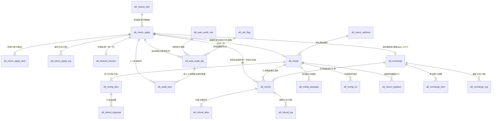

# DB-D05 售后域数据字典（oms_aftersale）

> 文档编号：DB-D05 · 版本 V1.0 · 2026-10-24 · 编写：小凯 · 状态：待审阅（批次⑥）
> 上游契约：DB-00 数据库设计总册（schema=oms_aftersale、表前缀 aft_、公共字段、命名/索引/类型基线、§6 六项必备、敏感字段 _enc+_hash、JSON 扩展列 platform_extra 替代商派镜像表）
> 需求依据：SRS-D05.01 ~ SRS-D05.05 全部 5 份 §6 数据字段章节
> 关联契约：DB-D03 订单域（售后关联订单/发货单，跨域 LFK）· DB-D04 库存域（退货入库联动 inv_io_bill、SN 核销联动 inv_serial_no）
> 参考溯源：商派 ome 模块 return_product / refund_apply / refunds / reship / reship_items / return_address / return_product_problem(_type) / return_freight / return_exchange_receiver / return_reshipping 及 **15 张平台镜像表**（return_product_{taobao,tmall,360buy,kaola,pinduoduo,huawei,yihaodian,bbc,youzan,luban} + refund_apply_{taobao,tmall,pinduoduo,youzan,luban}）——理解语义，凯淳用 platform_extra JSON 扩展列替代镜像表

---

## 1. 总体说明

### 1.1 域定位

售后域承载逆向链路**三段式**架构：申请归申请（aft_return_apply，D05.01）、仓内作业归作业（aft_reship，D05.02）、钱归钱（aft_refund，D05.03），三者分离、单据引用串联；换货（D05.04）= 退货链路 + 0 元新订单复用正向履约的双链路编排；自动审核（D05.05）= 承载于 D01.03 规则框架的自动化决策层。两条红线贯穿全域：**退款执行=平台执行，OMS 只记录**（零资金 API、无买家收款账户字段）；**平台差异吸收=platform_extra JSON 扩展列**（业务代码零平台分支）。

### 1.2 platform_extra 如何替代商派 15 张镜像表（本域核心设计决策）

商派模式：主表 return_product/refund_apply 平台无关 + 每平台一张垂直镜像表（复合主键 shop_id+return_id），如 return_product_taobao（refund_id/分账/客服介入/先行垫付）、return_product_tmall（退款版本号/换货物流族）、return_product_pinduoduo（售后类型细分/极速退款）等，共 15 张；**加平台=加表=DDL 变更=代码分支**。

凯淳模式：主表只保留 canonical 平台无关字段；平台特有字段全部入 `platform_extra` JSON 列（MySQL8 原生 JSON 类型）；三个高频查询字段建**生成列+二级索引**（GENERATED ALWAYS AS … VIRTUAL）：

| 生成列 | JSON 路径 | 用途（替代镜像表的高频查询场景） |
|---|---|---|
| platform_refund_id | $.refund_id | 淘系退款单号反查/对账（替代 return_product_taobao.refund_id 索引查询） |
| cs_intervene_flag | $.cs_intervene_flag | 客服介入单工作台筛选（替代 taobao/tmall/pdd 镜像表 cs_status） |
| platform_aftersale_type_raw | $.aftersale_type_raw | 平台售后类型原文对账（替代各镜像表 refund_type/bill_type） |

平台差异承载对照：淘系{refund_id/退款版本号/分账 split_taobao_fee/货物状态/客服介入/先行垫付}、京东{ASC 服务单号/换新订单号/售后服务类型/平台处理环节}、拼多多{售后类型细分/凭证体系/极速退款标记}、抖音{售后凭证/平台介入状态}、小红书/唯品会{退供单关联}、类型变更轨迹（换转退）。低频字段 JSON 内查询（`->>`/JSON_TABLE），高频字段升级为生成列——**加平台零 DDL**。约束（D05.01 FR-04d）：业务代码只依赖 canonical 字段，平台差异只允许出现在回传指令组装附加参数与展示层。

### 1.3 公共字段与例外（对齐 DB-00 §3）

所有业务表默认包含公共字段：`id`(BIGINT UNSIGNED AI 主键)、`tenant_id`、`owner_id`、`create_time`/`update_time`(DATETIME(3))、`version`(乐观锁)、`is_deleted`(软删)。**下文逐表定义只列业务字段**，例外情况在表头标注：

- **单据类禁用软删（无 is_deleted）**：aft_return_apply、aft_reship、aft_defect_disposal、aft_refund、aft_exchange（红冲/状态机纠错语义，台账不可改）。
- **日志/留痕类只增不改（无 is_deleted/version/update_time）**：aft_return_apply_log、aft_refund_log、aft_exchange_log；例外 aft_auto_audit_log 保留 update_time（人工终审回填改判字段）；aft_reship_sn 保留 update_time/version（人工复核闭环）。
- **字典/配置表 owner_id 免填（DEFAULT 0）**：aft_reason_dict、aft_auto_audit_rule（owner_id 有隔离语义时填值）、aft_return_address（owner_id=0 为全局兜底行）。
- **高频竞争表必备 version**：aft_return_apply（transit CAS）、aft_refund（状态吸收态推进）、aft_reship/_item（分批回传累积）、aft_exchange（双链路事件并发）。
- **敏感字段（PIPL，D01.05 信封加密）**：买家标识/手机 `buyer_id_enc`+`buyer_id_hash`、`buyer_phone_enc`+`buyer_phone_hash`（aft_return_apply）；退货收件电话 `contact_phone_enc`+`contact_phone_hash`（aft_return_address）；换货收件人 `receiver_snapshot`（JSON 密文引用）+`receiver_phone_hash`（aft_exchange）；风控维度键 `dim_key_enc`+`dim_key_hash`（aft_risk_flag）。展示一律脱敏，访问授权留痕。
- 全库：InnoDB / utf8mb4 / utf8mb4_0900_ai_ci / 不建物理外键（LFK 标注）/ 枚举不用 MySQL ENUM，注释写全枚举值。

### 1.4 单号与分表（对齐 DB-00 §1.3/§3.1）

| 单号 | 规则 | 表 |
|---|---|---|
| apply_bn | RA{YYYYMMDD}{6位序列}；手工单 MA 前缀 | aft_return_apply |
| reship_bn | RS{YYYYMMDD}{6位序列} | aft_reship |
| refund_bn | RF{YYYYMMDD}{6位序列} | aft_refund |
| exchange_bn | EX{YYYYMMDD}{6位序列} | aft_exchange |
| disposal_bn | 处置单号（Redis 发号） | aft_defect_disposal |

分表：本域主表不分表（DB-00 §1.3「其余业务表：小，不分表」；售后量级 ≈ 订单量 3-8%）。三张日志表随申请单归档策略（D03.13 归档单元含售后单）；platform_extra 原始报文引用保留 3 年（OSS 引用，SRS-D05.01 §8）；退款台账不随归档（财务对账需在线，SRS-D05.03 §1.3）。

---

## 2. 表清单（23 张）

| # | 表名 | 中文名 | 所属模块 | 分期 | 预估行量级 |
|---|---|---|---|---|---|
| 1 | aft_return_apply | 售后申请单（统一入口） | D05.01 | P0 | 百万级/年 |
| 2 | aft_return_apply_item | 申请单明细行 | D05.01 | P0 | 数百万级/年 |
| 3 | aft_return_apply_log | 申请单操作日志 | D05.01 | P0 | 千万级/年（只增） |
| 4 | aft_reason_dict | 售后字典（类型/原因/平台映射/不良/损失） | D05.01 | P0 | 千级 |
| 5 | aft_reship | 退货执行单 | D05.02 | P0 | 百万级/年 |
| 6 | aft_reship_item | 执行单明细行 | D05.02 | P0 | 数百万级/年 |
| 7 | aft_reship_package | 退回包裹 | D05.02 | P0 | 百万级/年 |
| 8 | aft_reship_sn | 退货 SN 核销记录 | D05.02 | P0（随 D04.09 P1 生效） | 十万级/年 |
| 9 | aft_defect_disposal | 不良品处置单 | D05.02 | P0 | 十万级/年 |
| 10 | aft_return_address | 退货地址路由配置 | D05.02 | P0 | 千级 |
| 11 | aft_return_logistics | 退货物流跟踪 | D05.02 | P1 | 百万级/年 |
| 12 | aft_refund | 退款单（含台账语义） | D05.03 | P0 | 百万级/年 |
| 13 | aft_refund_alloc | 退款金额行级分摊回冲 | D05.03 | P0 | 数百万级/年 |
| 14 | aft_refund_log | 退款日志 | D05.03 | P0 | 千万级/年（只增） |
| 15 | aft_exchange | 换货编排单 | D05.04 | P1 | 十万级/年 |
| 16 | aft_exchange_item | 换货明细行 | D05.04 | P1 | 数十万级/年 |
| 17 | aft_exchange_log | 换货编排日志 | D05.04 | P1 | 百万级/年（只增） |
| 18 | aft_auto_audit_rule | 售后自动审核规则参数 | D05.05 | P1 | 百级 |
| 19 | aft_auto_audit_log | 自动审核决策留痕 | D05.05 | P1 | 百万级/年 |
| 20 | aft_audit_task | 人工售后审核任务 | D05.05/D05.01 | P0 基础/P1 增强 | 百万级/年 |
| 21 | aft_risk_flag | 售后风控标记 | D05.05 | P1 | 十万级 |
| 22 | aft_timeout_monitor | 平台售后时效监控 | D05.01 | P0 | 百万级/年 |
| 23 | aft_buyer_profile | 跨店铺退货画像（V1.3 H4） | D05.05 | P1 | 百万级 |

> 结构收敛说明（对 SRS §6 的物理化调整，均已逐表标注）：
> ① SRS-D05.03 §6.2 refund_item 与分摊回冲明细 → 合一为 **aft_refund_alloc**（行引用+三口径回冲+allocation_snapshot 快照同源同行，减少 1:1 窄表）；
> ② SRS-D05.05 §6.2 decision + §6.3 reason 明细 → 合一为 **aft_auto_audit_log**（结构化原因入 reasons JSON 数组；决策与原因 1:N 量小随单装载，同 order_audit_reason 思想）；§6.4 buyer_risk_stat → **aft_risk_flag**（Redis 实时+DB 日终校准双轨，DB 侧落此表）；
> ③ SRS-D05.01 §6.1 申请单头字段 buyer 标识/收件信息 → 加密列并入主表（同 DB-D03 ord_order 收敛口径），不建独立买家表；
> ④ 商派 return_freight（邮费承担方）→ 申请单 platform_extra 承载 + 质检差价走 aft_reship_item.defect_reasons 责任方映射，不建独立表；
> ⑤ 商派 return_product_problem/_type → aft_reason_dict（dict_type=defect_reason，含责任方 duty_party）；
> ⑥ 商派 return_exchange_receiver → aft_exchange.receiver_snapshot（JSON 密文引用）；
> ⑦ 商派 return_reshipping 补寄单 → aft_exchange.reship_only 标记（补寄收敛进换货编排，D05.04 FR-03e）；
> ⑧ SRS-D05.05 规则本体（元数据/启停/缓存失效）承载于 oms_base.bas_rule（D01.03），**aft_auto_audit_rule 只存售后特有参数**（12 维条件/动作/灰度/兜底封顶，rule_id 1:1 关联）。

---

## 3. 逐表定义

> 表格只列业务字段；公共字段见 §1.3 约定。类型基线：单号 VARCHAR(32)（平台编码例外加宽注明）、金额 DECIMAL(18,2)、单价 DECIMAL(18,4)、比例 DECIMAL(9,4)、数量 INT、时间 DATETIME(3)。

### 3.1 D05.01 售后申请单（P0）

#### 3.1.1 aft_return_apply 售后申请单（P0，单据类无软删）★核心

用途：逆向链路统一入口与审批中枢——全平台售后申请（canonical 事件）与线下手工建单收敛为一张平台无关申请单；幂等键 `(platform, shop_id, platform_aftersale_bn)`（手工单 NULL 不冲突，防连击锁应用层）；状态机三链路合一（§SRS-D05.01 §4.1），transit CAS 推进。
溯源：← 商派 return_product（50 列）+ refund_apply（47 列）两级审批收敛为一级 + **15 张平台镜像表 → platform_extra JSON+3 生成列索引**（§1.2）。

| 字段 | 类型 | 约束 | 默认 | 注释 |
|---|---|---|---|---|
| apply_bn | VARCHAR(32) | NOT NULL | | 申请单号：RA/MA 前缀，全局唯一 |
| source | VARCHAR(16) | NOT NULL | 'platform' | 来源：platform=平台同步,manual=手工建单,import=导入,migration=迁移 |
| platform / shop_id / platform_aftersale_bn | VARCHAR(16) / BIGINT UNSIGNED / VARCHAR(64) NULL | | | 平台/店铺/平台售后单号（三元唯一幂等键；平台单号原文可长加宽至 64；手工单 NULL） |
| aftersale_type | TINYINT | NOT NULL | | 售后类型：1=仅退款(refund_only,不动货),2=退货退款(return_refund),3=换货(exchange,含平台换货/京东ASC/补寄)（FR-01d） |
| reship_only | TINYINT(1) | NOT NULL | 0 | 补寄单型：0=否,1=是（无退货链路纯补发，D05.04 FR-03e） |
| status | TINYINT | NOT NULL | 1 | 申请单状态：0=待关联(订单缺失异常),1=待审核,2=待退货,3=待收货,4=待退款,5=退款中,6=换货执行中,7=完成,8=拒绝(可reopen),9=关闭；类型裁剪：仅退款无2/3，换货无4/5 |
| goods_status | TINYINT | NOT NULL | 0 | 货物状态(canonical)：0=未发货,1=已发货未收,2=已收货（已发货仅退款=type1+值2→损失登记联动 D05.03） |
| order_id / order_bn | BIGINT UNSIGNED / VARCHAR(32) | NOT NULL | 0/'' | 关联订单 LFK→oms_order.ord_order（待关联异常态可暂 0） |
| is_archived_order | TINYINT(1) | NOT NULL | 0 | 归档回捞标记（ArchiveService.recall 后置位，IF-D03.13-02） |
| apply_amount_customer / apply_amount_platform_bear | DECIMAL(18,2) | NOT NULL | 0 | 双口径申请金额（≥0，≤行级可退余额，SRS §5.3） |
| approved_amount_customer / approved_amount_platform_bear | DECIMAL(18,2) | NOT NULL | 0 | 审核同意金额双口径（≤申请金额，部分同意调整留痕） |
| reason_code / reason_raw | VARCHAR(32) / VARCHAR(512) | NOT NULL | '' | OMS 原因字典码 LFK→aft_reason_dict（未命中=OTHER_UNCLASSIFIED）/平台原因原文保真 |
| buyer_claim / evidence_urls | VARCHAR(1024) / JSON NULL | | | 买家诉求/凭证 URL 数组（PIPL 授权访问留痕） |
| buyer_id_enc / buyer_id_hash | VARBINARY(256) NULL / CHAR(64) | | | 买家平台标识密文+盲索引（open_id，风控跨店合并检索） |
| buyer_nick / buyer_phone_enc / buyer_phone_hash | VARCHAR(64) / VARBINARY(256) NULL / CHAR(64) | | | 买家昵称（脱敏展示）/手机密文+盲索引 |
| deadline / warn_level | DATETIME(3) NULL / TINYINT | | | 平台处理截止（平台×类型×店铺覆写时效规则）/预警级别：0=无,1=黄色(≤24h),2=红色(≤4h升级主管),3=已超时 |
| platform_status_raw | VARCHAR(64) | NOT NULL | '' | 平台原始状态串保真（对账回放，FR-04c，canonical 与原始双轨） |
| platform_modified_version | VARCHAR(64) | NOT NULL | '' | 版本收敛依据（platform_modified/退款版本号，单调递增乱序防护 FR-01c） |
| sync_status | TINYINT | NOT NULL | 0 | 回传状态：0=未回传,1=回传中,2=成功,3=失败待重试(D02.05),4=转人工；回传失败不阻塞本地状态机 |
| auto_agreed_by_platform | TINYINT(1) | NOT NULL | 0 | 平台超时自动同意标记（被动收敛置位→资损复盘清单，FR-06b） |
| audit_channel / operator / auditor / audit_time | TINYINT / VARCHAR(64)×2 / DATETIME(3) NULL | | | 审核通道：0=未审,1=人工,2=自动规则,3=临期兜底,4=OA；建单人/审核人（建单≠审核 FR-03c）/审核时间 |
| platform_extra | JSON | NULL | NULL | **平台特有字段 JSON（替代商派 15 张镜像表，§1.2 承载对照+类型变更轨迹）** |
| platform_refund_id | VARCHAR(64) | 生成列 VIRTUAL | | =platform_extra.$.refund_id（淘系退款单号，FR-04b） |
| cs_intervene_flag | VARCHAR(64) | 生成列 VIRTUAL | | =platform_extra.$.cs_intervene_flag（客服介入） |
| platform_aftersale_type_raw | VARCHAR(64) | 生成列 VIRTUAL | | =platform_extra.$.aftersale_type_raw（平台类型原文） |

索引：`uk_aft_return_apply_bn(apply_bn)`；`uk_aft_return_apply_platform(platform, shop_id, platform_aftersale_bn)` 幂等唯一；`idx_aft_return_apply_order(order_id)`；`idx_aft_return_apply_status(status, deadline)` 工作台队列/超时扫描；`idx_aft_return_apply_shop(shop_id, status)`；`idx_aft_return_apply_owner(owner_id, create_time)` 门户视图；`idx_aft_return_apply_buyer(buyer_id_hash)` 风控检索；`idx_aft_return_apply_prefund/cs/typeraw` 三生成列索引。
LFK：order_id→oms_order.ord_order；shop_id→oms_gateway.gw_shop；owner_id→oms_org.org_owner。

#### 3.1.2 aft_return_apply_item 申请单明细行（P0）

用途：部分售后按行按数量（SRS §6.2）；行申请数量校验 `Σ(本单+历史处理中+历史完成) ≤ 行购买数量`（赠品随主品联动、福袋/组合装 BOM 展开校验 D04.01）。

| 字段 | 类型 | 约束 | 默认 | 注释 |
|---|---|---|---|---|
| apply_id | BIGINT UNSIGNED | NOT NULL | | 申请单 LFK→aft_return_apply |
| order_item_id / oid | BIGINT UNSIGNED / VARCHAR(64) | NOT NULL | 0/'' | 订单行引用 LFK→oms_order.ord_order_item / 平台子单号（平台售后对账键） |
| bm_id / sku_name / sku_spec | BIGINT UNSIGNED / VARCHAR(255)/VARCHAR(512) | | | 物料 LFK→oms_stock.inv_material 与规格快照（展示不回查） |
| apply_num / approved_num | INT | NOT NULL | 0 | 申请数量（≤行可退余额）/同意数量（行级部分同意调整留痕） |
| apply_amount_customer_line / apply_amount_platform_bear_line / approved_amount_customer_line | DECIMAL(18,2) | NOT NULL | 0 | 行级双口径申请金额（分摊自订单行 getDualAmount）+行级同意金额【辅助】 |
| gift_flag / combo_ref | TINYINT(1) / VARCHAR(64) | NOT NULL | 0/'' | 赠品标记/组合装引用（BOM 展开校验） |
| platform_extra | JSON | NULL | NULL | 行级平台字段（如淘系 oid 级退款状态） |

索引：`uk_aft_return_apply_item(apply_id, order_item_id)`；`idx…_oi(order_item_id)` 行级余额累计校验；`idx…_bm(bm_id)`。

#### 3.1.3 aft_return_apply_log 申请单操作日志（P0，只增不改）

用途：SRS §6.3——落单/审核/状态变迁/回传/类型变更（换转退轨迹）/预警/人工干预全留痕；审计可溯（D10.06 同源）。

| 字段 | 类型 | 约束 | 默认 | 注释 |
|---|---|---|---|---|
| apply_id / seq | BIGINT UNSIGNED / INT UNSIGNED | NOT NULL | | 归属/单内时序（联合唯一） |
| action | VARCHAR(32) | NOT NULL | | 动作：created/audit/transit/sync/type_changed/warn/reopen/manual/recall |
| from_status / to_status | TINYINT | NOT NULL | 0 | 状态变迁（可空语义=0） |
| operator_type / operator | TINYINT / VARCHAR(64) | NOT NULL | 1/'' | 1=系统,2=人工 + 标识（系统=事件/规则引用） |
| detail_json | JSON | NULL | NULL | 依据：事件 ID/回传指令 ID/变更快照/行级调整前后值 |

索引：`uk_aft_return_apply_log(apply_id, seq)`；`idx…_time(create_time)`。

#### 3.1.4 aft_reason_dict 售后字典（P0，字典表 owner_id 免填）

用途：售后域统一字典，dict_type 区分子字典；**平台原因码→OMS 原因映射**（D02.02 MappingService 数据源，`(platform, native_code)→reason_code`）承载于此。
溯源：← 商派 return_product_problem/_type + refund_reason 改造：+平台映射行合一、+责任方 duty_party、+白名单/拒绝建议标记。

| 字段 | 类型 | 约束 | 默认 | 注释 |
|---|---|---|---|---|
| dict_type | VARCHAR(24) | NOT NULL | | 字典类别：aftersale_type=售后类型枚举,reason=售后申请原因,reject_reason=审核拒绝原因码,defect_reason=质检不良原因(含责任方),loss_type=退款损失类型,close_type=申请关闭原因 |
| reason_code / reason_name | VARCHAR(32) / VARCHAR(128) | NOT NULL | | OMS 标准码（同 dict_type 内唯一）/标准名称 |
| platform / native_code / native_name | VARCHAR(16)/VARCHAR(64)/VARCHAR(255) | NOT NULL | 'all'/''/'' | 映射来源平台（all=OMS 标准行）/平台原始原因码/原文文案（保真） |
| duty_party | TINYINT | NOT NULL | 0 | 责任方（defect_reason 用，质检差价扣减依据 SRS-D05.02 §5.3）：0=无,1=买家责任(扣减),2=物流责任(不扣减+索赔),3=卖家/质量责任(不扣减),4=平台责任 |
| audit_white / reject_suggest | TINYINT(1) | NOT NULL | 0 | 自动审核原因白名单（D05.03 FR-04a/D05.05 reason_check）/拒绝建议清单（临期兜底不放行 D05.05 FR-05b） |
| sort_no / status | INT / TINYINT | NOT NULL | 0/1 | 排序/1=启用,2=停用 |

索引：`uk_aft_reason_dict_code(dict_type, reason_code, platform, native_code)`；`idx…_platform(platform, dict_type, status)` 映射查询。
初始数据：售后类型枚举 3 条 + 标准原因 12 条（含 OTHER_UNCLASSIFIED 兜底）+ 平台映射示例 8 条 + 不良原因 6 条 + 损失类型 3 条 + 拒绝/关闭原因 9 条。

#### 3.1.5 aft_timeout_monitor 平台售后时效监控（P0）

用途：SRS-D05.01 FR-06/§5.4——平台售后时效约束下的超时自动同意风险管理：黄/红分级预警（调度每 10 分钟扫描）、平台自动同意后被动收敛留痕、资损复盘清单（与 D05.05 本地兜底单同池月度对比）。溯源：凯淳产品化新增（商派 confirmreship 定时器只做自动确认无风险管理）。

| 字段 | 类型 | 约束 | 默认 | 注释 |
|---|---|---|---|---|
| apply_id | BIGINT UNSIGNED | NOT NULL | | 申请单（一单一监控行，reopen 更新）LFK→aft_return_apply |
| platform / shop_id / aftersale_type | | | | 平台/店铺/售后类型快照 |
| time_limit_rule | JSON | NULL | NULL | 时效规则快照：{platform,aftersale_type,limit_hours,shop_override}（拼多多 48h/淘系退货 5 天/抖音 72h） |
| deadline | DATETIME(3) | NOT NULL | | 平台处理截止（落单即计算，reopen 重算） |
| warn_level / warn_time / escalate_flag | TINYINT / DATETIME(3) NULL / TINYINT(1) | NOT NULL | 0 | 预警级别 0=正常,1=黄(≤24h 置顶+企微),2=红(≤4h 升级主管),3=已超时/首警时间/升级标记 |
| auto_agreed_flag / passive_converge_time | TINYINT(1) / DATETIME(3) NULL | NOT NULL | 0 | 平台超时自动同意标记（同步主表）/被动收敛时间（版本收敛跳过本地审核） |
| loss_review_flag / loss_amount | TINYINT(1) / DECIMAL(18,2) | NOT NULL | 0 | 资损复盘标记（高频店铺触发时效规则复审）/资损金额（联动 D05.03 台账标记） |
| status | TINYINT | NOT NULL | 1 | 监控状态：1=监控中,2=按时闭环,3=已超时(平台未动作,红色持续不静默),4=平台自动同意已收敛,5=已取消 |

索引：`uk_aft_timeout_monitor(apply_id)`；`idx…_scan(status, warn_level, deadline)` 调度扫描；`idx…_shop`；`idx…_review(loss_review_flag, auto_agreed_flag)` 复盘清单。

### 3.2 D05.02 退货退款执行（P0）

#### 3.2.1 aft_reship 退货执行单（P0，单据类无软删）★核心

用途：OMS 与仓库之间关于「退回来的货」的唯一作业单据：退货预报（IoBillService.create 类型=退货入库→dispatch→D09.03 下发）、良/不良质检分流结果累计、入库单据引用双向追溯、差异处理（申请 3 实退 2）、状态回驱申请单；幂等键=apply_id（一申请一执行单）。
溯源：← 商派 reship（70 列，内嵌 WMS 调用与库存回补）改造：通道剥离（下发/回传归 D09.03、记账归 D04.04），本表纯业务编排+io_bill 引用；+良不良分列累计、+差异状态机、+双仓字段（换货异仓）。

| 字段 | 类型 | 约束 | 默认 | 注释 |
|---|---|---|---|---|
| reship_bn | VARCHAR(32) | NOT NULL | | 执行单号 RS 前缀唯一 |
| apply_id | BIGINT UNSIGNED | NOT NULL | | 申请单引用（幂等键）LFK→aft_return_apply |
| reship_type | TINYINT | NOT NULL | 1 | 执行类型：1=退货入库,2=换货（良品入库不触发退款→触发换货出库编排 D05.04 FR-08） |
| status | TINYINT | NOT NULL | 1 | 执行单状态：1=已创建,2=已预报,3=下发失败(重试耗尽转人工),4=运送中(买家回填物流),5=收货中(分批回传),6=质检完成,7=已闭环,8=已取消,9=质检异常挂起(调包嫌疑/争议),10=差异处理中 |
| order_id / delivery_id | BIGINT UNSIGNED | NOT NULL | 0 | 原订单/原发货单 LFK→oms_order（原仓路由溯源依据） |
| return_branch_id / exchange_branch_id | BIGINT UNSIGNED | NOT NULL | 0 | 退货仓/换出仓 LFK→oms_fulfill.ful_branch（路由结果；换货双仓 FR-08b） |
| return_address_snapshot | JSON | NULL | NULL | 退货地址快照（地址/收件人/须知，下发时固化，路由自 aft_return_address） |
| io_bill_id / io_bill_bn | BIGINT UNSIGNED / VARCHAR(32) | NOT NULL | 0/'' | 退货入库单据 LFK→oms_stock.inv_io_bill（类型=return_in_good/return_in_defect，双向追溯） |
| expect_num / received_good_num / received_defect_num / diff_num | INT | NOT NULL | 0 | 预报/良品实收（入实际库存）/不良实收（入次品口径）/差异（累计口径） |
| logistics_company / tracking_nos | VARCHAR(64) / JSON NULL | | | 退回物流公司（D09.04 校验）/运单号集（多包裹多运单） |
| sn_check_status | TINYINT | NOT NULL | 0 | SN 校验汇总：0=无SN物料,1=全部通过,2=部分失败挂起,3=失败疑似调包（明细→aft_reship_sn） |
| diff_status / diff_expire_time | TINYINT / DATETIME(3) NULL | NOT NULL | 0 | 差异状态：0=无,1=等待补寄(72h),2=期满按实收闭环,3=多退容差内,4=暂挂待认领,5=人工强制闭环/等待期截止 |
| close_type | TINYINT | NOT NULL | 0 | 闭环类型：0=未闭环,1=正常,2=差异闭环,3=强制闭环(留痕),4=取消 |
| receive_time / qc_time / close_time | DATETIME(3) NULL | | | 收货/质检完成/闭环时间（时效考核供数 D11） |

索引：`uk_aft_reship_bn(reship_bn)`；`uk_aft_reship_apply(apply_id)` 幂等唯一；`idx_aft_reship_order`；`idx_aft_reship_status(status, create_time)`；`idx_aft_reship_iobill(io_bill_bn)` 单据追溯；`idx_aft_reship_owner`。

#### 3.2.2 aft_reship_item 执行单明细行（P0）

用途：SRS §6.2——行级良/不良数（Σ包裹累计）、不良原因结构化（责任方→质检差价扣减）、批次/SN 登记引用、行级退款联动状态（可退金额=同意金额×良品/申请−质检差价，D05.02 §5.3）。
溯源：← 商派 reship_items（normal_num/defective_num 良不良分列继承）改造：+defect_reasons 责任方结构化（商派 diff_money 人工填写无规则）、+退款联动状态。

| 字段 | 类型 | 约束 | 默认 | 注释 |
|---|---|---|---|---|
| reship_id / apply_item_id / order_item_id | BIGINT UNSIGNED | NOT NULL | | 执行单/申请行/订单行引用（追溯链） |
| bm_id / owner_id | BIGINT UNSIGNED | NOT NULL | 0 | 物料 LFK→inv_material/行级货主（退仓混货主预留） |
| expect_num / good_num / defect_num / diff_num | INT | NOT NULL | 0 | 行级预报/良品/不良/差异（Σ包裹累计） |
| defect_reasons | JSON | NULL | NULL | 不良原因明细：[{reason_code(→aft_reason_dict defect_reason),num,duty_party}]（§5.3 责任判定） |
| batch_details | JSON | NULL | NULL | 批次退回登记（D04.09 registerIn 联动：原批次优先/实际批次/效期） |
| refund_trigger_status | TINYINT | NOT NULL | 0 | 退款联动：0=未触发,1=已触发(activateOnInbound),2=人工确认中(差异调整>同意金额20%阈值 FR-05f) |
| diff_flag | TINYINT(1) | NOT NULL | 0 | 行级差异标记（短缺闭环后剩余可退余额保留，可再次申请） |

索引：`uk_aft_reship_item(reship_id, apply_item_id)`；`idx…_bm(bm_id)`。

#### 3.2.3 aft_reship_package 退回包裹（P0）

用途：多包裹分批退回按包裹维度独立回传累积（SRS §6.3）；齐套判定=Σ包裹实收≥预报 or 差异期满。溯源：← 商派 reship_package/reship_package_items 改造（items 并入 items_json，包裹明细量小）。

| 字段 | 类型 | 约束 | 默认 | 注释 |
|---|---|---|---|---|
| reship_id / package_no | BIGINT UNSIGNED / INT UNSIGNED | NOT NULL | | 归属/包裹序号（联合唯一） |
| tracking_no / logistics_company | VARCHAR(64) | NOT NULL | '' | 运单/公司 |
| arrive_time | DATETIME(3) | NULL | NULL | 到仓时间 |
| items_json | JSON | NULL | NULL | 包裹明细：[{bm_id,num,good_num,defect_num}] |
| callback_batch_ref | VARCHAR(64) | NOT NULL | '' | WMS 回传批次引用（幂等关联键，D09.03 callback 批次） |

索引：`uk_aft_reship_package(reship_id, package_no)`；`idx…_tn(tracking_no)` 运单反查。

#### 3.2.4 aft_reship_sn 退货 SN 核销记录（P0，随 D04.09 P1 生效）★联动 inv_serial_no

用途：SN 属单校验结果登记与防调包闭环（SRS-D05.02 FR-05b/SC-04）：预报登记+质检扫码两次校验（SerialService.validateReturn 消费）；校验失败→疑似调包标记→执行单质检异常挂起（不入账不退款）→人工复核（确认调包拒收/登记错误 D04.09 修正重检红冲）；通过→SN 核销（售后中→已核销），良品重入回在库。
溯源：← 商派 reship_items_serial（仅登记回收）改造：**+属单校验结果+防调包标记+人工复核闭环产品化**。

| 字段 | 类型 | 约束 | 默认 | 注释 |
|---|---|---|---|---|
| reship_id / reship_item_id / apply_id | BIGINT UNSIGNED | NOT NULL | | 执行单/行/申请单（冗余，SN 档案 aftersale_id 回填源） |
| sn_code / expect_sn_code | VARCHAR(64) | NOT NULL | | 质检扫码实收 SN/期望 SN（原订单出库 SN，预报携带比对） |
| bm_id / serial_id / order_id | BIGINT UNSIGNED | NOT NULL | 0 | 物料/SN 档案 LFK→oms_stock.inv_serial_no/原订单（属单校验依据） |
| check_stage | TINYINT | NOT NULL | 1 | 校验环节：1=预报登记,2=质检扫码 |
| check_result | TINYINT | NOT NULL | 0 | 属单校验结果：0=待校验,1=通过(属单+状态双校验),2=失败-非本订单出库SN,3=失败-SN状态异常,4=降级跳过(WMS无SN能力,高值人工抽检) |
| swap_suspect_flag | TINYINT(1) | NOT NULL | 0 | 防调包标记（失败置位→挂起不入账不退款→人工复核工作台） |
| before_sn_status / after_sn_status | TINYINT | NOT NULL | 0 | 校验前/处置后 SN 状态快照（D04.09 状态机：1在库/2已出库/3售后中/4已核销/5换出/6终止） |
| handle_result / handler / handle_time | TINYINT / VARCHAR(64) / DATETIME(3) NULL | NOT NULL | 0 | 复核结论：0=无需,1=确认调包-拒收(联动部分拒绝),2=登记错误-修正重检(红冲重记账),3=确认正常放行 |

索引：`uk_aft_reship_sn(reship_id, sn_code, check_stage)`；`idx…_serial(serial_id)`；`idx…_order(order_id)`；`idx…_suspect(swap_suspect_flag, handle_result)` 复核工作台。

#### 3.2.5 aft_defect_disposal 不良品处置单（P0，单据类无软删）

用途：不良品处置独立单据化（SRS-D05.02 FR-06/§6.4）：代销默认退仓还品牌方/买断报废 OA 审批/促销出清复判；处置前不良停留次品口径，处置单据 confirm 后次品-N 闭环；30 天超期预警升级；品牌方门户可见待处置清单（D10.04）。溯源：凯淳新增（商派次品滞留无处置闭环）。

| 字段 | 类型 | 约束 | 默认 | 注释 |
|---|---|---|---|---|
| disposal_bn | VARCHAR(32) | NOT NULL | | 处置单号唯一 |
| reship_id / reship_item_id | BIGINT UNSIGNED | NOT NULL | | 来源执行单/行 |
| disposal_type | TINYINT | NOT NULL | | 处置类型：1=退仓还品牌方(代销默认),2=报废(买断,OA),3=促销出清(转良品需质检复判),4=退供应商(D06,P2预留) |
| bm_id / branch_id / num | | NOT NULL | | 处置物料/所在仓（次品口径）/数量 |
| io_bill_id / io_bill_bn | BIGINT UNSIGNED / VARCHAR(32) | NOT NULL | 0/'' | 处置出库单据 LFK→oms_stock.inv_io_bill（return_warehouse_out 退仓/damage_out 报损） |
| approval_status / oa_flow_id | TINYINT / VARCHAR(64) | NOT NULL | 0/'' | 审批：0=免审,1=待OA(报废超阈值),2=通过,3=驳回,4=待品牌方门户确认(代销报废)/OA 流程 ID |
| return_tracking_no | VARCHAR(64) | NOT NULL | '' | 退仓物流单号（品牌方对账，D08 结算关联 P1） |
| status / deadline | TINYINT / DATETIME(3) NULL | NOT NULL | 1 | 1=待处置,2=处置中,3=已闭环,4=超期预警/截止时间（默认创建+30 天） |
| evidence_refs | JSON | NULL | NULL | 凭证（照片/单据 URL，访问授权留痕） |

索引：`uk_aft_defect_disposal_bn(disposal_bn)`；`idx…_reship`；`idx…_status(status, deadline)` 超期扫描；`idx…_owner(owner_id, status)` 门户清单。

#### 3.2.6 aft_return_address 退货地址路由配置（P0，配置表）

用途：D05.02 全局决策②——退货地址路由=**按货主配置+店铺覆盖**（优先级：店铺覆盖>货主默认>原仓优先>全局兜底凯淳总仓，§5.1 算法）；货主类型语义：品牌代销=品牌方指定仓或凯淳代收仓，买断=凯淳仓；目标仓必须支持退货入库+质检分流（D09.01 能力矩阵前置校验）。
溯源：← 商派 return_address（店铺维度）改造：**+货主维度（代销/买断双货主形态必需）+address_type 三型+退货须知**。

| 字段 | 类型 | 约束 | 默认 | 注释 |
|---|---|---|---|---|
| owner_id / shop_id / brand_id | BIGINT UNSIGNED | NOT NULL | 0 | 配置维度（owner_id=0 全局兜底行；shop_id>0 店铺级覆盖优先；品牌可选） |
| address_type | TINYINT | NOT NULL | 1 | 1=凯淳仓(买断默认原发货仓/集中退货仓),2=品牌方指定仓(代销直退),3=凯淳代收仓(代质检后退品牌方) |
| return_branch_id | BIGINT UNSIGNED | NOT NULL | 0 | 退货仓 LFK→oms_fulfill.ful_branch（质检分流能力校验） |
| province/city/district/detail_addr | VARCHAR | NOT NULL | '' | 地址四段 |
| contact_name / contact_phone_enc / contact_phone_hash | VARCHAR(64) / VARBINARY(256) NULL / CHAR(64) | | | 收件人/电话密文+盲索引（PIPL） |
| return_notice | VARCHAR(1024) | NOT NULL | '' | 退货须知文案（随预报下发 WMS+经 D05.01 回传平台买家侧展示） |
| status | TINYINT | NOT NULL | 1 | 1=启用,2=停用 |

索引：`uk_aft_return_address_scope(owner_id, shop_id, brand_id)` 维度唯一；`idx…_branch(return_branch_id)`。

#### 3.2.7 aft_return_logistics 退货物流跟踪（P1）

用途：退货运单轨迹订阅（SRS-D05.02 FR-04c）：签收→提醒仓端收货+超时未质检预警；拒收/退回→异常预警人工介入；P0 期以 WMS 回传+D09.03 超时反查（15 天）兜底。

| 字段 | 类型 | 约束 | 默认 | 注释 |
|---|---|---|---|---|
| reship_id / tracking_no | BIGINT UNSIGNED / VARCHAR(64) | NOT NULL | | 执行单/运单号（联合唯一） |
| logistics_company | VARCHAR(64) | NOT NULL | '' | 物流公司编码（D09.04） |
| trace_status | TINYINT | NOT NULL | 1 | 1=已揽收,2=运输中,3=已签收,4=拒收,5=退回买家,6=无轨迹 |
| last_trace_time / last_trace_desc / sign_time | DATETIME(3) NULL / VARCHAR(512) / DATETIME(3) NULL | | | 最新轨迹/描述/签收时间 |
| traces | JSON | NULL | NULL | 全量轨迹数组（超长存 OSS 引用） |
| warn_flag | TINYINT | NOT NULL | 0 | 0=无,1=签收后超时未质检,2=拒收/退回异常,3=预报后15天无轨迹 |

索引：`uk_aft_return_logistics(reship_id, tracking_no)`；`idx…_tn(tracking_no)`；`idx…_warn(warn_flag, trace_status)`。

### 3.3 D05.03 仅退款与退款单（P0）

#### 3.3.1 aft_refund 退款单（P0，单据类无软删）★核心

用途：三段式中「钱」的唯一单据+**退款台账权威数据源**（供 D08 对账）：两来源生成（仅退款审核同意 createFromApply/入库触发激活 activateOnInbound）+补建（平台介入消息先达）+线下例外；状态同步平台执行结果（**平台执行 OMS 只记录，零资金 API**）；已退款=吸收态不回退；台账不可改（红冲语义 red_flush_of）。
溯源：← 商派 refund_apply（审批）+refunds（打款单据）收敛：**审批语义并入 D05.01 申请单审核；删除 account/bank/pay_account 账户字段族与全部打款语义**（凯淳代运营资金在平台，OMS 只同步状态+台账）；+双口径显式化+损失登记+介入/兜底标记。

| 字段 | 类型 | 约束 | 默认 | 注释 |
|---|---|---|---|---|
| refund_bn | VARCHAR(32) | NOT NULL | | 退款单号 RF 前缀唯一 |
| apply_id / reship_id | BIGINT UNSIGNED | NOT NULL | 0 | 申请单/执行单引用（至少其一；补建单可暂 0 后关联） |
| order_id / order_bn | BIGINT UNSIGNED / VARCHAR(32) | NOT NULL | | 原订单（必填）LFK→oms_order.ord_order |
| source | VARCHAR(24) | NOT NULL | 'apply_audit' | 生成来源：apply_audit=仅退款审核同意,inbound_trigger=入库触发,platform_supplement=平台介入补建,manual_offline=手工线下,exchange_diff=换货差价子单(D05.04) |
| status | TINYINT | NOT NULL | 1 | 退款单状态：1=待退款,2=退款中(平台受理打款),3=已退款(吸收态),4=退款失败(平台重试/买家改账户→回2),5=已退款-线下(凭证+OA缺一不可),6=已取消 |
| channel | TINYINT | NOT NULL | 1 | 退款渠道：1=platform(原路退回,平台执行),2=offline(线下登记例外,不走平台同步与回传) |
| refund_customer / refund_platform_bear | DECIMAL(18,2) | NOT NULL | 0 | 双口径退款金额（上限校验：≤同意金额余额−Σ历史退款，§5.1 防错退红线） |
| platform_executed_amount | DECIMAL(18,2) | NOT NULL | 0 | 平台实际执行金额（与 OMS 期望比对差异告警，以平台为准落台账） |
| platform_refund_no / platform | VARCHAR(64) NULL / VARCHAR(16) | | | 平台退款流水号（补建幂等键成分/对账主键；线下单 NULL）/平台 |
| refund_time / arrive_time | DATETIME(3) NULL | | | 平台受理/到账时间（消息同步） |
| fail_reason_code / fail_reason_raw | VARCHAR(32) / VARCHAR(512) | NOT NULL | '' | 失败原因码/平台原文保真（退款失败必填） |
| platform_intervened | TINYINT(1) | NOT NULL | 0 | 平台介入标记（补建单置位，100% 入资损复盘清单 SC-04） |
| loss_type / loss_amount | TINYINT / DECIMAL(18,2) | NOT NULL | 0 | 损失类型：0=无,1=弃货退款,2=平台介入资损,3=超时自动同意资损（→aft_reason_dict loss_type）/货值损失（出库成本快照×数量，不回冲库存） |
| audit_channel / auditor / approval_ref | TINYINT / VARCHAR(64)×2 | NOT NULL | 1 | 审核通道：1=人工,2=自动(阈值内),3=OA(超人工权限默认2000元)/审核人/OA 单引用 |
| risk_flag | TINYINT(1) | NOT NULL | 0 | 高风险标记（高频退款/退款率异常强制人工，→D11 风控报表） |
| ledger_status | TINYINT | NOT NULL | 0 | 台账回冲状态：0=未入账,1=已推D08(应收红字/结算扣减),2=差异(对账工单) |
| red_flush_of | BIGINT UNSIGNED | NOT NULL | 0 | 红冲来源退款单（负向调整+新记录，原记录保留审计可溯） |
| platform_extra | JSON | NULL | NULL | 平台特有 JSON（§5.5）：淘系{refund_version,advance_flag 先行垫付}、拼多多{fast_refund_flag 极速退款,platform_advance 垫付追偿}、京东{asc_refund_id}、失败原因原文 |

索引：`uk_aft_refund_bn(refund_bn)`；`uk_aft_refund_platform_no(platform, shop_id, platform_refund_no)` 补建幂等；`idx_aft_refund_apply/reship/order`；`idx_aft_refund_status(status, update_time)` 退款中跟踪；`idx_aft_refund_ledger(ledger_status, create_time)` 财务取数；`idx_aft_refund_owner`。
LFK：apply_id→aft_return_apply；reship_id→aft_reship；order_id→oms_order.ord_order。

#### 3.3.2 aft_refund_alloc 退款金额行级分摊回冲（P0）

用途：SRS §6.2 refund_item+回冲明细合一——原订单优惠分摊的逆向运算（§5.2 算法）：行级三口径回冲（客户实付/平台承担/商家承担券）+allocation_snapshot 固化（可解释审计，财务争议回放）+部分数量二次分摊尾差入最后一行（Σ回冲=平台执行退款总额）；供 D08.01 应收红字/结算扣减取数（IF-D05.03-05）。

| 字段 | 类型 | 约束 | 默认 | 注释 |
|---|---|---|---|---|
| refund_id / apply_item_id | BIGINT UNSIGNED | NOT NULL | | 退款单/申请行引用（追溯链） |
| order_item_id / oid / bm_id | BIGINT UNSIGNED / VARCHAR(64) / BIGINT UNSIGNED | NOT NULL | 0 | 订单行 LFK→oms_order.ord_order_item/平台子单/物料 |
| refund_num | INT | NOT NULL | 0 | 退款数量（≤行申请数量） |
| refund_customer_line / refund_platform_bear_line / refund_merchant_bear_line | DECIMAL(18,2) | NOT NULL | 0 | 行级三口径回冲额（商家承担券不产生现金退回，只冲应收） |
| loss_line | DECIMAL(18,2) | NOT NULL | 0 | 行级损失（不动货：成本快照×数量） |
| is_last_line | TINYINT(1) | NOT NULL | 0 | 尾差行标记【辅助】 |
| allocation_snapshot | JSON | NOT NULL | | 分摊快照固化（getDualAmount 输入+比例+取数时间，可解释审计） |

索引：`uk_aft_refund_alloc(refund_id, order_item_id)`；`idx…_oi(order_item_id)`。

#### 3.3.3 aft_refund_log 退款日志（P0，只增不改）

用途：SRS §6.3——生成/审核分流/状态变迁/平台状态同步/对账差异（补建/补推/工单）/红冲/线下登记全留痕；依据（消息 ID/OA 单/对账批次）可溯。

| 字段 | 类型 | 约束 | 默认 | 注释 |
|---|---|---|---|---|
| refund_id / seq | BIGINT UNSIGNED / INT UNSIGNED | NOT NULL | | 归属/时序（联合唯一） |
| action | VARCHAR(32) | NOT NULL | | created/audit/transit/sync/reconcile/red_flush/offline_register/manual |
| from_status / to_status | TINYINT | NOT NULL | 0 | 状态变迁 |
| ref_json | JSON | NULL | NULL | 依据：消息 ID/OA 单号/对账批次/单拉核实结果 |
| operator_type / operator | TINYINT / VARCHAR(64) | NOT NULL | 1/'' | 系统/人工+标识 |

索引：`uk_aft_refund_log(refund_id, seq)`；`idx…_time(create_time)`。

### 3.4 D05.04 换货补发（P1）

#### 3.4.1 aft_exchange 换货编排单（P1，单据类无软删）

用途：换货双链路编排中枢（SRS §6.1）：退货侧联动 D05.02 执行单、补发侧创建 0 元新订单（C 前缀 createway=exchange）复用正向履约；时序策略创建时判定固化（高值 SN/风控名单强制 RETURN_FIRST 防欺诈红线）；五单串联追溯（原订单↔申请单↔执行单↔编排单↔新单）；补寄单型收敛（reship_only）。
溯源：← 商派 reship.create_order/change_order_id 弱关联 + return_exchange_receiver + return_reshipping 改造：**独立编排单+事件驱动双链路+时序策略配置化**（商派换货逻辑内嵌 reship 模型，固定先退后发无策略概念）。

| 字段 | 类型 | 约束 | 默认 | 注释 |
|---|---|---|---|---|
| exchange_bn | VARCHAR(32) | NOT NULL | | 编排单号 EX 前缀唯一 |
| apply_id | BIGINT UNSIGNED | NOT NULL | | 申请单引用（幂等键唯一） |
| order_id / order_bn | BIGINT UNSIGNED / VARCHAR(32) | NOT NULL | | 原订单 |
| reship_id | BIGINT UNSIGNED | NOT NULL | 0 | 退货执行单（D05.02 创建后回填） |
| new_order_id / new_order_bn / rebuild_round | BIGINT UNSIGNED / VARCHAR(32) / INT UNSIGNED | NOT NULL | 0/''/0 | 换货 0 元新单 LFK→oms_order.ord_order（补发触发后回填）/重建轮次（external_ref=EX 单号+轮次防重） |
| delivery_ids | JSON | NULL | NULL | 新发货单 ID 集 LFK→oms_order.ord_delivery |
| exchange_type | TINYINT | NOT NULL | 1 | 1=同款(bm_id 一致),2=异款(差价多退少补；同款不同规格视为异款) |
| reship_only | TINYINT(1) | NOT NULL | 0 | 补寄单型（无退货链路，闭环判定恒真 FR-03e） |
| sequence_mode / mode_reason_snapshot | VARCHAR(16) / JSON NULL | NOT NULL | 'RETURN_FIRST' | 时序模式：RETURN_FIRST=先退后发(默认),SHIP_FIRST=先发后退,PARALLEL=同时/判定依据快照（高值SN强制/风控名单强制/配置命中项） |
| status | TINYINT | NOT NULL | 1 | 编排单状态：1=已创建,2=退货链路中,3=双链路并行中,4=待补差确认(默认阻塞补发),5=补发链路中,6=补发挂起(缺货/异常),7=退货超时挂起,8=人工决策中(新单已发货取消失败),9=完成(退货闭环+新单发货+差价结清),10=已取消 |
| diff_type / diff_amount / diff_status | TINYINT / DECIMAL(18,2) / TINYINT | NOT NULL | 0 | 差价方向：0=无,1=退差(联动D05.03差价退款单),2=补差(联动D08.01应收)/金额（客户实付口径，快照固化修改需OA）/结清状态：0=无,1=处理中,2=已结清,3=已冲销 |
| diff_refund_id / diff_receivable_id | BIGINT UNSIGNED | NOT NULL | 0 | 差价退款单 LFK→aft_refund/补差应收 LFK→oms_finance.fin_receivable |
| receiver_snapshot / receiver_phone_hash | JSON NULL / CHAR(64) | | | 换货收件人快照（密文引用：复制原单/平台新地址/客服代改留痕，PIPL）/手机盲索引 |
| old_serial_nos / new_serial_nos | JSON | NULL | NULL | 换出原 SN 清单（核销对象）/换入新 SN 清单（bindOut 回填，新旧对照追溯）LFK→oms_stock.inv_serial_no |
| sn_reentry_policy | TINYINT | NOT NULL | 1 | 良品 SN 重入策略：1=可再售(默认回在库),2=换出终止(高值/贴身分品类,防问题机再售) |
| risk_freeze_id | BIGINT UNSIGNED | NOT NULL | 0 | 风险预占台账 LFK→oms_stock.inv_freeze_log（SHIP_FIRST 可选，obj_type=售后换货，72h 回收） |
| hold_reason / hold_expire | VARCHAR(64) / DATETIME(3) NULL | NOT NULL | '' | 挂起原因/升级时限（整单兜底默认 30 天 FR-06d） |
| cancel_reason_code | VARCHAR(32) | NOT NULL | '' | 取消原因码（结构化→aft_reason_dict close_type）：type_change/closed/manual/timeout |
| reship_close_time / new_ship_time / complete_time | DATETIME(3) NULL | | | 退货闭环/新单发货/完成时间（D11 时效考核） |

索引：`uk_aft_exchange_bn(exchange_bn)`；`uk_aft_exchange_apply(apply_id)` 幂等唯一；`idx_aft_exchange_order/new_order/reship`（多键追溯检索）；`idx_aft_exchange_status(status, create_time)` 工作台队列。

#### 3.4.2 aft_exchange_item 换货明细行（P1）

用途：SRS §6.2——换出物料（原行实付 getDualAmount 按比例）+换入物料（结算价×数量）+行级差价；取数快照固化审计；异款跨货主行级承载。

| 字段 | 类型 | 约束 | 默认 | 注释 |
|---|---|---|---|---|
| exchange_id / apply_item_id | BIGINT UNSIGNED | NOT NULL | | 编排单/申请行引用 |
| out_bm_id / out_num / out_paid_line / out_owner_id | | NOT NULL | 0 | 换出物料/数量/行实付（×换货数量/行购买数量，§5.4）/换出货主 |
| in_bm_id / in_num / in_settle_price / in_amount / in_owner_id | | NOT NULL | 0 | 换入物料/数量/结算价 DECIMAL(18,4)（货主协议价默认或 D04.07 成本）/价值/换入货主 |
| diff_line | DECIMAL(18,2) | NOT NULL | 0 | 行级差价（=换入价值−换出价值；Σ行=单级） |
| price_snapshot | JSON | NULL | NULL | 差价计算依据快照（取数值/时间/源，FR-04e 可回放） |
| batch_ref / serial_ref | JSON | NULL | NULL | 批次/SN 明细引用（D04.09 联动） |

索引：`uk_aft_exchange_item(exchange_id, apply_item_id, in_bm_id)`；`idx…_in(in_bm_id)`。

#### 3.4.3 aft_exchange_log 换货编排日志（P1，只增不改）

用途：SRS §6.3——创建/模式判定/补发触发/新单事件/差价动作/挂起/取消（可重入每步留痕）/完成/人工决策全记录；trigger_event 事件消费幂等台账键成分。

| 字段 | 类型 | 约束 | 默认 | 注释 |
|---|---|---|---|---|
| exchange_id / seq | BIGINT UNSIGNED / INT UNSIGNED | NOT NULL | | 归属/时序（联合唯一） |
| action | VARCHAR(32) | NOT NULL | | created/mode_decided/reship_triggered/new_order_event/diff_action/hold/cancel/complete/manual |
| from_status / to_status / trigger_event | TINYINT×2 / VARCHAR(64) | NOT NULL | 0/'' | 状态变迁与触发事件 ID |
| operator_type / operator / detail_json | | | | 系统/人工+标识+依据快照 |

索引：`uk_aft_exchange_log(exchange_id, seq)`；`idx…_time(create_time)`。

### 3.5 D05.05 售后自动审核（P1）

#### 3.5.1 aft_auto_audit_rule 自动审核规则参数（P1，配置表）

用途：售后审核规则的**售后特有参数**存储——规则本体（元数据/启停/静态缓存/失效重载）承载于 oms_base.bas_rule（D01.03 框架，rule_id 1:1）；12 维条件+动作四值+灰度+临期兜底；末尾系统缺省规则（转人工）不可删。溯源：凯淳新增（商派售后域自动化空白，参照自家 D03.02 ord_audit_rule 三层模型裁掉插件参数层同构复刻）。

| 字段 | 类型 | 约束 | 默认 | 注释 |
|---|---|---|---|---|
| rule_id | BIGINT UNSIGNED | NOT NULL | | 规则框架本体 LFK→oms_base.bas_rule（唯一） |
| rule_name | VARCHAR(128) | NOT NULL | | 规则名称（租户内唯一） |
| conditions | JSON | NOT NULL | | 条件层 12 维数组（维度/操作符/值集，AND 组合，同维度多值 OR）：售后类型/金额区间/原因码/客户等级/商品分类/店铺/货主/平台/货物状态/签收天数/买家标签/来源 |
| weight | INT | NOT NULL | 0 | 优先级（DESC，首个全条件命中即裁决不叠加） |
| action_type | TINYINT | NOT NULL | | 决策动作：1=自动同意退款,2=自动同意退货,3=自动拒绝建议(强制人工确认),4=转人工 |
| gray_ratio | TINYINT | NOT NULL | 0 | 灰度比例 0-100（apply_id 尾号 hash 稳定分流） |
| effective_window / exclude_window | JSON | NULL | NULL | 生效/排除时段（大促停自动审核） |
| rescue_flag / rescue_cap_amount | TINYINT(1) / DECIMAL(18,2) | NOT NULL | 0/500.00 | 临期兜底参与标记/金额封顶（超限升级人工不放行） |
| defaulted | TINYINT(1) | NOT NULL | 0 | 系统缺省规则（动作=转人工，不可删） |
| owner_account / shop_scope | VARCHAR(64) / JSON NULL | | | 规则 Owner（改判率告警接收）/适用店铺集（NULL=货主全部） |
| owner_id / status | BIGINT UNSIGNED / TINYINT | NOT NULL | 0/1 | 货主隔离（0=全局）/1=启用,2=停用 |

索引：`uk_aft_auto_audit_rule(rule_id)`；`uk…_rule_name(tenant_id, rule_name)`；`idx…_weight(status, weight)` 匹配排序。

#### 3.5.2 aft_auto_audit_log 自动审核决策留痕（P1，只增+人工回填）

用途：SRS §6.2 decision+§6.3 reason 合一——每次判定 1 条主记录，结构化原因入 reasons JSON 数组（插件/原因码/级别/数据快照/建议动作，同 order_audit_reason 模式）；决策依据快照固化（规则版本/阈值/风控统计值当时值）可解释可回放；人工终审回填改判字段（改判率超 5% 告警规则 Owner）；重审按 round 归档不覆盖。

| 字段 | 类型 | 约束 | 默认 | 注释 |
|---|---|---|---|---|
| apply_id / round | BIGINT UNSIGNED / INT UNSIGNED | NOT NULL | | 归属申请单与判定轮次（联合唯一） |
| trigger_type | VARCHAR(24) | NOT NULL | 'created' | 触发源：created/reopen/amount_changed/type_changed/deadline_rescue/rejudge |
| rule_id / rule_version_snapshot | BIGINT UNSIGNED / JSON NULL | NOT NULL | 0 | 命中规则 LFK→aft_auto_audit_rule/版本快照（回放依据） |
| decision | TINYINT | NOT NULL | | 决策：1=自动同意,2=拒绝建议(强制人工确认),3=转人工,4=灰度未开转人工,5=竞态放弃(人工优先),6=临期兜底自动同意 |
| operator_ref | VARCHAR(64) | NOT NULL | '' | 落地标识：AUTO_RULE:{rule_id}/DEADLINE_RESCUE:{rule_id}（经 D05.01 audit 同一入口） |
| risk_flag / deadline_rescue | TINYINT(1) | NOT NULL | 0 | 风控标记（风控 HOLD 压制放行不可配置绕过 FR-01c）/兜底标记（100% 入资损复盘） |
| reasons | JSON | NOT NULL | | 结构化原因数组：[{plugin(七插件),reason_code(BLACKLIST/FRAUD_FREQ/SHOP_REFUND_ABNORMAL/DUPLICATE_APPLY/AUDIT_PERIOD_EXPIRED/AMOUNT_OVER_AUTO/AMOUNT_OVER_MANUAL/REASON_NOT_ALLOWED/GOODS_FORCE_MANUAL/SYSTEM_ERROR),level(BLOCK/WARN),description,detail,suggest_action}] |
| manual_final_decision / manual_operator / overturn_flag / overturn_reason_code | TINYINT / VARCHAR(64) / TINYINT(1) / VARCHAR(32) | NOT NULL | 0 | 人工终审（0=未回填,1=同意,2=拒绝,3=转OA）/终审人/改判标记（改判率统计源）/改判原因码 |
| cost_ms | INT UNSIGNED | NOT NULL | 0 | 判定耗时（P95≤300ms 绩效供数） |

索引：`uk_aft_auto_audit_log(apply_id, round)`；`idx…_rule(rule_id, create_time)` 按规则聚合；`idx…_decision`；`idx…_overturn(overturn_flag, rule_id)` 改判率。

#### 3.5.3 aft_audit_task 人工售后审核任务（P0 基础/P1 增强）

用途：转人工队列载体（决策依据随单）+拒绝建议确认（机器只给建议，拒绝权留人工）+抽检任务（自动同意单默认 5%）+风控复核+质检争议复核（D05.02 FR-05g）；优先级排序=临期>风控>金额大>普通；认领并发 version 控制。

| 字段 | 类型 | 约束 | 默认 | 注释 |
|---|---|---|---|---|
| apply_id / seq | BIGINT UNSIGNED / INT UNSIGNED | NOT NULL | | 申请单/任务轮次（reopen 新任务+1） |
| task_type | TINYINT | NOT NULL | 1 | 1=常规人工审核(P0),2=自动转人工,3=拒绝建议确认(高优),4=抽检,5=风控复核,6=质检争议复核 |
| priority | TINYINT | NOT NULL | 1 | 1=普通,2=重要,3=置顶(临期) |
| decision_ref_id | BIGINT UNSIGNED | NOT NULL | 0 | 自动决策记录引用 LFK→aft_auto_audit_log |
| risk_detail | JSON | NULL | NULL | 风控详情快照（历史退款清单/累计金额/频次曲线/名单命中） |
| deadline | DATETIME(3) | NULL | NULL | 处理截止（=申请单 deadline） |
| status / assignee / claim_time / finish_time | TINYINT / VARCHAR(64) / DATETIME(3) NULL×2 | NOT NULL | 1 | 1=待处理,2=已认领,3=已完成,4=已取消/处理人/认领/完成时间 |
| result / oa_flow_id / remark | TINYINT / VARCHAR(64) / VARCHAR(512) | NOT NULL | 0 | 0=未决,1=同意,2=拒绝,3=转OA(超权限默认2000元),4=改判同意/OA 流程/备注（拒绝原因码经回传同步平台） |

索引：`uk_aft_audit_task(apply_id, task_type, seq)`；`idx…_status(status, priority, deadline)` 队列排序；`idx…_assignee(assignee, status)`。

#### 3.5.4 aft_risk_flag 售后风控标记（P1）

用途：SRS §6.4 buyer_risk_stat——防薅羊毛统计画像：买家维度（open_id **跨店铺合并防跨店薅**）30 天频次/金额、同订单拆单模式（7 天≥3 笔）、地址聚合异常、店铺退款率（>μ+2σ 该店自动同意整体降级）；Redis 实时计数+本表日终校准（对账防漂移）；名单权威在 D03.09 ord_risk_list，本表为售后域画像。

| 字段 | 类型 | 约束 | 默认 | 注释 |
|---|---|---|---|---|
| dim_type | TINYINT | NOT NULL | 1 | 统计维度：1=买家(open_id跨店合并),2=店铺,3=收货地址 |
| platform / dim_key_enc / dim_key_hash | VARCHAR(16) / VARBINARY(256) NULL / CHAR(64) | NOT NULL | | 平台/维度键密文（PIPL）/盲索引（聚合键） |
| shop_id | BIGINT UNSIGNED | NOT NULL | 0 | 店铺（dim_type=2 主维度） |
| refund_cnt_30d / refund_amt_30d | INT / DECIMAL(18,2) | NOT NULL | 0 | 30 天退款次数（默认≥5 强制转人工）/累计金额（默认≥2000 元） |
| same_order_cnt_7d | INT | NOT NULL | 0 | 同订单 7 天申请笔数（≥3=化整为零拆单模式风控） |
| refund_rate_30d | DECIMAL(9,4) | NOT NULL | 0 | 30 天退款率（店铺维度；>μ+2σ 自动同意整体降级转人工） |
| addr_hash | CHAR(64) | NOT NULL | '' | 收货地址盲索引（同址多买家集中退款异常因子） |
| blacklist_flag / blacklist_expire | TINYINT(1) / DATETIME(3) NULL | NOT NULL | 0 | 黑名单（D03.09 同步；永久转人工不自动拒绝，保留申诉空间）/失效期 |
| high_freq_flag | TINYINT(1) | NOT NULL | 0 | 高频退款标记（入台账，D11 风控报表供数） |
| stat_date / calibrate_status | DATE / TINYINT | NOT NULL | | 统计日期/0=待校准(Redis实时),1=已日终校准 |

索引：`uk_aft_risk_flag(dim_type, platform, dim_key_hash)`；`idx…_shop(shop_id, stat_date)`；`idx…_black(blacklist_flag, blacklist_expire)`。

### 3.23 aft_buyer_profile 跨店铺退货画像（V1.3 行业适配 H4，SRS-D05.05 §6.5）

代运营独有跨货主风控数据资产：同一买家在凯淳服务的全部店铺/货主的持久退货画像（区别于 aft_risk_flag 的 30 天滚动频次）。**跨货主全局数据，不设 owner_id**（单货主视角查询经 D10.03 过滤聚合）；PIPL：仅存 buyer_key_hash（HMAC），不落明文。

| 字段 | 类型 | 约束 | 默认 | 说明 |
|---|---|---|---|---|
| tenant_id | BIGINT UNSIGNED | NOT NULL | | 租户 |
| buyer_key_hash / platform | CHAR(64) / VARCHAR(16) | NOT NULL | | 买家维度键哈希（platform+open_id/手机号 HMAC）/平台 |
| return_cnt_90d / return_cnt_365d | INT | NOT NULL | 0 | 退货次数（90/365 天双窗口，售后终态事件驱动增量更新） |
| return_rate_90d / return_rate_365d | DECIMAL(5,4) | NOT NULL | 0 | 退货率（退货单数÷购买单数） |
| reject_cnt_365d | INT | NOT NULL | 0 | 拒收次数 |
| reason_dist | JSON | NULL | NULL | 售后原因分布 {质量:n,无理由:n,破损:n,…} |
| swap_suspect_cnt | INT | NOT NULL | 0 | 调包嫌疑次数（质检少件/非本单 SN/防伪扣异常，D05.02/D04.09 回传标记） |
| risk_score / score_version | TINYINT UNSIGNED / INT UNSIGNED | NOT NULL | 0 | 风险分 0-100（规则式加权公式版本化；≥60 触发 PROFILE_HIGH_RISK）/公式版本 |
| appeal_status / appeal_clear_time | TINYINT / DATETIME(3) NULL | NOT NULL | 0 | 申诉状态 0=无,1=申诉中,2=通过(清零重算),3=驳回/清除时间 |
| expire_time | DATETIME(3) | NOT NULL | | 365 天滚动过期（到期归档删除，PIPL 最小留存） |

索引：`uk_aft_buyer_profile(tenant_id, platform, buyer_key_hash)`；`idx…_score(risk_score)`；`idx…_expire(expire_time)`。消费方：D05.05 buyer_profile_check 插件（风控段短路）/ D03.02 黑名单插件读取高危名单 / D10.04 门户脱敏风险等级展示。

---

## 4. 域内 ER 图

---

## 5. 与其他域的关系点（跨域 LFK，只标关系不建物理外键）

| 本域字段 | 目标域.表 | 关系说明 |
|---|---|---|
| aft_return_apply.order_id / order_bn | oms_order.ord_order | 售后关联原订单（pay_status 退款联动、售后中标记、归档回捞 D03.13） |
| aft_return_apply_item.order_item_id / oid | oms_order.ord_order_item | 行级关联（部分售后数量校验、可退余额 getDualAmount） |
| aft_reship.order_id / delivery_id | oms_order.ord_order / ord_delivery | 原单溯源（原仓优先路由依据） |
| aft_reship.io_bill_id / io_bill_bn | oms_stock.inv_io_bill | 退货入库单据（类型=return_in_good/return_in_defect，D04.04 分流记账，双向追溯） |
| aft_defect_disposal.io_bill_id / io_bill_bn | oms_stock.inv_io_bill | 不良品处置出库单据（return_warehouse_out 退仓/damage_out 报损，次品-N 闭环） |
| aft_reship_sn.serial_id | oms_stock.inv_serial_no | SN 核销联动（属单校验 validateReturn、售后中→已核销→重入在库；inv_serial_no.aftersale_id 反向引用本域 aft_return_apply） |
| aft_reship_item.bm_id / batch_details | oms_stock.inv_material / inv_batch | 物料与批次退回登记（registerIn 联动 D04.09） |
| aft_reship.return_branch_id / exchange_branch_id / aft_defect_disposal.branch_id | oms_fulfill.ful_branch | 退货仓/换出仓/处置仓（质检分流能力矩阵校验 D09.01） |
| aft_exchange.new_order_id / delivery_ids | oms_order.ord_order / ord_delivery | 换货 0 元新单（createway=exchange，C 前缀，external_ref=EX 单号+轮次双向关联） |
| aft_exchange.risk_freeze_id | oms_stock.inv_freeze_log | 风险预占（obj_type=售后换货，SHIP_FIRST 可选，72h 回收） |
| aft_exchange.diff_receivable_id | oms_finance.fin_receivable | 异款补差应收登记（D08.01，收款确认解除补发阻塞） |
| aft_refund_alloc（回冲明细）/ aft_refund.ledger_status | oms_finance（D08.01/D08.03） | 退款台账供应收红字/结算扣减（IF-D05.03-05 财务取数权威）；loss_type 损失科目供 D08/D11 |
| 全部 shop_id | oms_gateway.gw_shop | 店铺维度（平台回传经 D02.04、时效规则按平台×店铺覆写） |
| 全部 owner_id | oms_org.org_owner | 货主维度（代销/买断处置策略分流、门户行级过滤 D10.04） |
| aft_auto_audit_rule.rule_id | oms_base.bas_rule | 规则框架本体承载（D01.03 注册表/缓存/失效重载，1:1 ,本域只存售后特有参数） |
| aft_risk_flag.blacklist_flag | oms_order.ord_risk_list | 黑名单权威名单库同步（D03.09 RiskListService，本表为售后域统计画像） |
| aft_*.oa_flow_id / approval_status | oms_org.org_approval（D10.05） | 泛微 OA 审批（超额退款/报废/差价修改） |
| 事件契约 | oms_base.bas_event_outbox | aftersale.apply.* / aftersale.reship.* / aftersale.refund.* / aftersale.exchange.* / aftersale.autoaudit.decided 经 outbox 投递 |
| 日志/台账归档 | 归档库（DB-00 §1.3）+ oms_order.ord_order_archive | 申请单随订单归档单元（D03.13 含售后单）；退款台账不随归档（财务在线对账） |

---

## 6. 配套 SQL 说明

1. **文件**：`需求文档/sql/DB-D05-oms_aftersale.sql`（MySQL 8.0 可执行 DDL，sqlglot 解析+mysql8 容器执行双重校验通过）。
2. **执行顺序**：`CREATE DATABASE oms_aftersale` → 字典/配置（aft_reason_dict、aft_return_address、aft_auto_audit_rule）→ 申请单族 → 执行单族 → 退款单族 → 换货族 → 自动审核/风控/时效 → 初始字典 INSERT（售后类型枚举 3 条+标准原因 12 条+平台映射示例 8 条+不良原因 6 条+损失类型 3 条+拒绝/关闭原因 9 条+全局兜底地址+缺省审核规则）。
3. **依赖**：仅本 schema；跨域 LFK 不建物理外键（DB-00 §1.2），关系完整性靠应用层校验+对账任务（申请单 vs 执行单 vs 退款单 vs D04.04 单据 vs WMS 四方状态每日对账）。
4. **生成列**：aft_return_apply 三个 VIRTUAL 生成列（json_unquote+json_extract）+二级索引——替代商派 15 张镜像表的高频查询路径；加平台零 DDL（新平台字段直接入 JSON）。
5. **枚举**：全部 TINYINT/VARCHAR 码值+COMMENT 写全枚举（不用 MySQL ENUM）；字符串码仅用于可扩展处（source/dict_type/reason_code/action/fail_reason_code/cancel_reason_code）。
6. **公共字段**：全表含 tenant_id/create_time；单据类无 is_deleted（红冲/状态机语义）、日志类只增不改（§1.3 例外逐表体现）；敏感字段 _enc(VARBINARY)+_hash(CHAR(64) HMAC) 成对。
7. **唯一键业务含义速查**：`uk_aft_return_apply_platform`=平台售后单幂等；`uk_aft_reship_apply`/`uk_aft_exchange_apply`=一申请一执行单/编排单幂等；`uk_aft_refund_platform_no`=平台退款流水补建幂等；`uk_aft_auto_audit_log(apply_id, round)`=重审轮次归档不覆盖。

## 7. 商派溯源标注汇总（DB-00 §6.6）

| 本域表 | 商派来源 | 关键改造 |
|---|---|---|
| aft_return_apply | return_product（50列）+ refund_apply（47列）+ **15 张平台镜像表** | 两级审批收敛为一级申请单；**镜像表→platform_extra JSON+3 生成列索引**（加平台零 DDL）；状态机显式流转表+CAS（商派魔法数字散落教训）；+双口径金额组+超时自动同意标记+归档回捞标记+PIPL 加密列 |
| aft_return_apply_item | return_product_items | +行级双口径金额+赠品/组合装 BOM 校验字段+行级 platform_extra |
| aft_reason_dict | return_product_problem/_type + refund_reason | 六类子字典合一（dict_type 区分）+平台原因码映射行+责任方 duty_party 结构化（商派 diff_money 人工填写无规则）+白名单/拒绝建议标记 |
| aft_reship | reship（70列，内嵌 WMS 调用与库存回补） | 通道剥离（下发/回传归 D09.03、记账归 D04.04）纯业务编排；+良不良分列累计+差异状态机+双仓字段（换货异仓）+io_bill 双向引用 |
| aft_reship_item | reship_items（normal_num/defective_num） | 良不良分列继承；+defect_reasons 责任方结构化+批次/SN 登记引用+行级退款联动状态 |
| aft_reship_package | reship_package/reship_package_items | items 并入 JSON；+callback_batch_ref 回传幂等关联 |
| aft_reship_sn | reship_items_serial（仅登记回收） | **+属单校验结果+防调包标记+人工复核闭环产品化**（联动 D04.09 validateReturn） |
| aft_defect_disposal | （商派次品滞留无处置闭环） | 凯淳新增：处置独立单据化+OA/品牌方门户双审批+30 天超期预警 |
| aft_return_address | return_address（店铺维度） | **+货主维度（代销/买断双形态必需）**+address_type 三型+店铺覆盖优先级+退货须知回传 |
| aft_return_logistics | reship.return_logi_name/no（单字段） | 独立轨迹跟踪表（P1 订阅）+签收提醒/拒收异常/15 天无轨迹三级预警 |
| aft_refund | refund_apply + refunds（refund_request 主动打款） | **退款执行形态反转：平台执行 OMS 只记录**——删除 account/bank/pay_account 账户字段族与全部打款 API；+双口径显式化+platform_executed_amount 比对+损失登记+介入/兜底标记+红冲语义台账不可改 |
| aft_refund_alloc | refunds.money（单值）+ refund_apply 平台优惠退回金额 | 行级三口径回冲+allocation_snapshot 固化（Σ回冲=平台执行额，尾差入最后一行）供 D08 应收红字 |
| aft_exchange | reship.create_order/change_order_id + return_exchange_receiver + return_reshipping | 独立编排单+事件驱动双链路；时序策略（先退后发/先发后退/同时）配置化+高值 SN 强制防欺诈；补寄收敛 reship_only 标记；五单串联追溯；差价多退少补产品化 |
| aft_auto_audit_rule | （商派售后域自动化空白，仅 confirmreship/lanjiereshipapprove 定时器） | 凯淳新增：正向审单规则三件套平移售后域（承载 D01.03 bas_rule），12 维条件+动作四值+灰度三层+临期兜底封顶 |
| aft_auto_audit_log | （无对应） | 决策+结构化原因合一（reasons JSON 数组，同 order_audit_reason 模式）+改判回流+版本快照可回放 |
| aft_risk_flag | （无对应） | 防薅羊毛画像：跨店 open_id 合并频次/拆单模式/地址聚合/店铺退款率 μ+2σ 降级；Redis+DB 日终校准双轨 |
| aft_buyer_profile | （无对应） | V1.3 行业适配 H4：跨店铺持久退货画像（商派无画像体系）；奢品/美妆高值退货风控，代运营跨货主数据优势 |
| aft_timeout_monitor | confirmreship 定时器（无差别自动确认） | 产品化：分级预警+被动收敛留痕+资损复盘清单（与本地兜底同池对比），不做无脑超时自动同意 |

---

## 变更记录

| 日期 | 版本 | 变更 | 原因 |
|---|---|---|---|
| 2026-10-24 | V1.0 | 首版：22 张表（P0×14 / P1×8），对齐 SRS-D05.01~05 §6 全部字段；platform_extra JSON+生成列替代商派 15 张平台镜像表 | 批次⑥ |
| 2026-10-24 | V1.3 | +aft_buyer_profile 跨店铺退货画像表（22→23）；aft_auto_audit_rule 货主级参数扩展高额阈值/画像降级阈值（JSON 配置无表变更）；MySQL8 全量回归 367 表零错误 | 行业适配校验 H4（Jason 决策A） |
