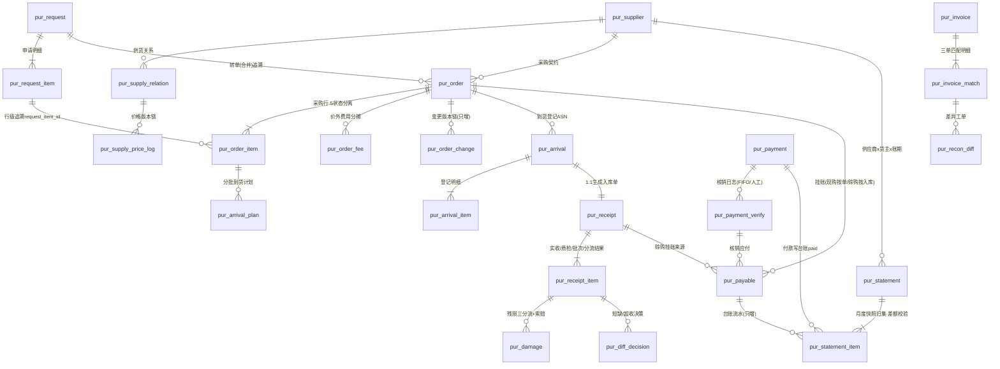

# DB-D06 采购域数据字典（oms_purchase）

> 文档编号：DB-D06 · 版本 V1.0 · 2026-10-24 · 编写：小凯 · 状态：待审阅（批次⑥）
> 上游契约：DB-00 数据库设计总册（schema=oms_purchase、表前缀 pur_、公共字段、命名/索引/类型基线、§6 六项必备）
> 需求依据：SRS-D06.01（采购申请与补货计划）/ SRS-D06.02（采购订单管理）/ SRS-D06.03（到货与入库）/ SRS-D06.04（采购对账与供应商台账）全部 4 份 §6 数据字段章节
> 参考溯源：商派 purchase 模块 38 表（po 5 组状态字段 check_status/eo_status/po_status/statement/defective_status + sync_status；statement 期初/增加/已付/期末八列结构；supplier/supplier_goods/branch_product_batch；逆向文档 04 §2）
> 关联契约：DB-D04 库存域数据字典（采购入库联动 inv_io_bill、在途联动 inv_stock_ledger.arrive_store、成本联动 inv_estimate_batch/inv_cost_change_log）

---

## 1. 总体说明

### 1.1 域定位

采购域承载「申请→采购单→到货入库→对账结算」全链路，三大设计主线：

1. **采购单 5 状态分离模型**（SRS-D06.02 §4.2，本域唯一定义源）：`audit_status`（审核）/ `inbound_status`（入库）/ `purchase_status`（采购）/ `settle_status`（结算）/ `damage_status`（残损）五个独立状态字段各管一段生命周期，替代单一大状态机；`wms_sync_status`（WMS 同步）为**集成层投影字段**独立于业务状态机（D09.03 指令事件回写）。任何消费方只读所需状态字段，**禁止组合推导隐式大状态**。
2. **供应商台账差额校验**（SRS-D06.04 §5.2，镜像商派 statement 八列结构）：月度台账 `期初 + 本期增加 − 本期已付 − 本期扣减 − 期末 = difference = 0`，校验不过**强制阻断关账**并生成逐笔回放定位工单；台账明细为流水式只增不改删（红冲纠错）。
3. **货主守卫与主数据外置**：只有凯淳买断货主产生采购（owner_id 必填强校验，SRS-D06.01 §5.1）；供应商主数据权威在金蝶/OA（Q28），本地 `pur_supplier` 只存映射（`kd_supplier_code`）+ 采购视角扩展属性。

### 1.2 公共字段与例外（对齐 DB-00 §3）

所有业务表默认包含：`id`(BIGINT UNSIGNED AI 主键)、`tenant_id`(BIGINT UNSIGNED NOT NULL，内部租户=1 也写入)、`owner_id`(BIGINT UNSIGNED NOT NULL DEFAULT 0)、`create_time`(DATETIME(3))、`update_time`(DATETIME(3) ON UPDATE)、`version`(INT UNSIGNED DEFAULT 0)、`is_deleted`(TINYINT(1) DEFAULT 0)。**下文逐表定义只列业务字段**，例外在表头标注：

- **流水/日志类**（pur_supply_price_log、pur_order_change、pur_statement_item、pur_payment_verify）：只增不改不删——**无 is_deleted、无 version、无 update_time**。
- **单据类**（pur_request/_item、pur_order/_item、pur_arrival/_item、pur_receipt/_item、pur_damage、pur_diff_decision、pur_payable、pur_invoice、pur_payment、pur_recon_diff）：状态机/红冲纠错，**禁用软删（无 is_deleted）**。
- **档案/配置/字典表**（pur_supplier、pur_supply_relation、pur_dict、pur_arrival_plan）：owner_id 免填（DEFAULT 0）或按归属物料冗余，逐表标注。
- **高频竞争表**必备 version：pur_order、pur_order_item、pur_receipt_item、pur_payable、pur_supply_relation（入库回写/核销回写并发）。
- 全库：InnoDB / utf8mb4 / utf8mb4_0900_ai_ci / 不建物理外键（LFK 标注）/ 枚举不用 MySQL ENUM，注释写全枚举值。

### 1.3 分表与归档（对齐 DB-00 §1.3）

采购域量级小（采购单日均 ≤200 张、行 ≤2000，SRS-D06.02 §8；到货/入库/应付日均 ≤500，SRS-D06.03 §8），**全部单表不分表**；pur_order_change / pur_statement_item 随单归档（`_arc` 后缀约定预留）。

---

## 2. 表清单（25 张）

| # | 表名 | 中文名 | 所属模块 | 分期 | 预估行量级 |
|---|---|---|---|---|---|
| 1 | pur_request | 采购申请单 | D06.01 | P0 | 万/年 |
| 2 | pur_request_item | 采购申请明细 | D06.01 | P0 | 十万/年 |
| 3 | pur_supplier | 供应商档案（金蝶映射+本地扩展） | D06.01 | P0 | 千 |
| 4 | pur_supply_relation | 供货关系（物料×供应商） | D06.01 | P0 | 十万 |
| 5 | pur_supply_price_log | 供货价历史（版本化流水） | D06.01 | P0 | 十万/年 |
| 6 | pur_order | 采购单（★5 状态分离） | D06.02 | P0 | 20万/3年 |
| 7 | pur_order_item | 采购单明细 | D06.02 | P0 | 百万/3年 |
| 8 | pur_order_fee | 采购价外费用 | D06.02 | P0 | 十万/3年 |
| 9 | pur_arrival_plan | 到货计划（分批批次） | D06.02 | P0 | 数十万/3年 |
| 10 | pur_order_change | 采购变更留痕（流水） | D06.02 | P0 | 十万/年 |
| 11 | pur_arrival | 到货登记单（ASN） | D06.03 | P0 | 20万/年 |
| 12 | pur_arrival_item | 到货登记明细 | D06.03 | P0 | 50万/年 |
| 13 | pur_receipt | 采购入库单（引用 inv_io_bill） | D06.03 | P0 | 20万/年 |
| 14 | pur_receipt_item | 采购入库单明细（实收/质检/批次效期/残损分流） | D06.03 | P0 | 50万/年 |
| 15 | pur_damage | 残损与索赔登记 | D06.03 | P0 | 万/年 |
| 16 | pur_diff_decision | 到货差异决策登记（短缺/超收） | D06.03 | P0 | 万/年 |
| 17 | pur_payable | 应付挂账单 | D06.04 | P1 | 30万/年 |
| 18 | pur_statement | 供应商台账（月度快照·差额校验） | D06.04 | P1 | 万/年 |
| 19 | pur_statement_item | 供应商台账明细（流水） | D06.04 | P1 | 50万/年 |
| 20 | pur_invoice | 采购发票（三单匹配） | D06.04 | P1 | 十万/年 |
| 21 | pur_invoice_match | 发票匹配明细 | D06.04 | P1 | 30万/年 |
| 22 | pur_payment | 付款申请与付款单 | D06.04 | P1 | 万/年 |
| 23 | pur_payment_verify | 付款核销日志（流水） | D06.04 | P1 | 十万/年 |
| 24 | pur_recon_diff | 采购对账差异工单 | D06.04 | P1 | 万/年 |
| 25 | pur_dict | 采购域字典（单据类型/挂账策略等） | 域级 | P0 | 百 |

> SRS §6 实体映射说明：SRS-D06.03 的 purchase_defect 与 purchase_claim 合并为 **pur_damage**（索赔是残损分流的并行动作，SRS §5.3；短缺/超收来源的索赔经 pur_diff_decision.decision=索赔 关联同一 claim 字段族）；SRS-D06.02 的 po_change_log 落为 **pur_order_change**；SRS-D06.04 的 payment_verification 落为 **pur_payment_verify**、purchase_diff_ticket 落为 **pur_recon_diff**、supplier_statement 按「月度快照头（pur_statement）+ 流水明细（pur_statement_item）」两级拆分（商派单表混存流水行与快照行，拆开后差额校验与关账锁定语义更清晰）。

---

## 3. 逐表定义

> 类型基线（DB-00 §6）：单号 VARCHAR(32)、名称 VARCHAR(128)、金额 DECIMAL(18,2)、单价 DECIMAL(18,4)、比例/税率 DECIMAL(9,4)、数量 INT、时间 DATETIME(3)、日期 DATE。

### 3.1 D06.01 采购申请与补货计划（P0）

#### 3.1.1 pur_request 采购申请单（SRS-D06.01 §6.1 purchase_apply）

用途：三类采购需求（手工/补货建议转单/批量导入）统一入口；OA 审批中形态承载；转采购单前的预算口径单据。owner_id 必填且强校验=凯淳买断（SRS §5.1 货主守卫）。 溯源：凯淳显式补建（商派无独立申请实体，purchase_need 继承 po 复用查询）；OA 审批字段族对齐 D10.05 契约。

| 字段 | 类型 | 约束 | 默认 | 注释 |
|---|---|---|---|---|
| request_bn | VARCHAR(32) | NOT NULL | | 申请单号 `PR{YYYYMMDD}{5位序列}` 全局唯一 |
| branch_id | BIGINT UNSIGNED | NOT NULL | | 目标仓（一单一仓）LFK→oms_fulfill.ful_branch |
| request_type | TINYINT | NOT NULL | 1 | 来源类型:1=手工,2=补货建议转单,3=批量导入（头级=混合时取主导来源，行级 source_type 为准） |
| status | TINYINT | NOT NULL | 1 | 单据状态:1=草稿,2=审批中,3=已通过,4=已驳回,5=部分转单,6=已转单,7=已关闭,8=已作废 |
| oa_instance_id | VARCHAR(64) | NOT NULL | '' | 泛微 OA 流程实例号（D10.05，回调幂等键成分） |
| oa_link | VARCHAR(255) | NOT NULL | '' | OA 单据跳转链接（OMS 不存审批节点明细，FR-02d） |
| approval_result | TINYINT | NOT NULL | 0 | 审批结果:0=无,1=通过,2=驳回,3=撤回确认（OA 回调回写） |
| approval_opinion | VARCHAR(512) | NOT NULL | '' | 审批意见（驳回意见企微通知申请人） |
| approval_time | DATETIME(3) | NULL | NULL | 审批完成时间 |
| expect_arrive_date | DATE | NULL | NULL | 期望到货日（头级默认，行可覆盖） |
| total_amount | DECIMAL(18,2) | NOT NULL | 0 | 申请总金额=Σ(参考价×数量)，预算口径（供货价变更不影响已提交申请，快照隔离） |
| applicant | VARCHAR(64) | NOT NULL | | 申请人 |
| apply_dept | VARCHAR(64) | NOT NULL | '' | 申请部门 |
| close_reason | TINYINT | NOT NULL | 0 | 关闭原因:0=无,1=需求取消,2=供应商断供,3=价格谈崩,4=转由调拨解决,9=其他（关闭必填，不可逆） |
| close_time | DATETIME(3) | NULL | NULL | 关闭时间 |
| import_batch_no | VARCHAR(64) | NOT NULL | '' | 导入批次号（request_type=3 时填，D01.06 留痕） |
| memo | VARCHAR(512) | NOT NULL | '' | 备注 |
| attachment | JSON | NULL | NULL | 附件（OSS URL 数组） |
| source | VARCHAR(16) | NOT NULL | 'local' | 数据来源:local=手工,suggest=建议转单,import=导入,migration=迁移 |

索引：`uk_pur_request_bn(request_bn)`；`idx_pur_request_owner(owner_id, status)`；`idx_pur_request_status(status, create_time)` 工作台；`idx_pur_request_oa(oa_instance_id)` 回调定位。 LFK：owner_id→oms_org.org_owner（仅凯淳买断类型）；branch_id→oms_fulfill.ful_branch。

#### 3.1.2 pur_request_item 采购申请明细（SRS-D06.01 §6.2 purchase_apply_item）

用途：申请行；建议转单行必存 calc_snapshot（D04.10 §5.4 测算依据快照，只读固化——申请改量不回写快照，人工调量另记 adjust_reason）；行余额=apply_num−transferred_num−closed_num 支撑部分转单。

| 字段 | 类型 | 约束 | 默认 | 注释 |
|---|---|---|---|---|
| request_id | BIGINT UNSIGNED | NOT NULL | | 申请单 LFK→pur_request |
| bm_id | BIGINT UNSIGNED | NOT NULL | | 基础物料 LFK→oms_stock.inv_material（货主归属与头一致，getProfile 校验） |
| apply_num | INT | NOT NULL | | 申请数量>0（箱规倍数软提示；已通过申请只可减不可增） |
| transferred_num | INT | NOT NULL | 0 | 已转单数量（累计≤apply_num，转单回写） |
| closed_num | INT | NOT NULL | 0 | 已关闭数量（行级关闭，累计+transferred≤apply_num） |
| expect_arrive_date | DATE | NULL | NULL | 期望到货日（行级，空则取头） |
| supplier_id | BIGINT UNSIGNED | NOT NULL | 0 | 建议供应商 LFK→pur_supplier（可空=0，转单前必填） |
| ref_price | DECIMAL(18,4) | NOT NULL | 0 | 参考供货价（默认供货价带出，预算口径） |
| price_version_id | BIGINT UNSIGNED | NOT NULL | 0 | 价格版本引用 LFK→pur_supply_price_log（§5.4 快照隔离依据） |
| source_type | TINYINT | NOT NULL | 1 | 行来源:1=手工,2=补货建议转单,3=导入 |
| source_ref | VARCHAR(64) | NOT NULL | '' | 来源引用:suggest_bn（LFK→oms_stock.inv_replenish_suggestion）/导入批次号 |
| calc_snapshot | JSON | NULL | NULL | 测算依据快照（建议转单行必存：日均销量/可售/在途/ROP/断货日等 D04.10 契约；合并转单同物料多行时为数组逐来源可溯；只读固化不可改） |
| adjust_reason | VARCHAR(255) | NOT NULL | '' | 人工调量原因（修改建议量时必填） |
| item_status | TINYINT | NOT NULL | 1 | 行状态:1=待转单,2=部分转单,3=已转单,4=已关闭 |
| target_order_bn | VARCHAR(32) | NOT NULL | '' | 转单后采购单号（追溯链回写：建议→申请→采购单） |

索引：`idx_pur_request_item_req(request_id)`；`idx_pur_request_item_bm(bm_id)`；`idx_pur_request_item_supplier(supplier_id, item_status)`；`idx_pur_request_item_source(source_ref)` 幂等防重复采纳（同 suggest_bn 已转单拒绝，FR-03d）。

#### 3.1.3 pur_supplier 供应商档案（SRS-D06.01 §6.3 supplier，档案表 owner_id 免填=0）

用途：供应商主数据映射（权威在金蝶/OA，Q28 决策）+ 采购视角本地扩展（付款方式/结算方式/信用等级等 OMS 本地权威，金蝶不管理）。映射缺失时申请/采购单选不到该供应商（前置阻断）。 溯源：← 商派 purchase.supplier（arrive_days/bank/account/credit_lv）改造：主数据字段收敛为金蝶映射+同步冗余，扩展属性显式分区。

| 字段 | 类型 | 约束 | 默认 | 注释 |
|---|---|---|---|---|
| supplier_code | VARCHAR(32) | NOT NULL | | 本地供应商编号，唯一 |
| kd_supplier_code | VARCHAR(64) | NOT NULL | | 金蝶供应商编码（映射键唯一，经 D08.06 通道同步；P1 前人工映射兜底） |
| supplier_name | VARCHAR(128) | NOT NULL | | 供应商名称（同步冗余） |
| short_name | VARCHAR(64) | NOT NULL | '' | 简称（同步冗余） |
| status | TINYINT | NOT NULL | 1 | 状态:1=启用,2=停用,3=冻结（随主数据同步+本地可加严） |
| pay_type | TINYINT | NOT NULL | 2 | 付款方式:1=现购cash,2=赊购credit（pur_order.po_type 默认来源，D06.04 挂账策略输入） |
| credit_days | INT | NOT NULL | 0 | 账期天数（pay_type=2 有效） |
| settle_type | TINYINT | NOT NULL | 3 | 结算方式:1=票到付款,2=货到付款,3=月结（应付到期日规则输入，SRS-D06.04 FR-01b） |
| credit_lv | VARCHAR(10) | NOT NULL | '' | 信用等级（本地评估，镜像商派 supplier.credit_lv；D06.03 履约统计参考） |
| default_branch_id | BIGINT UNSIGNED | NOT NULL | 0 | 默认收货仓 LFK→oms_fulfill.ful_branch |
| contact_ext | JSON | NULL | NULL | 本地联系人扩展（采购对接人/电话，不回写主数据；电话为敏感字段按 DB-00 §3.2 信封加密存 OSS 引用或 _enc 化，此处存非敏感摘要） |
| bank_ext | JSON | NULL | NULL | 银行账户展示冗余（账户权威在金蝶，SRS-D06.04 FR-04b；脱敏展示） |
| sync_time | DATETIME(3) | NULL | NULL | 最近主数据同步时间 |
| sync_source | VARCHAR(16) | NOT NULL | 'manual' | 同步来源:kingdee=金蝶,oa=OA,manual=人工补录,migration=迁移 |

索引：`uk_pur_supplier_code(supplier_code)`；`uk_pur_supplier_kd(kd_supplier_code)` 映射键唯一；`idx_pur_supplier_status(status)`。

#### 3.1.4 pur_supply_relation 供货关系（SRS-D06.01 §6.4 supplier_goods）

用途：供应商×基础物料供货档案（提前期/MOQ/箱规/默认供货价）；消费方=D04.10 建议量修正与 supplier_id 带出、申请行默认值、采购价参考；采购入库自动建立/更新（回写最近供货价，镜像商派 supplier_goods 自动关联机制）。owner_id=归属物料货主冗余（行级过滤用）。 溯源：← 商派 purchase.supplier_goods 改造：+price_version_id 版本引用、+tax_flag 含税口径（与 D04.07 §5.3 全局配置一致）。

| 字段 | 类型 | 约束 | 默认 | 注释 |
|---|---|---|---|---|
| supplier_id | BIGINT UNSIGNED | NOT NULL | | 供应商 LFK→pur_supplier（联合唯一①） |
| bm_id | BIGINT UNSIGNED | NOT NULL | | 基础物料 LFK→oms_stock.inv_material（联合唯一②） |
| default_price | DECIMAL(18,4) | NOT NULL | 0 | 默认供货价 |
| tax_flag | TINYINT | NOT NULL | 1 | 含税标记:1=含税,2=不含税（口径与 D04.07 §5.3 全局配置一致） |
| price_version_id | BIGINT UNSIGNED | NOT NULL | 0 | 当前价格版本 LFK→pur_supply_price_log |
| lead_time | INT | NOT NULL | 7 | 采购提前期（天，D04.10 补货公式与期望到货日推导消费；无档案默认 7 天） |
| moq | INT | NOT NULL | 0 | 最小起订量（D04.10 建议量修正消费） |
| pack_qty | INT | NOT NULL | 1 | 订货倍数/箱规（建议量向上取整修正） |
| is_default | TINYINT(1) | NOT NULL | 0 | 是否默认供应商:0=否,1=是（同物料多供应商时唯一默认，应用层校验） |
| last_purchase_time | DATETIME(3) | NULL | NULL | 最近采购时间（D06.03 入库确认回写，IF-D06.01-04） |
| last_purchase_price | DECIMAL(18,4) | NOT NULL | 0 | 最近采购价（同上回写） |
| status | TINYINT | NOT NULL | 1 | 状态:1=启用,2=停用 |

索引：`uk_pur_supply_relation(supplier_id, bm_id)` 联合唯一；`idx_pur_supply_relation_bm(bm_id, is_default)` 物料反查默认供应商；`idx_pur_supply_relation_owner(owner_id)`。

#### 3.1.5 pur_supply_price_log 供货价历史（SRS-D06.01 §6.5 supplier_price_history，流水类只增不改）

用途：供货价版本化留痕（每次变更记录版本：生效/失效时间、操作人、旧价新价）；申请行/采购行 price_version_id 指向本表实现价格快照隔离。 溯源：← 商派 purchase.branch_product_batch 进价历史 + dealer.goods_price 有效期版本化设计改造。

| 字段 | 类型 | 约束 | 默认 | 注释 |
|---|---|---|---|---|
| supplier_id | BIGINT UNSIGNED | NOT NULL | | 供应商 LFK→pur_supplier |
| bm_id | BIGINT UNSIGNED | NOT NULL | | 基础物料 LFK→oms_stock.inv_material |
| price | DECIMAL(18,4) | NOT NULL | 0 | 供货价（本版本价格） |
| tax_flag | TINYINT | NOT NULL | 1 | 含税口径:1=含税,2=不含税 |
| effective_time | DATETIME(3) | NOT NULL | | 生效时间 |
| expire_time | DATETIME(3) | NULL | NULL | 失效时间（NULL=当前有效版本） |
| change_reason | VARCHAR(255) | NOT NULL | '' | 变更原因 |
| operator | VARCHAR(64) | NOT NULL | '' | 操作人 |
| source | VARCHAR(16) | NOT NULL | 'manual' | 来源:manual=手工,inbound_writeback=入库回写(D06.03),migration=迁移 |
| create_time | DATETIME(3) | NOT NULL | CURRENT_TIMESTAMP(3) | 创建时间 |
| tenant_id | BIGINT UNSIGNED | NOT NULL | | 租户 |
| owner_id | BIGINT UNSIGNED | NOT NULL | 0 | 货主（冗余自物料归属） |

索引：`idx_pur_supply_price_log_pair(supplier_id, bm_id, effective_time)` 版本链检索；`idx_pur_supply_price_log_current(supplier_id, bm_id, expire_time)` 当前有效价。

### 3.2 D06.02 采购订单管理（P0）

#### 3.2.1 pur_order 采购单（SRS-D06.02 §6.1 purchase_order）★核心

用途：采购契约唯一载体，承载「审核→在途→到货→入库→结算」全链路；**5 状态分离字段各自独立**+wms_sync_status 集成层投影（§4.2 状态模型见本文 §3.2.1 后附表）。审核通过=在途 + 的唯一时点（D04.02 契约，经 StockLedgerService::change 记 inv_stock_ledger.arrive_store，幂等键=单号+行+动作）。owner_id 必填=凯淳买断（只有买断货主产生采购）。 溯源：← 商派 purchase.po（30 列）改造：**5 组状态字段保留并规范化命名**（check_status→audit_status、eo_status→inbound_status、po_status→purchase_status、statement→settle_status、defective_status→damage_status）、sync_status→wms_sync_status 独立集成层、+owner_id 货主守卫、+terminate_flag、deposit 预付款字段族迁出至 D06.04（pur_payment.pay_type=预付）。

| 字段 | 类型 | 约束 | 默认 | 注释 |
|---|---|---|---|---|
| order_bn | VARCHAR(32) | NOT NULL | | 采购单号 `PO{YYYYMMDD}{5位序列}` 全局唯一（变更不产生新单号，版本留痕 pur_order_change） |
| supplier_id | BIGINT UNSIGNED | NOT NULL | | 供应商 LFK→pur_supplier（映射有效校验） |
| branch_id | BIGINT UNSIGNED | NOT NULL | | 收货仓（一单一仓，改仓=取消重建）LFK→oms_fulfill.ful_branch |
| source_type | TINYINT | NOT NULL | 1 | 来源:1=申请转单,2=直接创建,3=复制创建 |
| source_request_bns | VARCHAR(255) | NOT NULL | '' | 关联申请单号（逗号分隔，合并转单可多个）LFK→pur_request.request_bn |
| direct_reason | VARCHAR(255) | NOT NULL | '' | 直建原因（source_type=2 必填，权限=采购主管及以上） |
| po_type | TINYINT | NOT NULL | 2 | 付款类型:1=现购cash,2=赊购credit（取供应商档案默认；D06.04 挂账策略依据） |
| currency | VARCHAR(8) | NOT NULL | 'CNY' | 币种（多币种 P2 预留） |
| audit_status | TINYINT | NOT NULL | 1 | **审核状态①**:1=未审核(草稿),2=审批中(OA在途),3=已审核(生效·在途已记),4=已驳回,5=已作废（商派 check_status；本模块写，OA 回调驱动） |
| inbound_status | TINYINT | NOT NULL | 0 | **入库状态②**:0=不适用(未审核),1=待入库,2=部分入库(Σin_num<num),3=已入库(Σ(in_num+shortage_num)≥num),4=未入库终止(取消且零入库)（商派 eo_status；消费 D04.04 iobill.confirmed/D09.03 事件重算回写） |
| purchase_status | TINYINT | NOT NULL | 1 | **采购状态③**:1=执行中,2=采购完成(全部入库且残损已确认),3=已终止(整单取消零入库),4=部分终止(取消时已部分入库,terminate_flag伴生),5=采购退货(退供全量核销,P1)（商派 po_status；本模块终态编排，独立显式置位不做隐式推导） |
| settle_status | TINYINT | NOT NULL | 1 | **结算状态④**:1=未结算,2=部分结算,3=已结算,4=拒绝结算(差异冻结)（商派 statement 字段；**回写权归 D06.04**，本模块只读展示；枚举与 D04.04 inv_io_bill.settle_status 对齐映射） |
| damage_status | TINYINT | NOT NULL | 0 | **残损状态⑤**:0=无需确认(无残损),1=待确认(回传有残损待三分流决策),2=已确认(残损处理闭环)（商派 defective_status；D06.03 残损闭环回写） |
| wms_sync_status | TINYINT | NOT NULL | 1 | **WMS 同步状态⑥（集成层投影，非业务状态机）**:1=无需同步(未下发/本地仓免推),2=已下发(dispatch成功),3=推送失败(wms.inbound.push.failed),4=已取消同步(wms.inbound.cancel.succ)（商派 sync_status；D09.03 指令事件投影回写） |
| terminate_flag | TINYINT(1) | NOT NULL | 0 | 部分终止标记:0=否,1=是（FR-05b，purchase_status=4 伴生） |
| total_amount | DECIMAL(18,2) | NOT NULL | 0 | 商品总额=Σ行金额（审批阈值比对基数=total_amount+total_extra_fee） |
| total_extra_fee | DECIMAL(18,2) | NOT NULL | 0 | 价外费用总额（明细 pur_order_fee） |
| check_time | DATETIME(3) | NULL | NULL | 审核时间（在途记账时点） |
| check_operator | VARCHAR(64) | NOT NULL | '' | 审核人（OA 终审人或「系统免审」） |
| oa_instance_id | VARCHAR(64) | NOT NULL | '' | OA 流程实例号（超阈值/直建/取消/反审核审批） |
| oa_link | VARCHAR(255) | NOT NULL | '' | OA 单据链接 |
| emergency | TINYINT(1) | NOT NULL | 0 | 紧急标记:0=否,1=是 |
| supplier_confirm_flag | TINYINT(1) | NOT NULL | 0 | 供应商接单确认:0=未确认,1=已确认（人工可选标记，线下回签后勾选，不阻塞流程；P2 门户协同预留） |
| buyer | VARCHAR(64) | NOT NULL | '' | 采购员 |
| memo | VARCHAR(512) | NOT NULL | '' | 备注 |
| attachment | JSON | NULL | NULL | 附件（比价说明/交货条款等 OSS URL 数组） |
| source | VARCHAR(16) | NOT NULL | 'local' | 数据来源:local=手工,apply=申请转单,api=自动,import=导入,migration=迁移 |

索引：`uk_pur_order_bn(order_bn)`；`idx_pur_order_supplier(supplier_id, audit_status)`；`idx_pur_order_owner(owner_id, create_time)`；`idx_pur_order_status(audit_status, inbound_status, purchase_status)` 台账多维查询；`idx_pur_order_settle(settle_status)` D06.04 取数；`idx_pur_order_sync(wms_sync_status)` 推送失败工作台；`idx_pur_order_branch(branch_id, inbound_status)` 到货看板。 LFK：owner_id→oms_org.org_owner；supplier_id→pur_supplier；branch_id→oms_fulfill.ful_branch；source_request_bns→pur_request；审核/变更/取消在途记账→oms_stock.inv_stock_ledger.arrive_store（经 D04.02 接口，非字段级 LFK）。

**5 状态分离要点**（唯一定义源=SRS-D06.02 §4.2，回写权归属 FR-03b）：

| 状态字段 | 回写权 | 商派对应 | 关系说明 |
|---|---|---|---|
| audit_status | 本模块（OA 回调） | check_status | 总闸：未审核其余状态无意义；已审核=在途已记 |
| inbound_status | 本模块消费 D04.04/D09.03 事件重算 | eo_status | 事件驱动、重算式幂等（非增量累加） |
| purchase_status | 本模块（终态编排） | po_status | 由 inbound+damage 条件判定但**显式置位**，禁止隐式推导 |
| settle_status | **D06.04 回写**（本模块只读） | statement | 钱的状态独立于货流 |
| damage_status | D06.03 残损闭环回写 | defective_status | 残损是入库的旁路分支，独立于 inbound_status |
| wms_sync_status | D09.03 指令事件投影 | sync_status | 集成层字段，WMS 通道健康度不污染业务状态机 |

#### 3.2.2 pur_order_item 采购单明细（SRS-D06.02 §6.2 purchase_order_item）

用途：采购行；价格快照固化（后续供货价变更不影响本单）；in_num/out_num/shortage_num 由 D06.03 事件重算回写（§5.2 重算式幂等）。

| 字段 | 类型 | 约束 | 默认 | 注释 |
|---|---|---|---|---|
| order_id | BIGINT UNSIGNED | NOT NULL | | 采购单 LFK→pur_order |
| bm_id | BIGINT UNSIGNED | NOT NULL | | 基础物料 LFK→oms_stock.inv_material（货主归属一致校验） |
| num | INT | NOT NULL | | 采购数量>0（变更后=最新有效数量，旧值在 pur_order_change） |
| price | DECIMAL(18,4) | NOT NULL | 0 | 含税单价（口径=D04.07 §5.3 全局配置；价格快照+price_version_id 引用；调价原因必填走变更） |
| tax_rate | DECIMAL(9,4) | NOT NULL | 0 | 税率（百分数值，如 13.0000） |
| price_net | DECIMAL(18,4) | NOT NULL | 0 | 不含税派生价=price/(1+tax_rate)，4 位小数 |
| price_version_id | BIGINT UNSIGNED | NOT NULL | 0 | 供货价版本引用 LFK→pur_supply_price_log |
| amount | DECIMAL(18,2) | NOT NULL | 0 | 行金额=price×num |
| extra_fee_share | DECIMAL(18,2) | NOT NULL | 0 | 价外费用分摊额（分摊算法 SRS §5.3：费用总额×行占比，尾差入最后一行；行入库成本价=price+extra_fee_share/num 传 D04.07 priceIn） |
| in_num | INT | NOT NULL | 0 | 已入库数=Σ关联入库单据行正品确认量（D06.03 事件重算回写） |
| out_num | INT | NOT NULL | 0 | 已退供数（退供出库 P1 预留） |
| shortage_num | INT | NOT NULL | 0 | 短缺核销量（差异闭环「短缺不补」量，D06.03 pur_diff_decision 回写；in_num+shortage_num=num 视同完成） |
| expect_arrive_date | DATE | NULL | NULL | 期望到货日（合并转单同物料多行取最早） |
| request_item_id | BIGINT UNSIGNED | NOT NULL | 0 | 来源申请行 LFK→pur_request_item（申请转单行必填，追溯链；合并转单多来源时存首个+JSON 备份于 calc_snapshot_refs） |
| calc_snapshot_refs | JSON | NULL | NULL | 测算快照引用数组（合并行逐来源可溯，元素=request_item_id+calc_snapshot 摘要） |
| item_status | TINYINT | NOT NULL | 1 | 行状态:1=待入库,2=部分入库,3=完成入库,4=已关闭（余量人工关闭） |

索引：`idx_pur_order_item_order(order_id)`；`idx_pur_order_item_bm(bm_id)`；`idx_pur_order_item_request(request_item_id)` 转单追溯。行级高频回写→含 version（公共字段）。

#### 3.2.3 pur_order_fee 采购价外费用（SRS-D06.02 §6.3 purchase_order_fee）

用途：头级费用行（运费/装卸/保险/关税）；分摊结果快照到行级 extra_fee_share；任一行入库前可改（自动重摊+版本留痕），有入库行后费用区锁定（新费用走 D06.04 对账差异）。 溯源：← 商派 po.delivery_cost 单字段改造：费用类型字典化+分摊方式显式化+入存货成本（商派只入应付不分摊）。

| 字段 | 类型 | 约束 | 默认 | 注释 |
|---|---|---|---|---|
| order_id | BIGINT UNSIGNED | NOT NULL | | 采购单 LFK→pur_order |
| fee_type | TINYINT | NOT NULL | | 费用类型:1=运费,2=装卸费,3=保险费,4=关税,9=其他（字典可扩展 pur_dict.fee_type） |
| fee_amount | DECIMAL(18,2) | NOT NULL | 0 | 费用金额 |
| alloc_type | TINYINT | NOT NULL | 1 | 分摊方式:1=按金额占比,2=按数量占比 |
| alloc_version | INT | NOT NULL | 1 | 分摊版本（重摊+1，旧版本快照留档） |
| alloc_snapshot | JSON | NULL | NULL | 分摊结果快照（行级份额数组 [{order_item_id, share_amount}]，重摊覆盖留版本） |

索引：`idx_pur_order_fee_order(order_id, fee_type)`。

#### 3.2.4 pur_arrival_plan 到货计划（SRS-D06.02 §6.4 purchase_arrival_plan）

用途：分批到货批次安排（Σplan_num≤行数量，余量不排计划=一次性到货默认）；D06.03 到货登记按批次核销；计划余量人工关闭同步触发在途差额释放（等同减量变更路径）。owner_id 免填（DEFAULT 0，随采购单头冗余归属）。

| 字段 | 类型 | 约束 | 默认 | 注释 |
|---|---|---|---|---|
| order_id | BIGINT UNSIGNED | NOT NULL | | 采购单 LFK→pur_order |
| order_item_id | BIGINT UNSIGNED | NOT NULL | | 采购行 LFK→pur_order_item |
| batch_seq | INT | NOT NULL | 1 | 计划批次序号（行内递增） |
| plan_date | DATE | NOT NULL | | 计划到货日（供应商延期改期留痕 pur_order_change） |
| plan_num | INT | NOT NULL | | 计划数量（Σ≤行数量） |
| arrived_num | INT | NOT NULL | 0 | 已核销数量（D06.03 到货登记回写） |
| deviation_flag | TINYINT(1) | NOT NULL | 0 | 偏离标记:0=无,1=日期偏离,2=量差偏离,3=双偏离（供应商履约统计供数：准时率/足量率→D11） |
| status | TINYINT | NOT NULL | 1 | 状态:1=待到货,2=部分核销,3=已核销,4=已关闭（余量人工关闭，原因必填） |
| close_reason | VARCHAR(255) | NOT NULL | '' | 关闭原因（status=4 必填，同步释放在途） |

索引：`uk_pur_arrival_plan(order_item_id, batch_seq)` 唯一；`idx_pur_arrival_plan_date(plan_date, status)` 逾期跟催扫描（D06.03 §5.5）。

#### 3.2.5 pur_order_change 采购变更留痕（SRS-D06.02 §6.5 po_change_log，流水类只增不改）

用途：加量/减量/价格/费用/计划/取消全类型变更字段级留痕（版本链：旧值/新值/原因/操作人）；arrive_adjust_num 为在途差额记账幂等键成分；跨阈值上移重审挂 OA。

| 字段 | 类型 | 约束 | 默认 | 注释 |
|---|---|---|---|---|
| order_id | BIGINT UNSIGNED | NOT NULL | | 采购单 LFK→pur_order |
| order_bn | VARCHAR(32) | NOT NULL | | 采购单号（冗余，归档追溯加速） |
| order_item_id | BIGINT UNSIGNED | NOT NULL | 0 | 采购行（行级变更填，头级=0） |
| change_version | INT | NOT NULL | 1 | 变更版本号（单内递增，记账幂等键成分=单号+行+动作+版本号） |
| change_type | TINYINT | NOT NULL | | 变更类型:1=加量,2=减量,3=价格调整,4=价外费用,5=到货计划,6=头信息,7=整单取消,8=部分终止,9=反审核 |
| field_name | VARCHAR(64) | NOT NULL | '' | 变更字段名（num/price/extra_fee_share/plan_date 等） |
| old_value | VARCHAR(255) | NOT NULL | '' | 旧值 |
| new_value | VARCHAR(255) | NOT NULL | '' | 新值 |
| reason | VARCHAR(512) | NOT NULL | | 变更原因（必填；取消原因字典:1=需求取消,2=供应商违约,3=价格谈崩,4=重复下单,9=其他） |
| arrive_adjust_num | INT | NOT NULL | 0 | 在途差额调整量（±Δ；加量+/减量−/取消−未入库量；经 D04.02 change 记 inv_stock_ledger.arrive_store，action=采购变更/采购取消） |
| reaudit_flag | TINYINT(1) | NOT NULL | 0 | 重审标记:0=免审生效,1=跨阈值上移需 OA 重审（审批中变更挂起，SRS §5.5 三分支判定） |
| oa_instance_id | VARCHAR(64) | NOT NULL | '' | 重审 OA 流程引用 |
| status | TINYINT | NOT NULL | 2 | 状态:1=挂起(待重审),2=已生效,3=已驳回,4=已撤销 |
| operator | VARCHAR(64) | NOT NULL | | 操作人 |
| create_time | DATETIME(3) | NOT NULL | CURRENT_TIMESTAMP(3) | 变更时间 |
| tenant_id | BIGINT UNSIGNED | NOT NULL | | 租户 |
| owner_id | BIGINT UNSIGNED | NOT NULL | 0 | 货主（冗余自单头） |

索引：`idx_pur_order_change_order(order_id, change_version)` 版本链；`idx_pur_order_change_bn(order_bn)`。

### 3.3 D06.03 到货与入库（P0）

#### 3.3.1 pur_arrival 到货登记单（SRS-D06.03 §6.1 purchase_asn）

用途：ASN 到货预约/登记（手工/供应商通知代录/导入/无单认领四通道）；与 pur_receipt（进而与 inv_io_bill）1:1 绑定；在途口径澄清——登记/下发/回传均**不加在途**（在途唯一 + 时点=采购审核，唯一 − 时点=confirm，SRS §5.4）。 溯源：凯淳显式建单层（商派直接录实收生成 eo，无预约/通知层）。

| 字段 | 类型 | 约束 | 默认 | 注释 |
|---|---|---|---|---|
| arrival_bn | VARCHAR(32) | NOT NULL | | 到货登记号 `ASN{YYYYMMDD}{5位序列}` 唯一 |
| order_id | BIGINT UNSIGNED | NOT NULL | | 采购单 LFK→pur_order（一登记单一 PO，多行可） |
| order_bn | VARCHAR(32) | NOT NULL | | 采购单号（冗余追溯） |
| supplier_id | BIGINT UNSIGNED | NOT NULL | | 供应商（冗余自 PO）LFK→pur_supplier |
| branch_id | BIGINT UNSIGNED | NOT NULL | | 收货仓（冗余自 PO） |
| plan_batch_id | BIGINT UNSIGNED | NOT NULL | 0 | 到货计划批次 LFK→pur_arrival_plan（0=计划外到货，out_of_plan_flag 标记） |
| out_of_plan_flag | TINYINT(1) | NOT NULL | 0 | 计划外到货标记:0=否,1=是 |
| expect_arrive_date | DATE | NULL | NULL | 预计到货日（改期留痕） |
| carrier | VARCHAR(64) | NOT NULL | '' | 承运物流 |
| tracking_no | VARCHAR(64) | NOT NULL | '' | 运单号 |
| packing_list_ref | JSON | NULL | NULL | 装箱清单附件（OSS URL 数组） |
| receipt_id | BIGINT UNSIGNED | NOT NULL | 0 | 生成的采购入库单 LFK→pur_receipt（1:1 回填，幂等防重键） |
| status | TINYINT | NOT NULL | 1 | 登记状态:1=已登记,2=已生成入库单据,3=已下发,4=收货中(WMS接收确认),5=已回传,6=已确认(confirm闭环),7=已取消,8=异常(create失败告警) |
| source_type | TINYINT | NOT NULL | 1 | 登记来源:1=手工,2=供应商通知代录,3=导入,4=无单认领（无头件衔接 D04.04 FR-03c，7 天未认领升级告警） |
| headless_ref | VARCHAR(64) | NOT NULL | '' | 无主回传引用（source_type=4 时填，D09.03 无主队列 ID） |
| operator | VARCHAR(64) | NOT NULL | | 经手人 |

索引：`uk_pur_arrival_bn(arrival_bn)`；`idx_pur_arrival_order(order_id, status)`；`idx_pur_arrival_status(status, expect_arrive_date)` 在途到货看板/逾期跟催；`idx_pur_arrival_supplier(supplier_id, create_time)`。

#### 3.3.2 pur_arrival_item 到货登记明细

用途：登记行级数量（≤采购行余额=num−in_num−shortage_num−在途登记量，超量拒绝提示走变更加量，FR-01d）。

| 字段 | 类型 | 约束 | 默认 | 注释 |
|---|---|---|---|---|
| arrival_id | BIGINT UNSIGNED | NOT NULL | | 到货登记单 LFK→pur_arrival |
| order_item_id | BIGINT UNSIGNED | NOT NULL | | 采购行 LFK→pur_order_item |
| bm_id | BIGINT UNSIGNED | NOT NULL | | 基础物料（冗余）LFK→oms_stock.inv_material |
| arrive_num | INT | NOT NULL | | 本次到货数量>0（≤行余额校验） |
| plan_batch_id | BIGINT UNSIGNED | NOT NULL | 0 | 行级计划批次关联（多批次拆分登记用） |
| memo | VARCHAR(255) | NOT NULL | '' | 行备注 |

索引：`idx_pur_arrival_item_arrival(arrival_id)`；`idx_pur_arrival_item_poitem(order_item_id)` 行余额累计校验。

#### 3.3.3 pur_receipt 采购入库单（凯淳新增采购侧视图，引用 inv_io_bill）

用途：采购入库单在采购域的**业务视图**，与 oms_stock.inv_io_bill（bill_type=purchase_in）**1:1 绑定**（bill_bn 唯一）；单据生命周期/记账/红冲权威在 D04.04，本表承载采购侧扩展（暂估标记、结算投影、质检汇总、批次效期要求）；确认事件回写采购单 inbound_status/damage_status 与行核销。禁用软删（随 inv_io_bill 红冲机制）。 溯源：← 商派 purchase.eo（save_eo 一体化）拆解：记账归 D04.04/D04.02，本表只留采购业务编排字段。

| 字段 | 类型 | 约束 | 默认 | 注释 |
|---|---|---|---|---|
| receipt_bn | VARCHAR(32) | NOT NULL | | 采购入库单号（=inv_io_bill.bill_bn 同值，唯一） |
| bill_bn | VARCHAR(32) | NOT NULL | | 出入库单据号 LFK→oms_stock.inv_io_bill（1:1 绑定，幂等键；跨 schema 逻辑外键） |
| bill_id | BIGINT UNSIGNED | NOT NULL | 0 | 单据头 ID LFK→oms_stock.inv_io_bill.id（冗余加速） |
| arrival_id | BIGINT UNSIGNED | NOT NULL | 0 | 到货登记单 LFK→pur_arrival（1:1） |
| order_id | BIGINT UNSIGNED | NOT NULL | | 采购单 LFK→pur_order（源单） |
| order_bn | VARCHAR(32) | NOT NULL | | 采购单号（冗余=inv_io_bill.source_bill_bn） |
| supplier_id | BIGINT UNSIGNED | NOT NULL | | 供应商 LFK→pur_supplier |
| branch_id | BIGINT UNSIGNED | NOT NULL | | 收货仓 |
| wms_batch_no | VARCHAR(64) | NOT NULL | '' | WMS 回传批次号（D09.03 回调透传，追溯） |
| estimate_flag | TINYINT(1) | NOT NULL | 1 | 暂估标记:0=正式价(发票已到),1=暂估价(发票未到，confirm 时 D04.07 priceIn 落 inv_estimate_batch；发票匹配由 D06.04 触发 reverseEstimate 转正) |
| bill_status | TINYINT | NOT NULL | 1 | 单据状态投影:1=草稿,2=已下发WMS,3=部分回传,4=全部回传,5=已确认,6=已红冲,7=已关闭（**权威在 inv_io_bill.status**，本字段为只读投影冗余，事件同步） |
| settle_status | TINYINT | NOT NULL | 1 | 结算状态:0=无需结算,1=未结算,2=部分结算,3=已结算,4=结算锁定(禁红冲)（D06.04 markSettled 回写投影，与 inv_io_bill.settle_status 同枚举语义） |
| settle_bn | VARCHAR(32) | NOT NULL | '' | 结算核销单号 LFK→pur_payment.payment_bn |
| confirm_time | DATETIME(3) | NULL | NULL | 确认记账时间（在途−/实际+时点，挂账取数时点） |
| operator | VARCHAR(64) | NOT NULL | '' | 经手人 |

索引：`uk_pur_receipt_bn(receipt_bn)`；`uk_pur_receipt_bill(bill_bn)` 1:1 绑定唯一；`idx_pur_receipt_order(order_id)`；`idx_pur_receipt_settle(settle_status, supplier_id)` D06.04 挂账取数；`idx_pur_receipt_estimate(estimate_flag, confirm_time)` 暂估超期预警（入库后 60 天发票未到）。

#### 3.3.4 pur_receipt_item 采购入库单明细（实收/质检/批次效期/残损分流结果量）

用途：入库行采购侧明细——实收/合格/次品/拒收/折让转正各量分流结果（残损决策过程在 pur_damage，本表存**决策后结果量**，Σ校验：qualified+defect+discount+reject+shortage=issued±容差）；批次效期为 D04.09 registerIn 供给源；unit_cost=入库成本价（传 D04.07 priceIn）。禁用软删。

| 字段 | 类型 | 约束 | 默认 | 注释 |
|---|---|---|---|---|
| receipt_id | BIGINT UNSIGNED | NOT NULL | | 采购入库单 LFK→pur_receipt |
| bill_item_id | BIGINT UNSIGNED | NOT NULL | 0 | 出入库单据行 LFK→oms_stock.inv_io_bill_item（1:1 投影） |
| order_item_id | BIGINT UNSIGNED | NOT NULL | | 采购行 LFK→pur_order_item（source_item_id 追溯链） |
| bm_id | BIGINT UNSIGNED | NOT NULL | | 基础物料 LFK→oms_stock.inv_material |
| issued_num | INT | NOT NULL | 0 | 下发数量（=登记本次到货量） |
| returned_num | INT | NOT NULL | 0 | 累计回传数量（WMS 收货登记，分批回传累积） |
| actual_num | INT | NOT NULL | 0 | 实收数量（质检前） |
| qualified_num | INT | NOT NULL | 0 | 合格确认量（正品入账=inv_io_bill_item.confirmed_num 主体） |
| defect_num | INT | NOT NULL | 0 | 次品量（让步接收-次品分流→D04.02 defective 口径入账） |
| discount_num | INT | NOT NULL | 0 | 折让转正量（让步接收-折让分流，按正品入账） |
| reject_num | INT | NOT NULL | 0 | 拒收量（不入账，核销走短缺路径；退供出库 P1 预留） |
| shortage_num | INT | NOT NULL | 0 | 短少量（差异决策后核销量回写 pur_order_item.shortage_num） |
| discount_amount | DECIMAL(18,2) | NOT NULL | 0 | 折让金额（协议价扣减，供 D06.04 应付扣减；超阈值 OA 审批） |
| batch_no | VARCHAR(64) | NOT NULL | '' | 批次号（效期物料必填→D04.09 registerIn 登记） |
| produce_date | DATE | NULL | NULL | 生产日期（效期物料必填） |
| expire_date | DATE | NULL | NULL | 效期到期日 |
| serial_nos | JSON | NULL | NULL | 序列号清单（SN 物料必填，JSON 数组→D04.09） |
| quality_result | TINYINT | NOT NULL | 0 | 质检结果:0=免检,1=合格,2=部分不良,3=整批不良（质检明细摘要存 quality_detail） |
| quality_detail | JSON | NULL | NULL | 质检明细（不良原因分布/抽检比例/WMS 质检单引用） |
| unit_cost | DECIMAL(18,4) | NOT NULL | 0 | 入库成本价=PO行 price+extra_fee_share/num（D04.07 priceIn 价源，含税口径 §5.3） |
| estimate_flag | TINYINT(1) | NOT NULL | 1 | 行暂估标记（同头；发票到→D06.04 reverseEstimate 转正联动 inv_estimate_batch） |
| amount | DECIMAL(18,2) | NOT NULL | 0 | 行金额=unit_cost×qualified_num(含折让转正量) |

索引：`idx_pur_receipt_item_receipt(receipt_id)`；`idx_pur_receipt_item_poitem(order_item_id)` 行核销重算；`idx_pur_receipt_item_billitem(bill_item_id)`；`idx_pur_receipt_item_batch(bm_id, batch_no)` 批次追溯。行级高频回写→含 version。

#### 3.3.5 pur_damage 残损与索赔登记（SRS-D06.03 §6.2 purchase_defect + §6.3 purchase_claim 合并）

用途：残损处理单——回传 defect_num>0 或 wms.inbound.diff 破损自动生成；三分流决策（拒收退回/让步次品/折让转正）JSON 明细 Σ=damage_num 强校验；索赔字段族并行（对象=供应商/物流承运商，金额=残损量×采购价，结果回写联动 D06.04 应付扣减）；全闭环后回写 pur_order.damage_status=已确认。禁用软删（决策留痕不可删，纠错走 D04.04 红冲+重新决策）。

| 字段 | 类型 | 约束 | 默认 | 注释 |
|---|---|---|---|---|
| damage_bn | VARCHAR(32) | NOT NULL | | 残损单号 `DM{YYYYMMDD}{5位}` 唯一 |
| order_id | BIGINT UNSIGNED | NOT NULL | | 采购单 LFK→pur_order |
| order_bn | VARCHAR(32) | NOT NULL | | 采购单号（冗余追溯） |
| order_item_id | BIGINT UNSIGNED | NOT NULL | | 采购行 LFK→pur_order_item |
| receipt_id | BIGINT UNSIGNED | NOT NULL | 0 | 采购入库单 LFK→pur_receipt |
| bill_item_id | BIGINT UNSIGNED | NOT NULL | 0 | 入库单据行 LFK→oms_stock.inv_io_bill_item（追溯链） |
| bm_id | BIGINT UNSIGNED | NOT NULL | | 基础物料（冗余） |
| damage_num | INT | NOT NULL | | 残损数量（=WMS 回传 defect_num 原始值**不可改**，改判走红冲） |
| damage_reason | TINYINT | NOT NULL | 9 | 不良原因:1=运输破损,2=生产不良,3=包装破损,4=效期异常,5=货差短少,9=其他（字典 pur_dict.damage_reason） |
| wms_evidence_ref | JSON | NULL | NULL | WMS 凭证引用（照片 OSS URL/差异登记 ID，D09.03 diff 透传） |
| decision_json | JSON | NULL | NULL | 分流决策明细:[{num,flow(1=拒收退回,2=让步接收-次品,3=让步接收-折让转正),discount_amount,approval_ref}]，Σnum=damage_num 强校验 |
| claim_flag | TINYINT(1) | NOT NULL | 0 | 是否发起索赔:0=否,1=是 |
| claim_bn | VARCHAR(32) | NOT NULL | '' | 索赔号 `CL{YYYYMMDD}{5位}`（claim_flag=1 生成；短缺/超收拒收来源索赔经 pur_diff_decision 关联同字段族） |
| claim_object_type | TINYINT | NOT NULL | 0 | 索赔对象类型:0=无,1=供应商,2=物流承运商 |
| claim_object_id | BIGINT UNSIGNED | NOT NULL | 0 | 索赔对象 ID（供应商 LFK→pur_supplier/承运商） |
| claim_amount | DECIMAL(18,2) | NOT NULL | 0 | 索赔金额=责任归属残损量×PO 行 price |
| claim_result | TINYINT | NOT NULL | 0 | 索赔结果:0=处理中,1=认赔,2=部分认赔,3=放弃(超阈值需OA) |
| claim_result_amount | DECIMAL(18,2) | NOT NULL | 0 | 认定金额（结果=1/2 填） |
| settle_ref | VARCHAR(32) | NOT NULL | '' | D06.04 应付扣减引用（调整单/台账流水 object_bn） |
| status | TINYINT | NOT NULL | 1 | 残损单状态:1=待决策,2=审批中(让步/放弃超阈值OA),3=已决策,4=已闭环（超期 7 天未决升级告警） |
| oa_instance_id | VARCHAR(64) | NOT NULL | '' | OA 审批引用（让步接收货值>2000 元/索赔放弃必填，D10.05） |
| handler | VARCHAR(64) | NOT NULL | '' | 决策人 |
| decide_time | DATETIME(3) | NULL | NULL | 决策时间 |

索引：`uk_pur_damage_bn(damage_bn)`；`idx_pur_damage_claim(claim_bn)`（claim_bn 允许空串复用，唯一性由应用层保障——空串场景无法建唯一索引）；`idx_pur_damage_order(order_id, status)`；`idx_pur_damage_status(status, create_time)` 超期扫描；`idx_pur_damage_claim_result(claim_result, claim_object_id)` 索赔台账。

#### 3.3.6 pur_diff_decision 到货差异决策登记（SRS-D06.03 §6.4 purchase_diff_decision）

用途：短缺/超收差异的采购侧决策留痕；与 D09.03 差异登记双向闭环（diff_ref）；核销量回写 pur_order_item.shortage_num；索赔路径关联 pur_damage 字段族。禁用软删。

| 字段 | 类型 | 约束 | 默认 | 注释 |
|---|---|---|---|---|
| diff_ref | VARCHAR(64) | NOT NULL | '' | D09.03 差异登记引用（fulfill_inbound_diff，双向闭环其 FR-05c） |
| order_id | BIGINT UNSIGNED | NOT NULL | | 采购单 LFK→pur_order |
| order_item_id | BIGINT UNSIGNED | NOT NULL | | 采购行 LFK→pur_order_item |
| receipt_id | BIGINT UNSIGNED | NOT NULL | 0 | 采购入库单 LFK→pur_receipt |
| bill_bn | VARCHAR(32) | NOT NULL | '' | 入库单据号 LFK→oms_stock.inv_io_bill |
| supplier_id | BIGINT UNSIGNED | NOT NULL | 0 | 供应商（冗余自 PO，差异台账统计维度）LFK→pur_supplier |
| diff_type | TINYINT | NOT NULL | | 差异类型:1=短缺,2=超收(容差内),3=超收(容差外挂起),4=拒收差异 |
| diff_num | INT | NOT NULL | 0 | 差异数量 |
| decision | TINYINT | NOT NULL | 0 | 决策:0=待决策;短缺:1=供应商补发(保持部分入库),2=短缺核销(视同完成),3=索赔;超收:4=追认(D06.02变更加量事后补审),5=拒收超出(同残损拒收路径) |
| shortage_num_writeback | INT | NOT NULL | 0 | 核销量回写值（decision=2 时回写 pur_order_item.shortage_num） |
| damage_id | BIGINT UNSIGNED | NOT NULL | 0 | 关联残损/索赔单 LFK→pur_damage（decision=3 时填） |
| reason | VARCHAR(512) | NOT NULL | '' | 决策原因（核销/放弃必填） |
| approval_ref | VARCHAR(64) | NOT NULL | '' | 审批引用（核销超阈值 OA，D10.05） |
| status | TINYINT | NOT NULL | 1 | 状态:1=待决策,2=已决策,3=已闭环 |
| operator | VARCHAR(64) | NOT NULL | '' | 决策人 |

索引：`idx_pur_diff_decision_order(order_id, status)`；`idx_pur_diff_decision_ref(diff_ref)` 双向闭环；`idx_pur_diff_decision_supplier(supplier_id, diff_type)` 供应商差异台账（短缺率/破损率/超收率统计，FR-05d）。

### 3.4 D06.04 采购对账与供应商台账（P1）

#### 3.4.1 pur_payable 应付挂账单（SRS-D06.04 §6.1 purchase_payable）

用途：挂账策略引擎产物——**现购按单挂账**（purchase.po.checked 事件，金额=商品总额+价外费用，镜像商派 payable=product_cost+delivery_cost）/**赊购按入库挂账**（purchase.receipt.confirmed 事件，金额=Σ入库成本价×确认量）；幂等键（事件+源单）防双挂；暂估标记发票匹配后转正式。禁用软删。 溯源：← 商派 purchase_payments（现购）+ credit_sheet（赊购）两表分叉显式化为策略字段 accrual_strategy。

| 字段 | 类型 | 约束 | 默认 | 注释 |
|---|---|---|---|---|
| payable_bn | VARCHAR(32) | NOT NULL | | 应付单号 `AP{YYYYMMDD}{5位}` 唯一 |
| supplier_id | BIGINT UNSIGNED | NOT NULL | | 供应商 LFK→pur_supplier |
| accrual_strategy | TINYINT | NOT NULL | | 挂账策略:1=现购按单挂账(采购单审核时点,触发事件purchase.po.checked),2=赊购按入库挂账(入库确认时点,触发事件purchase.receipt.confirmed)（供应商级默认+单据级覆盖，pur_dict.accrual_strategy） |
| accrual_time | DATETIME(3) | NOT NULL | | 挂账时点（=审核时间/confirm 时间，口径快照） |
| accrual_amount | DECIMAL(18,2) | NOT NULL | 0 | 挂账金额（策略1=total_amount+total_extra_fee 头级；策略2=Σ(unit_cost×确认量) 行级含价外分摊入单价） |
| accrual_basis_snapshot | JSON | NULL | NULL | 金额口径快照（行级明细/事件载荷摘要，可解释审计） |
| source_order_bn | VARCHAR(32) | NOT NULL | '' | 关联采购单号 LFK→pur_order.order_bn |
| source_bill_bns | JSON | NULL | NULL | 关联入库单据号数组 LFK→oms_stock.inv_io_bill.bill_bn（赊购可多单） |
| estimate_flag | TINYINT(1) | NOT NULL | 1 | 暂估标记:0=正式(发票已匹配),1=暂估(发票未到；转正后金额调整为发票口径+差额冲减留痕) |
| adjust_amount | DECIMAL(18,2) | NOT NULL | 0 | 调整扣减累计（红字负值：折让/索赔认定/拒付差额，超 1000 元 OA 审批） |
| settled_amount | DECIMAL(18,2) | NOT NULL | 0 | 已核销金额（付款核销累计） |
| balance | DECIMAL(18,2) | NOT NULL | 0 | 余额=accrual_amount+adjust_amount−settled_amount（应用层校验恒等式） |
| deposit_offset_amount | DECIMAL(18,2) | NOT NULL | 0 | 预付款抵扣额（§5.4 镜像商派 deposit_balance：预付≥结算额抵扣后余款挂应收方向；预付<结算额抵扣清零差额付款） |
| due_date | DATE | NULL | NULL | 到期日（票到付款=发票日+账期，发票未到不出到期日；货到付款=入库日+账期；月结=账期月末汇总；取 pur_supplier.settle_type+credit_days） |
| settle_status | TINYINT | NOT NULL | 1 | 结算状态:1=未结算,2=部分结算,3=已结算,4=拒绝结算(差异冻结)（与 pur_order.settle_status/inv_io_bill.settle_status 同枚举语义） |
| settle_bn | VARCHAR(32) | NOT NULL | '' | 核销付款单号 LFK→pur_payment.payment_bn |
| status | TINYINT | NOT NULL | 1 | 单据状态:1=生效,2=差异挂起(pur_recon_diff 关联),3=已关闭 |
| idempotent_key | VARCHAR(128) | NOT NULL | | 幂等键=(event_id, source_bill) 拼接，唯一索引防双挂 |

索引：`uk_pur_payable_bn(payable_bn)`；`uk_pur_payable_idem(idempotent_key)` 防双挂唯一；`idx_pur_payable_supplier(supplier_id, settle_status, due_date)` 付款工作台 FIFO；`idx_pur_payable_estimate(estimate_flag, accrual_time)` 暂估超期预警；`idx_pur_payable_owner(owner_id)` 货主分账。

#### 3.4.2 pur_statement 供应商台账·月度快照（SRS-D06.04 §6.2 supplier_statement 快照行）★差额校验

用途：供应商×货主×账期（月）八列台账快照（**商派 statement 镜像+扩展**）：应付方向四列（期初/本期增加/本期已付/期末）+应收方向四列（退款/索赔应收供应商场景）+扣减列+差额校验；关账状态机：未关账→关账中（校验）→已关账（锁定，补录走反关账 OA 审批）。
**差额校验契约（§5.2）**：`difference = initial_pay + pay_add − paid − deduct_amount − final_pay`，关账前置校验 difference=0，**不平强制阻断关账**+生成逐笔回放定位工单（按 pur_statement_item 流水重放）；校验结果留痕（check_result/check_ticket_ref）。
溯源：← 商派 purchase.statement（八列 initial_pay/pay_add/paid/final_pay + initial_receive/receive_add/received/final_receive + difference）改造：+owner_id 货主分账（凯淳买断即凯淳本体，预留经销采购分账）、+deduct_amount 扣减列显式化（商派混入 pay_add 负值）、差额从展示字段升级为**关账强制校验**、快照头与流水明细两表拆分。

| 字段 | 类型 | 约束 | 默认 | 注释 |
|---|---|---|---|---|
| supplier_id | BIGINT UNSIGNED | NOT NULL | | 供应商 LFK→pur_supplier |
| period | CHAR(7) | NOT NULL | | 账期（月，格式 YYYY-MM） |
| initial_pay | DECIMAL(18,2) | NOT NULL | 0 | 期初应付（=上月 final_pay；首期=期初导入值 source=migration） |
| pay_add | DECIMAL(18,2) | NOT NULL | 0 | 本期增加应付（Σ挂账，含暂估转正调整±） |
| paid | DECIMAL(18,2) | NOT NULL | 0 | 本期已付（Σ核销付款） |
| deduct_amount | DECIMAL(18,2) | NOT NULL | 0 | 本期扣减（Σ红字调整：索赔认定/折让/拒付差额） |
| final_pay | DECIMAL(18,2) | NOT NULL | 0 | 期末应付=initial_pay+pay_add−paid−deduct_amount |
| initial_receive | DECIMAL(18,2) | NOT NULL | 0 | 期初应收（应收供应商方向：退款/索赔应收/预付抵扣余额挂应收） |
| receive_add | DECIMAL(18,2) | NOT NULL | 0 | 本期增加应收 |
| received | DECIMAL(18,2) | NOT NULL | 0 | 本期已收 |
| final_receive | DECIMAL(18,2) | NOT NULL | 0 | 期末应收（应收方向四列同构校验） |
| difference | DECIMAL(18,2) | NOT NULL | 0 | 差额=initial_pay+pay_add−paid−deduct_amount−final_pay（**关账校验必须=0**） |
| check_result | TINYINT | NOT NULL | 0 | 差额校验结果:0=未校验,1=通过,2=不通过(阻断关账) |
| check_ticket_ref | VARCHAR(64) | NOT NULL | '' | 校验不平定位工单引用（pur_recon_diff.diff_bn，逐笔回放定位） |
| close_status | TINYINT | NOT NULL | 1 | 关账状态:1=未关账,2=关账中(校验),3=已关账(台账锁定,追溯调整走次期) |
| close_time | DATETIME(3) | NULL | NULL | 关账时间 |
| reopen_ref | VARCHAR(64) | NOT NULL | '' | 反关账 OA 审批引用（财务主管审批+全留痕） |
| recon_doc_ref | JSON | NULL | NULL | 对账单文档引用（PDF/Excel OSS URL、发送时间、回签影像，FR-05a/05b） |
| recon_confirm_status | TINYINT | NOT NULL | 0 | 对账单确认状态:0=未生成,1=待发送,2=已发送,3=已确认(回签),4=有异议(转 pur_recon_diff)（逾期未回默认不视同确认，升级人工跟进） |

索引：`uk_pur_statement(supplier_id, owner_id, period)` 唯一；`idx_pur_statement_period(period, close_status)` 月结批量；`idx_pur_statement_owner(owner_id, period)` 货主分账。

#### 3.4.3 pur_statement_item 供应商台账明细（SRS-D06.04 §6.2 流水行，流水类只增不改删）

用途：每笔资金/挂账动作实时 append 一行（红冲纠错：负向流水冲抵，禁止改删）；月度关账时归集到 pur_statement 快照；差额校验不平时**逐笔回放定位**的数据基础（balance_after 运行余额链）。

| 字段 | 类型 | 约束 | 默认 | 注释 |
|---|---|---|---|---|
| supplier_id | BIGINT UNSIGNED | NOT NULL | | 供应商 LFK→pur_supplier |
| period | CHAR(7) | NOT NULL | '' | 归属账期（YYYY-MM，动作时点所在月；关账后补录拒绝） |
| statement_id | BIGINT UNSIGNED | NOT NULL | 0 | 归属月度快照 LFK→pur_statement（0=未归集） |
| object_type | TINYINT | NOT NULL | | 业务类型:1=赊购入库挂账,2=现购按单挂账,3=付款核销,4=退货退款,5=调整扣减(索赔/折让/拒付),6=预付款抵扣,7=暂估转正调整,9=其他（商派 statement.object_type 1 赊购入库/2 现款结算/3 采购退货 语义扩展） |
| object_bn | VARCHAR(32) | NOT NULL | | 关联单号（AP 应付单/PP 付款单/DM 残损单/IV 发票等） |
| direction | TINYINT | NOT NULL | 1 | 方向:1=应付方向,2=应收方向（退款/索赔应收供应商） |
| amount | DECIMAL(18,2) | NOT NULL | 0 | 金额（带符号：挂账正/付款核销负/红字调整负；object_type=4 退款在应收方向汇总做减法，商派 statementDo 口径） |
| balance_after | DECIMAL(18,2) | NOT NULL | 0 | 该方向动作后运行余额（回放校验链，差额定位依据） |
| red_flush_of | BIGINT UNSIGNED | NOT NULL | 0 | 红冲引用原流水 id（纠错流水必填；非空即红冲行） |
| operator | VARCHAR(64) | NOT NULL | '' | 经手人（系统动作=系统账号名） |
| create_time | DATETIME(3) | NOT NULL | CURRENT_TIMESTAMP(3) | 动作时间 |
| tenant_id | BIGINT UNSIGNED | NOT NULL | | 租户 |
| owner_id | BIGINT UNSIGNED | NOT NULL | | 货主（分账维度，必填） |

索引：`idx_pur_statement_item_supplier(supplier_id, owner_id, period, create_time)` 台账回放；`idx_pur_statement_item_object(object_type, object_bn)` 单据追溯；`idx_pur_statement_item_stmt(statement_id)` 快照归集。

#### 3.4.4 pur_invoice 采购发票（SRS-D06.04 §6.3 purchase_invoice）

用途：进项发票登记（一发票多 PO 合并开票/一 PO 多发票分批开票，关联在 pur_invoice_match）；**三单匹配**（采购单-入库单-发票：数量/单价/金额三维比对+容差规则 §5.3）；匹配通过触发 `CostService::reverseEstimate(invoiceRef)` 暂估转正（联动 oms_stock.inv_estimate_batch 状态回写：暂估中→已转正/部分转正）。禁用软删（作废/红冲走状态字段）。

| 字段 | 类型 | 约束 | 默认 | 注释 |
|---|---|---|---|---|
| invoice_no | VARCHAR(64) | NOT NULL | | 发票号（供应商内唯一防重） |
| invoice_code | VARCHAR(64) | NOT NULL | '' | 发票代码 |
| invoice_date | DATE | NOT NULL | | 开票日期（票到付款账期起算点） |
| supplier_id | BIGINT UNSIGNED | NOT NULL | | 开票方 LFK→pur_supplier（映射校验） |
| amount_net | DECIMAL(18,2) | NOT NULL | 0 | 不含税金额 |
| tax_rate | DECIMAL(9,4) | NOT NULL | 0 | 税率（百分数值） |
| tax_amount | DECIMAL(18,2) | NOT NULL | 0 | 税额 |
| amount_total | DECIMAL(18,2) | NOT NULL | 0 | 价税合计（三单匹配金额比对基准） |
| match_status | TINYINT | NOT NULL | 0 | 匹配状态:0=未匹配,1=部分匹配,2=已匹配,3=差异挂起(pur_recon_diff 工单) |
| match_detail_json | JSON | NULL | NULL | 三单比对快照（数量/单价/金额三维结果+容差判定，可解释审计） |
| estimate_reversed | TINYINT(1) | NOT NULL | 0 | 暂估转正触发标记:0=未触发,1=已触发(reverseEstimate 回执，estimate_batch 已转正/部分转正) |
| status | TINYINT | NOT NULL | 1 | 发票状态:1=正常,2=作废,3=红冲（作废/红冲关联原发票，应付与暂估反向联动：已转正暂估回退+价差反冲） |
| origin_invoice_no | VARCHAR(64) | NOT NULL | '' | 红冲/作废原发票号（status=2/3 必填） |
| attachment_ref | JSON | NULL | NULL | 影像附件（OSS URL 数组） |
| registrant | VARCHAR(64) | NOT NULL | | 登记人 |
| register_time | DATETIME(3) | NULL | NULL | 登记时间 |

索引：`uk_pur_invoice(supplier_id, invoice_no, invoice_code)` 供应商内唯一防重；`idx_pur_invoice_match(match_status, invoice_date)` 匹配工作台；`idx_pur_invoice_owner(owner_id)`。

#### 3.4.5 pur_invoice_match 发票匹配明细（SRS-D06.04 §6.4 purchase_invoice_link）

用途：发票×采购单×入库单据×应付单多对多关联与部分匹配累计（一发票多 PO 按 PO 拆行匹配；一 PO 多发票累计匹配量≤挂账量）；行级匹配结果与差异定位。

| 字段 | 类型 | 约束 | 默认 | 注释 |
|---|---|---|---|---|
| invoice_id | BIGINT UNSIGNED | NOT NULL | | 发票 LFK→pur_invoice |
| order_bn | VARCHAR(32) | NOT NULL | '' | 采购单号 LFK→pur_order.order_bn |
| bill_bn | VARCHAR(32) | NOT NULL | '' | 入库单据号 LFK→oms_stock.inv_io_bill.bill_bn |
| payable_bn | VARCHAR(32) | NOT NULL | '' | 应付单号 LFK→pur_payable.payable_bn |
| match_num | INT | NOT NULL | 0 | 本关联行匹配数量（发票量 vs 入库确认量+差异闭环量，严格一致才通过——数量差异必须有 D06.03 闭环记录背书） |
| match_amount | DECIMAL(18,2) | NOT NULL | 0 | 本关联行匹配金额（部分匹配累计） |
| match_result | TINYINT | NOT NULL | 0 | 匹配结果:0=待匹配,1=通过,2=价格差异(发票价vs采购价快照>0.01元/件),3=数量差异(无闭环记录),4=金额尾差(≤1元自动通过记尾差科目月报汇总) |
| price_diff_amount | DECIMAL(18,2) | NOT NULL | 0 | 价格差异额（=(发票价−采购价)×数量，差异工单定位依据） |
| num_diff_num | INT | NOT NULL | 0 | 数量差异量 |
| tail_diff_amount | DECIMAL(18,2) | NOT NULL | 0 | 尾差金额（自动通过时记尾差科目） |
| diff_ticket_bn | VARCHAR(32) | NOT NULL | '' | 关联差异工单 LFK→pur_recon_diff.diff_bn（match_result=2/3 时生成） |

索引：`idx_pur_invoice_match_invoice(invoice_id)`；`idx_pur_invoice_match_order(order_bn)`；`idx_pur_invoice_match_payable(payable_bn)` 应付暂估转正追溯。

#### 3.4.6 pur_payment 付款申请与付款单（SRS-D06.04 §6.5 purchase_payment）

用途：付款申请（按供应商勾选应付范围，汇总=应付合计−调整扣减−预付抵扣）→OA 审批（金额分级）→银行付款事实登记→核销（pur_payment_verify）；预付款单（pay_type=1，PO 带 deposit 审核时生成）；付款/核销数据推金蝶经 D08.06 适配层（kd_push_status 跟踪，凭证在金蝶生成）。禁用软删。 溯源：← 商派 purchase_payments（deposit 预付款字段族承接自 pur_order 迁出）改造：申请与付款两阶段一表+核销日志化。

| 字段 | 类型 | 约束 | 默认 | 注释 |
|---|---|---|---|---|
| apply_bn | VARCHAR(32) | NOT NULL | | 付款申请号 `PA{YYYYMMDD}{5位}` 唯一 |
| payment_bn | VARCHAR(32) | NOT NULL | '' | 付款单号 `PP{YYYYMMDD}{5位}`（付款事实登记后生成，唯一；未付款为空串） |
| supplier_id | BIGINT UNSIGNED | NOT NULL | | 供应商 LFK→pur_supplier |
| pay_type | TINYINT | NOT NULL | 2 | 付款类型:1=预付款(PO deposit 联动,挂预付资产科目方向),2=货款,3=退款收回抵扣 |
| apply_amount | DECIMAL(18,2) | NOT NULL | 0 | 申请付款额=Σ应付余额−调整扣减−预付款余额抵扣 |
| payable_scope | JSON | NULL | NULL | 勾选应付单范围（ap_bn 数组；空=全量到期应付） |
| deposit_offset_amount | DECIMAL(18,2) | NOT NULL | 0 | 预付款余额抵扣额（§5.4：抵扣后预付余额=0 或余款挂应收方向退供应商/留抵下期，策略配置） |
| pay_amount | DECIMAL(18,2) | NOT NULL | 0 | 实付金额（银行付款事实） |
| pay_date | DATE | NULL | NULL | 付款日期 |
| bank_serial_no | VARCHAR(64) | NOT NULL | '' | 银行流水号 |
| bank_account | VARCHAR(128) | NOT NULL | '' | 付款账户（展示冗余，账户权威在金蝶；脱敏展示） |
| status | TINYINT | NOT NULL | 1 | 状态:1=申请草稿,2=审批中(OA),3=审批通过待付款,4=已付款,5=已核销,6=已驳回,7=已取消 |
| oa_instance_id | VARCHAR(64) | NOT NULL | '' | OA 审批引用（金额分级阈值，D10.05） |
| kd_push_status | TINYINT | NOT NULL | 0 | 金蝶推送状态:0=未推送,1=已推送,2=推送失败,3=已冲销同步(核销撤销补偿任务,经D08.06) |
| kd_push_time | DATETIME(3) | NULL | NULL | 金蝶推送时间 |
| operator | VARCHAR(64) | NOT NULL | | 发起人/登记人 |

索引：`uk_pur_payment_apply(apply_bn)`；`idx_pur_payment_bn(payment_bn)`（付款前为空串复用，无法建唯一索引，非空唯一由应用层保障）；`idx_pur_payment_supplier(supplier_id, status)`；`idx_pur_payment_kd(kd_push_status)` 推送失败补偿队列。

#### 3.4.7 pur_payment_verify 付款核销日志（SRS-D06.04 §6.5 payment_verification，流水类只增不删）

用途：付款单→应付单核销明细（默认到期日 FIFO，同期按挂账时点；人工可指定+原因留痕）；支持部分核销（应付余额保留）；核销撤销=反向日志（direction=2，原日志不可删）；已推金蝶的核销撤销触发冲销供数（D08.06 补偿任务）；核销完成联动 markSettled 回写 inv_io_bill.settle_status/settle_bn（结算锁定：已结算禁红冲）与 pur_order.settle_status 回写。

| 字段 | 类型 | 约束 | 默认 | 注释 |
|---|---|---|---|---|
| verify_bn | VARCHAR(32) | NOT NULL | | 核销流水号 `PV{YYYYMMDD}{6位}` 唯一 |
| payment_id | BIGINT UNSIGNED | NOT NULL | | 付款单 LFK→pur_payment |
| payment_bn | VARCHAR(32) | NOT NULL | | 付款单号（冗余追溯） |
| payable_id | BIGINT UNSIGNED | NOT NULL | | 应付单 LFK→pur_payable |
| payable_bn | VARCHAR(32) | NOT NULL | | 应付单号（冗余追溯） |
| verify_amount | DECIMAL(18,2) | NOT NULL | 0 | 核销金额（正向>0；反向撤销<0） |
| balance_after | DECIMAL(18,2) | NOT NULL | 0 | 核销后应付余额（=0 则 settle_status=已结算） |
| deposit_offset | DECIMAL(18,2) | NOT NULL | 0 | 本笔预付款抵扣额（§5.4） |
| direction | TINYINT | NOT NULL | 1 | 方向:1=正向核销,2=反向撤销（撤销需先解锁结算锁定，财务侧双审批） |
| fifo_flag | TINYINT(1) | NOT NULL | 1 | 核销方式:0=人工指定(原因必填),1=到期日FIFO自动 |
| reason | VARCHAR(255) | NOT NULL | '' | 人工指定/撤销原因 |
| kd_reverse_flag | TINYINT(1) | NOT NULL | 0 | 金蝶冲销标记:0=无需,1=已推金蝶需冲销供数(D08.06 补偿任务) |
| operator | VARCHAR(64) | NOT NULL | | 操作人 |
| create_time | DATETIME(3) | NOT NULL | CURRENT_TIMESTAMP(3) | 核销时间 |
| tenant_id | BIGINT UNSIGNED | NOT NULL | | 租户 |
| owner_id | BIGINT UNSIGNED | NOT NULL | | 货主 |

索引：`uk_pur_payment_verify_bn(verify_bn)`；`idx_pur_payment_verify_pay(payment_id)`；`idx_pur_payment_verify_ap(payable_id, create_time)` 应付核销链；`idx_pur_payment_verify_kd(kd_reverse_flag)` 冲销补偿扫描。

#### 3.4.8 pur_recon_diff 采购对账差异工单（SRS-D06.04 §6.6 purchase_diff_ticket）

用途：对账差异五类登记与闭环（价格差异/数量差异/金额尾差/对账异议/暂估超期）；三单数据快照可解释定位；强制核销需 OA 审批+借贷科目说明（供金蝶调整分录参考，镜像 D08.03 三档核销思想：正常/差异/强制）；超期 30 天升级采购主管+财务；差异率进供应商履约统计。禁用软删。

| 字段 | 类型 | 约束 | 默认 | 注释 |
|---|---|---|---|---|
| diff_bn | VARCHAR(32) | NOT NULL | | 差异工单号 `DF{YYYYMMDD}{5位}` 唯一 |
| diff_type | TINYINT | NOT NULL | | 差异类型:1=价格差异(发票价≠采购价),2=数量差异(发票量≠确认量且无闭环记录),3=金额尾差(容差内自动),4=对账异议(供应商提出),5=暂估超期(入库后60天发票未到),6=台账差额校验不平(pur_statement.check_ticket_ref 来源),7=索赔争议 |
| supplier_id | BIGINT UNSIGNED | NOT NULL | | 供应商 LFK→pur_supplier |
| invoice_id | BIGINT UNSIGNED | NOT NULL | 0 | 关联发票 LFK→pur_invoice |
| order_bn | VARCHAR(32) | NOT NULL | '' | 关联采购单号 |
| bill_bn | VARCHAR(32) | NOT NULL | '' | 关联入库单据号 LFK→oms_stock.inv_io_bill |
| payable_bn | VARCHAR(32) | NOT NULL | '' | 关联应付单号 LFK→pur_payable |
| statement_id | BIGINT UNSIGNED | NOT NULL | 0 | 关联台账快照 LFK→pur_statement（diff_type=6 必填） |
| snapshot_json | JSON | NULL | NULL | 三单数据快照（采购单/入库单/发票三维比对数据，定位依据可解释） |
| diff_amount | DECIMAL(18,2) | NOT NULL | 0 | 差异额 |
| handle_path | TINYINT | NOT NULL | 0 | 处理路径:0=待定,1=拒付差额(供应商红字重开),2=追认调价(补D06.02价格变更审批+差额补付),3=补决策(追查D06.03差异台账后重匹配),4=重开发票,5=强制核销,9=其他 |
| handle_result | VARCHAR(512) | NOT NULL | '' | 处理结果说明 |
| force_verify_flag | TINYINT(1) | NOT NULL | 0 | 强制核销标记:0=否,1=是（需 OA 审批+subject_mapping 必填，进差异台账月报） |
| subject_mapping | VARCHAR(512) | NOT NULL | '' | 借贷科目说明（金蝶调整分录参考，审计可解释） |
| oa_instance_id | VARCHAR(64) | NOT NULL | '' | OA 审批引用（强制核销/坏账放弃） |
| deadline | DATE | NULL | NULL | 处理截止（超期 30 天升级采购主管+财务） |
| status | TINYINT | NOT NULL | 1 | 状态:1=待处理,2=处理中,3=已闭环,4=已升级 |
| owner_operator | VARCHAR(64) | NOT NULL | '' | 责任人 |

索引：`uk_pur_recon_diff_bn(diff_bn)`；`idx_pur_recon_diff_supplier(supplier_id, status)`；`idx_pur_recon_diff_type(diff_type, status, deadline)` 超期升级扫描；`idx_pur_recon_diff_stmt(statement_id)` 台账差额定位。

### 3.5 域级字典

#### 3.5.1 pur_dict 采购域字典（配置表 owner_id 免填=0）

用途：域内可扩展枚举统一字典——单据类型（单号前缀/发号规则）、挂账策略（触发事件/金额口径）、不良原因、费用类型、关闭原因等；初始数据见 SQL INSERT。

| 字段 | 类型 | 约束 | 默认 | 注释 |
|---|---|---|---|---|
| dict_type | VARCHAR(32) | NOT NULL | | 字典类型:bill_type=单据类型,accrual_strategy=挂账策略,damage_reason=不良原因,fee_type=价外费用类型,close_reason=申请关闭原因,cancel_reason=取消原因 |
| dict_code | VARCHAR(32) | NOT NULL | | 字典码（类型内唯一） |
| dict_name | VARCHAR(64) | NOT NULL | | 字典名称 |
| dict_value | JSON | NULL | NULL | 扩展参数（单据类型={前缀,序列位数}；挂账策略={触发事件,金额口径,挂账时点}） |
| sort_no | INT | NOT NULL | 0 | 排序 |
| status | TINYINT | NOT NULL | 1 | 状态:1=启用,2=停用 |

索引：`uk_pur_dict(dict_type, dict_code)` 唯一。

---

## 4. 域内 ER 图

---

## 5. 与其他域的关系点（跨域 LFK，只标关系不建物理外键）

| 本域字段 | 目标域.表 | 关系说明 |
|---|---|---|
| 全部 owner_id | oms_org.org_owner | 货主维度（仅凯淳买断可采购，应用层强校验；台账分账预留经销） |
| 全部 branch_id | oms_fulfill.ful_branch | 仓维度（一单一仓，入库指令按仓下发 D09.03 约束） |
| 全部 bm_id | oms_stock.inv_material | 基础物料（getProfile 货主归属一致校验） |
| pur_request_item.source_ref | oms_stock.inv_replenish_suggestion.suggest_bn | 补货建议转单（adopt 契约 IF-D04.10-02，calc_snapshot 快照固化） |
| pur_receipt.bill_bn / bill_id | oms_stock.inv_io_bill | **采购入库单据 1:1 绑定**（create/dispatch/receive/confirm 归 D04.04；settle_status 同枚举语义，markSettled 回写触发结算锁定） |
| pur_receipt_item.bill_item_id | oms_stock.inv_io_bill_item | 单据行 1:1 投影（confirmed_num/defect_num 模板字段映射残损分流结果量） |
| pur_order 审核/变更/取消 → | oms_stock.inv_stock_ledger.arrive_store | **在途联动**（经 D04.02 StockLedgerService::change，幂等键=单号+行+动作+变更版本号；在途唯一±时点=审核+/confirm−） |
| pur_receipt_item.unit_cost / estimate_flag → | oms_stock.inv_estimate_batch / inv_cost_change_log | **成本联动**（confirm 时 D04.07 priceIn 价源=price+extra_fee_share/num；暂估落 estimate_batch，发票匹配触发 reverseEstimate 转正回冲，其 invoice_ref=本域发票号） |
| pur_receipt_item.batch_no / expire_date / serial_nos → | oms_stock.inv_batch / inv_serial_no | 批次效期/SN 登记供给（D04.09 registerIn，confirm 事务编排） |
| pur_supplier.kd_supplier_code | 金蝶供应商主数据（经 D08.06 通道） | 主数据映射键（Q28：权威在金蝶/OA，本地映射+采购扩展） |
| pur_payment.kd_push_status / pur_payment_verify | 金蝶应付凭证（经 D08.06 适配层） | 付款/核销/暂估冲回明细供数（凭证在金蝶生成，冲销补偿任务） |
| 全部 oa_instance_id | oms_org.org_approval（D10.05） | 泛微 OA 审批（申请/采购单/取消/反审核/残损让步/付款/强制核销/反关账） |
| pur_arrival.wms_sync 链路 / pur_order.wms_sync_status | oms_fulfill（D09.03 入库指令） | 集成层投影（wms.inbound.confirmed/diff/push.failed/cancel.succ 事件回写） |
| pur_diff_decision.diff_ref | oms_fulfill 差异登记（D09.03 FR-05c） | 到货差异双向闭环 |
| pur_statement_item / pur_payment 事件 | oms_base.bas_event_outbox | purchase.po.checked / purchase.receipt.confirmed / purchase.defect.closed / purchase.payable.settled / purchase.invoice.matched 经 outbox 投递 |
| pur_dict / 单据号发号 | Redis 发号器（DB-00 §3.1） | PR/PO/ASN/AP/PA/PP/DM/CL/DF 单号规则 |

---

## 6. 配套 SQL 说明

1. **文件**：`需求文档/sql/DB-D06-oms_purchase.sql`（MySQL 8.0 可执行 DDL）。
2. **执行顺序**：`CREATE DATABASE oms_purchase` → 字典表（pur_dict）→ 供应商档案族（pur_supplier/pur_supply_relation/pur_supply_price_log）→ 申请族（pur_request/_item）→ 采购单族（pur_order/_item/_fee/_arrival_plan/_change）→ 到货入库族（pur_arrival/_item/pur_receipt/_item/pur_damage/pur_diff_decision）→ 对账结算族（pur_payable/pur_statement/_item/pur_invoice/_match/pur_payment/_verify/pur_recon_diff）→ 初始字典 INSERT（单据类型/挂账策略等枚举）。
3. **依赖**：仅本 schema；跨域 LFK 不建物理外键（DB-00 §1.2），关系完整性靠应用层校验+对账任务（台账差额校验/应付余额恒等式/行核销重算对账）。
4. **枚举**：全部 TINYINT/VARCHAR 码值+COMMENT 写全枚举（不用 MySQL ENUM）；字符串码仅用于 pur_dict 与单号类字段。
5. **初始字典数据**：pur_dict 插入 bill_type（PR/PO/ASN/RCP/AP/PA/PP/DM/CL/DF 十类单据）与 accrual_strategy（cash_on_audit 现购按单挂账/credit_on_inbound 赊购按入库挂账，含触发事件与金额口径参数）及不良原因/费用类型/关闭原因基础集。
6. **保留字规避**：不使用 `statement`/`order`/`usage`/`rank` 等作表名裸词（表名带 pur_ 前缀天然规避；商派 po.statement 结算状态字段更名 settle_status）。

## 7. 商派溯源标注汇总（DB-00 §6.6，逐表内联已标注，此处按模块归纳）

| 模块 | 本域表 | 商派来源 | 关键改造 |
|---|---|---|---|
| D06.01 | pur_request/_item | （商派无独立申请实体，purchase_need 继承 po） | 凯淳显式补建：OA 审批中形态、calc_snapshot 固化、部分转单行余额、货主守卫 |
| D06.01 | pur_supplier / pur_supply_relation / pur_supply_price_log | purchase.supplier / supplier_goods / branch_product_batch+dealer.goods_price | 主数据外置金蝶/OA（Q28，kd_supplier_code 映射键+采购扩展）；供货价版本化流水+含税口径对齐 D04.07 |
| D06.02 | pur_order/_item | purchase.po（30列）/ po_items | **5 组状态字段保留+规范化命名**（check→audit/eo→inbound/po→purchase/statement→settle/defective→damage）、sync_status→wms_sync_status 集成层独立、+owner_id/terminate_flag、deposit 迁出 D06.04 |
| D06.02 | pur_order_fee / pur_arrival_plan / pur_order_change | po.delivery_cost /（无到货计划）/（无变更单靠改单） | 费用字典化+分摊入存货成本；分批到货+偏离标记；变更产品化（版本链+跨阈值重审+在途差额幂等键） |
| D06.03 | pur_arrival/_item / pur_receipt/_item | （直接录实收生成 eo）/ purchase.eo+eo_items（save_eo 一体化） | ASN 显式建单四通道与入库单 1:1；四层解耦（编排/单据/记账/通道），receipt=采购侧视图引用 inv_io_bill，+暂估标记+分流结果量族 |
| D06.03 | pur_damage / pur_diff_decision | eo_items.defective_num+defective_status /（无容差体系） | 残损三分流+索赔台账（商派单字段布尔式）；短缺/超收决策字典化+D09.03 双向闭环 |
| D06.04 | pur_payable / pur_statement/_item | purchase_payments+credit_sheet / statement（八列+object_type） | 挂账策略显式化 accrual_strategy（商派 cash/credit 硬编码分叉）+幂等防双挂；台账快照头/流水明细拆分+owner_id 分账+deduct_amount 显式化+差额升级为**关账强制校验** |
| D06.04 | pur_invoice/_match / pur_payment/_verify / pur_recon_diff | （无进项发票匹配层）/ purchase_payments /（无差异工单） | 三单匹配产品化+暂估转正联动 inv_estimate_batch；申请/付款两阶段+核销日志化+撤销反向日志+金蝶冲销补偿；差异五类字典+强制核销三档（镜像 D08.03） |

---

## 变更记录

| 日期 | 版本 | 变更 | 原因 |
|---|---|---|---|
| 2026-10-24 | V1.0 | 首版：25 张表（P0×16 / P1×8 / 域级字典×1），对齐 SRS-D06.01~04 §6 全部字段 | 批次⑥ |

> 自检说明：① SRS §6 字段逐一映射核对（差异仅命名规范化：apply_bn→request_bn、po_bn→order_bn、asn_bn→arrival_bn、ap_bn→payable_bn、pp_bn→payment_bn，商派 check_status/eo_status/po_status/statement/defective_status→audit_status/inbound_status/purchase_status/settle_status/damage_status，均已在溯源标注）；② purchase_defect+purchase_claim 合并为 pur_damage、supplier_statement 拆分为快照头+流水明细，已在 §2 映射说明注明依据；③ 流水类 4 表（pur_supply_price_log/pur_order_change/pur_statement_item/pur_payment_verify）无软删例外逐表核对 DB-00 §3；④ 5 状态字段枚举与回写权归属与 SRS-D06.02 §4.2/FR-03b 一一对应；⑤ 台账差额校验恒等式与关账阻断契约落在 pur_statement.difference/check_result 字段注释。
