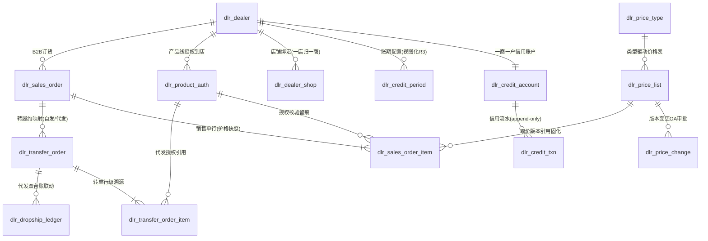

# DB-D07 经销域数据字典（oms_dealer · P2 建库占位）

> 文档编号：DB-D07 · 版本 V1.0 · 2026-10-24 · 编写：小凯 · 状态：待审阅（批次⑥）
> 上游契约：DB-00 数据库设计总册（schema=oms_dealer、表前缀 dlr_、公共字段、命名/索引/类型基线、§6 六项必备）
> 需求依据：SRS-D07.01 经销商管理 / SRS-D07.02 B2B销售订单 / SRS-D07.03 批发价格体系 / SRS-D07.04 转单与货权拆分（4 份均 **P2 · M4 之后启动**）§6 数据字段
> 参考溯源：商派 dealer 域 21 表（bbu/betc/business 三级组织、goods/goods_price 经销货品价格、series/series_products/series_endorse/series_endorse_products 产品线授权到店、platform_orders 转单）+ sales 6 表（销售单/发货结算明细）——字段语义参考，不照抄结构
>
> ⚠️ **全篇 P2 占位声明**：本域全部表为 **P2 建库占位**——P2 启动时建库（`CREATE DATABASE oms_dealer`），表结构随 P2 启动按业务确认结果细化（合作模式/支付模式/价格审批链等假设见各 SRS ⚠️ 声明）。本册给出可直接细化开发的**结构基线**：模型、字段、口径、与既有域（org/ord/inv/fin）的接入点与预留位全部定稿，P2 启动**不需要改动 P0/P1 已建核心表结构**（复用清单见 §5）。

---

## 1. 总体说明

### 1.1 域定位

经销域承载凯淳向下游经销商批发分销的 B2B 业务（Q25 决策：P2 后置）。四个子域：经销商主数据与信用（D07.01）、B2B 销售订单（D07.02）、批发价格（D07.03）、转单与货权拆分（D07.04）。设计主线：

1. **经销商上升为货主**：经销商=货主类型第三枚举 `DEALER_TC`（SRS-D10.01 FR-03a P0 预留位 R1），建档联动创建 org_owner，此后全域单据 owner_id 契约自动贯通（SRS-00 §4.4）；
2. **复用既有域不另建体系**：组织树复用 D10.01 reserved_dealer 节点（R2）、租户/门户复用 D10.02/D10.04 外壳（R4/R5）、B2B 订单转 ord_order 正向履约（D03.01 B2B 转入通道）、拆单复用 D03.04 owner 策略（P0 已预留 FR-05f）、应收/结算复用 D08.01 ar_type 扩展 + D08.02 既有结算引擎、信用流水镜像 D04.03 预占流水模式（append-only+余额派生+日终守恒对账）；**商派缺失自建**：账期与信用额度三口径模型（商派 dealer 域无信用建模，逆向文档 04 §12-2 启示）、多维价格表+版本化取价引擎（商派仅 goods_price 单维价）。

### 1.2 公共字段与例外（对齐 DB-00 §3）

所有业务表默认含：`id`(BIGINT UNSIGNED AI)、`tenant_id`(NOT NULL)、`owner_id`(BIGINT UNSIGNED NOT NULL，经销商货主=DEALER_TC 类型 org_owner.id；纯配置表免填 DEFAULT 0 并标注)、`create_time`/`update_time`(DATETIME(3))、`version`(INT UNSIGNED DEFAULT 0，高频竞争表必备)、`is_deleted`(TINYINT(1) DEFAULT 0)。例外在表头标注：

- **流水类**（dlr_credit_txn）：append-only 只增不改不删——无 is_deleted/version/update_time；红冲纠错（镜像 inv_freeze_log 设计）。
- **单据类**（dlr_sales_order/_item、dlr_transfer_order/_item、dlr_price_change）：状态机+红冲纠错，**禁用软删**。
- **台账类**（dlr_credit_account 余额列为派生缓存，流水对账兜底）。
- 全库：InnoDB / utf8mb4 / utf8mb4_0900_ai_ci / 不建物理外键（LFK 标注）/ 枚举不用 MySQL ENUM，注释写全枚举值 / 金额 DECIMAL(18,2)、单价 DECIMAL(18,4)、比例 DECIMAL(9,4)、时间 DATETIME(3)。
- **P2 占位标注**：每表 COMMENT 均含「P2占位」字样；字段为结构基线，P2 启动细化时只增列不破坏本册契约位（owner_id/tenant_id/单号/状态机/幂等键）。

### 1.3 容量预估（对齐 SRS-D07.01~04 §8）

经销商 ≤500、授权记录 ≤5 万、信用流水随订单量按年分区、销售单 ~3.6 万/3年、价格表明细行百万级/版本（按 list 分区，仅生效版本进缓存）、代发台账月 10 万行级按年分区——单表无分表需求。

## 2. 表清单（14 张，全部 P2 建库占位）

| # | 表名 | 中文名 | 所属模块 | 分期 | 预估行量级 |
|---|---|---|---|---|---|
| 1 | dlr_dealer | 经销商档案 | D07.01 FR-01/02 | **P2 占位** | ≤500 |
| 2 | dlr_dealer_shop | 经销商店铺关联 | D07.01 FR-02b | **P2 占位** | 千 |
| 3 | dlr_credit_account | 信用账户 | D07.01 FR-03 | **P2 占位** | ≤500 |
| 4 | dlr_credit_txn | 信用流水（append-only） | D07.01 FR-03c | **P2 占位** | 十万/年 |
| 5 | dlr_credit_period | 账期配置 | D07.01 FR-03b | **P2 占位** | 千 |
| 6 | dlr_product_auth | 产品线授权到店 | D07.01 FR-04 | **P2 占位** | ≤5万 |
| 7 | dlr_sales_order | B2B 销售单头 | D07.02 FR-02 | **P2 占位** | 万/年 |
| 8 | dlr_sales_order_item | B2B 销售单行 | D07.02 FR-02 | **P2 占位** | 十万/年 |
| 9 | dlr_price_type | 价格类型字典 | D07.03 FR-01 | **P2 占位** | 十 |
| 10 | dlr_price_list | 价格表（头+行合一，阶梯 JSON） | D07.03 FR-02/03 | **P2 占位** | 百万/版本 |
| 11 | dlr_price_change | 价格变更审批 | D07.03 FR-06 | **P2 占位** | 千/年 |
| 12 | dlr_transfer_order | 转单单据头（代发货权拆分） | D07.04 FR-01 | **P2 占位** | 万/年 |
| 13 | dlr_transfer_order_item | 转单单据行 | D07.04 FR-01 | **P2 占位** | 十万/年 |
| 14 | dlr_dropship_ledger | 代发双向结算台账 | D07.04 FR-04 | **P2 占位** | 十万/年 |

> SRS §6 实体名对应：dlr_dealer ← §6.1 dealer；dlr_credit_account/dlr_credit_txn ← §6.2 dealer_credit/dealer_credit_log；dlr_product_auth ← §6.3 dealer_series/dealer_endorse（产品线 series 层是否保留 P2 启动按业务定，FR-04e——本册以授权记录为主体，series 归并入 auth_ref）；dlr_sales_order(_item) ← D07.02 §6.1 b2b_sales_order(_item)；dlr_price_list ← D07.03 §6.1 b2b_price_list/_item（头行合一：行=SKU×阶梯 JSON，审批与生效原子单位=表头 version_no）；dlr_transfer_order(_item) ← D07.04 §6.1 dropship_convert(_item)；dlr_dropship_ledger ← §6.2 dropship_ledger。经销商应收台账（D07.02 §6.3 dealer_receivable_statement）**不落本域**——镜像 D06.04 八列结构落 oms_finance（fin_ 前缀，D08.01 扩展 ar_type=b2b_receivable 时同批建，避免跨域台账双头），本域经 dlr_credit_txn 的 ref_ar_bn 引用勾稽。销售单-履约订单关联（D07.02 §6.2 b2b_so_convert）并入 dlr_sales_order_item.converted_qty + dlr_transfer_order 映射承载（分批关系行级溯源见 §3.8）。

---

## 3. 逐表定义

> 表格只列业务字段；公共字段见 §1.2。每表均为 **P2 建库占位，表结构随 P2 启动细化**。

### 3.1 D07.01 经销商管理

#### 3.1.1 dlr_dealer 经销商档案（P2 占位）

用途：经销商主数据（等级/区域/合作状态），与货主一对一（建档联动创建 DEALER_TC 类型 org_owner，R1）；生命周期复用 D10.01 FR-06 货主状态机（合作中→暂停→终止+前置校验+OA）；等级/区域=D07.03 取价维度、区域树=串货管控。等级/区域变更走 OA（影响取价，只对未来订单生效）。单据类禁软删。
溯源：← 商派 dealer.business(bs)（bs_bn/customer_code/salesoffice_code 三级组织编码）改造：+owner_id 货主贯通、+信用/门户关联位、组织编码收敛为 org_node_id 单引用（规避商派 business 与 cos 双写脆弱性）。

| 字段 | 类型 | 约束 | 默认 | 注释 |
|---|---|---|---|---|
| dealer_bn | VARCHAR(32) | NOT NULL | | 经销商编码，全局唯一（Redis发号） |
| dealer_name | VARCHAR(128) | NOT NULL | | 经销商名称 |
| tax_no | VARCHAR(64) | NOT NULL | '' | 统一社会信用代码（格式校验） |
| dealer_level | TINYINT | NOT NULL | 3 | 等级:1=战略,2=A级,3=B级,4=C级（驱动D07.03取价；变更走OA只对未来订单生效；规避 level 命名歧义） |
| region_id | BIGINT UNSIGNED | NOT NULL | 0 | 区域（区域树节点:大区→省→市，驱动取价与串货管控；区域树载体P2定:复用org_node或本域字典） |
| coop_mode | TINYINT | NOT NULL | 1 | 合作模式:1=买断转售,2=代发,3=混合（业务假设待P2确认） |
| owner_id | BIGINT UNSIGNED | NOT NULL | | 联动货主（DEALER_TC类型，一对一，建档联动创建R1）LFK→oms_org.org_owner |
| org_node_id | BIGINT UNSIGNED | NOT NULL | 0 | 组织节点（reserved_dealer类型，R2）LFK→oms_org.org_node；层级:集团→销售团队→贸易公司→经销商→经销店铺 |
| portal_tenant_id | BIGINT UNSIGNED | NOT NULL | 0 | 门户外部租户（tenant_type=dealer，R4）LFK→oms_org.org_tenant |
| salesman_id | BIGINT UNSIGNED | NOT NULL | 0 | 归属业务员 LFK→oms_org.org_account（业绩维度，D11供数） |
| sales_org_id | BIGINT UNSIGNED | NOT NULL | 0 | 销售团队组织节点 LFK→oms_org.org_node |
| contact_name_enc / contact_phone_enc | VARBINARY(255) | NULL | NULL | 联系人姓名/电话密文（D01.05信封加密，DB-00 §3.2） |
| contact_phone_hash | CHAR(64) | NOT NULL | '' | 电话盲索引（HMAC，检索用） |
| invoice_json | JSON | NULL | NULL | 发票信息（抬头/税号/开户行等） |
| address_json | JSON | NULL | NULL | 收货地址集（可多个） |
| status | TINYINT | NOT NULL | 1 | 生命周期:1=合作中,2=暂停(新单停止/门户降级只读),3=终止(前置校验:信用占用=0+无在途B2B订单+无未闭环售后+无未决对账单;货主/租户/档案三处联动只读禁用) |
| source | VARCHAR(16) | NOT NULL | 'local' | 数据来源:local=手工,import=导入,migration=迁移（DB-00 §7） |

索引：`uk_dlr_dealer_bn(dealer_bn)`；`uk_dlr_dealer_owner(owner_id)` 货主一对一；`idx_dlr_dealer_level(dealer_level, region_id)` 取价维度；`idx_dlr_dealer_status(status)`。
LFK：owner_id→oms_org.org_owner（DEALER_TC）；org_node_id→oms_org.org_node（reserved_dealer）。

#### 3.1.2 dlr_dealer_shop 经销商店铺关联（P2 占位）

用途：经销商↔店铺多对多绑定（自有线上店/线下门店；一店铺只归一经销商——商派 series_endorse 约束继承）；代发场景消费者订单的店铺归属判定（D07.04 §5.1）；店铺授权挂经销组织层级节点（D02.06）。关联表。

| 字段 | 类型 | 约束 | 默认 | 注释 |
|---|---|---|---|---|
| dealer_id | BIGINT UNSIGNED | NOT NULL | | 经销商 LFK→dlr_dealer |
| shop_id | BIGINT UNSIGNED | NOT NULL | | 店铺 LFK→oms_gateway.gw_shop |
| shop_type | TINYINT | NOT NULL | 1 | 店铺类型:1=线上店(接入OMS拉单),2=线下门店 |
| is_dropship | TINYINT(1) | NOT NULL | 0 | 代发店铺标记:0=否,1=是（消费者订单走D07.04转单链路） |
| status | TINYINT | NOT NULL | 1 | 状态:1=启用,2=停用 |

索引：`uk_dlr_dealer_shop(shop_id)` 一店铺只归一经销商（唯一）；`idx_dlr_dealer_shop_dealer(dealer_id)`。

#### 3.1.3 dlr_credit_account 信用账户（P2 占位）★商派缺失自建核心

用途：信用三口径账户：`可用额度=授信额度+有效临时额度−已占用−逾期额`（FR-03a）；授信额度调整一律 OA（资金红线 FR-03f，版本化留档）；余额列为**派生缓存**（流水驱动失效+Redis 缓存，日终守恒对账兜底重建 §5.2——镜像 D04.03 预占流水模式：独立流水+余额派生，禁止人工直改余额）；超额策略/冻结参数经销商级可配。高频竞争表必备 version（Lua 原子占用对齐 D04.03）。
溯源：凯淳自建（商派 dealer 域无信用等级/账期字段，逆向文档 04 §4.1；按 §12-2 启示「supplier.credit_lv+statement 台账组合」设计）。

| 字段 | 类型 | 约束 | 默认 | 注释 |
|---|---|---|---|---|
| dealer_id | BIGINT UNSIGNED | NOT NULL | | 经销商（一商一户）LFK→dlr_dealer |
| credit_limit | DECIMAL(18,2) | NOT NULL | 0 | 授信额度（静态，OA审批调整，调整历史版本化留档dlr_price_change同款机制） |
| temp_limit | DECIMAL(18,2) | NOT NULL | 0 | 临时额度（超额OA审批产物） |
| temp_expire_time | DATETIME(3) | NULL | NULL | 临时额度有效期（到期自动回收，回收前占用校验计入） |
| occupied | DECIMAL(18,2) | NOT NULL | 0 | 已占用（动态派生缓存:下单占用→发货转应收仍占用→回款核销恢复；流水驱动失效） |
| overdue | DECIMAL(18,2) | NOT NULL | 0 | 逾期额（应收超账期未核销部分，D08应收台账日终扫描取数） |
| available_cache | DECIMAL(18,2) | NOT NULL | 0 | 可用额度缓存=credit_limit+有效temp_limit−occupied−overdue（派生值，日终守恒对账兜底:授信−Σ占用流水−逾期=缓存，不平告警重建§5.2） |
| over_policy | TINYINT | NOT NULL | 1 | 超额管控策略:1=拦截(默认,下单直接拒绝返回可用额/本单额/缺口),2=OA审批放行(超额单挂起推审批,通过后临时额度放行) |
| freeze_threshold | DECIMAL(9,4) | NOT NULL | 0.1 | 冻结阈值（逾期额>授信额度×该占比触发自动冻结，默认10%） |
| freeze_days | INT | NOT NULL | 15 | 冻结逾期天数（逾期>N天触发冻结，默认15） |
| status | TINYINT | NOT NULL | 1 | 账户状态:1=正常,2=冻结(禁新下单,存量在途订单继续履约;回款核销后自动解冻;冻结/解冻事件广播dealer.credit.frozen/unfrozen+审计) |

索引：`uk_dlr_credit_account_dealer(dealer_id)` 一商一户唯一；`idx_dlr_credit_account_status(status)`。

#### 3.1.4 dlr_credit_txn 信用流水（P2 占位，append-only）

用途：信用占用-扣减-恢复全时序流水（FR-03c/§5.2 六种类型），只增不改不删（红冲纠错）；订单号+动作幂等键（重复回调幂等 AC-02）；回款恢复由 D08.03 核销事件驱动（IF-D07.01-04）。**流水类：无 is_deleted/version/update_time**。
溯源：镜像 D04.03 inv_freeze_log 预占流水设计思想（独立流水+余额派生）。

| 字段 | 类型 | 约束 | 默认 | 注释 |
|---|---|---|---|---|
| dealer_id | BIGINT UNSIGNED | NOT NULL | | 经销商 LFK→dlr_credit_account |
| txn_type | TINYINT | NOT NULL | | 流水类型(§5.2六种):1=下单预占(占用+订单额),2=释放(订单取消/关闭,占用−订单额),3=审核扣减(预占转正式,额度语义不变),4=转应收(发货生成应收,占用性质标记转应收金额不变——杜绝发货二次占用双计),5=回款恢复(核销事件,占用−核销额),6=逾期登记(日终扫描,逾期额+可用额联动下降) |
| direction | TINYINT | NOT NULL | | 方向:1=占用增加,2=占用减少,3=性质转换(金额不变),4=逾期登记 |
| amount | DECIMAL(18,2) | NOT NULL | | 流水金额 |
| balance_after | DECIMAL(18,2) | NOT NULL | 0 | 流水后占用余额快照（任意时点重算/对账基础，镜像inv流水前后余额设计） |
| ref_so_bn | VARCHAR(32) | NOT NULL | '' | 关联B2B销售单号 LFK→dlr_sales_order.sales_order_bn |
| ref_ar_bn | VARCHAR(32) | NOT NULL | '' | 关联应收单号 LFK→oms_finance（D08.01 ar_type=b2b_receivable；应收台账勾稽位，§2说明） |
| idempotent_key | VARCHAR(128) | NOT NULL | | 幂等键=(销售单号+动作类型)拼接（IF-D07.01-03幂等契约） |
| operator | VARCHAR(64) | NOT NULL | '' | 操作人（系统动作=系统账号名） |
| create_time | DATETIME(3) | NOT NULL | CURRENT_TIMESTAMP(3) | 流水时间（毫秒） |
| tenant_id | BIGINT UNSIGNED | NOT NULL | | 租户 |

索引：`uk_dlr_credit_txn_key(idempotent_key)` 幂等唯一；`idx_dlr_credit_txn_dealer(dealer_id, create_time)` 流水检索/余额重建；`idx_dlr_credit_txn_so(ref_so_bn)` 订单链路追溯。

#### 3.1.5 dlr_credit_period 账期配置（P2 占位，配置表 owner_id 免填）

用途：账期天数与起算锚点配置（FR-03b）：经销商级可谈判差异化；**配置载体=D10.01 FR-05c 货主结算配置位（R3）**——本表为经销域视图化冗余（读取时以 org_owner_settle_config 为准，P2 启动可裁剪本表直接读 R3 配置位，此处保留结构占位）；到期预警三级（7/3/1 天，D01.07 推商务+门户）。

| 字段 | 类型 | 约束 | 默认 | 注释 |
|---|---|---|---|---|
| dealer_id | BIGINT UNSIGNED | NOT NULL | | 经销商 LFK→dlr_dealer |
| credit_days | INT | NOT NULL | 30 | 账期天数（默认30，经销商级可谈判） |
| start_anchor | TINYINT | NOT NULL | 1 | 起算日锚点:1=发货日,2=结算单归档日（可配；到期日=起算日+credit_days） |
| warn_days_json | JSON | NULL | NULL | 预警提前天数集（默认[7,3,1]三级，D01.07通道推商务+门户） |
| grace_days | INT | NOT NULL | 0 | 宽限期天数（R3 settle_config 扩展组同源） |
| status | TINYINT | NOT NULL | 1 | 状态:1=生效,2=历史（变更版本化留档） |

索引：`uk_dlr_credit_period(dealer_id, status)` 生效配置唯一；变更走 OA 留痕（D10.05）。

#### 3.1.6 dlr_product_auth 产品线授权到店（P2 占位）

用途：授权粒度三级（品牌级/分类级/SKU级，FR-04a）×授权对象（经销商，可细化到其名下指定店铺）×时间窗（到期自动失效，续期=新记录历史留档 FR-04b）×发货方式（自发/代发，模式切换带时间窗分界 FR-04c——继承商派 series_endorse_products「自发改成代发需设置时间范围」语义）；授权校验服务数据源（IF-D07.01-05，订货行逐行校验 §5.3 四类原因码 AUTH_SKU/AUTH_TIME/AUTH_SHOP/AUTH_MODE）；产品线（series）作为聚合载体归并入 auth_ref（FR-04e，P2 启动按业务决定保留 series 层或直接 SKU 清单）。
溯源：← 商派 dealer.series/series_products/series_endorse/series_endorse_products 四表改造：授权记录为主体+时间窗版本化+发货方式切换语义保留。

| 字段 | 类型 | 约束 | 默认 | 注释 |
|---|---|---|---|---|
| auth_bn | VARCHAR(32) | NOT NULL | | 授权记录号，唯一 |
| dealer_id | BIGINT UNSIGNED | NOT NULL | | 授权经销商 LFK→dlr_dealer |
| shop_id | BIGINT UNSIGNED | NOT NULL | 0 | 细化店铺（0=经销商全店铺；一店铺只归一经销商，dlr_dealer_shop约束） |
| auth_level | TINYINT | NOT NULL | | 授权粒度:1=品牌级,2=分类级(D04.01分类树节点),3=SKU级(基础物料清单) |
| auth_ref | JSON | NOT NULL | | 授权对象集:品牌级{"brand_ids":[...]}/分类级{"cat_ids":[...]}/SKU级{"bm_ids":[...]}或产品线{"series_id":x,"bm_ids":[...]}（运行期展开为SKU集合缓存，取价/订货校验只查SKU级） |
| delivery_mode | TINYINT | NOT NULL | 1 | 发货方式:1=自发(凯淳发货至经销商,买断转售),2=代发(经销商店铺消费者订单凯淳直发,D07.04转单场景)；模式切换=新记录带切换时间窗(切换日前订单按旧模式履约) |
| cargo_owner_id | BIGINT UNSIGNED | NOT NULL | 0 | 货权方货主（代发时必填:品牌方BRAND_CONSIGN/贸易公司DEALER_TC）LFK→oms_org.org_owner（D07.04 §5.1行货权方判定依据） |
| start_time / end_time | DATETIME(3) | NOT NULL | | 时间窗（到期自动失效订货拦截；续期=新记录） |
| auth_version | INT UNSIGNED | NOT NULL | 1 | 版本（续期/切换+1，历史留档不可改删） |
| status | TINYINT | NOT NULL | 1 | 状态:1=生效,2=已失效(到期/被替换),3=已终止 |

索引：`uk_dlr_product_auth_bn(auth_bn)`；`idx_dlr_product_auth_dealer(dealer_id, shop_id, status, end_time)` 授权校验热路径；`idx_dlr_product_auth_mode(delivery_mode, status)` 代发范围判定。

### 3.2 D07.02 B2B 销售订单

#### 3.2.1 dlr_sales_order B2B 销售单头（P2 占位，单据类禁软删）

用途：订货协议单据（价格/账期/信用占用载体，区别于履约订单管物流执行——显式两层分离，继承商派「一套订单引擎」思想但不共表，避免 B2B 语义污染 C 端 ord_order）；订货通道四选一（门户自助/业务员代下/批量导入/EDI 预留）；状态机 `草稿→待审核→超额审批中(可选挂起)→已审核→部分转单→全部转单→部分发货→已完成/已关闭`；信用时点=提交占用/审核扣减/取消释放（FR-05）；转履约走 D03.01「B2B 销售单转入」通道（R1，order_source=b2b）；金额口径双配置（批发价口径默认/0 元内部口径，防双挂 FR-04b）。单号 `BS{YYYYMMDD}{5位}`。
溯源：← 商派 ome.sales 销售单模型 + dealer.platform_orders（转单状态枚举 unconvert/converted/needless/splitting/fail 语义保留于 convert_status）。

| 字段 | 类型 | 约束 | 默认 | 注释 |
|---|---|---|---|---|
| sales_order_bn | VARCHAR(32) | NOT NULL | | 销售单号，唯一（BS{YYYYMMDD}{5位}，Redis发号防遍历） |
| dealer_id | BIGINT UNSIGNED | NOT NULL | | 经销商 LFK→dlr_dealer |
| channel | TINYINT | NOT NULL | 1 | 订货通道:1=门户自助,2=业务员代下单(独立授权点+客户确认凭证),3=批量导入(D01.06,取价一律系统重算不采信外部价格——防篡改红线),4=EDI直连(P2内预留占位,经D02.07网关,幂等键=经销商侧单号) |
| pay_mode | TINYINT | NOT NULL | 1 | 支付模式:1=账期赊销(默认,联动信用),2=先款后货,3=预存款抵扣(镜像D06.04 §5.4预付款抵扣为收款侧)（业务假设待P2确认） |
| amount_caliber | TINYINT | NOT NULL | 1 | 转履约金额口径:1=批发价口径(默认,订单金额=批发价直接驱动应收),2=0元内部口径(订单0元走履约,应收按销售单批发价独立挂账)——系统级配置选定后全局一致,防双挂校验(FR-04b) |
| total_amount | DECIMAL(18,2) | NOT NULL | 0 | 头金额=Σ行金额（2位小数） |
| currency | CHAR(3) | NOT NULL | 'CNY' | 币种（多币种P2内预留字段不实现） |
| salesman_id / sales_org_id | BIGINT UNSIGNED | NOT NULL | 0 | 业务员/销售团队（业绩归属，D11供数） |
| receiver_json | JSON | NULL | NULL | 收货地址快照（引用经销商档案地址集） |
| expect_delivery_date | DATE | NULL | NULL | 期望发货日（交付要求；缺货风险行提示不可达） |
| allow_split | TINYINT(1) | NOT NULL | 1 | 分批许可:0=整单一次转,1=允许分批转履约(SC-05) |
| status | TINYINT | NOT NULL | 1 | 状态机:1=草稿(不占信用),2=待审核(提交即占用),3=超额审批中(挂起推OA,已按含临时额度预占不重复占用),4=已审核(占用转正式),5=部分转单,6=全部转单,7=部分发货,8=已完成(全部发货+应收挂账),9=已关闭 |
| close_reason | TINYINT | NOT NULL | 0 | 关闭原因:0=无,1=经销商取消,2=凯淳拒绝,3=超时未审核自动关闭,4=OA驳回（关闭联动信用释放+流水留痕） |
| convert_status | TINYINT | NOT NULL | 1 | 转单状态(商派枚举语义继承):1=unconvert未转,2=splitting分批中,3=converted已转,4=fail转失败,5=needless无需转(纯代发直发场景) |
| oa_instance_id | VARCHAR(64) | NOT NULL | '' | 超额审批OA实例引用（D10.05，挂起场景） |
| credit_snapshot_json | JSON | NULL | NULL | 提交时信用快照（可用额/占用/本单额，OA审批附件+审计依据） |
| source | VARCHAR(16) | NOT NULL | 'local' | 数据来源:local=手工,portal=门户,import=导入,edi=EDI,migration=迁移 |

索引：`uk_dlr_sales_order_bn(sales_order_bn)`；`idx_dlr_sales_order_dealer(dealer_id, status)` 门户订单中心；`idx_dlr_sales_order_status(status, create_time)` 工作台队列。
LFK：dealer_id→dlr_dealer；转履约后 order_id 映射见 dlr_transfer_order（自发场景也经其登记映射，source_type=b2b_so）。

#### 3.2.2 dlr_sales_order_item B2B 销售单行（P2 占位，单据类禁软删）

用途：明细行（SKU/数量/**批发价快照**=D07.03 取价结果+价格版本引用固化——全链路金额唯一源头，禁二次取价 FR-07a）；起订量/整箱倍数校验留痕；已转履约量（守恒校验：Σ历史已转量+本批量≤行量，§5.1）。

| 字段 | 类型 | 约束 | 默认 | 注释 |
|---|---|---|---|---|
| sales_order_id | BIGINT UNSIGNED | NOT NULL | | 销售单头 LFK→dlr_sales_order |
| bm_id | BIGINT UNSIGNED | NOT NULL | | 基础物料 LFK→oms_stock.inv_material |
| qty | INT | NOT NULL | 0 | 订货数量（>0） |
| price | DECIMAL(18,4) | NOT NULL | 0 | 批发价快照（D07.03 quote结果固化，价格版本引用随单永久可追溯回放） |
| price_version_id | BIGINT UNSIGNED | NOT NULL | 0 | 价格表版本 LFK→dlr_price_list（取价命中层级与阶梯档见price_hit_json） |
| price_hit_json | JSON | NULL | NULL | 取价命中快照:{"hit_level":"special|contract|level","ladder_band":"≥100","list_id":x}（D07.03 FR-05c返回固化） |
| amount | DECIMAL(18,2) | NOT NULL | 0 | 行金额=qty×price |
| tax_rate | DECIMAL(9,4) | NOT NULL | 0 | 税率快照（随价格版本，含税价挂应收价税分离供金蝶D08.06） |
| moq_check | TINYINT | NOT NULL | 1 | 起订量校验结果:1=通过,2=低于起订量拦截,3=非整箱倍数拦截（MOQ_*原因码留痕） |
| endorse_ref | BIGINT UNSIGNED | NOT NULL | 0 | 授权记录引用 LFK→dlr_product_auth（授权校验留痕，AUTH_*四类拦截可剔行重提） |
| converted_qty | INT | NOT NULL | 0 | 已转履约量（守恒校验依据:Σ已转+本批≤qty；分批关系经dlr_transfer_order行级溯源） |
| status | TINYINT | NOT NULL | 1 | 行状态:1=正常,2=已关闭(行级取消),3=已转完 |

索引：`idx_dlr_sales_order_item_so(sales_order_id)`；`idx_dlr_sales_order_item_bm(bm_id)`。

### 3.3 D07.03 批发价格体系

#### 3.3.1 dlr_price_type 价格类型字典（P2 占位，配置表 owner_id 免填）

用途：三类价格类型定义（FR-01a）：经销价/批发价/特批价——共用价格表结构与取价引擎，类型作为表属性（适用客户群配置），不做引擎分支。

| 字段 | 类型 | 约束 | 默认 | 注释 |
|---|---|---|---|---|
| type_code | VARCHAR(32) | NOT NULL | | 类型码，唯一:dealer_price=经销价(买断转售出货价,主类型),wholesale_price=批发价(一般批发客户通用价,等级价目表默认承载),special_price=特批价(单商单SKU临时特价) |
| type_name | VARCHAR(64) | NOT NULL | | 类型名称 |
| tax_mode | TINYINT | NOT NULL | 1 | 价格属性:1=含税价,2=不含税价（税率引用D04.01物料开票属性） |
| status | TINYINT | NOT NULL | 1 | 状态:1=启用,2=停用 |

索引：`uk_dlr_price_type_code(type_code)`。

#### 3.3.2 dlr_price_list 价格表（P2 占位，头行合一）

用途：多维价格表（等级×区域×时间窗×数量阶梯四维，FR-02）+版本生命周期（`草稿→审批中→待生效→生效中→已失效`，同维度键任意时刻至多一份生效——时间轴不重叠发布期强制校验 §5.2）；头行合一：一行=表头×SKU（阶梯 JSON 列），表为审批与生效原子单位（version_no）；特批价/合同价=dealer_id 精确键行（合同价本质=限定单商的特批价常态化形态，共用结构 FR-05b）；历史版本永久留档不可改删（纠错=新版本+OA）；生效版本进 Redis 缓存（quote P99≤10ms 下单热路径）。明细量百万级/版本——按 list_group 分区，仅生效版本进缓存。
溯源：← 商派 dealer.goods_price（经销商×物料×采购价×生效/过期时间）改造：单维→四维+阶梯+版本治理+审批。

| 字段 | 类型 | 约束 | 默认 | 注释 |
|---|---|---|---|---|
| list_group_bn | VARCHAR(32) | NOT NULL | | 价格表组号（表头标识:名称/类型/适用范围承载于组，同组多version_no） |
| list_name | VARCHAR(128) | NOT NULL | '' | 价格表名称 |
| price_type | VARCHAR(32) | NOT NULL | | 价格类型 LFK→dlr_price_type.type_code |
| version_no | INT UNSIGNED | NOT NULL | 1 | 版本号（同list_group_bn递增；生命周期:1=草稿,2=审批中,3=待生效,4=生效中,5=已失效——status列） |
| status | TINYINT | NOT NULL | 1 | 版本状态:1=草稿(可改),2=审批中,3=待生效,4=生效中(不可变),5=已失效(永久留档) |
| level_scope | JSON | NULL | NULL | 适用等级集（含通配档"通用"；精确>通配优先级） |
| region_scope | JSON | NULL | NULL | 适用区域集（含通配档"全国"；精确>通配） |
| effect_from / effect_to | DATETIME(3) | NOT NULL | | 生效时间窗（同维度键时间轴不重叠校验；断档允许但发布页提示，断档期取价=PRICE_MISSING拦截） |
| dealer_id | BIGINT UNSIGNED | NOT NULL | 0 | 特批/合同价精确键经销商（0=等级默认价）LFK→dlr_dealer |
| bm_id | BIGINT UNSIGNED | NOT NULL | | 基础物料（SKU级最小粒度；分类/品牌级批量生成后落SKU行，取价只查SKU级避免运行期层级回溯）LFK→oms_stock.inv_material |
| ladder_json | JSON | NOT NULL | | 数量阶梯:[{"min":1,"max":100,"price":95.00},{"min":100,"max":500,"discount":0.95}]（区间左闭右开,同SKU内不重叠不留缝校验；按订单行数量落档,不跨行合并FR-05d） |
| price_tax / price_net | DECIMAL(18,4) | NOT NULL | 0 | 含税价/不含税价（不含税=毛利分析口径D11；无阶梯单一价场景直填） |
| tax_rate | DECIMAL(9,4) | NOT NULL | 0 | 税率（引用物料开票属性快照随版本） |
| cost_ref | DECIMAL(18,4) | NOT NULL | 0 | 成本参考价（D04.07口径；最高敏感字段D10.03字段级权限:仅商务/财务,经销商门户永不可见） |
| below_cost_flag | TINYINT(1) | NOT NULL | 0 | 低于成本标记（审批加签依据:财务总监FR-06b） |
| qty_limit / sold_qty | INT | NOT NULL | 0 | 特批数量上限/累计成交（限量管控:达上限自动失效,超额回落下一优先级,不追溯已成交FR-04c） |
| oa_instance_id | VARCHAR(64) | NOT NULL | '' | 审批OA实例引用（发布/变更一律OA，复用D10.05「改价」审批类型R5；回调按实例号幂等） |

索引：`uk_dlr_price_list(list_group_bn, version_no, bm_id, dealer_id)` 版本内SKU唯一；`idx_dlr_price_list_quote(price_type, bm_id, dealer_id, status, effect_from)` 取价热路径（quote优先级:特批>合同>等级 §5.1）；`idx_dlr_price_list_group(list_group_bn, status)` 版本切换。

#### 3.3.3 dlr_price_change 价格变更审批（P2 占位，单据类禁软删）

用途：价格表发布/变更/提前失效、特批价申请、合同价录入的 OA 审批登记（全量 OA 资金条款红线 FR-06a）；审批单携带差异对比快照（新版本 vs 现行：调价 SKU 数/平均涨跌幅/低于成本清单）；审批分级（常规=销售总监；低于成本/涨跌幅超阈值默认±15%=财务总监加签；战略经销商合同价=总经理）。append-only 留痕（SRS §6.2 b2b_price_version_log 语义并入本表 action 列）。

| 字段 | 类型 | 约束 | 默认 | 注释 |
|---|---|---|---|---|
| change_bn | VARCHAR(32) | NOT NULL | | 变更单号，唯一 |
| list_group_bn | VARCHAR(32) | NOT NULL | | 目标价格表组 LFK→dlr_price_list |
| target_version_no | INT UNSIGNED | NOT NULL | 0 | 目标版本号 |
| action | TINYINT | NOT NULL | | 动作:1=发布,2=变更,3=提前失效,4=版本切换,5=特批价申请,6=合同价录入 |
| diff_snapshot_json | JSON | NULL | NULL | 差异对比快照（调价SKU数/平均涨跌幅/低于成本清单——审批附件同源） |
| approval_level | TINYINT | NOT NULL | 1 | 审批分级:1=销售总监,2=财务总监加签(低于成本/涨跌幅超阈值±15%可配),3=总经理(战略经销商合同价) |
| oa_instance_id | VARCHAR(64) | NOT NULL | '' | OA实例号（防重幂等，回调驱动版本状态迁移） |
| approval_status | TINYINT | NOT NULL | 1 | 审批状态:1=待审,2=通过,3=驳回 |
| operator / action_time | VARCHAR(64)/DATETIME(3) | NOT NULL | NULL | 发起人/动作时间（append-only不可改删） |

索引：`uk_dlr_price_change_bn(change_bn)`；`idx_dlr_price_change_oa(oa_instance_id)` 回调幂等；`idx_dlr_price_change_list(list_group_bn, action_time)` 版本轨迹。

### 3.4 D07.04 转单与货权拆分

#### 3.4.1 dlr_transfer_order 转单单据头（P2 占位，单据类禁软删）

用途：代发场景转单映射与跟踪层（经销商源单→货权方履约单 1:N，按货权主体分组）——**不落第二套订单引擎**：拆单复用 D03.04 owner 策略（R1/R2 零引擎改动，经销场景 split_rule 参数=owner 一级+branch 级联+group_independent=true 组间独立履约）；履约单创建走 D03.01 标准转入通道；自发场景 B2B 销售单转履约也经本表登记映射（source_type=b2b_so，统一追溯）。幂等键=(source_bn, cargo_owner_id, batch_no)。
溯源：← 商派 dealer.platform_orders 转单（confirmOrder 按贸易公司 betc 分组 batchCreateErpOrders）改造：货权主体由 betc 隐含表达升级为显式货主档案（DEALER_TC/BRAND_CONSIGN），convert_status 枚举语义保留但落转单映射层而非订单主表。

| 字段 | 类型 | 约束 | 默认 | 注释 |
|---|---|---|---|---|
| transfer_bn | VARCHAR(32) | NOT NULL | | 转单号，唯一（Redis发号） |
| source_type | TINYINT | NOT NULL | | 源单类型:1=B2B销售单(自发转履约/代发直发),2=平台单(经销商店铺消费者订单,代发场景D03.01接入时判定dropship_mode) |
| source_bn | VARCHAR(32) | NOT NULL | | 源单号（dlr_sales_order.sales_order_bn 或 ord_order.order_bn） |
| dealer_id | BIGINT UNSIGNED | NOT NULL | | 经销商 LFK→dlr_dealer |
| cargo_owner_id | BIGINT UNSIGNED | NOT NULL | | 货权方货主（分组键:BRAND_CONSIGN品牌方代发/DEALER_TC贸易公司/凯淳买断=自发组）LFK→oms_org.org_owner（三元记账按货权方行预占扣减R4，凯淳买断行零流水场景SC-02） |
| batch_no | INT UNSIGNED | NOT NULL | 1 | 批次号（分批转单；(source_bn,cargo_owner_id,batch_no)幂等键） |
| transfer_status | TINYINT | NOT NULL | 1 | 转单状态(商派convert_status枚举语义继承):1=unconvert未转,2=splitting拆分中,3=converted已转,4=fail转失败,5=needless无需转 |
| fulfill_order_ids | JSON | NULL | NULL | 货权方履约单ID集合（1:N映射 LFK→oms_order.ord_order） |
| split_trace_json | JSON | NULL | NULL | 行级溯源与守恒登记（源单行→履约单行映射；组级部分成功时「分配+挂起=余量」守恒口径显式登记防丢行，D03.04 FR-06c续拆复用） |
| channel_type | TINYINT | NOT NULL | 1 | 履约通道:1=凯淳仓代发(货存凯淳仓常规推仓,扣货权方三元行),2=货权方仓,3=供应商直发(2/3=dropship通道,发货指令下发货权方,D09适配层扩展P2实现;dropship标记复用D03.04 channel策略R7) |
| fail_code / fail_detail | VARCHAR(32)/VARCHAR(512) | NOT NULL | ''/'' | 失败原因（D03.04错误码族复用；NO_STOCK组级挂起进缺货流程D03.09,组间独立不阻断其他组SC-05） |

索引：`uk_dlr_transfer_order_bn(transfer_bn)`；`uk_dlr_transfer_order_idem(source_bn, cargo_owner_id, batch_no)` 幂等唯一；`idx_dlr_transfer_order_dealer(dealer_id, transfer_status)` 转单工作台队列；`idx_dlr_transfer_order_status(transfer_status, create_time)`。

#### 3.4.2 dlr_transfer_order_item 转单单据行（P2 占位，单据类禁软删）

| 字段 | 类型 | 约束 | 默认 | 注释 |
|---|---|---|---|---|
| transfer_id | BIGINT UNSIGNED | NOT NULL | | 转单头 LFK→dlr_transfer_order |
| source_item_ref | BIGINT UNSIGNED | NOT NULL | 0 | 源单行引用（dlr_sales_order_item.id 或 ord_order_item.id，行级溯源） |
| bm_id | BIGINT UNSIGNED | NOT NULL | | 基础物料 LFK→oms_stock.inv_material |
| qty | INT | NOT NULL | 0 | 本批转单数量 |
| endorse_ref | BIGINT UNSIGNED | NOT NULL | 0 | 授权记录引用 LFK→dlr_product_auth（授权缺失拦截AUTH_MISSING——禁止无授权代发§5.1；结算与追溯依据） |
| dropship_flag | TINYINT(1) | NOT NULL | 0 | 直发标记:0=否(凯淳仓代发),1=是（R7 推仓通道分流依据） |
| fulfill_order_item_id | BIGINT UNSIGNED | NOT NULL | 0 | 履约订单行映射 LFK→oms_order.ord_order_item（转成功后回填） |
| status | TINYINT | NOT NULL | 1 | 行状态:1=待转,2=已转,3=挂起(NO_STOCK待续拆),4=失败,5=已取消(协商退款联动D07.02行级冲减) |

索引：`idx_dlr_transfer_order_item_tid(transfer_id)`；`idx_dlr_transfer_order_item_src(source_item_ref)` 全链路追溯（源单行→履约单→发货单→台账行任一环单号正反向查询 FR-06b）。

#### 3.4.3 dlr_dropship_ledger 代发双向结算台账（P2 占位，append-only）

用途：代发**双本账**流水（FR-04a）：①货权方侧（凯淳↔货权方）：代发出库量×结算价=凯淳应付货款；代发服务费（合同费率/件或货值×费率）=货权方应付凯淳；双向轧差净额→供 D08.02 该货权方货主结算单（既有五要素结构**不新建单据类型**）；②经销商侧（凯淳↔经销商）：代发量×批发价快照=经销商应付凯淳→走 oms_finance 应收台账（§2 说明）。镜像 D04.05 借调台账（inv_lend_ledger）模式（R8）：append-only+settle_month/settle_status 回写位+双向勾稽（凯淳侧台账行↔货权方结算单明细金额相等方向相反，D08.02 §5.2 镜像校验复用）+月度快照差额=0 才许关账（D06.04 §5.2 算法）。**流水类：无软删/乐观锁，红冲纠错**。

| 字段 | 类型 | 约束 | 默认 | 注释 |
|---|---|---|---|---|
| cargo_owner_id | BIGINT UNSIGNED | NOT NULL | | 货权方货主（双向维度①）LFK→oms_org.org_owner |
| dealer_id | BIGINT UNSIGNED | NOT NULL | | 经销商（双向维度②）LFK→dlr_dealer |
| period | CHAR(7) | NOT NULL | | 账务期间（YYYY-MM，月度快照维度） |
| object_type | TINYINT | NOT NULL | | 流水类型:1=代发出库(应付货款),2=代发服务费(应收),3=经销商侧代发应收(批发价快照),4=调整(红冲) |
| direction | TINYINT | NOT NULL | | 方向:1=凯淳应付,2=凯淳应收（append-only红冲纠错） |
| num | INT | NOT NULL | 0 | 代发数量 |
| settle_price_type | TINYINT | NOT NULL | 1 | 结算价类型:1=内部购销价,2=成本价,3=免费（D04.05 settle_price_type枚举复用） |
| unit_price | DECIMAL(18,4) | NOT NULL | 0 | 结算单价（货权方侧）/批发价快照（经销商侧） |
| amount | DECIMAL(18,2) | NOT NULL | 0 | 流水金额=num×unit_price |
| ref_delivery_id | BIGINT UNSIGNED | NOT NULL | 0 | 关联发货单 LFK→oms_order.ord_delivery（逐单勾稽依据；发货事件驱动写入,重复投递不双写幂等） |
| ref_transfer_bn | VARCHAR(32) | NOT NULL | '' | 关联转单号 LFK→dlr_transfer_order |
| settle_month | CHAR(7) | NOT NULL | '' | 结算归属月（D08.02归档回写位，R8借调台账同款） |
| settle_status | TINYINT | NOT NULL | 0 | 结算状态:0=未结算,1=已入结算单,2=已归档（D08.02回写） |
| snapshot_json | JSON | NULL | NULL | 月度快照行（期初/增加/已结/期末+差额校验=0才许关账,不平阻断+定位工单） |
| create_time | DATETIME(3) | NOT NULL | CURRENT_TIMESTAMP(3) | 流水时间 |
| tenant_id | BIGINT UNSIGNED | NOT NULL | | 租户 |

索引：`idx_dlr_dropship_ledger_owner(cargo_owner_id, period, settle_status)` 货权方结算取数；`idx_dlr_dropship_ledger_dealer(dealer_id, period)` 经销商侧对账；`idx_dlr_dropship_ledger_ref(ref_delivery_id)` 逐单勾稽。

---

## 4. 域内 ER 图

---

## 5. 与其他域的关系点（跨域 LFK 与 P0/P1 预留位接入清单）

### 5.1 跨域 LFK（只标关系不建物理外键）

| 本域字段 | 目标域.表 | 关系说明 |
|---|---|---|
| dlr_dealer.owner_id / dlr_product_auth.cargo_owner_id / dlr_transfer_order.cargo_owner_id | oms_org.org_owner | 经销商货主（DEALER_TC 枚举 R1）与货权方货主（BRAND_CONSIGN/DEALER_TC）；三元记账 (branch_id, bm, owner_id) 按货权方行分账（R4） |
| dlr_dealer.org_node_id / sales_org_id | oms_org.org_node | reserved_dealer 节点类型（R2）；层级复用 org_path/权限继承，禁止另建树 |
| dlr_dealer.portal_tenant_id | oms_org.org_tenant | 外部租户 tenant_type=dealer（R4，复用供应商门户同源机制）；门户=D10.04 外壳同壳不同菜单（R5：订货/信用/订单/对账/授权查看五中心）；行隔离 D10.03 FR-06 硬隔离 |
| dlr_credit_period | oms_org.org_owner_settle_config | 账期天数/宽限期落 D10.01 FR-05c 配置位（R3 权威源，本域视图化冗余） |
| dlr_credit_txn.ref_ar_bn | oms_finance（D08.01 fin_receivable，ar_type=b2b_receivable R4'） | 发货挂账应收（金额=发货量×批发价快照，到期日=发货日+credit_days）；核销事件（D08.03）驱动信用恢复；经销商应收台账镜像 D06.04 八列结构落 oms_finance（§2 说明） |
| dlr_sales_order → 转履约 order_id | oms_order.ord_order | B2B 销售单转入通道（D03.01 R1'，order_source=b2b）；转入后完全复用 D03 正向链路（审单 B2B 规则组含信用扣减插件位/拆单/发货单/推仓）；B2B 订单不与 C 端合单（合单指纹隔离） |
| dlr_transfer_order.split_trace_json | oms_order.ord_split_trace（D03.04） | owner 策略拆单（FR-02 #2 R1''+FR-05f 经销扩展预留 R2''）；order.split.completed 事件组属性含 owner_id=D08 分账依据（R6'）；group_independent=true 组间独立履约 |
| dlr_transfer_order.channel_type=2/3 | oms_fulfill（D09 适配层） | dropship 通道（货权方仓/供应商直发指令下发+物流回传，P2 实现）；标记复用 D03.04 channel 策略 dropship（R7'） |
| dlr_dropship_ledger.settle_month/settle_status | oms_finance.fin_settlement（D08.02） | 代发双向结算供数（既有五要素结构，D08.02 FR-02c 第 4 要素取数通道扩展 dropship 类型）；镜像双向勾稽（§5.2 D08.02 校验复用）；结算价类型复用 D04.05 settle_price_type（R8'） |
| dlr_dropship_ledger.ref_delivery_id | oms_order.ord_delivery | 发货完成事件（order.delivery.shipped，order_source=b2b）驱动台账写入与应收挂账 |
| dlr_sales_order_item.bm_id / dlr_price_list.bm_id | oms_stock.inv_material | 物料档案（owner_id 归属：买断转售模式货主仍是凯淳 R6''；批发价不落物料档案——D04.01 §1.2 边界 R1'''） |
| dlr_transfer_order 代发库存 | oms_stock.inv_stock_ledger（三元行） | 代发预占与扣减按货权方 owner 行（R4'）；凯淳买断行零流水（货不动凯淳账）；货权转移（代发转买断）调用 D04.05 FR-04 购销流程（R5'：配对出入库+same_code_group 档案建议+财务购销记录），本域只做触发编排 |
| 各表 oa_instance_id / approval_status | oms_org.org_approval（D10.05） | 授信/调额/超额放行/价格发布/特批价/货权转移全量 OA（资金红线）；回调按实例号幂等 |
| dlr_dealer.salesman_id、dlr_sales_order.salesman_id | oms_org.org_account | 业务员业绩维度（D11 报表供数：经销 B2B 销售/价格执行分析/代发业务量） |
| 事件契约 | oms_base.bas_event_outbox | dealer.credit.frozen/unfrozen、dealer.status_changed、dealer.endorse.expired、b2b.so.submitted/audited/closed、b2b.receivable.posted、b2b.price.published/expired、dropship.convert.completed/failed、dropship.ledger.posted（DB-00 事件字典登记） |

> R 编号带撇（R1'/R1''…）=对应各 SRS §1.4 预留位清单（D07.01 R1-R7 / D07.02 R1-R7 / D07.03 R1-R5 / D07.04 R1-R8），P2 启动逐项核验启用，**零改动 P0/P1 已建核心表结构**。

### 5.2 P2 启动前置校验清单（本域依赖的既有域契约位）

| 依赖 | 既有域契约 | P2 启用动作 |
|---|---|---|
| DEALER_TC 货主类型 | D10.01 FR-03a 枚举第三值（P0 置灰） | 启用枚举，建档联动 |
| reserved_dealer 组织节点 | D10.01 FR-01a/§5.1 层级矩阵 | 扩展销售团队→贸易公司→经销商→经销店铺层级 |
| dealer 外部租户 | D10.02 FR-01a external 机制 | 新增 dealer 枚举值 |
| B2B 转入通道 | D03.01 order_source=b2b | 直接走通道创建履约订单 |
| owner 拆单策略 | D03.04 FR-02 #2 + FR-05f | 注册经销场景 split_rule（零引擎改动） |
| ar_type 扩展 | D08.01 FR-01d 枚举 | 扩展 b2b_receivable |
| 货主级结算 | D10.01 FR-05 + D08.02 FR-01a | DEALER_TC 货主正常生成结算单（确认流分支=经销商门户） |
| 借调台账模式 | D04.05 FR-02 + D08.02 FR-02c | 代发台账镜像同款结构 |
| 门户写操作 | D10.04 FR-01a 只读白名单 | 订货中心=突破白名单须升版本（P2 启动时执行） |

---

## 6. 配套 SQL 说明

1. **文件**：`需求文档/sql/DB-D07-oms_dealer.sql`（MySQL 8.0 语法，**文件头显著标注 P2 占位建库**——P2 启动时执行建库，P0/P1 期不执行）。
2. **执行顺序**：`CREATE DATABASE oms_dealer`（P2 启动时）→ 字典（dlr_price_type）→ 主数据（dlr_dealer/dlr_dealer_shop）→ 信用（dlr_credit_account/dlr_credit_txn/dlr_credit_period）→ 授权（dlr_product_auth）→ 交易（dlr_sales_order/_item）→ 价格（dlr_price_list/dlr_price_change）→ 转单（dlr_transfer_order/_item/dlr_dropship_ledger）→ 初始字典 INSERT（dlr_price_type 三类）。
3. **依赖与枚举**：仅本 schema；跨域 LFK 不建物理外键（DB-00 §1.2），完整性靠应用层校验+对账任务（信用日终守恒对账/台账差额校验）；枚举全部 TINYINT/VARCHAR 码值+COMMENT 写全（不用 MySQL ENUM），保留字规避（不使用 rank/system/groups）。
4. **P2 细化原则**：只增列不改契约位（owner_id/tenant_id/单号唯一键/状态机/幂等键）；业务假设确认结果（合作模式/支付模式/审批链层级/series 层去留）落 COMMENT 与新增列，不推翻本册模型。

## 7. 商派溯源标注汇总（DB-00 §6.6）

| 本域表 | 商派来源 | 关键改造 |
|---|---|---|
| dlr_dealer | dealer.business(bs)（bs_bn/customer_code/salesoffice_code/division_code 三级组织编码+deal_cost 处理费公式） | +owner_id 货主贯通（经销商上升为货主 DEALER_TC，商派仅业务实体无货权语义）；组织编码收敛 org_node_id 单引用（规避 business 与 cos 双写脆弱性）；deal_cost 不继承（服务费归 D07.03/D08.02 体系化） |
| dlr_dealer_shop | dealer.business_branch（经销商仓库）+ series_endorse 店铺约束 | 「一个经销店铺只能选一个经销商」约束继承为 shop_id 唯一键 |
| dlr_credit_account / dlr_credit_txn / dlr_credit_period | （商派 dealer 域**完全缺失**——无信用等级/账期字段，§4.1 明确记载，代发先款后货所致） | 凯淳自建核心：三口径信用账户+append-only 流水+日终守恒对账（镜像 D04.03 预占流水模式；§12-2 启示「supplier.credit_lv+statement 组合」落地） |
| dlr_product_auth | dealer.series / series_products / series_endorse / series_endorse_products（产品线授权到店四表） | 四表收敛为授权记录主体+auth_ref JSON（series 层去留 P2 定）；时间窗版本化+自发/代发切换时间范围语义保留；+cargo_owner_id 显式货权方 |
| dlr_sales_order(_item) | ome.sales 销售单模型 + order_type='sale'（与平台订单共表混型）+ dealer.platform_orders | 销售单与履约订单**显式两层分离**（商派共表靠 order_type 区分——凯淳销售单管商务协议、履约订单管物流执行，一对多分批关联，B2B 语义不污染 C 端主表）；+信用占用时点显式编排（商派无信用模型）；+价格快照版本引用固化 |
| dlr_price_type / dlr_price_list / dlr_price_change | dealer.goods_price（经销商×物料×采购价×生效/过期时间）+ dealer.goods | 单维价→等级×区域×时间窗×数量阶梯四维+特批/合同/等级三层优先级取价引擎；版本治理产品化（时间轴不重叠/生效不可变/订单版本引用可回放）；+全量 OA 审批与低于成本加签（商派无审批） |
| dlr_transfer_order(_item) | dealer.platform_orders 转单（convert_status 枚举+confirmOrder 按贸易公司 betc 分组 batchCreateErpOrders） | 转单不建第二套订单引擎（商派 dealer 域内自建 ERP 订单独立代码路径——凯淳=D03.04 owner 策略业务化+D03.01 标准转入通道，本表仅映射跟踪层）；货权主体显式货主档案化；+组级独立履约参数（group_independent，商派整单 fail 无部分成功语义）；convert_status 枚举语义保留落映射层（状态收敛原则） |
| dlr_dropship_ledger | （商派代发无结算台账，货款靠 smart 接口取价散落） | 凯淳自建：双向台账镜像 D04.05 借调台账+D08.02 双向勾稽+月度差额校验关账（D06.04 算法复用） |

---

## 变更记录

| 日期 | 版本 | 变更 | 原因 |
|---|---|---|---|
| 2026-10-24 | V1.0 | 首版：14 张表全部 P2 建库占位，对齐 SRS-D07.01~04 §6 全部字段与 P0 预留位接入清单 | 批次⑥ |

> 自检说明：① SRS §6 字段逐一映射核对（实体名对应与两处结构归并已在 §2 说明：应收台账落 oms_finance、so_convert 并入转单映射——口径字段不缺失）；② 全部表标注 P2 占位（表清单/逐表标题/SQL 文件头三处）；③ 与既有域 org/ord/inv/fin 接入点经 §5.1 LFK 清单+§5.2 前置校验清单双覆盖（R 编号对应各 SRS §1.4）；④ 流水/单据类软删例外逐表核对 DB-00 §3；⑤ 商派溯源逐表标注（§7）。
