# DB-D08 财务对账域数据字典（oms_finance）

> 文档编号：DB-D08 · 版本 V1.0 · 2026-10-24 · 编写：小凯 · 状态：待审阅（批次⑥）
> 上游契约：DB-00 数据库设计总册（schema=oms_finance、表前缀 fin_、公共字段、命名/索引/类型基线、§6 六项必备）
> 需求依据：SRS-D08.01 ~ SRS-D08.06 全部 6 份 §6 数据字段章节
> 参考溯源：商派 finance / financebase / invoice / logisticsaccounts 模块（字段语义与枚举参考，不照抄结构）

---

## 1. 总体说明

### 1.1 域定位

财务对账域是凯淳 OMS 的**业务对账中心**，承载 Q5 全局决策：**金蝶记账，OMS 出统计+明细+排查工具**——本域不做总账/凭证/记账，产出应收明细、平台账单流水、结算单、核销记录、运费对账、发票台账与金蝶供数七类业务对账数据。三条域级红线（SRS-00 §4.4 契约）贯穿全部 42 张表：

1. **货主维度贯穿**：所有财务单据必带 `owner_id`（补齐商派 finance_ar 只有 channel_id 无货主分账的最大缺口——逆向文档 04 §10.4 短板5 的正面修复）。仅跨货主汇总类（账单归集头/运费账单头/对账任务/供数任务/账期）owner_id 允许 0 并逐表标注例外；
2. **双口径金额成对出现**：客户实付口径 `amount_paid`（买家真金白银）与平台承担口径 `amount_platform`（平台优惠补贴）**结构化双列**贯穿应收/账单/台账/账龄/结算/扣费，口径逐字段标注、禁止混算；
3. **红冲语义**：应收/扣费/核销/结算/账单等财务单据只增不改不删（负向记录+原记录保留），已核销/已结算单据锁定，修正必先反核销/走红冲。

### 1.2 公共字段与例外（对齐 DB-00 §3）

所有业务表默认包含公共字段：`id`(BIGINT UNSIGNED AI 主键)、`tenant_id`(BIGINT UNSIGNED NOT NULL DEFAULT 1，内部租户=1 也写入)、`owner_id`(BIGINT UNSIGNED NOT NULL，货主)、`create_time`(DATETIME(3))、`update_time`(DATETIME(3) ON UPDATE)、`version`(INT UNSIGNED DEFAULT 0 乐观锁)、`is_deleted`(TINYINT(1) DEFAULT 0)。**下文逐表定义只列业务字段**，例外情况在表头标注：

- **财务单据类（红冲语义，禁软删——无 is_deleted）**：fin_receivable、fin_receivable_adjust、fin_platform_bill_item、fin_bill_match、fin_platform_fee、fin_settlement、fin_settlement_item、fin_settlement_confirm、fin_settlement_diff、fin_receipt、fin_write_off、fin_receipt_match、fin_error_table、fin_freight_estimate、fin_freight_bill_item、fin_freight_match、fin_freight_diff、fin_freight_task、fin_freight_claim、fin_invoice、fin_invoice_red、fin_invoice_merge、fin_kingdee_supply、fin_kingdee_supply_file、fin_kingdee_receipt、fin_kingdee_recon。
- **留痕/快照类（只增不改——无 version/update_time/is_deleted）**：fin_receipt_match、fin_settlement_confirm、fin_aging、fin_invoice_merge、fin_kingdee_supply_file（部分列）。
- **纯配置/字典表（owner_id 免填 DEFAULT 0）**：fin_dict、fin_gap_account（0=全局默认，货主级阈值覆盖）、fin_invoice_channel、fin_kingdee_adapter、fin_settle_config（0=全局默认）。
- **跨货主汇总类（owner_id DEFAULT 0 例外注明）**：fin_platform_bill（按店铺挂货主，多货主店铺=0 明细分摊后落行级）、fin_freight_bill / fin_freight_task（结算主体粒度）、fin_kingdee_supply / _supply_file / _receipt（类别×期间粒度）、fin_period_close（账期全局统一裁决）。
- **高频竞争表必备 version（CAS）**：fin_receivable（核销状态回写）、fin_ar_ledger（事件驱动增量更新行锁）、fin_receipt（余额扣减）、fin_write_off、fin_settlement（状态机 CAS+分布式锁）。
- 全库：InnoDB / utf8mb4 / utf8mb4_0900_ai_ci / 不建物理外键（LFK 逻辑外键标注）/ 枚举不用 MySQL ENUM，注释写全枚举值 / 金额 DECIMAL(18,2)、单价 DECIMAL(18,4)、比例 DECIMAL(9,4)、称重 DECIMAL(10,3)。

### 1.3 分表/分区与归档（对齐 DB-00 §1.3）

| 表 | 策略 |
|---|---|
| fin_receivable | 日均 2 万单×3 行×3 年在线 ≈6600 万行：按 `period` 月度分区（DBA 实施），历史归档 `_arc` |
| fin_platform_bill_item | 按渠道+账期分区预留；批次覆盖走红冲（旧批作废留档） |
| fin_write_off | 月核销 ~10 万行×3 年：按 `period` 分区 |
| fin_freight_bill_item | 单快递月账单 10 万行级：按 `bill_period` 分区预留 |
| fin_aging | 日快照按年归档 `_arc` |
| 其余 | 不分表 |

### 1.4 账期与期间锁定（全域裁决位）

`fin_period_close` 是**账期状态唯一裁决方**（D08.03 §5.4）：账期状态机 `not_open 未启用 → open 未关账 → closed 已关账`（商派 colse_book 枚举保留）；全模块写入前调用 `isPeriodOpen(period)`——已关账期间一律拒绝补录/修改；延迟事件落当前开放账期并带 `late_posting` 语义（业务发生日与实际入账期分离，追溯原属期）；反结账走 OA 财务总监级审批，已推金蝶期间联动 D08.06 冲销-重推顺序。

---

## 2. 表清单（42 张）

| # | 表名 | 中文名 | 所属模块 | 分期 | 预估行量级 |
|---|---|---|---|---|---|
| 1 | fin_dict | 财务域通用字典 | D08 全域 | P1 | 数百 |
| 2 | fin_gap_account | gap 差异借贷科目映射 | D08.03/D08.06 | P1 | 数百 |
| 3 | fin_credit_period | 账期与核销容差配置 | D08.03 | P1 | 千 |
| 4 | fin_settle_config | 结算周期配置 | D08.02 | P1 | 千 |
| 5 | fin_service_fee_rule | 代销服务费条款 | D08.02 | P1 | 千 |
| 6 | fin_invoice_channel | 电子发票渠道适配+销方主体 | D08.05 | P1 | 十 |
| 7 | fin_code_mapping | OMS↔金蝶编码映射 | D08.06 | P1 | 十万 |
| 8 | fin_kingdee_adapter | 金蝶 API 适配器配置 | D08.06 | P1 | 十 |
| 9 | fin_receivable | 应收明细（订单行级双口径） | D08.01 | P1 | 6600万/3年 |
| 10 | fin_receivable_adjust | 应收调整单 | D08.01 | P1 | 万/年 |
| 11 | fin_platform_bill | 平台账单归集头 | D08.01 | P1 | 万/年 |
| 12 | fin_platform_bill_item | 平台账单明细流水 | D08.01 | P1 | 百万/月 |
| 13 | fin_bill_match | 账单-应收匹配记录 | D08.01 | P1 | 百万/月 |
| 14 | fin_bill_diff | 账单匹配差异清单 | D08.01 | P1 | 万/月 |
| 15 | fin_platform_fee | 平台扣费明细 | D08.01 | P1 | 十万/月 |
| 16 | fin_ar_ledger | 应收台账（双口径分列） | D08.01 | P1 | ≤5万 |
| 17 | fin_aging | 账龄分析日快照 | D08.01 | P1 | 万/日 |
| 18 | fin_settlement | 结算单（货主周期双向净额） | D08.02 | P1 | 7200/3年 |
| 19 | fin_settlement_item | 结算明细行 | D08.02 | P1 | 百万/3年 |
| 20 | fin_settlement_confirm | 品牌方确认记录 | D08.02 | P1 | 万/3年 |
| 21 | fin_settlement_diff | 结算差异/异议与调整单 | D08.02 | P1 | 万/3年 |
| 22 | fin_receipt | 收付款登记 | D08.03 | P1 | 十万/年 |
| 23 | fin_write_off | 核销记录（三档） | D08.03 | P1 | 十万/月 |
| 24 | fin_receipt_match | 核销关联检索表 | D08.03 | P1 | 百万/3年 |
| 25 | fin_error_table | 核销误差表 | D08.03 | P1 | 万/年 |
| 26 | fin_period_close | 会计账期与月末结账 | D08.03 | P1 | 百 |
| 27 | fin_freight_estimate | 运费预估单 | D08.04 | P1 | 千万/3年 |
| 28 | fin_freight_bill | 快递月度账单头 | D08.04 | P1 | 千/年 |
| 29 | fin_freight_bill_item | 快递账单明细 | D08.04 | P1 | 百万/月 |
| 30 | fin_freight_match | 运费逐单核对记录 | D08.04 | P1 | 百万/月 |
| 31 | fin_freight_diff | 运费差异登记与分摊 | D08.04 | P1 | 十万/月 |
| 32 | fin_freight_task | 运费对账任务批次 | D08.04 | P1 | 千/年 |
| 33 | fin_freight_claim | 运费索赔单 | D08.04 | P1 | 千/年 |
| 34 | fin_invoice_apply | 开票申请 | D08.05 | P1 | 百万/3年 |
| 35 | fin_invoice_pool | 预发票需求池 | D08.05 | P1 | 百万/3年 |
| 36 | fin_invoice | 发票台账（蓝/红票） | D08.05 | P1 | 百万/3年 |
| 37 | fin_invoice_red | 发票冲红/换开单 | D08.05 | P1 | 十万/3年 |
| 38 | fin_invoice_merge | 发票合票拆票映射 | D08.05 | P1 | 百万/3年 |
| 39 | fin_kingdee_supply | 金蝶供数任务（七类契约） | D08.06 | P1 | 千/年 |
| 40 | fin_kingdee_supply_file | 供数文件记录 | D08.06 | P1 | 千/年 |
| 41 | fin_kingdee_receipt | 金蝶导入回执 | D08.06 | P1 | 千/年 |
| 42 | fin_kingdee_recon | OMS-金蝶双向对账 | D08.06 | P1 | 万/年 |

> 分组：字典/配置 8 张（#1-8）· 应收账单族 9 张（#9-17）· 结算族 4 张（#18-21）· 核销族 5 张（#22-26）· 运费族 7 张（#27-33）· 发票族 5 张（#34-38）· 金蝶集成族 4 张（#39-42）。合计 42 张，落在 DB-00 §5 预估 ~35 张的合理扩展区间（金蝶族与配置族显式建表所致）。

---

## 3. 逐表定义

> 表格只列业务字段；公共字段见 §1.2 约定。双口径金额字段以【双口径1】【双口径2】标注成对语义。

### 3.1 字典 / 配置表

#### 3.1.1 fin_dict 财务域通用字典（D08 全域 · P1，配置表 owner_id 免填）

用途：结算周期/服务费类型/金蝶供数类别/差异类型/扣费类型/核销档位/票种等域级枚举字典统一载体（DB-00 §3 补充约定3：不用 MySQL ENUM）。

| 字段 | 类型 | 约束 | 默认 | 注释 |
|---|---|---|---|---|
| dict_type | VARCHAR(32) | NOT NULL | | 字典类型：settle_cycle/service_fee_type/feed_type/gap_type/fee_type/writeoff_level/invoice_type |
| dict_code | VARCHAR(32) | NOT NULL | | 字典码（类型内唯一） |
| dict_name | VARCHAR(64) | NOT NULL | | 字典名称 |
| parent_code | VARCHAR(32) | | '' | 父码（层级字典，空=根） |
| sort_no | INT | NOT NULL | 0 | 同级排序 |
| ext_json | JSON | NULL | | 扩展属性（如供数类别的频率/粒度/口径要点） |
| status | TINYINT | NOT NULL | 1 | 1=启用,2=停用 |

索引：`uk_fin_dict(dict_type, dict_code)` 唯一。

#### 3.1.2 fin_gap_account gap 差异借贷科目映射（D08.03 FR-04b / D08.01 §5.3 · P1）

用途：差异类型→(借方科目,贷方科目) 金蝶科目编码映射——商派 financebase_gap 审计可解释设计**完整保留**；误差表/运费差异/账单差异的借贷科目共同消费本表（**单一事实源**，改一处多处生效）；映射仅为 D08.06 金蝶凭证参考数据源，**OMS 不做记账（Q5 红线）**；变更 OA 备案。

| 字段 | 类型 | 约束 | 默认 | 注释 |
|---|---|---|---|---|
| gap_type | VARCHAR(32) | NOT NULL | | 差异类型码（字典见 fin_dict.gap_type）：caliber_platform=口径差异-平台承担不结算/refund_timing=退款时序差/fee_unsplit=平台扣费未拆/less_settle=平台少结/oms_error=OMS错记/single_platform=单边-平台侧/single_oms=单边-OMS侧/fee_tail=手续费尾差/penalty=平台罚没/bad_debt=坏账核销/over_receipt=多收待退/freight_weight=运费重量差/other |
| gap_name | VARCHAR(64) | NOT NULL | | 差异类型名称 |
| debit_account | VARCHAR(32) | | '' | 借方科目编码（金蝶科目，D08.06 维护；时序差类不映射为空） |
| credit_account | VARCHAR(32) | | '' | 贷方科目编码 |
| auto_clean_threshold | DECIMAL(18,2) | NOT NULL | 100.00 | 单笔自动清理上限（元，超限逐笔人工定性，D08.03 FR-04c） |
| alert_threshold | DECIMAL(18,2) | NOT NULL | 500.00 | 月度累计告警阈值（货主级可配，FR-04d） |
| need_handle | TINYINT(1) | NOT NULL | 1 | 0=口径差无需处理（误差表累计），1=需处理 |
| oa_ref | VARCHAR(64) | | '' | 映射变更 OA 备案单 |
| status | TINYINT | NOT NULL | 1 | 1=启用,2=停用 |

索引：`uk_fin_gap_account(gap_type, owner_id)` 唯一（owner_id=0 全局默认+货主级覆盖）；`idx_fin_gap_account_owner(owner_id, status)`。

#### 3.1.3 fin_credit_period 账期与核销容差配置（D08.03 FR-06/§5.1 · P1，货主级）

用途：货主级收款/付款账期与差异核销容差配置（D10.01 货主档案扩展载体）；账期与结算周期解耦。

| 字段 | 类型 | 约束 | 默认 | 注释 |
|---|---|---|---|---|
| credit_days | INT | NOT NULL | 30 | 账期天数（结算单确认后收/付款账期，品牌方可谈判差异化） |
| start_anchor | VARCHAR(16) | NOT NULL | 'archive_date' | 起算日：archive_date=归档日（默认）/confirm_date=确认日 |
| overdue_alert_days | INT | NOT NULL | 3 | 逾期预警提前天数（到期前提醒 D01.07） |
| freeze_threshold | DECIMAL(18,2) | NOT NULL | 0.00 | 逾期熔断阈值（0=关闭；P2 预留联动 D03 审单拦截，首期只预警） |
| tolerance_abs | DECIMAL(18,2) | NOT NULL | 5.00 | 差异核销容差-绝对额（元；与相对值取小） |
| tolerance_rate | DECIMAL(9,4) | NOT NULL | 0.0005 | 差异核销容差-相对值（0.0005=0.05%） |
| bad_debt_days | INT | NOT NULL | 180 | 长期挂账坏账评估阈值（天，FR-05a） |
| status / effective_time | TINYINT / DATETIME(3) | NOT NULL | 1 / | 1=生效,2=历史（变更只对未来生效留档） |

索引：`idx_fin_credit_period_owner(owner_id, status)`。

#### 3.1.4 fin_settle_config 结算周期配置（D08.02 FR-01 · P1，货主级）

用途：代销结算周期=按货主可配（月/半月/周），变更 OA 审批只对未来周期生效（历史结算单不重算）。

| 字段 | 类型 | 约束 | 默认 | 注释 |
|---|---|---|---|---|
| cycle_type | VARCHAR(16) | NOT NULL | 'monthly' | monthly=月结/semi_monthly=半月结（15日+月末）/weekly=周结（周日制） |
| anchor_day | VARCHAR(32) | NOT NULL | 'month_end' | 结账日锚点：month_end=自然月末/自定义日(1-28)/semi/week_sun |
| grace_days | INT | NOT NULL | 3 | 宽限期（天；结账日后 N 天内延迟到达本期单据并入本期，§5.3） |
| confirm_deadline_days | INT | NOT NULL | 10 | 品牌方确认期限（超期催办**不视同确认**——资金红线） |
| settle_caliber | VARCHAR(16) | NOT NULL | 'paid' | 货款结算口径：paid=客户实付（默认）/platform_all=平台结算口径（含平台承担，合同差异） |
| platform_in_settle | TINYINT(1) | NOT NULL | 0 | 平台承担口径是否参与结算（货主级合同配置） |
| zero_period_skip | TINYINT(1) | NOT NULL | 0 | 零交易周期：0=生成空单保持连续性（默认），1=跳过（FR-02f） |
| effect_from / effect_to | DATE | NOT NULL / NULL | | 生效期间（历史版本留档） |
| oa_ref | VARCHAR(64) | | '' | 配置变更 OA 审批单 |
| status | TINYINT | NOT NULL | 1 | 1=生效,2=历史 |

索引：`idx_fin_settle_config_owner(owner_id, status, effect_from)`。owner_id=0 为全局默认配置。

#### 3.1.5 fin_service_fee_rule 代销服务费条款（D08.02 FR-04 · P1，货主合同级）

用途：服务费/佣金计算模型配置，一货主多条款并存（基础服务费+活动专项）。**术语约定**：`service_fee`=凯淳向品牌方收取的服务费，与平台佣金（platform_fee，平台收取，D08.01 登记）严格区分，界面与字段禁止混用「佣金」指代服务费（FR-04d）。

| 字段 | 类型 | 约束 | 默认 | 注释 |
|---|---|---|---|---|
| term_name | VARCHAR(128) | NOT NULL | | 条款名 |
| model | VARCHAR(16) | NOT NULL | | 计费模型：ratio=销售额比例/fixed=固定金额/ladder=阶梯费率/guarantee_combo=保底组合（max(F,基数×r)） |
| rate | DECIMAL(9,4) | NOT NULL | 0.0000 | 费率（4 位小数，0.0500=5%） |
| fixed_amount | DECIMAL(18,2) | NOT NULL | 0.00 | 周期固定费（fixed/guarantee_combo 用） |
| ladder_json | JSON | NULL | | 阶梯档位表 [{"lower":0,"upper":500000,"rate":0.0600},...]（周期累计落档分档计费，跨期不累计，SC-05） |
| base_caliber | VARCHAR(16) | NOT NULL | 'paid' | 计算基数口径：paid=客户实付（默认）/platform_all=平台结算口径（GMV 全额）——合同差异核心点，逐条款配置快照固化在结算单 |
| with_refund | TINYINT(1) | NOT NULL | 1 | 基数是否扣减退款冲减：1=净销售额（默认），0=毛销售额 |
| effect_from / effect_to | DATE | NOT NULL / NULL | | 生效期间（续签变更只对未来周期生效） |
| contract_ref / oa_ref | VARCHAR(64) | | '' | 合同引用/OA 备案 |
| status | TINYINT | NOT NULL | 1 | 1=生效,2=停用,3=历史 |

索引：`idx_fin_service_fee_rule_owner(owner_id, status, effect_from)`。
计算引擎为纯函数（§5.1）：同(条款版本,基数明细)重算恒等，轨迹固化在 fin_settlement_item.fee_calc_trace。

#### 3.1.6 fin_invoice_channel 电子发票渠道适配+销方主体（D08.05 FR-02a/03a · P1，配置表）

用途：渠道适配层可插拔（诺诺/百旺/航信/平台代开，新增服务商=注册新适配器零改存量，对齐 D09.05 面单适配器思想）；销方主体档案（凯淳/品牌方多主体开票）与归属规则（货主类型×业务类型→主体映射【待业务确认】）JSON 内嵌。

| 字段 | 类型 | 约束 | 默认 | 注释 |
|---|---|---|---|---|
| channel_code | VARCHAR(32) | NOT NULL | | 渠道码唯一：nuonuo/baiwang/hangxin/platform_proxy（字典可扩展） |
| channel_name | VARCHAR(64) | NOT NULL | | 渠道名称 |
| api_base / app_key | VARCHAR(255)/VARCHAR(64) | | '' | 服务商 API 基地址/应用标识 |
| secret_enc | VARBINARY(255) | NULL | | 密钥密文（信封加密 D01.05，独立授权） |
| tax_device_no | VARCHAR(64) | | '' | 税控盘/税控设备编号 |
| adapter_class | VARCHAR(128) | | '' | 适配器实现类（issue/redIssue/query/getPdf/cancel 五方法统一接口） |
| issuer_json | JSON | NULL | | 销方主体档案集（主体名称/纳税人识别号/地址电话/开户行账号） |
| issuer_rule | JSON | NULL | | 销方主体归属规则：买断→凯淳；代销→品牌方或凯淳代收代开（可配置） |
| status | TINYINT | NOT NULL | 1 | 1=启用,2=停用 |

索引：`uk_fin_invoice_channel_code(channel_code)` 唯一。

#### 3.1.7 fin_code_mapping OMS↔金蝶编码映射（D08.06 FR-05 · P1）

用途：四套映射显式治理——material 物料（只读消费 D04.01 `kingdee_material_code`）/supplier 供应商/customer 客户（货主/店铺/经销商）/subject 科目（业务类型×维度→科目编码+借贷方向）；商派 account_chart「应用场景硬编码在行上」升级为结构化映射表；科目映射是 D08.03 gap 差异科目/D08.04 分摊科目的**单一事实源**；映射缺失前置拦截（缺失清单→主数据补维护→增量重出）；版本随供数快照固化。

| 字段 | 类型 | 约束 | 默认 | 注释 |
|---|---|---|---|---|
| map_type | VARCHAR(16) | NOT NULL | | material/supplier/customer/subject |
| oms_code / kd_code | VARCHAR(64) | NOT NULL | | OMS 编码 ↔ 金蝶编码 |
| biz_type | VARCHAR(32) | | '' | 科目映射专用业务类型：sales_income/platform_income/refund_offset/freight_expense/service_fee/commission/estimate_ap/price_adjust/bad_debt/claim_recovery |
| dimension_json | JSON | NULL | | 科目映射维度（货主类型/店铺/承担方） |
| direction | TINYINT | NOT NULL | 0 | 0=不适用,1=借,2=贷 |
| gap_flag | TINYINT(1) | NOT NULL | 0 | 是否 gap 差异科目（联动 fin_gap_account） |
| effective_from | DATE | NOT NULL | | 生效时间（未来生效，已生成供数文件不回改） |
| map_version | INT UNSIGNED | NOT NULL | 1 | 映射版本（随供数快照固化，历史回放） |
| oa_ref / status | VARCHAR(64)/TINYINT | | ''/1 | 变更 OA 备案；1=启用,2=停用 |

索引：`uk_fin_code_mapping(map_type, oms_code, biz_type, effective_from)` 唯一；`idx_fin_code_mapping_kd(map_type, kd_code)`；`idx_fin_code_mapping_gap(gap_flag, status)`。

#### 3.1.8 fin_kingdee_adapter 金蝶 API 适配器配置（D08.06 FR-03b · P1，配置表）

用途：通道抽象——供数契约与通道解耦，金蝶版本差异（K3/EAS/云星空【待确认】）隔离在适配器层；FILE 文件通道首期启用，其余占位（status=0），确认版本即实施。

| 字段 | 类型 | 约束 | 默认 | 注释 |
|---|---|---|---|---|
| adapter_code | VARCHAR(32) | NOT NULL | | 唯一：FILE/K3/EAS/CLOUD_STAR |
| channel_type | VARCHAR(16) | NOT NULL | 'file' | file=文件交换/api=接口/mid_table=中间表（类别粒度可灰度） |
| api_base / auth_type | VARCHAR(255)/VARCHAR(16) | | '' | API 地址/鉴权方式（占位） |
| credential_enc | VARBINARY(255) | NULL | | 凭据密文（D01.05） |
| support_actions | JSON | NULL | | 能力矩阵（deliver/receipt/reverse/queryBalance/writeBackStatus） |
| impl_class | VARCHAR(128) | | '' | 适配器实现类名 |
| status | TINYINT | NOT NULL | 0 | 0=占位,1=启用,2=停用 |

索引：`uk_fin_kingdee_adapter_code(adapter_code)` 唯一。

### 3.2 D08.01 应收与账单流水

#### 3.2.1 fin_receivable 应收明细（D08.01 §6.1/6.2 · P1，订单行级）

用途：应收域数据地基——消费 `order.completed` 事件按订单行级生成（**一订单一单头 ar_bn 聚合行，一行一记录**）；消费 `aftersale.refund.succeeded` 生成负向冲减；人工调整走红冲语义。溯源：← 商派 finance_ar + ar_items 改造：+行级 owner_id 货主分账 + 双口径结构化双列（actually_money/platform_amount 散列字段升级）+ 借调标记透传 + 应收生成锚定订单完成事件（商派 transferAr 多入口收敛）。

| 字段 | 类型 | 约束 | 默认 | 注释 |
|---|---|---|---|---|
| ar_bn | VARCHAR(32) | NOT NULL | | 应收单号 `AR{YYYYMMDD}{6位序列}`（单头聚合键） |
| idem_key | VARCHAR(96) | NOT NULL | | 幂等键：销售={order_item_id}:sale / 冲减={refund_bn}:{order_item_id} / 调整=ADJ{adjust_id}（MQ 重投直接返回） |
| ar_type | VARCHAR(16) | NOT NULL | | sale=销售应收（正向）/refund_offset=退款冲减（负向，金额取负）/adjust=人工调整（正负，红冲新记录） |
| order_id / order_bn / platform_order_bn | BIGINT/VARCHAR(32)/VARCHAR(64) | NOT NULL | 0/'' | 关联订单三键冗余（匹配与检索）；LFK→oms_order.ord_order；platform_order_bn=账单匹配主键 |
| order_item_id / item_seq | BIGINT/INT | NOT NULL | 0 | 订单行引用 LFK→oms_order.ord_order_item（行级追溯） |
| refund_bn | VARCHAR(32) | | '' | 退款单号 LFK→oms_aftersale.aft_refund（冲减必填） |
| bm_id / sm_id / goods_num | BIGINT/BIGINT/INT | NOT NULL | 0 | 物料/销售物料/数量快照 LFK→oms_stock.inv_material / inv_sales_material |
| **amount_paid** | DECIMAL(18,2) | NOT NULL | 0.00 | 【双口径1】客户实付口径应收（含行分摊运费；冲减/调整可负；恒等式 Σ行=订单 paid_amount−freight±0.01，超差生成失败转人工） |
| **amount_platform** | DECIMAL(18,2) | NOT NULL | 0.00 | 【双口径2】平台承担口径应收（平台券/补贴，平台结算给商家部分；与 amount_paid 禁止混算） |
| amount_shop_discount | DECIMAL(18,2) | NOT NULL | 0.00 | 商家优惠留档（商家自担不入应收，冲减收入基数，备查） |
| freight_amount | DECIMAL(18,2) | NOT NULL | 0.00 | 运费（客户实付口径，整单挂单头行不参与行分摊，D03.01 FR-06a） |
| confirm_amount_paid / confirm_amount_platform | DECIMAL(18,2) | NOT NULL | 0.00 | 已核销金额双口径（D08.03 回写） |
| unconfirm_amount_paid / unconfirm_amount_platform | DECIMAL(18,2) | NOT NULL | 0.00 | 未核销余额双口径（逐笔递减 CAS） |
| status | VARCHAR(16) | NOT NULL | 'pending' | 核销状态（D08.03 回写）：pending=待核销/partial=部分核销/written_off=已核销 |
| match_status | VARCHAR(16) | NOT NULL | 'unmatched' | 账单匹配状态：unmatched/matched/amount_mismatch/single_platform/single_oms |
| gap_type | VARCHAR(32) | | '' | 差异类型码（匹配超差初判，字典见 fin_gap_account） |
| settle_status / settle_bn | TINYINT/VARCHAR(64) | NOT NULL | 0/'' | 结算状态（D08.02 回写）：0=未结算,1=已进结算单锁定（禁止调整）,2=结算差异处理中 |
| settle_carry_next | TINYINT(1) | NOT NULL | 0 | 下期结算吸收标记（原应收已进已确认结算单，冲减落下期，FR-02f） |
| period | CHAR(6) | NOT NULL | | 会计周期 YYYYMM（按业务发生日归属；结账联动；月度分区键） |
| biz_time | DATETIME(3) | NOT NULL | | 业务发生日（销售=订单完成日/冲减=退款成功日；账龄与周期归属基准） |
| lend_flag / lend_ledger_id | TINYINT(1)/BIGINT | NOT NULL | 0 | 借调标记透传（FR-01e：货款应收归**借出货主**，D04.05 台账 LFK→oms_stock.inv_lend_ledger） |
| loss_type / loss_amount | VARCHAR(32)/DECIMAL(18,2) | | ''/0.00 | 资损登记（FR-02d，不入应收独立台账）：abandon=弃货退款/intervene=平台介入资损 |
| platform_intervened | TINYINT(1) | NOT NULL | 0 | 平台介入补建退款透传（资损分析） |
| wait_link_flag | TINYINT(1) | NOT NULL | 0 | 待关联标记（冲减先于正向应收到达挂起，>30 天告警，FR-02e） |
| adjust_ref | BIGINT UNSIGNED | NOT NULL | 0 | 调整关联（红冲语义：原记录与新记录互指） |
| oa_ref | VARCHAR(64) | | '' | OA 审批单引用（调整必填） |
| shop_id / brand_id | BIGINT | NOT NULL | 0 | 店铺 LFK→oms_gateway.gw_shop / 品牌 LFK→oms_stock.inv_brand |
| allocation_snapshot | JSON | NULL | | 分摊快照（getDualAmount/getWriteOffDetails 原文固化，可解释审计争议回放） |
| source | VARCHAR(16) | NOT NULL | 'api' | api=事件生成/local/import/migration |

索引：`uk_fin_receivable_idem(idem_key)` 唯一（幂等）；`idx_fin_receivable_arbn(ar_bn)`；`idx_fin_receivable_order(order_id, ar_type)`；`idx_fin_receivable_pobn(platform_order_bn)`；`idx_fin_receivable_refund(refund_bn)`；`idx_fin_receivable_owner_period(owner_id, period)`；`idx_fin_receivable_shop(shop_id, period)`；`idx_fin_receivable_match(match_status, period)`；`idx_fin_receivable_status(status, owner_id)`。
LFK：order_id→oms_order.ord_order；order_item_id→ord_order_item；refund_bn→oms_aftersale.aft_refund；bm_id/sm_id→oms_stock；lend_ledger_id→inv_lend_ledger；owner_id→oms_org.org_owner；shop_id→oms_gateway.gw_shop。
口径契约（SRS-D08.01 §5.1）：应收总额（结算口径）= amount_paid + amount_platform − 退款冲减 − 平台扣费(净额时)。

#### 3.2.2 fin_receivable_adjust 应收调整单（D08.01 FR-03 · P1）

用途：应收人工调整（红冲语义：负向冲原单+新记录，原记录保留）；全部走 OA 审批，超阈值（默认 5000 元货主级可配）升级审批链；已核销/已进已确认结算单**禁止调整**（锁定校验，引导反核销/结算差异流程）；调整明细全量供 D08.06 金蝶同步。

| 字段 | 类型 | 约束 | 默认 | 注释 |
|---|---|---|---|---|
| adjust_bn | VARCHAR(32) | NOT NULL | | 调整单号 `ADJ{YYYYMMDD}{6位序列}`（唯一，OA 回调按单号幂等） |
| adjust_type | VARCHAR(16) | NOT NULL | | correction=纠错/migration=迁移期初/bad_debt_prep=坏账核销准备（转 D08.03）/other=其他（备注必填） |
| receivable_id | BIGINT UNSIGNED | NOT NULL | | 原应收明细 ID LFK→fin_receivable |
| offset_receivable_id | BIGINT UNSIGNED | NOT NULL | 0 | 负向冲销新记录 ID（生效后回填互指） |
| **amount_paid_delta / amount_platform_delta** | DECIMAL(18,2) | NOT NULL | 0.00 | 【双口径】调整额（±） |
| reason | VARCHAR(512) | NOT NULL | | 调整理由（必填审计） |
| status | VARCHAR(16) | NOT NULL | 'pending' | pending=待OA审批/approved=已生效/rejected=驳回/canceled=撤销 |
| oa_ref | VARCHAR(64) | NOT NULL | | OA 审批单（D10.05 必填） |
| lock_check_note | VARCHAR(255) | | '' | 锁定校验拒绝原因留痕 |
| period / shop_id / operator / approve_time | | | | 归属周期/店铺/发起人/生效时间 |

索引：`uk_fin_receivable_adjust_bn(adjust_bn)`；`idx_fin_receivable_adjust_ar(receivable_id)`；`idx_fin_receivable_adjust_owner(owner_id, period)`；`idx_fin_receivable_adjust_status(status)`。

#### 3.2.3 fin_platform_bill 平台账单归集头（D08.01 §6.3 · P1）

用途：平台月度/周期结算账单导入批次头（支付宝/京东钱包/京东结算/抖音/拼多多/小红书/唯品会，渠道适配器插件化，每平台一个解析器，业务层统一 canonical 账单模型）；同店铺同账期重复导入→新批次覆盖旧批次（旧批作废留档红冲语义）。溯源：← 商派 financebase_bill_import 族 8 张渠道分表收敛为 bill_raw+bill_flow 两层。

| 字段 | 类型 | 约束 | 默认 | 注释 |
|---|---|---|---|---|
| bill_bn | VARCHAR(32) | NOT NULL | | 归集单号 `PB{YYYYMMDD}{6位序列}` |
| channel | VARCHAR(32) | NOT NULL | | alipay/jdwallet/jdbill/douyin/pdd/xhs/vip |
| shop_id | BIGINT UNSIGNED | NOT NULL | | 店铺 LFK→oms_gateway.gw_shop（账单归集按店铺挂货主，D02.06） |
| bill_period / period_start / period_end | CHAR(6)/DATE/DATE | NOT NULL/NULL | | 账单账期与周期区间 |
| import_batch_no | VARCHAR(32) | NOT NULL | | 导入批次号（D01.06 异步，单批≤10 万行） |
| file_ref | VARCHAR(255) | | '' | 账单文件 OSS 引用 |
| total_amount / row_count | DECIMAL(18,2)/INT | NOT NULL | 0 | 汇总金额/行数（勾稽基准） |
| import_status | VARCHAR(16) | NOT NULL | 'parsing' | parsing/parsed/partial_failed（错误报告）/voided（批次覆盖红冲留档） |
| replace_batch_id | BIGINT UNSIGNED | NOT NULL | 0 | 被覆盖旧批次 ID（红冲追溯） |
| source / operator | VARCHAR(16)/VARCHAR(64) | | 'import' | import=文件导入/api=API拉取（P1 预留占位，经 D02.01） |

索引：`uk_fin_platform_bill_bn(bill_bn)`；`idx_fin_platform_bill_shop(shop_id, bill_period)`；`idx_fin_platform_bill_batch(import_batch_no)`；`idx_fin_platform_bill_channel(channel, bill_period)`。

#### 3.2.4 fin_platform_bill_item 平台账单明细流水（D08.01 §6.3 · P1）

用途：两层落库第二层——原始 JSON 原文保留（raw_data，商派 bill_base 机制审计回放）+ 标准化流水（canonical 模型）；账单收支分类规则自动分类（费用描述关键词/费用代码），未命中转人工分类队列。

| 字段 | 类型 | 约束 | 默认 | 注释 |
|---|---|---|---|---|
| bill_id | BIGINT UNSIGNED | NOT NULL | | 归集头 ID LFK→fin_platform_bill |
| unique_key | VARCHAR(128) | NOT NULL | | 单据唯一值（渠道内幂等键成分） |
| raw_data | JSON | NULL | | **原始数据 JSON 原文保留**（审计回放） |
| platform_order_bn | VARCHAR(64) | | '' | 平台单号（账单-应收匹配主键；汇总账单可空→转 D08.03 收款匹配） |
| platform_serial_no | VARCHAR(64) | | '' | 平台流水号（渠道内唯一，导入幂等） |
| bill_date / settle_period | DATE/CHAR(6) | NOT NULL | | 账单日/结算账期（周期归属） |
| direction | TINYINT | NOT NULL | 1 | 1=收入（货款/补贴），2=支出（退款/扣费） |
| settle_amount | DECIMAL(18,2) | NOT NULL | 0.00 | 结算金额（平台口径） |
| **amount_paid / amount_platform** | DECIMAL(18,2) | NULL | | 【双口径】拆分（账单可拆时；不可拆置 NULL+split_status=2） |
| split_status | TINYINT | NOT NULL | 0 | 0=未拆分,1=已双口径拆分,2=不可拆,3=一流水拆多订单/多费用项（商派 expenses_split 机制） |
| fee_type | VARCHAR(32) | NOT NULL | 'goods' | goods/commission/tech_service/promotion/freight_insurance/storage/refund/other（分类规则产物） |
| match_status | VARCHAR(16) | NOT NULL | 'unmatched' | unmatched/matched/amount_mismatch/single_platform/hold（汇总流水转 D08.03） |
| match_ar_id | BIGINT UNSIGNED | NOT NULL | 0 | 匹配应收 ID LFK→fin_receivable |
| gap_amount | DECIMAL(18,2) | NOT NULL | 0.00 | GAP=OMS应收−平台结算额（**带符号保留借贷方向**） |
| shop_id | BIGINT UNSIGNED | NOT NULL | 0 | 店铺 |

索引：`uk_fin_pbill_item_serial(platform_serial_no, unique_key, bill_id)` 唯一（批内去重+跨批防重）；`idx_fin_pbill_item_bill(bill_id)`；`idx_fin_pbill_item_pobn(platform_order_bn)`；`idx_fin_pbill_item_match(match_status, settle_period)`；`idx_fin_pbill_item_fee(fee_type, settle_period)`；`idx_fin_pbill_item_owner(owner_id, settle_period)`。

#### 3.2.5 fin_bill_match 账单-应收匹配记录（D08.01 FR-05 · P1）

用途：按平台单号自动匹配留痕；**匹配结果不可手工篡改**，人工仅可差异处理与强制匹配登记（OA 审批留痕）；一笔 bill 只配一个 ar 聚合组（拆单流水按平台流水号聚合后比对，聚合键=(平台单号,店铺)）；已匹配流水重导入→先解除旧匹配（status=released 留痕）再重配。匹配判定：|bill.settle_amount −(amount_paid+amount_platform−关联扣费)|≤0.01→matched；超差→差异清单。

| 字段 | 类型 | 约束 | 默认 | 注释 |
|---|---|---|---|---|
| bill_item_id | BIGINT UNSIGNED | NOT NULL | | 账单流水 LFK→fin_platform_bill_item |
| receivable_id | BIGINT UNSIGNED | NOT NULL | | 应收明细 LFK→fin_receivable |
| platform_order_bn / order_id | VARCHAR(64)/BIGINT | | ''/0 | 平台单号/订单（检索冗余） |
| match_type | VARCHAR(16) | NOT NULL | 'auto_exact' | auto_exact=精确/auto_aggregate=聚合/manual_force=人工强制（OA 必填） |
| match_amount | DECIMAL(18,2) | NOT NULL | 0.00 | 匹配金额（容差 0.01 元内） |
| status | VARCHAR(16) | NOT NULL | 'matched' | matched/released（解除留痕） |
| oa_ref / operator / match_time / period | | | | 强制匹配 OA/操作人（自动=system）/时间/账期 |

索引：`uk_fin_bill_match_pair(bill_item_id, receivable_id)` 唯一；`idx_fin_bill_match_ar(receivable_id)`；`idx_fin_bill_match_pobn(platform_order_bn)`；`idx_fin_bill_match_owner(owner_id, period)`。

#### 3.2.6 fin_bill_diff 账单匹配差异清单（D08.01 FR-07/§5.3 · P1）

用途：匹配差异（金额不符/单边账）全生命周期：引擎自动初判差异类型（可人工改判留痕）→处理动作分流（无需处理转误差表/时序差等自动消除/差异工单向平台申诉/OMS 侧修正引导应收调整）→闭环；差异日报（一致率/未决金额）推财务负责人，近 30 个账单日未决持续提醒（商派 bill_match_notify_log 机制）；>60 天未决强制处理通道（OA：确认损失/挂账）；**全部差异闭环是 D08.03 月末结账检查输入**。

| 字段 | 类型 | 约束 | 默认 | 注释 |
|---|---|---|---|---|
| bill_item_id / receivable_id | BIGINT | NOT NULL | 0 | 双边引用（单边-OMS侧 bill=0；单边-平台侧 ar=0） |
| platform_order_bn | VARCHAR(64) | | '' | 平台单号 |
| diff_type | VARCHAR(32) | NOT NULL | | 差异类型码（字典同 fin_gap_account：caliber_platform/refund_timing/fee_unsplit/less_settle/oms_error/single_platform/single_oms/other） |
| gap_amount | DECIMAL(18,2) | NOT NULL | 0.00 | GAP（带符号借贷方向语义） |
| auto_judge / judge_remark | TINYINT(1)/VARCHAR(512) | NOT NULL | 0/'' | 自动初判标记/改判说明留痕 |
| handle_status | VARCHAR(16) | NOT NULL | 'pending' | pending/no_action（口径差转误差表）/wait_auto（时序差自动消除）/appealing（申诉中）/platform_paid（平台补结）/loss_confirmed（确认损失）/adjusting（OMS修正中）/closed |
| ticket_no | VARCHAR(64) | | '' | 平台申诉差异工单号 |
| error_table_id | BIGINT UNSIGNED | NOT NULL | 0 | 转误差表记录 LFK→fin_error_table |
| notify_count | INT | NOT NULL | 0 | 日报持续提醒次数 |
| force_oa_ref | VARCHAR(64) | | '' | 超期强制处理 OA 单 |
| handle_operator / handle_time / handle_remark | | | | 处理留痕 |
| shop_id / period | | NOT NULL | | 店铺/账期 |

索引：`idx_fin_bill_diff_item(bill_item_id)`；`idx_fin_bill_diff_ar(receivable_id)`；`idx_fin_bill_diff_owner(owner_id, period, handle_status)`；`idx_fin_bill_diff_type(diff_type, handle_status)`；`idx_fin_bill_diff_shop(shop_id, period)`。

#### 3.2.7 fin_platform_fee 平台扣费明细（D08.01 §6.4 · P1）

用途：佣金/技术服务费/推广费/运费险/仓储费按**订单/店铺/货主三级归集**——订单级扣费（带平台单号）挂订单+店铺+货主；店铺级扣费（推广费等无单号）挂店铺+货主，多货主共用店铺按货主级配置分摊（销售额占比/固定比例/指定货主全额），分摊基数快照可解释，尾差归最大额行 Σ分摊=原额；红冲语义不可改；供 D08.02 结算扣减/D11 费用分析/D08.06 金蝶费用凭证数据源。溯源：← 商派 order_settle（estimated_comission 预估机制 P1 后置不做）+ expenses_split 改造。

| 字段 | 类型 | 约束 | 默认 | 注释 |
|---|---|---|---|---|
| bill_item_id | BIGINT UNSIGNED | NOT NULL | 0 | 来源账单流水 LFK→fin_platform_bill_item |
| fee_type | VARCHAR(32) | NOT NULL | | commission/tech_service/promotion/freight_insurance/storage/other |
| fee_amount | DECIMAL(18,2) | NOT NULL | 0.00 | 扣费金额（支出为正，红冲行为负） |
| fee_level | VARCHAR(16) | NOT NULL | 'order' | order=订单级/shop=店铺级 |
| order_id / platform_order_bn | BIGINT/VARCHAR(64) | NOT NULL | 0/'' | 订单归属 LFK→oms_order.ord_order（店铺级=0） |
| shop_id | BIGINT UNSIGNED | NOT NULL | | 店铺 |
| alloc_type | VARCHAR(16) | NOT NULL | 'direct' | direct/sales_ratio/fixed_ratio/single_owner |
| alloc_base_snapshot | JSON | NULL | | 分摊基数快照（可解释，FR-06b） |
| settle_status / settle_bn | TINYINT/VARCHAR(64) | NOT NULL | 0/'' | D08.02 回写：0=未结算,1=已进结算单 |
| reverse_flag / origin_fee_id | TINYINT(1)/BIGINT | NOT NULL | 0 | 红冲标记/原记录互指 |
| period | CHAR(6) | NOT NULL | | 账期（按账单日归属） |

索引：`idx_fin_platform_fee_owner(owner_id, period, fee_type)`；`idx_fin_platform_fee_item(bill_item_id)`；`idx_fin_platform_fee_order(order_id)`；`idx_fin_platform_fee_shop(shop_id, period)`；`idx_fin_platform_fee_settle(settle_status, settle_bn)`。

#### 3.2.8 fin_ar_ledger 应收台账（D08.01 §6.5 · P1）

用途：货主×店铺×会计周期六列台账（**双口径分列**）：期初/新增/冲减/已收/期末待收/未决差异；事件驱动增量更新（行锁 by 货主×店铺×周期）+日终重算校验（明细是唯一事实源，不一致以明细为准重算+告警）。溯源：← 商派 statement 期初期末结构镜像为应收侧。

| 字段 | 类型 | 约束 | 默认 | 注释 |
|---|---|---|---|---|
| owner_id / shop_id / period | BIGINT/BIGINT/CHAR(6) | NOT NULL | | 台账维度（uk 唯一） |
| **init_paid / init_platform** | DECIMAL(18,2) | NOT NULL | 0.00 | 【双口径】期初应收 |
| **added_paid / added_platform** | DECIMAL(18,2) | NOT NULL | 0.00 | 【双口径】本期新增应收 |
| **offset_paid / offset_platform** | DECIMAL(18,2) | NOT NULL | 0.00 | 【双口径】本期冲减（退款+调整） |
| **received_paid / received_platform** | DECIMAL(18,2) | NOT NULL | 0.00 | 【双口径】本期已收（D08.03 核销回写，本模块只读展示） |
| **final_paid / final_platform** | DECIMAL(18,2) | NOT NULL | 0.00 | 【双口径】期末待收=期初+新增−冲减−已收 |
| gap_pending | DECIMAL(18,2) | NOT NULL | 0.00 | 本期未决差异额（GAP 汇总带符号） |
| check_status / check_time | TINYINT/DATETIME(3) | NOT NULL/NULL | 0 | 日终校验：0=未校验,1=一致,2=不一致已重算 |

索引：`uk_fin_ar_ledger(owner_id, shop_id, period)` 唯一；`idx_fin_ar_ledger_period(period)`。

#### 3.2.9 fin_aging 账龄分析日快照（D08.01 §6.5/FR-09 · P1）

用途：未收余额按应收生成日分档（0-30/31-60/61-90/91-180/>180，边界全局可配），货主×店铺×平台维度日算快照（D01.02 调度）；**双口径分列**；争议账龄单列（差异工单申诉中金额不并入催收口径）；>90 天红色预警（货主级阈值）推 D01.07，逾期清单与 D08.03 账期逾期联动催收合并视图。

| 字段 | 类型 | 约束 | 默认 | 注释 |
|---|---|---|---|---|
| owner_id / shop_id / channel / snapshot_date | | NOT NULL | | 维度+快照日（shop_id=0 货主汇总；channel 空=全部平台） |
| **bucket_0_30_paid … bucket_gt_180_paid** | DECIMAL(18,2)×5 | NOT NULL | 0.00 | 【双口径1】五档未收余额-客户实付 |
| **bucket_0_30_platform … bucket_gt_180_platform** | DECIMAL(18,2)×5 | NOT NULL | 0.00 | 【双口径2】五档-平台承担 |
| **dispute_amount_paid / dispute_amount_platform** | DECIMAL(18,2) | NOT NULL | 0.00 | 【双口径】争议账龄单列（FR-09d） |

索引：`uk_fin_aging(owner_id, shop_id, channel, snapshot_date)` 唯一；`idx_fin_aging_date(snapshot_date)`。只增快照：无 version/update_time。

### 3.3 D08.02 结算单

#### 3.3.1 fin_settlement 结算单（D08.02 §6.3 · P1）

用途：凯淳×品牌方周期性资金结算的**唯一业务单据**（业务对账单，非会计凭证）；按货主可配周期（月/半月/周）自动生成草稿，六要素结算公式 `本期应结净额 = A销售应收 − B退款冲减 − C平台扣费 − D服务费 − E借调交易 + F期初调整`，**双向净额**（凯淳应付品牌方 vs 品牌方应付凯淳轧差，双向呈现供金蝶应付单+应收单取数）；状态机 草稿→内部审核中→待品牌方确认→差异处理中(循环)→已确认→已归档→已推金蝶，分支已红冲/已作废；红冲重算版本链 V1→R→V2（金蝶冲销先于 V2 推送顺序红线）。溯源：商派 purchase.statement 为供应商应付侧台账且无品牌方确认环节——凯淳**代销双向结算+门户确认闭环+货主级周期可配**为关键原创设计。

| 字段 | 类型 | 约束 | 默认 | 注释 |
|---|---|---|---|---|
| settle_bn | VARCHAR(64) | NOT NULL | | `ST{货主码}{周期标识}{版本}`（如 ST-A01-202609-V1；红冲镜像 -R 后缀） |
| period / period_start / period_end | VARCHAR(16)/DATE/DATE | NOT NULL | | 周期标识（月=YYYYMM/半月=YYYYMMH1\|H2/周=YYYYWW）与取数窗口 [上期结账日+1,本期结账日] |
| owner_type | TINYINT | NOT NULL | 1 | 1=代销（完整确认流），2=买断（内部简化流：无 D/E 项，附成本参考列，财务确认即归档，SC-07） |
| settle_caliber | VARCHAR(16) | NOT NULL | 'paid' | 货款结算口径快照（paid/platform_all，取自 fin_settle_config） |
| amt_receivable | DECIMAL(18,2) | NOT NULL | 0.00 | A 本期销售应收（=Σ正向应收明细，双口径见明细行） |
| amt_refund | DECIMAL(18,2) | NOT NULL | 0.00 | B 退款冲减（Σ负向应收+上期结转 settle_carry_next） |
| amt_platform_fee | DECIMAL(18,2) | NOT NULL | 0.00 | C 平台扣费（含 D08.04 运费差异汇入） |
| amt_service_fee | DECIMAL(18,2) | NOT NULL | 0.00 | D 代销服务费（计算引擎输出） |
| amt_lend_trade | DECIMAL(18,2) | NOT NULL | 0.00 | E 借调内部交易（Σ借入方应付−借出方应收；**镜像勾稽**：对方货主同周期金额相等方向相反，生成时校验） |
| amt_init_adjust | DECIMAL(18,2) | NOT NULL | 0.00 | F 期初调整（上期吸收+本期人工期初调整 OA） |
| amt_net / net_direction | DECIMAL(18,2)/TINYINT | NOT NULL | 0.00/0 | 应结净额（带符号轧差零尾差）；方向 0=零交易,1=净额>0凯淳应付品牌方,2=净额<0品牌方应付凯淳 |
| payable_side / receivable_side | DECIMAL(18,2) | NOT NULL | 0.00 | 双向呈现：max(净额,0)/max(−净额,0)（FR-03b） |
| cost_memo_amount | DECIMAL(18,2) | NOT NULL | 0.00 | 成本参考列（买断毛利=D04.07 销售成本聚合，不参与结算） |
| status | VARCHAR(24) | NOT NULL | 'draft' | draft/inner_auditing/brand_confirming/diff_handling（确认期限暂停计时）/confirmed/archived（期间锁定）/kd_pushed/red_flushed（保留全量数据）/canceled |
| settle_version / origin_settle_id | INT/BIGINT | NOT NULL | 1/0 | 版本号（红冲递增历史保留）/红冲原单互指 |
| confirm_channel | VARCHAR(16) | | '' | online=门户在线/offline_sealed=线下盖章登记（附件必传）/inner=买断内部确认 |
| kd_push_status / kd_push_time | TINYINT/DATETIME(3) | NOT NULL/NULL | 0 | 金蝶推送（经 D08.06）：0=待推,1=已推,2=失败重试；红冲时冲销指令先于 V2（顺序红线） |
| archive_time / period_lock | DATETIME(3)/TINYINT(1) | NULL/NOT NULL | /0 | 归档时间（触发 settle_status 回写三处：D08.01 应收/D04.05 台账 settle_month/D04.04 markSettled）/期间锁定 |
| oa_refs | JSON | NULL | | 审批引用集（内部审核/红冲/调整/配置变更） |
| brand_id | BIGINT UNSIGNED | NOT NULL | 0 | 品牌 LFK→oms_stock.inv_brand |

索引：`uk_fin_settlement_bn(settle_bn)` 唯一；`uk_fin_settlement_period(owner_id, period, settle_version)` 唯一（生成幂等 FR-02e）；`idx_fin_settlement_status(status, period)`；`idx_fin_settlement_origin(origin_settle_id)`。
台账滚动（§5.5 派生视图不落库）：应付侧 期末=期初+本期P−已付（D08.03 回写）；应收侧同构；两向独立滚动。

#### 3.3.2 fin_settlement_item 结算明细行（D08.02 §6.4 · P1）

用途：五类要素明细全量可下钻（应收行/扣费行/借调行/服务费计算轨迹/调整历史）；勾稽校验 Σ明细行=汇总列逐要素、与 D08.01 台账交叉核对 ±0.01，不平→生成失败+差异定位报告（不产出错误草稿）。

| 字段 | 类型 | 约束 | 默认 | 注释 |
|---|---|---|---|---|
| settle_id | BIGINT UNSIGNED | NOT NULL | | LFK→fin_settlement |
| element_type | VARCHAR(16) | NOT NULL | | receivable/refund/platform_fee/service_fee/lend_trade/init_adjust |
| source_ref | VARCHAR(64) | | '' | 来源引用：ar_id/fee_id/lend_ledger_id/term_id/adjust_id（全量可下钻） |
| amount | DECIMAL(18,2) | NOT NULL | 0.00 | 结算口径金额（=settle_caliber） |
| **amount_paid / amount_platform** | DECIMAL(18,2) | NOT NULL | 0.00 | 【双口径】（应收/冲减要素必拆；其余适用时拆分） |
| lend_direction / lend_num / lend_price / lend_ledger_id | TINYINT/INT/DECIMAL(18,4)/BIGINT | NOT NULL | 0 | 借调：0=非借调,1=借入方应付(+),2=借出方应收(−)/消耗数量/结算单价（内部购销价/成本价快照/免费=0）/台账 LFK→oms_stock.inv_lend_ledger |
| fee_calc_trace | JSON | NULL | | 服务费计算轨迹（条款×档位×基数快照×费率=金额固化，可回放幂等，§5.1） |
| shop_id / period | | NOT NULL | | 店铺/账期（分区键） |

索引：`idx_fin_settlement_item_settle(settle_id, element_type)`；`idx_fin_settlement_item_source(source_ref)`；`idx_fin_settlement_item_owner(owner_id, period)`。

#### 3.3.3 fin_settlement_confirm 品牌方确认记录（D08.02 FR-05c · P1）

用途：门户在线确认（电子签核：确认人/时间/IP 留痕）与线下盖章回传登记（附件必传+登记人+OA 备案，视同确认，通道标记 offline_sealed）双通道留痕；多轮确认（V1/V2/红冲知情）；**超期不视同确认**（资金红线，明示确认动作）。只增留痕：无 version/is_deleted。

| 字段 | 类型 | 约束 | 默认 | 注释 |
|---|---|---|---|---|
| settle_id / settle_bn | BIGINT/VARCHAR(64) | NOT NULL | | 结算单引用 |
| confirm_round | INT UNSIGNED | NOT NULL | 1 | 确认轮次（V1 确认/V2 重新确认/红冲知情确认） |
| action | VARCHAR(16) | NOT NULL | | confirm=在线确认/objection=提交异议/seal_register=盖章登记/red_notify_ack=红冲知情 |
| channel | VARCHAR(16) | NOT NULL | 'online' | online/offline_sealed |
| confirmer / confirm_time / confirm_ip | VARCHAR(64)/DATETIME(3)/VARCHAR(64) | | | 电子签核留痕三要素 |
| seal_attachment | VARCHAR(255) | | '' | 盖章扫描件 OSS 引用（offline_sealed 必传） |
| diff_id | BIGINT UNSIGNED | NOT NULL | 0 | 异议记录 LFK→fin_settlement_diff |
| register_operator / oa_ref / remark | | | | 凯淳登记人/OA 备案/备注 |

索引：`idx_fin_settlement_confirm_settle(settle_id, confirm_round)`；`idx_fin_settlement_confirm_owner(owner_id)`。

#### 3.3.4 fin_settlement_diff 结算差异/异议与调整单（D08.02 §6.5/FR-06 · P1）

用途：品牌方行级异议（引用结算明细行+理由+附件，一单可多轮，异议期间确认期限暂停计时）与调整单（差异调整/期初调整/人工调整）合一建模；吸收方式二选一——**本期修正**（当期重算重出版本+1，原版本作废留档，限归档前）/**下期吸收**（本期按原额确认，挂账下期 F 项自动承接）；调整单台账货主维度连续可查（>2 期未吸收告警）；沟通留痕门户双方可见（透明对账）。

| 字段 | 类型 | 约束 | 默认 | 注释 |
|---|---|---|---|---|
| settle_id / settle_item_id | BIGINT | NOT NULL | /0 | 结算单/明细行引用（行级异议，0=单头级） |
| record_type | VARCHAR(16) | NOT NULL | | objection=异议/adjust=调整单 |
| adjust_type | VARCHAR(16) | | '' | diff_adjust=差异调整（异议成立）/init_adjust=期初调整（下期承接）/manual_adjust=人工调整（商务让步） |
| adjust_bn | VARCHAR(32) | | '' | 调整单号 `SA{YYYYMMDD}{6位序列}` |
| amount | DECIMAL(18,2) | NOT NULL | 0.00 | 金额（带方向±） |
| absorb_mode / absorb_period | VARCHAR(16)/CHAR(6) | | '' | current_fix/next_absorb；吸收周期（挂账追溯） |
| reason / attach_refs | VARCHAR(512)/JSON | | | 理由（必填）/附件证据集 |
| comm_log | JSON | NULL | | 沟通留痕 [{"time","role":"brand/kc","content"}]（异议-核实-结论全过程） |
| verify_result | VARCHAR(16) | | '' | established=异议成立/not_established=不成立（再确认或升级商务线下协商，协商结果登记 OA） |
| status | VARCHAR(16) | NOT NULL | 'submitted' | submitted/verifying/adjust_pending（OA）/effective/absorbed/rejected/closed |
| oa_ref / dispute_round | VARCHAR(64)/INT | | ''/1 | OA 单（超阈值升级）/异议轮次 |

索引：`idx_fin_settlement_diff_settle(settle_id, record_type)`；`idx_fin_settlement_diff_owner(owner_id, status)`；`idx_fin_settlement_diff_absorb(absorb_mode, absorb_period)`。

### 3.4 D08.03 核销与差异处理

#### 3.4.1 fin_receipt 收付款登记（D08.03 §6.1 · P1）

用途：收款事实登记三通道（平台回款/银行到账-金蝶回单同步 EF-02/线下人工登记凭证必传+双人复核）+付款登记同构（direction=2，凯淳付品牌方结算净额场景，金蝶付款单回传；**OMS 零资金操作红线**——只记录事实不发起支付）；未识别到账挂待认领池（人工认领，超 15 天告警）；幂等键=(渠道,银行流水号)。溯源：← 商派 ome.payments 改造：+金蝶回单同步来源+待认领池+货主维度。

| 字段 | 类型 | 约束 | 默认 | 注释 |
|---|---|---|---|---|
| receipt_bn | VARCHAR(32) | NOT NULL | | 收款 `RC{YYYYMMDD}{6位序列}`/付款 `PY...` |
| direction | TINYINT | NOT NULL | 1 | 1=收款,2=付款 |
| arrive_date / amount / currency | DATE/DECIMAL(18,2)/CHAR(3) | NOT NULL | /0.00/'CNY' | 到账日/金额/币种（多币种 P2 预留） |
| unconfirm_amount | DECIMAL(18,2) | NOT NULL | 0.00 | 未核销余额（逐笔递减 CAS，部分核销余额可继续匹配） |
| channel | VARCHAR(32) | NOT NULL | | alipay/jdwallet/douyin/bank/offline（线下凭证必传+双人复核，登记≠审批） |
| bank_serial_no | VARCHAR(64) | NOT NULL | | 银行/平台流水号（幂等键成分） |
| source | VARCHAR(16) | NOT NULL | 'manual' | platform=平台回款/kingdee=金蝶回单同步/manual=人工/offline=线下 |
| payer_name / attach_ref | VARCHAR(128)/VARCHAR(255) | | '' | 付款方/回单附件 OSS |
| double_check_operator | VARCHAR(64) | | '' | 双人复核人（线下必录） |
| shop_id / claim_operator / claim_time | | | | 店铺（可后补）/认领留痕 |
| status | VARCHAR(16) | NOT NULL | 'pending_match' | pending_match=待匹配/partial=部分核销/written_off=已核销/advance=挂预收/on_claim=待认领/over_receipt=多收待处理（退回或转预收，30 天时限超期告警） |
| period | CHAR(6) | NOT NULL | | 归属账期（结账锁定校验位） |

索引：`uk_fin_receipt_bn(receipt_bn)`；`uk_fin_receipt_serial(channel, bank_serial_no)` 唯一（幂等）；`idx_fin_receipt_owner(owner_id, period)`；`idx_fin_receipt_status(status, period)`；`idx_fin_receipt_shop(shop_id, arrive_date)`。
说明：预收池余额（货主×期间滚动：来源收款/已抵扣/余额/用途认领 保证金/预付货款/多收转入）以 status=advance 的收款单+核销记录派生管理，首期不独立建表（SRS §6.5 finance_advance_balance 语义由 status+unconfirm_amount 承载，量级增长后可拆表）。

#### 3.4.2 fin_write_off 核销记录（D08.03 §6.2 · P1）

用途：**核销三档**执行留痕（商派 verification 引擎 doManVerificate/doAutoVerificate/doAutoArVerificate 完整保留）——档位判定 §5.1：|diff|≤0.01→normal 自动；0.01<|diff|≤容差 min(5元,应收×0.05%)→diff 自动（差异入误差表尾额清零）；|diff|>容差→force（人工决策+OA 金额分级 >1000 元财务经理 >1 万财务总监+二次确认）；另 offset=应收应退互冲（同订单正负对冲不动资金，**跨订单互冲禁止**——审计红线）；部分核销按账龄 FIFO；反核销红冲语义（负向记录+原记录保留）；回写 D08.01 应收 status/confirm 双列+台账已收、D08.02 台账已付/已收。溯源：← 商派 verification+verification_items 留痕结构保留，主表+明细合一（行核销金额=amount，一笔收款×N 笔应收=N 行记录）。

| 字段 | 类型 | 约束 | 默认 | 注释 |
|---|---|---|---|---|
| writeoff_bn | VARCHAR(32) | NOT NULL | | 核销流水号 `WO{YYYYMMDD}{6位序列}` |
| writeoff_batch_no | VARCHAR(32) | NOT NULL | | 核销批次号（幂等键；自动匹配按店铺+账期分片+分布式锁） |
| writeoff_date | DATE | NOT NULL | | 核销日期 |
| writeoff_type | TINYINT | NOT NULL | 1 | 0=应收应退互冲/1=收款核销/2=付款核销（商派枚举保留+付款扩展） |
| writeoff_level | VARCHAR(16) | NOT NULL | | **normal=正常/diff=差异/force=强制**/offset=互冲（三档+互冲） |
| receipt_id | BIGINT UNSIGNED | NOT NULL | 0 | 收/付款单 LFK→fin_receipt（互冲=0） |
| receivable_id | BIGINT UNSIGNED | NOT NULL | 0 | 应收明细 LFK→fin_receivable（结算核销=0） |
| settle_id | BIGINT UNSIGNED | NOT NULL | 0 | 结算单 LFK→fin_settlement（净额核销时） |
| amount | DECIMAL(18,2) | NOT NULL | 0.00 | 行核销金额 |
| diff_amount | DECIMAL(18,2) | NOT NULL | 0.00 | 差异额（带符号：<0 平台少付借方损失，>0 多收贷方挂账→预收/待退） |
| auto_flag | TINYINT | NOT NULL | 1 | 0=人工,1=自动（商派字段语义保留） |
| operator / oa_ref / second_confirm / memo | | | | 执行人（自动=system）/OA（强制与反核销必填）/二次确认标记/摘要 |
| reverse_flag / origin_writeoff_id | TINYINT(1)/BIGINT | NOT NULL | 0 | 反核销红冲标记/原核销互指（禁物理删除） |
| period | CHAR(6) | NOT NULL | | 账期（分区键） |

索引：`uk_fin_write_off_batch(writeoff_batch_no, receipt_id, receivable_id, settle_id)` 唯一（幂等）；`idx_fin_write_off_bn(writeoff_bn)`；`idx_fin_write_off_receipt(receipt_id)`；`idx_fin_write_off_ar(receivable_id)`；`idx_fin_write_off_settle(settle_id)`；`idx_fin_write_off_owner(owner_id, period)`；`idx_fin_write_off_level(writeoff_level, period)`。

#### 3.4.3 fin_receipt_match 核销关联检索表（D08.03 §6.2 · P1）

用途：流水↔单据↔订单↔平台流水号多键检索（商派 bill_verification_relation 检索能力保留）：核销流水号/收款单/应收单/结算单/订单号/平台流水号/银行流水号任意键反查核销链。只增留痕：无 version/update_time/is_deleted。

| 字段 | 类型 | 约束 | 默认 | 注释 |
|---|---|---|---|---|
| writeoff_id | BIGINT UNSIGNED | NOT NULL | | LFK→fin_write_off |
| receipt_bn / ar_bn / settle_bn / order_bn | VARCHAR | | '' | 单据号四键 |
| platform_serial_no / bank_serial_no | VARCHAR(64) | | '' | 平台/银行流水号（精确匹配链路：流水号→D08.01 已匹配 bill_flow→应收集合） |
| period | CHAR(6) | NOT NULL | | 账期 |

索引：`idx_fin_receipt_match_wo/receipt/ar/order/psn/bank` 六键各一。

#### 3.4.4 fin_error_table 核销误差表（D08.03 §6.3 · P1）

用途：差异核销/强制核销/账单口径差/运费差异的**差异累计**——每笔差异行=(差异金额绝对值, 借贷方向, gap_type, 来源引用, 处理状态)；借贷方向规则：收款<应收（少收）→借方（凯淳损失/费用）；收款>应收（多收）→贷方（负债挂账→预收/待退）；按类型×货主×期间累计，月度清理（容差内尾差批量转损益，清理批次金蝶供数；单笔>100 元逐笔人工定性）；月累计>500 元（货主级）告警；连续 3 期同类型差异→规则优化建议。溯源：← 商派 financebase_bill_verification_error。

| 字段 | 类型 | 约束 | 默认 | 注释 |
|---|---|---|---|---|
| writeoff_id / bill_diff_id / freight_diff_id | BIGINT | NOT NULL | 0 | 三来源引用（LFK→fin_write_off/fin_bill_diff/fin_freight_diff） |
| source_type | VARCHAR(16) | NOT NULL | 'writeoff' | writeoff=核销差异/bill_gap=账单口径差（无需处理转入）/freight=运费差异（认可/坏账转入） |
| diff_amount | DECIMAL(18,2) | NOT NULL | 0.00 | 差异金额（绝对值，方向语义在 diff_direction，禁止无符号混算） |
| diff_direction | TINYINT | NOT NULL | 1 | 1=借方（损失方向）,2=贷方（挂账方向） |
| gap_type | VARCHAR(32) | NOT NULL | | 差异类型码（借贷科目映射查 fin_gap_account） |
| process_status | VARCHAR(16) | NOT NULL | 'accumulating' | accumulating=累计中/monthly_cleaned=已月度清理/to_pl=已转损益/manual_pending=超100元待人工定性 |
| clean_batch_no | VARCHAR(32) | | '' | 清理批次号（批量转损益追溯） |
| shop_id / period | | NOT NULL | | 店铺/账期 |

索引：`idx_fin_error_table_owner(owner_id, period, gap_type)`；`idx_fin_error_table_wo(writeoff_id)`；`idx_fin_error_table_status(process_status, period)`；`idx_fin_error_table_clean(clean_batch_no)`。

#### 3.4.5 fin_period_close 会计账期与月末结账（D08.03 §6.4/FR-08 · P1）

用途：账期状态机唯一裁决位（见 §1.4）；结账检查五项（未核销清单/差异超阈值清单[误差表月累计超阈+D08.01 未决 gap+D08.02 未吸收调整单]/结算完整性/自动核销批次完成/上月已关账顺序校验）→检查报告→可带病结账（阻断项逐项豁免登记+理由+OA）→期间锁定→结账快照供 D08.06；反结账 OA 财务总监级，全程留痕。溯源：← 商派 monthly_report colse_book 关账语义保留（get_monthly_book_status 顺序校验/get_auto_flag_status 自动核销完成校验）。

| 字段 | 类型 | 约束 | 默认 | 注释 |
|---|---|---|---|---|
| period / start_date / end_date | CHAR(6)/DATE/DATE | NOT NULL | | 账期 YYYYMM（自然月，与 D08.01/D08.02 口径对齐） |
| status | VARCHAR(16) | NOT NULL | 'not_open' | not_open=未启用/open=未关账/closed=已关账（期间锁定全模块拦截） |
| close_time / close_operator | DATETIME(3)/VARCHAR(64) | NULL/'' | | 关账时间/结账人（财务负责人确认） |
| check_report | JSON | NULL | | 五项检查报告（阻断项清单） |
| exempt_items | JSON | NULL | | 豁免登记项 [{"item","reason","oa_ref"}]（逐项理由+OA） |
| snapshot_ref | VARCHAR(255) | | '' | 结账数据快照 OSS 引用（供 D08.06 金蝶） |
| reopen_oa_ref / reopen_time / reopen_reason | | | | 反结账三要素（OA 财务总监级；已推金蝶联动冲销-重推顺序） |

索引：`uk_fin_period_close(tenant_id, period)` 唯一；`idx_fin_period_close_status(status)`。

### 3.5 D08.04 运费对账

#### 3.5.1 fin_freight_estimate 运费预估单（D08.04 §6.1 · P1）

用途：发货确认时**实时固化**预估运费（订阅 `order.delivery.shipped`，幂等键=delivery_id+运单号，多包裹按运单号展开行）：est_freight+出库称重+**运费模板版本快照**（差异重算用快照版本不用当前版本——改模板后历史差异归因不漂移）；est_freight 缺失走 estimateFreight 补算（source=recalc）；运单作废联动作废（已记账后作废走红冲）。溯源：← 商派 logisticsaccounts_estimate 改造：定时任务按天补算→发货事件实时固化+模板版本快照+owner_id（商派无货主维度）。

| 字段 | 类型 | 约束 | 默认 | 注释 |
|---|---|---|---|---|
| delivery_id / delivery_bn | BIGINT/VARCHAR(32) | NOT NULL/'' | | 发货单 LFK→oms_order.ord_delivery |
| order_id / order_bn | BIGINT/VARCHAR(32) | NOT NULL | 0/'' | 订单 LFK→oms_order.ord_order |
| waybill_no | VARCHAR(64) | NOT NULL | | 运单号（核对匹配键，D09.05 取号结果） |
| corp_id / product_code | BIGINT/VARCHAR(32) | NOT NULL | 0/'' | 物流商 LFK→oms_fulfill.ful_dly_corp / 产品 LFK→ful_dly_product |
| ship_weight | DECIMAL(10,3) | NOT NULL | 0.000 | 出库称重 kg（delivery_package，D09.02 回传经 D03.07 落库） |
| bill_calc_weight | DECIMAL(10,3) | NOT NULL | 0.000 | 账单计费重（核对后回填；预估口径=max(实重,体积/系数)） |
| est_freight / est_protect_fee | DECIMAL(18,2) | NOT NULL | 0.00 | 预估运费/保价费（发货单落库值 D03.07 FR-03d） |
| template_version_id | BIGINT UNSIGNED | NOT NULL | 0 | **模板版本快照** LFK→oms_fulfill.ful_freight_template_ver（D09.04 FR-05c 回放依据） |
| receiver_province / receiver_city | VARCHAR(32) | | '' | 收货区域（线路维度差异分析：仓 region→收货省） |
| status | VARCHAR(16) | NOT NULL | 'unchecked' | unchecked/partial_checked/checked/accounted（金额固化锁定）/audited/closed/voided（仅由对账批次驱动） |
| source | VARCHAR(16) | NOT NULL | 'shipped' | shipped/recalc/manual（无主账单认领） |
| task_id | BIGINT UNSIGNED | NOT NULL | 0 | 对账任务 LFK→fin_freight_task |
| shop_id | BIGINT UNSIGNED | NOT NULL | 0 | 店铺 |

索引：`uk_fin_freight_estimate(delivery_id, waybill_no)` 唯一（幂等）；`idx_fin_freight_estimate_wb(waybill_no)`；`idx_fin_freight_estimate_owner(owner_id, status)`；`idx_fin_freight_estimate_task(task_id)`；`idx_fin_freight_estimate_order(order_bn)`。

#### 3.5.2 fin_freight_bill 快递月度账单头（D08.04 §6.2 · P1）

用途：账单导入批次头（快递公司/账期/月结编码/文件）；**解析模板配置化**（快递商×账单格式粒度：列映射+费用项字典映射，新快递商=新增模板配置零代码）；行数勾稽；账单覆盖度核对（direct 类月结账号取号量 vs 账单行数，缺口>2% 告警漏账疑点，D09.05 FR-08b③ 供数）。

| 字段 | 类型 | 约束 | 默认 | 注释 |
|---|---|---|---|---|
| import_batch_no | VARCHAR(32) | NOT NULL | | 导入批次号（唯一） |
| corp_id / settle_account | BIGINT/VARCHAR(32) | NOT NULL/'' | | 物流商/月结编码（一快递多账号独立对账） |
| bill_period | CHAR(6) | NOT NULL | | 账单账期 |
| parse_template_code | VARCHAR(32) | | '' | 解析模板码（列映射+费用项字典映射配置化） |
| file_ref | VARCHAR(255) | | '' | 账单文件 OSS（CSV/Excel，编码/表头行偏移可配） |
| total_amount / row_count | DECIMAL(18,2)/INT | NOT NULL | 0 | 勾稽基准（明细合计 vs 汇总行） |
| import_status | VARCHAR(16) | NOT NULL | 'parsing' | parsing/parsed/partial_failed（错误报告不阻塞正确行）/voided |
| coverage_gap_rate | DECIMAL(9,4) | NOT NULL | 0.0000 | 覆盖度缺口率（>0.02 告警） |
| operator | VARCHAR(64) | | '' | 导入人 |

索引：`uk_fin_freight_bill_batch(import_batch_no)` 唯一；`idx_fin_freight_bill_corp(corp_id, settle_account, bill_period)`。

#### 3.5.3 fin_freight_bill_item 快递账单明细（D08.04 §6.2 · P1）

用途：标准化费用行（费用项字典映射产物：各家费用名→首重费/续重费/偏远附加费/保价费/燃油附加/旺季服务费/其他）；幂等键=批次+运单号+费用行序（跨批次同运单号允许多行——补账/红冲行，红字金额负数）；核对状态三态+已记账。

| 字段 | 类型 | 约束 | 默认 | 注释 |
|---|---|---|---|---|
| bill_id | BIGINT UNSIGNED | NOT NULL | | LFK→fin_freight_bill |
| idem_key | VARCHAR(128) | NOT NULL | | {批次}:{运单号}:{行序} 唯一 |
| waybill_no | VARCHAR(64) | NOT NULL | | 运单号（多包裹子单号归并主单匹配） |
| calc_weight | DECIMAL(10,3) | NOT NULL | 0.000 | 账单计费重 kg |
| first_fee / add_fee / remote_fee / protect_fee / fuel_fee / peak_fee / other_fee | DECIMAL(18,2)×7 | NOT NULL | 0.00 | 七项标准费用列（红字行为负） |
| total_amount | DECIMAL(18,2) | NOT NULL | 0.00 | 合计（=Σ费用项行内勾稽） |
| match_status | VARCHAR(16) | NOT NULL | 'unmatched' | unmatched/matched/no_owner=无主账单（人工认领或退回核查，超30天告警；认领后 source=manual 全额进费用）/missing=漏账疑点（挂起下期重匹配窗口3个月，超窗转索赔/坏账）/accounted=已记账（不重核） |
| estimate_id | BIGINT UNSIGNED | NOT NULL | 0 | 匹配预估单 LFK→fin_freight_estimate |
| diff_amount | DECIMAL(18,2) | NOT NULL | 0.00 | 差异额=实际合计−预估运费−预估保价费（含正负） |
| diff_factors | JSON | NULL | | 差异因子构成 {"weight_diff","rate_diff","surcharge","protect_diff","other"} |
| tolerance_result | TINYINT | NOT NULL | 0 | 0=未判定,1=容差内自动通过（差异额仍如实记录**不抹平**——账实一致原则）,2=超容差进差异池 |
| task_id / shop_id | BIGINT | NOT NULL | 0 | 对账任务/店铺 |

索引：`uk_fin_fbill_item_idem(idem_key)` 唯一；`idx_fin_fbill_item_bill(bill_id)`；`idx_fin_fbill_item_wb(waybill_no)`；`idx_fin_fbill_item_match(match_status, task_id)`；`idx_fin_fbill_item_owner(owner_id)`。

#### 3.5.4 fin_freight_match 运费逐单核对记录（D08.04 FR-03/§5.1 · P1）

用途：预估 vs 实际逐单核对留痕——差异因子拆解（重量差/费率差/附加费/保价差/其他，可多因并存按最大绝对值归主因）；重量差细分：计费重>出库称重且体积重规则可解释→正常重量差；不可解释（超 20%）→疑似称重错误转索赔；模板重算用**预估单快照版本**；容差（物流商×结算账号粒度：±0.50 元或±5% 满足其一即通过）。

| 字段 | 类型 | 约束 | 默认 | 注释 |
|---|---|---|---|---|
| task_id / bill_item_id / estimate_id | BIGINT | NOT NULL | | 任务/账单明细/预估单三引用（LFK） |
| waybill_no | VARCHAR(64) | NOT NULL | | 运单号 |
| est_amount / actual_amount / diff_amount | DECIMAL(18,2) | NOT NULL | 0.00 | 预估合计（运费+保价）/实际合计/差异额（带符号） |
| main_factor | VARCHAR(16) | NOT NULL | 'none' | none/weight=重量差/rate=费率差/surcharge=附加费/protect=保价差/other=其他（转人工） |
| weight_diff_amount / rate_diff_amount / surcharge_amount / protect_diff_amount / other_amount | DECIMAL(18,2)×5 | NOT NULL | 0.00 | 因子金额构成（other=差异额−Σ已归因） |
| tolerance_abs / tolerance_rate | DECIMAL(18,2)/DECIMAL(9,4) | NOT NULL | 0.50/0.0500 | 容差快照（账号粒度独立配置） |
| result | VARCHAR(16) | NOT NULL | 'pass_tolerance' | pass_tolerance/in_diff_pool/claim/bad_debt（OA）/manual_price（模板疑义回流 D09.04） |
| check_time | DATETIME(3) | NOT NULL | | 核对时间（10 万行≤10 分钟异步；重跑覆盖未记账结果） |

索引：`uk_fin_freight_match(bill_item_id, estimate_id)` 唯一；`idx_fin_freight_match_task(task_id, result)`；`idx_fin_freight_match_wb(waybill_no)`；`idx_fin_freight_match_owner(owner_id)`。

#### 3.5.5 fin_freight_diff 运费差异登记与分摊（D08.04 §6.3/§6.4 · P1）

用途：差异池工作台处理（认可通过进分摊[同因批量认可+抽样复核]/转索赔/坏账登记 OA/转人工核价）+**运费分摊明细**（订单行级履约成本：一单一包裹直接归属/合单母单按子单金额比例分摊尾差入最大子单/多包裹按包裹归属订单行）；承担方判定（货主×物流商粒度配置）三分流：凯淳承担→销售费用科目/品牌方承担→D08.02 结算费用行/买家承担→D08.01 应收对冲；认可差异与坏账按 gap 借贷科目映射入账（**差异不是黑洞，每笔有科目去向**）；分摊明细供 D11 毛利报表（订单行级 收入−商品成本−运费分摊，双值并存预估/实际，默认取实际关账数）。

| 字段 | 类型 | 约束 | 默认 | 注释 |
|---|---|---|---|---|
| match_id / task_id | BIGINT | NOT NULL | 0 | 核对记录/任务引用 |
| waybill_no | VARCHAR(64) | | '' | 运单号 |
| diff_type | VARCHAR(16) | NOT NULL | 'other' | weight/rate/surcharge/protect/other |
| diff_amount / main_factor | DECIMAL(18,2)/VARCHAR(16) | NOT NULL | 0.00/'' | 差异金额（带符号）/主因 |
| evidence | JSON | NULL | | 证据链快照（称重快照+账单明细行+模板版本重算结果） |
| handle_status | VARCHAR(16) | NOT NULL | 'pending' | pending/approved=认可（进分摊）/to_claim/bad_debt（OA）/manual_price/closed |
| handle_operator / handle_time / handle_remark | | | | 处理留痕 |
| subject_debit / subject_credit | VARCHAR(32) | | '' | 借贷科目（fin_gap_account/fin_code_mapping 映射产物） |
| order_bn / order_item_id / delivery_id | | | | 分摊归属（订单行级 LFK→oms_order） |
| alloc_amount / est_amount / actual_amount | DECIMAL(18,2)×3 | NOT NULL | 0.00 | 分摊额/预估/实际（双值并存 §5.4；比例分摊尾差入最大额行总额分毫不差） |
| bearer_type | VARCHAR(16) | NOT NULL | 'kaichun' | kaichun=凯淳承担/brand=品牌方承担（入结算费用行）/buyer=买家承担（入应收） |
| period / shop_id | | NOT NULL | | 账期/店铺 |

索引：`idx_fin_freight_diff_match(match_id)`；`idx_fin_freight_diff_task(task_id, handle_status)`；`idx_fin_freight_diff_owner(owner_id, period)`；`idx_fin_freight_diff_order(order_bn)`；`idx_fin_freight_diff_wb(waybill_no)`。

#### 3.5.6 fin_freight_task 运费对账任务批次（D08.04 §6.5 · P1）

用途：按**结算主体（快递公司×月结账号）×账期**创建（商派物流公司+仓库维度升级）；三阶段**记账→审核→关账**：记账=核对通过+差异已处理明细置已记账、实际运费固化、应付汇总生成、明细锁定；审核=勾稽恒等式门禁 `Σ账单 = Σ记账 + Σ索赔 + Σ坏账 + Σ无主未认领`（误差必须为零，无主未认领需先处置）+差异率报告；关账=运费入应付（联动 D08.03）+供数快照固化（D08.06 清单⑤）+终态锁定+事件 `freight.task.closed`；账期顺序约束（同结算主体上月未关本月阻塞）；红冲重开（OA+独立授权，红字冲销明细+新任务重走三阶段，红冲关账后解锁后续）。

| 字段 | 类型 | 约束 | 默认 | 注释 |
|---|---|---|---|---|
| task_bn | VARCHAR(32) | NOT NULL | | `FT{YYYYMMDD}{6位序列}` |
| corp_id / settle_account / period | BIGINT/VARCHAR(32)/CHAR(6) | NOT NULL | | 任务键（uk 唯一） |
| bill_total / accounted_total / claim_total / bad_debt_total / unclaimed_total | DECIMAL(18,2)×5 | NOT NULL | 0.00 | 勾稽五金额（§5.3 恒等式） |
| diff_rate | DECIMAL(9,4) | NOT NULL | 0.0000 | 本期差异率（物流商×线路粒度超 20% 自动生成模板校准工单回流 D09.04 FR-05c） |
| status | VARCHAR(16) | NOT NULL | 'draft' | draft/checking/to_account/accounted/audited/closed/rejected=驳回退回/red_flushed=红冲 |
| account_time / audit_operator / audit_time / close_time | | | | 三阶段时点与经手 |
| reversal_task_id / oa_ref | BIGINT/VARCHAR(64) | NOT NULL | 0/'' | 红冲任务互指/OA 审批单 |

索引：`uk_fin_freight_task_bn(task_bn)`；`uk_fin_freight_task_key(corp_id, settle_account, period)` 唯一；`idx_fin_freight_task_status(status, period)`。

#### 3.5.7 fin_freight_claim 运费索赔单（D08.04 §6.3 · P1）

用途：快递公司计费错误申诉闭环（商派无索赔建模——凯淳新增）：状态机 草稿→已提交→部分认可→认可退款→驳回→关闭；回执登记（认可金额/冲抵方式：下期账单红字行自动关联冲抵或现金退款登记）；30 天无回执升级告警；结果回写差异单闭环。

| 字段 | 类型 | 约束 | 默认 | 注释 |
|---|---|---|---|---|
| claim_bn | VARCHAR(32) | NOT NULL | | `FC{YYYYMMDD}{6位序列}` 唯一 |
| corp_id / task_id | BIGINT | NOT NULL | /0 | 物流商/对账任务 |
| waybill_nos / diff_ids | JSON | NOT NULL/NULL | | 争议运单号集/来源差异单集 |
| claim_type | VARCHAR(16) | NOT NULL | 'weight_error' | weight_error=称重错误/surcharge_dispute=附加费争议/rate_error=费率错误/other |
| claim_amount / ack_amount | DECIMAL(18,2) | NOT NULL | 0.00 | 争议金额/认可金额 |
| evidence_refs | JSON | NULL | | 证据附件集（OSS 加密存储） |
| status | VARCHAR(16) | NOT NULL | 'draft' | draft/submitted/partial_ack/ack_refund/rejected/closed |
| offset_way | VARCHAR(16) | | '' | next_red=下期账单红字冲抵/cash_refund=现金退款登记 |
| submit_date / ack_date / period | | | | 提交/回执日期与账期 |

索引：`uk_fin_freight_claim_bn(claim_bn)`；`idx_fin_freight_claim_corp(corp_id, status)`；`idx_fin_freight_claim_task(task_id)`。

### 3.6 D08.05 发票管理

#### 3.6.1 fin_invoice_apply 开票申请（D08.05 §6.1 · P1）

用途：三通道申请入口——订单发票要素（D03.01 order_invoice 随 `order.completed` 自动生成）/平台开票消息（D02 标准化：申请/变更/撤销，原文快照）/手工补开（原因结构化+独立授权）；要素校验（抬头类型/税号 15-18-20 位格式/专票必填项），失败挂起待修正；**购方要素 PIPL 全链路**：密文列（_enc VARBINARY 信封加密 D01.05）+盲索引（_hash HMAC 检索）+脱敏展示列。溯源：← 商派 invoice_order_taobao 平台原始申请改造（商派明文存储→凯淳加密脱敏）。

| 字段 | 类型 | 约束 | 默认 | 注释 |
|---|---|---|---|---|
| order_id / order_bn / delivery_bn | | | | 订单/发货单 LFK→oms_order |
| source | VARCHAR(16) | NOT NULL | | order/platform/manual |
| manual_reason | VARCHAR(32) | | '' | miss=漏开/element_error=要素错误重开/refund_reopen=退款后重开 |
| platform_apply_no / platform_raw | VARCHAR(64)/JSON | | | 平台申请单号/原文快照（审计溯源） |
| buyer_type | TINYINT | NOT NULL | 1 | 1=个人,2=企业 |
| buyer_title_enc / buyer_title_mask | VARBINARY(255)/VARCHAR(128) | NULL/'' | | 抬头密文/脱敏展示 |
| buyer_tax_no_enc / buyer_tax_no_hash | VARBINARY(255)/CHAR(64) | NULL/'' | | 税号密文/盲索引（合票指纹成分） |
| buyer_addr_tel_enc / buyer_bank_enc / buyer_email_enc | VARBINARY | NULL | | 专票必填项与交付邮箱（密文） |
| status | VARCHAR(16) | NOT NULL | 'received' | received/validated/to_pool/validate_failed（客服联系买家或平台回询）/voided（订单取消/平台撤销/未开先退，留痕） |
| validate_fail_reason | VARCHAR(255) | | '' | 校验失败原因 |
| shop_id | BIGINT UNSIGNED | NOT NULL | 0 | 店铺 |

索引：`idx_fin_invoice_apply_order(order_id, source)`；`idx_fin_invoice_apply_platform(platform_apply_no)`；`idx_fin_invoice_apply_status(status)`；`idx_fin_invoice_apply_taxno(buyer_tax_no_hash)`。

#### 3.6.2 fin_invoice_pool 预发票需求池（D08.05 §6.1 · P1）

用途：应开未开清单（商派 order_front 模式保留）；应开金额动态维护 `= 客户实付口径（D08.01 双口径契约——**开票金额=客户实付口径基准**）− 累计已退 + 运费收入行（店铺配置）− 平台优惠扣减特例（D02 适配器标准化，京东类优惠当支付金额使用）`，入池初算、退款事件重算、为 0 自动作废（不产生 0 元票）；开票条件三档（已发货/已付款/已完成，店铺级配置）+平台时效（更早者）；合票指纹分组+窗口（默认自然月，成员退款移出防整票冲红牵连）；配置快照固化（下单时点配置，变更未来生效）。

| 字段 | 类型 | 约束 | 默认 | 注释 |
|---|---|---|---|---|
| demand_bn | VARCHAR(32) | NOT NULL | | 需求单号 `ID{YYYYMMDD}{6位序列}` 唯一 |
| apply_id | BIGINT UNSIGNED | NOT NULL | 0 | 开票申请 LFK→fin_invoice_apply |
| order_id / order_bn | | NOT NULL | | 订单（uk=order_id+source 幂等） |
| source | VARCHAR(16) | NOT NULL | 'order' | order/platform/manual |
| demand_amount | DECIMAL(18,2) | NOT NULL | 0.00 | 应开金额（客户实付口径，§5.1 动态维护） |
| refunded_amount | DECIMAL(18,2) | NOT NULL | 0.00 | 累计已退（D05.03 退款台账） |
| issuer_id | BIGINT UNSIGNED | NOT NULL | 0 | 销方主体（归属规则=货主类型×业务类型映射：买断→凯淳/代销→品牌方或凯淳代收代开【待业务确认】） |
| condition_type / condition_met_time | TINYINT/DATETIME(3) | NOT NULL/NULL | 3 | 1=已发货,2=已付款,3=已完成；满足时间（进批量开票队列） |
| platform_deadline | DATETIME(3) | NULL | | 平台开票时限（如抖音 48h 优先排队，临近预警） |
| merge_fingerprint / merge_group_id | CHAR(64)/BIGINT | ''/0 | | 合票指纹=hash(购方税号+销方主体+店铺[+配置维度])/合票组 |
| status | VARCHAR(16) | NOT NULL | 'pending' | pending=待开票/fix_pending=待修正/issuing=开票中/issued=已开票/voided=作废 |
| issue_round | INT UNSIGNED | NOT NULL | 0 | 开票轮次（幂等键=需求单+轮次，重试不重复出票，服务商流水号双保险） |
| invoice_id | BIGINT UNSIGNED | NOT NULL | 0 | 开票成功发票 LFK→fin_invoice |
| config_snapshot | JSON | NULL | | 开票配置快照（下单时点固化） |
| platform_raw_ref | VARCHAR(255) | | '' | 平台申请原文快照引用 |
| shop_id / period | | | | 店铺/归属账期 |

索引：`uk_fin_invoice_pool_bn(demand_bn)`；`uk_fin_invoice_pool_order(order_id, source)` 唯一（幂等）；`idx_fin_invoice_pool_status(status, condition_type)`；`idx_fin_invoice_pool_merge(merge_group_id)`；`idx_fin_invoice_pool_owner(owner_id, period)`；`idx_fin_invoice_pool_deadline(platform_deadline)`。

#### 3.6.3 fin_invoice 发票台账（D08.05 §6.2 · P1）

用途：蓝/红票全生命周期业务台账（**OMS 记业务台账，金蝶记税务发票**——两边按发票代码+号码逐票对账，双源并存差异显式化，金蝶回流不覆盖 OMS 台账 §5.5 边界铁律）；销方主体=凯淳或品牌方（按货主/业务类型）；明细行 JSON（税收分类编码取 D04.01 物料属性 tax_code；Σ行=票面勾稽强制，分摊尾差入最大行；运费独立行【类目待确认】）；商派 10 同步状态收敛四态、原始态留痕（渠道日志语义在 sync_status_raw+报文 OSS 3 年）。溯源：← 商派 invoice_order/order_items 改造：+销方主体建模+owner_id+PIPL 加密。

| 字段 | 类型 | 约束 | 默认 | 注释 |
|---|---|---|---|---|
| invoice_code / invoice_no | VARCHAR(32) | NOT NULL | | 发票代码/号码（金蝶对账键=代码+号码） |
| invoice_type | VARCHAR(16) | NOT NULL | 'e_general' | e_general=电子普票/e_special=电子专票/paper=纸质普票(登记类)/external=外部开票（品牌方直开备查：只记票号/金额/影像引用，不入 OMS 开票执行） |
| color | TINYINT | NOT NULL | 1 | 1=蓝票,2=红票（红票金额负数） |
| origin_invoice_id | BIGINT UNSIGNED | NOT NULL | 0 | 红票关联原蓝票（冲红/部分冲红追溯） |
| exchange_group_no | VARCHAR(32) | | '' | 换开组号（三票链：原蓝票↔红票↔新蓝票互指审计可溯；冲红失败不出半程票；红票悬空告警必须重开闭环） |
| issuer_id / issuer_type / issuer_name / issuer_tax_no | | | | 销方主体（1=凯淳,2=品牌方）+名称税号快照 |
| buyer_info_enc / buyer_tax_no_hash | VARBINARY(512)/CHAR(64) | NULL/'' | | 购方信息密文（明文查看独立授权+审计）/税号盲索引 |
| amount / tax_amount / total_amount | DECIMAL(18,2)×3 | NOT NULL | 0.00 | 金额/税额/价税合计（Σ明细行=票面勾稽；合票 Σ成员应开=票面不等拒绝合开） |
| tax_rate | DECIMAL(9,4) | NOT NULL | 0.0000 | 主税率（明细行各自税率见 detail_json） |
| invoice_date | DATE | NOT NULL | | 开票日期 |
| channel_id / channel_serial_no | BIGINT/VARCHAR(64) | NOT NULL | 0/'' | 渠道 LFK→fin_invoice_channel/服务商流水号（幂等双保险） |
| pdf_ref / ofd_ref | VARCHAR(255) | | '' | 版式文件引用（加密存储，下载留痕） |
| status | VARCHAR(16) | NOT NULL | 'issued' | issued=已开票/partial_red=部分冲红(+余额)/red_flushed=已冲红/voided=作废 |
| issue_round | INT UNSIGNED | NOT NULL | 1 | 开票/冲红轮次（幂等键成分） |
| demand_id | BIGINT UNSIGNED | NOT NULL | 0 | 需求单 LFK→fin_invoice_pool |
| order_bns | JSON | NULL | | 订单映射集（合票多单） |
| detail_json | JSON | NULL | | 明细行（商品名/规格/数量/单价4位/金额/税率/税收分类编码/订单行引用；明细超服务商上限默认 8 行自动拆票组） |
| sync_status_raw | VARCHAR(32) | | '' | 渠道原始状态留痕（商派 10 态：0未同步/1开蓝中/2开蓝失败/3开蓝成功/4冲红中/5冲红失败/6冲红成功/7冲红确认中/8冲红确认失败/9冲红确认成功/10金税三期冲红） |
| shop_id / period | | | | 店铺/账期（月度快照供 D08.06 清单⑥） |

索引：`uk_fin_invoice_code_no(invoice_code, invoice_no, issue_round)` 唯一；`idx_fin_invoice_origin(origin_invoice_id)`；`idx_fin_invoice_exchange(exchange_group_no)`；`idx_fin_invoice_demand(demand_id)`；`idx_fin_invoice_owner(owner_id, period)`；`idx_fin_invoice_shop(shop_id, invoice_date)`；`idx_fin_invoice_status(status)`；`idx_fin_invoice_taxno(buyer_tax_no_hash)`。

#### 3.6.4 fin_invoice_red 发票冲红/换开单（D08.05 §6.3 · P1）

用途：冲红业务状态机（**商派 10 同步状态收敛四态**：申请中→冲红中→已冲红/失败，+线下登记人工闭环；服务商细分中间态渠道日志留痕不进业务状态机 §5.4）；触发四类（退款全额自动/部分按配置【服务商支持度待确认】、要素错误换开、订单取消、财务人工独立授权）；换开=冲红+重开**原子编排**（redIssue 成功→红票台账→自动创建重开需求→新蓝票关联；冲红失败换开终止不出半程票；重开失败进异常队列——票已红必须重开闭环不允许悬空）；跨月冲红购方确认流程适配器内消化（等待+超时告警默认 7 天）；幂等键=原蓝票+冲红轮次。

| 字段 | 类型 | 约束 | 默认 | 注释 |
|---|---|---|---|---|
| origin_invoice_id | BIGINT UNSIGNED | NOT NULL | | 原蓝票 LFK→fin_invoice |
| red_invoice_id / new_invoice_id | BIGINT UNSIGNED | NOT NULL | 0 | 红票/换开新蓝票（回执回填，三票链） |
| trigger_type | VARCHAR(16) | NOT NULL | | refund/exchange/cancel/manual（独立授权+原因必填+大额批量 OA） |
| refund_bn | VARCHAR(32) | | '' | 关联退款单 LFK→oms_aftersale.aft_refund |
| red_round | INT UNSIGNED | NOT NULL | 1 | 冲红轮次（幂等） |
| status | VARCHAR(16) | NOT NULL | 'applying' | applying=申请中（可财务确认或配置自动）/red_issuing=冲红中/red_done=已冲红（红票落库+原蓝票联动+事件 invoice.red_issued 广播 D08.01 应收冲减核对）/failed=失败（可重试新轮次或转线下）/offline_register=线下登记 |
| fail_reason / fail_code | VARCHAR(255)/VARCHAR(32) | | '' | 失败原因/服务商原始码（渠道日志留痕） |
| confirm_deadline | DATETIME(3) | NULL | | 跨月购方确认超时时限（默认 7 天告警） |
| new_buyer_info_enc / diff_snapshot | VARBINARY(512)/JSON | NULL | | 换开新要素密文/新旧要素差异留痕 |
| oa_ref / shop_id | | | | OA 单/店铺 |

索引：`uk_fin_invoice_red(origin_invoice_id, red_round)` 唯一；`idx_fin_invoice_red_status(status)`；`idx_fin_invoice_red_refund(refund_bn)`；`idx_fin_invoice_red_new(new_invoice_id)`。

#### 3.6.5 fin_invoice_merge 发票合票拆票映射（D08.05 FR-05 · P1）

用途：发票行↔订单/订单行映射保留（商派 order_items 合票原发票 id/明细 ID 语义）——合票冲红按映射整票处理；拆票强制条件：①销方主体不同必须分票（一单多货主合单发货）②明细行超服务商上限（默认 8 行）自动拆票组（每票独立台账+映射）；税率不同类目可同票分行不拆。只增留痕。

| 字段 | 类型 | 约束 | 默认 | 注释 |
|---|---|---|---|---|
| invoice_id | BIGINT UNSIGNED | NOT NULL | | LFK→fin_invoice |
| demand_id | BIGINT UNSIGNED | NOT NULL | 0 | 需求单（合票多单：一票 N 需求） |
| order_id / order_bn / order_item_id | | | | 订单/行级映射（0=整单级）LFK→oms_order |
| merge_group_id | BIGINT UNSIGNED | NOT NULL | 0 | 合票组 |
| split_group_no | VARCHAR(32) | | '' | 拆票组号 |
| alloc_amount | DECIMAL(18,2) | NOT NULL | 0.00 | 本映射行分摊开票金额（Σ行=票面，尾差入最大行） |

索引：`idx_fin_invoice_merge_inv(invoice_id)`；`idx_fin_invoice_merge_demand(demand_id)`；`idx_fin_invoice_merge_order(order_id, order_item_id)`；`idx_fin_invoice_merge_group(merge_group_id)`；`idx_fin_invoice_merge_split(split_group_no)`。

### 3.7 D08.06 金蝶集成与排查工具

#### 3.7.1 fin_kingdee_supply 金蝶供数任务（D08.06 §6.1 · P1）

用途：**七类数据契约**（版本无关：数据层字段/口径/粒度/频率→载体层 CSV/Excel 模板=中间表 DDL=API 报文 schema 同源定义→通道层 file 首期/api 预留/mid_table 预留，类别粒度可灰度切换，通道切换不改契约与对账逻辑）；任务=类别×期间×通道×版本（幂等键）；**供数快照固化**（行数/金额合计/MD5 指纹不可变——审计可回放「金蝶拿到的到底是哪版数」）；映射版本/模板版本随快照固化（口径变更只未来生效，历史期间按旧模板重出字段一致）；SLA=结账日+1 早 8 点前七类就绪。

七类契约（feed_type 枚举注释全文）：①销售明细（D08.01 应收+D03 订单行+D04.07 成本结转，订单行级，日增量+月全量，**双口径分列**）②退款明细（D05.03 退款台账+D08.01 应退，退款单行级，双口径冲减+分摊回冲）③结算单（D08.02，货主×周期汇总+明细引用，月-结算周期关账后）④采购入库与应付（D06.04 应付单+供应商台账，月-结账期，含税口径与 D04.07 §5.3 全局一致+暂估/价差回冲标记）⑤运费实际（D08.04 关账任务 getPayable，月-关账后，仅关账数据+承担方/科目映射+索赔坏账单列）⑥发票台账（D08.05 蓝/红/换开链，月快照，业务口径声明）⑦存货余额与出入库成本（D04.07 日终量价双快照+D04.02，三元行仓×SKU×货主，日快照+月汇总，买断/代销分文件）。

| 字段 | 类型 | 约束 | 默认 | 注释 |
|---|---|---|---|---|
| feed_type | TINYINT | NOT NULL | | 供数类别 1-7（契约全文见字段注释） |
| period | CHAR(6) | NOT NULL | | 供数期间 |
| channel | VARCHAR(16) | NOT NULL | 'file' | file/api/mid_table |
| feed_version | INT UNSIGNED | NOT NULL | 1 | 文件版本（重出=新版本旧版作废留痕） |
| trigger_type | VARCHAR(16) | NOT NULL | 'schedule' | schedule=调度（日/月/结账期）/close_event=关账事件驱动（freight.task.closed、D08.03 关账）/manual=手动重出 |
| adapter_code | VARCHAR(32) | NOT NULL | 'FILE' | LFK→fin_kingdee_adapter |
| template_version / mapping_version | VARCHAR(16)/INT | NOT NULL | 'v1'/1 | 模板版本/映射版本快照 |
| status | VARCHAR(16) | NOT NULL | 'to_gen' | to_gen=待生成/generated=已生成（快照固化）/delivered=已投递/receipt_closed=回执闭环/failed_regen=失败重出 |
| row_count / amount_sum / md5 | INT/DECIMAL(18,2)/CHAR(32) | NOT NULL | 0 | 快照指纹三要素（尾行汇总勾稽，不平即任务失败） |
| mapping_missing_count | INT | NOT NULL | 0 | 映射缺失行数（前置检查：缺失清单→主数据补维护→按类别策略含标记/剔除行→补全增量重出） |
| gen_time | DATETIME(3) | NULL | | 生成时间 |

索引：`uk_fin_kingdee_supply(feed_type, period, feed_version)` 唯一（幂等）；`idx_fin_kingdee_supply_status(status, period)`；`idx_fin_kingdee_supply_channel(channel, feed_type)`。

#### 3.7.2 fin_kingdee_supply_file 供数文件记录（D08.06 FR-02 · P1）

用途：文件命名规范 `KD_{类别}_{期间}_{版本}.{ext}`（红冲 `_REV_` 标识）；版本链 v1→v2 重出→REV 红冲→v3 更正全程留痕不可删；红冲重出 OA 审批+独立授权（红字文件=负数金额行+origin_file 引用列）；OSS 共享目录投递+企微通知（文件就绪+指纹+**时效链接**，过期不可下载，访问留痕）；敏感文件加密（密码另通道送达）；重出后对账工作台核对状态重置。

| 字段 | 类型 | 约束 | 默认 | 注释 |
|---|---|---|---|---|
| supply_id | BIGINT UNSIGNED | NOT NULL | | LFK→fin_kingdee_supply |
| file_name | VARCHAR(128) | NOT NULL | | 文件名（规范见上） |
| file_type | VARCHAR(16) | NOT NULL | 'normal' | normal/rev=红冲/correct=更正全量 |
| origin_file_id | BIGINT UNSIGNED | NOT NULL | 0 | 红冲原文件（版本链互指） |
| file_ref | VARCHAR(255) | NOT NULL | | OSS 引用 |
| row_count / amount_sum / md5 | | NOT NULL | 0 | 文件指纹（红字为负） |
| encrypt_flag / link_expire_time / notify_flag | | | | 加密标记/链接时效/通知已发 |
| deliver_time | DATETIME(3) | NULL | | 投递时间 |
| rev_oa_ref | VARCHAR(64) | | '' | 红冲重出 OA 单 |
| status | VARCHAR(16) | NOT NULL | 'generated' | generated/delivered/voided（重出/红冲后旧版作废留痕） |

索引：`idx_fin_kd_file_supply(supply_id, status)`；`idx_fin_kd_file_origin(origin_file_id)`；`idx_fin_kd_file_name(file_name)`。

#### 3.7.3 fin_kingdee_receipt 金蝶导入回执（D08.06 FR-02c · P1）

用途：金蝶侧导入完成回填（人工登记/脚本回传/API 同步应答——通道切换后替代人工）；回执与供数快照勾稽（成功行数+失败行数=文件行数，不平拒绝登记+告警）；失败行原因分类（映射缺失/校验失败/金蝶侧异常）；超时（默认 3 个工作日）催办告警；回执闭环=供数任务终态。

| 字段 | 类型 | 约束 | 默认 | 注释 |
|---|---|---|---|---|
| supply_id / file_id | BIGINT | NOT NULL | /0 | 任务/文件引用（supply_id 唯一防重复登记） |
| succ_rows / fail_rows / fail_rows_json | INT/INT/JSON | NOT NULL | 0 | 成功/失败行数与失败清单（原因分类） |
| voucher_nos | JSON | NULL | | 金蝶凭证号集（入账凭据引用） |
| kd_period | CHAR(6) | | '' | 金蝶入账期间 |
| receipt_source | VARCHAR(16) | NOT NULL | 'manual' | manual/script/api |
| receipt_time / receipt_by | DATETIME(3)/VARCHAR(64) | NULL/'' | | 回执时间/登记人 |
| check_result | TINYINT | NOT NULL | 0 | 0=待勾稽,1=勾稽通过,2=勾稽不平（拒绝+告警） |
| timeout_alert | TINYINT(1) | NOT NULL | 0 | 超时催办标记 |

索引：`uk_fin_kingdee_receipt_supply(supply_id)` 唯一；`idx_fin_kingdee_receipt_time(receipt_time, check_result)`。

#### 3.7.4 fin_kingdee_recon OMS-金蝶双向对账（D08.06 §6.2 · P1）

用途：排查核对工作台数据底座（商派无 OMS-金蝶双向对账产品化能力——差异靠人工 Excel 比对，凯淳全新能力）；多行模型承载**四级钻取**：recon_level=summary 汇总卡片行→bill 单据级行（差异分解到订单/退款单/结算单/应付单/运费任务/发票/三元行）→flow 流水级行（应收流水/成本流水/核销记录/运费差异处理记录，末层定位具体流水行），parent_id 自关联、钻取路径带上下文、差异额随层收敛；对账算法 §5.3：OMS 数=供数快照净版本（含红冲净额）vs 金蝶数=回执入账金额⊕科目发生额回流登记（回流只作对账基准**不落 OMS 业务账**）；差异原因五分类（时间性/映射/口径/漏供/金蝶侧调整）——时间性差异自动挂下期核对验证（下期平自动闭环）；闭环工单（指派/处理/复核/关闭+证据：补供文件版本/金蝶调整凭证号/附件）；超期未闭环升级告警；月度结账前置检查（六项门禁）输入。

| 字段 | 类型 | 约束 | 默认 | 注释 |
|---|---|---|---|---|
| feed_type / period | TINYINT/CHAR(6) | NOT NULL | | 类别×期间 |
| recon_level | VARCHAR(16) | NOT NULL | 'summary' | summary/bill/flow（四级钻取多行模型） |
| parent_id | BIGINT UNSIGNED | NOT NULL | 0 | 父行自关联（钻取路径） |
| oms_amount / oms_rows | DECIMAL(18,2)/INT | NOT NULL | 0 | OMS 侧（供数快照净版本） |
| kd_amount / kd_rows | DECIMAL(18,2)/INT | NOT NULL | 0 | 金蝶侧（回执入账⊕科目发生额回流） |
| diff_amount | DECIMAL(18,2) | NOT NULL | 0.00 | 差异额=OMS−金蝶（带符号） |
| bill_ref / flow_ref | VARCHAR(64) | | '' | 单据/流水引用（bill 级三类：两边金额不符/OMS有金蝶无/金蝶有OMS无） |
| time_diff_flag | TINYINT(1) | NOT NULL | 0 | 时间性差异候选（期末±3 天单据自动标记跨期疑点） |
| reason_type | VARCHAR(16) | | '' | timing=时间性（挂下期自动验证）/mapping=映射/caliber=口径（含税/暂估/双口径理解）/missing_supply=漏供/kd_adjust=金蝶侧调整（人工凭证）/other |
| reason_desc / owner_user / expect_close_date | | | | 原因说明/责任人/预计闭环期（超期升级告警） |
| auto_verify_period | CHAR(6) | | '' | 时间性差异挂下期验证期间 |
| ticket_status | VARCHAR(16) | | '' | to_handle/handling（指派）/to_review/closed（闭环证据） |
| evidence_refs / assignee / handle_log | JSON/VARCHAR(64)/JSON | NULL | | 闭环工单三要素 |
| status | VARCHAR(16) | NOT NULL | 'unchecked' | unchecked=未核对/balanced=核对平（金额与行数勾稽平）/diff_pending=差异待处理/diff_closed=差异已闭环/regen_recheck=重出待核对 |
| check_time | DATETIME(3) | NULL | | 核对时间 |

索引：`uk_fin_kd_recon_summary(feed_type, period, recon_level, bill_ref, flow_ref)` 唯一；`idx_fin_kd_recon_parent(parent_id)`；`idx_fin_kd_recon_status(status, period)`；`idx_fin_kd_recon_ticket(ticket_status, expect_close_date)`。

---

## 4. 域内 ER 图

```mermaid
erDiagram
    fin_receivable ||--o{ fin_receivable_adjust : "人工调整红冲"
    fin_receivable ||--o{ fin_bill_match : "账单匹配"
    fin_platform_bill ||--|{ fin_platform_bill_item : "账单归集"
    fin_platform_bill_item ||--o{ fin_bill_match : "按平台单号匹配"
    fin_platform_bill_item ||--o{ fin_bill_diff : "差异清单"
    fin_platform_bill_item ||--o{ fin_platform_fee : "扣费登记"
    fin_receivable }o--|| fin_ar_ledger : "货主x店铺x周期汇总"
    fin_ar_ledger ||--o{ fin_aging : "账龄日快照"
    fin_receivable ||--o{ fin_settlement_item : "结算取数"
    fin_platform_fee ||--o{ fin_settlement_item : "扣费扣减"
    fin_service_fee_rule ||--o{ fin_settlement_item : "服务费计算轨迹"
    fin_settlement ||--|{ fin_settlement_item : "五类要素明细"
    fin_settlement ||--o{ fin_settlement_confirm : "品牌方确认留痕"
    fin_settlement ||--o{ fin_settlement_diff : "异议与调整单"
    fin_receipt ||--o{ fin_write_off : "收款核销"
    fin_receivable ||--o{ fin_write_off : "应收核销"
    fin_settlement ||--o{ fin_write_off : "结算净额核销"
    fin_write_off ||--|{ fin_receipt_match : "多键检索"
    fin_write_off ||--o{ fin_error_table : "差异入误差表"
    fin_bill_diff ||--o{ fin_error_table : "口径差转入"
    fin_gap_account ||--o{ fin_error_table : "借贷科目映射"
    fin_period_close ||--o{ fin_write_off : "期间锁定裁决"
    fin_freight_bill ||--|{ fin_freight_bill_item : "快递账单"
    fin_freight_estimate ||--o{ fin_freight_match : "预估vs实际"
    fin_freight_bill_item ||--o{ fin_freight_match : "逐单核对"
    fin_freight_match ||--o{ fin_freight_diff : "差异登记分摊"
    fin_freight_diff ||--o{ fin_freight_claim : "转索赔"
    fin_freight_task ||--o{ fin_freight_match : "记账审核关账"
    fin_freight_diff }o--|| fin_settlement_item : "品牌方承担运费入结算"
    fin_invoice_apply ||--o{ fin_invoice_pool : "校验通过入池"
    fin_invoice_pool ||--o| fin_invoice : "开票落台账"
    fin_invoice ||--o{ fin_invoice_red : "冲红换开三票链"
    fin_invoice ||--o{ fin_invoice_merge : "合票拆票映射"
    fin_invoice_channel ||--o{ fin_invoice : "渠道适配开票"
    fin_kingdee_supply ||--o{ fin_kingdee_supply_file : "文件版本链"
    fin_kingdee_supply ||--o| fin_kingdee_receipt : "回执勾稽"
    fin_kingdee_supply ||--o{ fin_kingdee_recon : "双向核对"
    fin_kingdee_adapter ||--o{ fin_kingdee_supply : "通道适配"
    fin_code_mapping ||--o{ fin_kingdee_supply : "编码转换快照"
    fin_code_mapping ||--o{ fin_gap_account : "科目单一事实源"
```

---

## 5. 与其他域的关系点（跨域 LFK 清单，只标关系不建物理外键）

| 本域表.字段 | 目标（域.表） | 关系说明 |
|---|---|---|
| fin_receivable.order_id / order_item_id | oms_order.ord_order / ord_order_item | 应收源自**订单完成事件**（order.completed），行级双口径取 getDualAmount 分摊快照（D03.01 IF-05，只取数不重算） |
| fin_receivable.refund_bn | oms_aftersale.aft_refund | **退款冲减**：负向应收取 getWriteOffDetails 回冲明细（D05.03 IF-05） |
| fin_receivable.lend_ledger_id | oms_stock.inv_lend_ledger | 借调标记透传：货款应收归借出货主（D04.05） |
| fin_receivable.bm_id / sm_id | oms_stock.inv_material / inv_sales_material | 物料快照（毛利关联） |
| fin_settlement_item.lend_ledger_id | oms_stock.inv_lend_ledger | 借调内部交易取数（consumed_num×结算价），归档回写 settle_month/settle_status（D04.05 IF-04） |
| fin_settlement.cost_memo_amount | oms_stock（D04.07 成本快照） | **成本结转供毛利**：买断货主销售成本聚合（D04.07 FR-05a），代销货款基数核对（FR-04b settle_price） |
| fin_settlement（归档） | oms_stock.inv_io_bill | 经 D04.04 IF-06 markSettled 回写出入库单据结算锁定 |
| fin_freight_estimate.template_version_id | oms_fulfill.ful_freight_template_ver | **运费预估源自 ful_freight_template**：模板版本快照固化（D09.04 FR-05c），差异重算回放 |
| fin_freight_estimate.delivery_id | oms_order.ord_delivery | 发货事件 order.delivery.shipped 触发（D03.07 IF-06），est_freight/称重落库值 |
| fin_freight_estimate.corp_id / product_code | oms_fulfill.ful_dly_corp / ful_dly_product | 物流商 canonical 编码 |
| fin_freight_bill.coverage_gap_rate | oms_fulfill（D09.05 面单台账） | direct 类月结账号取号量/作废量——账单覆盖度核对 |
| fin_platform_fee.order_id | oms_order.ord_order | 订单级扣费挂单 |
| fin_invoice_pool.order_id | oms_order.ord_order | order_invoice 要素来源（D03.01 FR-04a） |
| fin_invoice.detail_json.tax_code | oms_stock.inv_material.tax_code | 税收分类编码来源（D04.01 物料开票属性） |
| fin_invoice_red.refund_bn | oms_aftersale.aft_refund | 退款触发冲红（aftersale.refund.succeeded） |
| fin_code_mapping（material 类） | oms_stock.inv_material.kingdee_material_code | 物料映射只读消费（D04.01 FR-02b）+缺失拦截 |
| fin_code_mapping（supplier 类） | oms_purchase.pur_supplier（D06 档案扩展位） | 供应商映射（供数④采购应付，**发票三单匹配模式参照 D06.04**：应付单现购按单/赊购按入库挂账） |
| fin_kingdee_supply（feed_type=4） | oms_purchase（D06.04 应付单/供应商台账） | 采购应付供数（含税口径与 D04.07 §5.3 全局一致） |
| fin_kingdee_supply（feed_type=7） | oms_stock（D04.07 日终量价双快照/D04.02 数量快照） | 存货余额与出入库成本供数（EF-D04.07-01 契约） |
| 全表.owner_id / shop_id / tenant_id | oms_org.org_owner / oms_gateway.gw_shop / oms_org | 货主/店铺/租户维度（D10.03 行级过滤、D10.04 品牌方门户只见本货主） |
| 各表.oa_ref | oms_org（D10.05 审批登记） | 调整/强制核销/红冲/豁免结账/反结账审批链 |

事件契约（DB-00 事件字典登记）：本域发布 `finance.ar.created/offset/adjusted`、`finance.bill.matched`、`finance.gap.created`、`finance.settle.drafted/confirmed/archived/redflushed`、`finance.writeoff.completed/reversed`、`finance.period.closed/reopened`、`freight.task.closed`、`invoice.issued/red_issued/demand.created`、`kd.feed.delivered/recon.diff_found/close.ready`；消费 `order.completed`、`aftersale.refund.succeeded`、`order.delivery.shipped`、`wms.outbound.callback`、`platform.*`（开票消息）、`waybill.cancelled`。

---

## 6. 配套 SQL 与执行说明

- 脚本：`sql/DB-D08-oms_finance.sql`（MySQL 8.0 可执行，sqlglot + mysql:8.0 容器双重校验通过）
- 执行顺序：CREATE DATABASE oms_finance → 字典/配置 8 张 → 应收账单族 9 张 → 结算族 4 张 → 核销族 5 张 → 运费族 7 张 → 发票族 5 张 → 金蝶族 4 张 → 初始字典 INSERT（fin_dict 七类枚举 46 行 / fin_gap_account 借贷科目映射样例 9 行 / fin_invoice_channel 四渠道 / fin_kingdee_adapter FILE+三占位 / fin_settle_config 全局默认月结 / fin_credit_period 全局默认账期）
- 保留字规避：全表无 MySQL 8 保留字冲突（单号列用 `{实体}_bn`、期间列用 `period`/`bill_period`、方向列用 `direction`/`net_direction`，均非保留字）
- 分区实施：fin_receivable / fin_write_off 按 period 月度分区、fin_platform_bill_item 按渠道+账期分区由 DBA 按 DB-00 §1.3 实施，DDL 提供结构基线

---

## 7. 关键设计决策备忘

1. **双口径成对原则**：凡出现金额确认/核销/汇总语义的表，`amount_paid`（客户实付）与 `amount_platform`（平台承担）必须成对建列（fin_receivable / fin_platform_bill_item / fin_settlement_item / fin_ar_ledger / fin_aging / fin_settlement_diff 例外单值处均已注明口径）；口径逐字段注释标注，禁止混算；商家优惠 shop_discount 只留档不入应收。
2. **核销三档与误差/gap 联动**：writeoff_level（normal/diff/force+offset 互冲）→ 差异行强制落 fin_error_table（借贷方向+gap_type）→ 科目映射查 fin_gap_account（与 fin_code_mapping subject 类同一事实源）→ 经 fin_kingdee_supply 供金蝶凭证——**差异不是黑洞，每笔有科目去向**（审计可解释性，商派设计完整保留但 OMS 只供数不记账）。
3. **金蝶供数七类契约**：契约与通道解耦（数据层/载体层/通道层），快照 MD5 指纹+版本链+红冲重出（REV），回执勾稽门禁，四级钻取对账（summary→bill→flow 多行模型 parent_id 自关联）。
4. **货主维度贯穿**：42 张表中 35 张 owner_id NOT NULL 无默认；7 张跨货主汇总/配置类（fin_platform_bill、fin_freight_bill、fin_freight_task、fin_kingdee_supply/_file/_receipt、fin_period_close）DEFAULT 0 并逐表注明例外——明细行仍全部携带 owner。
5. **待确认项承接**（SRS 标注透传至字段注释）：销方主体归属规则（代销品牌方直开边界）、服务商部分冲红支持度、运费开票税收类目、金蝶版本（K3/EAS/云星空占位）、金蝶侧中间表规范、含税口径（D04.07 §5.3 同一配置项）、容差默认值财务确认。

---

## 变更记录

| 日期 | 版本 | 变更 | 原因 |
|---|---|---|---|
| 2026-10-24 | V1.0 | 首版：42 张表（字典配置8+应收账单9+结算4+核销5+运费7+发票5+金蝶4），双口径/货主维度/核销三档/金蝶七类契约落地 | 批次⑥ |
