# DB-D09 履约集成域数据字典（oms_fulfill）

> 文档编号：DB-D09 · 版本 V1.0 · 2026-10-24 · 编写：小凯 · 状态：待审阅（批次⑥）
> 上位契约：DB-00 数据库设计总册（冲突以 DB-00 为准）
> 需求来源：SRS-D09.01~D09.05 §6 数据字段 · 商派 711 表逆向（ome.branch / ome.dly_corp / ome.dly_corp_area / ome.print_queue / ome.print_tmpl / logistics.area_router / logisticsmanager.channel·waybill·waybill_log）

---

## 1. 域定位与总体约定

- schema：`oms_fulfill`，表前缀 `ful_`，共 **41 张**（含 2 张按月分表基表、2 张 P1 预留、V1.2 同城运力 9 张）。
- 职责：仓库档案、多 WMS 路由与绑定、出入库指令与回传、物流公司与分单路由、运费模板、电子面单取号与打印、**同城骑手运力聚合（V1.2，D09.06：档案/呼叫比价/状态追踪/交接凭证/配送费台账/自配送兜底）**。
- 边界：**仓库主档 ful_branch 在 fulfill 域**（DB-00 §4 ER 图：ful_branch 被 oms_stock.inv_stock_ledger 引用，跨域 LFK）；店铺-仓/店铺-物流的业务绑定参数在 gateway（gw_shop_config）与本域（ful_shop_dly）分工：本域为物流分单事实源。
- 分表：`ful_route_log`、`ful_channel_log` 按月分表（`_YYYYMM`），在线 3 个月（DB-00 §1.3）。
- 加密：WMS 账号 secret、面单账号密钥一律 `_enc`（VARBINARY，KMS 信封加密，D01.05）。
- 日志/回传登记类表（route_log/channel_log/callback 族）**只增不改、禁软删**（回传登记幂等重入不覆盖）。

### 公共字段（DB-00 §3，逐表定义中省略）

id / tenant_id / owner_id / create_time / update_time / version / is_deleted，语义同 DB-D02 §1。纯配置与日志表 owner_id 可空并逐表标注。

---

## 2. 表清单

| # | 表名 | 中文名 | SRS 模块 | 分期 | 预估行量级 |
|---|---|---|---|---|---|
| 1 | ful_branch | 仓库档案 | D09.01 | P0 | 百级 |
| 2 | ful_wms | WMS 服务商档案 | D09.01 | P0 | 十级 |
| 3 | ful_wms_binding | 仓×WMS 绑定（协议+账号+能力） | D09.01 | P0 | 百级 |
| 4 | ful_wms_health | WMS 通道健康与熔断 | D09.01 | P0 | 万级（滚动） |
| 5 | ful_route_log | 路由决策日志（按月分表） | D09.01 | P0 | 百万级/月 |
| 6 | ful_cmd_fail | 指令失败与熔断记录 | D09.01/D09.02 | P0 | 十万级 |
| 7 | ful_outbound_cmd | 出库指令 | D09.02 | P0 | 百万级/年 |
| 8 | ful_outbound_callback | 出库回传登记 | D09.02 | P0 | 百万级/年 |
| 9 | ful_outbound_buffer | 出库指令熔断缓冲队列 | D09.02 | P0 | 万级（滚动） |
| 10 | ful_channel_log | WMS 通道日志（按月分表） | D09.02 | P0 | 百万级/月 |
| 11 | ful_inbound_cmd | 入库指令 | D09.03 | P0 | 十万级/年 |
| 12 | ful_inbound_callback | 入库回传登记 | D09.03 | P0 | 十万级/年 |
| 13 | ful_inbound_diff | 入库差异登记 | D09.03 | P0 | 万级/年 |
| 14 | ful_dly_corp | 物流公司档案 | D09.04 | P0 | 百级 |
| 15 | ful_dly_product | 物流产品 | D09.04 | P0 | 千级 |
| 16 | ful_area_router | 区域路由规则 | D09.04 | P0 | 千级 |
| 17 | ful_unreach_area | 物流商×区域不可达 | D09.04 | P0 | 万级 |
| 18 | ful_suspend | 停运时间窗 | D09.04 | P0 | 千级 |
| 19 | ful_addr_keyword | 地址关键字（乡村件等） | D09.04 | P0 | 千级 |
| 20 | ful_shop_dly | 店铺物流绑定 | D09.04 | P0 | 千级 |
| 21 | ful_branch_dly | 仓-物流揽收关系 | D09.04 | P0 | 千级 |
| 22 | ful_freight_template | 运费模板头 | D09.04 | P0 | 千级 |
| 23 | ful_freight_region_price | 运费模板区域报价行 | D09.04 | P0 | 十万级 |
| 24 | ful_trace_sub | 轨迹订阅登记 | D09.04 | P1 | 百万级/年 |
| 25 | ful_trace_node | 轨迹节点 | D09.04 | P1 | 千万级/年 |
| 26 | ful_waybill_account | 面单账号档案 | D09.05 | P0 | 百级 |
| 27 | ful_waybill_segment | 面单号段预取缓存（号池） | D09.05 | P0 | 万级 |
| 28 | ful_waybill | 运单号取号台账 | D09.05 | P0 | 百万级/年 |
| 29 | ful_print_template | 面单打印模板 | D09.05 | P0 | 百级 |
| 30 | ful_print_tmpl_binding | 打印模板绑定 | D09.05 | P0 | 千级 |
| 31 | ful_print_task | 打印任务队列（含批次） | D09.05 | P0 | 百万级/年 |
| 32 | ful_print_log | 打印操作台账 | D09.05 | P0 | 百万级/年 |
| 33 | ful_carrier | 运力方档案 | D09.06 | P1 | 十级 |
| 34 | ful_rider_call | 骑手呼叫单 | D09.06 | P1 | 百万级/年（即时单量×1.2 改派系数） |
| 35 | ful_rider_track | 配送状态轨迹（只增） | D09.06 | P1 | 千万级/年 |
| 36 | ful_handover | 交接凭证（只增） | D09.06 | P1 | 百万级/年 |
| 37 | ful_city_freight | 同城配送费台账 | D09.06 | P1 | 百万级/年（随订单归档） |
| 38 | ful_call_decision | 比价决策快照（只增） | D09.06 | P1 | 百万级/年 |
| 39 | ful_carrier_metric | 运力方滚动指标 | D09.06 | P1 | 万级/年（运力方×城市×日） |
| 40 | ful_shop_carrier | 店铺运力绑定 | D09.06 | P1 | 千级 |
| 41 | ful_store_carrier_map | 运力方门店 ID 映射 | D09.06 | P1 | 万级 |

> V1.2 增补说明（2026-10-24，SRS-D09.06 同城配送运力对接新模块，友商对标 G1 决策）：物理表名=SRS §6 实体名按 DB-00 §2.1 域前缀规范化，一一对应——fulfill_carrier→**ful_carrier**（§6.1）/fulfill_rider_call→**ful_rider_call**（§6.2）/fulfill_rider_track→**ful_rider_track**、fulfill_handover→**ful_handover**（§6.3）/fulfill_city_freight→**ful_city_freight**（§6.4）/fulfill_call_decision→**ful_call_decision**、fulfill_carrier_metric→**ful_carrier_metric**、fulfill_shop_carrier→**ful_shop_carrier**、store_carrier_map→**ful_store_carrier_map**（§6.5）。溯源：商派美团系 5 适配目录配送能力散落无聚合层；本设计收敛为独立运力聚合层（CarrierAdapter 六能力+可插拔注册，架构同构 D02.02 但注册表独立），治理规则同 ful_dly_corp（canonical 编码不可变/停用不影响在途单/变更审计）。

---

## 3. 逐表定义

### 3.1 ful_branch 仓库档案（SRS-D09.01 §6.1）

用途：仓库主档（**全系统事实源**，inv_stock_ledger 三元记账键 branch_id 引用本表）。溯源：← 商派 ome.branch 改造：+owner_id 可空（凯淳仓多货主）/tenant_id/org_node_id；商派 bind_conf/area_conf longtext 移出至绑定与路由表。

| 字段 | 类型 | 约束/默认 | 注释 |
|---|---|---|---|
| branch_bn | VARCHAR(32) | NOT NULL | 仓库编码（全局唯一，不可变更） |
| branch_name | VARCHAR(128) | NOT NULL | 仓库名称 |
| branch_type | VARCHAR(16) | NOT NULL | 仓库类型：entity 实体仓/cloud 云仓/store 门店仓/bonded 保税仓/virtual 虚拟仓/defective 次品仓 |
| owner_id | BIGINT UNSIGNED | NULL | 归属货主（单一归属仓必填；凯淳多货主仓为空，以绑定粒度区分，LFK→oms_org.org_owner 跨域） |
| region_code | VARCHAR(16) | NULL | 区域编码（华东/华南…，D03.06 区域路由、D09.04 物流分单用） |
| province | VARCHAR(32) | NULL | 省 |
| city | VARCHAR(32) | NULL | 市 |
| district | VARCHAR(32) | NULL | 区 |
| address | VARCHAR(256) | NULL | 详细地址 |
| contact_name | VARCHAR(64) | NULL | 联系人 |
| contact_mobile_enc | VARBINARY(512) | NULL | 联系人手机密文（PIPL） |
| is_ctrl | TINYINT(1) | NOT NULL DEFAULT 1 | 管控库存：0 不管控（跳过记账，商派口径）/1 管控 |
| countable_flag | TINYINT(1) | NOT NULL DEFAULT 1 | 计可售：0 否（平台自发仓，D04.08 排除）/1 是 |
| is_declare | TINYINT(1) | NOT NULL DEFAULT 0 | 跨境申报仓：0 否/1 是（D03.12） |
| cutoff_time | CHAR(5) | NULL | 截单时间（HH:mm，D03.06 分仓参考） |
| org_node_id | BIGINT UNSIGNED | NULL | 组织树节点（LFK→oms_org.org_node，跨域） |
| status | VARCHAR(16) | NOT NULL DEFAULT 'enabled' | 状态：enabled 启用/disabled 停用/migrating 迁移中/archived 归档 |
| memo | VARCHAR(512) | NULL | 备注 |
| source | VARCHAR(16) | NOT NULL DEFAULT 'local' | 数据来源：api/local/import/migration |

索引：`uk_ful_branch_branch_bn(branch_bn)` 唯一；`idx_ful_branch_owner(owner_id)`；`idx_ful_branch_status_type(status, branch_type)`。

### 3.2 ful_wms WMS 服务商档案（SRS-D09.01 §6.2）

溯源：← 商派 ome.branch.wms_id 关联的 WMS 常量独立成档。

| 字段 | 类型 | 约束/默认 | 注释 |
|---|---|---|---|
| wms_code | VARCHAR(32) | NOT NULL | WMS 服务商编码（唯一）：ttx 通天晓/flux 富勒/wln 万里牛/qimen 奇门通用/self 自研仓内 |
| wms_name | VARCHAR(128) | NOT NULL | 服务商名称 |
| protocol | VARCHAR(16) | NOT NULL DEFAULT 'qimen' | 默认协议类型：qimen 奇门/restful REST/ttx_rest 通天晓REST（字典可扩展） |
| adapter_code | VARCHAR(64) | NULL | 默认适配器编码（注册校验，D09.01 FR-03） |
| status | VARCHAR(16) | NOT NULL DEFAULT 'enabled' | 状态：enabled 启用/disabled 停用（停用即全绑定不可发） |

索引：`uk_ful_wms_wms_code(wms_code)` 唯一。owner_id 免填（平台级配置）。

### 3.3 ful_wms_binding 仓×WMS 绑定（SRS-D09.01 §6.2/§6.3，含账号配置与能力矩阵）

用途：绑定四要素（仓×WMS×协议×账号）+ 账号凭证加密 + 能力矩阵 JSON；同仓多绑定按 priority 取最高，重叠生效窗口的"可发"绑定禁止。溯源：新建（商派 branch.bind_conf longtext 结构化+加密改造）。

| 字段 | 类型 | 约束/默认 | 注释 |
|---|---|---|---|
| branch_id | BIGINT UNSIGNED | NOT NULL | 仓库（LFK→ful_branch.id） |
| wms_id | BIGINT UNSIGNED | NOT NULL | WMS（LFK→ful_wms.id） |
| protocol | VARCHAR(16) | NOT NULL DEFAULT 'qimen' | 本协议：qimen/restful/ttx_rest |
| adapter_code | VARCHAR(64) | NOT NULL | 适配器编码（必须已注册，D09.01 FR-03） |
| owner_id | BIGINT UNSIGNED | NULL | 货主粒度（空=仓级默认绑定；跨域 LFK→org_owner） |
| wms_branch_code | VARCHAR(64) | NOT NULL | WMS 侧仓编码（报文 warehouseCode 来源） |
| wms_owner_code | VARCHAR(64) | NULL | WMS 侧货主编码（报文 ownerCode 来源） |
| app_key | VARCHAR(128) | NULL | 账号 appkey（奇门 appKey 等，非敏感） |
| secret_enc | VARBINARY(1024) | NULL | 账号 secret 密文（KMS，D01.05） |
| key_version | VARCHAR(32) | NOT NULL DEFAULT 'v1' | 密钥版本 |
| endpoint | VARCHAR(256) | NULL | 接口地址（沙箱/生产） |
| env | VARCHAR(16) | NOT NULL DEFAULT 'prod' | 环境：sandbox 沙箱/prod 生产 |
| timeout_ms | INT UNSIGNED | NOT NULL DEFAULT 10000 | 超时（默认 10s） |
| retry_policy_json | JSON | NULL | 重试参数：{max_times:3, backoff:'exp'}（默认 3 次退避） |
| capability_json | JSON | NULL | 能力矩阵：{batch 批次:1, sn 序列号:1, stocktake 盘点:0, waybill_callback 面单回传:1, recall 叫回:1, split_pkg 多包裹:1}（FR-06a 字典；绑定级覆盖 WMS 级默认） |
| priority | INT UNSIGNED | NOT NULL DEFAULT 0 | 优先级（同仓多绑定取最高） |
| effective_from | DATETIME(3) | NULL | 生效起（空=即时） |
| effective_to | DATETIME(3) | NULL | 生效止（空=长期） |
| status | VARCHAR(16) | NOT NULL DEFAULT 'active' | 状态：pending 待生效/active 生效/receive_only 只收不发/archived 失效归档 |

索引：`idx_ful_wms_binding_branch(branch_id, owner_id, status)`（路由查询）；`uk_ful_wms_binding_unique(branch_id, wms_id, owner_id, wms_branch_code)` 唯一=同仓同 WMS 同货主同仓码不重复；重叠可发绑定由应用层校验（D09.01 FR-03d）。

### 3.4 ful_wms_health WMS 通道健康与熔断（SRS-D09.01 §6.4 health）

用途：探活滑动窗口明细+熔断状态快照；滚动清理。溯源：新建。

| 字段 | 类型 | 约束/默认 | 注释 |
|---|---|---|---|
| wms_id | BIGINT UNSIGNED | NOT NULL | WMS（LFK→ful_wms.id） |
| binding_id | BIGINT UNSIGNED | NULL | 绑定粒度（空=WMS 级汇总） |
| probe_time | DATETIME(3) | NOT NULL | 探活时间 |
| success | TINYINT(1) | NOT NULL | 探活结果：0 失败/1 成功 |
| latency_ms | INT UNSIGNED | NULL | 探活延迟（毫秒） |
| circuit_status | VARCHAR(16) | NOT NULL DEFAULT 'closed' | 熔断状态：closed 正常/open 熔断中/half_open 半开探测 |
| open_time | DATETIME(3) | NULL | 熔断开启时间 |
| buffer_depth | INT UNSIGNED | NOT NULL DEFAULT 0 | 缓冲积压快照（ful_outbound_buffer 深度） |

索引：`idx_ful_wms_health_wms_time(wms_id, probe_time)`；`idx_ful_wms_health_circuit(circuit_status)`。owner_id 免填（通道监控）。

### 3.5 ful_route_log 路由决策日志（SRS-D09.01 §6.4 route_log，按月分表 ful_route_log_YYYYMM）

只增不改、禁软删；在线 3 个月。溯源：新建。

| 字段 | 类型 | 约束/默认 | 注释 |
|---|---|---|---|
| cmd_ref | VARCHAR(64) | NOT NULL | 指令引用（cmd_bn/bill_bn） |
| branch_id | BIGINT UNSIGNED | NOT NULL | 仓库（LFK→ful_branch.id） |
| owner_id | BIGINT UNSIGNED | NULL | 货主 |
| binding_id | BIGINT UNSIGNED | NULL | 命中绑定（LFK→ful_wms_binding.id；失败为空） |
| result | VARCHAR(16) | NOT NULL | 结果：succ 成功/degraded 降级（缓冲）/fail 失败 |
| err_code | VARCHAR(64) | NULL | 失败码（无可用绑定/熔断/能力不匹配…） |
| spendtime_ms | INT UNSIGNED | NULL | 路由决策耗时 |

索引：`idx_ful_route_log_cmd(cmd_ref)`；`idx_ful_route_log_branch_time(branch_id, create_time)`。

### 3.6 ful_cmd_fail 指令失败与熔断记录（SRS-D09.01 FR-05c / D09.02 §5.4）

用途：出入库指令通道失败统一登记（含 WMS 健康状态快照），驱动退避重试与熔断计数。溯源：新建（复用 D02.05 失败重试理念，通道侧独立）。

| 字段 | 类型 | 约束/默认 | 注释 |
|---|---|---|---|
| cmd_type | VARCHAR(16) | NOT NULL | 指令类型：outbound 出库/inbound 入库/recall 叫回/cancel 取消 |
| cmd_id | BIGINT UNSIGNED | NOT NULL | 指令（LFK→ful_outbound_cmd.id 或 ful_inbound_cmd.id，按 cmd_type 解释） |
| cmd_bn | VARCHAR(32) | NOT NULL | 指令号（冗余检索） |
| wms_id | BIGINT UNSIGNED | NOT NULL | WMS（LFK→ful_wms.id） |
| binding_id | BIGINT UNSIGNED | NULL | 绑定 |
| err_class | VARCHAR(16) | NOT NULL | 错误分类：RETRYABLE 可重试/FATAL 停重试/BIZ_REJECT 业务拒绝（D09.02 §5.4） |
| err_code | VARCHAR(64) | NULL | WMS 侧错误码 |
| err_msg | VARCHAR(512) | NULL | 错误原文（截断） |
| circuit_snapshot | VARCHAR(16) | NULL | 失败时 WMS 健康状态快照：closed/open/half_open |
| retry_times | INT UNSIGNED | NOT NULL DEFAULT 0 | 重试次数 |
| next_retry_time | DATETIME(3) | NULL | 下次重试时间（分级退避） |
| status | VARCHAR(16) | NOT NULL DEFAULT 'waiting' | 状态：waiting 等待/retrying 重试中/succ 成功/manual 转人工/dead 死信 |
| resolved_by | VARCHAR(16) | NULL | 解决方式：retry/manual/biz_closed |

索引：`idx_ful_cmd_fail_status_retry(status, next_retry_time)`；`idx_ful_cmd_fail_cmd(cmd_type, cmd_id)`；`idx_ful_cmd_fail_wms(wms_id, create_time)`（熔断计数窗口）。

### 3.7 ful_outbound_cmd 出库指令（SRS-D09.02 §6.1）

用途：一发货单×一轮次一行；路由下发时快照不漂移；状态机对齐 D09.02 §4.2（D03.07 通道侧投影）。溯源：新建（商派 dly 直推 WMS 无指令台账，补建）。

| 字段 | 类型 | 约束/默认 | 注释 |
|---|---|---|---|
| cmd_bn | VARCHAR(32) | NOT NULL | 指令号（delivery_bn+轮次派生，Redis 发号） |
| delivery_id | BIGINT UNSIGNED | NOT NULL | 发货单（LFK→oms_order.ord_delivery.id，跨域） |
| delivery_bn | VARCHAR(32) | NOT NULL | 发货单号（冗余检索） |
| push_round | INT UNSIGNED | NOT NULL DEFAULT 1 | 推送轮次（重推递增；幂等键成分） |
| wms_id | BIGINT UNSIGNED | NOT NULL | WMS 路由快照（LFK→ful_wms.id） |
| binding_id | BIGINT UNSIGNED | NOT NULL | 绑定快照（LFK→ful_wms_binding.id，D09.01 FR-03e 历史溯源不漂移） |
| adapter_code | VARCHAR(64) | NOT NULL | 适配器快照 |
| wms_bill_no | VARCHAR(64) | NULL | WMS 侧单号（受理应答回填；回传匹配键） |
| cmd_type | VARCHAR(16) | NOT NULL DEFAULT 'push' | 指令类型：push 推送/recall 叫回/resume 恢复 |
| status | VARCHAR(16) | NOT NULL DEFAULT 'accepted' | 通道状态机：accepted 已受理/buffering 缓冲中/sending 下发中/sent 已下发/retrying 重试中/send_failed 下发失败/processing WMS作业中/partial_callback 部分回传/callback_done 回传闭环/orchestrated 编排完成/recalling 叫回中/recall_succ 叫回成功/recall_failed 叫回失败/rejected 已打回/voided 已作废 |
| waybill_no | VARCHAR(64) | NULL | 面单号（D09.05 取号结果引用，FR-06） |
| print_ref | VARCHAR(128) | NULL | 打印数据引用（云打印报文 ID/PDF 文件 ID） |
| payload_oss_ref | VARCHAR(256) | NULL | 下发报文快照 OSS 引用（压缩存储，FR-07a） |
| diff_flag | TINYINT(1) | NOT NULL DEFAULT 0 | 差异标记：0 无/1 实发≠指令（差异明细引用见 callback.lines_json，SC-06） |
| idempotent_key | VARCHAR(128) | NOT NULL | 幂等键（delivery_id+轮次派生） |
| branch_id | BIGINT UNSIGNED | NOT NULL | 仓库（LFK→ful_branch.id） |
| fail_reason | VARCHAR(64) | NULL | 打回/失败结构化原因：缺货/地址不可达/仓内异常（SC-07） |
| source | VARCHAR(16) | NOT NULL DEFAULT 'local' | 数据来源：api/local/import/migration |

索引：`uk_ful_outbound_cmd_idem(idempotent_key)` 唯一；`uk_ful_outbound_cmd_bn(cmd_bn)` 唯一；`idx_ful_outbound_cmd_delivery(delivery_id)`；`idx_ful_outbound_cmd_status(status, create_time)`；`idx_ful_outbound_cmd_wms_bill(wms_bill_no)`（回传匹配）。owner_id 公共字段必填（SRS-00 契约）。

### 3.8 ful_outbound_callback 出库回传登记（SRS-D09.02 §6.2）

用途：回传先登记后编排；幂等键=单据号+WMS 批次号（SRS-00 全局决策）；匹配失败进无主队列（owner 空）。只增不改。溯源：新建。

| 字段 | 类型 | 约束/默认 | 注释 |
|---|---|---|---|
| cmd_id | BIGINT UNSIGNED | NULL | 指令匹配（LFK→ful_outbound_cmd.id；无主回传为空） |
| delivery_id | BIGINT UNSIGNED | NULL | 发货单匹配（跨域 LFK→ord_delivery；无主为空） |
| wms_batch_no | VARCHAR(64) | NOT NULL | WMS 回传批次号（幂等键成分） |
| idempotent_key | VARCHAR(160) | NOT NULL | 幂等键（cmd_bn 或 delivery_bn + wms_batch_no，FR-03c） |
| callback_type | VARCHAR(16) | NOT NULL | 回传类型：accept 接收确认/outbound 出库/reject 打回/cancel_result 取消结果/node 节点 |
| lines_json | JSON | NULL | 标准明细（适配器标准化产物）：[{bm_id, num, batch_no, sn_list}] |
| packages_json | JSON | NULL | 包裹/称重/体积/运单（供 D03.07 落库与 D08.04 对账） |
| reject_reason | VARCHAR(64) | NULL | 打回结构化原因：oos 缺货/address_unreachable 地址不可达/wh_error 仓内异常 |
| process_status | VARCHAR(16) | NOT NULL DEFAULT 'registered' | 处理状态：registered 已登记/event_sent 已发事件/orchestrated 编排闭环/exception 异常缓冲 |
| raw_payload_ref | VARCHAR(256) | NULL | 原始报文引用（压缩存储 OSS，FR-07a） |
| receive_time | DATETIME(3) | NOT NULL | 接收时间 |
| ack_time | DATETIME(3) | NULL | 应答时间（回执时效监控） |

索引：`uk_ful_outbound_callback_idem(idempotent_key)` 唯一；`idx_ful_outbound_callback_cmd(cmd_id)`；`idx_ful_outbound_callback_status(process_status, receive_time)`（无主队列扫描）。owner_id 公共字段：匹配成功回填、无主为空。

### 3.9 ful_outbound_buffer 出库指令熔断缓冲队列（SRS-D09.02 §6.3 buffer）

用途：熔断降级时指令入队（按仓 FIFO），恢复后补发复核。溯源：新建。

| 字段 | 类型 | 约束/默认 | 注释 |
|---|---|---|---|
| cmd_id | BIGINT UNSIGNED | NOT NULL | 出库指令（LFK→ful_outbound_cmd.id） |
| branch_id | BIGINT UNSIGNED | NOT NULL | 仓库（FIFO 分组键） |
| wms_id | BIGINT UNSIGNED | NOT NULL | 目标 WMS |
| enqueue_time | DATETIME(3) | NOT NULL | 入队时间（FIFO 序） |
| status | VARCHAR(16) | NOT NULL DEFAULT 'buffered' | 状态：buffered 缓冲中/resent 已补发/voided 已作废（叫回/取消，FR-04d） |

索引：`idx_ful_outbound_buffer_branch(branch_id, status, enqueue_time)`（按仓 FIFO 补发）；`uk_ful_outbound_buffer_cmd(cmd_id)` 唯一=一指令一在队记录。

### 3.10 ful_channel_log WMS 通道日志（SRS-D09.02 §6.3 log，按月分表 ful_channel_log_YYYYMM）

只增不改、禁软删；在线 3 个月。溯源：← 商派 ome.api_log 理念移植到 WMS 通道侧。

| 字段 | 类型 | 约束/默认 | 注释 |
|---|---|---|---|
| cmd_id | BIGINT UNSIGNED | NULL | 指令引用（出入向） |
| cmd_bn | VARCHAR(32) | NULL | 指令号（冗余） |
| wms_id | BIGINT UNSIGNED | NOT NULL | WMS |
| direction | TINYINT | NOT NULL DEFAULT 1 | 方向：1 出向(OMS→WMS)/2 入向(WMS 回传) |
| action | VARCHAR(32) | NOT NULL | 动作：push/recall/cancel/query/callback_accept/callback_outbound… |
| payload_ref | VARCHAR(256) | NULL | 请求/应答报文引用（OSS，压缩） |
| err_class | VARCHAR(16) | NULL | 错误分类：RETRYABLE/FATAL/BIZ_REJECT |
| err_code | VARCHAR(64) | NULL | WMS 错误码 |
| spendtime_ms | INT UNSIGNED | NULL | 耗时 |
| retry_times | INT UNSIGNED | NOT NULL DEFAULT 0 | 重试次数 |

索引：`idx_ful_channel_log_cmd(cmd_id)`；`idx_ful_channel_log_wms_time(wms_id, create_time)`。

### 3.11 ful_inbound_cmd 入库指令（SRS-D09.03 §6.1）

用途：三类源单（采购/退货/调拨）入库下发；幂等键=bill_bn+轮次。溯源：新建。

| 字段 | 类型 | 约束/默认 | 注释 |
|---|---|---|---|
| cmd_bn | VARCHAR(32) | NOT NULL | 指令号（bill_bn+轮次派生，唯一） |
| bill_id | BIGINT UNSIGNED | NOT NULL | D04.04 单据（LFK→oms_stock.inv_io_bill.id，跨域，契约关联） |
| bill_bn | VARCHAR(32) | NOT NULL | 单据号（冗余检索） |
| bill_type | VARCHAR(16) | NOT NULL | 单据类型：purchase 采购/transfer 调拨/other 其他出库类入库（D04.04 口径） |
| source_type | VARCHAR(16) | NOT NULL | 业务源类型：purchase 采购(PO)/return 退货(RA)/transfer 调拨(TR)（模板注册表键，FR-01b） |
| source_bill_bn | VARCHAR(32) | NULL | 源单号（PO/RA/TR 单号，追溯链头） |
| push_round | INT UNSIGNED | NOT NULL DEFAULT 1 | 下发轮次（幂等键成分） |
| wms_id | BIGINT UNSIGNED | NOT NULL | WMS 路由快照 |
| binding_id | BIGINT UNSIGNED | NOT NULL | 绑定快照 |
| adapter_code | VARCHAR(64) | NOT NULL | 适配器快照 |
| wms_bill_no | VARCHAR(64) | NULL | WMS 侧单号（受理回填；回传匹配键） |
| status | VARCHAR(16) | NOT NULL DEFAULT 'accepted' | 通道状态机（同 3.7 口径，回传侧为收货语义）：accepted/buffering/sending/sent/retrying/send_failed/processing/partial_callback/callback_done/orchestrated/recalling/recall_succ/recall_failed/rejected/voided |
| diff_flag | TINYINT(1) | NOT NULL DEFAULT 0 | 差异标记：0 无/1 有（超收/短缺/破损/争议，FR-05） |
| diff_ref | VARCHAR(64) | NULL | 差异登记引用（ful_inbound_diff.cmd_bn 关联） |
| idempotent_key | VARCHAR(128) | NOT NULL | 幂等键（bill_bn+轮次） |
| branch_id | BIGINT UNSIGNED | NOT NULL | 仓库 |
| payload_oss_ref | VARCHAR(256) | NULL | 报文快照 OSS 引用 |

索引：`uk_ful_inbound_cmd_idem(idempotent_key)` 唯一；`uk_ful_inbound_cmd_bn(cmd_bn)` 唯一；`idx_ful_inbound_cmd_bill(bill_id)`；`idx_ful_inbound_cmd_source(source_type, source_bill_bn)`；`idx_ful_inbound_cmd_wms_bill(wms_bill_no)`。

### 3.12 ful_inbound_callback 入库回传登记（SRS-D09.03 §6.2）

幂等键=bill_bn+wms_batch_no；只增不改。

| 字段 | 类型 | 约束/默认 | 注释 |
|---|---|---|---|
| cmd_id | BIGINT UNSIGNED | NULL | 指令匹配（无主为空→无单到货转 D04.04 无头件流程） |
| bill_bn | VARCHAR(32) | NULL | 单据匹配 |
| wms_batch_no | VARCHAR(64) | NOT NULL | WMS 回传批次号（幂等键成分） |
| idempotent_key | VARCHAR(160) | NOT NULL | 幂等键（bill_bn+wms_batch_no） |
| callback_type | VARCHAR(16) | NOT NULL | 回传类型：accept 接收确认/receive 收货/qc 质检/diff_report 差异上报/cancel_result 取消结果 |
| lines_json | JSON | NULL | 标准明细：[{bm_id, received_num 实收, batch_no, expire_date, sn_list, good_num 良品, defect_num 不良, defect_reason}]（质检分流字段族，FR-04a） |
| qc_result_json | JSON | NULL | 质检结果明细（退货/残损场景，不良原因字典） |
| process_status | VARCHAR(16) | NOT NULL DEFAULT 'registered' | 处理状态：registered 已登记/received 已收/confirmed 已确认/diff_hold 差异挂起/exception 异常缓冲 |
| raw_payload_ref | VARCHAR(256) | NULL | 原始报文引用（压缩存储） |
| receive_time | DATETIME(3) | NOT NULL | 接收时间 |
| ack_time | DATETIME(3) | NULL | 应答时间 |

索引：`uk_ful_inbound_callback_idem(idempotent_key)` 唯一；`idx_ful_inbound_callback_cmd(cmd_id)`；`idx_ful_inbound_callback_status(process_status, receive_time)`。

### 3.13 ful_inbound_diff 入库差异登记（SRS-D09.03 §6.3）

用途：差异闭环跟踪（FR-05c）；容差快照可解释。溯源：新建。

| 字段 | 类型 | 约束/默认 | 注释 |
|---|---|---|---|
| cmd_id | BIGINT UNSIGNED | NOT NULL | 指令（LFK→ful_inbound_cmd.id） |
| bill_bn | VARCHAR(32) | NOT NULL | 单据号 |
| bill_item_ref | VARCHAR(64) | NULL | 单据行引用（bill_item_id 或行号） |
| diff_type | VARCHAR(16) | NOT NULL | 差异类型：over 超收/short 短缺/damage 破损/wrong_goods 串货/qc_dispute 质检争议/mismatch 预报不符 |
| diff_num | INT | NOT NULL DEFAULT 0 | 差异数量（正=超收，负=短缺口径见处理规则） |
| tolerance_snapshot | JSON | NULL | 当时容差规则快照（D04.04 类型配置，可解释） |
| wms_evidence_ref | VARCHAR(256) | NULL | WMS 侧凭证（照片/单据 OSS 引用） |
| handle_status | VARCHAR(16) | NOT NULL DEFAULT 'open' | 处理状态：open 待处理/handling 处理中/closed 已闭环 |
| handle_result | VARCHAR(64) | NULL | 处理结果（按实收记账/拒收/索赔/争议升级…） |
| handler | VARCHAR(64) | NULL | 经手人 |
| source_notify_status | VARCHAR(16) | NOT NULL DEFAULT 'pending' | 源模块透传状态：pending 待送达/sent 事件已送达/acked 已确认 |

索引：`idx_ful_inbound_diff_cmd(cmd_id)`；`idx_ful_inbound_diff_status(handle_status, diff_type)`；`idx_ful_inbound_diff_bill(bill_bn)`。

### 3.14 ful_dly_corp 物流公司档案（SRS-D09.04 §6.1）

溯源：← 商派 ome.dly_corp 改造：运费字段拆出至 ful_freight_template；+corp_type/面单账号类型/服务标签 JSON。

| 字段 | 类型 | 约束/默认 | 注释 |
|---|---|---|---|
| corp_code | VARCHAR(32) | NOT NULL | canonical 物流编码（全局唯一不可变更，D02.02 映射基准：sf/zto/yto/jd/swky…） |
| corp_name | VARCHAR(128) | NOT NULL | 物流公司名称 |
| short_name | VARCHAR(32) | NULL | 简称 |
| corp_type | VARCHAR(16) | NOT NULL DEFAULT 'express' | 类型：express 快递/freight 快运/lastmile 落地配/samecity 同城/postal 邮政/platform 平台物流/special 特殊（字典） |
| waybill_account_type | VARCHAR(16) | NOT NULL DEFAULT 'cainiao' | 面单账号类型：cainiao 菜鸟系/platform 平台系/direct 快递直客/none 无需面单（D09.05 路由依据） |
| protect_rate | DECIMAL(9,4) | NULL | 保价费率（FR-05a 联动） |
| protect_max | DECIMAL(18,2) | NULL | 保价上限 |
| service_tags | JSON | NULL | 服务属性标签：["冷链","大件","生鲜","贵重","到付","签返"] |
| pickup_mode | VARCHAR(16) | NULL | 揽收方式：door 上门/self 自送/station 驿站 |
| status | VARCHAR(16) | NOT NULL DEFAULT 'enabled' | 状态：enabled 启用/disabled 停用（停用不可被新分单命中） |

索引：`uk_ful_dly_corp_code(corp_code)` 唯一；`idx_ful_dly_corp_status(status)`。owner_id：平台级共享档案=系统货主（SRS-00 契约）。

### 3.15 ful_dly_product 物流产品（SRS-D09.04 §6.2）

溯源：新建（商派 dly_corp 产品维度内嵌拆出；product_code=面单取号 express_type 映射源）。

| 字段 | 类型 | 约束/默认 | 注释 |
|---|---|---|---|
| corp_id | BIGINT UNSIGNED | NOT NULL | 物流商（LFK→ful_dly_corp.id） |
| product_code | VARCHAR(32) | NOT NULL | 产品编码（=面单取号 express_type 映射源，如 sf_std/sf_eco） |
| product_name | VARCHAR(128) | NOT NULL | 产品名称 |
| product_type | VARCHAR(16) | NOT NULL DEFAULT 'standard' | 产品类型：standard 标快/express 特快/economy 经济/cold 冷链/bulky 大件/samecity 同城/intl 国际（字典可扩展） |
| weight_min | DECIMAL(9,3) | NULL | 重量段下限 kg（productFit 过滤，§5.1） |
| weight_max | DECIMAL(9,3) | NULL | 重量段上限 kg |
| volume_limit | DECIMAL(9,3) | NULL | 体积限制 m³ |
| service_tags | JSON | NULL | 服务属性（继承物流商+覆盖） |
| timeliness_table | JSON | NULL | 区域时效表：{from_region×to_province: 承诺天数} |
| status | VARCHAR(16) | NOT NULL DEFAULT 'enabled' | 启停：enabled/disabled |

索引：`uk_ful_dly_product_corp_code(corp_id, product_code)` 唯一。

### 3.16 ful_area_router 区域路由规则（SRS-D09.04 §6.3）

用途：省市区→物流商产品优先级候选序；区/市/省/全国四级上溯（FR-03b），同级多规则按 weight DESC 首个命中。溯源：← 商派 logistics.area_router + ome.dly_corp_area 改造：从"地区可达关系"升级为"条件集+有序候选"规则引擎表。

| 字段 | 类型 | 约束/默认 | 注释 |
|---|---|---|---|
| rule_name | VARCHAR(128) | NOT NULL | 规则名 |
| area_level | TINYINT | NOT NULL | 区域级别：4 区/3 市/2 省/1 全国（上溯序） |
| area_id | BIGINT UNSIGNED | NOT NULL DEFAULT 0 | 区域 ID（0=全国；行政区划编码引用 oms_base 区划表，跨域） |
| conditions | JSON | NULL | 条件集：{branch_id, shop_id, platform, category 物料分类, weight_range, volume_range, tags[], time_range} |
| logi_seq | JSON | NOT NULL | 输出候选序（有序）：[{corp_id, product_id, priority}] |
| weight | INT | NOT NULL DEFAULT 0 | 匹配权重（同级多规则 DESC 首个命中） |
| effective_period | VARCHAR(256) | NULL | 生效时间段（JSON 串：起止/周期性，大促临时切物流） |
| exclude_period | VARCHAR(256) | NULL | 排除时间段 |
| default_flag | TINYINT(1) | NOT NULL DEFAULT 0 | 全国缺省标记：0 否/1 是（缺省规则全局唯一，应用层校验） |
| status | VARCHAR(16) | NOT NULL DEFAULT 'enabled' | 启停：enabled/disabled |

索引：`idx_ful_area_router_area(area_level, area_id, status, weight)`（上溯匹配）；`idx_ful_area_router_default(default_flag)`。

### 3.17 ful_unreach_area 物流商×区域不可达（SRS-D09.04 §6.4）

三处消费同一事实源（分单过滤/面单校验/人工提示，§5.4）。溯源：← 商派 ome.dly_corp_area 反向语义改造（可达清单→不可达黑名单）。

| 字段 | 类型 | 约束/默认 | 注释 |
|---|---|---|---|
| corp_id | BIGINT UNSIGNED | NOT NULL | 物流商（LFK→ful_dly_corp.id） |
| area_id | BIGINT UNSIGNED | NOT NULL | 区域 ID（区/市/省级） |
| reason | VARCHAR(128) | NULL | 不可达原因 |
| valid_from | DATETIME(3) | NULL | 生效起（空=即时） |
| valid_to | DATETIME(3) | NULL | 生效止（空=长期） |
| status | VARCHAR(16) | NOT NULL DEFAULT 'enabled' | 状态：enabled/disabled |

索引：`idx_ful_unreach_area_corp(corp_id, area_id, status)`。

### 3.18 ful_suspend 停运时间窗（SRS-D09.04 §6.4）

分钟级生效。溯源：新建。

| 字段 | 类型 | 约束/默认 | 注释 |
|---|---|---|---|
| corp_id | BIGINT UNSIGNED | NOT NULL | 物流商（LFK→ful_dly_corp.id） |
| area_id | BIGINT UNSIGNED | NULL | 区域（空=全国停运） |
| suspend_from | DATETIME(3) | NOT NULL | 停运起 |
| suspend_to | DATETIME(3) | NOT NULL | 停运止 |
| reason | VARCHAR(128) | NULL | 停运原因（台风/疫情/网点异常…） |
| status | VARCHAR(16) | NOT NULL DEFAULT 'enabled' | 状态：enabled/disabled（撤销停运） |

索引：`idx_ful_suspend_corp_time(corp_id, suspend_from, suspend_to)`。

### 3.19 ful_addr_keyword 地址关键字（SRS-D09.04 §6.4，FR-03e）

| 字段 | 类型 | 约束/默认 | 注释 |
|---|---|---|---|
| keyword | VARCHAR(64) | NOT NULL | 关键字（乡村件地址特征等） |
| level | VARCHAR(8) | NOT NULL DEFAULT 'WARN' | 级别：WARN 提示/BLOCK 拦截 |
| logi_limit | VARCHAR(256) | NULL | 限定物流商（corp_code 逗号分隔；空=全部命中即触发） |
| status | VARCHAR(16) | NOT NULL DEFAULT 'enabled' | 状态：enabled/disabled |

索引：`idx_ful_addr_keyword_status(status)`；关键字匹配走应用层全文扫描缓存。

### 3.20 ful_shop_dly 店铺物流绑定（SRS-D09.04 §6.5 shop_dly）

用途：店铺可用物流集合+默认+仓级覆盖（FR-04a）。溯源：← 商派 ome.dly_corp.shop_id 关联改造为独立绑定表。

| 字段 | 类型 | 约束/默认 | 注释 |
|---|---|---|---|
| shop_id | BIGINT UNSIGNED | NOT NULL | 店铺（LFK→oms_gateway.gw_shop.id，跨域） |
| corp_id | BIGINT UNSIGNED | NOT NULL | 物流商（LFK→ful_dly_corp.id） |
| product_id | BIGINT UNSIGNED | NULL | 默认产品（LFK→ful_dly_product.id；空=分单时定） |
| is_default | TINYINT(1) | NOT NULL DEFAULT 0 | 默认物流：0 否/1 是（一店一默认） |
| priority | INT | NOT NULL DEFAULT 0 | 优先级 |
| branch_id | BIGINT UNSIGNED | NULL | 仓级覆盖（空=店铺级；非空=该仓专用绑定） |
| status | VARCHAR(16) | NOT NULL DEFAULT 'enabled' | 状态：enabled/disabled |

索引：`uk_ful_shop_dly_unique(shop_id, corp_id, branch_id)` 唯一（branch_id 空以 0 存储）；`idx_ful_shop_dly_shop(shop_id, status)`。owner_id=冗余店铺货主（必填）。

### 3.21 ful_branch_dly 仓-物流揽收关系（SRS-D09.04 §6.5 branch_dly，FR-04d）

| 字段 | 类型 | 约束/默认 | 注释 |
|---|---|---|---|
| branch_id | BIGINT UNSIGNED | NOT NULL | 仓库（LFK→ful_branch.id） |
| corp_id | BIGINT UNSIGNED | NOT NULL | 物流商 |
| product_id | BIGINT UNSIGNED | NULL | 产品（空=物流商全部产品） |
| pickup_support | TINYINT(1) | NOT NULL DEFAULT 1 | 支持揽收：0 否/1 是 |
| cutoff_time | CHAR(5) | NULL | 揽收截单（HH:mm） |
| pickup_window | VARCHAR(64) | NULL | 揽收时间窗（如 09:00-18:00） |
| status | VARCHAR(16) | NOT NULL DEFAULT 'enabled' | 状态：enabled/disabled |

索引：`uk_ful_branch_dly_unique(branch_id, corp_id, product_id)` 唯一（product_id 空以 0 存储）。

### 3.22 ful_freight_template 运费模板头（SRS-D09.04 §6.6 template，D08.04 预估运费数据源）

版本化（FR-05c）。溯源：← 商派 ome.dly_corp 首重续重字段（firstunit/firstprice/continueunit/continueprice/area_fee_conf）拆出结构化+版本化。

| 字段 | 类型 | 约束/默认 | 注释 |
|---|---|---|---|
| corp_id | BIGINT UNSIGNED | NOT NULL | 物流商（LFK→ful_dly_corp.id） |
| product_id | BIGINT UNSIGNED | NULL | 产品（空=物流商通用模板） |
| template_name | VARCHAR(128) | NOT NULL | 模板名称 |
| charge_mode | VARCHAR(16) | NOT NULL DEFAULT 'weight' | 计费模式：weight 首重续重/piece 按件/volume_max 体积重取大 |
| first_weight | DECIMAL(9,3) | NULL | 首重 kg |
| first_price | DECIMAL(18,2) | NULL | 首重价（缺省，区域行可覆盖） |
| add_weight | DECIMAL(9,3) | NULL | 续重单位 kg |
| add_price | DECIMAL(18,2) | NULL | 续重价（缺省） |
| volume_factor | INT UNSIGNED | NULL | 体积重系数（如 6000，长宽高cm/系数=体积重kg） |
| protect_rate | DECIMAL(9,4) | NULL | 保价费率 |
| discount_json | JSON | NULL | 折扣协议：{discount_rate, monthly_settle} |
| tmpl_version | INT UNSIGNED | NOT NULL DEFAULT 1 | 模板版本（版本化留痕） |
| effective_from | DATETIME(3) | NOT NULL | 生效时间 |
| status | VARCHAR(16) | NOT NULL DEFAULT 'enabled' | 状态：enabled/disabled/archived |

索引：`idx_ful_freight_template_corp(corp_id, product_id, status)`；`uk_ful_freight_template_ver(corp_id, product_id, tmpl_version)` 唯一。owner_id=协议价粒度可选（空=租户级）。

### 3.23 ful_freight_region_price 运费模板区域报价行（SRS-D09.04 §6.6 region_price）

| 字段 | 类型 | 约束/默认 | 注释 |
|---|---|---|---|
| template_id | BIGINT UNSIGNED | NOT NULL | 模板头（LFK→ful_freight_template.id） |
| from_region | VARCHAR(16) | NOT NULL | 发货区域（仓 region_code） |
| to_area_id | BIGINT UNSIGNED | NOT NULL DEFAULT 0 | 收货区域（省/市 area_id；0=缺省行兜底） |
| to_area_level | TINYINT | NOT NULL DEFAULT 2 | 区域级别：2 省/3 市 |
| first_price | DECIMAL(18,2) | NOT NULL DEFAULT 0 | 首重价 |
| add_price | DECIMAL(18,2) | NOT NULL DEFAULT 0 | 续重价 |
| timeliness_days | INT UNSIGNED | NULL | 承诺时效天数 |
| default_flag | TINYINT(1) | NOT NULL DEFAULT 0 | 缺省行：0 否/1 是（模板内 from_region 维度唯一缺省） |

索引：`idx_ful_freight_region_price_tmpl(template_id, from_region, to_area_id)`；`uk_ful_freight_region_price_unique(template_id, from_region, to_area_level, to_area_id)` 唯一。

### 3.24 ful_trace_sub 轨迹订阅登记（SRS-D09.04 §6.7 sub，P1 预留）

幂等：运单号唯一。溯源：新建。

| 字段 | 类型 | 约束/默认 | 注释 |
|---|---|---|---|
| waybill_no | VARCHAR(64) | NOT NULL | 运单号（唯一，幂等键） |
| corp_id | BIGINT UNSIGNED | NOT NULL | 物流商 |
| provider | VARCHAR(16) | NOT NULL DEFAULT 'kuaidi100' | 订阅通道：kuaidi100 快递100/cainiao 菜鸟 |
| delivery_id | BIGINT UNSIGNED | NULL | 发货单（跨域 LFK→ord_delivery） |
| sub_status | VARCHAR(16) | NOT NULL DEFAULT 'subscribed' | 订阅状态：subscribed 已订阅/closed 已关闭(签收/退签)/failed 订阅失败 |
| sub_time | DATETIME(3) | NOT NULL | 订阅时间 |

索引：`uk_ful_trace_sub_waybill(waybill_no)` 唯一；`idx_ful_trace_sub_status(sub_status)`。

### 3.25 ful_trace_node 轨迹节点（SRS-D09.04 §6.7 node，P1；只增不改）

| 字段 | 类型 | 约束/默认 | 注释 |
|---|---|---|---|
| waybill_no | VARCHAR(64) | NOT NULL | 运单号 |
| node_time | DATETIME(3) | NOT NULL | 节点时间 |
| node_status | VARCHAR(16) | NOT NULL | 节点状态：collected 揽收/transit 运输/delivering 派送/signed 签收/returned 退签/exception 异常 |
| node_desc | VARCHAR(256) | NULL | 节点描述 |
| city | VARCHAR(32) | NULL | 所在城市 |
| source | VARCHAR(16) | NOT NULL DEFAULT 'provider' | 来源：provider 订阅推送/manual 人工登记 |

索引：`idx_ful_trace_node_waybill(waybill_no, node_time)`。

### 3.26 ful_waybill_account 面单账号档案（SRS-D09.05 §6.1）

溯源：← 商派 logisticsmanager.channel（面单来源表）改造：+账号类型/月结编码/密钥加密/号池余量/熔断状态。

| 字段 | 类型 | 约束/默认 | 注释 |
|---|---|---|---|
| account_type | VARCHAR(16) | NOT NULL | 账号类型：cainiao 菜鸟/platform 平台系/direct 快递直客/none 无需面单（FR-01a 字典可扩展） |
| corp_id | BIGINT UNSIGNED | NULL | 归属物流商（LFK→ful_dly_corp.id；none 类可空） |
| shop_id | BIGINT UNSIGNED | NULL | 店铺（platform 类必挂店铺，跨域 LFK→gw_shop；cainiao/direct 可空=共享池） |
| account_name | VARCHAR(128) | NOT NULL | 账号名称 |
| monthly_code | VARCHAR(64) | NULL | 月结编码（direct 类必填：customerCode/月结卡号） |
| site_info_json | JSON | NULL | 网点信息（cainiao 类：{site_code 网点编码, sender_address 发货地址}） |
| app_key | VARCHAR(128) | NULL | 账号 appKey（非敏感部分） |
| secret_enc | VARBINARY(1024) | NULL | 密钥/token 密文（KMS，D01.05；SRS credential_ref 引用 ID 语义由本字段+key_version 承载） |
| key_version | VARCHAR(32) | NOT NULL DEFAULT 'v1' | 密钥版本 |
| daily_limit | INT UNSIGNED | NULL | 日限额（空=不限；轮询剔除依据 FR-04a） |
| daily_used | INT UNSIGNED | NOT NULL DEFAULT 0 | 日已用（每日零点重置） |
| pool_balance | INT UNSIGNED | NOT NULL DEFAULT 0 | 号池余量（冗余视图；实时源=ful_waybill_segment） |
| priority | INT | NOT NULL DEFAULT 0 | 优先级（加权轮询） |
| weight | INT | NOT NULL DEFAULT 1 | 权重（加权轮询） |
| circuit_status | VARCHAR(16) | NOT NULL DEFAULT 'closed' | 熔断状态：closed 正常/open 熔断中/half_open 半开探测（FR-04b） |
| last_test_time | DATETIME(3) | NULL | 最近连通性测试时间（FR-01g） |
| test_result | VARCHAR(16) | NULL | 测试结果：succ/fail |
| status | VARCHAR(16) | NOT NULL DEFAULT 'enabled' | 启停：enabled/disabled |

索引：`idx_ful_waybill_account_corp(corp_id, account_type, status)`（取号账号轮询）；`idx_ful_waybill_account_shop(shop_id)`。

### 3.27 ful_waybill_segment 面单号段预取缓存（SRS-D09.05 §6.2 waybill_pool）

用途：号段预取，DB 为对账基准（FR-03e）；T-1 归还调度（FR-03d）。溯源：← 商派 logisticsmanager.waybill 号段理念改造（商派逐号发放→号段预取缓存）。

| 字段 | 类型 | 约束/默认 | 注释 |
|---|---|---|---|
| account_id | BIGINT UNSIGNED | NOT NULL | 面单账号（LFK→ful_waybill_account.id） |
| corp_id | BIGINT UNSIGNED | NOT NULL | 物流商（快照冗余） |
| product_code | VARCHAR(32) | NOT NULL | 产品编码（账号×物流商×产品粒度） |
| segment_start | VARCHAR(64) | NOT NULL | 号段起（运单号字符串，兼容非纯数字） |
| segment_end | VARCHAR(64) | NOT NULL | 号段止 |
| allocated_to | VARCHAR(64) | NULL | 已分配水位（≤segment_end；DB 对账基准） |
| expire_date | DATE | NULL | 号段有效期（T-1 归还调度依据） |
| status | VARCHAR(16) | NOT NULL DEFAULT 'in_pool' | 状态：in_pool 在池/partial 部分分配/exhausted 已耗尽/returned 已归还 |

索引：`idx_ful_waybill_segment_account(account_id, product_code, status)`（取号分配）；`idx_ful_waybill_segment_expire(expire_date, status)`（归还调度）。

### 3.28 ful_waybill 运单号取号台账（SRS-D09.05 §6.3 waybill_record）

用途：取号记录/使用状态/补打次数；幂等防重复取号（delivery+package+轮次）。溯源：← 商派 logisticsmanager.waybill 改造：+幂等键/账号快照/分拣要素/密文单标记/生命周期。

| 字段 | 类型 | 约束/默认 | 注释 |
|---|---|---|---|
| waybill_no | VARCHAR(64) | NOT NULL | 运单号（台账业务主键成分） |
| delivery_id | BIGINT UNSIGNED | NULL | 发货单（跨域 LFK→ord_delivery；幂等键成分） |
| package_no | VARCHAR(32) | NOT NULL DEFAULT '1' | 包裹号（一单多包；幂等键成分） |
| order_ref | VARCHAR(64) | NULL | 订单引用（冗余检索） |
| corp_id | BIGINT UNSIGNED | NOT NULL | 物流商快照（取号时点，账号变更不漂移） |
| product_code | VARCHAR(32) | NOT NULL | 产品编码快照 |
| account_id | BIGINT UNSIGNED | NOT NULL | 面单账号快照（LFK→ful_waybill_account.id） |
| big_head | VARCHAR(32) | NULL | 大头笔（分拣要素，随指令下发） |
| gather_place | VARCHAR(64) | NULL | 集包地 |
| route_label | VARCHAR(64) | NULL | 路由标签 |
| print_data_ref | VARCHAR(256) | NULL | 打印数据引用（云打印报文 ID/PDF 文件 ID/平台 URL） |
| template_id | BIGINT UNSIGNED | NULL | 模板快照（LFK→ful_print_template.id） |
| cipher_flag | TINYINT(1) | NOT NULL DEFAULT 0 | 密文单标记：0 明文/1 平台密文（不落明文，§5.4） |
| source | VARCHAR(16) | NOT NULL DEFAULT 'oms' | 取号来源：oms 默认/wms 例外仓回传登记/manual 人工登记 |
| status | VARCHAR(16) | NOT NULL DEFAULT 'getting' | 生命周期：getting 取号中/obtained 已取号/printed 已打印/used 已使用/cancelled 已作废/returning 退回中/expired 已过期（FR-08a） |
| reprint_count | INT UNSIGNED | NOT NULL DEFAULT 0 | 补打次数（FR-07c） |
| cancel_reason | VARCHAR(128) | NULL | 作废原因（FR-02f） |
| idempotent_key | VARCHAR(160) | NOT NULL | 幂等键（delivery_id+package_no+取号轮次派生） |
| shop_id | BIGINT UNSIGNED | NULL | 店铺（跨域 LFK→gw_shop） |
| get_time | DATETIME(3) | NULL | 取号时间 |
| print_time | DATETIME(3) | NULL | 打印时间 |
| used_time | DATETIME(3) | NULL | 使用时间（出库回传核销） |
| expire_time | DATETIME(3) | NULL | 过期时间（对账与清理依据） |

索引：`uk_ful_waybill_idem(idempotent_key)` 唯一=幂等防重复取号；`uk_ful_waybill_no(waybill_no)` 唯一；`idx_ful_waybill_delivery(delivery_id)`；`idx_ful_waybill_status(status, create_time)`；`idx_ful_waybill_account_time(account_id, get_time)`。owner_id 公共字段必填。

### 3.29 ful_print_template 面单打印模板（SRS-D09.05 §6.5 tmpl）

溯源：← 商派 ome.print_tmpl 沿袭（宽高偏移 mm 建模：prt_tmpl_width/height/offsetx/offsety → width_mm/height_mm/offset_x/offset_y）。

| 字段 | 类型 | 约束/默认 | 注释 |
|---|---|---|---|
| tmpl_name | VARCHAR(128) | NOT NULL | 模板名称 |
| tmpl_type | VARCHAR(16) | NOT NULL | 模板类型：standard 标准/custom 自定义/cloud 云打印/local 本地渲染 |
| corp_id | BIGINT UNSIGNED | NULL | 物流商（空=通用模板） |
| provider_tmpl_id | VARCHAR(128) | NULL | 服务商模板 ID（菜鸟/快递100 云打印模板） |
| width_mm | INT UNSIGNED | NOT NULL DEFAULT 100 | 宽度 mm |
| height_mm | INT UNSIGNED | NOT NULL DEFAULT 180 | 高度 mm |
| offset_x | INT | NOT NULL DEFAULT 0 | X 偏移 mm（可负） |
| offset_y | INT | NOT NULL DEFAULT 0 | Y 偏移 mm |
| custom_area_json | JSON | NULL | 自定义区定义：[{name,x,y,w,h,fields[]}] |
| file_ref | VARCHAR(256) | NULL | 模板文件引用（OSS） |
| status | VARCHAR(16) | NOT NULL DEFAULT 'enabled' | 状态：enabled/disabled |

索引：`idx_ful_print_template_corp(corp_id, tmpl_type, status)`。

### 3.30 ful_print_tmpl_binding 打印模板绑定（SRS-D09.05 §6.5 binding，FR-05b）

| 字段 | 类型 | 约束/默认 | 注释 |
|---|---|---|---|
| shop_id | BIGINT UNSIGNED | NOT NULL | 店铺（跨域 LFK→gw_shop） |
| corp_id | BIGINT UNSIGNED | NOT NULL | 物流商 |
| product_id | BIGINT UNSIGNED | NOT NULL DEFAULT 0 | 产品（0=物流商全部产品） |
| template_id | BIGINT UNSIGNED | NOT NULL | 模板（LFK→ful_print_template.id） |
| is_default | TINYINT(1) | NOT NULL DEFAULT 0 | 默认绑定：0 否/1 是 |
| status | VARCHAR(16) | NOT NULL DEFAULT 'enabled' | 状态：enabled/disabled |

索引：`uk_ful_print_tmpl_binding_unique(shop_id, corp_id, product_id)` 唯一。

### 3.31 ful_print_task 打印任务队列（SRS-D09.05 §6.4 queue+item 合并）

用途：打印批次头字段并入任务行（batch_no 分组）；下发目标=仓内客户端；失败重试。溯源：← 商派 ome.print_queue（md5/crc 批次幂等、dly_bns/dly_orders 冗余）+ item 明细合并改造。

| 字段 | 类型 | 约束/默认 | 注释 |
|---|---|---|---|
| batch_no | VARCHAR(32) | NOT NULL | 打印批次号（Redis 发号；同批任务共享） |
| batch_md5 | CHAR(32) | NULL | 批次内容 MD5（重复提交幂等，商派 print_queue.md5 沿袭） |
| initiator | VARCHAR(64) | NOT NULL | 发起人（操作人/系统任务） |
| channel | VARCHAR(16) | NOT NULL DEFAULT 'wh_client' | 下发通道：wh_client 仓内客户端/central 集中打印/store 门店 |
| target_client | VARCHAR(64) | NULL | 下发目标（仓内客户端标识/打印机编号） |
| branch_id | BIGINT UNSIGNED | NULL | 仓库（仓内打印场景） |
| delivery_id | BIGINT UNSIGNED | NOT NULL | 发货单（跨域 LFK→ord_delivery） |
| delivery_bn | VARCHAR(32) | NOT NULL | 发货单号（冗余，商派 dly_bns 沿袭） |
| package_no | VARCHAR(32) | NOT NULL DEFAULT '1' | 包裹号 |
| waybill_no | VARCHAR(64) | NULL | 运单号（LFK→ful_waybill.waybill_no 逻辑关联） |
| template_id | BIGINT UNSIGNED | NULL | 模板快照 |
| task_status | VARCHAR(16) | NOT NULL DEFAULT 'pending' | 任务状态：pending 待下发/sent 已下发/printed 已打印/failed 失败/reprinted 已补打 |
| retry_count | INT UNSIGNED | NOT NULL DEFAULT 0 | 重试次数 |
| fail_reason | VARCHAR(256) | NULL | 失败原因 |
| sent_time | DATETIME(3) | NULL | 下发时间 |
| printed_time | DATETIME(3) | NULL | 打印回执时间 |

索引：`idx_ful_print_task_batch(batch_no)`；`idx_ful_print_task_status(task_status, create_time)`（队列拉取）；`idx_ful_print_task_delivery(delivery_id, package_no)`；`uk_ful_print_task_md5(batch_md5)` 唯一（batch_md5 空值不参与唯一约束——MySQL 唯一索引允许多 NULL）。

### 3.32 ful_print_log 打印操作台账（SRS-D09.05 §6.4 log；只增不改）

溯源：← 商派 ome.print_queue 操作留痕理念 + logisticsmanager.waybill_log 改造。

| 字段 | 类型 | 约束/默认 | 注释 |
|---|---|---|---|
| task_id | BIGINT UNSIGNED | NOT NULL | 打印任务（LFK→ful_print_task.id） |
| action | VARCHAR(16) | NOT NULL | 动作：send 下发/receipt 回执/reprint 补打/resend 重发 |
| channel | VARCHAR(16) | NOT NULL | 通道：wh_client/central/store |
| operator | VARCHAR(64) | NULL | 操作人（回执为系统时=client 标识） |
| receipt_time | DATETIME(3) | NULL | 回执时间 |
| raw_ref | VARCHAR(256) | NULL | 原始报文引用（OSS） |

索引：`idx_ful_print_log_task(task_id, create_time)`。

### 3.33 ful_carrier 运力方档案（SRS-D09.06 §6.1；V1.2，P1）

用途：同城骑手运力方 canonical 档案（治理规则同 ful_dly_corp：编码全局唯一不可变/停用不影响存量在途单/变更审计 D10.06）；能力白名单与计费协议 JSON 承载适配器差异（FR-01c/d）；熔断运行态与停运配置分钟级生效。初始 INSERT 内置 6 运力方（MEITUAN_PAOTUI/FENGNIAO/DADA/SHANSONG/SF_CITY/SELF）。

| 字段 | 类型 | 约束/默认 | 注释 |
|---|---|---|---|
| carrier_code | VARCHAR(32) | NOT NULL，uk | canonical 运力编码（全局唯一不可变；SELF=品牌自配送内置虚拟运力方） |
| carrier_name / short_name | VARCHAR(128)/VARCHAR(32) | NOT NULL/NULL | 名称/简称 |
| carrier_type | VARCHAR(16) | NOT NULL | platform_self 平台自营/crowdsource 第三方众包/express_city 快递同城/brand_self 品牌自配送 |
| service_cities | JSON | NULL | 服务城市集（city_code 列表，候选过滤输入 FR-02b） |
| pickup_radius | DECIMAL(9,4) | NULL | 取货范围 km（空=城市内不限） |
| capability_flags | JSON | NULL | 能力声明：{reservation 预约单, update 变更, pre_query 询价, trajectory 轨迹} |
| agreement_json | JSON | NULL | 计费协议：{discount_rate 折扣系数, price_list_ref 价目表引用, monthly_account 月结账号} |
| app_key / secret_enc | VARCHAR(128)/VARBINARY(1024) | NULL | 接入凭证（secret 走 D01.05 L3 信封加密，D02.01 框架托管口径） |
| circuit_status | VARCHAR(16) | NOT NULL DEFAULT 'closed' | closed 闭合/open 开启（剔除比价候选，在途回调仍消费）/half_open 半开探测（每 2 分钟询价×3 成功即闭合，FR-01f） |
| suspend_json | JSON | NULL | 停运配置 [{city_code,start_time,end_time}]（FR-01g，同 D09.04 停运表机制） |
| status | VARCHAR(16) | NOT NULL DEFAULT 'enabled' | enabled/disabled（停用不参与新派发） |

索引：`uk_ful_carrier_code(carrier_code)`、`idx_ful_carrier_status(status, circuit_status)`。owner_id=系统货主可空（平台级共享档案）。

### 3.34 ful_rider_call 骑手呼叫单（SRS-D09.06 §6.2；V1.2，P1）

用途：callRider 指令的实体载体——比价派发/顺位改派/预呼叫/取货码/自配送兜底全生命周期；幂等键=(delivery_id, call_round)，呼叫单级分布式锁；状态=§4.2 标准化状态机（本模块权威定义源）。

| 字段 | 类型 | 约束/默认 | 注释 |
|---|---|---|---|
| call_no | VARCHAR(32) | NOT NULL，uk | 呼叫单号（RC+yyMMdd+序列） |
| delivery_id / order_id | BIGINT UNSIGNED | NOT NULL | 关联发货单/订单（LFK→oms_order 跨域） |
| call_round | INT UNSIGNED | NOT NULL DEFAULT 1 | 呼叫轮次（≥1，>3 告警；改派单调递增） |
| pre_call_flag / expected_pickup_time | TINYINT(1)/DATETIME(3) | NOT NULL DEFAULT 0/NULL | 预呼叫标记与预计取货时间（预约语义或延迟派发，FR-02e） |
| carrier_code / carrier_order_no | VARCHAR(32)/VARCHAR(64) | NOT NULL/NULL | 运力方/运力方单号（受理回执；账单匹配键） |
| status | VARCHAR(24) | NOT NULL DEFAULT 'called' | 标准化状态 11 值（§4.2：called/accepted/rider_assigned/rider_arrived/picked_up/delivering/delivered/call_failed/cancelled/rider_cancelled/delivery_exception） |
| pickup_code / code_voided | CHAR(6)/TINYINT(1) | NULL/NOT NULL DEFAULT 0 | 取货码（一次一码；错误码 5 次锁 10 分钟）/作废标记（改派换码防重放） |
| promise_time / eta_time / est_price | DATETIME(3)/DATETIME(3)/DECIMAL(18,2) | NOT NULL/NULL/NULL | 期望送达/预计送达/预估价（比价输入） |
| decision_snapshot_id | BIGINT UNSIGNED | NULL | LFK→ful_call_decision（FR-02c 回放依据） |
| cancel_fee / wait_fee / fee_liability | DECIMAL(18,2)×2/VARCHAR(16) | NULL | 取消费/等待费/责任方（store/carrier/system，台账归集输入） |
| courier_name / courier_phone_enc | VARCHAR(64)/VARBINARY(512) | NULL | 骑手信息（脱敏展示，联系经隐私号，FR-03e） |
| self_courier_id / assign_mode | BIGINT UNSIGNED/VARCHAR(16) | NULL | 自配送员/指派方式（assign 指派/grab 抢单，FR-06c） |
| store_branch_id / shop_id | BIGINT UNSIGNED | NOT NULL | 取货门店仓/店铺（跨域 LFK） |

索引：`uk_ful_rider_call_no(call_no)`、`uk_ful_rider_call_idem(delivery_id, call_round)`、`idx(carrier_order_no)`、`idx(status, create_time)`、`idx(store_branch_id, create_time)`。

### 3.35 ful_rider_track 配送状态轨迹（SRS-D09.06 §6.3 track；只增不改，V1.2）

回调标准化流水：call_id/call_no/carrier_order_no；std_status（§4.2 枚举）/native_status（映射前原文，未命中进异常缓冲+P1 告警不静默）；carrier_ts/receive_ts（推送延迟监控）；source=callback 回调/query 反查（停滞扫描与乱序校正）/supplement 补录（差异标记）；rider_snapshot JSON（广播 payload 留档）；lng/lat/point_ts（P2 轨迹预留，在线 7 天滚动清理）。幂等去重键 `uk(carrier_order_no, native_status, carrier_ts)`。**无 update_time/version/is_deleted**（只增表约定）。

### 3.36 ful_handover 交接凭证（SRS-D09.06 §6.3 handover；只增不改，V1.2）

店员扫码交接举证链（货损责任分界=交接时点：交接前门店/交接后运力方）：call_id/call_no；pickup_code（核验链：码存在→属本呼叫单→未核验未作废→锁定检查）；verify_operator（店员账户，审计 D10.06）/verify_time；item_snapshot JSON（货品清单核对快照）；verify_mode=scan 扫码/supplement 补录（回调已取货但无扫码记录→差异标记+P1 告警+备注必填）；diff_flag 差异标记（举证链缺口）；store_branch_id。索引：`idx(call_id)`、`idx(diff_flag, create_time)`。**无 update_time/version/is_deleted**。

### 3.37 ful_city_freight 同城配送费台账（SRS-D09.06 §6.4；V1.2）

用途：送达确认（或取消产生费用）即落账；D08.04 账单体系扩展（`FreightBillService::import` 同城模板按 carrier_order_no 匹配）；预估 vs 实际差异率>20% 生成协议复核工单校准比价。字段：call_no/carrier_order_no（uk=账单匹配键）/order_id/delivery_id/carrier_code；计费明细 7 项（base_fee/distance_fee/weight_fee/period_fee/tip_fee/cancel_fee/wait_fee）；compensation_deduct 赔付核减+deduct_ref 依据（订阅 `instant.compensation.created` 责任方=运力方，FR-05b）；est_price/actual_price/diff_rate；settle_status（recorded 记账/audited 审核/closed 关账，三阶段复用 D08.04）/bill_period（yyyyMM，关账后按运力方×货主×周期汇总应付供 D08.03/06 金蝶链路）。索引：`uk(carrier_order_no)`、`idx(settle_status, bill_period, carrier_code)`、`idx(owner_id, create_time)`。随订单归档（D03.13 口径）。

### 3.38 ful_call_decision 比价决策快照（SRS-D09.06 §6.5 decision；只增不改，V1.2）

决策全量可回放（对账争议与权重校准依据）：call_no（uk）；quotes_json（各家报价+eta+accept_rate_7d+超时标记；询价并发 2 秒/家，超时按协议价目表估算）；scores_json（price_score/time_score/rate_score/total_score，权重默认 0.4/0.35/0.25 店铺可配）；weights_version；chosen_carrier（score DESC 首位，并列取接单率高者）；estimated_flags（本地估算运力方清单）。**无 update_time/version/is_deleted**。

### 3.39 ful_carrier_metric 运力方滚动指标（SRS-D09.06 §6.5 metric；V1.2）

carrier_code×city_code×stat_date 唯一（D01.02 日批滚动刷新）：accept_rate_7d/accept_rate_30d（比价 rate_score 输入）/avg_accept_seconds（预呼叫延迟派发定时输入）/cancel_rate/overtime_rate（熔断阈值输入+D11.03 看板排名）。

### 3.40 ful_shop_carrier 店铺运力绑定（SRS-D09.06 §6.5 shop_carrier；V1.2）

shop_id×carrier_code 唯一：priority（店铺级优先级覆写）；self_mode=fallback_only 仅兜底（默认）/always 始终参与（FR-06a）；accept_timeout（默认 3 分钟）/reassign_limit（默认 3 轮）覆写（FR-02b/d 参数源）；status。同 ful_shop_dly 店铺物流绑定机制。

### 3.41 ful_store_carrier_map 运力方门店 ID 映射（SRS-D09.06 §6.5 store_carrier_map；V1.2）

store_branch_id×carrier_code 唯一：carrier_store_id（运力方侧商家门店 ID，入驻开通时登记 FR-01b；下单报文取货点标识）。

---

## 4. 域内 ER 图

```mermaid
erDiagram
    ful_branch ||--o{ ful_wms_binding : "仓×WMS绑定"
    ful_wms ||--o{ ful_wms_binding : "服务商"
    ful_wms ||--o{ ful_wms_health : "探活熔断"
    ful_wms_binding ||--o{ ful_route_log : "路由命中"
    ful_outbound_cmd ||--o{ ful_outbound_callback : "出库回传(单据+批次幂等)"
    ful_outbound_cmd ||--o| ful_outbound_buffer : "熔断缓冲"
    ful_outbound_cmd ||--o{ ful_channel_log : "通道日志"
    ful_outbound_cmd ||--o{ ful_cmd_fail : "失败登记"
    ful_inbound_cmd ||--o{ ful_inbound_callback : "入库回传"
    ful_inbound_cmd ||--o{ ful_inbound_diff : "差异登记"
    ful_dly_corp ||--o{ ful_dly_product : "物流产品"
    ful_dly_corp ||--o{ ful_area_router : "候选序(logi_seq JSON)"
    ful_dly_corp ||--o{ ful_unreach_area : "不可达"
    ful_dly_corp ||--o{ ful_suspend : "停运窗"
    ful_dly_corp ||--o{ ful_shop_dly : "店铺绑定"
    ful_dly_corp ||--o{ ful_branch_dly : "仓揽收"
    ful_dly_product ||--o{ ful_freight_template : "运费模板"
    ful_freight_template ||--|{ ful_freight_region_price : "区域报价行"
    ful_waybill_account ||--o{ ful_waybill_segment : "号段预取"
    ful_waybill_account ||--o{ ful_waybill : "取号台账"
    ful_waybill ||--o{ ful_trace_sub : "轨迹订阅(P1)"
    ful_trace_sub ||--o{ ful_trace_node : "轨迹节点(P1)"
    ful_print_template ||--o{ ful_print_tmpl_binding : "模板绑定"
    ful_print_template ||--o{ ful_print_task : "模板快照"
    ful_print_task ||--o{ ful_print_log : "操作台账"
    ful_outbound_cmd ||--o| ful_waybill : "面单引用(waybill_no)"
    ful_carrier ||--o{ ful_rider_call : "运力方派发(V1.2)"
    ful_rider_call ||--o{ ful_rider_track : "状态轨迹(只增,V1.2)"
    ful_rider_call ||--o| ful_handover : "交接凭证(V1.2)"
    ful_rider_call ||--o| ful_city_freight : "配送费台账(V1.2)"
    ful_rider_call ||--o| ful_call_decision : "比价决策快照(V1.2)"
    ful_carrier ||--o{ ful_carrier_metric : "滚动指标(城市x日,V1.2)"
    ful_carrier ||--o{ ful_shop_carrier : "店铺绑定(V1.2)"
    ful_carrier ||--o{ ful_store_carrier_map : "门店ID映射(V1.2)"
```

## 5. 与其他域的关系点（跨域 LFK 清单，不建物理外键）

| 本域表.字段 | 目标域.表 | 关系说明 |
|---|---|---|
| ful_branch.id | oms_stock.inv_stock_ledger.branch_id | 三元记账键 (branch_id, bm_id, owner_id) 仓维度（DB-00 §4 主链） |
| ful_branch.owner_id / org_node_id | oms_org.org_owner / org_node | 货主归属与组织挂载 |
| ful_outbound_cmd.delivery_id | oms_order.ord_delivery | 发货单→出库指令（DB-00 §4 主链；D03.07 编排方） |
| ful_inbound_cmd.bill_id | oms_stock.inv_io_bill | D04.04 出入库单据契约关联 |
| ful_inbound_cmd.source_bill_bn | oms_purchase.pur_order / oms_aftersale.aft_return_apply | 三类源单追溯链头（PO/RA/TR） |
| ful_shop_dly.shop_id / ful_waybill.shop_id / ful_print_tmpl_binding.shop_id | oms_gateway.gw_shop | 店铺维度绑定 |
| ful_area_router.area_id | oms_base（区划字典） | 行政区划编码引用 |
| ful_waybill.delivery_id / ful_print_task.delivery_id | oms_order.ord_delivery | 面单/打印归属发货单 |
| ful_outbound_callback.packages_json | oms_finance（D08.04） | 包裹称重体积供运费对账 |
| ful_freight_template | oms_finance（D08.04） | 预估运费数据源（服务接口读取） |
| ful_wms_binding.capability_json（waybill_callback） | oms_gateway（D02.04 回传中心） | 面单回传支持性联动 |
| ful_rider_call.delivery_id / order_id（V1.2） | oms_order.ord_delivery / ord_order | 呼叫单归属发货单/订单（D03.15 编排方；幂等键=(delivery_id, call_round)） |
| ful_rider_call.store_branch_id / ful_store_carrier_map.store_branch_id（V1.2） | oms_fulfill.ful_branch（branch_type=store）+ oms_order.ord_store_profile | 取货门店仓（自配送池 courier_pool 数据源在 ord_store_profile 侧） |
| ful_rider_call.shop_id / ful_shop_carrier.shop_id（V1.2） | oms_gateway.gw_shop | 店铺运力绑定维度 |
| ful_city_freight.compensation_deduct/deduct_ref（V1.2） | oms_order.ord_instant_track（D03.15 赔付台账） | instant.compensation.created 事件驱动应付核减（FR-05b） |
| ful_city_freight.settle_status/bill_period（V1.2） | oms_finance（D08.04 运费对账/D08.03/06 金蝶供数） | 同城账单三阶段与应付汇总 |
| ful_rider_track / ful_call_decision / ful_handover（V1.2） | D11.03 看板 / D10.06 审计 | 呼叫成功率/改派率/交接差异率指标供数；人工改派与强制取消审计 |

## 6. 配套 SQL 说明

- 文件：`需求文档/sql/DB-D09-oms_fulfill.sql`；执行顺序：DB-00 约定→DB-D02（gateway 先建，本域引用 shop_id）→本册。
- `CREATE SCHEMA IF NOT EXISTS oms_fulfill`；utf8mb4 / utf8mb4_0900_ai_ci / InnoDB。
- 分表基表 `ful_route_log`、`ful_channel_log` 为模板，月表由调度器 `CREATE TABLE ... LIKE` 滚动创建（脚本内附注释态示例）。
- 初始数据：物流公司/产品样例、区域路由规则样例结构（含全国缺省行）、单据类型与错误分类等枚举以字段 COMMENT 承载（DB-00 §3.3 不用 ENUM 类型）。
- 唯一索引业务含义：指令幂等键（delivery/bill+轮次）、回传幂等键（单据号+WMS 批次号）、取号幂等键（delivery+package+轮次）为三大防重键（SRS-00 全局决策）；V1.2 增补呼叫幂等键（delivery_id+call_round）与轨迹去重键（carrier_order_no+native_status+carrier_ts）为同城侧两大防重键。
- V1.2（2026-10-24）：文件末尾「V1.2 增补」块——同城运力 9 表（ful_carrier/rider_call/rider_track/handover/city_freight/call_decision/carrier_metric/shop_carrier/store_carrier_map，SRS-D09.06 §6）+ 内置 6 运力方初始 INSERT；rider_track/handover/call_decision 为只增表（无 update_time/version/is_deleted）。**MySQL 8.0 容器实测 41 表建库零错误（11 脚本全量回归）**。

## 7. 商派溯源标注汇总

| 本域表 | 商派来源 | 改造要点 |
|---|---|---|
| ful_branch | ome.branch | +owner_id 可空（凯淳多货主仓）/tenant_id/org_node_id；bind_conf longtext 移出结构化 |
| ful_wms / ful_wms_binding | ome.branch.wms_id + bind_conf | WMS 独立建档；绑定四要素+账号加密+能力矩阵 JSON |
| ful_dly_corp | ome.dly_corp | 运费字段拆出模板表；+corp_type/waybill_account_type/service_tags |
| ful_area_router | logistics.area_router + ome.dly_corp_area | 从地区可达关系升级为条件集+有序候选序规则表 |
| ful_unreach_area | ome.dly_corp_area（反向语义） | 可达清单→不可达黑名单+有效期 |
| ful_freight_template/_region_price | ome.dly_corp（firstunit/firstprice/continueunit/continueprice/area_fee_conf） | 首重续重结构化+版本化+区域报价行 |
| ful_waybill_account | logisticsmanager.channel | +账号类型/月结编码/密钥 _enc/日限额/熔断状态 |
| ful_waybill_segment | logisticsmanager.waybill（号段理念） | 逐号发放→号段预取缓存+T-1 归还 |
| ful_waybill | logisticsmanager.waybill | +幂等键/账号快照/分拣要素（大头笔/集包地）/密文单/生命周期 |
| ful_print_template | ome.print_tmpl | 宽高偏移 mm 建模沿袭；+云打印服务商模板 ID/自定义区 JSON |
| ful_print_task | ome.print_queue（+item 合并） | md5 批次幂等沿袭；批次头并入任务行；+下发目标=仓内客户端 |
| ful_print_log | logisticsmanager.waybill_log 理念 | 打印操作台账（下发/回执/补打/重发） |
| ful_outbound/inbound_cmd 族 | （商派无指令台账，直推 WMS） | 新建：路由快照+幂等键+状态机+报文 OSS 引用 |
| ful_carrier 族 9 表（V1.2） | 商派 meituan4sg/4medicine/4flash/4group/4wm 5 适配目录配送能力（散落无聚合）+ logisticsmanager 同城配送商预留（达达/顺丰同城占位） | 收敛为独立运力聚合层：canonical 档案治理同 ful_dly_corp；比价决策快照+标准化状态机+取货码交接举证链+熔断停运+SELF 自配送兜底均为新建 |

---

## 变更记录

| 日期 | 版本 | 变更 | 原因 |
|---|---|---|---|
| 2026-10-24 | V1.0 | 首版：32 表定义+ER+跨域关系 | 批次⑥ D09 域字典 |
| 2026-10-24 | V1.2 | 新增同城运力 9 表（32→41 张）+ 内置 6 运力方初始数据，MySQL8 全量回归实测通过 | SRS-D09.06 同城配送运力对接新模块（友商对标 G1 决策：有业务补完整能力；SRS-D03.15 即时零售的执行方） |
