# DB-D10 组织权限域数据字典（oms_org + oms_audit）

> 文档编号：DB-D10 · 版本 V1.0 · 2026-10-24 · 编写：小凯 · 状态：待审阅（批次⑥）
> 上游契约：DB-00 数据库设计总册（schema=oms_org 前缀 org_ / **审计独立 schema=oms_audit 前缀 aud_**、公共字段、命名/索引/类型基线、§6 六项必备、敏感字段 _enc+_hash、流水/日志按月分表）
> 需求依据：SRS-D10.01 ~ SRS-D10.06 全部 6 份 §6 数据字段章节
> 参考溯源：商派 organization（cos_ops/organization/organization_ops 双树）/ desktop（users/roles/hasrole/user_logs）/ pam（account/auth/log）模块（字段语义参考，不照抄结构）

---

## 1. 总体说明

### 1.1 域定位

组织权限域是**全系统身份与主数据地基**，横跨两个 schema：

1. **oms_org（28 张）**：一棵带类型枚举的组织树（org_node，SRS-D10.01 契约——修正商派 cos/organization 双树并存短板）、货主档案（org_owner，三元记账键第三元 `(branch_id, bm_id, owner_id)` 的权威来源，SRS-00 §4.4 契约）、租户/账户/角色（双通道认证：内部自建账号+企微扫码、外部手机号+验证码）、四维数据权限（店铺/品牌/仓库/货主 + 租户第 0 维）、审批集成（31 场景注册表+泛微 OA 唯一通道）、品牌方门户运营数据；
2. **oms_audit（6 张，独立 schema）**：操作审计与 PIPL 数据访问日志——量大（日增 50-100 万条）、只增不改不删、保留策略独立（DB-00 §1.2），hash 链防篡改（SRS-D10.06 FR-04a）。

### 1.2 公共字段与例外（对齐 DB-00 §3）

所有业务表默认包含公共字段：`id`(BIGINT UNSIGNED AI 主键)、`tenant_id`(BIGINT UNSIGNED NOT NULL，内部租户=1 也写入)、`owner_id`(BIGINT UNSIGNED NOT NULL DEFAULT 0)、`create_time`(DATETIME(3))、`update_time`(DATETIME(3) ON UPDATE)、`version`(INT UNSIGNED DEFAULT 0 乐观锁)、`is_deleted`(TINYINT(1) DEFAULT 0)。**下文逐表定义只列业务字段**，例外情况在表头标注：

- **身份/配置/关系/字典类表**（org_tenant、org_account、org_role、org_perm_point、org_data_permission、org_approval_scene 等本域大多数表）：owner_id 免填（DEFAULT 0，本域表以 tenant_id 为行隔离主维），字典中标注；
- **关系表**（org_node_relation、org_role_perm、org_account_role）：无软删（解绑=物理删除，变更留痕走审计）、无 version；
- **日志/流水类**（org_oa_callback_log、org_portal_read_log、org_perm_violation、aud_operation_log、aud_data_access_log）：只增不改不删——**无 is_deleted、无 version、无 update_time**；
- **oms_audit 全部表**：应用账号仅 INSERT/SELECT 权限（D10.06 FR-03d 防篡改第一层），公共字段仅保留 id/tenant_id/create_time；
- **敏感字段**（DB-00 §3.2 / SRS-D01.05 信封加密）：手机号/邮箱 `mobile_enc`(VARBINARY 密文)+`mobile_hash`(CHAR(64) HMAC 盲索引，等值检索)；密码仅存 argon2id 哈希；合同附件/授权证据 OSS 加密引用；
- 全库：InnoDB / utf8mb4 / utf8mb4_0900_ai_ci / 不建物理外键（LFK 逻辑外键标注）/ 枚举不用 MySQL ENUM，注释写全枚举值。

### 1.3 分表与归档（对齐 DB-00 §1.3）

| 表 | 策略 |
|---|---|
| aud_operation_log | **按月分表** `aud_operation_log_YYYYMM`（日增 50-100 万），在线 1 年+归档 OSS WORM；DDL 为结构基线表，月度表由调度按模板 `CREATE TABLE ... LIKE` 创建 |
| aud_data_access_log | 按月分表 `_YYYYMM`（PIPL 明文访问日志），在线 1 年+归档 ≥3 年 |
| org_oa_callback_log | 按月分表 `_YYYYMM`（OA 回调原始报文全量），在线 6 个月+归档 |
| org_portal_read_log | 按月分表 `_YYYYMM`（P1，门户访问日志），在线 3 个月 |
| 其余 | 不分表（org_node ≤5000、org_account ≤7000、审批实例 500/日——单表无压力） |

---

## 2. 表清单

### 2.1 oms_org（28 张）

| # | 表名 | 中文名 | 所属模块 | 分期 | 预估行量级 |
|---|---|---|---|---|---|
| 1 | org_node | 组织树节点 | D10.01 | P0 | ≤5000 |
| 2 | org_node_relation | 节点×业务对象关联 | D10.01 | P0 | 万 |
| 3 | org_owner | 货主档案 | D10.01 | P0 | ≤200 |
| 4 | org_owner_contract | 货主合同 | D10.01 | P0 | ≤2000 |
| 5 | org_owner_settle_config | 货主结算配置（版本化） | D10.01 | P0 | 千 |
| 6 | org_shop_owner_transfer | 店铺换货主申请单 | D10.01 | P0 | 千/年 |
| 7 | org_tenant | 租户档案 | D10.02 | P0 | 百 |
| 8 | org_account | 账户档案（双通道） | D10.02 | P0 | ≤7000 |
| 9 | org_account_credential | 登录凭证 | D10.02 | P0 | ≤7000 |
| 10 | org_session | 会话落档 | D10.02 | P0 | 万（滚动） |
| 11 | org_role | 角色 | D10.02 | P0 | 千 |
| 12 | org_role_perm | 角色-权限点绑定 | D10.02 | P0 | 万 |
| 13 | org_account_role | 账户-角色关联 | D10.02 | P0 | 万 |
| 14 | org_idp_config | IdP 配置（SSO/OIDC 预留） | D10.02 | P0（结构预留） | 十 |
| 15 | org_perm_point | 权限点注册表 | D10.03 | P0 | 千 |
| 16 | org_data_permission | 数据权限授权（四维） | D10.03 | P0 | 十万 |
| 17 | org_filterable_entity | 实体过滤声明表 | D10.03 | P0 | ≤400 |
| 18 | org_field_perm | 敏感字段权限注册表 | D10.03 | P0 | 千 |
| 19 | org_perm_violation | 越权事件缓冲 | D10.03 | P0 | 万/年 |
| 20 | org_portal_account | 门户账户扩展（注册审核） | D10.02/D10.04 | P1 | ≤5000 |
| 21 | org_portal_message | 门户站内信 | D10.04 | P1 | 十万/年 |
| 22 | org_portal_notify_pref | 门户通知偏好 | D10.04 | P1 | 千 |
| 23 | org_portal_export_log | 门户导出记录 | D10.04 | P1 | 万/年 |
| 24 | org_portal_read_log | 门户访问日志（按月分表） | D10.04 | P1 | 十万/月 |
| 25 | org_approval_scene | 审批场景注册表（31 场景） | D10.05 | P1（M1 预留） | 数十 |
| 26 | org_approval_threshold | 审批阈值规则 | D10.05 | P1（M1 预留） | 百 |
| 27 | org_approval_instance | 审批实例（审批单档案） | D10.05 | P1（M1 预留） | 500/日 |
| 28 | org_oa_callback_log | OA 回调报文日志（按月分表） | D10.05 | P1 | 万/月 |

### 2.2 oms_audit（6 张，独立 schema）

| # | 表名 | 中文名 | 所属模块 | 分期 | 预估行量级 |
|---|---|---|---|---|---|
| 29 | aud_operation_log | 操作审计事件（按月分表） | D10.06 | P0（框架）/P1（接入） | 50-100 万/日 |
| 30 | aud_data_access_log | 数据明文访问日志（PIPL，按月分表） | D10.06/D01.05 | P0 | 万/日 |
| 31 | aud_entity_registry | 审计采集声明表 | D10.06 | P0 | ≤400 |
| 32 | aud_hash_anchor | hash 链月锚点（外部存证） | D10.06 | P0 | 12/年 |
| 33 | aud_retention_policy | 审计保留策略（版本化） | D10.06 | P0 | 十 |
| 34 | aud_destroy_log | 销毁留痕（双确认） | D10.06 | P0 | 百/年 |

> 门户确认签核包（SRS-D10.04 §6.4 confirm_sign）不单独建表：以 decision_event 类审计事件（biz_type=settle_confirm 等）落 aud_operation_log 的 payload，hash 链保证不可篡改（纠纷取证 SC-D10.06-03 依据）。

---

## 3. 逐表定义

> 表格只列业务字段；公共字段见 §1.2 约定。类型基线：单号 VARCHAR(32)、名称 VARCHAR(128)、时间 DATETIME(3)、JSON 用原生 JSON 类型。

### 3.1 D10.01 组织架构与货主管理

#### 3.1.1 org_node 组织树节点（P0）★核心

用途：全系统一棵统一组织树（SRS-D10.01 FR-01），节点类型枚举承载集团/品牌/货主公司/店铺/仓/部门/经销商（P2 预留）；org_path 路径冗余（`,1,5,12,` 形态）子树前缀查询（LIKE ',5,%'），D10.03 权限继承展开的树结构。层级约束矩阵（FR-01b/§5.1）与单根约束（group 全系统唯一 KC_ROOT）应用层强校验。
溯源：← 商派 organization 模块 cos 树（bbu/betc/bs/shop 类型编码互认）改造：**双树合一**+类型枚举化、cos_id 逗号集合（FIND_IN_SET）改关系表（org_node_relation）、+ref_id 双向引用业务档案。

| 字段 | 类型 | 约束 | 默认 | 注释 |
|---|---|---|---|---|
| org_code | VARCHAR(64) | NOT NULL | | 节点编码，全局唯一，创建后不可改 |
| org_name | VARCHAR(128) | NOT NULL | | 节点名称，同父下不重名（应用层校验） |
| node_type | VARCHAR(32) | NOT NULL | | 节点类型:group=集团(唯一根KC_ROOT),brand=品牌,owner_co=货主公司,shop=店铺,warehouse=仓,dept=部门(行政,不参与单据归属),reserved_dealer=经销商(P2预留) |
| parent_id | BIGINT UNSIGNED | NOT NULL | 0 | 父节点ID（0=根，严格树非DAG，层级≤8）LFK→org_node |
| cat_path | VARCHAR(255) | NOT NULL | '' | 节点路径冗余（,根ID,...,本节点ID,；写时补全，子树查询 LIKE ',{id},%' 前缀索引） |
| node_level | TINYINT | NOT NULL | 1 | 层级（根=1，≤8） |
| ref_id | BIGINT UNSIGNED | NOT NULL | 0 | 关联业务档案:shop→oms_gateway.gw_shop.shop_id;warehouse→oms_fulfill.ful_branch.branch_id;其余=0 |
| sort_no | INT | NOT NULL | 0 | 同级排序 |
| status | TINYINT | NOT NULL | 1 | 状态:1=启用,2=停用（有子节点或生效关联禁止停用；停用后授权选择器置灰） |
| remark | VARCHAR(512) | | '' | 备注 |
| source | VARCHAR(16) | NOT NULL | 'local' | 数据来源:local=手工,api=自动,import=导入,migration=迁移 |

索引：`uk_org_node_code(org_code)` 全局唯一；`idx_org_node_parent(parent_id)`；`idx_org_node_path(cat_path)` 前缀索引；`idx_org_node_type(node_type, status)`；`idx_org_node_ref(ref_id)`。
LFK：parent_id→org_node；ref_id→gw_shop/ful_branch（按 node_type）。

#### 3.1.2 org_node_relation 节点×业务对象关联（P0，关系表无软删无version）

用途：节点与账户/店铺/仓/货主的关联关系统一载体（FR-07a：一律关系表，禁商派 cos_ops.cos_ids 逗号集合）；`rel_type=branch_owner` 行表达**仓-货主服务关系**（branch_owner_rel 语义：一个物理仓可存多货主货物，三元记账前提，D09.01 消费）；账户↔节点授权关系在 org_data_permission（dim_type=org_node），本表只管节点与业务对象归属。
溯源：← 商派 organization_ops / cos_ops（op_id+cos_ids 逗号串）改造：拆行规范化+rel_type 泛化。

| 字段 | 类型 | 约束 | 默认 | 注释 |
|---|---|---|---|---|
| node_id | BIGINT UNSIGNED | NOT NULL | | 组织节点 LFK→org_node |
| rel_type | VARCHAR(32) | NOT NULL | | 关联类型:shop=店铺档案,branch=仓库档案,owner=货主档案,branch_owner=仓可服务货主(node_id=仓节点,rel_id=owner_id) |
| rel_id | BIGINT UNSIGNED | NOT NULL | | 关联对象ID（gw_shop.shop_id/ful_branch.branch_id/org_owner.id） |
| is_primary | TINYINT(1) | NOT NULL | 0 | 是否主关联:0=否,1=是（货主↔货主公司节点一对一、店铺↔店铺节点一对一约束用） |
| status | TINYINT | NOT NULL | 1 | 关系状态:1=启用,2=停用（branch_owner 启用后该仓可为该货主开立三元记账行） |
| create_op | VARCHAR(64) | NOT NULL | '' | 建立人 |

索引：`uk_org_node_relation(node_id, rel_type, rel_id)` 联合唯一；`idx_org_node_relation_rel(rel_type, rel_id)` 反查。

#### 3.1.3 org_owner 货主档案（P0）★核心（货主维度契约定义源）

用途：库存与单据的法律归属主体（SRS-00 术语表），三元记账键第三元权威来源；owner_type 创建后**不可改**（改类型=资产转移走新货主+SC-03）；全域写单据 `OwnerService::assertValid(owner_id)` 校验源；初始化 `owner_KC`（凯淳买断默认货主，不可停用）。联系人电话 L2 敏感：密文+盲索引（D01.05）。
溯源：凯淳新增一等公民实体（商派无 owner，货权靠 betc 贸易公司隐含表达）。

| 字段 | 类型 | 约束 | 默认 | 注释 |
|---|---|---|---|---|
| owner_code | VARCHAR(64) | NOT NULL | | 货主编码，全局唯一，创建后不可改 |
| owner_name | VARCHAR(128) | NOT NULL | | 货主名称 |
| owner_type | VARCHAR(32) | NOT NULL | | 货主类型(SRS-00契约):KC_BUYOUT=凯淳买断,BRAND_CONSIGN=品牌代销,DEALER_TC=经销商贸易公司(P2预留置灰);创建后不可改 |
| org_node_id | BIGINT UNSIGNED | NOT NULL | | 归属货主公司节点（node_type=owner_co，必填）LFK→org_node |
| tax_no | VARCHAR(64) | | '' | 统一社会信用代码（格式校验） |
| contact_name | VARCHAR(64) | | '' | 联系人姓名 |
| contact_phone_enc | VARBINARY(256) | NULL | NULL | 联系人电话密文（D01.05 信封加密，界面脱敏展示） |
| contact_phone_hash | CHAR(64) | | '' | 电话HMAC盲索引（等值检索用） |
| status | TINYINT | NOT NULL | 1 | 生命周期:1=合作中,2=暂停(新单停止/存量继续/门户只读),3=终止(不可逆,数据只读);暂停/终止走OA审批 |
| contract_id_cur | BIGINT UNSIGNED | NOT NULL | 0 | 当前生效合同（至多一份生效中）LFK→org_owner_contract |
| kingdee_subject_code | VARCHAR(64) | | '' | 金蝶核算主体编码映射（EF-D10.01-02，D08.06 推凭证用，P1） |
| terminate_check_json | JSON | NULL | NULL | 终止前置校验未决清单快照（FR-06c 阻断式清单留档）【辅助】 |
| remark | VARCHAR(512) | | '' | 备注 |
| source | VARCHAR(16) | NOT NULL | 'local' | 数据来源:local=手工,api=自动,import=导入,migration=迁移 |

索引：`uk_org_owner_code(owner_code)` 全局唯一；`idx_org_owner_node(org_node_id)`；`idx_org_owner_type(owner_type, status)`；`idx_org_owner_phone_hash(contact_phone_hash)`。
LFK：org_node_id→org_node；contract_id_cur→org_owner_contract。

#### 3.1.4 org_owner_contract 货主合同（P0）

用途：品牌方合同档案（FR-04）：一个货主可多份合同（续签历史），任意时刻至多一份生效中；到期预警 60/30/7 天（D01.07 企微通知）；结算周期等结构化配置落 org_owner_settle_config（避免「配置在 PDF 里」），合同附件仅作法律凭证 OSS 加密留档。

| 字段 | 类型 | 约束 | 默认 | 注释 |
|---|---|---|---|---|
| contract_no | VARCHAR(64) | NOT NULL | | 合同编号，全局唯一 |
| owner_id | BIGINT UNSIGNED | NOT NULL | | 货主 LFK→org_owner |
| party_a | VARCHAR(128) | NOT NULL | | 甲方（凯淳主体） |
| party_b | VARCHAR(128) | NOT NULL | | 乙方（品牌方主体） |
| start_date | DATE | NOT NULL | | 合同起始日 |
| end_date | DATE | NOT NULL | | 合同到期日（到期预警60/30/7天） |
| mode_snapshot | VARCHAR(32) | NOT NULL | | 合作模式快照=签约时货主类型:KC_BUYOUT/BRAND_CONSIGN/DEALER_TC |
| attachment_ref | JSON | NULL | NULL | 附件（OSS加密存储引用数组，D01.05 策略） |
| status | TINYINT | NOT NULL | 1 | 状态:1=草稿,2=生效中,3=已到期,4=已作废（同货主至多一份生效中） |
| source | VARCHAR(16) | NOT NULL | 'local' | 来源:local=手工,import=导入,migration=迁移 |

索引：`uk_org_owner_contract_no(contract_no)`；`idx_org_owner_contract_owner(owner_id, status)`；`idx_org_owner_contract_end(end_date)` 到期扫描。

#### 3.1.5 org_owner_settle_config 货主结算配置·版本化（P0，配置表 owner_id 有业务含义）

用途：结算周期/确认期限/宽限期/账期/服务费条款的**结构化配置载体**（FR-05，D08.02 FR-01a 唯一配置入口、D08.03 FR-06a 消费）；变更走 OA 审批（资金条款红线）+版本化快照——结算单生成时快照当时配置版本，变更只影响未来周期（FR-05e）。
溯源：凯淳新增（商派配置散落无版本）。

| 字段 | 类型 | 约束 | 默认 | 注释 |
|---|---|---|---|---|
| owner_id | BIGINT UNSIGNED | NOT NULL | | 货主 LFK→org_owner |
| config_version | INT UNSIGNED | NOT NULL | 1 | 配置版本号（变更+1，历史版本只读留档） |
| settle_period_type | TINYINT | NOT NULL | 1 | 结算周期:1=月结,2=半月结,3=周结 |
| settle_anchor | VARCHAR(32) | NOT NULL | 'month_end' | 结账日锚点:month_end=自然月末,custom_day=自定义日(1-28),half=15日+月末,week_sunday=周日制 |
| settle_anchor_day | TINYINT | NOT NULL | 0 | 自定义结账日（settle_anchor=custom_day 时 1-28） |
| confirm_days | INT | NOT NULL | 10 | 品牌方确认期限（天，超期催办不视同确认） |
| grace_days | INT | NOT NULL | 3 | 宽限期（天，跨期延迟单据补录窗口） |
| payment_days | INT | NOT NULL | 30 | 收付款账期天数（可谈判差异化） |
| payment_start_basis | TINYINT | NOT NULL | 1 | 账期起算日:1=结算单归档日,2=品牌方确认日 |
| service_fee_json | JSON | NULL | NULL | 服务费条款参数(费率/阶梯/计费基数口径:paid=客户实付,include_platform=含平台承担;D08.02 ServiceFeeService消费) |
| status | TINYINT | NOT NULL | 1 | 版本状态:1=生效,2=历史（同货主仅一个生效版） |
| approval_bn | VARCHAR(32) | | '' | 变更审批单号 LFK→org_approval_instance（资金条款OA红线） |
| effective_time | DATETIME(3) | NULL | NULL | 生效时间（只影响未来周期） |
| operator | VARCHAR(64) | NOT NULL | '' | 配置人 |

索引：`uk_org_owner_settle_config(owner_id, config_version)` 唯一；`idx_org_owner_settle_config_status(owner_id, status)`。

#### 3.1.6 org_shop_owner_transfer 店铺换货主申请单（P0，单据类无软删）

用途：店铺换货主=**资产转移**（FR-07b/SC-03）：申请→影响面清单自动生成（未完结订单/库存余额/未结算金额/在途审批，申请时与执行前双快照）→OA 审批→执行（历史单据保留原 owner_id、新单切新货主、库存走 D04.05 货权转移、应收走 D08 分期切账）→发布事件 org.shop.owner_transferred；执行以 transfer_bn CAS 防并发双执行，Saga 可补偿。
溯源：凯淳原创（商派无货主转移模型）。

| 字段 | 类型 | 约束 | 默认 | 注释 |
|---|---|---|---|---|
| transfer_bn | VARCHAR(32) | NOT NULL | | 申请单号，唯一（bas_seq 发号） |
| shop_id | BIGINT UNSIGNED | NOT NULL | | 店铺 LFK→oms_gateway.gw_shop |
| from_owner_id | BIGINT UNSIGNED | NOT NULL | | 原货主（须状态=合作中）LFK→org_owner |
| to_owner_id | BIGINT UNSIGNED | NOT NULL | | 目标货主（须状态=合作中）LFK→org_owner |
| reason | VARCHAR(512) | NOT NULL | | 换货主原因（必填） |
| impact_snapshot | JSON | NOT NULL | | 影响面清单快照{unfinished_orders,stock_balance,unsettled_amount,inflight_approvals}（申请时+执行前双快照,偏差>阈值中止重审） |
| approval_status | TINYINT | NOT NULL | 0 | 审批状态:0=待发起,1=审批中,2=通过,3=驳回 |
| approval_bn | VARCHAR(32) | | '' | 审批单号 LFK→org_approval_instance（scene=shop_owner_transfer 全量必审） |
| status | TINYINT | NOT NULL | 1 | 单据状态:1=草稿,2=审批中,3=执行中,4=完成,5=关闭(驳回/撤销) |
| execute_time | DATETIME(3) | NULL | NULL | 执行完成时间 |
| applicant | VARCHAR(64) | NOT NULL | | 发起人 |
| source | VARCHAR(16) | NOT NULL | 'local' | 来源:local=手工,migration=迁移 |

索引：`uk_org_shop_owner_transfer_bn(transfer_bn)`；`idx_org_shop_owner_transfer_shop(shop_id, status)`；`idx_org_shop_owner_transfer_owner(from_owner_id, to_owner_id)`。

### 3.2 D10.02 租户账户与角色

#### 3.2.1 org_tenant 租户档案（P0，配置表 owner_id 免填）

用途：租户级行隔离（SRS-00 §4.4 契约）的身份侧载体：internal 内部租户（全系统唯一 tenant_KC，id=1，永不可禁用）/ external 外部租户（一品牌方一租户，P2 预留 supplier）；租户↔货主关联（org_node_relation 承载，rel_type=tenant_owner 见注释）是 D10.03 外部租户硬隔离的**唯一数据来源**；禁用=该租户全部账户禁登+存量会话即时失效。

| 字段 | 类型 | 约束 | 默认 | 注释 |
|---|---|---|---|---|
| tenant_code | VARCHAR(64) | NOT NULL | | 租户编码，全局唯一（内部租户=KC，id 固定=1） |
| tenant_name | VARCHAR(128) | NOT NULL | | 租户名称 |
| tenant_type | VARCHAR(16) | NOT NULL | 'external' | 租户类型:internal=内部(凯淳员工,唯一),external=外部品牌方,supplier=供应商门户(P2预留) |
| owner_scope_json | JSON | NOT NULL | | 关联货主集[owner_id,...]（外部租户↔货主1..n;D10.03 FR-06a getOwnerScope唯一来源,门户侧不可放宽） |
| contact_name | VARCHAR(64) | | '' | 联系人 |
| contact_phone_enc | VARBINARY(256) | NULL | NULL | 联系电话密文（D01.05） |
| contact_phone_hash | CHAR(64) | | '' | 电话HMAC盲索引 |
| valid_until | DATE | NULL | NULL | 有效期（对齐合同期限，到期联动提醒） |
| status | TINYINT | NOT NULL | 1 | 状态:1=启用,2=禁用（禁用即全员禁登;货主终止联动;internal永不可禁用） |
| source | VARCHAR(16) | NOT NULL | 'local' | 来源:local=手工,migration=迁移 |

索引：`uk_org_tenant_code(tenant_code)`；`idx_org_tenant_type(tenant_type, status)`。

#### 3.2.2 org_account 账户档案·双通道（P0）★核心

用途：全域 operator/op_id 引用值（历史操作人永久可解析——离职只禁用不删除）；内部 staff=自建账号+企微扫码绑定，外部 portal=手机号+验证码（无密码），machine=P2 预留（API 密钥，D02.07）；手机号 L2 敏感：_enc 密文+_hash 盲索引（portal 账户手机号=登录凭证且租户内唯一→hash 唯一索引）。状态机：待激活→正常⇄锁定→禁用（§4.3）。
溯源：← 商派 pam_account（操作员，op_id 全域外键约定）+ desktop_users（门户用户）改造：**双表合一+租户维度+account_type 双通道**、明文手机号改密文+盲索引、+锁定/僵尸治理字段。

| 字段 | 类型 | 约束 | 默认 | 注释 |
|---|---|---|---|---|
| account_type | VARCHAR(16) | NOT NULL | 'staff' | 账户类型:staff=内部员工,portal=品牌方门户用户,machine=服务账户(P2预留,D02.07) |
| login_name | VARCHAR(64) | | '' | 登录账号（仅staff:手机号或工号,全局唯一;portal空串） |
| account_name | VARCHAR(64) | NOT NULL | | 姓名/名称 |
| mobile_enc | VARBINARY(256) | NULL | NULL | 手机号密文（D01.05信封加密;portal=登录凭证） |
| mobile_hash | CHAR(64) | NOT NULL | '' | 手机号HMAC盲索引（等值检索+portal租户内唯一约束） |
| email_enc | VARBINARY(256) | NULL | NULL | 邮箱密文 |
| email_hash | CHAR(64) | | '' | 邮箱HMAC盲索引 |
| org_node_id | BIGINT UNSIGNED | NOT NULL | 0 | 主组织节点（staff必填,dept或品牌/货主公司节点）LFK→org_node |
| dept_name | VARCHAR(64) | | '' | 部门（文本双记） |
| position | VARCHAR(64) | | '' | 岗位 |
| status | TINYINT | NOT NULL | 1 | 状态:1=待激活,2=正常,3=锁定(连败5次,15/30分钟自动解锁),4=禁用(离职/注销/租户禁用/僵尸治理;保留只读永久追溯) |
| lock_until | DATETIME(3) | NULL | NULL | 锁定截止时间 |
| fail_count | TINYINT | NOT NULL | 0 | 连续失败计数（密码/验证码连败,成功清零） |
| disable_reason | VARCHAR(255) | | '' | 禁用原因:resign=离职,cancel=注销,tenant_disabled=租户禁用,zombie=僵尸治理,manual=人工 |
| last_login_time | DATETIME(3) | NULL | NULL | 最近登录时间（僵尸治理:内部90天提醒/外部180天自动禁用） |
| last_login_ip | VARCHAR(64) | | '' | 最近登录IP |
| roles_ver | INT UNSIGNED | NOT NULL | 0 | 角色绑定版本号（角色/权限变更+1,JWT内版本落后即强制刷新AuthContext,§5.1） |
| create_op | VARCHAR(64) | NOT NULL | '' | 创建人 |
| source | VARCHAR(16) | NOT NULL | 'local' | 来源:local=手工,import=批量导入(D01.06),register=自助注册,migration=迁移 |

索引：`uk_org_account_login(login_name)`（staff 账号唯一，portal 空串以 mobile_hash+tenant_id 唯一约束：`uk_org_account_mobile(mobile_hash, tenant_id)`）；`idx_org_account_type(account_type, status)`；`idx_org_account_node(org_node_id)`；`idx_org_account_last_login(last_login_time)` 僵尸扫描。
LFK：org_node_id→org_node。

#### 3.2.3 org_account_credential 登录凭证（P0，1:1 扩展，无软删）

用途：凭证与账户档案分离（安全最小面）：密码 argon2id 单向哈希（禁明文/可逆）、企微 openid 一对一绑定（扫码免密登录）、sso_subject 预留（OIDC/K-AIDE，本期只落结构开关默认关）、API 密钥（machine 账户 P2）；密码策略字段（90 天过期提醒、历史 3 次不重复→history_json）。
溯源：← 商派 pam_account.login_password/is_hash256 + pam_auth（通道凭据）改造：拆分独立凭证表+argon2id+多通道行。

| 字段 | 类型 | 约束 | 默认 | 注释 |
|---|---|---|---|---|
| account_id | BIGINT UNSIGNED | NOT NULL | | 账户（唯一）LFK→org_account |
| credential_type | VARCHAR(16) | NOT NULL | 'password' | 凭证类型:password=账密,wecom=企微扫码,oidc=SSO预留,api_key=机器账户(P2) |
| password_hash | VARCHAR(255) | | '' | 密码argon2id哈希（仅staff;初始密码短信下发库中只存哈希;portal无密码空串） |
| password_history_json | JSON | NULL | NULL | 历史密码哈希数组（最近3次不重复校验） |
| password_updated_time | DATETIME(3) | NULL | NULL | 密码最后修改时间（90天过期提醒,不强制断登） |
| must_change_pwd | TINYINT(1) | NOT NULL | 0 | 首次登录强制改密:0=否,1=是 |
| wecom_corp_id | VARCHAR(64) | | '' | 企业微信corpid（多corp预留） |
| wecom_openid | VARCHAR(64) | | '' | 企微成员openid（corp内与account一对一,扫码登录匹配键;解绑清空） |
| sso_subject | VARCHAR(128) | | '' | OIDC subject（K-AIDE预留,本期开关默认关） |
| sso_idp_id | BIGINT UNSIGNED | NOT NULL | 0 | IdP配置 LFK→org_idp_config（预留） |
| api_key_hash | VARCHAR(255) | | '' | API密钥哈希（machine账户P2,D02.07消费） |
| status | TINYINT | NOT NULL | 1 | 凭证状态:1=有效,2=失效（通道级禁用,如解绑企微） |

索引：`uk_org_account_credential(account_id, credential_type)` 唯一；`uk_org_account_credential_wecom(wecom_openid)`（非空唯一，空串多行以应用层保障）；`idx_org_account_credential_sso(sso_subject)`。

#### 3.2.4 org_session 会话落档（P0，日志类扩展：无软删无version）

用途：Redis 会话主存（session:{account_id}:{device}）+ DB 落档（登录审计源与 Redis 故障兜底，限流保护）；refresh_token 落库可吊销（登出/禁用/踢出=删 Redis+吊销双保险）；多端策略键=device_type（内部 PC1+移动1 并存同端互踢，外部同端互踢最多 2 端）。

| 字段 | 类型 | 约束 | 默认 | 注释 |
|---|---|---|---|---|
| session_id | VARCHAR(64) | NOT NULL | | 会话ID（Redis键成分，唯一） |
| account_id | BIGINT UNSIGNED | NOT NULL | | 账户 LFK→org_account |
| device_type | VARCHAR(16) | NOT NULL | 'pc' | 设备类型:pc=PC端,mobile=移动端,api=机器（多端策略键） |
| device_fp | VARCHAR(128) | | '' | 设备指纹 |
| login_ip | VARCHAR(64) | | '' | 登录IP |
| ip_region | VARCHAR(64) | | '' | IP库粗粒度地点（异地登录风控） |
| channel | VARCHAR(16) | NOT NULL | | 登录通道:password=账密,wecom_qr=企微扫码,sms_code=手机验证码,oidc=SSO(预留),api_key=密钥(P2) |
| refresh_token_hash | CHAR(64) | NOT NULL | | 刷新令牌哈希（可吊销;access JWT 2h短期不落库） |
| expire_time | DATETIME(3) | NOT NULL | | 会话过期时间（refresh 7d） |
| status | TINYINT | NOT NULL | 1 | 状态:1=活跃,2=登出,3=被踢(同端互踢),4=被吊销(禁用/离职) |
| login_result | TINYINT | NOT NULL | 1 | 登录结果:1=成功,2=失败(密码错/锁定/禁用/租户禁用/验证码错,原因结构化投递D10.06) |
| fail_reason | VARCHAR(64) | | '' | 失败原因码:pwd_error/locked/disabled/tenant_disabled/sms_error |

索引：`uk_org_session(session_id)`；`idx_org_session_account(account_id, status)`；`idx_org_session_expire(expire_time)` 清理。

#### 3.2.5 org_role 角色（P0，配置表 owner_id 免填）

用途：system 系统角色（初始化预置 10 个：超级管理员/组织管理员/审单员/库存专员/财务/采购/客服/品牌方管理员/品牌方财务/品牌方运营——不可删，权限点可升版）/ custom 自定义角色（租户内自建；外部租户角色由凯淳运营模板派生，品牌方管理员仅可模板内选人）；role_code 租户内唯一；删除前校验无账户绑定。
溯源：← 商派 desktop_roles（workground/data_authority TEXT 逗号串）改造：权限点关系表化（org_role_perm）+数据权限模式引用化（D10.03）。

| 字段 | 类型 | 约束 | 默认 | 注释 |
|---|---|---|---|---|
| role_code | VARCHAR(64) | NOT NULL | | 角色编码（租户内唯一） |
| role_name | VARCHAR(64) | NOT NULL | | 角色名称 |
| role_type | VARCHAR(16) | NOT NULL | 'custom' | 角色类型:system=系统预置(不可删),custom=自定义 |
| data_scope_mode | VARCHAR(16) | NOT NULL | 'org_node' | 数据权限模式(D10.03 FR-02c):all=全部(仅内部超管类可设),org_node=按授权节点展开,custom=自定义四维组合 |
| custom_scope_json | JSON | NULL | NULL | custom模式显式四维值{owner_ids,shop_ids,branch_ids,brand_ids} |
| portal_flag | TINYINT(1) | NOT NULL | 0 | 门户外部角色:0=内部,1=外部（外部租户限绑portal角色,写业务权限点不可绑定） |
| status | TINYINT | NOT NULL | 1 | 状态:1=启用,2=停用 |
| remark | VARCHAR(255) | | '' | 备注 |

索引：`uk_org_role_code(role_code, tenant_id)` 租户内唯一；`idx_org_role_type(role_type, status)`。

#### 3.2.6 org_role_perm 角色-权限点绑定（P0，关系表无软删无version）

用途：角色↔权限点多对多（权限点编码来自 org_perm_point 注册表，未注册编码不可绑定防拼写漂移）；绑定变更即时触发 D10.03 权限缓存失效+关联账户 roles_ver bump（§5.5 联动）。
溯源：← 商派 desktop_hasrole/roles.workground 逗号串改造：关系表化。

| 字段 | 类型 | 约束 | 默认 | 注释 |
|---|---|---|---|---|
| role_id | BIGINT UNSIGNED | NOT NULL | | 角色 LFK→org_role |
| perm_code | VARCHAR(128) | NOT NULL | | 权限点编码 LFK→org_perm_point（域.模块.资源.动作） |
| grant_op | VARCHAR(64) | NOT NULL | '' | 授权人 |

索引：`uk_org_role_perm(role_id, perm_code)` 唯一；`idx_org_role_perm_code(perm_code)` 反查（权限点下线影响面）。

#### 3.2.7 org_account_role 账户-角色关联（P0，关系表无软删无version）

用途：账户↔角色多对多（内部可多角色=并集语义，D10.03 合并规则；外部限本租户模板角色）；变更触发 auth.role_changed 事件与 ctx 缓存失效。

| 字段 | 类型 | 约束 | 默认 | 注释 |
|---|---|---|---|---|
| account_id | BIGINT UNSIGNED | NOT NULL | | 账户 LFK→org_account |
| role_id | BIGINT UNSIGNED | NOT NULL | | 角色 LFK→org_role |
| grant_op | VARCHAR(64) | NOT NULL | '' | 授权人 |
| expire_time | DATETIME(3) | NULL | NULL | 有效期（空=长期；临时角色到期自动失效） |

索引：`uk_org_account_role(account_id, role_id)` 唯一；`idx_org_account_role_role(role_id)`。

#### 3.2.8 org_idp_config IdP 配置·SSO 预留（P0 只落结构，开关默认关）

用途：FR-07 预留 OIDC/K-AIDE 对接结构：issuer/client_id/密钥引用（D01.05 L3 加密）/JWKS 缓存位/账户映射策略（sso_subject 匹配已有账户或 JIT 自动开户）；本期通道开关关闭，登录页不展示 OIDC 入口。

| 字段 | 类型 | 约束 | 默认 | 注释 |
|---|---|---|---|---|
| idp_code | VARCHAR(64) | NOT NULL | | IdP编码（唯一,如kaide） |
| idp_name | VARCHAR(128) | NOT NULL | | IdP名称 |
| protocol | VARCHAR(16) | NOT NULL | 'oidc' | 协议:oidc=OIDC,saml=SAML(预留) |
| issuer | VARCHAR(255) | NOT NULL | | 签发者URL |
| client_id | VARCHAR(128) | NOT NULL | | 客户端ID |
| client_secret_ref | VARCHAR(255) | | '' | 客户端密钥引用（KMS/OSS加密,D01.05 L3;禁明文落库） |
| jwks_uri | VARCHAR(255) | | '' | JWKS公钥地址（缓存位） |
| mapping_policy | VARCHAR(16) | NOT NULL | 'match' | 账户映射:match=sso_subject匹配已有,jit=自动开户 |
| enabled | TINYINT(1) | NOT NULL | 0 | 通道开关:0=关(本期默认),1=开（P1+对接） |

索引：`uk_org_idp_config_code(idp_code)`。

### 3.3 D10.03 多维数据权限

#### 3.3.1 org_perm_point 权限点注册表（P0，字典表 owner_id 免填）★核心

用途：全域功能权限点唯一注册入口（FR-01b）：menu 菜单/action 操作/button 按钮/field 字段级四类；编码规范 `域.模块.资源.动作`（如 d03.order.skipAudit、field.stock.cost.view）；各业务模块上线/升版随迁移脚本声明式注册，未注册编码不可绑定；internal_only 标记外部租户不可绑定（FR-06c），portal_visible 标记门户白名单（D10.04 §5.4）；D01.04 元数据实体注册自动生成 CRUD 权限点推送本表（同源防漏）。

| 字段 | 类型 | 约束 | 默认 | 注释 |
|---|---|---|---|---|
| perm_code | VARCHAR(128) | NOT NULL | | 权限点编码，全局唯一（域.模块.资源.动作） |
| perm_name | VARCHAR(128) | NOT NULL | | 权限点名称 |
| perm_type | VARCHAR(16) | NOT NULL | 'action' | 类型:menu=菜单级,action=操作级(接口与动作),button=按钮级(页面元素),field=字段级(敏感字段可见性) |
| module_code | VARCHAR(32) | NOT NULL | | 所属模块（D03.02等,随发布升版） |
| internal_only | TINYINT(1) | NOT NULL | 1 | 仅内部租户:0=外部可绑定,1=仅内部（FR-06c写业务权限点对外部不可绑定） |
| portal_visible | TINYINT(1) | NOT NULL | 0 | 门户可见:0=否,1=是（D10.04权限点白名单=internal_only=0且portal_visible=1子集） |
| register_version | VARCHAR(32) | NOT NULL | 'v1' | 注册版本（模块发布升版） |
| status | TINYINT | NOT NULL | 1 | 状态:1=生效,2=废弃（下线权限点绑定自动失效并提示） |
| remark | VARCHAR(255) | | '' | 说明 |

索引：`uk_org_perm_point_code(perm_code)`；`idx_org_perm_point_module(module_code, perm_type, status)`。

#### 3.3.2 org_data_permission 数据权限授权·四维（P0）★核心

用途：账户数据权限授权统一关系表（FR-02a/02b 合并建模）：dim_type=org_node 行为**组织节点授权**（四步模型第①步源头，grant_scope=inherit 可继承展开子树/self_only 仅本节点）；dim_type=shop/brand/branch/owner 行为**直接维度授权**（点状授权，reason 必填可追溯）；grant_source 标记授权来源=direct 直接配置/inherit 继承展开物化（诊断工具展示用，正常继承不物化——事件驱动缓存重算 FR-03d，本字段主要供 scope 明细导出与展开结果落档）；与继承结果**并集**合并（第③步）；无任何授权的内部账户 scope=空集（拒绝一切，修正商派「无授权=全部」）。外部租户写入校验（FR-06b）：tenant_type=external 且目标维度值 ∉ owner_scope 推导集→拒绝（含超管误操作）。
溯源：← 商派 organization_ops（cos_id 逗号串）/ desktop branch_ops 直接授权改造：四维泛化+关系表化+事件驱动继承（不物化双写）。

| 字段 | 类型 | 约束 | 默认 | 注释 |
|---|---|---|---|---|
| account_id | BIGINT UNSIGNED | NOT NULL | | 账户 LFK→org_account |
| dim_type | VARCHAR(16) | NOT NULL | | 维度类型:org_node=组织节点(继承展开源头),shop=店铺,brand=品牌,branch=仓库,owner=货主 |
| dim_id | BIGINT UNSIGNED | NOT NULL | | 维度值ID（org_node.id/gw_shop.shop_id/inv_brand.id/ful_branch.branch_id/org_owner.id） |
| grant_scope | VARCHAR(16) | NOT NULL | 'inherit' | 节点授权展开方式(dim_type=org_node用):inherit=可继承展开子树,self_only=仅本节点不展开 |
| grant_source | VARCHAR(16) | NOT NULL | 'direct' | 授权来源:direct=直接配置,inherit=继承展开（诊断/导出落档标记,FR-07b来源明细） |
| reason | VARCHAR(255) | | '' | 授权事由（直接维度授权必填,点状授权可追溯） |
| grant_op | VARCHAR(64) | NOT NULL | | 授权人（独立授权点d10.grant.manage+全量审计变更前后快照） |
| expire_time | DATETIME(3) | NULL | NULL | 有效期（空=长期；到期自动失效,如单店临时支援） |
| status | TINYINT | NOT NULL | 1 | 状态:1=生效,2=已失效（到期/收回留档） |

索引：`uk_org_data_permission(account_id, dim_type, dim_id)` 唯一（幂等）；`idx_org_data_permission_dim(dim_type, dim_id)` 反查（维度收回影响面）；`idx_org_data_permission_expire(expire_time, status)` 到期扫描。

#### 3.3.3 org_filterable_entity 实体过滤声明表（P0，配置表 owner_id 免填）

用途：各业务域模块注册时声明「可过滤实体→维度列映射」（FR-04b，如 oms_order.ord_order→{tenant_id,owner_id,shop_id}）；数据权限中间件按声明自动注入行级过滤（业务域无感知）；未声明实体默认只注入 tenant_id 保底+开发期告警。与 D10.06 采集声明（aud_entity_registry）同模式注册。

| 字段 | 类型 | 约束 | 默认 | 注释 |
|---|---|---|---|---|
| entity_name | VARCHAR(64) | NOT NULL | | 实体名（唯一,如ord_order） |
| schema_name | VARCHAR(64) | NOT NULL | | 所属schema（oms_order等） |
| table_name | VARCHAR(64) | NOT NULL | | 物理表名 |
| dim_columns_json | JSON | NOT NULL | | 维度列映射{"tenant_id":"tenant_id","owner_id":"owner_id","shop_id":"shop_id","branch_id":null,"brand_id":null}（tenant_id必含） |
| module_code | VARCHAR(32) | NOT NULL | | 声明模块（D03.01等） |
| register_version | VARCHAR(32) | NOT NULL | 'v1' | 声明版本 |
| status | TINYINT | NOT NULL | 1 | 状态:1=生效,2=停用 |

索引：`uk_org_filterable_entity(entity_name)`；`idx_org_filterable_entity_module(module_code)`。

#### 3.3.4 org_field_perm 敏感字段权限注册表（P0，配置表 owner_id 免填）

用途：字段级权限注册（FR-05a）：实体+字段+所需权限点（field.* 类，如 stock_ledger.unit_cost→field.stock.cost.view）；序列化/导出/门户视图统一按权限点**服务端置 null**（防抓包越权，非前端隐藏列）；PII 字段叠加 D01.05 脱敏规则引用+明文查看独立权限点（field.pii.plaintext.view，internal_only）。与 D01.05 bas_pipl_policy 分级登记双向一致校验。

| 字段 | 类型 | 约束 | 默认 | 注释 |
|---|---|---|---|---|
| entity_name | VARCHAR(64) | NOT NULL | | 实体名（如inv_stock_ledger） |
| field_name | VARCHAR(64) | NOT NULL | | 字段名（如unit_cost） |
| perm_code | VARCHAR(128) | NOT NULL | | 所需权限点 LFK→org_perm_point（field.*类） |
| mask_rule | VARCHAR(32) | | '' | 脱敏规则引用（D01.05规则编码:phone/name/address/id_card/bank_card/token;非PII字段空串） |
| portal_forbidden | TINYINT(1) | NOT NULL | 0 | 门户永不可见:0=按权限点,1=品牌方永不展示（成本/毛利/服务费率参数,D10.04 §5.4） |
| status | TINYINT | NOT NULL | 1 | 状态:1=生效,2=停用 |

索引：`uk_org_field_perm(entity_name, field_name)` 唯一；`idx_org_field_perm_code(perm_code)`。

#### 3.3.5 org_perm_violation 越权事件缓冲（P0，日志类无软删无version）

用途：越权拦截本地缓冲（§6.6，投递 D10.06 前的落地+连续越权告警计数源）：scope 外 ID 直查 404 语义返回后异步记录；请求参数携带 scope 外维度值静默收敛+越权审计标记；连续 3 次越权触发企微告警安全管理员（D01.07）。

| 字段 | 类型 | 约束 | 默认 | 注释 |
|---|---|---|---|---|
| account_id | BIGINT UNSIGNED | NOT NULL | | 越权主体账户 LFK→org_account |
| resource_entity | VARCHAR(64) | NOT NULL | | 目标资源实体（如ord_order） |
| row_pk | VARCHAR(64) | | '' | 目标行主键（直查场景） |
| miss_dim | VARCHAR(16) | NOT NULL | | 缺失/越权维度:shop/brand/branch/owner/tenant |
| request_uri | VARCHAR(255) | NOT NULL | | 请求URI |
| request_ip | VARCHAR(64) | | '' | 来源IP |
| param_snapshot | JSON | NULL | NULL | 请求参数快照（脱敏后存储,D01.05出口过滤） |
| audit_pushed | TINYINT(1) | NOT NULL | 0 | 已投递D10.06:0=否,1=是（异步投递状态） |

索引：`idx_org_perm_violation_account(account_id, create_time)` 连续越权计数；`idx_org_perm_violation_time(create_time)` 归档清理。

### 3.4 D10.04 品牌方门户（P1）+ D10.02 门户账户扩展

#### 3.4.1 org_portal_account 门户账户扩展·注册审核（P1）

用途：org_account(account_type=portal) 的 1:1 扩展：自助注册审核流（FR-03c：手机号+企业信息+申请角色+授权协议勾选留痕→待审核→凯淳运营核对 D10.01 合同→通过自动建租户关联账户/驳回结构化原因，SLA 2 个工作日超时提醒）；运营代建（FR-03d）跳过审核；子账户数上限默认 20 可配（FR-03e）；注册申请以手机号判重（在审/已存在拒绝重复提交）。

| 字段 | 类型 | 约束 | 默认 | 注释 |
|---|---|---|---|---|
| account_id | BIGINT UNSIGNED | NOT NULL | | 门户账户（唯一,已建成账户）LFK→org_account |
| apply_mobile_hash | CHAR(64) | NOT NULL | '' | 申请手机号盲索引（注册判重:在审/已存在拒绝重复提交） |
| company_name | VARCHAR(128) | | '' | 企业名称（注册申请） |
| tax_no | VARCHAR(64) | | '' | 统一社会信用代码（核对D10.01合同） |
| apply_role_code | VARCHAR(64) | | '' | 申请角色（品牌方管理员/财务/运营模板角色） |
| register_source | VARCHAR(16) | NOT NULL | 'self' | 注册来源:self=自助注册,ops_create=运营代建 |
| consent_text_version | VARCHAR(32) | | '' | 授权协议文本版本（PIPL授权留痕,D01.05 consent记录互引） |
| audit_status | TINYINT | NOT NULL | 0 | 注册审核状态:0=待审核,1=通过,2=驳回,3=无需审核(运营代建) |
| audit_op | VARCHAR(64) | | '' | 审核人 |
| audit_time | DATETIME(3) | NULL | NULL | 审核时间（SLA 2工作日超时提醒运营） |
| reject_reason | VARCHAR(255) | | '' | 驳回原因（结构化,通知申请人可重新提交） |
| parent_account_id | BIGINT UNSIGNED | NOT NULL | 0 | 上级账户（品牌方管理员=0;子账户=管理员account_id,上限默认20可配） |

索引：`uk_org_portal_account(account_id)`；`idx_org_portal_account_apply(apply_mobile_hash, audit_status)` 判重与待审队列；`idx_org_portal_account_parent(parent_account_id)`。

#### 3.4.2 org_portal_message 门户站内信（P1）

用途：门户消息中心落点（FR-02g/§6.1）：通知触达的站内信载体（D01.07 发送，本表为门户侧收件箱）；9 类通知场景（FR-05a：结算待确认/催办/红冲V2/异议结论/红色缺货预警/橙黄预警日报/临期红色/库存调整知情/账号审核）；与 D01.07 bas_notify_log 发送记录互查（push_channel_ref）。

| 字段 | 类型 | 约束 | 默认 | 注释 |
|---|---|---|---|---|
| scene_code | VARCHAR(64) | NOT NULL | | 通知场景:settle_pending=结算待确认,settle_urge=确认催办,settle_redflush=红冲V2重确认,dispute_result=异议结论,stock_red=缺货红色预警,stock_daily=橙黄预警日报,batch_red=临期红色预警,stock_adjust=库存调整知情,account_audit=账号审核结果 |
| title | VARCHAR(255) | NOT NULL | | 标题 |
| content | TEXT | NOT NULL | | 内容（模板化变量注入,敏感变量脱敏形态） |
| link_url | VARCHAR(512) | | '' | 跳转链接（门户内页面） |
| ref_type | VARCHAR(32) | | '' | 关联业务对象类型:settle/order/suggestion/account等 |
| ref_bn | VARCHAR(64) | | '' | 关联业务对象单号（如settle_bn） |
| receiver_account_id | BIGINT UNSIGNED | NOT NULL | | 接收账户 LFK→org_account |
| read_status | TINYINT(1) | NOT NULL | 0 | 已读:0=未读,1=已读 |
| read_time | DATETIME(3) | NULL | NULL | 已读时间 |
| push_channel_ref | JSON | NULL | NULL | 同步推送通道记录{sms_msg_id,email_msg_id}（D01.07留痕互查） |

索引：`idx_org_portal_message_receiver(receiver_account_id, read_status, create_time)`；`idx_org_portal_message_ref(ref_type, ref_bn)`。

#### 3.4.3 org_portal_notify_pref 门户通知偏好（P1，配置表）

用途：租户管理员按场景配置通道开关与接收人（FR-05b）：短信仅保留资金与红色预警类（防打扰约束应用层校验）；偏好变更审计。

| 字段 | 类型 | 约束 | 默认 | 注释 |
|---|---|---|---|---|
| scene_code | VARCHAR(64) | NOT NULL | | 通知场景（同org_portal_message.scene_code枚举） |
| channels_json | JSON | NOT NULL | | 通道开关{"inbox":1,"sms":0,"email":1}（短信仅资金与红色预警可开） |
| receivers_json | JSON | NULL | NULL | 接收人账户ID集（空=租户全部相关角色） |
| update_op | VARCHAR(64) | NOT NULL | '' | 变更人（审计要素） |

索引：`uk_org_portal_notify_pref(tenant_id, scene_code)` 租户×场景唯一。

#### 3.4.4 org_portal_export_log 门户导出记录（P1，日志类无软删无version）

用途：门户数据导出全量审计（FR-04c/§6.3）：水印要素（姓名+手机后4位+租户名+时间，斜排平铺）；范围参数快照脱敏存储；文件 OSS 加密+时效链接；导出行为 100% 审计（谁/何时/导了什么范围）；单次行数上限默认 5 万超限走异步（D01.06）。

| 字段 | 类型 | 约束 | 默认 | 注释 |
|---|---|---|---|---|
| account_id | BIGINT UNSIGNED | NOT NULL | | 导出账户 LFK→org_account |
| scene | VARCHAR(64) | NOT NULL | | 导出场景（订单/库存/结算/售后等） |
| query_params_snapshot | JSON | NULL | NULL | 范围参数快照（脱敏存储） |
| row_count | INT | NOT NULL | 0 | 导出行数 |
| file_ref | VARCHAR(512) | | '' | 文件引用（OSS加密+时效链接,对齐D08.06文件策略） |
| watermark_text | VARCHAR(255) | NOT NULL | '' | 水印内容（姓名+手机后4位+租户名+yyyy-MM-dd HH:mm） |
| export_ip | VARCHAR(64) | | '' | 导出IP（审计要素） |

索引：`idx_org_portal_export_log_account(account_id, create_time)`；`idx_org_portal_export_log_time(create_time)` 归档。

#### 3.4.5 org_portal_read_log 门户访问日志（P1，按月分表 _YYYYMM，日志类）

用途：门户只读查询抽样审计（FR-06b：导出 100%、查询 10% 采样）：品牌方访问行为留痕（PIPL 消费者数据访问日志保留期口径见 aud_retention_policy）；审计记录携带双身份要素（外部账户+租户+货主），纠纷取证时内部审计工作台可按租户/货主检索品牌方操作。

| 字段 | 类型 | 约束 | 默认 | 注释 |
|---|---|---|---|---|
| account_id | BIGINT UNSIGNED | NOT NULL | | 访问账户 LFK→org_account |
| owner_id | BIGINT UNSIGNED | NOT NULL | | 访问时点货主上下文（公共字段例外:门户行隔离主维之一） |
| page_code | VARCHAR(64) | NOT NULL | | 页面编码（home/order/stock/settle/aftersale/warn/msg/account） |
| action | VARCHAR(32) | NOT NULL | 'view' | 动作:view=浏览,detail=明细查询,export=导出(100%记录),confirm=确认类操作(逐笔另投aud_operation_log) |
| ref_type | VARCHAR(32) | | '' | 关联对象类型 |
| ref_bn | VARCHAR(64) | | '' | 关联对象单号 |
| sampled | TINYINT(1) | NOT NULL | 0 | 采样标记:0=全量(导出/确认),1=采样命中(查询10%) |
| access_ip | VARCHAR(64) | | '' | 访问IP |
| device_fp | VARCHAR(128) | | '' | 设备指纹 |

索引：`idx_org_portal_read_log_account(account_id, create_time)`；`idx_org_portal_read_log_owner(owner_id, create_time)`；`idx_org_portal_read_log_time(create_time)` 分表归档。

### 3.5 D10.05 审批流集成（P1，M1 预留接口）

#### 3.5.1 org_approval_scene 审批场景注册表（P1，字典表 owner_id 免填）★核心

用途：OMS↔泛微 OA 唯一审批通道的场景注册（FR-01b/02）：**31 场景汇总登记源**（FR-02 清单：场景码/名称/来源模块/OA 模板映射/表单字段映射/要素 schema/发起权限点/默认需审/SLA/回调订阅方）；新增场景=注册表配置+OA 模板映射+业务域回调订阅，零核心代码改动；OA 模板升版不改代码（映射配置化）；下线场景置废弃（在途单跑完为止）。初始 INSERT 含全部 31 场景（对齐 SRS-D10.05 FR-02 表）。

| 字段 | 类型 | 约束 | 默认 | 注释 |
|---|---|---|---|---|
| scene_code | VARCHAR(64) | NOT NULL | | 场景编码（全局唯一,如purchase_request/stock_manual_adjust,31场景见初始数据） |
| scene_name | VARCHAR(128) | NOT NULL | | 场景名称 |
| source_module | VARCHAR(32) | NOT NULL | | 来源模块（D03.08/D04.02/D06.01等,SRS引用位） |
| oa_template_id | VARCHAR(64) | | '' | 泛微OA流程模板ID（workflowId,M1桩期空串） |
| field_mapping_json | JSON | NULL | NULL | 表单字段映射(OMS要素JSON→OA表单字段,配置化模板升版不改代码) |
| element_schema_json | JSON | NULL | NULL | 要素schema(JSON Schema,发起时校验完整性;要素含业务快照防审批期间数据被改) |
| perm_code | VARCHAR(128) | | '' | 发起权限点 LFK→org_perm_point（D10.03注册） |
| default_need | TINYINT(1) | NOT NULL | 1 | 默认需审:0=免审(阈值内approved_auto留痕),1=需审（场景注册默认值兜底） |
| fixed_must | TINYINT(1) | NOT NULL | 0 | 固定必审:0=有阈值,1=全量必审无阈值豁免（如purchase_request/settle_red_flush） |
| sla_hours | INT | NOT NULL | 24 | SLA小时（超时催办企微,超2×SLA升级告警审批管理员） |
| callback_consumers | JSON | NULL | NULL | 结果事件订阅方["D06.01","D04.02"]（approval.finished分发登记） |
| stub_mode | TINYINT(1) | NOT NULL | 1 | M1桩模式:0=正式OA,1=桩（阈值内直通/超阈值pending_manual线下登记,§5.4切换DI实现不改业务代码） |
| status | TINYINT | NOT NULL | 1 | 状态:1=生效,2=废弃（在途单跑完为止） |
| register_version | VARCHAR(32) | NOT NULL | 'v1' | 注册版本（场景清单升版需SRS-D10.05变更记录登记） |

索引：`uk_org_approval_scene_code(scene_code)`；`idx_org_approval_scene_module(source_module, status)`。

#### 3.5.2 org_approval_threshold 审批阈值规则（P1，配置表 owner_id 免填）

用途：阈值配置中心统一载体（FR-05）：`scene_code+维度条件（货主/仓/店铺/调整类型等场景自定义维度）→阈值表达式+是否免审+生效期间`；阈值**语义定义权在各业务域 SRS**，本表提供统一配置/版本化/读取（`ThresholdService::needApproval`）；匹配按维度特异性 DESC+priority（货主+仓+类型 > 货主 > 全局默认）；修改需高权限点 d10.approval.threshold.manage+变更前后快照审计；资金类场景（19/21-27）阈值变更本身走 OA（自举）；审批实例记录发起时命中规则版本（rule_ver 可解释性）。

| 字段 | 类型 | 约束 | 默认 | 注释 |
|---|---|---|---|---|
| scene_code | VARCHAR(64) | NOT NULL | | 审批场景 LFK→org_approval_scene |
| dim_condition_json | JSON | NULL | NULL | 维度条件{"owner_id":5,"branch_id":3,"adjust_type":1}（空=全局默认;特异性高者优先） |
| dim_specificity | TINYINT | NOT NULL | 0 | 维度特异性（条件维度数,匹配排序用:大者优先） |
| rule_expr | VARCHAR(512) | NOT NULL | | 阈值表达式（数值/比例/枚举,如 abs_qty>10 OR value_amount>5000） |
| need_approval | TINYINT(1) | NOT NULL | 1 | 命中后是否需审:0=免审(approved_auto留痕),1=需审 |
| effect_start | DATETIME(3) | NULL | NULL | 生效期间起（支持大促临时策略,空=不限） |
| effect_end | DATETIME(3) | NULL | NULL | 生效期间止 |
| rule_version | INT UNSIGNED | NOT NULL | 1 | 规则版本（审批实例记录发起时命中版本,可解释当时为什么需/免审） |
| priority | INT | NOT NULL | 0 | 同特异性优先级（大者优先） |
| status | TINYINT | NOT NULL | 1 | 状态:1=生效,2=停用 |
| update_op | VARCHAR(64) | NOT NULL | '' | 变更人（资金类场景变更自举走OA） |

索引：`idx_org_approval_threshold_scene(scene_code, status, dim_specificity, priority)` 匹配序；`uk_org_approval_threshold_ver(scene_code, rule_version, dim_specificity)` 版本留档唯一【辅助约束：同场景同版本同特异性唯一】。

#### 3.5.3 org_approval_instance 审批实例·审批单档案（P1，单据类无软删）★核心

用途：审批单全生命周期档案（FR-03）：状态机 发起中→审批中→通过/驳回/撤回，异常态 发起失败（OA 创建重试 3 次失败→业务解冻+告警）/撤回中（等 OA 确认，双轨状态红线）/通过未执行（FR-04d 二次校验失败）；同业务单据同场景**在途唯一**（重复 submit 幂等返回）；要素快照+命中规则版本+OA 流转摘要（可解释性闭环：当时命中哪条规则/审批人看了什么要素/OA 里谁何时给了什么意见）；免审也留痕（status=通过+auto_flag=1，审计红线 FR-05d）；本地消息表语义：状态迁移与 approval.finished MQ 投递意向同事务（bas_event_outbox），ACK 必达。

| 字段 | 类型 | 约束 | 默认 | 注释 |
|---|---|---|---|---|
| approval_bn | VARCHAR(32) | NOT NULL | | OMS审批单号，唯一（bas_seq发号AP+日期+序列） |
| scene_code | VARCHAR(64) | NOT NULL | | 审批场景 LFK→org_approval_scene |
| biz_type | VARCHAR(32) | NOT NULL | | 业务类型（pur_request/stock_adjust/settle等） |
| biz_bn | VARCHAR(32) | NOT NULL | | 业务单号（与scene_code联合在途唯一,防双发起） |
| initiator_id | BIGINT UNSIGNED | NOT NULL | | 发起人账户 LFK→org_account（回避规则OA侧执行:发起人≠审批人） |
| urgent_flag | TINYINT(1) | NOT NULL | 0 | 加急:0=否,1=是（透传OA加急标记+企微通知当前处理人;加急率进看板） |
| urgent_reason | VARCHAR(255) | | '' | 加急理由（勾选加急必填） |
| element_snapshot | JSON | NOT NULL | | 要素快照（发起时点数据,审批人看快照非实时值;执行前二次校验基准） |
| snapshot_ver | INT UNSIGNED | NOT NULL | 1 | 快照版本（回调分发携带,业务域执行前重验FR-04d） |
| rule_ver | VARCHAR(32) | NOT NULL | 'default' | 命中阈值规则版本（rule_id:rule_version,可解释性;免审=default） |
| auto_flag | TINYINT(1) | NOT NULL | 0 | 免审通过:0=否,1=是（阈值内approved_auto,留痕红线FR-05d） |
| oa_instance_id | VARCHAR(64) | | '' | 泛微OA流程实例号（发起成功必填;M1桩期空串） |
| oa_template_id | VARCHAR(64) | | '' | OA模板ID快照（发起时点） |
| status | TINYINT | NOT NULL | 1 | 状态:1=发起中,2=审批中,3=通过,4=驳回,5=撤回,6=发起失败(业务解冻+告警),7=撤回中(等OA确认),8=通过未执行(二次校验失败告警人工) |
| result_opinion | VARCHAR(1024) | | '' | 终态意见（驳回意见结构化回传业务域,企微通知申请人） |
| flow_summary | JSON | NULL | NULL | OA流转记录摘要[{node,handler,opinion,time,delegate_flag}](回调/补偿查询时同步;代理以OA为权威仅透传展示) |
| execute_check_status | TINYINT | NOT NULL | 0 | 执行前二次校验:0=未执行,1=通过,2=失败(权限收回/数据漂移,标记通过未执行+告警) |
| sla_due_time | DATETIME(3) | NULL | NULL | SLA截止时间（超时催办依据,场景级可配默认24h） |
| finish_time | DATETIME(3) | NULL | NULL | 完成时间（终态） |
| trace_id | VARCHAR(64) | | '' | 全链路追踪ID（D01.01契约） |

索引：`uk_org_approval_instance_bn(approval_bn)`；`uk_org_approval_instance_oa(oa_instance_id)`（非空唯一，桩期空串应用层保障）；`idx_org_approval_instance_inflight(scene_code, biz_type, biz_bn, status)` 在途唯一检查；`idx_org_approval_instance_initiator(initiator_id, status)` 我的审批；`idx_org_approval_instance_sla(status, sla_due_time)` 超时扫描（补偿查询：审批中/撤回中超2h）。

#### 3.5.4 org_oa_callback_log OA 回调报文日志（P1，按月分表 _YYYYMM，日志类）

用途：OA 回调可靠性四件套之一（FR-01d/04a）：回调（HTTP POST 签名验证+IP 白名单）**先落库再处理**——原始报文全量保留（审计与重放依据）；`(oa_instance_id, result_version)` 联合唯一=幂等去重键（重复回调直接 ACK、乱序旧版本忽略留标记）；oa_api_log 语义合并（请求/响应全量，对齐 D02.01 api_log 机制）；补偿查询/日终对账的差异定位数据源。

| 字段 | 类型 | 约束 | 默认 | 注释 |
|---|---|---|---|---|
| log_type | VARCHAR(16) | NOT NULL | 'callback' | 日志类型:callback=OA回调,request=OMS调OA请求/响应,compensate=补偿查询结果 |
| oa_instance_id | VARCHAR(64) | NOT NULL | | OA流程实例号 |
| result_version | INT UNSIGNED | NOT NULL | 0 | 结果版本（幂等键成分:重复/乱序回调判定） |
| direction | TINYINT | NOT NULL | 1 | 方向:1=入(回调),2=出(创建/撤回/查询) |
| raw_payload | JSON | NOT NULL | | 原始报文全量（先落库再处理;脱敏字段按D01.05出口规则） |
| sign_verified | TINYINT(1) | NOT NULL | 0 | 签名验证:0=失败,1=通过（失败拒绝处理+告警） |
| source_ip | VARCHAR(64) | | '' | 来源IP（白名单校验） |
| process_status | TINYINT | NOT NULL | 0 | 处理状态:0=待处理,1=已处理,2=重复忽略,3=乱序忽略,4=处理失败 |
| approval_bn | VARCHAR(32) | | '' | 关联审批单号 LFK→org_approval_instance |
| trace_id | VARCHAR(64) | | '' | 全链路追踪ID |

索引：`uk_org_oa_callback_log_dedup(oa_instance_id, result_version, log_type)` 幂等去重；`idx_org_oa_callback_log_bn(approval_bn)`；`idx_org_oa_callback_log_time(create_time)` 分表归档。

### 3.6 D10.06 操作审计（oms_audit 独立 schema）

#### 3.6.1 aud_operation_log 操作审计事件（P0 框架，按月分表 _YYYYMM）★核心

用途：全系统审计唯一存储（八要素事件模型 FR-01a：谁/何时/何地/做了什么/对象/旧值新值/来源/结果）；六类事件分类+敏感分级 1-3（3=资金/PII 明文/权限变更，检索导出需独立授权点 d10.audit.sensitive.view）；**只增不改不删+hash 链防篡改**（prev_hash/row_hash=SHA256(canonical_json+prev_hash+event_id)，分表内成链+月末锚点外部存证）；应用账号仅 INSERT/SELECT；field_diffs 中 PII 字段密文+脱敏摘要（mask_hint）；门户确认签核包以 decision_event 落本表（biz_type=settle_confirm，纠纷取证）；在线 1 年（等保≥6 个月加严）+归档 OSS WORM。
溯源：← 商派散落审计字段（ome_orders 操作员/finance bill_op_logs/desktop user_logs）收敛：统一八要素+字段级 diff+hash 链（商派可随意改日志）。

| 字段 | 类型 | 约束 | 默认 | 注释 |
|---|---|---|---|---|
| event_id | BIGINT UNSIGNED | NOT NULL | | 事件ID（雪花ID,时间有序=链序基础;非AUTO_INCREMENT,应用发号） |
| event_class | VARCHAR(32) | NOT NULL | | 事件分类:data_change=数据变更(自动diff),auth_event=认证事件(登录/登出/锁定),perm_event=权限事件(授权/角色/越权/模拟),decision_event=决策事件(审批/调整/确认签核),access_event=访问事件(PII明文/敏感导出/审计检索本身),system_event=系统事件(配置变更/豁免通道调用) |
| action | VARCHAR(32) | NOT NULL | | 操作类型:create/update/delete/login/logout/export/approve/grant/revoke/simulate/view_pii/business_event/config_change |
| scene_code | VARCHAR(64) | | '' | 业务场景码（与D10.05审批场景/D10.06事件字典对齐,防拼写漂移） |
| perm_code | VARCHAR(128) | | '' | 关联权限点（操作对应授权依据） |
| actor_id | BIGINT UNSIGNED | NOT NULL | 0 | 操作人账户ID（system=0）LFK→oms_org.org_account |
| actor_name_snapshot | VARCHAR(64) | NOT NULL | '' | 操作人姓名快照（账户禁用后仍可解析展示） |
| actor_type | VARCHAR(16) | NOT NULL | 'staff' | 操作人类型:staff=内部,portal=门户,system=系统(MQ worker/调度,含任务标识) |
| simulate_origin_id | BIGINT UNSIGNED | NOT NULL | 0 | 模拟模式原身份账户（D10.03 FR-09a双身份:谁模拟了谁） |
| owner_id | BIGINT UNSIGNED | NOT NULL | 0 | 货主上下文（门户/货主维度检索） |
| event_time | DATETIME(3) | NOT NULL | | 业务发生时间（毫秒,服务端时间权威） |
| receive_time | DATETIME(3) | NOT NULL | | 落库接收时间（延迟监控P99≤30s） |
| ip | VARCHAR(64) | | '' | 来源IP |
| ip_region | VARCHAR(64) | | '' | IP库粗粒度地点 |
| device_fp | VARCHAR(128) | | '' | 设备指纹 |
| channel | VARCHAR(16) | | '' | 渠道:web/h5/api/mq/scheduler/oa_callback |
| entity_name | VARCHAR(64) | | '' | 对象实体（如ord_order） |
| table_name | VARCHAR(64) | | '' | 物理表名 |
| row_pk | VARCHAR(64) | | '' | 对象行主键（时间线检索主维度） |
| biz_type | VARCHAR(32) | | '' | 业务单据类型（settle_confirm/stock_adjust等） |
| biz_bn | VARCHAR(64) | | '' | 业务单号（对象时间线/取证检索键） |
| field_diffs | JSON | NULL | NULL | 字段级diff[{field,old,new,mask_rule,mask_hint}];PII密文+脱敏摘要(D01.05);delete=全字段快照;create=[{field,old:null,new:v}] |
| source | VARCHAR(32) | NOT NULL | 'manual' | 来源:manual=人工界面,scheduler=调度,mq=MQ消费,oa_callback=OA回调,platform_notify=平台通知,openapi=OpenAPI |
| ref_ids_json | JSON | NULL | NULL | 关联单据引用{approval_bn,modify_bn,callback_log_id}（决策语境链互引） |
| result | VARCHAR(16) | NOT NULL | 'success' | 结果:success=成功,fail=失败,denied=拒绝（越权必记） |
| fail_reason | VARCHAR(255) | | '' | 失败/拒绝原因（结构化） |
| sensitive_level | TINYINT | NOT NULL | 1 | 敏感级别:1=普通(在线6月+归档1年),2=一般变更决策(在线1年+归档≥3年),3=资金/PII明文/权限变更(在线1年+归档≥5年,检索导出独立授权点) |
| trace_id | VARCHAR(64) | | '' | 全链路追踪ID（D01.01契约,贯穿业务日志） |
| prev_hash | CHAR(64) | NOT NULL | '' | 前条记录哈希（hash链:分表内串行成链,Redis缓存链尾） |
| row_hash | CHAR(64) | NOT NULL | '' | 本条哈希=SHA256(canonical_json(八要素+diffs)+prev_hash+event_id)（任何中间篡改导致后续全链校验失败） |
| tenant_id | BIGINT UNSIGNED | NOT NULL | | 租户 |

索引：`uk_aud_operation_log_event(event_id)` 唯一；`idx_aud_operation_log_actor(actor_id, event_time)` 账户画像；`idx_aud_operation_log_row(entity_name, row_pk, event_time)` 对象时间线；`idx_aud_operation_log_biz(biz_type, biz_bn)` 取证检索；`idx_aud_operation_log_time(event_time)` 分表归档；`idx_aud_operation_log_class(event_class, action, sensitive_level)` 分类检索。
说明：**无 update_time/version/is_deleted**（只增不改不删）；主键 id 仍为 AUTO_INCREMENT（物理主键），event_id 为业务唯一键。

#### 3.6.2 aud_data_access_log 数据明文访问日志·PIPL（P0，按月分表 _YYYYMM，日志类）

用途：PIPL 明文访问专项日志（D10.06 FR-07a / D01.05 §6.4）：明文查看（字段级）/批量解密/凭证取用/导出/权利操作/授权访问/密钥操作七类 access_type；频次异常探测数据源（>50 次/日或 >10 次/小时告警、非工作时段批量、爬取模式——risk_flag 标记）；消费者投诉「我的信息被谁看过」按订单号/手机号密文匹配检索（SC-05）；保留期执行 PIPL 专项策略（业务必要期默认 3 年，超期**匿名化而非删除**：actor 降粒度+PII 值销毁留脱敏摘要）。

| 字段 | 类型 | 约束 | 默认 | 注释 |
|---|---|---|---|---|
| access_type | VARCHAR(32) | NOT NULL | | 访问类型:plain_view=明文查看,batch_decrypt=批量解密,credential_use=凭证取用,export=导出,dsr_op=权利响应操作,consent_query=授权记录访问,key_op=密钥操作(轮换/销毁) |
| accessor_type | VARCHAR(16) | NOT NULL | 'staff' | 访问者类型:staff/portal=人员账户,service=服务账号（L3白名单:申报组装服务账号） |
| accessor_id | BIGINT UNSIGNED | NOT NULL | 0 | 人员账户ID（service时=0） |
| service_account | VARCHAR(64) | | '' | 服务账号标识（accessor_type=service时必填,逐次审计） |
| entity_name | VARCHAR(64) | NOT NULL | | 访问实体 |
| record_ref | VARCHAR(64) | NOT NULL | | 记录定位（row_pk或业务单号） |
| field_name | VARCHAR(64) | | '' | 字段名（字段级明文查看;批量/导出为空,明细在batch_size/columns） |
| batch_size | INT | NOT NULL | 0 | 批量大小（批量解密/导出条数,上限默认50） |
| scene_context | VARCHAR(255) | | '' | 场景上下文（业务单号/工作台/接口方法） |
| perm_code | VARCHAR(128) | | '' | 命中权限点（{entity}.field.{f}.plain） |
| result | VARCHAR(16) | NOT NULL | 'success' | 结果:success/denied（无权拒绝也记,拒绝本身记审计） |
| risk_flag | TINYINT | NOT NULL | 0 | 异常探测标记:0=正常,1=高频,2=非工作时段,3=爬取模式,4=服务账号突增（命中→D01.07告警P1+安全工单） |
| source_ip | VARCHAR(64) | | '' | 来源IP |
| anonymized | TINYINT(1) | NOT NULL | 0 | 已匿名化:0=否,1=是（PIPL超期匿名化标记,actor已降粒度） |
| tenant_id | BIGINT UNSIGNED | NOT NULL | | 租户 |
| owner_id | BIGINT UNSIGNED | NOT NULL | 0 | 货主上下文 |
| create_time | DATETIME(3) | NOT NULL | CURRENT_TIMESTAMP(3) | 访问时间 |

索引：`idx_aud_data_access_log_accessor(accessor_id, create_time)` 个人访问月报；`idx_aud_data_access_log_record(entity_name, record_ref)` 按对象检索（消费者投诉场景）；`idx_aud_data_access_log_type(access_type, risk_flag, create_time)` 异常探测；`idx_aud_data_access_log_time(create_time)` 分表归档。

#### 3.6.3 aud_entity_registry 审计采集声明表（P0，配置表）

用途：自动 diff 采集范围声明（FR-02b）：各域注册需自动采集的实体与字段白/黑名单（默认全字段，排除大文本/无意义字段）；未注册实体不自动采集（防无差别采集爆量）+开发期告警——与 D10.03 org_filterable_entity 同模式注册；接入注册台（FR-07a）进度管理数据源。

| 字段 | 类型 | 约束 | 默认 | 注释 |
|---|---|---|---|---|
| entity_name | VARCHAR(64) | NOT NULL | | 实体名（唯一,与org_filterable_entity同模式） |
| table_name | VARCHAR(64) | NOT NULL | | 物理表名（schema.table） |
| fields_include_json | JSON | NULL | NULL | 字段白名单（空=全字段默认） |
| fields_exclude_json | JSON | NULL | NULL | 字段黑名单（大文本/无意义字段） |
| default_sensitive_level | TINYINT | NOT NULL | 2 | 默认敏感级别:1/2/3（事件落库级别基线,资金类实体=3） |
| module_code | VARCHAR(32) | NOT NULL | | 声明模块 |
| register_version | VARCHAR(32) | NOT NULL | 'v1' | 声明版本 |
| status | TINYINT | NOT NULL | 1 | 状态:1=生效,2=停用 |
| tenant_id | BIGINT UNSIGNED | NOT NULL | 1 | 租户 |
| create_time | DATETIME(3) | NOT NULL | CURRENT_TIMESTAMP(3) | 创建时间 |
| update_time | DATETIME(3) | NOT NULL | CURRENT_TIMESTAMP(3) ON UPDATE CURRENT_TIMESTAMP(3) | 更新时间 |

索引：`uk_aud_entity_registry(entity_name)`；`idx_aud_entity_registry_module(module_code)`。

#### 3.6.4 aud_hash_anchor hash 链月锚点（P0，只增）

用途：跨月链锚点+外部存证（FR-04a）：每月末条 row_hash 写入本表并同步外部见证（企微机器人频道/邮件发送安全管理员，低成本外部存证）；每日校验任务（抽样+周末全量）断链告警与断点定位；法务取证出具防篡改证明（第三方可复验）。

| 字段 | 类型 | 约束 | 默认 | 注释 |
|---|---|---|---|---|
| month_table | VARCHAR(64) | NOT NULL | | 月表名（aud_operation_log_202610） |
| last_event_id | BIGINT UNSIGNED | NOT NULL | | 月末最后事件ID |
| last_hash | CHAR(64) | NOT NULL | | 月末链尾哈希 |
| row_count | INT UNSIGNED | NOT NULL | 0 | 当月记录数 |
| external_proof_ref | VARCHAR(255) | | '' | 外部存证引用（企微消息ID/邮件Message-ID） |
| verify_status | TINYINT | NOT NULL | 0 | 校验状态:0=待校验,1=通过,2=断链（断链→告警安全管理员+运维,断点定位报告） |
| verify_time | DATETIME(3) | NULL | NULL | 最后校验时间 |
| create_time | DATETIME(3) | NOT NULL | CURRENT_TIMESTAMP(3) | 创建时间 |

索引：`uk_aud_hash_anchor(month_table)` 唯一。

#### 3.6.5 aud_retention_policy 审计保留策略·版本化（P0，配置表）

用途：分级保留策略配置化+版本化（FR-08a/08d）：level 3 在线 1 年+归档≥5 年 / level 2 在线 1 年+归档≥3 年 / level 1 在线 6 个月+归档 1 年；PIPL 专项（涉消费者 PII 记录保留期=业务必要期限默认 3 年，超期匿名化而非删除）；归档期满销毁需安全管理员+内审双确认（aud_destroy_log 留痕）；策略变更审计；与法规冲突以法务书面意见为准（流程占位）。

| 字段 | 类型 | 约束 | 默认 | 注释 |
|---|---|---|---|---|
| policy_level | TINYINT | NOT NULL | | 敏感级别:1/2/3（对应sensitive_level） |
| policy_type | VARCHAR(16) | NOT NULL | 'audit' | 策略类型:audit=审计事件,piil=PIPL数据访问日志专项 |
| online_months | INT | NOT NULL | 12 | 在线保留月数 |
| archive_years | INT | NOT NULL | 3 | 归档保留年数（OSS WORM桶,Object Lock保留期内不可删改） |
| pii_anonymize_months | INT | NOT NULL | 0 | PIPL匿名化期限月数（0=不适用;访问日志默认36=业务必要期,超期匿名化:actor降粒度+PII值销毁留脱敏摘要） |
| policy_version | INT UNSIGNED | NOT NULL | 1 | 策略版本（变更留痕+审计） |
| status | TINYINT | NOT NULL | 1 | 状态:1=生效,2=历史 |
| update_op | VARCHAR(64) | NOT NULL | '' | 变更人 |
| create_time | DATETIME(3) | NOT NULL | CURRENT_TIMESTAMP(3) | 创建时间 |
| update_time | DATETIME(3) | NOT NULL | CURRENT_TIMESTAMP(3) ON UPDATE CURRENT_TIMESTAMP(3) | 更新时间 |

索引：`uk_aud_retention_policy(policy_type, policy_level, policy_version)` 唯一。

#### 3.6.6 aud_destroy_log 销毁留痕（P0，只增）

用途：归档期满销毁记录（FR-08a）：销毁范围/策略引用/**双人确认**（安全管理员+内审，必填）/销毁时间——销毁记录本身留痕；匿名化任务留痕同源登记（method=anonymize：何时/何范围/何策略）。

| 字段 | 类型 | 约束 | 默认 | 注释 |
|---|---|---|---|---|
| policy_id | BIGINT UNSIGNED | NOT NULL | | 保留策略 LFK→aud_retention_policy |
| destroy_range | VARCHAR(255) | NOT NULL | | 销毁/匿名化范围（月表名+记录区间） |
| method | VARCHAR(16) | NOT NULL | 'destroy' | 处理方式:destroy=物理销毁(归档期满),anonymize=匿名化(PIPL超期,不可逆声明) |
| record_count | INT UNSIGNED | NOT NULL | 0 | 涉及记录数 |
| confirm_op_1 | VARCHAR(64) | NOT NULL | | 确认人1（安全管理员,双确认必填） |
| confirm_op_2 | VARCHAR(64) | NOT NULL | | 确认人2（内审负责人,双确认必填） |
| verify_result | VARCHAR(255) | | '' | 抽样校验结果（匿名化:原明文不可恢复+统计可用性验证） |
| destroy_time | DATETIME(3) | NOT NULL | | 执行时间 |
| create_time | DATETIME(3) | NOT NULL | CURRENT_TIMESTAMP(3) | 创建时间 |

索引：`idx_aud_destroy_log_policy(policy_id)`；`idx_aud_destroy_log_time(destroy_time)`。

---

## 4. 域内 ER 图

```mermaid
erDiagram
    org_node ||--o{ org_node : "parent_id自引用严格树"
    org_node ||--o{ org_node_relation : "节点x对象关联"
    org_node ||--o| org_owner : "货主公司节点1对1货主"
    org_owner ||--o{ org_owner_contract : "续签历史"
    org_owner ||--o{ org_owner_settle_config : "结算配置版本化"
    org_owner ||--o{ org_shop_owner_transfer : "换货主(资产转移)"
    org_tenant ||--o{ org_account : "租户行隔离"
    org_account ||--|| org_account_credential : "凭证1对1扩展"
    org_account ||--o{ org_session : "会话落档"
    org_account ||--o{ org_account_role : "多角色并集"
    org_role ||--o{ org_account_role : "角色绑定"
    org_role ||--o{ org_role_perm : "角色-权限点"
    org_perm_point ||--o{ org_role_perm : "注册表校验"
    org_account ||--o{ org_data_permission : "四维授权"
    org_account ||--o| org_portal_account : "门户扩展(注册审核)"
    org_account ||--o{ org_perm_violation : "越权缓冲"
    org_tenant ||--o{ org_portal_message : "站内信"
    org_tenant ||--o{ org_portal_notify_pref : "通知偏好"
    org_account ||--o{ org_portal_export_log : "导出留痕"
    org_account ||--o{ org_portal_read_log : "访问日志(按月)"
    org_approval_scene ||--o{ org_approval_threshold : "阈值规则"
    org_approval_scene ||--o{ org_approval_instance : "31场景发起"
    org_approval_instance ||--o{ org_oa_callback_log : "回调幂等(按月)"
    org_idp_config ||--o{ org_account_credential : "SSO预留"
    aud_operation_log ||--o{ aud_hash_anchor : "月末锚点存证"
    aud_retention_policy ||--o{ aud_destroy_log : "销毁双确认"
    aud_entity_registry ||--o{ aud_operation_log : "声明驱动采集"
```

---

## 5. 与其他域的关系点（跨域 LFK，只标关系不建物理外键）

| 本域字段 | 目标域.表 | 关系说明 |
|---|---|---|
| org_node.ref_id(node_type=shop) | oms_gateway.gw_shop | 店铺节点↔店铺档案一对一（D02.06） |
| org_node.ref_id(node_type=warehouse) | oms_fulfill.ful_branch | 仓节点↔仓库档案一对一（D09.01） |
| org_node_relation(rel_type=branch_owner) | oms_fulfill.ful_branch × org_owner | 仓可服务货主多对多（三元记账前提，D09.01 IF-D09.01-D1 校验） |
| org_owner.id（被引用方） | 全域 owner_id（oms_stock.inv_stock_ledger 三元键③ / oms_order / oms_finance 等 13+ 处） | 货主维度契约（SRS-00 §4.4，assertValid 全域写单据校验） |
| org_owner_settle_config | oms_finance（D08.02 FR-01a / D08.03 FR-06a） | 结算周期/账期配置唯一入口（版本化快照消费） |
| org_shop_owner_transfer.shop_id | oms_gateway.gw_shop | 换货主对象（执行联动 D04.05 货权转移/D08.01 分期切账） |
| org_account.id（被引用方） | 全域 operator/op_id 字段 | 历史操作人永久可解析（商派 pam op_id 同款约定） |
| org_data_permission.dim_id(dim_type=shop/brand/branch) | gw_shop / inv_brand / ful_branch | 四维授权合法性校验来源 |
| org_filterable_entity | 全域业务表（oms_order.ord_order 等） | 行级过滤注入维度列声明（D10.03 中间件驱动） |
| org_field_perm.mask_rule | oms_base.bas_pipl_policy | 脱敏规则引用（D01.05 分级登记双向一致校验） |
| org_approval_instance.biz_type+biz_bn | 全域 31 场景业务单据（pur_request/stock_adjust/settle…） | 审批引用（在途唯一幂等键成分） |
| org_approval_instance（approval.finished 事件） | oms_base.bas_event_outbox | 结果分发经本地消息表必达（D01.01 outbox 契约） |
| org_portal_message.push_channel_ref | oms_base.bas_notify_log | 站内信与 D01.07 发送记录互查 |
| aud_operation_log.actor_id | oms_org.org_account | 双身份解析（快照冗余保禁用后可展示） |
| aud_data_access_log | oms_base（D01.05 CryptoService 产生） | PIPL 明文访问事件落库（保留策略专项） |
| org_node/org_owner/org_account 变更事件 | oms_base.bas_event_outbox | org.node.moved / org.owner.status_changed / auth.role_changed 等经 outbox 投递（D10.03 权限重算订阅） |

---

## 6. 配套 SQL 说明

1. **文件**：`需求文档/sql/DB-D10-oms_org.sql`（MySQL 8.0 可执行 DDL，含 **CREATE DATABASE oms_org 与 oms_audit 两库**）。
2. **执行顺序**：`CREATE DATABASE oms_org / oms_audit` → 组织货主族（org_node/relation/owner/contract/settle_config/transfer）→ 租户账户族（tenant/account/credential/session/role/绑定关系/idp）→ 权限族（perm_point/data_permission/filterable_entity/field_perm/violation）→ 门户族（portal_*）→ 审批族（scene/threshold/instance/callback_log）→ oms_audit 六表 → 初始字典数据 INSERT。
3. **初始字典数据**：org_node 初始化根节点（KC_ROOT 集团+凯淳贸易主体）；org_owner 初始化 owner_KC（凯淳买断默认货主）；org_tenant 初始化 tenant_KC（id=1 内部租户）；org_role 预置 10 系统角色；org_perm_point 权限点样例（d10.grant.manage / d10.perm.simulate / d10.audit.sensitive.view / field.stock.cost.view / field.pii.plaintext.view 等）；org_approval_scene **31 场景全量**（对齐 SRS-D10.05 FR-02 清单）；org_approval_threshold 全局默认样例；aud_retention_policy 三级+PIPL 专项策略。
4. **依赖**：仅依赖本两 schema；跨域 LFK 不建物理外键（DB-00 §1.2），关系完整性靠应用层校验+对账任务。
5. **按月分表**：aud_operation_log / aud_data_access_log / org_oa_callback_log / org_portal_read_log 的 DDL 为**结构基线表**，`_YYYYMM` 月度表由调度任务按基线 `CREATE TABLE ... LIKE` 创建；查询走服务封装路由；归档 OSS WORM（DB-00 §1.3）。
6. **oms_audit 权限隔离**：应用账号仅授 INSERT/SELECT（无 UPDATE/DELETE——防篡改第一层，FR-03d）；归档删除走专用账号+aud_destroy_log 双确认。
7. **敏感字段**：mobile/email/phone 一律 `_enc`(VARBINARY)+`_hash`(CHAR(64) HMAC 盲索引)成对（DB-00 §3.2 / D01.05 信封加密）；密码仅 argon2id 哈希；验证码明文不落库（Redis 短存，§5.2）。
8. **枚举**：全部 TINYINT/VARCHAR 码值+COMMENT 写全枚举（不用 MySQL ENUM）；字符串码用于值可能扩展处（node_type/owner_type/dim_type/scene_code/action 等）。

## 7. 商派溯源标注汇总（DB-00 §6.6）

| 本域表 | 商派来源 | 关键改造 |
|---|---|---|
| org_node | organization 模块 cos 树（bbu/betc/bs/shop 类型前缀互认）+ cos_path 路径冗余 | **双树合一**+node_type 枚举化；FIND_IN_SET 逗号集合改关系表；+ref_id 双向引用店铺/仓档案 |
| org_node_relation | cos_ops（op_id+cos_ids 逗号串）/ organization_ops | 拆行规范化+rel_type 泛化（shop/branch/owner/branch_owner）；仓直挂树+多货主服务关系（修正仓经 o2o.store 中转短板） |
| org_owner | （商派无 owner 实体，货权靠 betc 贸易公司隐含） | 凯淳新增一等公民：owner_type 三枚举上升 SRS-00 全域契约、生命周期状态机、终止前置校验清单 |
| org_owner_contract / org_owner_settle_config | （商派配置散落无版本） | 合同附件仅作凭证、结构化配置版本化落表+OA 变更红线（结算单生成时快照配置版本） |
| org_shop_owner_transfer | （商派无货主转移模型） | 凯淳原创：资产转移申请单+影响面双快照+Saga 执行 |
| org_tenant | （商派无租户概念） | 凯淳新增：internal/external 双类型+owner_scope 硬关联（D10.03 隔离唯一来源） |
| org_account / org_account_credential / org_session | pam_account（login_password/is_hash256/times 失败计数）+ pam_auth + desktop_users（门户 ownerId 语义） | 双表合一+account_type 双通道；argon2id 替代弱哈希；手机号 _enc+_hash；企微扫码绑定；roles_ver 版本化失效；会话即时吊销落档 |
| org_role / org_role_perm / org_account_role | desktop_roles（workground/data_authority TEXT 逗号串）+ desktop_hasrole | 权限点关系表化；数据权限模式引用化（四维组合）；system/custom 分类+portal 外部角色派生 |
| org_idp_config | （商派阿里云 IDaaS 通道 aliyun.idaas.account.create 点状） | OIDC/K-AIDE 可插拔 Authenticator 预留结构（本期开关默认关） |
| org_perm_point | desktop.xml 菜单权限 workground 人工声明 | 注册表化：各域迁移脚本声明式注册+D01.04 元数据自动生成推送（同源防漏）+internal_only/portal_visible 标记 |
| org_data_permission | organization permission.php（expandUserBranchIds/getMergedBranchIds/autoInheritPermissionForNewStore） | 单维 branch 展开升级四维；物化写授权表改**事件驱动缓存重算**；无授权=空集（修正超管隐式全量）；外部租户写入校验硬隔离 |
| org_filterable_entity / org_field_perm | （商派应用层散落 filter，漏一处即越权） | 实体声明注册+ORM 全局 Scope 统一注入；字段级服务端置 null+PII 叠加 D01.05 |
| org_perm_violation | （商派无越权审计） | 404 语义+静默收敛+连续越权告警缓冲 |
| org_portal_account/message/notify_pref/export_log/read_log | desktop_users（仅内部操作员）+ finance bill_confirm 确认留痕字段（操作员/支付IP/下载时间） | 凯淳原创门户产品化：注册审核流+电子签核要素（经 aud_operation_log decision_event）+水印导出+抽样访问日志 |
| org_approval_scene/threshold/instance/oa_callback_log | ERP 内自建审批（purchase checklist / ome_return_product apply_op_id-verify_op_id / finance bill 审核流） | 审批外置泛微 OA 唯一通道：31 场景注册表+模板映射配置化；要素快照+规则版本+二次校验可解释闭环；回调幂等/补偿/对账四件套；免审也留痕 |
| aud_operation_log | 散落审计字段（ome_orders 操作员/审核时间、payments 支付IP、bill_op_logs、dealer batch_log、desktop user_logs） | 统一八要素事件模型+六类分类+敏感分级；自动 diff 中间件+显式埋点双通道；**hash 链+外部存证+仅 INSERT 权限+审计的审计**四层防篡改 |
| aud_data_access_log | （商派无 PIPL 体系） | 明文访问专项日志+频次异常探测+超期匿名化（保留统计价值消除个体关联） |
| aud_entity_registry / aud_hash_anchor / aud_retention_policy / aud_destroy_log | （商派无归档与保留策略） | 声明驱动采集、月锚点存证、分级保留版本化、销毁双确认留痕 |

---

## 变更记录

| 日期 | 版本 | 变更 | 原因 |
|---|---|---|---|
| 2026-10-24 | V1.0 | 首版：oms_org 28 张 + oms_audit 6 张（共 34 张），对齐 SRS-D10.01~06 §6 全部字段 | 批次⑥ |

> 自检说明：① SRS §6 字段逐一映射核对（差异仅命名规范化：tenant→org_tenant、account→org_account、permission_registry→org_perm_point、account_org_grant+account_dim_grant→org_data_permission 统一建模（dim_type=org_node 区分）、approval_bill→org_approval_instance、oa_callback_dedup+oa_api_log→org_oa_callback_log 合并（log_type 区分）、audit_event→aud_operation_log，均已在逐表定义标注 SRS 原名）；② 辅助字段（terminate_check_json/audit_pushed/dim_specificity 等）均标注来源条款；③ 日志/关系/单据类无软删例外逐表核对 DB-00 §3；④ 避开 MySQL8 保留字（grant_type→grant_scope、condition→dim_condition_json、system→actor_type=system 码值、read→read_status）；⑤ 门户签核包不单独建表的决策已在 §2.2 表清单注明（经 aud_operation_log decision_event 承载，hash 链防篡改满足取证需求）；⑥ branch_owner_rel（SRS-D10.01 §6.5）经 org_node_relation(rel_type=branch_owner) 承载，避免与 D09 域表重复定义。
