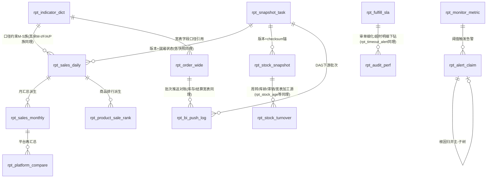

# DB-D11 报表域数据字典（oms_report）

> 文档编号：DB-D11 · 版本 V1.0 · 2026-10-24 · 编写：小凯 · 状态：待审阅（批次⑥）
> 上游契约：DB-00 数据库设计总册（schema=oms_report、表前缀 rpt_、公共字段、命名/索引/类型基线、§6 六项必备、快照表约定、宽表设计）
> 需求依据：SRS-D11.01 固定报表（P1·M3）§6 / SRS-D11.02 BI 数据供给（P1·M3 后段）§6 / SRS-D11.03 履约监控看板（P1·M2）§6
> 参考溯源：商派 omeanalysts 15 表（products_sale 销售排行 / branch_product_stock_detail 商品库存日报 / ome_salestatistics 退货率统计 / ordersPrice 客单价 / ordersTime 下单时段 / logistics_analysts 物流统计 / zero_sale 零销售 / analysis_stocknsale 呆滞库存）+ monitor 应用 7 表（event_notify 预警通知 / event_receiver 预警配置 / workwx_rule 企微规则）——字段语义参考，不照抄结构
>
> **命名对应说明**：本册表名按 DB-00 rpt_ 前缀统一规范化，与 SRS §6 业务名的对应在 §2 表清单「SRS 对应」列标注（rpt_sales_daily ← §6.1 rpt_sale_daily；rpt_indicator_dict ← §6.4 rpt_metric_dict 等）。

---

## 1. 总体说明

### 1.1 域定位与数据流

报表域是**只读数据加工域**（红线：任何报表不得回写业务库，SRS-D11.01 全局决策①）。三层链路：

```
业务库主库(oms_order/oms_stock/oms_finance/oms_aftersale/oms_fulfill...)
  └─binlog→ 只读从库 ─日终快照DAG(D01.02编排)→【快照层】rpt_sales_daily/rpt_fulfill_sla/rpt_aftersale/rpt_stock_snapshot...
                                                └─汇总派生→【汇总层】rpt_sales_monthly/rpt_product_sale_rank/rpt_stock_turnover/rpt_platform_compare/rpt_profit...
  Redis实时计数(各域埋点) ─分钟聚合→【监控层】rpt_monitor_metric(注册+分钟/小时/日三级) + rpt_alert_claim
  从库+快照层 ─宽表ETL→【BI宽表层】rpt_order_wide/rpt_stock_wide/rpt_settlement_wide ─推送(OSS文件/中间表)→ BI数仓(rpt_bi_push_log对账)
```

**rpt_stock_snapshot 与 oms_stock.inv_stock_snapshot 的边界（重要）**：
- `inv_stock_snapshot`（D04.02 FR-06a）＝**记账快照权威源**：三元键 `(branch_id, bm_id, owner_id)` 全量五口径余额+量价双快照，是库存账日切权威切面，对账/重算/审计以它为准；
- `rpt_stock_snapshot`（本域）＝**报表口径汇总**：消费 inv_stock_snapshot + inv_cost_snapshot，按报表维度预汇总并附加报表专属列（货值双口径标注、same_code_group 合并视角、环比列），供 D11.01 库存报表与品牌方门户直查，**不作为记账依据**；
- 数据流：`inv_stock_snapshot ─(快照DAG·库存域就绪后)→ rpt_stock_snapshot ─→ rpt_stock_wide(BI)`；行数/金额校验以 inv 侧 checksum 为锚（±0）。

### 1.2 公共字段与例外（对齐 DB-00 §3）

所有表默认含 `id`(BIGINT UNSIGNED AI 主键)、`tenant_id`(NOT NULL，内部租户=1)、`create_time`/`update_time`(DATETIME(3))。逐表定义只列业务字段，例外在表头标注：

- **快照/汇总/宽表类**：由快照任务按 `(维度键, stat_date, snapshot_version)` 幂等覆盖重建——**无 is_deleted、无 version 乐观锁**（版本语义由 snapshot_version 承载，FR-06d 重跑=版本+1 旧版留档）；owner_id/branch_id 等为维度列（NOT NULL DEFAULT 0，0=汇总行）。
- **流水/日志类**（rpt_snapshot_task、rpt_bi_push_log、rpt_alert_claim、rpt_monitor_metric 时序行、rpt_timeout_alert）：只增不改（状态列除外），无软删。
- **字典类**（rpt_indicator_dict）：owner_id 免填（DEFAULT 0），含完整公共字段。
- 全部快照/汇总/宽表携带**四维权限字段**（shop_id/brand_id/owner_id/branch_id，D10.03 行级过滤载体）与 `snapshot_version`(INT UNSIGNED NOT NULL DEFAULT 1，LFK→rpt_snapshot_task.version)，下文不再重复注释。
- 金额 DECIMAL(18,2)（DB-00 基线，SRS §6 的 DECIMAL(14,2) 从基线）；比例 DECIMAL(9,4)；聚合数量 BIGINT、明细数量 INT；时效秒 INT；时间 DATETIME(3)、日期 DATE。
- 全库：InnoDB / utf8mb4 / utf8mb4_0900_ai_ci / 不建物理外键（LFK 标注）/ 枚举不用 MySQL ENUM，注释写全枚举值。

### 1.3 分区与保留策略（对齐 DB-00 §1.3 与 SRS-D11.01 FR-06f）

| 表 | 策略 |
|---|---|
| rpt_order_wide | 量最大（~6 万行/日，3 年 ~6600 万）：按 stat_date 月分区（RANGE），DDL 为结构基线、分区 DBA 预建；推送后本地留 90 天回溯窗口滚动清理（BI 侧存全量） |
| rpt_stock_wide / rpt_stock_snapshot | 日切全量（~50 万行/日）按月分区，在线 3 年后归档 `_arc` |
| rpt_monitor_metric | 分钟行在线 7 天/小时行 90 天/日行长期（period 列区分，降采样+过期分区清理，SRS-D11.03 §5.4） |
| rpt_sales_daily 等日快照 | 在线 3 年（对齐 D03.13 归档口径），按月分区 |
| 月汇总/字典/任务台账 | 长期保留，不分表 |

### 1.4 保留字规避（DB-00 §2.1）

排行列用 `rank_no`（**禁用 `rank`**，MySQL 8.0 窗口函数保留字）；指标值列用 `metric_value`（避免 value）；不使用 system/groups/interval/range 做列名。

---

## 2. 表清单（24 张）

| # | 表名 | 中文名 | 所属模块 | SRS §6 对应 | 分期 | 预估行量级 |
|---|---|---|---|---|---|---|
| 1 | rpt_indicator_dict | 指标口径字典（唯一事实源） | D11.01 FR-08 | §6.4 rpt_metric_dict | P1·M3 | 数百 |
| 2 | rpt_snapshot_task | 快照任务依赖链与重跑记录 | D11.01 FR-06 | §6.3 rpt_snapshot_version | P1·M3 | 万/年 |
| 3 | rpt_sales_daily | 销售日快照 | D11.01 FR-01/06a | §6.1 rpt_sale_daily | P1·M3 | ~2000/日 |
| 4 | rpt_sales_monthly | 销售月汇总 | D11.01 FR-01 | §6.1 派生 | P1·M3 | ~6万/年 |
| 5 | rpt_product_sale_rank | 商品销售排行快照 | D11.01 FR-01 | §6.1 rpt_sale_goods | P1·M3 | ~5万/日 |
| 6 | rpt_platform_compare | 平台对比月表 | D11.01 FR-01 | §6.1 派生 | P1·M3 | 千/年 |
| 7 | rpt_stock_snapshot | 库存报表口径日切汇总 | D11.01 FR-02 | §6.2（消费 D04.02/07 快照） | P1·M3 | ~5万/日 |
| 8 | rpt_stock_turnover | 库存周转率月表 | D11.01 FR-02 | §6.2 派生（M-I02） | P1·M3 | 万/年 |
| 9 | rpt_stock_age | 库龄分析日表 | D11.01 FR-02 | §6.2 派生（M-I03） | P1·M3 | ~5万/日 |
| 10 | rpt_near_expire | 临期库存日表 | D11.01 FR-02 | §6.2（源 D04.09） | P1·M3 | 万/日 |
| 11 | rpt_slow_moving | 滞销日表 | D11.01 FR-02 | §6.2（源 D04.10） | P1·M3 | 万/日 |
| 12 | rpt_stockout | 缺货准实时表 | D11.01 FR-02 | §6.2（源 D03.09） | P1·M3 | 千/日 |
| 13 | rpt_fulfill_sla | 履约时效日快照 | D11.01 FR-03/06a | §6.2 rpt_fulfill_daily | P1·M3 | ~3000/日 |
| 14 | rpt_audit_perf | 审单员绩效日表 | D11.01 FR-03 | §6.2（消费 D03.03 audit_performance） | P1·M3 | 千/日 |
| 15 | rpt_timeout_alert | 超时预警清单（准实时） | D11.01 FR-03 | §6.2 明细（从库 10 分钟缓存） | P1·M3 | 千/日 |
| 16 | rpt_aftersale | 售后日快照 | D11.01 FR-04/06a | §6.3 rpt_aftersale_daily | P1·M3 | ~1000/日 |
| 17 | rpt_profit | 毛利月表（买断货主） | D11.01 FR-05a | 派生（M-P01/02） | P1·M3 | 万/年 |
| 18 | rpt_service_fee | 代销服务费月表 | D11.01 FR-05b | 派生（M-P03） | P1·M3 | 千/年 |
| 19 | rpt_order_wide | 订单宽表（BI 供给） | D11.02 FR-01 | §6.1 dws_order_wide | P1·M3 后段 | ~6万/日 |
| 20 | rpt_stock_wide | 库存宽表日切（BI 供给） | D11.02 FR-02 | §6.2 dws_stock_wide | P1·M3 后段 | ~50万/日 |
| 21 | rpt_settlement_wide | 结算宽表（BI 供给） | D11.02 FR-03 | §6.2 dws_settle_wide | P1·M3 后段 | 千/月 |
| 22 | rpt_bi_push_log | BI 推送台账与对账记录 | D11.02 FR-04/06 | §6.3 bi_push_batch+bi_recon_record 合并 | P1·M3 后段 | 万/年 |
| 23 | rpt_monitor_metric | 监控指标注册与分钟级聚合 | D11.03 FR-01/02 | §6.1 monitor_metric+§6.3 三级时序 | P1·M2 | ~288万/日(分钟行) |
| 24 | rpt_alert_claim | 告警认领闭环记录 | D11.03 FR-04/05 | §6.2 monitor_alert(+action) 合并 | P1·M2 | 万/年 |

> 合并/收敛说明（对 SRS §6 的结构化落地，口径字段一一对应不缺失）：① monitor_metric 注册表与 monitor_minute/hour/daily 三级时序收敛为 rpt_monitor_metric 单表+`period` 列（registry 行=注册元数据，minute/hour/day 行=时序，查询路由规则不变 SRS-D11.03 §5.4）；② monitor_alert+monitor_alert_action 合并为 rpt_alert_claim（主记录+闭环列+actions_json 时间线），动作量大再拆；③ bi_push_batch+bi_recon_record 合并为 rpt_bi_push_log（批次主行+对账列，多核对项入 recon_json）；④ SRS-D11.01 §6.4 订阅表 rpt_subscription **不落本域**——订阅配置与推送执行归 D01.07（oms_base），本域只发 `report.snapshot.ready` 事件触发，避免双头维护；⑤ SRS-D11.03 §6.3 大促会话 promo_session 以 rpt_monitor_metric 的 metric_code='promo.session' registry 行承载（ext_json=会话窗口/阈值集/预案执行/峰值快照/战报，年十余次不独立建表），告警经 rpt_alert_claim.promo_session_id 挂会话。

---

## 3. 逐表定义

> 表格只列业务字段；公共字段与快照通用列见 §1.2。同类字段合并行展示（类型/约束一致）。

### 3.1 治理层（D11.01）

#### 3.1.1 rpt_indicator_dict 指标口径字典（P1·M3）★唯一事实源

用途：全系统报表指标**唯一口径事实源**（FR-08/全局决策②）：编码/名称/定义/公式/来源表/口径标注/版本治理。任何报表/导出/推送/BI 宽表字段与字典不一致即为缺陷（CI 校验红线 AC-07）；报表列头「?」提示取本表（IF-D11.01-02）；宽表口径字段引用 metric_code（D11.02 FR-05b）。口径变更只对未来生效、历史快照不重算，effect_from 为页脚分界标注依据。配置类：owner_id 免填、含完整公共字段。
溯源：凯淳原创（商派口径散落各报表代码——「销售额」多处定义不一致的教训）。

| 字段 | 类型 | 约束 | 默认 | 注释 |
|---|---|---|---|---|
| metric_code | VARCHAR(32) | NOT NULL | | 指标编码唯一:M-S01有效订单量/M-S02 GMV/M-S03客户实付/M-S04客单价/M-S05退款率/M-S06销售收入/M-I01五口径余额/M-I02周转率/M-I03库龄/M-I04库存货值/M-I05缺货账龄/M-F01~F07履约时效族/M-A01售后率/M-A02良不良比/M-A03售后处理时效/M-P01毛利/M-P02毛利率/M-P03服务费收入（V1.0基线=SRS-D11.01 §5.1，初始INSERT见SQL） |
| metric_name / category | VARCHAR(128)/VARCHAR(16) | NOT NULL | | 指标名称/分类:sale=销售,stock=库存,fulfill=履约,aftersale=售后,profit=毛利服务费,monitor=监控（监控口径与经营口径差异明示，D11.03 FR-01d） |
| biz_define / formula | VARCHAR(512)/VARCHAR(1024) | NOT NULL | ''/ | 业务定义/计算公式（如 M-S02: Σ(行paid_amount+platform_subsidy)+freight） |
| source_table | VARCHAR(512) | NOT NULL | | 数据来源表（schema.table 或接口编号，如 oms_order.ord_order / IF-D03.03-08） |
| caliber_note | VARCHAR(512) | NOT NULL | '' | 口径标注：双口径归属（客户实付/平台承担）/时点归属（付款日/退款成功日/完成日）/跨期说明 |
| dict_version / effect_from / metric_owner | VARCHAR(16)/DATE/VARCHAR(64) | NOT NULL | 'v1.0'//'' | 字典版本（FR-08b三方评审后递增）/生效日期（只未来生效，报表页脚标注分界）/指标负责人（产品+财务+数据登记） |
| status | TINYINT | NOT NULL | 1 | 状态:1=生效,2=历史,3=废止 |
| ext_json | JSON | NULL | NULL | 扩展（关联报表清单/BI宽表字段映射） |

索引：`uk_rpt_indicator_dict_code(metric_code, dict_version)`；`idx_rpt_indicator_dict_cat(category, status)`。

#### 3.1.2 rpt_snapshot_task 快照任务依赖链与重跑记录（P1·M3）

用途：快照 DAG 执行台账（FR-06b/c/d/e，联动 D01.02）：每任务=（域×业务日期×版本）一行；依赖链就绪状态、行数±0/金额±0.01 双校验、7 日均值波动>50% 待人工复核、重跑留痕（谁/何时/范围/原因必填）、就绪时间（页头「数据截至」透出 FR-06e）。DAG：日切→库存/成本快照(D04.02/07)∥销售/履约/售后快照→汇总层→宽表 ETL→BI 推送（D11.02 批次也登记 domain=bi_*）。只增+状态推进，无软删。
溯源：← SRS §6.3 rpt_snapshot_version 扩展（+依赖链+校验列）。

| 字段 | 类型 | 约束 | 默认 | 注释 |
|---|---|---|---|---|
| task_bn | VARCHAR(32) | NOT NULL | | 任务号唯一（Redis发号:日期+RPT+序列） |
| domain | VARCHAR(32) | NOT NULL | | 快照域:sales/product_rank/fulfill/aftersale/stock_rpt=库存报表汇总/agg_monthly=月汇总派生/profit/bi_order_wide/bi_stock_wide/bi_settle_wide/bi_push |
| biz_date / version | DATE/INT UNSIGNED | NOT NULL | /1 | 业务日期（日切归属日）/快照版本（重跑+1旧版留档可回滚；下游表 snapshot_version 引用此值） |
| depends_on | JSON | NULL | NULL | 上游依赖任务集（task_bn数组，DAG边，全部就绪才执行） |
| status | TINYINT | NOT NULL | 1 | 状态:1=待执行,2=生成中,3=就绪,4=失败,5=待人工复核(行数波动>50%),6=已重跑替代 |
| row_count / source_count / amount_total | BIGINT UNSIGNED×2/DECIMAL(18,2) | NOT NULL | 0 | 快照行数/源库COUNT(*)（行数校验±0）/金额合计（与源库SUM比对±0.01） |
| checksum | VARCHAR(64) | NOT NULL | '' | 校验和（金额SUM哈希；库存域=inv快照checksum锚） |
| start_time / finish_time | DATETIME(3) | NULL | NULL | 起止时间（单任务超时默认30分钟告警，FR-06c） |
| retry_count / rerun_flag | TINYINT/TINYINT(1) | NOT NULL | 0 | 自动重试次数（退避重试2次仍失败→告警人工）/是否重跑批次:0=否,1=是 |
| rerun_operator / rerun_reason | VARCHAR(64)/VARCHAR(512) | NOT NULL | '' | 重跑发起人（权限=报表管理员，D10.06审计）/原因必填（FR-06d） |
| err_msg | VARCHAR(1024) | NOT NULL | '' | 失败原因（联动上游域排查提示） |

索引：`uk_rpt_snapshot_task(task_bn)`；`uk_rpt_snapshot_task_domain(domain, biz_date, version)` 幂等键（§5.2 算法）；`idx_rpt_snapshot_task_status(status, biz_date)`。

### 3.2 销售类（D11.01 FR-01）

#### 3.2.1 rpt_sales_daily 销售日快照（P1·M3）

用途：日×平台×店铺×品牌×货主销售快照（SRS §6.1）：GMV/客户实付**双口径强制分列**（FR-01b 禁止单口径「销售额」）、有效订单量/取消量、退款双口径、环比（前日/上周同日）快照固化；日报晨报（SC-01）与订阅推送数据源。金额列逐一引用字典编码。快照类：无软删/乐观锁。
溯源：← 商派 ome_salestatistics 改造：+货主/品牌维度、+双口径分列、+版本化。

| 字段 | 类型 | 约束 | 默认 | 注释 |
|---|---|---|---|---|
| stat_date | DATE | NOT NULL | | 统计日期（按付款日归属，M-S01） |
| platform | VARCHAR(32) | NOT NULL | | 平台码:tmall/taobao/jd/douyin/pdd/xhs/wechat/other（gw_shop枚举同源） |
| shop_id | BIGINT UNSIGNED | NOT NULL | | 店铺 LFK→oms_gateway.gw_shop（四维①） |
| brand_id / owner_id / branch_id | BIGINT UNSIGNED | NOT NULL | 0 | 品牌 LFK→inv_brand（四维②，0=未归属）/货主 LFK→org_owner（四维③，门户行隔离键）/仓（四维④，销售快照默认0不分仓） |
| gmv / paid_amount / platform_subsidy | DECIMAL(18,2) | NOT NULL | 0 | GMV·平台承担口径=Σ(paid_amount+platform_subsidy)+freight（M-S02）/客户实付=Σpaid_amount+freight（M-S03）/平台承担金额（双口径差额勾稽列） |
| order_count / cancel_count / item_count / refund_count | INT | NOT NULL | 0 | 有效订单量=付款订单数−整单取消数、拆单不重复计按订单头（M-S01/FR-01c）/整单取消量/商品件数/退款笔数 |
| avg_order_amount | DECIMAL(18,2) | NOT NULL | 0 | 客单价=GMV/有效订单量（M-S04；汇总行按分子分母重算，禁止比率平均 FR-07b） |
| refund_amount_customer / refund_amount_platform | DECIMAL(18,2) | NOT NULL | 0 | 退款金额双口径（客户实付按退款成功日归属 M-S05 分子/平台承担冲减单列 FR-04b） |
| refund_rate / gmv_dod / gmv_wow | DECIMAL(9,4) | NOT NULL | 0 | 退款率=refund_amount_customer/gmv（M-S05跨期口径字典明示）/GMV环比·前日/上周同日（快照固化） |
| ready_time | DATETIME(3) | NULL | NULL | 数据就绪时间（页头透出 FR-06e） |

索引：`uk_rpt_sales_daily(stat_date, platform, shop_id, brand_id, owner_id, snapshot_version)` 幂等重建键；`idx_rpt_sales_daily_owner(owner_id, stat_date)` 门户；`idx_rpt_sales_daily_shop(shop_id, stat_date)`。

#### 3.2.2 rpt_sales_monthly 销售月汇总（P1·M3）

用途：月×平台×店铺×品牌×货主（FR-01 销售月报）：月累计+月环比+年同比+退款金额；由 rpt_sales_daily 按月汇总派生（DAG 汇总层，依赖当月全部日快照就绪）。长期保留。
溯源：← 商派 cat_sale_statis 月对比语义扩展。

| 字段 | 类型 | 约束 | 默认 | 注释 |
|---|---|---|---|---|
| stat_month | CHAR(7) | NOT NULL | | 统计月份（YYYY-MM） |
| platform | VARCHAR(32) | NOT NULL | | 平台码（同日快照枚举） |
| shop_id / brand_id / owner_id / branch_id | BIGINT UNSIGNED | NOT NULL | 0 | 四维（含义同 rpt_sales_daily） |
| gmv / paid_amount / platform_subsidy | DECIMAL(18,2) | NOT NULL | 0 | 月GMV平台承担口径（M-S02）/月客户实付（M-S03）/月平台承担 |
| order_count / cancel_count | INT | NOT NULL | 0 | 月有效订单量（M-S01）/整单取消量 |
| avg_order_amount / refund_amount_customer / refund_amount_platform | DECIMAL(18,2) | NOT NULL | 0 | 月客单价（M-S04）/月退款金额双口径 |
| refund_rate / gmv_mom / gmv_yoy | DECIMAL(9,4) | NOT NULL | 0 | 月退款率（M-S05）/月环比（vs上月）/年同比（vs去年同月） |

索引：`uk_rpt_sales_monthly(stat_month, platform, shop_id, brand_id, owner_id, snapshot_version)`；`idx_rpt_sales_monthly_owner(owner_id, stat_month)`。

#### 3.2.3 rpt_product_sale_rank 商品销售排行快照（P1·M3）

用途：日×商品(bm/sm)×店铺×货主销售明细快照（SRS §6.1 rpt_sale_goods）+滚动窗口（7/30/90 天可配）排行派生（FR-01 TOP N）；滞销联动场景（SC-03「曾爆款现滞销」）数据源。**排名列 rank_no（禁用保留字 rank）**。
溯源：← 商派 products_sale + sale_products 改造：+货主维度、+退款率、+双口径。

| 字段 | 类型 | 约束 | 默认 | 注释 |
|---|---|---|---|---|
| stat_date | DATE | NOT NULL | | 统计日期（付款日归属） |
| window_type | TINYINT | NOT NULL | 1 | 汇总窗口:1=当日,2=近7天滚动,3=近30天,4=近90天（排行报表取2/3/4） |
| bm_id / sm_id | BIGINT UNSIGNED | NOT NULL | /0 | 基础物料 LFK→oms_stock.inv_material/销售物料 LFK→inv_sales_material（0=跨店铺bm聚合行） |
| goods_name | VARCHAR(255) | NOT NULL | '' | 商品名快照（防档案变更影响历史） |
| shop_id / brand_id / owner_id | BIGINT UNSIGNED | NOT NULL | 0 | 维度（brand_id/owner_id 冗余自物料档案） |
| sale_num / refund_num | BIGINT | NOT NULL | 0 | 销量（Σ行数量）/退款量 |
| gmv / paid_amount / refund_amount / refund_rate | DECIMAL(18,2)×3/DECIMAL(9,4) | NOT NULL | 0 | GMV平台承担口径（M-S02）/客户实付（M-S03）/退款金额客户实付口径/退款率（M-S05） |
| rank_no | INT | NOT NULL | 0 | 排行名次（窗口内降序TOP N固化；**勿用rank保留字**） |
| rank_type | TINYINT | NOT NULL | 1 | 排行口径:1=按GMV,2=按销量,3=按实付,4=按退款率（SC-03多榜） |

索引：`uk_rpt_product_sale_rank(stat_date, window_type, rank_type, bm_id, sm_id, shop_id, owner_id, snapshot_version)`；`idx_rpt_product_sale_rank_top(stat_date, window_type, rank_type, rank_no)`；`idx_rpt_product_sale_rank_bm(bm_id, stat_date)`。

#### 3.2.4 rpt_platform_compare 平台对比月表（P1·M3）

用途：平台×月对比（FR-01）：GMV/实付/单量/客单价/退款率占比与环比；由 rpt_sales_monthly 按平台再汇总派生。
溯源：← 商派 cat_sale_statis 对比思想平移至平台维度。

| 字段 | 类型 | 约束 | 默认 | 注释 |
|---|---|---|---|---|
| stat_month / platform | CHAR(7)/VARCHAR(32) | NOT NULL | | 统计月份（YYYY-MM）/平台码 |
| owner_id | BIGINT UNSIGNED | NOT NULL | 0 | 货主（0=全货主汇总行；门户按本货主行过滤） |
| gmv / paid_amount | DECIMAL(18,2) | NOT NULL | 0 | 平台月GMV（M-S02）/客户实付（M-S03） |
| order_count | INT | NOT NULL | 0 | 平台月有效订单量（M-S01） |
| avg_order_amount / refund_rate / gmv_share / gmv_mom | DECIMAL(18,2)/DECIMAL(9,4)×3 | NOT NULL | 0 | 平台月客单价（M-S04）/退款率（M-S05）/GMV占比=本平台÷全平台（同owner范围）/月环比 |

索引：`uk_rpt_platform_compare(stat_month, platform, owner_id, snapshot_version)`。

### 3.3 库存类（D11.01 FR-02）

#### 3.3.1 rpt_stock_snapshot 库存报表口径日切汇总（P1·M3）

用途：库存余额表数据源：**消费** inv_stock_snapshot（五口径权威源）+inv_cost_snapshot（量价），按日切×仓×货主×品牌×分类×SKU 落报表口径汇总——五口径**照录不另算**（FR-02a available 派生值照录）、货值双口径（买断=均价×实际/代销=代管货值单列标注 FR-02b）、same_code_group 合并视角（FR-02c）。与 inv 快照边界见 §1.1。当日实时直查从库 inv_stock_ledger 不落本表。
溯源：← 商派 branch_product_stock_detail（day1~31 平铺反范式）改造：行式日切+货主维度+货值口径分列。

| 字段 | 类型 | 约束 | 默认 | 注释 |
|---|---|---|---|---|
| stat_date | DATE | NOT NULL | | 快照日期（日切） |
| branch_id / bm_id / owner_id | BIGINT UNSIGNED | NOT NULL | | 三元维度（与inv快照同构）LFK→oms_fulfill.ful_branch / oms_stock.inv_material / oms_org.org_owner |
| brand_id / cat_id / shop_id | BIGINT UNSIGNED | NOT NULL | 0 | 品牌（冗余自物料）/分类 LFK→inv_material_cat/店铺（库存维度默认0） |
| store_num / available_num / freeze_num / arrive_num / defective_num | INT | NOT NULL | 0 | 五口径余额:实际/可用(派生值照录FR-02a)/锁定/在途/次品（M-I01，照录inv快照不另算） |
| unit_cost | DECIMAL(18,4) | NOT NULL | 0 | 移动加权均价（D04.07量价双快照照录） |
| stock_value | DECIMAL(18,2) | NOT NULL | 0 | 库存货值（M-I04）:买断=均价×实际（凯淳存货）;代销=数量×settle_price（代管货值非存货，FR-02b） |
| owner_type | TINYINT | NOT NULL | 1 | 货主类型冗余:1=买断,2=代销,3=经销商DEALER_TC(P2预留)（货值口径分流标注） |
| same_code_group | VARCHAR(64) | NOT NULL | '' | 同货号跨货主组（FR-02c合并视角聚合键，D04.01契约：运营看总货、财务分货主看账） |

索引：`uk_rpt_stock_snapshot(stat_date, branch_id, bm_id, owner_id, snapshot_version)`；`idx_rpt_stock_snapshot_owner(owner_id, stat_date)`；`idx_rpt_stock_snapshot_group(same_code_group, stat_date)`。

#### 3.3.2 rpt_stock_turnover 库存周转率月表（P1·M3）

用途：货主×仓×分类×月周转（M-I02）：周转率=当期销售出库成本/平均库存货值；周转天数=期间天数/周转率。源=rpt_stock_snapshot 期初期末货值+D04.07 出库结转（inv_cost_change_log）。汇总层派生。

| 字段 | 类型 | 约束 | 默认 | 注释 |
|---|---|---|---|---|
| stat_month | CHAR(7) | NOT NULL | | 统计月份（期间=自然月，M-I02） |
| owner_id / branch_id / cat_id / brand_id / shop_id | BIGINT UNSIGNED | NOT NULL | 0 | 维度（branch_id/cat_id=0为汇总行；shop_id 周转默认0） |
| outbound_cost | DECIMAL(18,2) | NOT NULL | 0 | 当期销售出库成本（D04.07结转，成本口径非售价） |
| begin_value / end_value / avg_value | DECIMAL(18,2) | NOT NULL | 0 | 期初货值（月初日切）/期末货值（月末日切）/平均=(期初+期末)/2 |
| turnover_rate / turnover_days | DECIMAL(9,4) | NOT NULL | 0 | 周转率=outbound_cost/avg_value（M-I02；avg=0置0并标注）/周转天数=期间天数÷周转率 |

索引：`uk_rpt_stock_turnover(stat_month, owner_id, branch_id, cat_id, brand_id, snapshot_version)`。

#### 3.3.3 rpt_stock_age 库龄分析日表（P1·M3）

用途：货主×仓×库龄档日汇总（M-I03）：库龄=快照日−入库日（批次优先，无批次取记账行首入日）；分档 0-30/31-60/61-90/91-180/>180 天可配。源=rpt_stock_snapshot+oms_stock.inv_batch/inv_batch_stock（D04.09）。

| 字段 | 类型 | 约束 | 默认 | 注释 |
|---|---|---|---|---|
| stat_date | DATE | NOT NULL | | 统计日期 |
| owner_id / branch_id / brand_id / cat_id / shop_id | BIGINT UNSIGNED | NOT NULL | 0 | 维度（shop_id 默认0） |
| age_bucket | VARCHAR(16) | NOT NULL | | 库龄档:b0_30=0-30天,b31_60,b61_90,b91_180,b180p=>180天（边界可配，M-I03） |
| stock_num / stock_value | BIGINT/DECIMAL(18,2) | NOT NULL | 0 | 该档实际库存数量合计/该档货值合计（M-I04口径） |
| num_ratio / value_ratio | DECIMAL(9,4) | NOT NULL | 0 | 数量占比/货值占比（档内/全量） |

索引：`uk_rpt_stock_age(stat_date, owner_id, branch_id, cat_id, brand_id, age_bucket, snapshot_version)`。

#### 3.3.4 rpt_near_expire 临期库存日表（P1·M3）

用途：货主×仓×SKU×批次×临期级别明细（FR-02 临期库存表）：到期日/剩余天数/数量/货值/处置状态；级别=黄/橙/红（D04.09 FR-03a），联动 D04.09 处置看板。源=inv_batch_stock/inv_expire_rule（从库抽取）。

| 字段 | 类型 | 约束 | 默认 | 注释 |
|---|---|---|---|---|
| stat_date | DATE | NOT NULL | | 统计日期 |
| branch_id / bm_id / owner_id | BIGINT UNSIGNED | NOT NULL | | 三元维度 |
| shop_id / brand_id | BIGINT UNSIGNED | NOT NULL | 0 | 店铺/品牌（四维①②） |
| batch_no / expire_date / remain_days | VARCHAR(64)/DATE/INT | NOT NULL | //0 | 批次号 LFK→oms_stock.inv_batch/到期日（批次效期档案）/剩余天数=expire_date−stat_date |
| expire_level | TINYINT | NOT NULL | 1 | 临期级别:1=黄,2=橙,3=红（D04.09 FR-03a阈值规则） |
| batch_num / stock_value | INT/DECIMAL(18,2) | NOT NULL | 0 | 批次库存数量/批次货值（M-I04） |
| disposal_status | TINYINT | NOT NULL | 0 | 处置状态:0=未处置,1=处置中,2=已处置(退仓/报废/促销),3=已过期（联动inv_expire_disposal） |

索引：`uk_rpt_near_expire(stat_date, branch_id, bm_id, owner_id, batch_no, snapshot_version)`；`idx_rpt_near_expire_level(expire_level, remain_days)` 红色置顶。

#### 3.3.5 rpt_slow_moving 滞销日表（P1·M3）

用途：货主×仓×SKU 滞销清单：滞销天数（M 天无动销，D04.10 规则）/库存量/货值/最近出库日/处置建议状态（联动 inv_replenish_suggestion suggest_type=4）。源=D04.10 滞销标记+rpt_stock_snapshot。
溯源：← 商派 analysis_stocknsale（呆滞）+zero_sale（零销售）改造：+货主维度+建议单联动。

| 字段 | 类型 | 约束 | 默认 | 注释 |
|---|---|---|---|---|
| stat_date | DATE | NOT NULL | | 统计日期 |
| branch_id / bm_id / owner_id | BIGINT UNSIGNED | NOT NULL | | 三元维度 |
| shop_id / brand_id | BIGINT UNSIGNED | NOT NULL | 0 | 店铺/品牌 |
| slow_days / last_outbound_date | INT/DATE | NOT NULL/NULL | 0/NULL | 滞销天数=stat_date−最近出库日（M天无动销判定可配，D04.10）/最近出库日（NULL=从未动销） |
| stock_num / stock_value / sale_num_90d | INT/DECIMAL(18,2)/INT | NOT NULL | 0 | 当前实际库存量/滞销货值（按货值排序主列SC-03）/近90天销量（0=零销售） |
| suggest_status / suggest_bn | TINYINT/VARCHAR(32) | NOT NULL | 0/'' | 处置建议状态:0=无建议,1=已生成待处理,2=已采纳,3=已忽略（LFK→oms_stock.inv_replenish_suggestion）/关联建议单号 |

索引：`uk_rpt_slow_moving(stat_date, branch_id, bm_id, owner_id, snapshot_version)`；`idx_rpt_slow_moving_value(owner_id, stat_date, stock_value)` 货值降序。

#### 3.3.6 rpt_stockout 缺货准实时表（P1·M3）

用途：店铺×SKU×货主×仓缺货清单（**准实时**：从库分钟级缓存抽取 D03.09 ord_stockout+D04.10 建议单，非日终快照——snapshot_version 恒=0 标识准实时口径，刷新覆盖）。缺货账龄分档 >24h/>48h/>72h（M-I05，D03.09 FR-04d）。

| 字段 | 类型 | 约束 | 默认 | 注释 |
|---|---|---|---|---|
| stat_date / refresh_time | DATE/DATETIME(3) | NOT NULL | | 刷新归属日期/本次刷新时间（分钟级，准实时口径标注） |
| shop_id / bm_id / owner_id / branch_id / brand_id | BIGINT UNSIGNED | NOT NULL | 0 | 四维全携带+品牌 |
| shortage_num / shortage_order_count | INT | NOT NULL | 0 | 缺口量（需求−可售）/缺货订单数（ord_stockout未解除行） |
| age_level / first_shortage_time | TINYINT/DATETIME(3) | NOT NULL | 1/ | 缺货账龄分级:1=>24h,2=>48h,3=>72h（M-I05，以缺货明细创建时间起算）/首次缺货标记时间（账龄起算点） |
| suggest_status / source_ref | TINYINT/VARCHAR(32) | NOT NULL | 0/'' | 补货建议状态:0=无,1=已生成,2=已采纳（联动D04.10）/来源缺货明细单号 LFK→oms_order.ord_stockout |

索引：`idx_rpt_stockout_refresh(stat_date, refresh_time)`；`idx_rpt_stockout_sku(shop_id, bm_id, stat_date)`；`idx_rpt_stockout_age(age_level, first_shortage_time)`。

### 3.4 履约类（D11.01 FR-03）

#### 3.4.1 rpt_fulfill_sla 履约时效日快照（P1·M3）

用途：日×店铺×仓×WMS 各环节时效快照（SRS §6.2 rpt_fulfill_daily）：审单（自动/人工量、通过率）→推仓（均值/P90、失败量）→出库（耗时、回传延迟）→发货（≤24h/24-48h/>48h 分档，平台考核口径）→签收；时效**全部分布呈现**（均值+P90+分档，FR-03a）；超时单量+卡点归因分布（§5.3 优先级：异常>审单>缺货>暂停>推仓失败>WMS出库）。时间点口径=M-F 族字典。
溯源：← 商派 logistics_analysts 改造：+五段全链路+P90 分布+货主维度。

| 字段 | 类型 | 约束 | 默认 | 注释 |
|---|---|---|---|---|
| stat_date | DATE | NOT NULL | | 统计日期（各环节按业务归属日，M-F族） |
| shop_id / branch_id / owner_id / brand_id | BIGINT UNSIGNED | NOT NULL | 0 | 四维（branch_id=0为店铺级汇总行） |
| wms_id | BIGINT UNSIGNED | NOT NULL | 0 | WMS LFK→oms_fulfill.ful_wms（0=不分WMS汇总） |
| audit_auto_count / audit_manual_count | INT | NOT NULL | 0 | 自动审单量（D03.02供数）/人工审核量 |
| audit_pass_rate | DECIMAL(9,4) | NOT NULL | 0 | 自动审单通过率=自动通过/投审（M-F07，按投审日归属） |
| audit_dur_avg / audit_dur_p90 / queue_dur_avg | INT | NOT NULL | 0 | 人工审单时效均值/P90·秒（M-F01，分派→终态，口径以D03.03 §5.4为准）/队列停留均值·秒（M-F02，付款→审核终态，SLA考核口径含待分派） |
| push_dur_avg / push_dur_p90 / push_fail_count | INT | NOT NULL | 0 | 推仓时效均值/P90·秒（M-F03，发货单生成→WMS推送成功，多轮取首轮）/推送失败量（D09.02事件，原因分布见reason_dist） |
| outbound_dur_avg / outbound_dur_p90 / callback_delay_count | INT | NOT NULL | 0 | 出库时效均值/P90·秒（M-F04，推送成功→出库回传，分批取末批）/回传延迟量（>N小时阈值可配） |
| ship_24h_rate / ship_48h_rate / ship_over48h_count | DECIMAL(9,4)×2/INT | NOT NULL | 0 | 发货≤24h占比/24-48h占比（M-F05，付款→发货确认，部分发货取首包，平台考核口径）/>48h单量（平台考核红线） |
| sign_dur_avg / overtime_order_count | INT | NOT NULL | 0 | 签收时效均值·秒（M-F06，发货→签收，无轨迹单不计入分母）/超时单量（付款超阈值未发货，店铺级阈值默认48h可配） |
| reason_dist | JSON | NULL | NULL | 卡点归因分布:{"exception":n,"audit":n,"shortage":n,"pause":n,"push_fail":n,"wms_out":n,"unknown":n}（§5.3首个命中） |

索引：`uk_rpt_fulfill_sla(stat_date, shop_id, branch_id, wms_id, owner_id, snapshot_version)`；`idx_rpt_fulfill_sla_owner(owner_id, stat_date)`。

#### 3.4.2 rpt_audit_perf 审单员绩效日表（P1·M3）

用途：审核员×组×店铺×日绩效：**消费** D03.03 audit_performance（IF-D03.03-08，口径以其 §5.4 为准，本表为报表侧冗余落地供多维联查）。仅统计不强制排名（D03.03 FR-07c：默认不展示全员排名，主管可看组内）。

| 字段 | 类型 | 约束 | 默认 | 注释 |
|---|---|---|---|---|
| stat_date | DATE | NOT NULL | | 统计日期 |
| auditor_id | BIGINT UNSIGNED | NOT NULL | | 审核员 LFK→oms_org.org_account |
| audit_group_id | BIGINT UNSIGNED | NOT NULL | 0 | 审核组 LFK→oms_order.ord_audit_group |
| shop_id / owner_id / brand_id | BIGINT UNSIGNED | NOT NULL | 0 | 店铺/货主/品牌维度 |
| handle_count / pass_count / reject_count / overtime_count | INT | NOT NULL | 0 | 人工处理量（审核终态单数）/通过量/驳回量/超时单数（audit.task.overtime事件计数） |
| reject_rate | DECIMAL(9,4) | NOT NULL | 0 | 驳回率=驳回/处理量 |
| dur_avg / dur_p90 / queue_dur_avg | INT | NOT NULL | 0 | 处理时效均值/P90·秒（分派→终态，M-F01）/队列停留均值·秒（M-F02） |

索引：`uk_rpt_audit_perf(stat_date, auditor_id, shop_id, owner_id, snapshot_version)`；`idx_rpt_audit_perf_group(stat_date, audit_group_id)`。

#### 3.4.3 rpt_timeout_alert 超时预警清单（P1·M3）

用途：付款超 N 小时（默认 48，店铺级可配）未发货**订单明细**（准实时：从库 10 分钟缓存刷新）：订单号/店铺/付款时间/已超时/卡点环节（§5.3 首个命中）。一行一订单幂等刷新，解除置状态留痕。无软删。

| 字段 | 类型 | 约束 | 默认 | 注释 |
|---|---|---|---|---|
| order_id / order_bn | BIGINT UNSIGNED/VARCHAR(32) | NOT NULL | | 订单 LFK→oms_order.ord_order/订单号（冗余，清单直显） |
| shop_id / branch_id / owner_id / brand_id | BIGINT UNSIGNED | NOT NULL | 0 | 四维 |
| pay_time | DATETIME(3) | NOT NULL | | 付款时间（超时起算点） |
| timeout_hours / threshold_hours | INT | NOT NULL | 0/48 | 已超时小时数=now−pay_time−阈值/店铺级阈值快照（默认48） |
| block_stage / block_ref | VARCHAR(32)/VARCHAR(64) | NOT NULL | /'' | 卡点环节（§5.3归因）:exception=异常(附类型),audit=审单(待审核/驳回),shortage=缺货,pause=暂停,push_fail=推仓失败,wms_out=WMS出库未回传,unknown=待排查(告警聚合)/卡点关联单据号（异常单/发货单号，下钻跳转） |
| status | TINYINT | NOT NULL | 1 | 状态:1=预警中,2=已解除(发货/取消),3=已升级(P0联动D11.03) |
| first_alert_time / resolve_time / refresh_time | DATETIME(3) | NULL | NULL | 首次进入清单/解除/最近刷新时间（10分钟缓存口径；first_alert_time/refresh_time NOT NULL） |

索引：`uk_rpt_timeout_alert(order_id)` 一单一行幂等；`idx_rpt_timeout_alert_status(status, timeout_hours)`；`idx_rpt_timeout_alert_shop(shop_id, status)`。

### 3.5 售后类（D11.01 FR-04）

#### 3.5.1 rpt_aftersale 售后日快照（P1·M3）

用途：日×店铺×货主×原因×类型售后快照（SRS §6.3）：申请量/退款金额（**一律客户实付口径** FR-04b，平台承担冲减单列）/笔数/良不良入库数（M-A02）/各段时效 P90/超 SLA 量；售后率=申请单数/付款订单量（M-A01 默认分母，可切发货订单量——denominator_type 明示，切换整表统一 FR-04c）；原因=平台码经 D02.02 映射后标准字典（跨平台可比 FR-04a）；平台介入占比（资损观测）。
溯源：← 商派 ome_salestatistics+ome_goodsrma/ome_rmatype 改造：+货主维度+良不良比+双口径。

| 字段 | 类型 | 约束 | 默认 | 注释 |
|---|---|---|---|---|
| stat_date | DATE | NOT NULL | | 统计日期（按申请创建日归属，M-A01） |
| shop_id / owner_id / brand_id / branch_id | BIGINT UNSIGNED | NOT NULL | 0 | 维度（branch_id 良不良比行有值；brand_id 冗余自商品） |
| bm_id | BIGINT UNSIGNED | NOT NULL | 0 | 商品（0=店铺级汇总行） |
| reason_code | VARCHAR(32) | NOT NULL | 'ALL' | 售后原因码（D05.01标准字典映射后；ALL=全原因汇总行，原因TOP分布FR-04a） |
| apply_type | TINYINT | NOT NULL | 0 | 售后类型:0=全部,1=仅退款,2=退货退款,3=换货,4=补发 |
| denominator_type | TINYINT | NOT NULL | 1 | 售后率分母口径:1=付款订单量(默认),2=发货订单量（字典明示，整表统一FR-04c） |
| apply_count / order_base_count | INT | NOT NULL | 0 | 售后申请单数（含被拒，申请口径）/分母基数快照 |
| aftersale_rate / refund_only_rate / return_refund_rate | DECIMAL(9,4) | NOT NULL | 0 | 售后率=apply_count/order_base_count（M-A01）/仅退款率/退货退款率（分列） |
| refund_amount_customer / refund_amount_platform | DECIMAL(18,2) | NOT NULL | 0 | 退款金额·客户实付口径（D05.03台账，买家真金白银视角）/平台承担冲减单列（对齐D08.01负向应收双口径FR-04b） |
| refund_count | INT | NOT NULL | 0 | 退款笔数 |
| good_count / defect_count | INT | NOT NULL | 0 | 退货入库良品数/不良品数（D05.02质检分流qc_completed事件） |
| defect_rate | DECIMAL(9,4) | NOT NULL | 0 | 良不良比=不良/退货入库总数（M-A02，按质检完成日） |
| defect_disposal_dist | JSON | NULL | NULL | 不良品处置状态分布:{"return_wh":n,"scrap":n,"pending":n}（退仓/报废/待处置） |
| audit_dur_p90 / refund_dur_p90 / over_sla_count | INT | NOT NULL | 0 | 申请→审核/审核→退款时效P90·秒（M-A03）/超SLA单量 |
| platform_intervened_count | INT | NOT NULL | 0 | 平台介入单量（透传标记，资损观测占比列） |

索引：`uk_rpt_aftersale(stat_date, shop_id, owner_id, reason_code, apply_type, bm_id, branch_id, denominator_type, snapshot_version)`；`idx_rpt_aftersale_owner(owner_id, stat_date)` 门户；`idx_rpt_aftersale_reason(stat_date, reason_code)`。

### 3.6 毛利与服务费（D11.01 FR-05，按货主类型分流）

#### 3.6.1 rpt_profit 毛利月表·买断货主（P1·M3）

用途：货主×店铺×分类×单品×月毛利（M-P01/02）：`毛利=收入−销售成本−运费`；收入=D08.01 应收（客户实付默认，platform 对照列可切）−退款冲减，按完成日归属（M-S06）；销售成本=D04.07 出库结转（均价×出库量，**退货按原单成本冲回**非当期均价 AC-09）；运费=D08.04 实际（关账），未关账取预估整表标注（freight_caliber）。期间锁定联动 D08.03 结账。**仅买断货主**（代销自动切 rpt_service_fee，FR-05c 分组不合并；门户不展示毛利）。

| 字段 | 类型 | 约束 | 默认 | 注释 |
|---|---|---|---|---|
| stat_month | CHAR(7) | NOT NULL | | 统计月份 |
| owner_id | BIGINT UNSIGNED | NOT NULL | | 货主（买断类型，D10.01档案分流依据） |
| shop_id / brand_id / branch_id / cat_id / bm_id | BIGINT UNSIGNED | NOT NULL | 0 | 四维+分类LFK→inv_material_cat+单品（0=汇总行，三级下钻） |
| category_level | TINYINT | NOT NULL | 1 | 汇总层级:1=货主总,2=店铺级,3=分类级,4=单品级（下钻链路标识） |
| revenue_customer / revenue_platform / refund_deduct | DECIMAL(18,2) | NOT NULL | 0 | 收入·客户实付口径（M-S06:Σ应收−Σ退款冲减，按完成日归属）/平台承担口径对照列（FR-05a可切）/退款冲减额（已从收入扣除，明细列示） |
| sale_cost / cost_return_back | DECIMAL(18,2) | NOT NULL | 0 | 销售成本（D04.07出库结转:均价×出库量）/退货成本冲回额（按原单成本快照非当期均价，单列勾稽AC-09） |
| freight / freight_caliber | DECIMAL(18,2)/TINYINT | NOT NULL | 0/1 | 运费（D08.04:关账=实际,未关账=预估）/口径:1=实际(已关账),2=预估(未关账，整表标注FR-05a) |
| gross_profit / gross_margin | DECIMAL(18,2)/DECIMAL(9,4) | NOT NULL | 0 | 毛利=收入(客户实付)−销售成本−运费（M-P01）/毛利率=毛利/收入（M-P02；收入=0不计算置0前端显—） |
| period_locked | TINYINT(1) | NOT NULL | 0 | 期间锁定:0=未关账(数据可能调整),1=已关账只读固化（D08.03联动FR-05d） |

索引：`uk_rpt_profit(stat_month, owner_id, shop_id, cat_id, bm_id, category_level, snapshot_version)`；`idx_rpt_profit_owner(owner_id, stat_month)`。

#### 3.6.2 rpt_service_fee 代销服务费月表（P1·M3）

用途：代销货主×周期服务费（FR-05b，M-P03）：源 D08.02 结算单（IF-D08.02-05）——服务费（条款×模型×轨迹汇总）/借调内部交易/净额/台账滚动；**不计算毛利**（货权非凯淳）；代管货值余额单列（D04.07 FR-04a，inv_consignment_value 供数）。

| 字段 | 类型 | 约束 | 默认 | 注释 |
|---|---|---|---|---|
| stat_month | CHAR(7) | NOT NULL | | 结算周期月份 |
| owner_id | BIGINT UNSIGNED | NOT NULL | | 货主（代销类型） |
| shop_id / brand_id | BIGINT UNSIGNED | NOT NULL | 0 | 维度 |
| settle_bn | VARCHAR(32) | NOT NULL | '' | 结算单号 LFK→oms_finance.fin_settlement（空=周期货主级汇总行） |
| service_fee | DECIMAL(18,2) | NOT NULL | 0 | 服务费收入（Σ结算单服务费D项含调整单，M-P03，按结算周期归属，轨迹可下钻） |
| fee_detail_json | JSON | NULL | NULL | 服务费明细:条款×模型×档位（{"term_code":{"model":"rate","base":x,"rate":y,"amount":z}}） |
| lend_trade_amount / net_amount / net_direction | DECIMAL(18,2)×2/TINYINT | NOT NULL | 0/0/1 | 借调内部交易额（D04.05台账，D08.02第4要素）/结算净额/方向:1=凯淳应收,2=凯淳应付（双向呈现） |
| ledger_init / ledger_payable / ledger_paid / ledger_final | DECIMAL(18,2) | NOT NULL | 0 | 台账滚动四列:期初/本期应结/本期已付/期末 |
| consignment_value | DECIMAL(18,2) | NOT NULL | 0 | 代管货值余额（单列标注「代管，非凯淳存货」FR-05b，inv_consignment_value供数） |

索引：`uk_rpt_service_fee(stat_month, owner_id, settle_bn, snapshot_version)`；`idx_rpt_service_fee_owner(owner_id, stat_month)`。

### 3.7 BI 宽表与推送（D11.02）

> 宽表=BI 数仓供数契约层（OMS 不做 BI 展示层红线）。字段口径强制引用 rpt_indicator_dict 编码（FR-05b）；schema 只增不改（FR-05c）；PIPL：不含买家明文（哈希+省市粒度）。核心结构如下，全量字段清单见《OMS BI 宽表数据字典》交付物（FR-05a）。

#### 3.7.1 rpt_order_wide 订单宽表（P1·M3 后段）

用途：**一行一订单行**（order_item_id upsert 主键语义，BI 幂等消费）：头冗余下行+行明细+双口径分摊快照（D03.01 §5.2 getDualAmount 照录不重算）+履约时效（时间戳+预计算秒，M-F 族）+售后标记。增量=昨日有变更订单行整行重推（§5.1 圈定，重叠 5 分钟窗口）；月分区，推送后本地留 90 天。
溯源：← 商派 sales.delivery_order/item 字段语义参考；供数结构凯淳原创（商派未对外供数）。

| 字段 | 类型 | 约束 | 默认 | 注释 |
|---|---|---|---|---|
| order_item_id / order_id | BIGINT UNSIGNED | NOT NULL | | 订单行 LFK→oms_order.ord_order_item（upsert主键）/订单头 LFK→ord_order |
| order_bn / platform_order_bn / platform | VARCHAR(32)/VARCHAR(64)/VARCHAR(32) | NOT NULL | | OMS订单号/平台单号/平台码（同销售快照枚举） |
| shop_id / brand_id / owner_id / branch_id | BIGINT UNSIGNED | NOT NULL | 0 | 四维（branch_id=发货仓，未发货0） |
| order_type / create_way | TINYINT/VARCHAR(32) | NOT NULL | 1/'' | 订单类型快照:1=普通,2=换货,3=补发,4=B2B(P2预留)等（ord_order值域）/订单来源:api=拉单,manual=手工,import=导入,b2b=转入(P2),migration=迁移 |
| order_time / pay_time | DATETIME(3) | NULL | NULL | 下单/付款时间 |
| audit_status / fulfill_status / pay_status / ship_status | TINYINT | NOT NULL | 0 | 订单状态三套快照值（ord_order 对应状态列值域） |
| buyer_id_hash | CHAR(64) | NOT NULL | '' | 买家ID脱敏哈希（HMAC盲索引，PIPL不供明文） |
| receiver_province / receiver_city | VARCHAR(32) | NOT NULL | '' | 收货省/市（区域分析，不到区县以下） |
| bm_id / sm_id / goods_name / num | BIGINT UNSIGNED×2/VARCHAR(255)/INT | NOT NULL | 0/0/''/0 | 基础/销售物料+商品名快照（防档案变更影响历史）+行数量 |
| list_price / deal_price | DECIMAL(18,4) | NOT NULL | 0 | 吊牌价/成交单价 |
| list_amount / shop_discount / platform_subsidy / paid_amount | DECIMAL(18,2) | NOT NULL | 0 | 吊牌金额/店铺优惠/平台承担/客户实付（行级分摊后快照照录，D03.01 §5.2） |
| freight / gmv | DECIMAL(18,2) | NOT NULL | 0 | 运费（头级不分摊，整单冗余，口径标注列）/GMV=paid_amount+platform_subsidy（M-S02；行级不含freight，头级单列） |
| audit_done_time / audit_mode / auditor_id | DATETIME(3)/TINYINT/BIGINT UNSIGNED | NULL/NOT NULL | NULL/0/0 | 审单完成时间/审单方式:0=未审,1=自动,2=人工/审核员（人工时）LFK→org_account |
| delivery_bns | JSON | NULL | NULL | 发货单号列表（一单多发货单JSON数组） |
| push_time / outbound_time / ship_time / sign_time | DATETIME(3) | NULL | NULL | 推仓成功（M-F03）/出库回传（M-F04分批取末批）/发货确认（M-F05部分发货取首包）/签收（M-F06轨迹） |
| dur_audit_sec / dur_push_sec / dur_outbound_sec / dur_ship_sec / dur_sign_sec | INT | NOT NULL | 0 | 五段时效·秒（预计算落列，口径同M-F族；dur_ship_sec=付款→发货平台考核） |
| has_aftersale / aftersale_type / refund_status | TINYINT | NOT NULL | 0 | 有无售后:0=无,1=申请中,2=已完成/售后类型:0=无,1=仅退款,2=退货退款,3=换货,4=补发/退款状态:0=无,1=退款中,2=成功,3=关闭 |
| refund_amount_customer / refund_amount_platform | DECIMAL(18,2) | NOT NULL | 0 | 退款金额双口径 |
| qc_good_flag / platform_intervened | TINYINT/TINYINT(1) | NOT NULL | 0 | 退货良不良:0=未质检,1=良品,2=不良品（D05.02）/平台介入标记:0=否,1=是（资损观测） |
| lend_flag / lend_ledger_id / merge_parent_flag | TINYINT(1)/BIGINT UNSIGNED/TINYINT(1) | NOT NULL | 0 | 借调发货标记（D04.05透传）/借调台账行 LFK→inv_lend_ledger/合单母单标记（D03.05） |
| stat_date | DATE | NOT NULL | | ETL归属业务日期（增量圈定日，分区键） |
| schema_version / etl_batch_id | VARCHAR(16)/VARCHAR(32) | NOT NULL | 'v1'/'' | 宽表schema版本（只增不改；破坏性变更升主版本双轨≥1月）/ETL批次 LFK→rpt_bi_push_log.batch_id |

索引：`uk_rpt_order_wide_item(order_item_id, stat_date)` upsert幂等键；`idx_rpt_order_wide_date(stat_date, shop_id)` 增量圈定与对账；`idx_rpt_order_wide_owner(owner_id, stat_date)`；`idx_rpt_order_wide_bn(order_bn)`。

#### 3.7.2 rpt_stock_wide 库存宽表日切（P1·M3 后段）

用途：**日切×仓×SKU(bm)×货主一行**全量切面（FR-02a）：五口径照录+均价/货值（owner_type 口径列）+库龄档+临期三级汇总+滞销标记+近 7/30 天销量冗余（周转分析免 join）。一致性锚点：行数=当日 inv_stock_snapshot 行数±0、五口径合计=inv 侧 checksum（FR-02d）。每日全量按日分区追加，BI 留存历史切面做趋势。

| 字段 | 类型 | 约束 | 默认 | 注释 |
|---|---|---|---|---|
| stat_date | DATE | NOT NULL | | 快照日（日切，分区键） |
| branch_id / bm_id / owner_id | BIGINT UNSIGNED | NOT NULL | | 三元粒度键（与inv快照同构） |
| shop_id / brand_id / cat_id | BIGINT UNSIGNED | NOT NULL | 0 | 维度冗余列（BI侧权限映射基础FR-07c） |
| store_num / available_num / freeze_num / arrive_num / defective_num / safe_store | INT | NOT NULL | 0 | 五口径余额（D04.02契约照录，available派生值照录，M-I01）+安全库存 |
| unit_cost / stock_value | DECIMAL(18,4)/DECIMAL(18,2) | NOT NULL | 0 | 移动加权均价（D04.07）/货值:买断=均价×实际（凯淳存货）;代销=代管货值（M-I04） |
| owner_type | TINYINT | NOT NULL | 1 | 货主类型:1=买断,2=代销,3=经销商(P2预留)（货值口径区分列） |
| age_bucket | VARCHAR(16) | NOT NULL | '' | 库龄档（M-I03，同rpt_stock_age档位枚举） |
| near_expire_yellow / near_expire_orange / near_expire_red / near_expire_value | INT×3/DECIMAL(18,2) | NOT NULL | 0 | 临期黄/橙/红三级数量（D04.09汇总）/临期货值合计 |
| slow_moving_flag | TINYINT(1) | NOT NULL | 0 | 滞销标记:0=否,1=是（D04.10） |
| sale_num_7d / sale_num_30d | INT | NOT NULL | 0 | 近7/30天销量（快照冗余免join） |
| schema_version / etl_batch_id | VARCHAR(16)/VARCHAR(32) | NOT NULL | 'v1'/'' | 宽表schema版本/ETL批次 LFK→rpt_bi_push_log.batch_id |

索引：`uk_rpt_stock_wide(stat_date, branch_id, bm_id, owner_id, snapshot_version)`；`idx_rpt_stock_wide_owner(owner_id, stat_date)`。

#### 3.7.3 rpt_settlement_wide 结算宽表（P1·M3 后段）

用途：**货主×结算周期×结算单版本一行**（FR-03a）：六要素金额+净额方向+服务费轨迹汇总+借调明细+台账滚动四列；红冲重算=多版本行**追加式**（settle_version/origin_settle_bn/redflush_flag 版本链，BI 按最新版本生效，旧版本不删可回放 SC-05）；触发=finance.settle.archived/redflushed 事件+日批兜底；买断货主内部结算行同构推送（cost_memo 成本参考列供 BI 毛利分析 FR-03d）。

| 字段 | 类型 | 约束 | 默认 | 注释 |
|---|---|---|---|---|
| owner_id | BIGINT UNSIGNED | NOT NULL | | 货主 |
| owner_type | TINYINT | NOT NULL | 1 | 货主类型:1=买断,2=代销,3=经销商(P2预留) |
| period_start / period_end | DATE | NOT NULL | | 结算周期起/止 |
| settle_bn / settle_version | VARCHAR(32)/INT UNSIGNED | NOT NULL | /1 | 结算单号 LFK→oms_finance.fin_settlement/版本（红冲重算+1，最新生效） |
| origin_settle_bn / redflush_flag | VARCHAR(32)/TINYINT(1) | NOT NULL | ''/0 | 原结算单号（红冲链引用）/红冲标记:0=正常,1=红冲单,2=被红冲原单 |
| amt_receivable / amt_refund / amt_platform_fee / amt_service_fee / amt_lend_trade / amt_init_adjust | DECIMAL(18,2) | NOT NULL | 0 | 六要素:①应收货款②退款冲减③平台扣费④服务费(M-P03)⑤借调内部交易⑥期初调整（D08.02 FR-03a公式对应列） |
| amt_net / net_direction | DECIMAL(18,2)/TINYINT | NOT NULL | 0/1 | 结算净额（六要素公式）/方向:1=凯淳应付货主,2=凯淳应收货主（双向呈现金额） |
| fee_detail_json / lend_detail_json | JSON | NULL | NULL | 服务费明细（条款×模型×档位汇总，轨迹可下钻）/借调交易明细汇总 |
| ledger_init / ledger_payable / ledger_paid / ledger_final | DECIMAL(18,2) | NOT NULL | 0 | 台账滚动四列:期初/应结/已付/期末（fin_settle_ledger供数，对账锚±0.01） |
| cost_memo | DECIMAL(18,2) | NOT NULL | 0 | 成本参考列（买断货主内部结算行，供BI毛利分析，与D11.01毛利报表同源FR-03d） |
| status / confirm_time | TINYINT/DATETIME(3) | NOT NULL/NULL | 1/NULL | 状态:1=已归档,2=已红冲/确认时间 |
| stat_date | DATE | NOT NULL | | ETL归属日期（事件到达日/兜底批日） |
| schema_version / etl_batch_id | VARCHAR(16)/VARCHAR(32) | NOT NULL | 'v1'/'' | 宽表schema版本/ETL批次 |

索引：`uk_rpt_settlement_wide(settle_bn, settle_version)` 版本链唯一；`idx_rpt_settlement_wide_owner(owner_id, period_start)`；`idx_rpt_settlement_wide_date(stat_date)`。

#### 3.7.4 rpt_bi_push_log BI 推送台账与对账记录（P1·M3 后段）

用途：宽表推送批次台账+对账闭环（SRS §6.3 bi_push_batch 与 bi_recon_record 合并落地，§2 说明③）：批次唯一键=（宽表×业务日期×批次类型×序号）幂等；通道=文件（Parquet/CSV→OSS 分区+_SUCCESS）或中间表（PushChannel 双实现）；三向勾稽（宽表↔快照↔BI 回执：行数±0/金额±0.01，§5.3）落 recon_json/recon_status；SLA=T+1 10:00（订单/库存）、事件后 2 小时（结算），超时告警 D01.07；补推可溯。全留痕审计。台账类无软删。

| 字段 | 类型 | 约束 | 默认 | 注释 |
|---|---|---|---|---|
| batch_id | VARCHAR(32) | NOT NULL | | 批次号唯一（Redis发号） |
| table_name / biz_date / batch_seq | VARCHAR(32)/DATE/INT UNSIGNED | NOT NULL | /1 | 宽表名:rpt_order_wide/rpt_stock_wide/rpt_settlement_wide/业务日期/批次序号（三者+batch_type=批次幂等键） |
| batch_type | TINYINT | NOT NULL | 2 | 批次类型:1=全量(初始化/重建，分片+衔接日重叠1天),2=增量(日批+事件批),3=补推(人工触发可溯),4=重建(口径变更双轨) |
| shard_no / shard_total / row_count | INT UNSIGNED×2/BIGINT UNSIGNED | NOT NULL | 0 | 分片号/总片数（全量按月分片，0=不分片）/批次行数（三级一致校验:圈定=输出=台账） |
| checksum / schema_version | VARCHAR(64)/VARCHAR(16) | NOT NULL | ''/'v1' | 校验和（金额SUM哈希）/宽表schema版本 |
| channel | TINYINT | NOT NULL | 1 | 推送通道:1=文件OSS(Parquet/CSV+_SUCCESS标记),2=中间表(BI直连从库，PushChannel抽象切换) |
| oss_path | VARCHAR(255) | NOT NULL | '' | OSS路径（{bucket}/oms_bi/{table}/dt={date}/part-{n}.{ext}，加密存储+ACL仅BI服务账号） |
| status | TINYINT | NOT NULL | 1 | 状态:1=加工中,2=已推送,3=对账平(闭环),4=对账不平(告警),5=失败,6=已补推替代 |
| plan_time / start_time / finish_time / bi_receipt_time | DATETIME(3) | NULL | NULL | 计划完成（SLA红线:T+1 10:00订单库存/事件后2h结算）/加工开始/推送完成/BI回执时间（无回执超时告警EF-D11.02-02） |
| recon_status | TINYINT | NOT NULL | 0 | 对账状态:0=未对账,1=平,2=不平(连续2日升级数据负责人),3=无回执超时 |
| recon_json | JSON | NULL | NULL | 对账明细:[{"recon_type":"row_count|metric|checksum","oms_value":x,"bi_value":y,"diff":z,"pass":1}]（三向勾稽§5.3:宽表↔快照ΣGMV±0.01/行数±0；宽表↔BI回执±0；不平四级回放定位） |
| alarm_id / operator / trigger_source | VARCHAR(32)/VARCHAR(64)/VARCHAR(32) | NOT NULL | ''/''/'dag' | 关联告警（不平/超时→D01.07）/操作人（补推留痕，系统批=系统账号）/触发源:dag=快照就绪事件(report.snapshot.ready),manual=人工补推,settle_event=结算归档事件,fallback=日批兜底 |

索引：`uk_rpt_bi_push_log_batch(batch_id)`；`uk_rpt_bi_push_log_key(table_name, biz_date, batch_type, batch_seq)` 批次幂等键；`idx_rpt_bi_push_log_status(status, recon_status)` 未闭环扫描。

### 3.8 监控看板层（D11.03，P1·M2——早于 D11.01/02 上线）

> 链路红线：监控=Redis 实时计数为主（各域埋点 incr/gauge，大屏 30s 直读 Redis），本域表仅承载**分钟级聚合落库**（回看/降采样/告警复盘）与**告警认领闭环**，不走业务从库主查询（FR-02c，与 D11.01 T+1 链路资源隔离）。

#### 3.8.1 rpt_monitor_metric 监控指标注册与分钟级聚合（P1·M2）

用途：SRS §6.1 monitor_metric（注册）与 §6.3 monitor_minute/hour/daily（三级时序）**收敛单表**（§2 说明①）：`period='registry'` 行=注册元数据（编码/域/类型/维度/Redis key 模式/阈值规则集/口径/下钻路由/负责人组）；`period=minute/hour/day` 行=时序聚合值（分钟在线 7 天/小时 90 天/日长期，三级降采样与查询路由 §5.4）。八域+附属域：pull/audit/push/sync/freeze/exc/wms/auth/waybill。埋点双通道对账（主=Redis、兜底=事件流，差异>5% 埋点质量告警 §5.3；埋点永不阻断业务红线）。大促会话承载见 §2 说明⑤。时序行只增；注册行含软删。

| 字段 | 类型 | 约束 | 默认 | 注释 |
|---|---|---|---|---|
| metric_code | VARCHAR(64) | NOT NULL | | 指标编码:pull.watermark.lag/pull.buffer.backlog/audit.queue.depth/audit.auto.pass.rate/audit.throughput/push.fail.count/push.recall.pending/callback.delay.count/sync.writeback.p95/freeze.overdue.24h(48h/72h)/exc.open.count/exc.overdue.count/wms.circuit.state/auth.expire.count/waybill.segment.balance等（FR-01b清单）；promo.session=大促会话行（§2说明⑤） |
| metric_name / domain | VARCHAR(128)/VARCHAR(16) | NOT NULL | '' | 指标名称（registry行必填）/所属域:pull=拉单水位,audit=审单积压,push=推仓,sync=库存同步,freeze=预占账龄,exc=异常单,wms=通道健康,auth=平台授权,waybill=面单打印(附属),promo=大促会话 |
| period | VARCHAR(8) | NOT NULL | | 行粒度:registry=注册元数据,minute=分钟聚合(在线7天),hour=小时降采样(90天),day=日汇总(长期，大促同期对比源) |
| metric_type / unit | VARCHAR(16) | NOT NULL | '' | 指标类型（registry行）:gauge=瞬时值,counter=累计,histogram=分布/单位（单/分钟/秒/%/个） |
| dims_json | JSON | NULL | NULL | registry行=维度组合声明（平台/店铺/仓/WMS/审核组/异常类型）；时序行=维度值快照 |
| dims_hash | CHAR(32) | NOT NULL | '' | 维度组合哈希（时序粒度键；维度组合注册制控制基数，日增≈288万行） |
| redis_key_pattern / event_source | VARCHAR(128)/VARCHAR(255) | NOT NULL | '' | Redis key模式（registry行:mon:{域}.{指标}:{维度}:{时间分区}，TTL 7天）/事件来源（兜底通道:wms.outbound.push.failed、order.exception.created、stock.freeze_expired、audit.task.overtime等） |
| threshold_json | JSON | NULL | NULL | 阈值规则集（registry行）:{"yellow":x,"red":y,"sustain_min":2,"level_map":{"red":"P1"},"promo_set":{...}}（黄红×持续分钟防抖×P0/P1/P2映射×大促独立阈值集FR-06e） |
| caliber_note | VARCHAR(512) | NOT NULL | '' | 口径说明（registry行，「?」透出FR-01d；与经营口径差异明示:如通过率滚动1h vs 报表按投审日） |
| drill_route / owner_group | VARCHAR(255)/VARCHAR(64) | NOT NULL | '' | 下钻链接（业务模块路由）/负责人组（告警路由D01.07） |
| ts | DATETIME(3) | NULL | NULL | 时序行时间点（分钟/小时/日桶起始；registry行用'1970-01-01'哨兵值参与唯一键） |
| metric_value | DECIMAL(18,4) | NOT NULL | 0 | 时序值（gauge=切片值/counter=桶累计/histogram=聚合值；**规避value命名**） |
| max_value / min_value / p95_value / sample_count | DECIMAL(18,4)×3/INT | NOT NULL | 0 | 桶内最大/最小/P95（hour/day降采样列）/样本数 |
| alert_mark | TINYINT | NOT NULL | 0 | 告警标注:0=无,1=触发点,2=恢复点（曲线叠加渲染FR-02d，alert_id关联经ext_json） |
| reg_status | TINYINT | NOT NULL | 1 | 注册状态（registry行）:1=启用,2=停用 |
| ext_json | JSON | NULL | NULL | 扩展（registry行=变更留痕/大促会话载荷:会话窗口/阈值集引用/plan_exec_log预案执行/peak_snapshot峰值/limit_switch_snapshot限流面板/war_report战报；时序行=alert_id关联） |

索引：`uk_rpt_monitor_metric_reg(metric_code, period, dims_hash, ts)` 粒度键唯一；`idx_rpt_monitor_metric_ts(metric_code, period, ts)` 回看曲线；`idx_rpt_monitor_metric_domain(domain, period, ts)` 域卡聚合。

#### 3.8.2 rpt_alert_claim 告警认领闭环记录（P1·M2）

用途：SRS §6.2 monitor_alert+monitor_alert_action **合并落地**（§2 说明②）：告警全生命周期状态机（触发→已通知→已认领→处置中→已闭环/已自动恢复/已归并/已静默，§4.2）+认领互斥（单人认领防重复处置、转派留痕）+升级链（P1 30min 未认领升 P0 重呼/P0 15min 升运营负责人）+根因归并（熔断期间推仓失败类挂主告警，parent_alert_id 树 SC-06）+静默（原因必填到期自动恢复，静默≠失明大屏照常算色）+闭环结论结构化（根因字典必填）+MTTA/MTTR 月度统计+P0 复盘摘要自动生成。**无人认领的告警=没有告警**（作战室红线）。全生命周期留痕（D10.06），无软删。

| 字段 | 类型 | 约束 | 默认 | 注释 |
|---|---|---|---|---|
| alert_id | VARCHAR(32) | NOT NULL | | 告警ID唯一（Redis发号） |
| metric_code | VARCHAR(64) | NOT NULL | | 指标编码 LFK→rpt_monitor_metric(registry行) |
| dims_snapshot / threshold_snapshot | JSON | NULL | NULL | 触发时维度值快照/阈值快照（规则版本化，复盘依据） |
| alert_level | TINYINT | NOT NULL | 2 | 级别:1=P0(企微+电话值班，5min未认领再呼备份),2=P1(企微即时负责人组),3=P2(汇总小时/日报)（D01.07分级触达契约） |
| trigger_value / recover_value | DECIMAL(18,4) | NOT NULL | 0 | 触发值/恢复时指标值 |
| trigger_time / notify_time | DATETIME(3) | NULL | NULL | 触发时间（NOT NULL）/通知时间（monitor.alert.fired→D01.07触达≤1分钟） |
| status | TINYINT | NOT NULL | 1 | 状态:1=触发,2=已通知,3=已认领,4=处置中,5=已闭环(结论必填),6=已自动恢复(指标回落持续5min+恢复通知同通道),7=已归并(挂主告警只记不发),8=已静默,9=已升级 |
| dedup_key / merge_count | VARCHAR(128)/INT | NOT NULL | ''/1 | 去重键=(metric_code,dims_hash,level)哈希（10分钟窗口同键更新计数不重发）/归并计数 |
| parent_alert_id | VARCHAR(32) | NOT NULL | '' | 主告警引用（根因归并树:wms.circuit.opened期间push.fail/recall/callback延迟挂主告警；主告警闭环联动子告警SC-06） |
| escalate_level | TINYINT | NOT NULL | 0 | 升级级别:0=未升级,1=P1→P0(30min未认领重呼),2=P0→运营负责人(15min未认领)（升级链随认领重置） |
| claim_op / claim_time | VARCHAR(64)/DATETIME(3) | NOT NULL/NULL | ''/NULL | 认领人（互斥认领；转派留痕于actions_json）/认领时间（MTTA起算） |
| mtta_sec / mttr_sec | INT | NOT NULL | 0 | 认领时长·秒=claim−trigger/恢复时长·秒=recover−trigger（按域/级别/根因月度汇总，复盘与预案优化输入） |
| recover_time | DATETIME(3) | NULL | NULL | 恢复时间（自动恢复/处置完成） |
| silence_reason / silence_until | VARCHAR(512)/DATETIME(3) | NOT NULL/NULL | ''/NULL | 静默原因（必填；静默期只落库不触达，大屏照常算色静默≠失明）/到期时间（自动恢复发送） |
| close_reason_code | VARCHAR(32) | NOT NULL | '' | 闭环根因字典（必填）:platform=外部平台,wms_fault=WMS故障,config=配置错误,data=数据问题,capacity=容量不足,other=其他 |
| close_memo | VARCHAR(1024) | NOT NULL | '' | 处置结论（闭环必填:根因+动作+恢复时间） |
| rel_bills | JSON | NULL | NULL | 关联单据（处置中跳转的业务操作引用数组） |
| review_summary | TEXT | NULL | NULL | P0复盘摘要（闭环后自动生成:触发/通知/认领/处置/恢复时间线+影响面指标，大促复盘归档FR-05d） |
| actions_json | JSON | NULL | NULL | 动作时间线append:[{"action":"claim|transfer|escalate|silence|close","op":"x","time":"...","memo":"..."}]（原monitor_alert_action合并承载） |
| promo_session_id | VARCHAR(32) | NOT NULL | '' | 大促会话引用（会话期告警挂promo.session行，战报统计源FR-06f） |

索引：`uk_rpt_alert_claim(alert_id)`；`idx_rpt_alert_claim_status(status, alert_level, trigger_time)` 活跃队列（P0置顶闪烁）；`idx_rpt_alert_claim_dedup(dedup_key, trigger_time)` 去重窗口；`idx_rpt_alert_claim_metric(metric_code, trigger_time)` 指标告警历史。

---

## 4. 域内 ER 图



---

## 5. 与其他域的关系点（跨域 LFK，只标关系不建物理外键）

| 本域字段 | 目标域.表 | 关系说明 |
|---|---|---|
| rpt_sales_daily / rpt_product_sale_rank / rpt_order_wide 的 order_id/order_item_id/order_bn/delivery_bns | oms_order.ord_order / ord_order_item / ord_delivery | 销售快照与宽表主源（D03.01 双口径分摊快照照录）；履约时间戳源（D03.07） |
| rpt_order_wide.push_time / outbound_time | oms_fulfill.ful_outbound_cmd / ful_outbound_callback | 推仓/出库回传时间戳（D09.02） |
| rpt_timeout_alert.order_id / block_ref、rpt_stockout.source_ref | oms_order.ord_order / ord_abnormal / ord_stockout | 超时清单与卡点归因（D03.09 §5.3） |
| rpt_audit_perf.auditor_id / audit_group_id | oms_org.org_account / oms_order.ord_audit_group | 消费 D03.03 audit_performance（IF-D03.03-08，口径以其 §5.4 为准） |
| rpt_stock_snapshot / rpt_stock_wide 三元键与五口径 | oms_stock.inv_stock_snapshot（权威源）/ inv_stock_ledger（当日实时） | **边界：inv=记账快照权威源，rpt=报表口径汇总**（§1.1，checksum 锚±0） |
| rpt_stock_snapshot.unit_cost / rpt_stock_turnover.outbound_cost / rpt_profit.sale_cost、rpt_service_fee.lend_trade_amount / rpt_order_wide.lend_ledger_id | oms_stock.inv_cost_snapshot / inv_cost_change_log / inv_lend_ledger | 量价双快照与出库结转（D04.07，退货按原单成本冲回）；借调内部交易（D04.05 台账，D08.02 第 4 要素） |
| rpt_near_expire.batch_no / expire_level、rpt_slow_moving.suggest_bn / rpt_stockout.suggest_status | oms_stock.inv_batch / inv_batch_stock / inv_expire_rule / inv_replenish_suggestion | 批次临期级别（D04.09 FR-03a 黄橙红）；滞销处置与补货建议联动（D04.10） |
| rpt_aftersale 售后列 | oms_aftersale.aft_return_apply / aft_refund / D05.02 质检分流 | 售后率/退款双口径/良不良比（原因码经 D02.02 映射） |
| rpt_profit.revenue_* / refund_deduct / freight、rpt_service_fee.settle_bn、rpt_settlement_wide.settle_bn | oms_finance.fin_receivable（IF-D08.01-04）/ D08.04 运费明细 / fin_settlement / fin_settlement_item | 收入双口径与退款冲减（按完成日归属 M-S06）；运费（关账=实际/未关账=预估标注）；结算六要素与服务费轨迹（IF-D08.02-05），finance.settle.archived/redflushed 事件驱动宽表推送 |
| 全部 shop_id / brand_id / owner_id / branch_id / wms_id、tenant_id | oms_gateway.gw_shop / oms_stock.inv_brand / oms_org.org_owner / oms_fulfill.ful_branch / ful_wms / org_tenant | 四维权限过滤载体（D10.03；owner_type 含 DEALER_TC P2 预留；门户租户行隔离 FR-06；内部租户=1） |
| rpt_monitor_metric.event_source / rpt_alert_claim、rpt_snapshot_task.depends_on | oms_base.bas_event_outbox / bas_schedule_task + D01.07 告警触达 | wms.outbound.*/order.exception.*/stock.freeze_expired/audit.task.overtime/monitor.alert.fired 等（DB-00 事件字典登记）；快照 DAG 编排（D01.02） |
| rpt_order_wide.buyer_id_hash、rpt_bi_push_log.oss_path | D10.03 权限中间件 / D01.05 脱敏 / OSS（EF-D11.02-01） | PIPL：哈希盲索引明文永不入宽表；文件通道分区推送（加密+ACL 仅 BI 服务账号+TLS） |

---

## 6. 配套 SQL 说明

1. **文件**：`需求文档/sql/DB-D11-oms_report.sql`（MySQL 8.0 可执行 DDL）。
2. **执行顺序**：`CREATE DATABASE oms_report` → 治理层（rpt_indicator_dict、rpt_snapshot_task）→ 销售类 → 库存类 → 履约类 → 售后 → 毛利/服务费 → BI 宽表与推送台账 → 监控层 → 初始字典数据 INSERT（rpt_indicator_dict V1.0 基线 24 项=SRS-D11.01 §5.1 全量）。
3. **依赖**：仅本 schema；跨域 LFK 不建物理外键（DB-00 §1.2）；报表域对业务库**只读**（从库），本 schema 由快照/ETL 任务写入。
4. **分区**：rpt_order_wide/rpt_stock_wide/rpt_stock_snapshot/rpt_monitor_metric(minute 行) 的 DDL 为结构基线表，月分区由 DBA 脚本预建、调度滚动维护；分钟 7 天/小时 90 天过期分区清理。
5. **枚举**：全部 TINYINT/VARCHAR 码值+COMMENT 写全枚举（不用 MySQL ENUM）；保留字规避见 §1.4（rank_no/metric_value）。
6. **口径治理**：任何列的业务口径以 rpt_indicator_dict 初始 INSERT 为准（唯一事实源）；宽表字段注释标注引用的 metric_code。

## 7. 商派溯源标注汇总（DB-00 §6.6）

| 本域表 | 商派来源 | 关键改造 |
|---|---|---|
| rpt_indicator_dict / rpt_snapshot_task | （商派无——口径散落代码、统计表覆盖写无版本） | 凯淳原创：唯一事实源+版本治理+CI 校验红线；版本化+双校验+重跑留痕+DAG 依赖链 |
| rpt_sales_daily / rpt_sales_monthly / rpt_product_sale_rank / rpt_platform_compare | ome_salestatistics（店铺日统计）+ products_sale / sale_products / cat_sale_statis | +货主/品牌维度、+双口径强制分列、+环比固化、+版本化；+滚动窗口多榜、rank_no 规避保留字；类目对比平移至平台维度 |
| rpt_stock_snapshot / rpt_stock_turnover / rpt_stock_age / rpt_slow_moving | branch_product_stock_detail（day1~31 平铺）+ analysis_stocknsale（呆滞）+ zero_sale | 反范式平铺改行式日切+货主维度+货值双口径+inv 快照消费边界（§1.1）；周转/库龄/滞销独立成表口径入字典（M-I02/03）+建议单联动闭环 |
| rpt_near_expire / rpt_stockout | （商派效期管理散落、无缺货账龄模型） | 黄橙红三级+处置联动 D04.09；准实时+账龄分级（M-I05） |
| rpt_fulfill_sla / rpt_audit_perf / rpt_timeout_alert、rpt_aftersale | logistics_analysts（物流统计）+ ome_salestatistics + ome_goodsrma/ome_rmatype | 五段全链路时效+P90 分布+卡点归因 JSON；消费 D03.03 绩效仅统计不排名；售后+标准原因映射（跨平台可比）+良不良比+平台介入占比+分母口径可切 |
| rpt_profit / rpt_service_fee、rpt_order_wide / rpt_stock_wide / rpt_settlement_wide / rpt_bi_push_log | finance.monthly_report（月结 GAP）+ sales.delivery_order/item（结算宽表字段语义）；商派无数据质量体系、未对外供数 | 买断毛利/代销服务费按货主类型分流（商派无此模型）+运费口径标注+期间锁定；宽表+字典+对账三件套凯淳原创（Q29 决策 A），批次幂等+三向勾稽+BI 回执闭环+补推可溯 |
| rpt_monitor_metric / rpt_alert_claim | monitor 应用 7 表（event_template/event_receiver/event_notify/workwx_rule）+ erpapi monitor_event_notify | 邮件规则通知→指标注册制+Redis 实时+三级时序收敛；通知发出即止→认领-处置-闭环状态机+升级链+归并树+MTTA/MTTR+复盘摘要 |

---

## 变更记录

| 日期 | 版本 | 变更 | 原因 |
|---|---|---|---|
| 2026-10-24 | V1.0 | 首版：24 张表（治理 2/销售 4/库存 6/履约 3/售后 1/毛利服务费 2/BI 宽表推送 4/监控 2），对齐 SRS-D11.01/02/03 §6 全部字段 | 批次⑥ |

> 自检说明：① SRS §6 字段逐一映射核对（结构化收敛 5 处已在 §2 表清单说明，口径字段不缺失）；② 与 inv_stock_snapshot 边界及数据流在 §1.1 明示；③ 指标字典初始 24 项=SRS-D11.01 §5.1 V1.0 基线全量；④ 保留字规避（rank→rank_no、value→metric_value）；⑤ 快照/流水类无软删例外逐表核对 DB-00 §3；⑥ 每表标注 SRS 编号与分期（D11.01/02=P1·M3、D11.03=P1·M2）。
