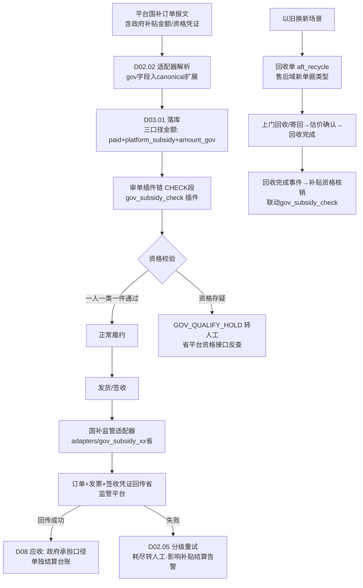
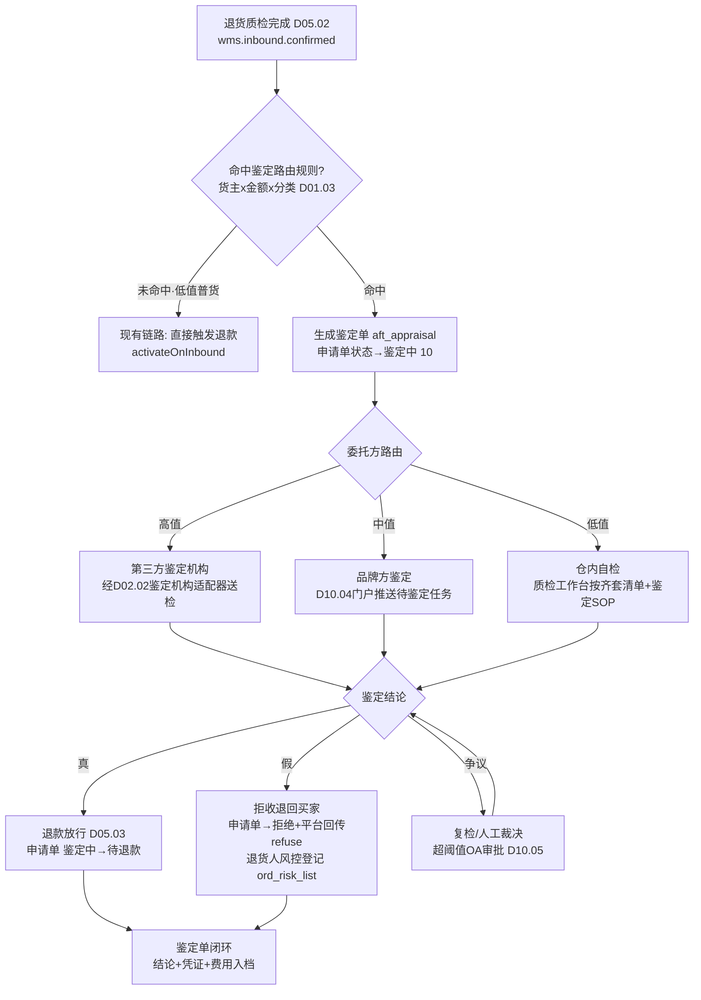
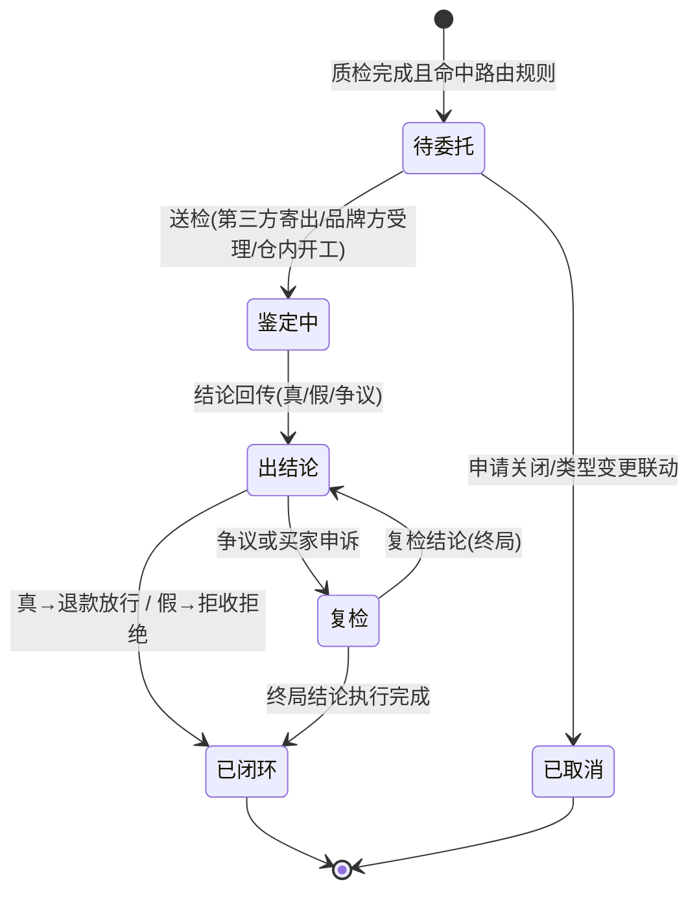
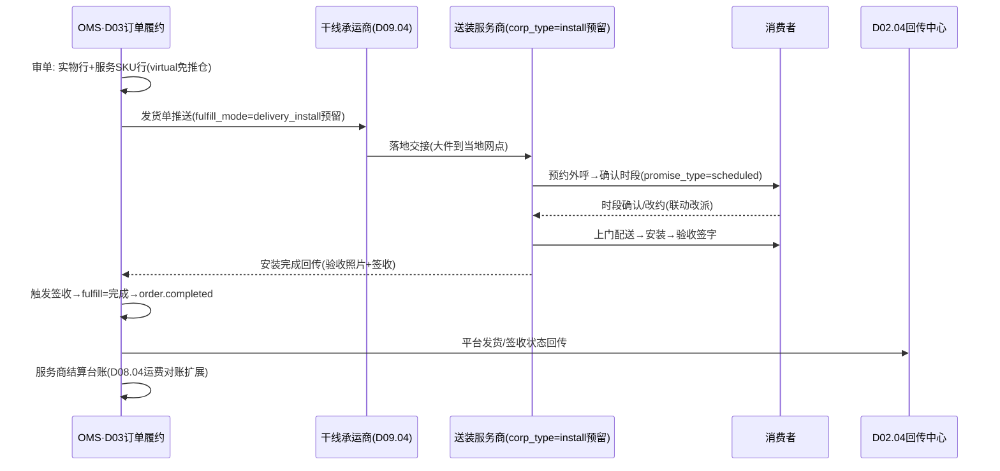
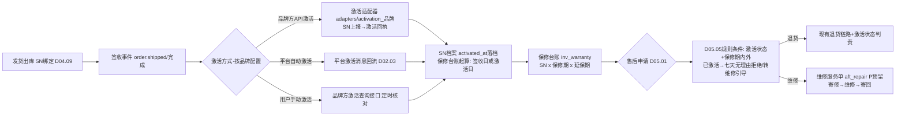
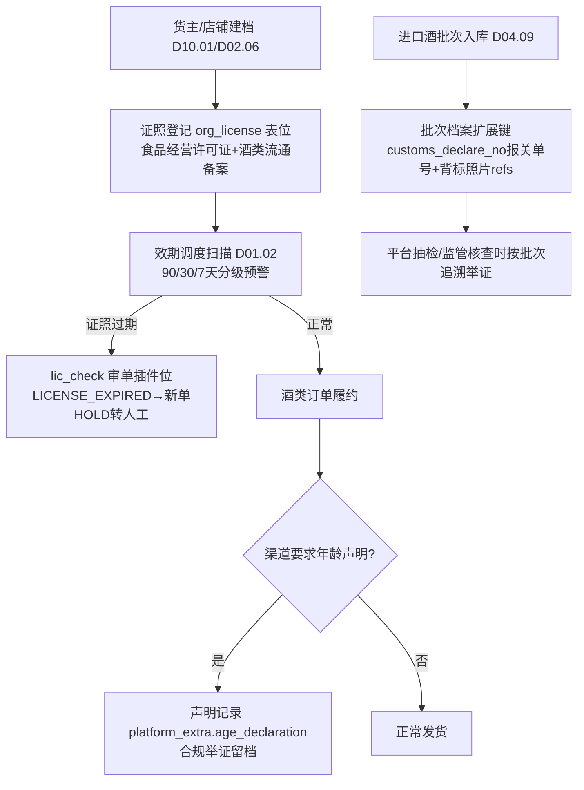
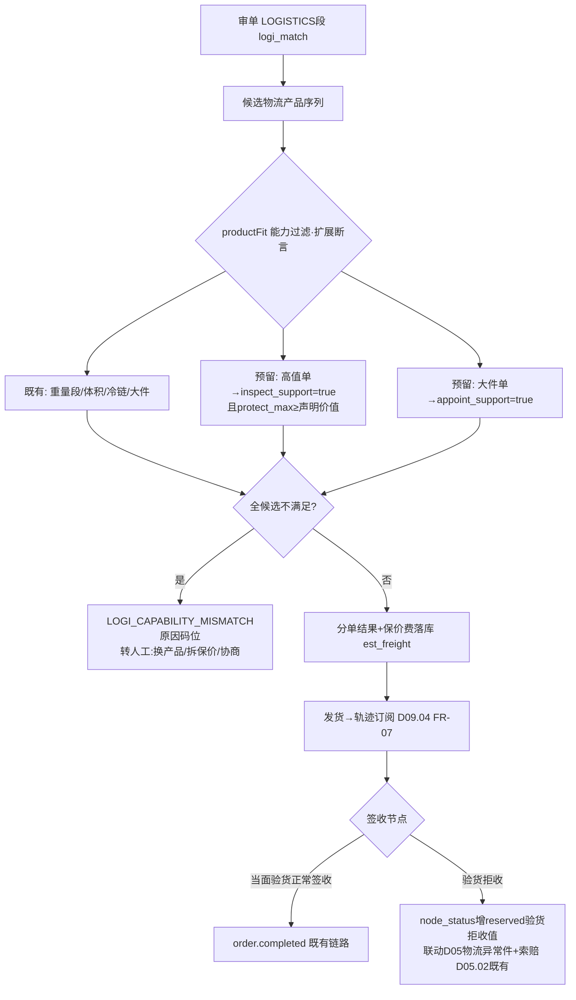
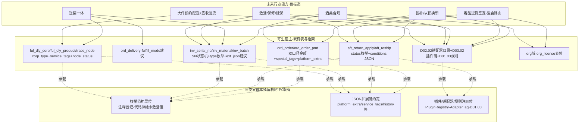

# 凯淳自研 OMS · DESIGN-行业适配扩展预留设计

> 文档编号：DESIGN-IND-01 · 版本 V1.0 · 2026-10-24 · 编写：小凯 · 状态：待审阅（V1.3 行业适配增补）
> 上游依据：《行业适配性校验报告 V1.0》缺口 G8-G16 · Jason 决策 H1（国补/送装/鉴定/激活延保先不实现但留扩展余地）/ H2（奢品退货鉴定=混合模式：按品牌/金额配置高值第三方鉴定机构、中值品牌方、低值仓内自检）/ H3（厨房家具目前无业务，送装一体只做架构预留）
> 定位：本文档是行业适配校验报告 9 处缺口的**处置方案之「预留位设计」部分**——把未来行业能力设计成寄生在现有表/枚举/JSON 扩展列/插件与适配器注册机制上的「预留位」，保证 P0/P1 实现不堵死未来路径。本文档**不修改任何既有 SRS 正文**，是全部行业预留位的唯一登记处；涉及既有表的物理字段建议单独列于 §9，待 DB 字典 V1.3 吸收。

---

## 0. 预留设计总原则

### 0.1 三类零成本预留手段（按优先级）

| 优先级 | 手段 | 说明 | P0 成本 |
|---|---|---|---|
| ① | **枚举值扩展位** | DB-00 §3 约定枚举不用 MySQL ENUM、字段注释写全值——在注释中登记「预留值」即完成预留，代码层状态机校验表拒绝未激活值，零 DDL 零逻辑 | ≈0 |
| ② | **JSON 扩展列键约定** | 既有 `platform_extra`（平台特有）与本文档约定的 `biz_extra` 键（业务特有），在本文档登记键名/结构/语义，写入方未来激活时才产生数据 | ≈0 |
| ③ | **插件/适配器/规则注册位** | D03.02 插件链（PluginRegistry 服务发现式）、D02.02 适配器目录（`#[AdapterTag]`）、D01.03 规则框架（条件→动作）均为「加目录+加配置」纯增量机制——预留=在本文档登记未来插件/适配器/规则的命名与挂载点 | ≈0 |

**例外（允许提出增列建议的两类场景）**：影响**状态机流转校验**的挂起态（JSON 标记无法阻止状态推进，必须落状态枚举——见 §2 鉴定挂起态）；影响**金额勾稽恒等式与索引/报表**的第三口径金额（JSON 取数无法参与 DB 层校验与聚合——见 §1 国补金额，仍按「P0 注释预留 + V1.3 增列建议」两步走）。

### 0.2 向后兼容统一约定

所有预留位激活时遵守：**老数据 NULL/缺省 = 能力未启用语义**（如 `amount_gov` 缺省 0、`platform_extra` 无对应键 = 非国补单）；枚举新增值只追加不重排（TINYINT 码值只增、VARCHAR 码只加不改）；激活功能一律走「新插件/新适配器/新单据类型」增量路径，不改既有主链路代码分支（对齐 D02.02 SC-04「新平台接入纯增量验证」同款约束）。每项预留位在 §1-§6 内单独给出兼容说明。

### 0.3 预留位编号规则

`RS-<域>-<序号>`（如 RS-ORD-01）。全部预留位在 §8 汇总表登记，激活开发时以该表为 checklist。

---

## 1. R1 国补/以旧换新（消费电子，缺口 G8）

### 1.1 目标能力设计（业务启动时的完整方案）

国补订单全链路 = **资格校验**（一人一类一件，身份证/手机号核验，部分省份要求下单前锁定资格）→ **三口径金额**（客户实付 = 原价 − 平台优惠 − 商家优惠 − 政府补贴；政府承担部分走财政结算通道，与平台账单分离）→ **监管数据回传**（订单/发票/签收凭证按省平台要求上传，签收后 N 天内回传，失败影响补贴结算）→ **以旧换新回收单**（旧机回收估价、上门回收/寄回、回收完成联动补贴资格核销）。

**三口径金额模型**（目标态）：`paid_amount = list_amount − shop_discount − platform_subsidy − amount_gov + freight`；`ord_order_pmt` 增承担方 `government`，行级分摊算法（D03.01 §5.2）按 Ds:Dp:Dg 三比例二次拆分；D08.01 应收从双口径扩为三口径（政府承担部分挂财政应收台账，账期与平台账单不同）。

**监管回传**：国补监管平台 = 一种「平台」——复用 D02.02 适配器注册机制新建 `adapters/gov_subsidy_{省}/`，能力白名单只声明「监管数据上报」一类（`subsidyReport(订单+发票+签收凭证)`）；回传编排复用 D02.04 回传中心（事件驱动：`order.shipped`/发票开具/签收轨迹三个触发点）与 D02.05 失败重试。

**以旧换新回收单**：售后域新单据类型 `aft_recycle`（回收单：原订单引用/旧机品类/估价/回收方式/状态机 待回收→已回收→估价确认→完成/取消）；回收完成发布事件供资格核销与补贴结算消费。

### 1.2 P0/P1 期预留位

| 编号 | 预留位 | 落点（所在文档/表） | 类型 | 内容 |
|---|---|---|---|---|
| RS-ORD-01 | 第三承担方枚举位 | `ord_order_pmt.bearer`（DB-D03，D03.01 §6.4） | 枚举 | 注释追加预留值 `government政府承担(国补预留,未激活)`；VARCHAR 码值只追加 |
| RS-ORD-02 | 国补金额 JSON 键 | `ord_order.platform_extra` / 行级 `ord_order_item.platform_extra`（DB-D03） | JSON 键 | 约定键 `$.gov_subsidy = {amount, qualify_no资格凭证号, province, activity_id}`；平台报文含国补信息时适配器原样留档（只存不算，P0 不参与勾稽） |
| RS-ORD-03 | 国补订单标记 | `ord_order.special_tags`（DB-D03，D03.10 detect 打标机制） | 枚举 | 追加预留标签值 `gov_subsidy`（逗号分隔多标签位天然可扩展） |
| RS-ORD-04 | 金额列增列建议 | `ord_order` / `ord_order_item`（§9 待 DB V1.3） | 字段建议 | `amount_gov DECIMAL(18,2) DEFAULT 0`（头+行两级同构，参与勾稽恒等式与报表聚合，JSON 键无法替代——见 §0.1 例外说明）；**P0 不建列**，仅登记 |
| RS-AUD-01 | 资格校验插件位 | D03.02 插件链 CHECK 段（SRS-D03.02 §3 FR-01a/IF-D03.02-07） | 插件位 | 登记未来插件 `gov_subsidy_check`（CHECK 段，原因码 `GOV_QUALIFY_HOLD`）；PluginRegistry 服务发现式注册，加插件零改引擎 |
| RS-GW-01 | 监管平台适配器位 | D02.02 适配器注册机制（SRS-D02.02 §3 FR-03a） | 适配器位 | 登记未来目录 `adapters/gov_subsidy_{省}/`（能力=监管数据上报，非电商五类能力，白名单裁剪机制天然支持） |
| RS-AFT-01 | 回收单类型枚举位 | `aft_return_apply.aftersale_type`（DB-D05，D05.01 FR-01d） | 枚举 | 注释追加预留值 `4=recycle以旧换新回收(国补预留,未激活)`；回收单未来独立建 `aft_recycle` 表，申请单类型位先行保证售后域入口统一 |
| RS-FIN-01 | 第三口径结算台账位 | D08.01/D08.02（SRS-D08.01 双口径供数处） | 文档登记 | 登记「政府承担口径=财政应收，独立结算周期」的扩展方向；D08.01 取数接口 `getDualAmount` 签名未来扩为 `getTripleAmount`（新增方法不改老方法） |

**向后兼容**：RS-ORD-01/02/03 激活前无数据写入，老订单 bearer 仅 platform/shop、platform_extra 无 gov 键 = 非国补单，语义自然成立；RS-ORD-04 增列时 DEFAULT 0，存量订单勾稽恒等式退化为双口径（amount_gov=0 时三口径公式 ≡ 现公式），无需刷数。

### 1.3 启动路径（未来激活的开发步骤）

1. DB 变更：`ord_order`/`ord_order_item` 增 `amount_gov` 列（在线 DDL，DEFAULT 0，半小时级）；勾稽校验服务加第三口径分支（D03.01 FR-04b/FR-06a 增补，0.5 人周）；
2. 6 平台适配器逐一解析国补报文字段（各平台国补标识字段不同，每平台 0.5-1 人周，按参与国补的店铺范围裁剪）；
3. 新建 `gov_subsidy_check` 插件 + 省平台资格核验接口对接（1-2 人周/省）；
4. 新建省监管适配器 + D02.04 回传编排挂三个触发点（2-3 人周/省，报文规范各省差异大）；
5. D08 三口径应收/结算台账扩展（2 人周）；以旧换新回收单 `aft_recycle` 建表+状态机+工作台（3-4 人周，可独立后置）。

合计（不含回收单、单省口径）约 8-12 人周；全部为增量开发，主链路（审单引擎/回传中心/插件框架）零改动。

### 1.4 不预留的代价

- 不留 bearer=government 枚举位与 platform_extra 键约定 → 国补报文到达时适配器无处落数据，只能塞进 pmt_memo 原文串（不可结构化取数），激活时需回溯清洗历史报文；
- 不留 amount_gov 增列登记 → 未来在勾稽恒等式上硬插第三口径，D03.01 FR-06/D08.01 应收/D03.08 价格监控三处公式同时改，且历史订单需刷数补 0 值列（大表 DDL+刷数 ≈ 2 人周风险窗口）；
- 不留插件/适配器位 → 资格校验逻辑侵入审单引擎代码（违背 D01.03 可插拔原则），监管回传侵入 D02.04 主流程（违背「加平台=纯增量」架构目标），激活成本从增量开发劣化为回归全链路。

---

## 2. R2 奢品退货鉴定·混合路由（奢侈品箱包珠宝，缺口 G13/G15，决策 H2）

### 2.1 目标能力设计

**鉴定单模型**（`aft_appraisal`，售后域新表）：委托方三路由（第三方鉴定机构：中检/云鱼类；品牌方鉴定；仓内自检）、状态机（待委托→鉴定中→出结论→复检→闭环）、结论（真/假/争议）驱动下游——真=正常退款放行；假=拒收退回买家+退款拒绝+风控登记（联动 G15 职业退货人画像）；争议=升级复检或人工裁决。

**混合路由规则**（H2 决策落地）：按 `货主(品牌) × 申请金额分级 × 物料分类` 配置委托方——高值（如 ≥10000 元）→ 第三方鉴定机构；中值（如 3000-10000）→ 品牌方鉴定（品牌方门户 D10.04 参与）；低值（<3000）→ 仓内自检。规则承载 D01.03「条件→动作」框架（与 D05.05 自动审核规则同构，conditions JSON 维度复用）。

**齐套质检清单**：按 SKU 配置应含项（证书/保卡/发票/防尘袋/配件×N），质检时逐项核对，缺项按预置扣减规则计算差价（挂 D05.02 §5.3 质检差价公式的 diff_money 项，责任方=买家）。

**防伪扣/安全扣**：出库扣上（发货单行登记扣码）、退货验扣（质检扫码核对）——复用 SN 档案模型（D04.09），扣码 = 一种「非商品本体 SN」的追溯标识，状态机同构（在库→已出库→售后中→已核销）。

### 2.2 P0/P1 期预留位

**鉴定挂起态落点建议（本项唯一需要明确取舍的决策点）**：建议**落 `aft_return_apply.status` 新增枚举值 `10=鉴定中(appraising)`**，而非 platform_extra/biz_extra JSON 标记。理由：① D05.01 FR-02c 状态推进唯一入口按流转表强校验——JSON 标记**无法阻止**「待收货→待退款→退款中」的合法推进，挂起语义必须进状态机才具备阻断力；② 售后工作台按 status 筛选队列（FR-07a），鉴定中订单需要独立队列视图，JSON 键查询无法走索引；③ TINYINT 码值只追加（10），既有 0-9 枚举与流转表零改动，激活前 transit 校验表不含 10 = 天然拒绝，成本≈注释一行。取舍代价：激活时 D05.01 §5.1 流转表增补 3 行迁移（待收货→鉴定中→待退款/拒绝），属文档级增补非结构变更。同理 `aft_reship.status` 追加预留值 `11=鉴定挂起`（与既有 `9=质检异常挂起` 区分：9 是 SN 调包/争议的件级挂起，11 是整单送外部鉴定的挂起）。

| 编号 | 预留位 | 落点 | 类型 | 内容 |
|---|---|---|---|---|
| RS-AFT-02 | 申请单鉴定挂起态 | `aft_return_apply.status`（DB-D05，D05.01 §4.1） | 枚举 | 注释追加 `10=鉴定中(奢品鉴定预留,未激活;插入位:待收货→待退款之间)` |
| RS-AFT-03 | 执行单鉴定挂起态 | `aft_reship.status`（DB-D05，D05.02 §4.1） | 枚举 | 注释追加 `11=鉴定挂起(外部送检中,退款联动冻结)` |
| RS-AFT-04 | 鉴定单表位 | oms_aftersale schema（DB-D05 字典登记） | 表位登记 | 登记未来表 `aft_appraisal`（apply_id/reship_id 引用、委托方 third_party/brand/warehouse、状态机 §2.1、结论 genuine/fake/dispute、费用、凭证 refs、机构引用）；**P0 不建表** |
| RS-AFT-05 | 齐套质检清单键 | `aft_reship_item.defect_reasons` JSON + WMS 质检回传报文（D05.02 §6.2/SRS-D09.03 回传协议） | JSON 键 | 约定键 `$.checklist = [{item:证书/保卡/配件, expect, actual, deduct_amount}]`；回传协议登记扩展段，通天晓对接时预留报文位（D09.03 适配器映射） |
| RS-AFT-06 | 齐套清单配置表位 | oms_aftersale（DB-D05 字典登记） | 表位登记 | 登记未来表 `aft_qc_checklist_config`（bm_id × 应含项 × 缺项扣减规则）；P0 质检差价公式（D05.02 §5.3 diff_money）已可人工承载 |
| RS-STK-01 | 防伪扣类型枚举位 | `inv_serial_no`（DB-D04，D04.09 §6.3） | 枚举+字段建议 | 表增 `sn_type` 列建议（`sn商品序列号/seal防伪扣安全扣/rfid`，§9 待 DB V1.3）；P0 先在本文档登记：防伪扣复用 SN 档案全部机制（唯一键/状态机/属单校验 validateReturn/履历链），仅类型语义不同 |
| RS-AFT-07 | 鉴定机构适配器位 | D02.02 适配器注册机制（SRS-D02.02 FR-03a） | 适配器位 | 登记未来目录 `adapters/appraisal_{机构}/`（能力=送检下单/结论回查/费用对账；机构字典可扩展同物流轨迹服务商 D09.04 FR-07a 模式） |
| RS-RUL-01 | 鉴定路由规则位 | D01.03 规则框架 + `aft_auto_audit_rule` 同构模式（DB-D05） | 规则位 | 登记未来规则类型 `appraisal_route`（conditions 维度：货主/品牌/金额区间/物料分类；action：委托方+机构）；D05.05 自动审核规则「>5000 强制人工」（G15）为其金额分级特例，激活时可合并承载 |
| RS-AFT-08 | 假货风控登记位 | `ord_risk_list`（DB-D03，D03.09 风控名单） | 枚举 | 登记未来 list_type 值 `fake_return假退名单(鉴定结论=假自动登记)`；G15 跨店铺退货人画像的先行数据点 |

**向后兼容**：status=10/11 激活前 transit 流转表不含该值，任何写入被拒绝并告警（状态机防腐化机制即兼容保障）；存量「待收货」申请单激活后仍走原路径（未命中路由规则不进鉴定），命中规则的**新单**才进 10——无需刷历史数据；sn_type 增列 DEFAULT 'sn'，存量档案语义不变。

### 2.3 启动路径

1. 建 `aft_appraisal` + `aft_qc_checklist_config` 两表（0.5 人周）；D05.01/D05.02 流转表增补鉴定分支（状态机文档+transit 校验表，1 人周）；
2. 鉴定路由规则类型注册进 D01.03（复用 conditions 求值器，0.5 人周）+ 规则配置界面（1 人周）；
3. D05.02 质检完成事件消费处增「命中路由→生成鉴定单→挂起」编排（1 人周）；退款联动 `activateOnInbound` 增鉴定放行前置校验（0.5 人周）；
4. 第三方鉴定机构适配器（每家 1-2 人周，首家含联调 3 人周）；品牌方门户鉴定任务页（D10.04 扩展，1.5 人周）；仓内自检工作台+SOP 清单核对页（2 人周）；
5. 齐套清单配置+缺项扣减接入质检差价公式（1.5 人周）；防伪扣 sn_type 启用+出库扣上/退货验扣流程（1 人周）；假退名单自动登记（0.5 人周）。

合计约 12-16 人周（首家第三方机构口径）；售后主链路改动集中在 D05.01/D05.02 状态机增补，均为流转表驱动的增量。

### 2.4 不预留的代价

- 不留 status=10 挂起态 → 未来只能靠人工在质检工作台「不点确认」实现挂起（无系统阻断，退款误放行=真金白银资损），或紧急改状态机枚举+全量回归售后链路（D05.01/02/03/04 四模块联动，≥3 人周回归成本）；
- 不留 checklist JSON 键 → 通天晓质检回传报文无扩展段位，激活时需改 WMS 对接协议并重新联调（跨系统协议变更，周期不可控）；
- 不留 sn_type → 防伪扣只能另建平行档案表，属单校验（validateReturn）/履历链两套实现重复建设（≈2 人周冗余+长期双维护）；
- 不留鉴定机构适配器位 → 送检逻辑侵入 D05.02 编排代码，多机构接入时形成 if-else 平台分支（违背 D05.01 FR-04d「业务代码零平台分支」同款约束）。

---

## 3. R3 送装一体（厨房家具，缺口 G10/G11，决策 H3：仅架构预留不开发）

### 3.1 目标能力设计

送装一体履约链 = 干线运输 → 落地配 → **预约上门（时段协商外呼）→ 配送 → 安装 → 验收签字**。目标模型四要素：

1. **服务 SKU**：安装费/上楼费/拆旧费作为服务型物料挂在订单行（与实物行同单，履约走「不推仓」分支——复用 D03.10 虚拟商品免推仓机制）；
2. **履约模式**：订单/发货单维度区分 仓发快递（现主链路）/ 工厂直发（D07.04 转单 P2）/ 送装一体（新）；
3. **送装服务商**：物流服务商的一种扩展类型（install 类），档案复用 `ful_dly_corp`（服务能力标签：安装/上楼/拆旧/验收照片回传）；
4. **预约时段与安装回传**：配送时间窗（复用 `promise_time/promise_type=scheduled` 既有字段族）；安装完成回传（服务商回传验收签字照片）触发签收 → `order.shipped/completed` 事件链。

### 3.2 P0/P1 期预留位

**现有字段核查结论**（不臆断）：`ord_order` 已有 `fulfill_channel`（V1.2 增列：express/store/instant，落单即定不可变）——送装一体属于「仓发」细分，**建议不占用 fulfill_channel**（其语义是销售渠道形态），而在**发货单 `ord_delivery` 预留 `fulfill_mode` 枚举位**（仓发快递/工厂直发/送装一体是发货单粒度的履约方式，拆单后可能一单混合两种模式）；`ord_store_order.fulfill_mode` 已存在但语义为门店履约方式（store_ship/store_pickup/city_delivery），不复用避免语义污染。`promise_time/promise_type=scheduled` 既有字段可直接承载预约时段（即时零售已建，语义兼容：期望送达时间窗）。

| 编号 | 预留位 | 落点 | 类型 | 内容 |
|---|---|---|---|---|
| RS-STK-02 | 服务 SKU 物料类型位 | `inv_material.type`（DB-D04，D04.01 §6.2） | 枚举 | 注释追加预留值 `6=service服务型(安装/上楼/拆旧/延保,不记账同虚拟,P0未激活)`；履约走 `is_virtual=1` 免推仓分支（D03.10 机制现成） |
| RS-ORD-05 | 发货单履约模式位 | `ord_delivery`（DB-D03，D03.07 §6） | 字段建议 | 增 `fulfill_mode VARCHAR(16) DEFAULT 'warehouse_express'` 建议（`warehouse_express仓发快递/factory_direct工厂直发(P2联动D07.04)/delivery_install送装一体(H3预留)`，§9 待 DB V1.3）；P0 不建列仅登记 |
| RS-FUL-01 | 送装服务商类型位 | `ful_dly_corp.corp_type`（DB-D09，D09.04 §6.1） | 枚举 | 注释追加预留值 `install送装服务商(H3预留,未激活)`；服务能力挂 `service_tags` JSON（追加约定标签：安装/上楼/拆旧/验收照片） |
| RS-FUL-02 | 送装产品能力键 | `ful_dly_product.service_tags` + `product_type`（DB-D09） | 枚举+JSON 键 | product_type 追加预留值 `install送装一体`；service_tags 约定键 `install_scope安装范围/warranty_install安装质保` |
| RS-ORD-06 | 预约时段字段复用登记 | `ord_order.promise_time/promise_type`（DB-D03 V1.2 既有） | 复用登记 | 登记送装场景复用口径：promise_type=scheduled + promise_time=预约时段起点；时段区间约定 `platform_extra.$.appoint_window={start,end,seq第几时段}` |
| RS-EVT-01 | 安装完成回传事件位 | DB-00 事件字典（附录） | 事件位 | 登记未来事件 `fulfill.install.completed`（payload：delivery_id/验收照片 refs/签收人）→ 订阅方 D03.01（触发签收完成）/D08.04（服务商结算）；发布方=送装服务商回传通道（D09 新增，随激活建） |

**向后兼容**：fulfill_mode 增列 DEFAULT 'warehouse_express'，存量发货单即仓发快递语义，零刷数；type=6/corp_type=install/product_type=install 激活前无任何档案引用，追加码值不影响既有校验；promise 字段族已被即时零售占用——送装激活时按 fulfill_mode 区分取数口径（两业务不同时命中同一订单，无冲突）。

### 3.3 启动路径（H3：业务启动时才执行）

1. DB：`ord_delivery` 增 fulfill_mode 列（0.5 人周）；服务 SKU 建档指引+type=6 激活（0.5 人周）；
2. 送装服务商档案维护+区域覆盖配置（复用 D09.04 区域路由规则，增「支持送装」条件维度，1 人周）；
3. 预约时段管理：外呼任务/改约联动（新模块级开发，3-4 人周——H3 明示不开发，此为启动时估算）；
4. 安装完成回传通道（服务商对接，每家 1-2 人周）+ `fulfill.install.completed` 事件编排接入签收链路（1 人周）；
5. 服务商结算台账（D08.04 扩展，1.5 人周）。

合计约 8-10 人周（不含外呼系统自研，可用服务商侧外呼降级）。

### 3.4 不预留的代价

- 不留 type=6 服务 SKU 位 → 安装费只能建「虚拟物料」混用（虚拟=卡券/电子凭证语义，D03.10 自动发货分支会把安装服务当卡密直发——语义冲突需改分支判断，波及正向履约主链路）；
- 不留 fulfill_mode → 送装单混入 express 主链路，拆单/推仓/签收判定全部按快递逻辑跑（安装完成前就触发 order.completed，平台考核签收时效错乱），激活时需在 D03.07/D09.02 主链路插条件分支（回归成本高）；
- 不留 corp_type=install → 送装服务商塞进 lastmile 落地配类型，服务能力（安装资质/验收照片）无处声明，分单规则无法按「支持送装」过滤。

---

## 4. R4 激活/保修/延保（消费电子，缺口 G9/G16）

### 4.1 目标能力设计

1. **激活登记**：出库 SN 上报品牌方激活系统（或平台自动激活），SN 状态机增「已激活」维度；激活状态影响售后判定——「已激活手机不支持七天无理由」（D05.05 自动审核规则条件）；
2. **保修台账**：SN 关联保修期（起算=签收日或激活日，按品牌规则配置），保修期内维修/换新走售后服务单；
3. **延保服务**：延保 = 服务型订单行（§3 的 type=6 服务 SKU 承载，或现阶段虚拟物料），延保期在保修台账上顺延；
4. **维修服务单**：售后域扩展单据类型（repair），与退货/换货并列，走「寄修→维修→寄回」链路（复用 D05.02 执行单双向物流编排）。

### 4.2 P0/P1 期预留位

| 编号 | 预留位 | 落点 | 类型 | 内容 |
|---|---|---|---|---|
| RS-STK-03 | SN 激活状态枚举位 | `inv_serial_no.status`（DB-D04，D04.09 §4.1 状态机） | 枚举 | 注释追加预留值 `7=已激活(activated,消电预留;插入位:已出库2→售后中3之间,激活不改变库存归属仅叠加生命周期标记)`；**取舍说明**：激活态与库存态正交（已激活的机器仍在用户手中=已出库），若未来发现双维混杂，备选方案为增 `activated_at DATETIME NULL` 独立列（§9 建议），激活时间非空即已激活——两案均已登记，激活开发时按品牌方回传粒度定案 |
| RS-STK-04 | SN 激活扩展键 | `inv_serial_no.history` JSON（DB-D04，履历链只增数组） | JSON 键 | 约定履历事件类型 `{event:"activated", channel:品牌API/平台/手动, at, warranty_start}`——履历链机制现成，零结构变更 |
| RS-STK-05 | 保修台账表位 | oms_stock schema（DB-D04 字典登记） | 表位登记 | 登记未来表 `inv_warranty`（sn_id/order_id/保修起算规则 sign签收-activate激活/warranty_start/warranty_end/延保期 ext_warranty_end/维修记录 refs）；**P0 不建表** |
| RS-ORD-07 | 延保服务行承载登记 | `ord_order_item.is_virtual` + `inv_material.type`（DB-D03/D04） | 复用登记 | 延保 SKU 现阶段=虚拟物料（type=5）承载可售可结算；type=6 服务 SKU（RS-STK-02）激活后迁移承载，订单行结构零变更 |
| RS-AFT-09 | 维修售后类型位 | `aft_return_apply.aftersale_type`（DB-D05） | 枚举 | 注释追加预留值 `5=repair维修(消电预留,未激活;寄修链路复用D05.02执行单双向物流编排)` |
| RS-AUD-02 | 激活状态审核条件位 | `aft_auto_audit_rule.conditions` JSON（DB-D05，D05.05 FR-01a 12 维） | JSON 维度 | 登记未来条件维度 `activation_status(未激活/已激活/激活超N天)` 与 `in_warranty(保修期内/外)`——conditions 为 JSON 数组天然可扩展维度，求值器增维度实现即可 |
| RS-GW-02 | 品牌激活适配器位 | D02.02 适配器注册机制 | 适配器位 | 登记未来目录 `adapters/activation_{品牌}/`（能力=激活上报/激活状态查询；同 RS-AFT-07 鉴定机构模式，非电商平台适配器） |

**向后兼容**：status=7 激活前 transit 型校验（D04.09 SN 状态变迁同走合法流转校验）不含该值即拒绝；history JSON 追加事件类型对既有消费方（履历查询展示）透明——未知 event 按原文展示；conditions 新维度激活前无规则引用，老规则求值不受影响。

### 4.3 启动路径

1. 定案激活态落点（status=7 vs activated_at 列，0.5 人周含 DB 变更）；
2. 建 `inv_warranty` 台账表 + 起算规则配置（签收事件/激活回执双触发，1.5 人周）；
3. 品牌激活适配器（每家 1-2 人周，主流消电品牌激活接口标准化程度高）；
4. D05.05 条件维度扩展（激活状态/保修期求值器，1 人周）+ 已激活拒七天无理由规则配置（0.5 人周）；
5. 维修服务单 aft_repair 建表+寄修双向编排（复用 D05.02，3 人周，可独立后置）。

合计约 6-9 人周（不含维修服务单）。

### 4.4 不预留的代价

- 不留 SN 激活位 → 激活状态只能存订单扩展 JSON（与 SN 档案脱钩），同一 SN 二次销售（退货良品重入）时激活历史丢失，售后判责无据；
- 不留 conditions 维度位 → 「已激活拒退」规则无法进 D05.05 自动审核，只能人工审核全量消电退货（日均单量下人力不可持续）；
- 不留保修台账表位 → 保修期计算散落售后代码（签收时间+品牌保修月数硬编码），延保叠加无处落，多品牌规则差异形成代码分支。

---

## 5. R5 酒类合规（酒水饮料，缺口 G12）

### 5.1 目标能力设计

1. **资质档案**：货主/店铺/仓三级证照登记（食品经营许可证含酒类销售范围、酒类流通备案登记），证照效期预警（到期前 90/30/7 天分级，过期自动阻断新单履约——审单插件校验）；
2. **年龄声明**：部分渠道要求下单人年龄声明（≥18 岁），声明记录随订单留档（合规举证）；
3. **进口酒中文背标与报关关联**：跨境 P2 已有三单对碰（ord_declare）；一般贸易进口酒需报关单号/中文背标合规信息随批次留档（追溯+平台抽检举证）。

### 5.2 P0/P1 期预留位

| 编号 | 预留位 | 落点 | 类型 | 内容 |
|---|---|---|---|---|
| RS-ORG-01 | 证照档案表位 | oms_org schema（DB-D10 字典登记，D10.01 货主档案扩展方向） | 表位登记 | 登记未来表 `org_license`（主体类型 owner货主/shop店铺/branch仓 × 证照类型 food_operating食品经营/alcohol_circulation酒类流通/other × 证照号/效期/附件 refs/预警级别）；**P0 不建表**（现有 org_owner_contract 合同表只承载商务合同，语义不混用） |
| RS-AUD-03 | 资质校验插件位 | D03.02 插件链 CHECK 段 | 插件位 | 登记未来插件 `lic_check`（原因码 `LICENSE_EXPIRED/LICENSE_MISSING`）；与 RS-AUD-01 同为 CHECK 段增量插件 |
| RS-ORD-08 | 年龄声明 JSON 键 | `ord_order.platform_extra`（DB-D03） | JSON 键 | 约定键 `$.age_declaration = {declared:true, channel, declared_at}`——平台报文含声明时适配器留档（只存不校验） |
| RS-STK-06 | 进口酒批次扩展键 | `inv_batch`（DB-D04，D04.09 §6.1） | JSON 键/字段建议 | inv_batch 现无 JSON 扩展列——建议增 `ext_json JSON NULL` 通用扩展列（§9，对齐 DB-00 §2.2 扩展列统一命名）；约定键 `$.customs_declare_no 报关单号 / $.cn_label_photos 中文背标照片refs / $.origin_country`；跨境三单对碰（ord_declare P2）语义独立不复用（一般贸易无三单对碰） |
| RS-AUD-04 | 酒类禁运联动登记 | D09.04 禁运区域表 + D03.02 address_check（既有） | 复用登记 | 含酒精商品航空件限制已由 address_check 禁运表覆盖（SRS-D09.04 SC-03 明示）——登记酒水激活时需补录「酒精类×航空产品」禁运数据即可，无新预留位开发 |

**向后兼容**：ext_json 增列 NULL 缺省，存量批次无键=非进口酒或未登记，追溯查询按键存在性过滤；age_declaration 键激活前平台报文不含即不写，老订单无键=无需声明渠道，语义自然成立。

### 5.3 启动路径

1. 建 `org_license` 表+证照登记界面（货主/店铺/仓三主体，2 人周）；
2. 效期扫描调度（D01.02 注册，0.5 人周）+ `lic_check` 插件（1 人周）；
3. inv_batch 增 ext_json 列+入库登记界面扩展（报关单号/背标照片，1 人周）；
4. 年龄声明按渠道要求配置解析（各平台适配器映射，0.5 人周/平台）；禁运数据补录（运营配置，0 开发）。

合计约 5-6 人周。校验报告 §3 G12 已给出降级判断：酒水业务量小则本项可长期停留在「资质档案+校验插件」轻量态，预留位足以支撑。

### 5.4 不预留的代价

- 不留 org_license 表位 → 证照效期靠 Excel 台账人工盯（过期继续卖酒=行政处罚风险，代运营连带责任），激活时证照数据需从散落邮件/网盘清洗迁移；
- 不留 inv_batch ext_json → 报关单号只能写批次备注自由文本（不可结构化追溯），平台抽检时按批次举证需人工翻找；批次表增列虽也是 DDL，但**提前登记建议**可让 V1.3 一次性吸收，避免未来单独走一次 DB 变更评审流程。

---

## 6. R6 大件预约配送 + 签收验货（家具/奢品高值，缺口 G11/G14）

### 6.1 目标能力设计

1. **物流产品能力矩阵扩展**：产品档案增能力声明——支持预约时段（appoint_support）/支持当面验货（inspect_support）/保价上限（protect_max 既有）/送装能力（§3 install 联动）；
2. **分单约束**：高值订单（声明价值 ≥ 阈值，如奢品 ≥5000 元）强制选「支持验货+保价上限覆盖货值」的产品（顺丰特安类）；大件订单强制选「支持预约时段」产品——规则引擎条件位（D09.04 区域路由规则 conditions 增维度，productFit 过滤增能力断言）；
3. **签收验货回传**：当面验货结果（正常签收/验货拒收）回流轨迹节点（D09.04 FR-07 轨迹订阅既有机制，node_status 增验货语义值）；验货拒收联动售后（D05 物流异常件路径既有）。

### 6.2 P0/P1 期预留位

| 编号 | 预留位 | 落点 | 类型 | 内容 |
|---|---|---|---|---|
| RS-FUL-03 | 产品能力标签键 | `ful_dly_product.service_tags` JSON（DB-D09，D09.04 §6.2） | JSON 键 | 约定标签值 `预约时段/当面验货/送装/验收照片`（service_tags 为 JSON 数组天然可扩展，物流商级 `ful_dly_corp.service_tags` 同步约定）；保价上限复用既有 `protect_max` 列，无需新位 |
| RS-FUL-04 | 分单能力约束规则位 | D09.04 区域路由规则 `conditions` JSON + productFit（SRS-D09.04 §5.1） | 规则位+断言位 | 登记未来条件维度 `declared_value声明价值区间/bulky_flag大件标记`；productFit 伪代码登记扩展断言位（高值→验货+保价覆盖；大件→预约时段）；失败原因码登记 `LOGI_CAPABILITY_MISMATCH`（对齐 D03.02 结构化错误码契约，只追加） |
| RS-FUL-05 | 验货签收轨迹节点位 | `fulfill_trace_node.node_status`（DB-D09，D09.04 §6.7 P1 表） | 枚举 | 注释追加预留值 `验货签收/验货拒收(inspect_signed/inspect_rejected,P1轨迹订阅激活时随用)`；验货拒收联动 D05 走既有物流异常件路径（登记复用关系，无新逻辑位） |
| RS-ORD-09 | 声明价值取数登记 | `ord_order.paid_amount` + D09.04 estimateFreight 签名（既有「声明价值」入参） | 复用登记 | estimateFreight 已含声明价值参数（保价费计算），登记高值分单约束激活时取数口径=行实付合计（客户实付口径），无需新字段 |

**向后兼容**：service_tags 追加标签对既有 productFit（按冷链/大件断言）透明——未配置新标签的产品在约束激活后仅对命中高值/大件条件的订单被过滤，普通订单分单结果不变；node_status 新值随 P1 轨迹表启用时一并生效（表本身 P1 才建，无存量数据）；原因码只追加，D03.02 HOLD 路由按码表驱动零改动。

### 6.3 启动路径

1. 产品档案能力标签维护界面扩展（service_tags 勾选式录入，0.5 人周）+ 存量产品数据补录（运营配置）；
2. 区域路由规则 conditions 增声明价值/大件维度（求值器扩展，1 人周）+ productFit 能力断言（0.5 人周）+ 新原因码接入 HOLD 路由（0.5 人周）；
3. 轨迹节点验货语义值启用+验货拒收联动售后提示（随 P1 轨迹订阅交付，0.5 人周增量）。

合计约 3 人周——本项预留位最薄、启动最快（物流产品模型 V1.0 已含 service_tags/protect_max/结构化原因码三块基石）。

### 6.4 不预留的代价

- 不留能力标签键 → 高值单验货需求靠人工审单记忆（奢品漏发特安=丢件全额资损+客诉），激活时需在产品档案增列+全量产品数据迁移补录；
- 不留 conditions 维度与原因码 → 高值约束写死在 logi_match 插件代码里（if 声明价值>5000 then 指定顺丰——店铺级差异无法配置化），违背 D09.04「规则承载 D01.03 框架」设计，激活=重构插件。

---

## 7. 预留位全景图

---

## 8. 汇总预留位清单表

> 类型：枚举=枚举值扩展位 / JSON键=JSON 扩展列键约定 / 字段=增列建议（P0 不建，§9 待 DB V1.3 吸收）/ 表位=未来建表登记 / 插件位・适配器位・规则位・事件位=注册机制挂载点 / 复用登记=既有字段复用口径登记（零变更）。

| 编号 | 预留位 | 所在表/文档 | 类型 | P0 期成本 | 成本≈0 的原因 |
|---|---|---|---|---|---|
| RS-ORD-01 | pmt.bearer 增 government | ord_order_pmt（DB-D03） | 枚举 | ≈0 | VARCHAR 码值注释追加一行 |
| RS-ORD-02 | 国补 platform_extra 键 | ord_order(_item).platform_extra | JSON 键 | ≈0 | 键约定仅文档登记，激活前无写入 |
| RS-ORD-03 | special_tags 增 gov_subsidy | ord_order.special_tags | 枚举 | ≈0 | 逗号分隔多标签位天然扩展 |
| RS-ORD-04 | amount_gov 增列建议 | ord_order/_item（§9） | 字段 | ≈0 | P0 只登记不建列 |
| RS-AUD-01 | gov_subsidy_check 插件位 | D03.02 CHECK 段 | 插件位 | ≈0 | 注册表机制，登记命名即预留 |
| RS-GW-01 | 国补监管适配器位 | D02.02 adapters/ | 适配器位 | ≈0 | 目录约定+AdapterTag 纯增量 |
| RS-AFT-01 | aftersale_type 增 recycle | aft_return_apply | 枚举 | ≈0 | TINYINT 码值注释追加 |
| RS-FIN-01 | 第三口径结算登记 | D08.01/D08.02 | 复用登记 | ≈0 | 文档登记扩展方向 |
| RS-AFT-02 | status 增 10=鉴定中 | aft_return_apply | 枚举 | ≈0 | 码值追加；transit 校验表不含即拒绝（挂起态必须进状态机，见 §2.2 取舍） |
| RS-AFT-03 | status 增 11=鉴定挂起 | aft_reship | 枚举 | ≈0 | 同上，与既有 9=质检异常挂起区分 |
| RS-AFT-04 | aft_appraisal 表位 | oms_aftersale（DB-D05 登记） | 表位 | ≈0 | 不建空表，字典登记结构草案 |
| RS-AFT-05 | checklist 质检清单键 | aft_reship_item.defect_reasons + WMS 回传协议 | JSON 键 | ≈0 | 键约定+对接协议登记扩展段 |
| RS-AFT-06 | 齐套清单配置表位 | oms_aftersale | 表位 | ≈0 | 同 RS-AFT-04 |
| RS-STK-01 | sn_type 防伪扣类型 | inv_serial_no（§9） | 字段+枚举 | ≈0 | P0 登记；增列 DEFAULT 'sn' 零刷数 |
| RS-AFT-07 | 鉴定机构适配器位 | D02.02 adapters/ | 适配器位 | ≈0 | 同 RS-GW-01 |
| RS-RUL-01 | appraisal_route 规则位 | D01.03 规则框架 | 规则位 | ≈0 | 条件→动作模型登记新规则类型 |
| RS-AFT-08 | 假退名单类型位 | ord_risk_list | 枚举 | ≈0 | list_type 码值追加 |
| RS-STK-02 | type 增 6=service 服务SKU | inv_material | 枚举 | ≈0 | 码值注释追加；履约复用 virtual 免推仓分支 |
| RS-ORD-05 | fulfill_mode 增列建议 | ord_delivery（§9） | 字段 | ≈0 | P0 只登记不建列；DEFAULT 仓发快递 |
| RS-FUL-01 | corp_type 增 install | ful_dly_corp | 枚举 | ≈0 | VARCHAR 码值追加 |
| RS-FUL-02 | 送装产品能力键 | ful_dly_product.service_tags/product_type | 枚举+JSON 键 | ≈0 | 标签数组扩展+码值追加 |
| RS-ORD-06 | 预约时段复用登记 | ord_order.promise_time/type（既有） | 复用登记 | ≈0 | 即时零售已建字段，口径登记 |
| RS-EVT-01 | fulfill.install.completed 事件位 | DB-00 事件字典 | 事件位 | ≈0 | 字典登记，发布方随激活建 |
| RS-STK-03 | SN status 增 7=已激活 | inv_serial_no | 枚举 | ≈0 | 码值追加（备选 activated_at 列已同登记） |
| RS-STK-04 | history 激活事件键 | inv_serial_no.history | JSON 键 | ≈0 | 履历数组只增机制现成 |
| RS-STK-05 | inv_warranty 表位 | oms_stock（DB-D04 登记） | 表位 | ≈0 | 不建空表 |
| RS-ORD-07 | 延保服务行承载登记 | ord_order_item.is_virtual + type | 复用登记 | ≈0 | 虚拟物料现成承载 |
| RS-AFT-09 | aftersale_type 增 repair | aft_return_apply | 枚举 | ≈0 | 码值追加 |
| RS-AUD-02 | 激活/保修审核条件维度 | aft_auto_audit_rule.conditions | JSON 键 | ≈0 | conditions JSON 数组天然扩展维度 |
| RS-GW-02 | 品牌激活适配器位 | D02.02 adapters/ | 适配器位 | ≈0 | 同 RS-GW-01 |
| RS-ORG-01 | org_license 证照表位 | oms_org（DB-D10 登记） | 表位 | ≈0 | 不建空表 |
| RS-AUD-03 | lic_check 插件位 | D03.02 CHECK 段 | 插件位 | ≈0 | 同 RS-AUD-01 |
| RS-ORD-08 | age_declaration 键 | ord_order.platform_extra | JSON 键 | ≈0 | 键约定登记 |
| RS-STK-06 | inv_batch ext_json 增列建议 | inv_batch（§9） | 字段+JSON 键 | ≈0 | P0 登记；增列 NULL 零刷数 |
| RS-AUD-04 | 酒精禁运数据补录登记 | D09.04 禁运表+address_check（既有） | 复用登记 | ≈0 | 机制既有，激活时仅补配置数据 |
| RS-FUL-03 | 产品能力标签键 | ful_dly_product/corp.service_tags | JSON 键 | ≈0 | 标签数组扩展 |
| RS-FUL-04 | 高值/大件分单约束位 | D09.04 规则 conditions+productFit+原因码 | 规则位+枚举 | ≈0 | 条件维度+原因码登记追加 |
| RS-FUL-05 | 验货轨迹节点值 | fulfill_trace_node.node_status（P1 表） | 枚举 | ≈0 | 表随 P1 建，码值一次写全 |
| RS-ORD-09 | 声明价值取数登记 | estimateFreight 既有入参 | 复用登记 | ≈0 | 接口签名已含该参数 |

**合计 39 个预留位**：枚举位 14 / JSON 键位 8 / 字段建议 4（均 P0 不建列）/ 表位登记 5（均 P0 不建表）/ 插件・适配器・规则・事件注册位 8 / 复用登记 5（含 RS-STK-01 双计其一）。P0 期总开发成本 ≈ **0 人日**（落点全部为字段注释、本文档登记与 DB-00 事件字典条目；唯一随 P0 执行的物理动作 = 各 SQL 脚本注释行追加预留值说明，随 DB 字典 V1.3 一次性合入）。

---

## 9. 涉及既有表的字段建议清单（待 DB 字典 V1.3 吸收，P0 不执行 DDL）

| 表 | 建议变更 | 关联预留位 | 激活时机 |
|---|---|---|---|
| ord_order / ord_order_item | 增 `amount_gov DECIMAL(18,2) NOT NULL DEFAULT 0`（头+行同构） | RS-ORD-04 | 国补业务启动 |
| ord_delivery | 增 `fulfill_mode VARCHAR(16) NOT NULL DEFAULT 'warehouse_express'` | RS-ORD-05 | 送装/工厂直发启动 |
| inv_serial_no | 增 `sn_type VARCHAR(8) NOT NULL DEFAULT 'sn'`；视激活态定案增 `activated_at DATETIME(3) NULL` | RS-STK-01 / RS-STK-03 | 防伪扣启用 / 激活登记启动 |
| inv_batch | 增 `ext_json JSON NULL` | RS-STK-06 | 进口酒批次追溯启动 |
| aft_return_apply / aft_reship / ord_order_pmt / aft_return_apply(aftersale_type) / inv_material / inv_serial_no(status) / ful_dly_corp / ful_dly_product / fulfill_trace_node | **仅字段 COMMENT 追加预留枚举值说明**（无 DDL 结构变更） | RS-ORD-01/03、RS-AFT-01/02/03/09、RS-STK-02/03、RS-FUL-01/02/05 | 随 DB 字典 V1.3 一次性合入 |

> 注释级变更也统一走 V1.3 吸收，不在 P0 建库脚本上零散打补丁——保证 sql/*.sql 与字典文档单一事实源（DB-00 §6 约定）。

---

## 10. 与既有文档的关系

1. **本文档不修改既有 SRS 正文**：SRS-D03.01/D05.01/D05.02/D04.09/D04.01/D09.04/D02.02/D03.02 等文档保持现版本；全部行业预留位以**本文档为唯一登记处**（编号 RS-*，激活开发时按 §8 清单逐项核销）。
2. **单一事实源边界**（SRS-00 §6.1 约定）：目标能力设计（§1-§6 各「①」段）是未来模块 SRS 的**输入草案**——业务启动时按 SRS-00 §1.4 九章模板细化为正式 SRS（如国补启动时新编 SRS-D03.16 或增补 D03.01/D08.01），届时本文档对应章节标记「已转正式 SRS」并冻结。
3. **DB 字典吸收路径**：§9 字段建议清单待 DB-00/DB-D03/D04/D05/D09/D10 字典 V1.3 修订时统一吸收（含 COMMENT 级预留值说明）；吸收前 sql/*.sql 建库脚本不变更。
4. **上游追溯**：本文档逐条处置《行业适配性校验报告》G8（§1）/G9+G16（§4）/G10+G11（§3、§6）/G12（§5）/G13（§2）/G14（§6）/G15（§2 RS-AFT-08 先行数据点+RS-RUL-01 金额分级规则位，完整画像方案待业务启动另行设计）。
5. **决策依据**：H1（先不实现但留余地）→ 本文档全部预留位 P0 成本≈0；H2（鉴定混合模式）→ §2.1 路由规则目标设计+RS-RUL-01；H3（家具无业务）→ §3 仅架构预留、启动路径含估算不排期。

---

## 变更记录

| 日期 | 版本 | 变更 | 原因 |
|---|---|---|---|
| 2026-10-24 | V1.0 | 首版：G8-G16 缺口预留位设计（6 大项 39 个预留位 + 4 个字段建议 + 5 个表位登记），Mermaid 图 5 张 | 行业适配性校验报告 V1.0 处置 + Jason H1/H2/H3 决策（V1.3 行业适配增补） |
