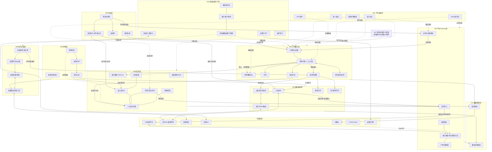

# 凯淳自研 OMS · SRS-00 需求文档总纲

> 文档编号：SRS-00 · 版本 V1.0 · 2026-10-23 · 编写：小凯 · 审阅：Jason
> 依据：《07-新架构设计书》《06-差距分析表》《阶段3-需求澄清答题记录》（41 问决策）· 商派 ONEX OMS 逆向文档集（00-05）
> 定位：本文档是整个需求文档体系的**目录、规范与地图**。所有分模块 SRS 与数据设计文档均按本总纲的编号、模板、口径编制。

---

## 1. 文档体系说明

### 1.1 文档目的

将商派 ONEX OMS 逆向所得业务模型 + 凯淳 41 问需求决策，转化为可直接指导开发、测试、验收的**软件产品需求规格说明书（SRS）体系**，并配套完整的数据库设计文档。

### 1.2 读者对象

| 读者 | 关注内容 |
|---|---|
| 开发工程师 | 模块 SRS 的功能/流程/处理逻辑/字段/接口 + 数据字典 DDL |
| 测试工程师 | 业务场景、验收标准、状态机与边界条件 |
| 产品/业务（Jason 及业务方） | 业务场景、流程、模块关系、分期范围 |
| 管理层 | 总纲的模块地图、分期、里程碑对应关系 |

### 1.3 文档编号体系

```
SRS-00            总纲（本文档）
SRS-D<N>.<M>      分模块需求规格说明书（N=域号，M=模块号）
                  例：SRS-D04.02 = 库存域 · 库存记账模块
DB-00             数据库设计总册（分域 schema 规划、通用约定、ER 总图）
DB-D<N>           分域数据字典（表 DDL、字段、索引、表间关系）
```

### 1.4 模块 SRS 统一模板（每个模块文档必须包含以下章节）

| 章 | 内容 | 说明 |
|---|---|---|
| 1 | 模块概述 | 定位、职责边界（做什么/不做什么）、所属域、分期 |
| 2 | 业务场景 | 谁、在什么情况下、要完成什么事；典型场景逐条描述 |
| 3 | 功能需求 | 功能点清单（FR 编号），每个功能点的输入/操作/输出 |
| 4 | 业务流程 | Mermaid 流程图/泳道图/状态机；主流程+分支+异常流 |
| 5 | 处理逻辑 | 关键算法与规则（审单规则、拆单策略、预占扣减、成本计算等），伪代码或规则表 |
| 6 | 数据字段 | 本模块核心业务实体的**业务字段描述**（业务含义/取值/校验规则）；物理 DDL 见数据字典，两处职责分离不重复 |
| 7 | 接口 | 内部接口（对其他模块提供的服务/订阅与发布的事件）+ 外部接口（平台 API/WMS/金蝶/OA） |
| 8 | 非功能需求 | 性能、并发、幂等、一致性、安全/PIPL 要求 |
| 9 | 验收标准 | 可测试的验收条件清单 |

### 1.5 分期标注口径

| 标记 | 含义 | 对应里程碑 |
|---|---|---|
| **P0** | MVP 必须 | M1-M2（第 1-5 月） |
| **P1** | 二期 | M3（第 5-7 月） |
| **P2** | 后置/预留 | M4 之后，本轮只写需求占位与预留设计 |

### 1.6 编制顺序与计划

按已确认决策：**库存域先行（地基优先）**，其后按依赖顺序推进。

| 批次 | 模块 | 理由 |
|---|---|---|
| ① | D04 库存域（10 模块） | 三元记账是全系统地基，订单/售后/采购都依赖其口径 |
| ② | D02 平台 Gateway + D03 订单履约 | 业务主链路：拉单→审单→拆合单→发货单 |
| ③ | D09 履约集成 + D05 售后 | 推仓回传与逆向链路 |
| ④ | D06 采购 + D08 财务对账 | 供应链与资金链路 |
| ⑤ | D10 组织权限门户 + D01 底座 + D11 报表 | 横向能力（部分需求随①-④已带出，此批次收口） |
| ⑥ | D07 经销分销（P2）+ DB 系列数据字典 | 后置模块占位 + 数据层文档 |

> 每批次完成后交 Jason 审阅确认，再进入下一批次；模块间口径冲突以先定稿者为准，后续文档引用不重复定义。

---

## 2. 系统总体定位

**凯淳自研 OMS** 是面向「电商代运营 + 经销」双业务的**全渠道订单管理中台**：

- 向上：对接 6 大电商平台（淘/京/抖/拼/红/唯）+ 私域，统一接单；
- 向下：路由多个 WMS（通天晓为主）完成仓储履约；
- 横向：与金蝶（记账）、泛微 OA（审批）、BI（分析）、K-AIDE（Agent）集成；
- 核心改造（相对商派模型）：**三元库存记账（仓×SKU×货主）**、**货主维度贯穿全域单据**、**租户级行隔离（品牌方门户）**。

架构风格：模块化单体（7+ 域严格边界）· PHP 8.2+（Hyperf 优先，spike 定型）· MySQL 8 按域分 schema · Redis（库存预占）· MQ 全链路异步。

---

## 3. 模块划分总览（两级：11 个一级域 → 67 个二级模块）

### D01 平台底座域（横向基础设施）

| 编号 | 模块 | 主要功能 | 分期 |
|---|---|---|---|
| D01.01 | 消息队列与异步任务中心 | MQ 封装、常驻 worker、任务白名单声明（并发数/超时/重试）、死信处理 | P0 |
| D01.02 | 统一调度器 | 定时任务注册与调度（分钟/小时/日级）、执行日志、失败告警 | P0 |
| D01.03 | 规则引擎基础框架 | 审单插件链、拆单策略注册表、通用「条件→动作」规则配置模型（商派 omeauto 机制的新栈实现） | P0 |
| D01.04 | 元数据驱动 CRUD 基础 | 实体元数据（字段/枚举/校验/列表列）驱动后台通用增删改查与筛选器（商派 dbschema DSL 思想） | P0 |
| D01.05 | PIPL 隐私合规组件 | 消费者敏感字段加密存储、展示脱敏、访问授权留痕、数据导出脱敏 | P0 |
| D01.06 | 导入导出中心 | 异步大数据量导入导出、模板管理、进度与结果通知 | P0 |
| D01.07 | 通知与告警中心 | 企业微信/短信/邮件统一通知服务、告警订阅 | P1 |

### D02 平台 Gateway 域（对外平台通道，替代商派矩阵中心）

| 编号 | 模块 | 主要功能 | 分期 |
|---|---|---|---|
| D02.01 | 平台接入框架 | 统一调用出口：签名、session 托管、限流、错误码字典、api_log 报文日志 | P0 |
| D02.02 | 平台适配器 ×6 | 淘系/京东/拼多多/小红书/唯品会（有商派报文映射参考）+ **抖音（从零）**：订单/商品/库存/发货/售后五类报文映射 | P0（抖音 M2） |
| D02.03 | 拉单与消息接收 | 拉单三保险：平台消息推送（TMC/webhook）+ 定时增量（水位）+ 单拉补偿；幂等防重；订单缓冲落库 | P0 |
| D02.04 | 回传中心 | 发货回传（事件驱动+可配置时机：发货/打印/校验）、库存回写、售后单回传 | P0 |
| D02.05 | 失败重试与对账 | api_fail 分级重试（错误码正则分级+退避）、平台对账反查（回传结果核对） | P0 |
| D02.06 | 店铺授权管理 | 店铺档案、平台授权（OAuth/session 续期）、多店铺-货主-租户关联、授权过期告警 | P0 |
| D02.07 | 对外 OpenAPI 网关 | 面向品牌方/第三方的开放接口：鉴权、限流、审计、Agent 能力接口（K-AIDE 自然语言查单等） | P2 预留 |

### D03 订单履约域（系统心脏）

| 编号 | 模块 | 主要功能 | 分期 |
|---|---|---|---|
| D03.01 | 订单接入与创建 | 平台单落库、手工建单、导入建单、B2B 销售单转入、售后换货 0 元单；订单号生成；三套状态初始化 | P0 |
| D03.02 | 审单引擎（自动） | 插件链顺序执行（仓→拆→库存→物流→校验类）；结构化不通过原因（替代位标记）；通过即路由生成履约方案 | P0 |
| D03.03 | 人工审单工作台 | 待审队列（按店铺/品牌/货主分组）、批量审核、分派审核组/审核员、审单绩效 | P0 |
| D03.04 | 拆单策略中心 | 16 种策略全实现为可插拔插件（按仓/货主/SKU/商品类型/重量/体积/客户分类/赠品…）；策略=纯函数输出分配方案；级联拆分 | P0 |
| D03.05 | 合单 | 合单指纹预计算（收货人/店铺维度）+ 缓冲时间窗；**店铺级开关，默认关** | P0 预留 |
| D03.06 | 配货分仓 | 分仓规则（仓库优先级/区域路由/库存深度）、缺货判定与处理 | P0 |
| D03.07 | 发货单管理 | 发货单生成（拆单产物，一单多发货单）、母子单合并、发货单指令（推送/叫回/恢复/确认）、包裹与称重 | P0 |
| D03.08 | 订单修改与复审 | 改单前快照+库存冻结+对比回滚；改地址/改商品/改价格；价格异常复审 | P1 |
| D03.09 | 异常单与缺货处理 | 异常单识别与标记（地址/黑名单/风控）、缺货单挂起与补货联动、暂停/恢复（联动推仓叫回） | P0 |
| D03.10 | 特殊单型 | 预售（定金/尾款/延迟履约）、团购、福袋、虚拟商品自动发货（不推仓分支） | P1 |
| D03.11 | O2O 门店履约 | 门店仓发货、门店自提（自提码/核销）、门店库存 | P1 |
| D03.12 | 跨境申报 | 跨境订单三单对碰、申报要素、保税仓路由 | P2 |
| D03.13 | 订单归档与历史查询 | 冷热分离归档（近 3 年在线+历史归档）、归档单查询与售后回溯 | P1 |
| D03.14 | 促销与赠品引擎 | 满赠/买赠/阶梯赠品规则，审单自动加赠，赠品库存预占联动（V1.1 复查增补） | P1 |
| D03.15 | 即时零售履约 | 美团闪购/饿了么/京东到家/抖音小时达/淘宝小时达订单分钟级履约：派店/拣货倒计时/骑手协同/时效监控（V1.2 友商对标 G1） | P1 |
| D03.16 | 客服订单360视图 | 客服统一查单工作台：多维检索/360聚合/操作入口跳转/归档回捞（V1.4 业务仿真 S2） | P1 |

### D04 库存域（三元记账地基）

| 编号 | 模块 | 主要功能 | 分期 |
|---|---|---|---|
| D04.01 | 商品与物料管理 | 销售物料（SKU）/基础物料两层模型、BOM 组合装拆解、平台商品与本地物料映射、货品档案（外部主数据+本地扩展属性） | P0 |
| D04.02 | 库存记账 | **三元记账行（仓×SKU×货主）**、五口径库存（实际/可用/锁定/在途/次品）、库存调整（人工调整走审批） | P0 |
| D04.03 | 预占与释放 | 审单预占、发货扣减、取消/超时释放；**独立预占流水表 + Redis Lua 原子扣减**（不落主字段）；miss 降级 DB；定时对账兜底 | P0 |
| D04.04 | 出入库单据与流水 | 统一出入库单据中心（单据类型体系）、每笔变动记流水、账实一致性校验 | P0 |
| D04.05 | 仓间调拨 | 调拨单（出库仓→入库仓在途）、**货主间借调**（借调规则：比例/上限/归还）、调拨成本处理 | P0/P1 |
| D04.06 | 盘点 | 盘点单（明盘/盲盘）、盘盈盘亏调整、WMS 盘点结果回传对账 | P1 |
| D04.07 | 库存成本核算 | 移动加权平均、**按货主分别核算**（买断计凯淳存货成本；代销只记代管不计存货）、成本回写与出库成本结转 | P1 |
| D04.08 | 可售计算与平台同步 | 可售库存公式（策略链）、**按店铺可配置同步策略**（分平台独立/共享池比例分配/全量共享-安全库存预留）、多平台超卖防护、同步任务与水位 | P0 |
| D04.09 | 批次/效期/序列号 | 批次号、效期管理（FIFO 出库/临期预警）、序列号登记与售后核销追溯 | P1 |
| D04.10 | 库存预警与补货建议 | 上下限预警、缺货提醒、补货公式（安全库存+冻结-现货-在途）、联动采购申请 | P1 |
| D04.11 | 价格管理 | 价格档案（吊牌/日常/活动/底价红线）+版本时间窗+批量改价回传平台+破线 OA 审批+审单底价基准供给（V1.5 S4 决策修正） | P1 |

### D05 售后域（三段式）

| 编号 | 模块 | 主要功能 | 分期 |
|---|---|---|---|
| D05.01 | 售后申请单 | 平台售后单自动同步、手工建单；统一申请单模型（平台差异 JSON 扩展列，替代商派 15 张镜像表）；申请状态机 | P0（M2） |
| D05.02 | 退货退款执行 | 退货预报推 WMS、退货入库（**良/不良质检分仓**：正品/次品库存）、入库触发退款 | P0（M2） |
| D05.03 | 仅退款与退款单 | 仅退款链路（不动货）、退款单生成与支付渠道原路退回、退款状态回传平台 | P0（M2） |
| D05.04 | 换货补发 | 换货=退货链路+0 元新订单复用正向履约；补发单管理 | P1 |
| D05.05 | 售后自动审核 | 规则内自动同意退款（金额阈值/原因白名单/客户等级）、自动拒绝与转人工 | P1 |

### D06 采购域

| 编号 | 模块 | 主要功能 | 分期 |
|---|---|---|---|
| D06.01 | 采购申请与补货计划 | 手工申请、补货建议转申请、审批（推泛微 OA） | P0（M3） |
| D06.02 | 采购订单管理 | 采购单 5 状态分离（审核/入库/采购/结算/残损）、供应商与货主维度（买断才采购） | P0（M3） |
| D06.03 | 到货与入库 | 到货登记、入库单推 WMS、入库回传（在途-、实际+）、残损处理 | P0（M3） |
| D06.04 | 采购对账与供应商台账 | 现购按单挂账/赊购按入库挂账（应付单生成策略）、供应商台账（期初/增加/已付/期末）、应付数据供给金蝶 | P1（M3） |

### D07 经销分销域（P2 后置，本轮只写占位与预留设计）

| 编号 | 模块 | 主要功能 | 分期 |
|---|---|---|---|
| D07.01 | 经销商管理 | 经销商档案、组织层级（BU→贸易公司→经销商→店铺）、**账期与信用额度**（商派缺失需自建） | P2 |
| D07.02 | B2B 销售订单 | 经销商自助订货/业务员代下单、销售单转履约 | P2 |
| D07.03 | 批发价格体系 | 多级价格（经销价/批发价）、按等级/区域/时间窗差异化 | P2 |
| D07.04 | 转单与货权拆分 | 按货权主体分组拆单（机制在 D03.04 P0 预留，业务界面 P2） | P2 |

> **P0 预留要求**：D04.02 货主类型枚举、D03.04 按货主拆单策略、D08 财务单据货主维度，首期即预留经销扩展位。

### D08 财务对账域（记账在金蝶，OMS 做对账/核销/供给/排查）

| 编号 | 模块 | 主要功能 | 分期 |
|---|---|---|---|
| D08.01 | 应收与账单流水 | 订单应收（**客户实付 vs 平台承担双口径**）、平台账单归集、货主维度分账 | P1（M3） |
| D08.02 | 结算单 | 按货主/店铺/周期生成结算单、代销服务费/佣金计算 | P1 |
| D08.03 | 核销与差异处理 | 核销三档（正常/差异/强制）、误差表、差异借贷科目映射（审计可解释） | P1 |
| D08.04 | 运费对账 | 预估/实际双账单、按物流单号匹配、对账批次（记账→审核→关账） | P1 |
| D08.05 | 发票管理 | 开票申请、电子发票渠道适配、冲红、发票与订单/结算关联 | P1 |
| D08.06 | 金蝶集成与排查工具 | 统计+明细数据供给金蝶（可插拔适配层）、凭证外推、OMS 侧数据排查核对工作台（差异定位/追溯） | P1 |

### D09 履约集成域（WMS/物流/面单）

| 编号 | 模块 | 主要功能 | 分期 |
|---|---|---|---|
| D09.01 | 仓库与多 WMS 路由 | 仓库档案（类型/归属货主/对接 WMS）、wms_binding 按仓路由、WMS 适配层（通天晓为首个适配器，奇门/RESTful 协议参考） | P0 |
| D09.02 | 出库指令与回传 | 发货通知单推送、**指令状态机（推送/叫回/恢复/确认）**、出库回传（运单号/包裹/称重）、发货确认触发订单发货 | P0 |
| D09.03 | 入库指令 | 采购入库/退货入库/调拨入库通知推送与回传 | P0（退货入库 M2） |
| D09.04 | 物流公司与分单路由 | 物流公司档案、区域路由分单规则、店铺-物流绑定 | P0 |
| D09.05 | 电子面单与打印 | **三类面单账号统一抽象**（菜鸟/平台系-拼多多抖音京东/快递直客-顺丰京东物流）、打印模板、打印队列（集中打印+仓内打印两模式）、包裹合并 | P0-P1 |
| D09.06 | 同城配送运力对接 | 骑手运力聚合（美团跑腿/蜂鸟/达达/闪送/顺丰同城）：智能比价呼叫/改派/轨迹/交接确认/配送费台账（V1.2 友商对标 G1） | P1 |

### D10 组织权限与门户域

| 编号 | 模块 | 主要功能 | 分期 |
|---|---|---|---|
| D10.01 | 组织架构与货主管理 | 组织树（集团/品牌/**货主公司**/店铺/仓）、货主类型（凯淳买断/品牌代销/预留经销商贸易公司）、组织-账户-店铺-仓关联 | P0 |
| D10.02 | 租户账户与角色 | 租户（内部+品牌方）、账户、角色、登录认证（预留 SSO 对接 K-AIDE） | P0 |
| D10.03 | 多维数据权限 | 店铺/品牌/仓库/货主四维授权 + **租户级行隔离**；权限继承四步模型（节点授权→展开→合并→子节点自动继承） | P0 |
| D10.04 | 品牌方门户 | 品牌方自助门户：只看本货主数据（订单/库存/售后/结算报表）、账号自助管理 | P1（M3） |
| D10.05 | 审批流集成 | 敏感操作审批（改价/超额退款/手工改库存/跳过审单/采购）推**泛微 OA**、审批结果回调驱动业务 | P1 |
| D10.06 | 操作审计 | 字段级审计日志（谁/何时/改了什么/旧值新值）、独立存储、检索与导出 | P1 |

### D11 数据与报表域

| 编号 | 模块 | 主要功能 | 分期 |
|---|---|---|---|
| D11.01 | 固定报表 | 销售报表、库存报表、履约时效报表、售后率报表（内置，按货主/店铺/品牌维度） | P1 |
| D11.02 | BI 数据供给 | 宽表/数据订阅推送 BI 数仓（自助分析不在 OMS 内做） | P1 |
| D11.03 | 履约监控看板 | 拉单水位、审单积压、推仓失败、同步延迟、异常单实时监控与告警 | P1 |

---

## 4. 模块间关系架构

### 4.1 域间关系架构图



### 4.2 模块间关系类型说明

| 关系类型 | 表示 | 约定 |
|---|---|---|
| 同步服务调用 | A → B | A 调用 B 提供的内部服务接口（如审单调库存预占）；被调方须幂等 |
| 领域事件（异步） | A ⇢ B（经 MQ） | 事件命名 `域.实体.动作`（如 `order.delivery.shipped`）；订阅方自行消费，发布方不感知 |
| 数据权限过滤 | 虚线 | D10.03 对所有业务域的查询统一注入租户/货主/店铺行级过滤 |
| 框架支撑 | 虚线 | D01 底座为业务域提供机制（规则引擎/MQ/调度/PIPL），不含业务逻辑 |

### 4.3 核心业务对象流转（一单的旅程）

```
平台订单报文 ──D02.03──▶ 订单(orders) ──D03.02审单──▶ 预占(stock_freeze_log)
                                        │
                                        ├─D03.04拆单─▶ 分配方案
                                        ├─D03.05合单─▶ 合单组
                                        └─D03.07──▶ 发货单(delivery)
                                                        │
                              D09.02出库指令 ◀──────────┘
                                   │ 推WMS(按仓路由)
                                   ▼
                              WMS出库回传 ──▶ 发货确认 ──▶ D02.04平台回传
                                   │                        │
                                   ▼                        ▼
                        库存扣减(iostock流水)      订单完成事件 ──▶ D08.01应收
                                                            └──▶ D11报表/BI
```

### 4.4 关键跨模块契约（先定死，避免各写各的）

| 契约 | 提供方 | 消费方 | 内容 |
|---|---|---|---|
| 库存五口径定义 | D04.02 | 全域 | 实际/可用/锁定/在途/次品的计算公式与变动触发点（SRS-D04.02 §5 为准） |
| 三元记账键 | D04.02 | 全域 | `(branch_id, sku_id, owner_id)` 唯一约束，所有库存操作必须携带三元组 |
| 货主维度 | D10.01 | 全域 | 所有业务单据必填 `owner_id`；财务单据必须可按货主分账 |
| 订单状态机 | D03.01 | D05/D08/D09/D11 | audit_status × fulfill_status × pay_status × ship_status 的合法流转（SRS-D03.01 §4 为准） |
| 发货单指令状态机 | D03.07/D09.02 | D02/D04 | 推送/叫回/恢复/确认四态与失败补偿 |
| 事件字典 | 各域 | 各域 | DB-00 附录统一登记全部领域事件（名称/payload/发布方/订阅方） |

---

## 5. 术语表（全体系统一用语）

| 术语 | 定义 |
|---|---|
| 货主（Owner） | 库存与单据的法律归属主体：凯淳买断 / 品牌方代销（/ 预留：经销商、贸易公司） |
| 租户（Tenant） | 系统访问隔离单元：内部租户（凯淳员工）与外部租户（品牌方门户用户） |
| 三元记账 | 库存记账行以 仓×SKU×货主 为唯一键 |
| 借调 | 货主 A 的可用库存按规则借给货主 B 售卖，扣减记借调流水，结算时区分归属 |
| 五口径库存 | 实际（在库总量）/可用（可售）/锁定（预占）/在途（采购或调拨未入库）/次品（不良品） |
| 预占 | 审单通过时对库存的占用承诺（独立流水+Redis Lua 原子操作，不落主字段） |
| 审单 | 订单履约路由决策：校验+选仓+拆单+合单+选物流，通过即生成发货单 |
| 拆单 | 一张订单按策略拆成多张发货单（**不产生新订单记录**） |
| 合单 | 多张订单按指纹分组共用发货（母子发货单），店铺级开关 |
| 发货单（Delivery） | 履约执行单元，推 WMS 的载体，指令状态机管理其生命周期 |
| 推仓 / 出库指令 | OMS 向 WMS 下发发货通知单；回传后触发平台发货回传 |
| 拉单三保险 | 平台消息推送 + 定时增量（水位）+ 单拉补偿，幂等防重 |
| 三段式售后 | 申请单（return_apply）/ 执行单（reship 仓内作业）/ 退款单（refund 钱）三分离 |
| 良/不良分仓 | 退货入库按质检结果分别入正品/次品库存 |
| 双口径金额 | 客户实付 vs 平台承担（优惠分摊）两套金额字段贯穿订单与财务 |
| 水位 | 增量拉单的时间游标（last_download_time） |

---

## 6. 变更管理与编写约定

1. **单一事实源**：同一业务规则只在一个模块 SRS 中定义（§4.4 契约表指定归属），其他文档只引用编号，不复制描述。
2. **版本与审阅**：每份 SRS 完成后交 Jason 审阅，确认后才算定稿；定稿后变更需在文档头部「变更记录」登记（日期/变更点/原因）。
3. **编号规则**：功能需求 `FR-D<N>.<M>-<序号>`；业务场景 `SC-…`；验收标准 `AC-…`；接口 `IF-…`（内部）/ `EF-…`（外部）。跨文档引用用完整编号。
4. **图**：一律 Mermaid（flowchart/stateDiagram/sequenceDiagram/erDiagram），节点文字避免特殊字符。
5. **与逆向文档的关系**：商派逆向文档（00-05）是「参考实现的说明书」，本 SRS 体系是「凯淳系统的需求书」；SRS 中引用商派机制时标注来源文档编号（如：合单指纹机制，见逆向文档 02 §5），但**需求以本文档体系为准**。

---

## 7. 文档清单与状态跟踪

| 编号 | 文档 | 分期批次 | 状态 |
|---|---|---|---|
| SRS-00 | 总纲（本文档） | — | ✅ V1.0 待审阅 |
| SRS-D04.01 ~ D04.10 | 库存域 10 模块 | 批次① | ✅ V1.0 待审阅 |
| SRS-D02.01 ~ D02.07 | 平台 Gateway 域 7 模块 | 批次② | ✅ V1.0 待审阅 |
| SRS-D03.01 ~ D03.13 | 订单履约域 13 模块 | 批次② | ✅ V1.0 待审阅 |
| SRS-D03.14 | 促销与赠品引擎（复查增补） | V1.1 | ✅ V1.0 待审阅 |
| SRS-D03.15 / D09.06 | 即时零售履约 + 同城运力（友商对标增补） | V1.2 | ✅ V1.0 待审阅 |
| V1.2 增量修订 | D02.02 / D03.02 / D03.06 / D03.09 / D04.08 / D04.10（即时零售适配器/风控插件/DOM埋点/异常类型/活动锁库/AI预测） | V1.2 | ✅ 待审阅 |
| V1.3 行业适配 | D05.05（高额分级+跨店铺退货画像）+ DESIGN-IND-01 行业扩展预留设计（39 预留位）+ 行业适配性校验报告 | V1.3 | ✅ 待审阅 |
| V1.4 业务仿真 | D03.16 客服360视图（新增）+ D03.01/D03.03/D02.04（协同标记）+ D05.01（补发类型）+ 业务场景全链路仿真文档 | V1.4 | ✅ 待审阅 |
| V1.5 价格修正 | D04.11 价格管理（新增）+ D03.02 审单基准升级 + D02.02 价格写回能力 + D02.04 sync_type=price + D10.05 场景32 破线改价 + 价格 5 表 | V1.5 | ✅ 待审阅 |
| SRS-D09.01 ~ D09.05 | 履约集成域 5 模块 | 批次③ | ✅ V1.0 待审阅 |
| SRS-D05.01 ~ D05.05 | 售后域 5 模块 | 批次③ | ✅ V1.0 待审阅 |
| SRS-D06.01 ~ D06.04 | 采购域 4 模块 | 批次④ | ✅ V1.0 待审阅 |
| SRS-D08.01 ~ D08.06 | 财务对账域 6 模块 | 批次④ | ✅ V1.0 待审阅 |
| SRS-D10 / D01 / D11 | 组织权限门户 6 / 底座 7 / 报表 3 | 批次⑤ | ✅ V1.0 待审阅 |
| SRS-D07.01 ~ D07.04（占位） | 经销分销域 P2 | 批次⑥ | ✅ V1.0 待审阅 |
| DB-00 | 数据库设计总册 | 批次⑥ | ✅ V1.0 待审阅 |
| DB-D02/03/04/09 | P0 四域数据字典 + SQL（gateway/order/stock/fulfill） | 批次⑥ | ✅ V1.0 待审阅 |
| DB-D01/05/06/07/08/10/11 | 其余 7 域数据字典 + SQL（org/base/aftersale/purchase/finance/report/dealer） | 批次⑥ | ✅ V1.0 待审阅 |
| sql/*.sql（11 文件） | 全量建库脚本：**MySQL 8.0 容器实测 12 schema / 347 表 / 零错误** | 批次⑥ | ✅ 已验证 |

> 下一步：本总纲经 Jason 审阅确认后，从 **SRS-D04 库存域** 开始逐模块编制（每模块完成即交审阅，不批量囤稿）。
