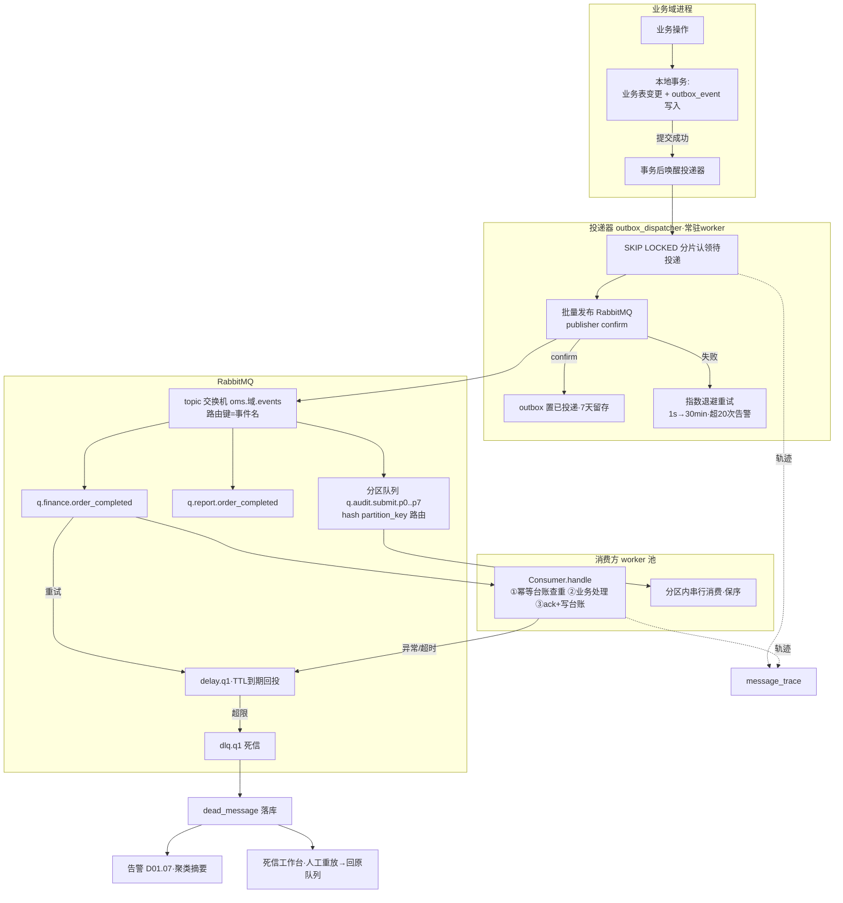
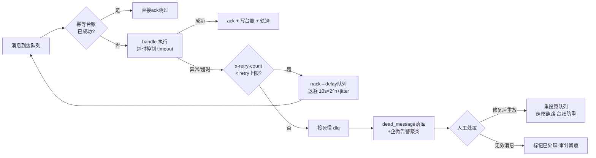

# SRS-D01.01 消息队列与异步任务中心 需求规格说明书

> 文档编号：SRS-D01.01 · 版本 V1.0 · 2026-10-24 · 编写：小凯 · 状态：待审阅（批次⑤）
> 所属域：D01 平台底座域 · 分期：**P0（M0-M1）** · schema：oms_base
> 上游依据：SRS-00 §3 D01 清单 / §4.2 事件命名契约（`域.实体.动作`）/ §4.4 事件字典 · 逆向文档 05 §7.1（base 伪队列 + taskmgr Swoole 队列）/ §7.7 重写建议（消息表+幂等键、消费者直连业务代码）· 07 架构书 §1.3（RabbitMQ）/ §4（机制继承）
> 消费方契约（本模块为其服务）：SRS-D03.01（订单创建 MQ 削峰、聚组 worker、补偿重试）· SRS-D03.02（审单投审消息、同组同实例 hash 路由）· SRS-D03.03（批量审单异步任务白名单）· SRS-D04.02 FR-03c（流水 MQ 异步落库、积压告警）· SRS-D02.03（消息缓冲投递失败重试）· SRS-D08.01 FR-01a（order.completed 消费失败进重试与死信）· SRS-D03.10（auto_delivery 任务、补偿重试队列）· SRS-D03.11（延迟消息 delivery.timeout.accept）
> 定位：全系统**异步通信与后台任务的唯一机制承载方**。业务域只声明「发什么事件/注册什么任务」，不各自封装 MQ 客户端；本模块提供发布（outbox 防丢）、消费（常驻 worker + 幂等 + 重试 + 死信）、顺序性（分区键）、可观测（积压/轨迹）五组机制。

---

## 1. 模块概述

### 1.1 定位

消息队列与异步任务中心对 RabbitMQ 做**统一封装**，向全部业务域提供三类能力：

1. **领域事件通道**：按 SRS-00 §4.2 事件命名契约（`域.实体.动作`，如 `order.delivery.shipped`）的发布/订阅，事件字典（DB-00 附录）登记的事件一律经本模块通道流转；
2. **异步任务通道**：白名单声明式注册的后台任务（消费类/一次性作业类），继承商派 taskmgr「threadNum/timeout/retry」声明式配置思想（逆向文档 05 §7.1），实现换成 Hyperf 常驻进程直连业务代码（不再 HTTP 回调自身——§7.7 重写建议①）；
3. **消息治理**：发布可靠性（事务性 outbox，防「业务落库成功但事件丢失」）、消费可靠性（幂等框架 + 指数退避重试 + 死信队列）、顺序性（分区键保序）、积压监控、全链路轨迹（trace_id）。

### 1.2 职责边界

**做**：MQ 客户端统一封装（连接池/序列化/交换机与队列声明）、命名规范与拓扑管理、消息信封契约、outbox 发布机制与投递器、消费框架（worker 进程模型/并发配置/幂等台账/重试退避/死信）、延迟消息、顺序性分区路由、积压与延迟监控告警（联动 D01.07）、消息轨迹查询。

**不做**：业务消费逻辑本身（各域自己的 consumer/handler，本模块只提供运行框架）；业务级失败重试的**语义**分级（→ D02.05 api_fail 错误码字典是平台调用的业务重试，与本模块的传输级重试是两层，不混用）；定时触发（→ D01.02 调度器；调度任务若需异步执行可注册为本模块任务，触发归 D01.02、运行归本模块）；平台消息缓冲表（→ D02.03 msg_buffer 是平台报文的业务缓冲，消费后经本模块投递内部事件）。

### 1.3 与其他模块关系

| 模块 | 关系 |
|---|---|
| 全部业务域 | 事件发布/订阅、异步任务注册的唯一通道 |
| D01.02 调度器 | 调度触发的重活注册为本模块任务运行；调度器自身多实例协调也复用本模块（触发消息） |
| D01.07 通知告警 | 积压/死信/投递器停滞告警的发送通道 |
| D10.06 审计 | 死信人工重放、消息轨迹查询等运维操作留痕 |
| DB-00 事件字典 | 事件名称/payload/发布方/订阅方的统一登记处，本模块命名校验以其为准 |

---

## 2. 业务场景（消费方场景）

**SC-D01.01-01 库存流水异步落库（D04.02 FR-03c）**
大促峰值审单 500+ 单/分钟，每单预占/释放经 Redis Lua 记账成功后投递 `stock.change.logged` 事件；D04.02 的落库 worker（白名单任务，并发 8、批量 200 条/批）异步消费写 DB 流水表。记账热路径零 DB 写，吞吐由 worker 并发数弹性承接；队列积压超阈值即告警（对账窗口 ≤5 分钟的 SLA 依据）。

**SC-D01.01-02 订单创建削峰（D03.01 FR-01c）**
平台推单洪峰（大促开售瞬时 3000 单/分钟）：D02.03 拉单/消息接收把订单报文落缓冲表后投递 `order.raw.received`；D03.01 创建 worker 按分区键（shop_id）保序消费、按幂等键（平台单号）防重创建。消费失败自动退避重试，超限进死信工作台人工重放——削峰+不丢单双保障。

**SC-D01.01-03 outbox 防丢事件（D03.07 发货确认）**
发货单确认出库：业务事务内「更新发货单状态 + 写 outbox 事件表（`order.delivery.shipped`）」同库同事务提交；投递器异步扫表发 MQ。若事务提交后进程崩溃，事件仍在 outbox 表待投递——下游（D02.04 平台回传、D08.01 应收）绝不会因「先提交后发消息」的时序缺口丢事件。

**SC-D01.01-04 审单同组保序（D03.02 FR-06e）**
订单组投审消息按组键（合单指纹组/买家键）hash 路由到固定分区队列：同组消息必落同队列、同 worker 实例顺序消费，合单语义不被并发撕裂；不同组均匀散列到全部分区，水平扩展吞吐。

**SC-D01.01-05 延迟消息（D03.11 门店接单超时）**
O2O 平台派单后投递 `delivery.timeout.accept` 延迟消息（TTL=接单时限 15 分钟）：到期未被取消（门店已接单则删除/幂等跳过）即触发超时改派流程。延迟消息由本模块统一提供（RabbitMQ TTL+死信交换或延迟插件，消费方无感）。

**SC-D01.01-06 死信人工重放（D02.03/D08.01 消费失败兜底）**
`order.completed` 消费方（D08.01 应收登记）因代码 bug 连续失败 16 次进死信：企微告警含聚类摘要（事件名×错误指纹 TOP）；开发修复后在死信工作台按事件名批量重放，重放走原消费链路（幂等台账保证已成功的不会二次生效）。

**SC-D01.01-07 消息轨迹排障（全链路 trace_id）**
客服反馈某订单未生成应收：运维按订单号查到 `order.completed` 的 event_id → 消息轨迹页展示全链路：outbox 写入时间 → 投递时间 → broker 确认 → 各订阅方消费时间/结果/重试次数，一眼定位是「未发布」还是「某消费方失败挂死信」。

---

## 3. 功能需求

### FR-D01.01-01 MQ 统一封装与命名规范
- FR-01a 客户端封装：业务代码只依赖 `EventPublisher` / `TaskPublisher` 接口，禁止直连 AMQP 客户端；封装内含连接池（Swoole 协程通道池）、JSON 序列化、发布确认（publisher confirm）、失败本地降级（FR-03e）。
- FR-01b 拓扑命名规范（对齐 SRS-00 §4.2 事件字典）：
  - 交换机：topic 类型，命名 `oms.{域}.events`（如 `oms.order.events`、`oms.stock.events`）；
  - 路由键 = 事件名：`域.实体.动作`（小写点分，如 `order.delivery.shipped`）；
  - 队列：按订阅方命名 `q.{消费域}.{用途}`（如 `q.finance.order_completed`）；一个订阅方一个队列（fan-out 语义由 topic 广播实现，消费方互不影响）；
  - 任务队列：`q.task.{task_name}`；死信：`dlx.{原队列名}` + `dlq.{原队列名}`；延迟：`delay.{原队列名}`。
- FR-01c 拓扑即代码：全部交换机/队列/绑定关系以配置文件声明（版本化，随发布执行 declare），禁止运行时手工建队列；事件名必须在 DB-00 事件字典登记后方可发布（CI 校验：扫描代码中的事件名与字典比对）。
- FR-01d 多环境隔离：vhost 按环境划分（dev/test/prod），队列名前缀不含环境（vhost 已隔离）。

### FR-D01.01-02 消息信封契约（全系统统一，消费方按此解析）
- FR-02a 信封结构（JSON）：

| 字段 | 必填 | 说明 |
|---|---|---|
| event_id | ✅ | 全局唯一（ULID），消息身份证；轨迹查询主键 |
| event_name | ✅ | 路由键=事件名（`域.实体.动作`）或任务名 |
| idempotent_key | ✅ | 业务幂等键（发布方定义：如 order_id+动作、bill_type+bill_item_id+action——对齐 D04.02 流水幂等键口径） |
| tenant_id / owner_id | ✅/按需 | 租户与货主（SRS-00 全域契约，事件也携带，消费方免回查） |
| trace_id | ✅ | 全链路追踪 ID（HTTP 请求/调度触发/上游消息继承透传） |
| partition_key | 按需 | 分区键（顺序性要求时必填，FR-05） |
| occurred_at / published_at | ✅ | 业务发生时间 / 发布投递时间（毫秒） |
| payload | ✅ | 业务数据（瘦事件原则：只带 ID 与关键状态，明细由消费方回查——防大报文与数据过期） |
| schema_version | ✅ | payload 结构版本（消费方兼容解析依据） |

- FR-02b 发布方义务：idempotent_key 业务语义唯一；payload 不含消费者敏感明文（PIPL，D01.05——事件里只放加密引用或脱敏值）；payload ≤64KB（超限走「瘦事件+OSS 引用」）。
- FR-02c 消费方义务：按 idempotent_key 做消费幂等（框架提供台账，FR-04c）；按 schema_version 兼容解析；消费失败抛异常交框架重试，禁止吞异常返回成功。

### FR-D01.01-03 发布机制（事务性 outbox，防丢事件）
- FR-03a outbox 表：`oms_base.outbox_event`（与各域业务表同库同事务写入——模块化单体单库，天然支持）：event_id/事件名/idempotent_key/tenant_id/trace_id/partition_key/payload/状态（待投递/已投递/投递失败）/重试次数/next_retry_at/创建时间。
- FR-03b 标准发布路径：**业务变更 + outbox 写入同一本地事务** → 投递器（常驻 worker，白名单任务 `outbox_dispatcher`）轮询+事务提交后即时唤醒双触发，扫「待投递」批量发 MQ（publisher confirm 确认）→ 置「已投递」。
- FR-03c 轻量路径（明确允许非事务性的场景）：纯通知类、可容忍丢失的埋点类事件可用 `EventPublisher::publishDirect`（不经 outbox）；**凡驱动业务状态联动的事件一律强制 outbox**（事件字典登记时标注可靠性等级 reliable/best-effort，CI 校验代码调用方式匹配）。
- FR-03d 投递器可靠性：多实例竞争用 `SELECT ... FOR UPDATE SKIP LOCKED` 分片认领；投递失败指数退避（1s/5s/30s/2min/10min，封顶 30min）；单事件失败超 20 次置「投递失败」告警人工；投递器停滞检测（心跳行+D01.02 巡检）。
- FR-03e broker 不可用降级：publishDirect 路径在 RabbitMQ 不可用时写本地降级表（`outbox_event` 兜底复用），恢复后补投——对齐 D04.02 §8「MQ 故障流水本地暂存重投」。
- FR-03f outbox 清理：已投递记录保留 7 天（轨迹查询窗口）后归档删除（分区表按日滚动）。

### FR-D01.01-04 消费机制（常驻 worker + 幂等 + 重试 + 死信）
- FR-04a 消费框架：业务方实现 `ConsumerInterface { name(); queue(); concurrency(); handle(Envelope): void; }` 并以 DI 标签注册（继承商派白名单声明思想，07 架构书 §4）；worker 进程由 Hyperf `Process` 常驻，按声明的 concurrency 启动协程消费池；**消费者直连业务代码，不 HTTP 回调**（逆向文档 05 §7.7 重写建议）。
- FR-04b 任务白名单声明（配置模型，继承 taskmgr whitelist）：

| 声明项 | 对应商派 | 说明 |
|---|---|---|
| task_name | 白名单键 | 全局唯一 |
| concurrency | threadNum | 消费协程/进程数（支持配置热更，大促临时调大——D03.02 FR-06e） |
| timeout | timeout | 单条消息处理超时（默认 30s；超时视为失败进重试） |
| retry | retry | 最大重试次数（默认 5；0=不重试直接死信） |
| backoff | —（新增） | 退避基数与封顶（默认 10s×2^n，封顶 30min，含 jitter） |
| partitioned | —（新增） | 是否分区队列（FR-05）及分区数（默认 8） |
| rule | rule | 启停规则：enabled + 生效时段（如归档任务仅凌晨窗口运行） |

- FR-04c 消费幂等台账：框架级支持——消费前以 `(queue_name, idempotent_key)` 查幂等台账（Redis SETNX 快路径 + DB 表 `consume_idempotent` 持久化，TTL 30 天）：已存在成功记录则直接 ack 跳过；处理成功后写台账。**台账是框架提供的便利设施，业务复杂幂等（如记账前后余额校验）仍是消费方责任**（对齐 D04.02 §5.2「幂等责任在调用方」的口径）。
- FR-04d 失败重试：handle 抛异常/超时 → nack 进延迟重试队列（`delay.{queue}`，TTL=退避时长 → 到期转回原队列）；重试次数记录在消息头 `x-retry-count`；达 retry 上限 → 投递死信队列 `dlq.{queue}`。
- FR-04e 死信处理：死信落 DB（`dead_message` 表：原队列/信封全文/失败原因/异常堆栈摘要/死信时间）+ 即时告警 D01.07（聚类摘要：队列×错误指纹计数）；死信工作台（列表按队列/时间/错误聚类筛选、单条详情、单条/批量重放、标记已处理）；重放=重新投递原队列（走原消费链路，幂等台账防重复生效）；重放操作写审计（D10.06）。死信积压 >24h 未处理升级告警（对齐 D02.05 FR-05d SLA 口径）。
- FR-04f 消费确认语义：手动 ack——handle 成功返回后框架 ack；处理中 worker 崩溃 → 消息未 ack 自动 requeue（at-least-once，靠幂等台账去重）。
- FR-04g 优雅停机：SIGTERM → 停止取新消息，等待在途消息处理完（最长 timeout×1.5）后退出；K8s preStop hook 配合（滚动发布不丢消息）。

### FR-D01.01-05 消息顺序性（分区键保序）
- FR-05a 分区机制：声明 `partitioned=true` 的队列实际创建 N 个分区队列（`q.{name}.p0..pN-1`）；发布时按 `hash(partition_key) mod N` 路由到固定分区；每分区独立 worker 顺序消费（分区内串行=保序，分区间并行=吞吐）。
- FR-05b 分区键约定（消费方在事件字典登记时声明）：审单投审=订单组键（D03.02 同组同实例）；订单创建=shop_id（同店铺保序）；库存流水=三元键 hash（同记账行保序，D04.02 流水落库顺序与发生顺序一致）；回传指令=发货单 ID（D09.02 指令状态机时序）。
- FR-05c 重试与顺序的冲突处理：分区内某条消息失败进延迟重试时，**阻塞该分区后续消息**（head-of-line blocking，保序代价）；业务可声明 `blocking=false` 降级为「失败旁路进重试、后续继续消费」（放弃该消息与后续的相对顺序）——登记事件时显式选择，默认阻塞。
- FR-05d 分区数调整：扩分区=新建队列组+灰度切流（发布方双写过渡），不支持在线改 N（hash 路由会变）；容量规划一次到位（默认 8，高频域 16）。

### FR-D01.01-06 延迟消息
- FR-06a 统一延迟能力：`TaskPublisher::publishDelay(envelope, delaySeconds)`；实现=RabbitMQ 延迟插件（x-delayed-message）为主、TTL+DLX 兜底（插件不可用时）；延迟上限 7 天（超期需求改用 D01.02 调度扫描）。
- FR-06b 消费方无感：延迟到期后进入目标队列，信封含 `scheduled_at`（原定触发时间），消费幂等/重试机制同普通消息。
- FR-06c 典型消费方：D03.11 门店接单超时、D03.05 合单缓冲窗到期、D03.01 未付款自动取消（订单侧兜底核对）。

### FR-D01.01-07 积压监控与告警
- FR-07a 指标采集（每分钟，Prometheus 抓取）：每队列 ready/unacked 消息数、消费速率（条/分钟）、发布速率、消费延迟 P95（occurred_at→消费完成）、重试率、死信增量、outbox 待投递存量与最老记录年龄。
- FR-07b 告警规则（联动 D01.07，阈值可按队列配置）：

| 告警项 | 默认阈值 | 级别 |
|---|---|---|
| 队列积压 | ready >1 万条 或 按消费速率估算排空时间 >30 分钟 | P1 |
| 消费停滞 | 有积压且消费速率=0 持续 5 分钟 | P0 |
| 死信新增 | 任意新增即时通知（聚类摘要）；积压 >24h 升级 | P1→P0 |
| outbox 滞留 | 最老待投递 >5 分钟（投递器故障） | P0 |
| 消费延迟 | P95 > SLA（事件字典按事件登记 SLA，如 stock.change.logged ≤5 分钟——D04.02 对账窗口） | P1 |

- FR-07c 积压处置设施：worker 并发热更（FR-04b concurrency 配置热生效）；临时扩容指引（K8s HPA 按队列深度指标）；紧急旁路（运维可对指定队列暂停消费/跳过堆积段——高危操作双人复核+审计）。
- FR-07d 看板：队列总览（D11.03 集成）：TOP 积压队列、死信趋势、各域事件流量分布。

### FR-D01.01-08 消息轨迹查询（trace_id 全链路）
- FR-08a 轨迹采集：发布（outbox 写入/投递/confirm）、消费（各订阅方开始/结束/结果/重试次数/死信）各环节写轨迹流水（`message_trace` 表，按月分区，在线 3 个月）。
- FR-08b 查询入口：按 event_id / idempotent_key / trace_id / 业务单号（payload 摘要索引）检索；单消息轨迹视图=时间线（发布→broker→N 个订阅方各自消费状态）；trace_id 视图=一次业务动作触发的全部消息链（跨事件级联：如发货确认→shipped 事件→回传任务→回传完成事件）。
- FR-08c 消费方定位：轨迹含消费实例（pod/进程）、耗时、异常摘要（不含敏感明文），支撑「哪个订阅方拖垮了链路」快速定位。

---

## 4. 业务流程

### 4.1 outbox 发布-消费架构（核心图）



### 4.2 消费失败重试-死信-重放流程



---

## 5. 处理逻辑

### 5.1 投递器扫描算法

```
dispatcher_loop(实例i, 分片数K):                      # 多实例水平分片
    rows = SELECT * FROM outbox_event
           WHERE status=待投递 AND next_retry_at<=now AND id%K=i
           ORDER BY id LIMIT 500 FOR UPDATE SKIP LOCKED
    for batch in chunk(rows, 50):
        confirms = channel.publish_batch(batch)        # publisher confirm
        成功 → status=已投递, 写轨迹
        失败 → retry_count+1, next_retry_at=now+backoff(n)
               retry_count>20 → status=投递失败, 告警
    空轮询 → 休眠1s(事务后唤醒机制兜底即时性)
```

### 5.2 消费幂等台账双层结构

```
快路径: Redis SETNX idem:{queue}:{idempotent_key} = PROCESSING, TTL 30天
        已存在且=SUCCESS → ack跳过
        已存在且=PROCESSING → 在途重复(requeue场景) → 延迟重投(防并发双跑)
慢路径: DB consume_idempotent 表(queue, idempotent_key, status, 消费时间) 持久化
        handle成功 → 事务内写SUCCESS + ack; Redis 丢失时以 DB 为准
台账仅防「同消息重复消费」; 业务级幂等(余额校验/状态机CAS)由消费方自理
```

### 5.3 分区路由与保序

```
发布: partition = hash(partition_key) mod N → routing_key = {event}.{partition}
消费: 每分区队列独立 worker, prefetch=1(严格串行) 或 小批量(性能模式,可配)
阻塞模式(默认): 分区内失败→后续消息等待重试完成(head-of-line, 强保序)
旁路模式(blocking=false): 失败消息进delay重试, 分区继续消费(放弃跨消息顺序)
```

### 5.4 可靠性矩阵（各环节故障的行为）

| 故障点 | 行为 | 数据保障 |
|---|---|---|
| 业务事务提交前崩溃 | outbox 同事务回滚 | 无脏事件 |
| 事务提交后、投递前崩溃 | 投递器重启后继续扫表 | 事件不丢（at-least-once，可能重发→消费幂等兜底） |
| broker 宕机（outbox 路径） | 投递器退避重试 | 事件滞留 outbox，恢复补投 |
| broker 宕机（direct 路径） | 写本地降级表补投 | reliable 等级事件禁用 direct 路径（CI 校验） |
| 消费者崩溃（处理中） | 未 ack 自动 requeue | 幂等台账防重复生效 |
| 消费者持续失败 | 退避重试→死信 | 死信落库+告警，人工闭环 |
| 死信重放时消费方已修复 | 走原链路正常消费 | 台账已 SUCCESS 的自动跳过 |

### 5.5 全链路约定
- 语义：**at-least-once + 消费幂等 = 业务视角 exactly-once**（不做事务性消息/两阶段提交，复杂度不值得——模块化单体单库 outbox 已覆盖可靠性诉求）；
- trace_id 生成于链路入口（HTTP 中间件/调度触发器/平台消息接收），跨事件级联时透传（消费方发布新事件继承 trace_id）；结构化日志统一携带（对接 Sentry/Grafana Tempo，07 架构书可观测栈）。

---

## 6. 数据字段（业务字段描述，schema：oms_base）

### 6.1 outbox 事件表（outbox_event，按日分区）

| 字段 | 业务含义 | 取值/校验 |
|---|---|---|
| event_id | 消息唯一 ID | ULID，主键 |
| event_name / reliability | 事件名/可靠性等级 | 字典校验；reliable/best-effort |
| idempotent_key | 业务幂等键 | 发布方定义，同事件名内唯一 |
| tenant_id / owner_id / trace_id | 契约字段 | FR-02a |
| partition_key | 分区键 | partitioned 事件必填 |
| payload / schema_version | 业务数据/版本 | JSON ≤64KB |
| status | 投递状态 | 待投递/已投递/投递失败 |
| retry_count / next_retry_at | 投递重试 | 退避节奏 FR-03d |
| create_time / publish_time | 写入/投递成功时间 | 轨迹依据 |

### 6.2 消费幂等台账（consume_idempotent，按月分区，30 天滚动）

| 字段 | 业务含义 |
|---|---|
| queue_name / idempotent_key | 联合唯一键 |
| status | PROCESSING/SUCCESS |
| event_id / consume_time / cost_ms | 首次成功消费溯源 |

### 6.3 死信表（dead_message）

| 字段 | 业务含义 |
|---|---|
| dead_id / source_queue | 死信 ID/来源队列 |
| envelope | 信封全文 JSON |
| fail_reason / exception_digest | 最后一次失败原因/堆栈摘要（脱敏） |
| retry_count / dead_time | 累计重试/死信时间 |
| handle_status | 未处理/已重放/已作废（含处理人/时间——审计） |

### 6.4 消息轨迹（message_trace，按月分区，在线 3 个月）

| 字段 | 业务含义 |
|---|---|
| event_id / trace_id | 检索键（双索引） |
| stage | outbox 写入/投递/confirm/消费开始/消费成功/重试/死信/重放 |
| node | 实例标识（pod/进程） |
| queue_name / consumer_name | 归属队列/消费方 |
| cost_ms / detail / create_time | 耗时/摘要（无敏感明文）/时间 |

---

## 7. 接口

### 7.1 内部接口（本模块提供，全系统唯一 MQ 通道）

| 编号 | 接口 | 消费方 | 说明 |
|---|---|---|---|
| IF-D01.01-01 | `EventPublisher::publishTx(Envelope, DbTransaction)` | 全域 | outbox 事务内发布（reliable 事件强制） |
| IF-D01.01-02 | `EventPublisher::publishDirect(Envelope)` | 全域 | 轻量直发（best-effort 事件） |
| IF-D01.01-03 | `TaskPublisher::publishTask(taskName, params, idempotentKey)` / `publishDelay(envelope, delaySeconds)` | 全域 | 异步任务投递/延迟消息 |
| IF-D01.01-04 | `ConsumerInterface` + DI 标签注册（`#[MessageConsumer]`） | 全域消费方 | 消费框架接入规范（FR-04a/04b 白名单声明） |
| IF-D01.01-05 | `DeadMessageService::list/replay/markHandled` | 运维工作台 | 死信治理（重放审计） |
| IF-D01.01-06 | `MessageTraceService::query(event_id/trace_id/业务单号)` | 运维/客服排障 | 轨迹查询 |
| IF-D01.01-07 | 指标暴露（Prometheus /metrics） | D11.03/D01.07 | 积压/延迟/死信指标与告警数据源 |
| IF-D01.01-08 | 事件 `mq.deadletter.created` / `mq.backlog.exceeded` / `mq.dispatcher.stalled` | D01.07 | 自身告警事件（吃自己狗粮） |

### 7.2 依赖接口

| 编号 | 接口 | 提供方 | 说明 |
|---|---|---|---|
| IF-D01.01-D1 | 告警发送 | D01.07 | 死信/积压/停滞告警 |
| IF-D01.01-D2 | 投递器心跳巡检任务 | D01.02 | dispatcher 停滞检测调度 |
| IF-D01.01-D3 | 事件字典（名称/payload/可靠性等级/分区键/SLA 登记） | DB-00 附录 | 命名与契约校验源 |
| IF-D01.01-D4 | 死信重放/紧急旁路操作审计 | D10.06 | 高危操作留痕 |

### 7.3 外部接口

无直接外部接口（RabbitMQ 为内部基础设施）。

---

## 8. 非功能需求

| 项 | 要求 |
|---|---|
| 吞吐 | 集群 ≥5000 消息/秒发布+消费（大促峰值预估 3000 单/分钟 × 平均 8 事件/单 + 库存流水 18 万条/日集中落库）；单 worker 实例 ≥500 条/秒（轻处理） |
| 延迟 | outbox 路径：事务提交→broker 可见 P95 ≤1s（投递器即时唤醒）；direct 路径 ≤50ms；延迟消息精度 ±1s |
| 可靠性 | reliable 事件零丢失（outbox+confirm+重投闭环）；at-least-once+幂等台账=业务 exactly-once；broker 集群 3 节点镜像队列（quorum queue） |
| 顺序性 | 分区内严格保序（阻塞模式）；分区键路由稳定（hash 算法版本化） |
| 可用性 | broker 故障：发布降级本地表、消费暂停不丢（requeue）；恢复自动续传；worker 滚动发布零丢消息（优雅停机 FR-04g） |
| 可观测 | 全队列指标 Prometheus 采集；轨迹在线 3 个月；死信/积压/停滞三类告警 100% 触达 |
| 安全 | payload 禁含敏感明文（发布侧校验+抽检扫描）；死信工作台/紧急旁路为高危权限点（D10.03 独立授权）+审计 |
| 容量 | outbox 日均 ≈50 万条（7 天在线 ≈350 万，分区表）；轨迹日均 ≈200 万条按月分区；consume_idempotent 30 天滚动 ≈5000 万行（Redis 主+DB 归档） |

---

## 9. 验收标准

| 编号 | 验收条件 |
|---|---|
| AC-01 | outbox 原子性：业务事务回滚则事件不发出；事务提交后 kill 应用进程，重启后事件仍被投递（模拟 SC-03 时序缺口场景，1000 次注入零丢失） |
| AC-02 | 消费幂等：同一 idempotent_key 消息重复投递 10 次（人工重放+requeue 混合），消费方业务只生效一次；Redis 台账清空后以 DB 台账兜底仍不重复生效 |
| AC-03 | 失败重试：模拟消费方连续抛异常，按 10s/20s/40s…退避（含 jitter）重试，达上限（声明 retry=5）后进入死信队列并落 dead_message+企微告警送达（含聚类摘要） |
| AC-04 | 死信重放：修复消费方后从工作台批量重放 30 条死信，全部正常消费闭环；其中 5 条台账已 SUCCESS 的自动跳过不重复生效；重放操作审计可查 |
| AC-05 | 分区保序：partitioned 队列按订单组键发布 1000 条乱序交错消息，同组消息消费顺序=发布顺序；同组必落同分区（hash 路由验证）；blocking 模式下失败消息阻塞分区后续、旁路模式不阻塞 |
| AC-06 | 削峰：瞬时注入 3000 条/分钟持续 10 分钟，消费方按 concurrency=8 平稳消化，积压曲线可观测、排空时间符合估算、无消息丢失 |
| AC-07 | 延迟消息：publishDelay 15 分钟的消息在 15 分钟±1s 内可消费；提前不出现；消费幂等同样生效 |
| AC-08 | 积压告警：人为暂停消费方制造积压 >1 万条，P1 告警 5 分钟内触达；消费速率为 0 持续 5 分钟触发 P0 停滞告警；恢复消费后告警自动解除 |
| AC-09 | broker 故障降级：关停 RabbitMQ，direct 路径发布写本地降级表不报错；恢复后自动补投且顺序保持；outbox 路径事件滞留待投递并触发投递器告警（>5 分钟滞留） |
| AC-10 | 消息轨迹：按业务单号检索，完整展示「outbox 写入→投递→confirm→3 个订阅方消费结果（含 1 个重试 2 次成功）」时间线；trace_id 视图展示跨事件级联链路（发货确认→回传任务→回传完成） |
| AC-11 | 命名契约：发布未在事件字典登记的事件名被 CI 校验拦截；队列/交换机拓扑与配置文件一致（declare 幂等验证）；reliable 事件调用 publishDirect 被编译期/运行期拦截 |
| AC-12 | 优雅停机：消费处理中发送 SIGTERM，在途消息处理完成后退出、无未 ack 丢失；K8s 滚动发布全程零消息丢失（压测中执行） |

---

## 变更记录

| 日期 | 版本 | 变更 | 原因 |
|---|---|---|---|
| 2026-10-24 | V1.0 | 首版 | — |

---

*参考实现溯源：商派三代队列并存——① base 伪队列 `sdb_base_queue`（worker/cursor_id/total/remaining 游标分批，save() 重写为落库即推 taskmgr，逆向文档 05 §7.1）；② taskmgr Swoole 进程池（whitelist 声明 threadNum/timeout/retry、`Swoole\Process\Manager` 消费池+定时池、RabbitMQ/Redis 双连接器抽象、企业微信失败告警、requeue+ack 语义）；③ base_queue_mq/rdkafka 旁路直发。重写差异：① 三代收敛为一代（RabbitMQ+Hyperf 常驻协程 worker，07 架构书 §7.7 建议）；② **消费者直连业务代码**，废除商派「消费即 HTTP 回调 PHP-FPM」模式（少一跳少一层 taskmgr_sign 签名）；③ 白名单声明从 PHP 数组（lib/whitelist.php）迁移为 DI 标签+配置中心（threadNum→concurrency 热更，新增 backoff/partitioned 声明项）；④ 新增事务性 outbox（商派无发布可靠性机制，事件丢失靠对账兜底——凯淳在机制层根治）；⑤ 统一消息信封（商派 push_params 各任务自定结构；凯淳强制 event_id/idempotent_key/tenant_id/trace_id 契约）；⑥ 幂等从商派业务侧 is_repeat/set_repeat 散落实现收敛为框架级双层台账；⑦ 分区键保序为新增机制（商派无顺序性保障，审单组消费靠单实例串行硬扛）；⑧ 死信从商派「errmsg 字段+人工查表」升级为死信表+工作台+聚类告警+审计重放；⑨ 消息轨迹（trace 全链路）为全新能力（商派仅 taskmgr 结构化日志 task/url/spend/code）。*
