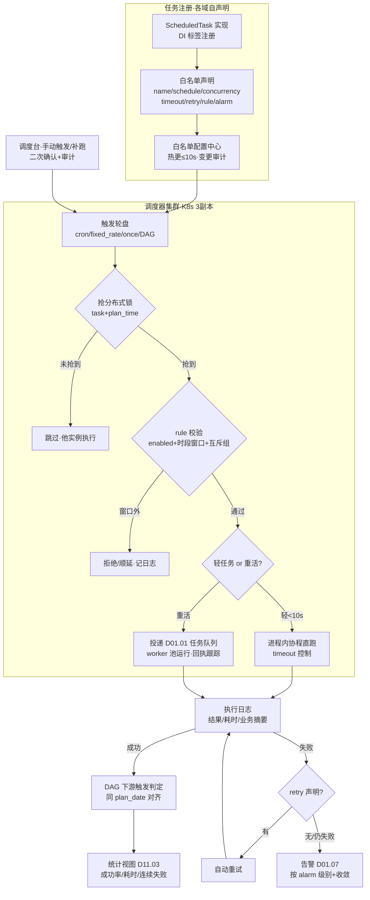
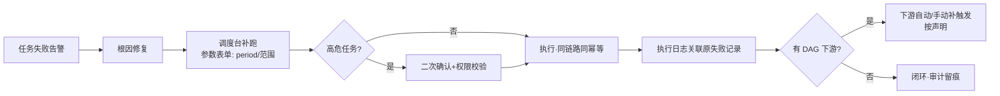

# SRS-D01.02 统一调度器 需求规格说明书

> 文档编号：SRS-D01.02 · 版本 V1.0 · 2026-10-24 · 编写：小凯 · 状态：待审阅（批次⑤）
> 所属域：D01 平台底座域 · 分期：**P0（M0-M1）** · schema：oms_base
> 上游依据：SRS-00 §3 D01 清单 · 逆向文档 05 §7.1（taskmgr 任务白名单声明 threadNum/timeout/retry/rule）/ §7.2（定时任务三代并存：autotask 服务广播 + taskmgr 秒级 crontab + MySQL EVENT）/ §7.7 重写建议（统一到一个调度器，保留「模块自声明定时任务」插件化注册思想）· 07 架构书 §1.3（自研统一调度器·声明式任务白名单）
> 消费方契约（本模块为其服务）：SRS-D02.03 FR-02d（拉单轮询每分钟/大促 30 秒）· SRS-D04.02 FR-05c/06a（Redis 对账每 5 分钟、日终快照 0 点）· SRS-D05.05 FR-05a（售后临期扫描每 10 分钟）· SRS-D09.01 FR-05a（WMS 探活每分钟）· SRS-D03.13 FR-06a（归档日级凌晨窗口）· SRS-D08.02 FR-02a（结算单周期到期生成）等——全部已声明调度任务见 §FR-08 清单
> 定位：全系统**定时/周期任务的唯一触发源**。任务由各域以白名单声明式注册（商派 taskmgr 思想继承），调度器负责触发时机、分布式互斥、依赖编排、执行日志与失败告警；重活任务的**运行**委托 D01.01 任务通道（触发归本模块、执行归 worker 池）。

---

## 1. 模块概述

### 1.1 定位

统一调度器把商派「三代并存」的定时任务体系（autotask 服务广播 / taskmgr 秒级 crontab / MySQL EVENT，逆向文档 05 §7.2）收敛为**一代**：任务=可注册 handler + 白名单声明式配置（任务名/调度表达式/并发数/超时/重试/启停规则——照搬 taskmgr whitelist 四要素并扩展），调度器多实例高可用（分布式锁防重复触发），支持 cron/固定频率/一次性三种模式与简单 DAG 依赖编排（日终快照→报表汇总类场景），执行全量留痕（成功率/耗时统计）并联动 D01.07 失败告警。

### 1.2 职责边界

**做**：任务注册与白名单配置模型、调度触发（cron/频率/一次性/依赖触发）、分布式锁与多实例协调、手动触发与补跑（指定业务时间参数）、任务执行日志与统计、失败重试与告警联动、简单 DAG 编排、任务清单治理（各域声明汇总与冲突检查）、大促模式（调度参数热切换）。

**不做**：任务业务逻辑本身（各域 handler）；任务运行进程管理（重活经 D01.01 任务通道投给 worker 池运行，本模块只管触发与状态跟踪）；数据库分区维护类 DBA 作业（保留 DB EVENT 或运维脚本——逆向文档 05 §7.7 建议，不入业务调度器）；事件驱动型触发（那是 D01.01 订阅，不是定时调度）。

### 1.3 与其他模块关系

| 模块 | 关系 |
|---|---|
| 全部业务域 | 定时任务注册与触发的唯一入口 |
| D01.01 MQ | 重活任务触发后经任务通道投递运行；调度器心跳/投递器巡检也挂本调度 |
| D01.07 通知告警 | 任务失败/超时/连续失败告警发送 |
| D10.06 审计 | 手动触发/补跑/启停变更留痕 |
| D11.03 监控 | 任务成功率/耗时/积压指标供数 |

---

## 2. 业务场景（消费方场景）

**SC-D01.02-01 拉单轮询（D02.03 FR-02d，分钟级高频）**
每店铺增量拉单任务每分钟一轮：调度器按店铺分片触发（分片参数注入 handler，多实例并行不重叠）；大促模式一键切换 30 秒频率（白名单 rule 热更，不重启）；某轮执行超时（平台接口慢）不阻塞下一轮（超时即杀+告警，跳过语义防堆积）。

**SC-D01.02-02 库存对账（D04.02 FR-05c，5 分钟兜底 SLA）**
Redis-DB 余额对账每 5 分钟抽样+每小时全量：任务声明 `timeout=240s, retry=1, concurrency=1`（对账任务禁止并发重叠）；执行中发现差异自动修复并上报差异数；连续 3 轮失败升级 P0 告警（对账停摆=库存账失去兜底）。

**SC-D01.02-03 日终快照→报表汇总（DAG 依赖编排）**
每日 0:00 触发「库存日终快照」（D04.02 FR-06a），完成后自动触发下游「结算取数汇总」（D08.02 台账日校验）与「BI 宽表刷新」（D11.02）：DAG 声明 `报表汇总 after 日终快照`；上游失败则下游不触发并连带告警；上游重跑成功后下游可手动补触发。

**SC-D01.02-04 归档任务窗口控制（D03.13 FR-06a）**
订单归档任务声明生效窗口 2:00-5:00（rule 时段）：窗口内分片批跑（每批 500 单、批间限速 QPS 可配）；窗口到点未跑完自动暂停，次日窗口续跑（断点=归档水位游标）；窗口外手动触发被拒绝（防在线库压力事故）。

**SC-D01.02-05 失败补跑（月结场景）**
月初 1 日「结算单自动生成」（D08.02 FR-02a）因取数服务故障失败：告警推送财务运维；修复后在调度台手动补跑（携带业务参数 period=上月），handler 幂等（D08.02 FR-02e）保证重复补跑不产生重复结算单；补跑记录与原失败记录关联留痕。

**SC-D01.02-06 多实例防重（K8s 3 副本）**
调度器 3 副本同时运行：每次触发前抢分布式锁（Redis SET NX + 任务名+计划时间戳为键），抢到者执行触发，其余跳过；锁带 TTL 防死锁；副本崩溃后锁自动过期，下一计划周期正常接管——任何任务任何时刻只被触发一次。

---

## 3. 功能需求

### FR-D01.02-01 任务注册与白名单声明（继承商派 taskmgr whitelist）
- FR-01a 注册方式：各域实现 `ScheduledTaskInterface { name(); handle(TaskContext): TaskResult; }` 并以 DI 标签注册；白名单声明随代码配置化（PHP 配置数组/注解），**新增任务=实现接口+声明注册，不改调度器代码**（模块自声明插件化，逆向文档 05 §7.7）。
- FR-01b 白名单声明项（配置模型）：

| 声明项 | 商派对应 | 说明 |
|---|---|---|
| task_name | 白名单键 | 全局唯一，命名 `{域}.{任务}`（如 `stock.reconcile`、`gateway.pull_orders`） |
| schedule_type | rule（crontab） | cron / fixed_rate（固定频率秒级）/ once（一次性）/ dag（依赖触发，FR-06） |
| expression | rule | 5 位 cron（分級）或频率秒数；秒级需求用 fixed_rate（商派 6 位秒级 crontab 的替代） |
| concurrency | threadNum | 并发实例数：1=串行（重叠时跳过本轮，skip_if_running 默认开）；N=分片并行（shard_count=N，分片号注入 handler） |
| timeout | timeout | 单次执行超时（超时终止+记失败；不阻塞下一轮） |
| retry | retry | 失败自动重试次数与间隔（默认 0；重试仍失败才告警） |
| rule | rule | 启停与生效规则：enabled 开关 + 生效时段窗口（如归档仅 2:00-5:00）+ 互斥组（同组任务不同时跑） |
| alarm | —（新增） | 告警策略：失败告警级别/连续失败升级阈值/接收人（缺省按域值班表，D01.07 路由） |
| owner | —（新增） | 任务 Owner（域+负责人），治理与告警寻址 |

- FR-01c 配置热更：白名单声明集中管理（配置中心/DB 表），启停/频率/时段/并发变更热生效（≤10s 全调度实例感知）；变更写审计（D10.06）。
- FR-01d 大促模式：模式开关（手动/日历触发）批量切换预设参数组（拉单 30 秒、对账加密、归档暂停、非核心统计任务停跑）；模式切换事件通知各域 Owner。

### FR-D01.02-02 调度模式
- FR-02a cron 模式：标准 5 位 cron 表达式（分/时/日/月/周），时区固定 Asia/Shanghai；支持多表达式（同任务不同节奏，如「工作日 9 点+周六 10 点」）。
- FR-02b 固定频率模式：每 N 秒/分（N≥10s），首轮对齐整点边界（可配偏移）；高频任务（拉单/探活/对账）主用此模式。
- FR-02c 一次性模式：指定时间执行一次（如「大促结束次日 6 点出报告」）；执行后自动置完成，可复制重建。
- FR-02d 错过触发策略（misfire）：调度器停机/锁竞争错过计划时间点时——默认跳过（skip，高频任务语义）；可声明 fire_once（补一次，日结类任务语义）；声明项 per-task 配置。

### FR-D01.02-03 分布式锁与多实例协调
- FR-03a 触发锁：每次计划触发抢 Redis 锁 `sched:lock:{task}:{plan_time}`（SET NX PX，TTL=timeout×1.5）；抢到者触发，未抢到跳过；锁值含实例 ID（可观测谁在执行）。
- FR-03b 执行互斥：concurrency=1 的任务加执行锁（上一轮未结束则本轮跳过并记 skipped_overlapping 日志，连续跳过 ≥3 轮告警——任务实际跑不动的信号）。
- FR-03c 分片协调：concurrency=N 时按分片号各自加锁（`sched:lock:{task}:{plan_time}:shard{i}`），分片间并行、分片内互斥；分片分配稳定（i=实例序号 hash）。
- FR-03d 时钟一致性：调度实例启用 NTP 强校验，时钟漂移 >2s 的实例自动退出触发竞争（防双触发）。

### FR-D01.02-04 任务执行与运行委托
- FR-04a 轻任务直跑：预估耗时 <10s 的任务（巡检/水位推进）在调度进程内协程直跑。
- FR-04b 重活委托：批量类任务（归档/快照/对账全量/日结）由调度器投递 D01.01 任务队列（`publishTask`，携带 plan_time 与分片参数），worker 池运行；调度器跟踪任务消息回执/执行日志状态（触发≠完成，完成态以 handler 回报为准）。
- FR-04c 执行上下文：TaskContext 注入 plan_time（计划时间，补跑时=业务时间参数）、shard_index/shard_count、trace_id（贯穿到 D01.01 消息与业务日志）、手动触发标记与操作人。
- FR-04d 超时终止：直跑任务协程级取消；委托任务发终止信号+worker 侧 timeout 双保险；超时记失败（原因=timeout）触发告警。

### FR-D01.02-05 执行日志与统计
- FR-05a 执行日志：每次触发一条（任务/plan_time/触发方式 auto|manual|dag|retry/实例/开始结束时间/耗时/结果 success|failed|timeout|skipped/错误摘要/业务摘要 JSON——如「扫描 1200 单、修复差异 3 条」）。
- FR-05b 统计视图：按任务聚合成功率（日/周）、耗时分布（P50/P95/max）、连续失败计数、跳过（重叠/窗口外）计数；域维度汇总（哪个域任务最多失败）；供 D11.03。
- FR-05c 日志治理：执行日志在线 90 天，按月分区归档；高频任务（分钟级）日志抽样降级可配（保留失败全量+成功 1/10 抽样，防日志爆量——商派 cleanupLogs 进程思想）。

### FR-D01.02-06 任务依赖编排（简单 DAG）
- FR-06a 依赖声明：`dag_after: [task_a, task_b]`（多上游 AND 语义：全部成功才触发）；仅支持无环依赖（注册期拓扑校验，成环拒绝）；不做复杂工作流引擎（分支/条件/并行网关不在范围——保持「简单 DAG」边界）。
- FR-06b 触发语义：同一业务日期（plan_date）维度对齐——上游今日成功 → 下游触发（携带同 plan_date）；上游失败 → 下游不触发+连带告警（「因上游 X 失败被阻断」）；上游补跑成功 → 下游可手动/自动（可配）补触发。
- FR-06c 典型 DAG（首批登记）：`stock.daily_snapshot（0:00）→ finance.settle_daily_check → bi.wide_table_refresh`；`order.archive_daily` 独立无下游。
- FR-06d DAG 可视化：任务清单页展示依赖图（Mermaid 渲染），阻断链路高亮。

### FR-D01.02-07 手动触发与补跑
- FR-07a 手动触发：调度台按任务触发一次（立即执行，不影响原计划节奏）；高危任务（写库类/资金类）手动触发需二次确认+权限点（D10.03）。
- FR-07b 参数化补跑：携带业务参数（plan_time/period/店铺范围等，按任务声明的参数 schema 表单化输入）；补跑与自动触发同链路同幂等约束（handler 幂等责任在各域，调度器透传参数）。
- FR-07c 批量补跑：按时间段生成补跑序列（如「补跑 10-01 至 10-03 的日结任务」按日依次执行，前一日成功才跑下一日）；补跑进度可视。
- FR-07d 全部手动操作写审计（D10.06）：谁/何时/触发什么任务/什么参数/结果。

### FR-D01.02-08 任务清单（各域已声明调度任务汇总登记）

> 汇总来源=各模块 SRS 中对 D01.02 的引用；本清单为**登记视图**（任务名最终以各域白名单声明为准），新任务上线前在此登记（Owner/节奏/告警级别齐备才准入）。

| 域 | 任务 | 节奏 | 来源 |
|---|---|---|---|
| D02 | 拉单增量轮询（分店铺分片） | 每 1 分钟（大促 30 秒） | D02.03 FR-02d |
| D02 | 在途调用扫描反查（rpcpoll 语义） | 每 1 分钟 | D02.01 FR-07d |
| D02 | api_fail 分级重试扫描（minute/hour 档） | 每 1 分钟/每小时 | D02.05 |
| D02 | 店铺授权有效期巡检与续期 | 每日 | D02.06 FR-04a |
| D02 | 回传结果平台对账反查 | 每日 | D02.05 |
| D03 | 订单完成判定扫描（发货后 ≥N 天自动完成） | 每小时 | D03.01 FR-05e |
| D03 | 履约停滞扫描（待推仓超 24h） | 每 30 分钟 | D03.09 FR-03c |
| D03 | 预售到期批量放行 | 每 10 分钟 | D03.10 FR-02c |
| D03 | 发货单超时自动确认批处理 | 每小时 | D03.07 §8 |
| D03 | 审单绩效日结汇总 | 每日 | D03.03 FR-07b |
| D03 | 订单归档（凌晨窗口 2:00-5:00，限速分片） | 每日 | D03.13 FR-06a |
| D04 | Redis-DB 库存对账（抽样） | 每 5 分钟 | D04.02 FR-05c |
| D04 | Redis-DB 库存对账（全量） | 每小时 | D04.02 FR-05c |
| D04 | 库存日终快照 | 每日 0:00 | D04.02 FR-06a |
| D04 | WMS 库存快照对账 | 每日 | D04.02 FR-06b |
| D04 | 预占过期回收 | 每 10 分钟 | D04.03（SRS-00 清单） |
| D04 | 临期批次扫描与预警 | 每日 | D04.09 |
| D04 | 可售计算与平台同步水位推进 | 每 1 分钟 | D04.08 |
| D04 | 补货建议扫描（上下限/缺货） | 每 30 分钟 | D04.10 |
| D05 | 售后申请临期预警扫描（黄/红分级） | 每 10 分钟 | D05.01 FR-06b |
| D05 | 售后自动审核临期兜底扫描 | 每 10 分钟 | D05.05 FR-05a |
| D05 | 退货差异等待期/预报超期/处置超期扫描 | 每小时 | D05.02 §8 |
| D05 | 退款台账日终对账 | 每日 | D05.03 §4 |
| D05 | 换货超时/补发挂起/整单超时扫描 | 每小时 | D05.04 §8 |
| D06 | 到货超期未认领预警（7 天） | 每日 | D06.03 FR-06c |
| D08 | 应收账龄日算 | 每日 | D08.01 FR-09b |
| D08 | 账单差异日报生成推送 | 每日（日终） | D08.01 FR-07d |
| D08 | 结算单周期到期自动生成 | 每日 | D08.02 FR-02a |
| D08 | 结算确认超期催办 | 每日 | D08.02 FR-05d |
| D08 | 自动核销批/逾期扫描 | 每日 | D08.03 |
| D08 | 月度结账前置检查（结账日前 N 天） | 每月（可配） | D08.06 FR-04f |
| D08 | 批量开票/发票回执超时反查 | 每小时/每日 | D08.05 FR-01d |
| D08 | 金蝶供数任务 | 每日/每月 | D08.06 |
| D09 | WMS 健康探活（分账号） | 每 1 分钟 | D09.01 FR-05a |
| D09 | 出库回传超时反查/通道对账/缓冲监控 | 每 5 分钟/每日 | D09.02 IF-D5 |
| D09 | 入库回传超时反查/三方对账 | 每 5 分钟/每日 | D09.03 IF-D6 |
| D09 | 面单号池预取水位检查/号段归还/对账/熔断探测 | 每 5 分钟~每日 | D09.05 FR-03b/08b |
| D09 | 物流轨迹断更扫描（P1） | 每小时 | D09.04 FR-07c |
| D01 | outbox 投递器心跳巡检 | 每 1 分钟 | D01.01 FR-03d |
| D01 | 死信积压升级检查（>24h） | 每小时 | D01.01 FR-04e |
| D01 | 规则命中统计日聚合 | 每日 | D01.03 FR-07 |

### FR-D01.02-09 失败告警（联动 D01.07）
- FR-09a 告警触发：执行失败（重试后仍失败）/超时/连续失败达阈值（默认 3）/连续重叠跳过 ≥3 轮/DAG 阻断/窗口内未完成（如归档）——按任务声明的 alarm 级别发送（P0 电话+企微 / P1 企微 / P2 日报汇总，D01.07 分级）。
- FR-09b 告警内容：任务名/Owner/plan_time/失败原因摘要/最近 N 次执行历史/建议动作（补跑入口链接）。
- FR-09c 收敛：同任务同原因告警静默期（默认 30 分钟内不重复发，D01.07 收敛机制）；恢复（下次成功）自动发恢复通知。

---

## 4. 业务流程

### 4.1 调度架构



### 4.2 补跑流程（SC-05）



---

## 5. 处理逻辑

### 5.1 触发决策（伪代码）

```
tick(实例):                                  # 每秒轮盘
    for task in 白名单(enabled且本实例负责分片):
        if task.到计划时间点(plan_time):
            if not redis_lock(task, plan_time): continue      # FR-03a 他实例已抢
            if not task.rule.window.contains(now): 记skipped; continue
            if task.concurrency==1 and running_lock(task):    # FR-03b 重叠
                记skipped_overlapping; 连续≥3 → 告警; continue
            if task.misfire==skip and 迟到>阈值: 记skipped; continue
            trigger(task, plan_time)          # 轻跑 or 投 D01.01
trigger 后: 写执行日志 → 失败按 retry 重试 → 仍失败告警 → 成功检 DAG 下游
```

### 5.2 DAG 触发判定

```
on_success(task, plan_date):
    for down in dag_children(task):
        if all(up.status(plan_date)==success for up in down.dag_after):
            trigger(down, plan_date)          # 携带同业务日期
        # 部分上游未完成 → 等待(不重复触发: 下游也有 plan_date 幂等锁)
on_failure(task, plan_date):
    for down in 传递闭包(task): 标记 blocked(plan_date) + 告警「因上游失败阻断」
```

### 5.3 错过触发（misfire）矩阵

| 任务类型 | 策略 | 理由 |
|---|---|---|
| 高频轮询（拉单/探活/对账抽样） | skip | 下一轮立即覆盖，补跑无意义 |
| 日结/快照/归档 | fire_once | 业务日期不能缺（补一次，携带原 plan_date） |
| 月结/报表 | fire_once+人工确认 | 资金类补跑需 Owner 确认参数 |
| once 一次性 | fire_once | 错过即尽快补 |

### 5.4 与 D01.01 的分工边界

```
D01.02 管「什么时候跑、谁能跑、跑没跑成」: 触发时机/互斥/窗口/依赖/日志/告警
D01.01 管「怎么跑起来」: 重活任务的进程承载(worker池)/超时终止/队列积压
任务handler 管「跑什么」: 业务逻辑+幂等(plan_time 参数化, 补跑重跑安全)
```

---

## 6. 数据字段（业务字段描述，schema：oms_base）

### 6.1 任务白名单（sched_task）

| 字段 | 业务含义 | 取值/校验 |
|---|---|---|
| task_name | 任务名 | `{域}.{任务}` 全局唯一 |
| schedule_type / expression | 调度模式/表达式 | cron/fixed_rate/once/dag（FR-02） |
| concurrency / shard_count | 并发与分片 | 默认 1；分片任务 ≥2 |
| timeout_sec / retry_times / retry_interval | 超时/重试 | 白名单声明 |
| rule_json | 启停规则 | enabled/时段窗口/互斥组/misfire 策略 |
| dag_after | 上游依赖 | 任务名数组（注册期无环校验） |
| alarm_json | 告警策略 | 级别/连续失败阈值/接收人 |
| exec_mode | 运行方式 | inline（直跑）/ mq（委托 D01.01） |
| owner / domain | Owner/归属域 | 治理必填 |
| param_schema | 补跑参数 schema | JSON（表单化输入依据） |
| version / update_time | 配置版本 | 热更与审计依据 |

### 6.2 执行日志（sched_exec_log，按月分区，在线 90 天）

| 字段 | 业务含义 |
|---|---|
| exec_id / task_name / plan_time | 执行标识/任务/计划时间（补跑=业务时间） |
| trigger_type | auto/manual/dag/retry/backfill |
| instance / shard_index | 执行实例/分片号 |
| start_time / end_time / cost_ms | 起止与耗时 |
| result | success/failed/timeout/skipped_overlapping/skipped_window/cancelled |
| error_digest / biz_summary | 错误摘要（脱敏）/业务摘要 JSON（扫描量/处理量/差异数） |
| operator / related_exec_id | 手动触发人/关联的原失败记录（补跑溯源） |
| trace_id | 全链路追踪（贯穿 D01.01 与业务日志） |

### 6.3 任务统计（sched_task_stat，日聚合）

| 字段 | 业务含义 |
|---|---|
| task_name / stat_date | 任务×日 |
| total / success / failed / timeout / skipped | 次数分布 |
| cost_p50 / cost_p95 / cost_max | 耗时分布 |
| continuous_fail_count | 连续失败计数（告警升级依据） |

---

## 7. 接口

### 7.1 内部接口（本模块提供）

| 编号 | 接口 | 消费方 | 说明 |
|---|---|---|---|
| IF-D01.02-01 | `ScheduledTaskInterface` + DI 标签注册（`#[ScheduledTask]`） | 全域 | 任务注册规范（FR-01） |
| IF-D01.02-02 | `SchedulerService::triggerNow(taskName, params, operator)` | 调度台/各域运维入口 | 手动触发与补跑（审计） |
| IF-D01.02-03 | `SchedulerService::backfill(taskName, 时间范围, params)` | 调度台 | 批量补跑序列（FR-07c） |
| IF-D01.02-04 | `TaskConfigService::enable/disable/updateRule(taskName, rule)` | 调度台/大促模式 | 白名单热更（审计） |
| IF-D01.02-05 | `ExecLogService::list/stat(taskName, 时间)` | 调度台/D11.03 | 执行日志与统计查询 |
| IF-D01.02-06 | 事件 `sched.task.failed` / `sched.task.blocked`（DAG 阻断）/ `sched.mode.changed`（大促切换） | D01.07/D11.03/各域 Owner | 告警与联动广播 |

### 7.2 依赖接口

| 编号 | 接口 | 提供方 | 说明 |
|---|---|---|---|
| IF-D01.02-D1 | `TaskPublisher::publishTask` | D01.01（IF-D01.01-03） | 重活任务委托运行 |
| IF-D01.02-D2 | 告警发送（分级/收敛） | D01.07 | 失败告警 |
| IF-D01.02-D3 | 手动触发/配置变更审计 | D10.06 | 操作留痕 |
| IF-D01.02-D4 | Redis 分布式锁 | 基础设施 | 触发/执行/分片锁 |

### 7.3 外部接口

无（纯内部机制模块）。

---

## 8. 非功能需求

| 项 | 要求 |
|---|---|
| 触发精度 | fixed_rate/cron 触发偏差 ≤2s（正常负载）；秒级 fixed_rate 下限 10s |
| 可靠性 | 任一任务任一计划点恰好触发一次（多实例锁互斥）；调度器全副本重启 ≤30s 恢复轮盘，misfire 策略兜底不丢日结类任务 |
| 容量 | 白名单任务 ≤500 个；执行日志日均 ≈5 万条（分钟级任务 40 个×1440 + 其他），90 天在线按月分区 |
| 性能 | 触发轮盘单实例每秒扫描 ≤500 任务声明无压力；调度动作本身（抢锁+投递）P99 ≤100ms |
| 隔离 | 单任务异常（handler 崩溃/超时）不影响其他任务调度；直跑任务协程隔离+超时强杀 |
| 可观测 | 全量执行日志可检索；成功率/耗时/连续失败三组指标上报 D11.03；调度台一屏总览（今日执行/失败/阻断/窗口任务状态） |
| 安全 | 高危任务手动触发权限点独立（D10.03）；全部手动操作与配置变更审计（D10.06）；补跑参数按 schema 校验（防注入） |

---

## 9. 验收标准

| 编号 | 验收条件 |
|---|---|
| AC-01 | 多实例防重：3 副本并行，分钟级任务连续运行 24h，每计划点执行日志恰好 1 条（无重复触发无遗漏）；kill 持锁实例后锁 TTL 过期、下一周期正常接管 |
| AC-02 | 声明式注册：新任务实现接口+白名单声明后不改调度器代码即被调度（含 timeout/retry/rule 全声明项生效验证）；未注册任务名手动触发被拒 |
| AC-03 | 重叠保护：concurrency=1 任务注入 sleep 使其超过周期，下一轮 skipped_overlapping 不双跑；连续 3 轮跳过触发告警 |
| AC-04 | 分片并行：shard_count=4 的拉单任务，4 分片并行且店铺集合不重叠不遗漏（分片路由正确性）；单分片失败不影响其他分片 |
| AC-05 | 窗口控制：归档任务在 5:00 窗口结束后手动触发被拒；窗口内自动暂停次日续跑（断点水位正确，无重复归档） |
| AC-06 | DAG 编排：日终快照失败 → 下游结算校验与 BI 刷新不触发+阻断告警；快照补跑成功后下游按声明自动补触发（同 plan_date）；注册成环依赖被拒绝 |
| AC-07 | 失败重试与告警：任务声明 retry=2，注入连续失败——自动重试 2 次后告警（含 Owner/原因摘要/补跑链接）；恢复成功后发恢复通知；同原因 30 分钟静默期收敛生效 |
| AC-08 | 补跑：月结任务携带 period 参数补跑，与原失败记录关联留痕；handler 幂等验证（重复补跑无重复业务产物）；批量补跑按日序列执行且前日失败即停 |
| AC-09 | misfire 策略：停调度器 10 分钟——分钟级轮询任务恢复后跳过错过轮次（skip）；日结任务恢复后补触发一次（fire_once，携带原 plan_date） |
| AC-10 | 大促模式：一键切换后拉单频率 30 秒生效（≤10s 热更）、归档任务暂停，切换事件通知各 Owner；切回正常模式参数还原 |
| AC-11 | 执行统计：调度台展示任一任务 7 日成功率/P95 耗时/连续失败数，与执行日志明细一致；D11.03 指标可拉取 |

---

## 变更记录

| 日期 | 版本 | 变更 | 原因 |
|---|---|---|---|
| 2026-10-24 | V1.0 | 首版 | — |

---

*参考实现溯源：商派定时任务三代并存（逆向文档 05 §7.2）——① 框架级 autotask：`base_misc_autotask::trigger()` 遍历 `kernel::servicelist('autotask')` 广播执行 minute/hour/day/week/month 五档方法，`sdb_base_task` 表 replace 记录执行时间，模块 services.xml 注册即挂载（去中心化 cron）；② taskmgr timer_list + init_list domainqueue：`Swoole\Timer::tick(1000)` 每秒轮盘、6 位秒级 crontab（misctask `*/30 * * * * *`、inventorydepth 每 5 分钟、cancelorder 每 10 分钟、cleandata 每天 1 点）、单实例 pid 文件保护、白名单 threadNum/timeout/retry/rule 声明（lib/whitelist.php：inventorydepthproduct/check_freeze_store/stockcost 库存快照/wms_sync_inv/platform_timeliness 等——本 SRS §FR-08 清单的机制原型）；③ MySQL EVENT（api_log 分区滚动）。重写差异：① 三代收敛为一代统一调度器（07 架构书 §1.3 自研声明式）；② 保留「模块自声明任务」插件化注册（services.xml autotask → DI 标签+白名单配置中心，热更≤10s）；③ pid 单实例保护 → K8s 多副本+Redis 分布式锁（高可用，任一副本崩溃不断调度）；④ 秒级 crontab → cron+fixed_rate 双模式（10s 下限，够用且省去 6 位表达式心智）；⑤ 新增 DAG 依赖编排（商派任务间依赖靠执行时间错开硬编码，如 stockcost 快照与统计任务的先后全靠 crontab 时间点人肉保证）；⑥ 新增 misfire 策略/参数化补跑/窗口控制/大促模式热切换（商派均缺失，故障后补跑靠手工执行脚本）；⑦ 执行日志从商派 taskmgr 结构化文本日志升级为 DB 表+统计聚合+90 天治理；⑧ DB 分区维护类 DBA 作业不入调度器（保留运维脚本，§7.7 建议）。*
