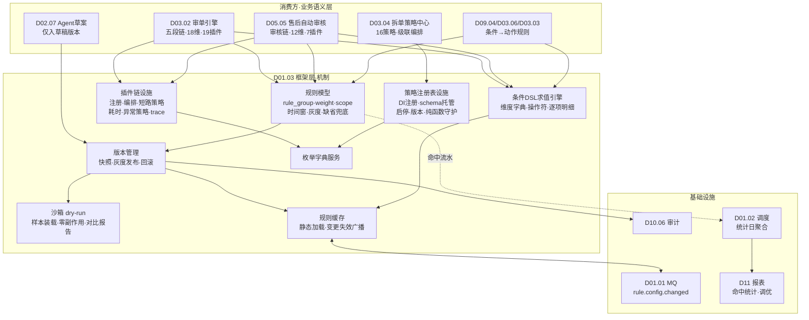
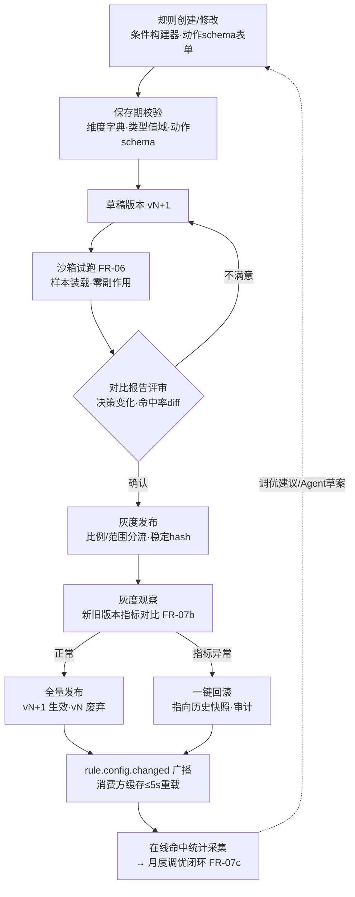
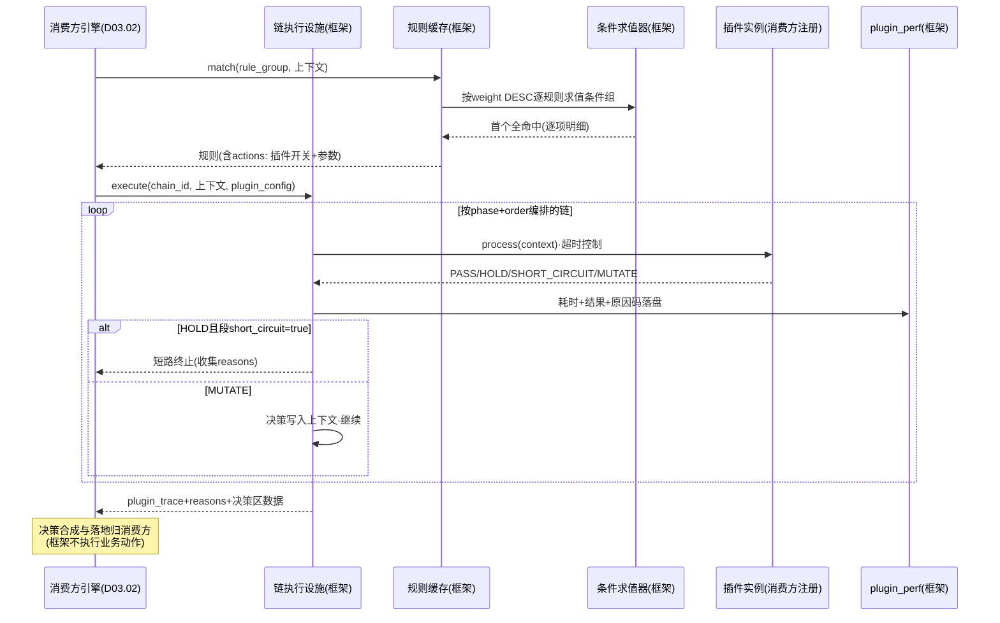

# SRS-D01.03 规则引擎基础框架 需求规格说明书

> 文档编号：SRS-D01.03 · 版本 V1.0 · 2026-10-24 · 编写：小凯 · 状态：待审阅（批次⑤）
> 所属域：D01 平台底座域 · 分期：**P0（M0-M1）** · schema：oms_base
> 上游依据：SRS-00 §3 D01 清单（商派 omeauto 机制的新栈实现）/ §4.2 框架支撑关系 · 逆向文档 05 §7.3（servicelist 多播扩展点）/ §7.4（services.xml 服务注册 → DI 标签）/ §7.5（dbeav EAV）/ §7.6（Lua 规则脚本）/ §7.7 重写建议 · 07 架构书 §4（审单插件链→责任链、拆单策略→DI 标签注册）
> 消费方契约（本框架为其服务，接口对齐以消费方 SRS 为准）：
> - SRS-D03.02 审单引擎：`AuditPluginInterface`/`PluginRegistry::register`（IF-D03.02-07）、五段链 ADMIT→WAREHOUSE→STOCK→LOGISTICS→CHECK、PluginResult=PASS/HOLD/SHORT_CIRCUIT/MUTATE、18 维条件、规则静态缓存+变更事件失效（FR-06b）、原因码字典登记（FR-04b）、dry-run 试算（FR-03c）
> - SRS-D03.04 拆单策略中心：`SplitStrategyRegistry::register/list/get`（IF-D03.04-04）、策略四接口（allocate/validateConfig/getSpecial/describe）、配置 schema 保存期校验、策略版本化与启停灰度（FR-01b/01e）
> - SRS-D05.05 售后自动审核：第二个插件链承载方（7 插件/12 维条件/灰度比例/风控压制）、决策记录同构模式、`AftersaleAuditPluginRegistry`（IF-D05.05-06）
> - SRS-D09.04 物流分单：区域路由「条件→动作」规则承载（FR-03a）· SRS-D03.06 配货分仓：「条件→仓序」规则（FR-02a）· SRS-D03.03 人工审单：分派规则同构承载（FR-02a）· SRS-D02.07：Agent 规则草案建议的正式发布流程（FR-06d）
> 定位：全系统「**条件→动作**」规则与「**插件链/策略注册表**」两大机制的公共框架。业务域定义规则语义与插件实现，本框架提供：规则模型与条件 DSL、求值引擎与缓存、插件链编排设施、策略注册表设施、版本管理与灰度、测试沙箱、命中统计。框架不含任何业务逻辑。

---

## 1. 模块概述

### 1.1 定位

商派把「规则」散落在三处机制：omeauto 审单规则（order_type 17 维分组条件+autoconfirm 动作）、lib/split 拆单策略注册表、services.xml servicelist 多播扩展点（逆向文档 05 §7.3/§7.4）——彼此不通用，售后域想复用审单规则机制时无从下手（商派售后自动化空白，D05.05 溯源）。凯淳把三者抽象为**一个框架的三件套**：

1. **规则模型**：规则=条件组（DSL）+动作+优先级+生效范围+时间窗+灰度，通用「条件→动作」配置实体，审单/售后审核/物流分单/配货分仓/人工分派五个消费方共用同一套模型与配置心智；
2. **插件链机制**：插件接口规范（上下文入参/决策出参/短路与阶段编排/耗时记录），链的注册、编排、执行设施——D03.02 五段审单链与 D05.05 审核链是两个实例；
3. **策略注册表机制**：策略接口规范+DI 标签注册+配置 schema 校验+版本化启停——D03.04 十六拆单策略是首个实例。

配套设施：规则版本管理（快照/灰度发布/回滚）、规则静态缓存与变更事件失效、**规则测试沙箱**（样本试跑，上线前验证必备）、枚举字典（原因码/决策码统一登记）、命中统计与调优数据。

### 1.2 职责边界

**做**：条件 DSL 的语法定义、存储结构与求值引擎；规则实体的通用模型（各域扩展动作语义）；插件链/策略注册表的框架设施（注册/发现/编排/耗时/异常策略钩子）；规则缓存与失效广播；规则版本化/灰度/回滚机制；沙箱试跑设施（dry-run 运行时：无副作用执行环境+样本装载协议）；枚举字典服务；命中统计采集与聚合。

**不做**：各域规则的业务语义（18 维审单条件的字段含义、拆单策略算法、售后决策合成矩阵——分别归 D03.02/D03.04/D05.05，框架只提供承载与求值）；决策落地执行（框架产出决策，调 audit/生成发货单等动作由消费方自己执行）；可视化条件构建器的前端实现（框架提供**数据契约**，前端按契约渲染，见 FR-02e）；复杂规则脚本语言（不做 Drools/Lua 通用脚本——商派 Lua 仅用于 Redis 库存原子操作而非规则表达，见溯源；凯淳规则=结构化 DSL，可解释可测试优于图灵完备）。

### 1.3 与其他模块关系

| 模块 | 关系 |
|---|---|
| D03.02 审单引擎 | 首个插件链承载方：五段链编排/规则匹配/缓存/原因码字典/dry-run |
| D03.04 拆单策略 | 策略注册表首个实例：16 策略 DI 注册/schema 校验/版本化 |
| D05.05 售后自动审核 | 第二个插件链承载方：同框架不同插件集与条件维度 |
| D03.03/D03.06/D09.04 | 「条件→动作」规则模型消费方（分派/仓序/物流路由） |
| D02.07 OpenAPI | Agent 规则草案（`rule.audit.suggest`）经本框架正式发布流程（人工评审）方可生效 |
| D01.01 MQ | 规则变更事件发布（`rule.config.changed`）驱动各域缓存失效 |
| D01.02 调度 | 命中统计日聚合任务 |
| D10.06 审计 | 规则变更（含灰度/回滚）全量审计 |
| D10.03 权限 | 规则配置权限点（各域规则 Owner 角色） |

---

## 2. 业务场景（消费方场景）

**SC-D01.03-01 审单插件链承载（D03.02）**
审单引擎启动时经本框架 `PluginRegistry` 发现全部已注册插件（19 个，各以 DI 标签注册），按五段 phase（ADMIT/WAREHOUSE/STOCK/LOGISTICS/CHECK）与段内 order 编排成链；规则匹配走框架条件求值引擎（18 维、weight DESC 首个命中、缺省兜底）；规则集启动全量加载进静态缓存，运营改规则 → 框架发布 `rule.config.changed` → 全部审单 worker 5s 内缓存失效重载（D03.02 AC-12 的机制承载）。

**SC-D01.03-02 拆单策略注册（D03.04）**
开发新增第 17 个拆单策略（如「按温层拆」）：实现 `SplitStrategy` 四接口 + `#[RuleStrategy('temp_zone')]` 标签注册 → 重启后策略出现在注册表（`describe` 元信息+config schema 自动进配置界面）→ 运营在拆单规则中即可选用，配置保存期经 `validateConfig` 校验——零引擎代码改动（D03.04 AC-14 的机制承载）。策略停用后引用规则保存报错、执行返回 STRATEGY_DISABLED（框架统一实现启停语义）。

**SC-D01.03-03 售后审核链复用（D05.05）**
售后自动审核以同一框架承载第二个插件链实例：注册 7 个审核插件（风控段短路+条件段不短路）、12 维条件规则、灰度比例（apply_id 尾号分流）——配置界面、缓存机制、dry-run 沙箱、命中统计全部复用，只有插件集与决策合成矩阵是 D05.05 自己的。「同一套框架、同一种配置心智、同一类决策留痕」（D05.05 §1.1）由此成立。

**SC-D01.03-04 规则上线前沙箱验证（全消费方）**
运营拟调整「美妆店铺-常规单」审单规则（大额阈值 1000→800）：保存为新版本草稿 → 沙箱选样本（近 7 天该店铺订单 2000 单，或手工构造边界样本）→ 试跑输出对比报告：命中规则变化 37 单（原通过现转人工）、无异常报错 → 确认无误后灰度发布（先 10% 流量）→ 观察命中率与通过率指标 1 天 → 全量。发现问题一键回滚上一版本（消费方缓存自动重载）。

**SC-D01.03-05 条件→动作规则承载（D09.04 物流分单）**
物流区域路由规则=条件（收货区域省市区/发货仓/店铺/重量段）→动作（物流商优先级序列）：规则实体、条件求值、缓存、版本管理全部走本框架，D09.04 只定义条件维度字典与动作结构。同类：D03.06 仓序规则、D03.03 分派规则（「与审单规则同构，D01.03 框架承载」——D03.03 FR-02a 原文）。

**SC-D01.03-06 Agent 规则草案的正式发布（D02.07 FR-06d）**
K-AIDE Agent 基于历史数据生成规则草案（DSL JSON）：草案只能进入本框架的「草稿版本」状态（沙箱可试跑、不生效）；人工评审（规则 Owner）通过后走正常灰度发布流程——Agent 建议与人工配置在同一版本管理轨道，无旁路生效通道。

---

## 3. 功能需求

### FR-D01.03-01 规则模型（通用「条件→动作」实体）
- FR-01a 规则实体通用结构（框架定义骨架，各域扩展动作语义）：

| 构件 | 说明 | 消费方实例 |
|---|---|---|
| rule_id / rule_name | 标识，租户内唯一 | 全域 |
| rule_group | 规则集归属（域+用途） | `order.audit`（18 维）/`aftersale.audit`（12 维）/`logistics.route`/`branch.route`/`audit.dispatch` |
| conditions | 条件组（DSL JSON，FR-02） | 各域维度字典不同 |
| weight | 优先级，DESC 排序首个全命中生效 | D03.02 FR-03b / D05.05 FR-01b 同款 |
| actions | 动作配置（JSON，结构由 rule_group 的 schema 定义） | 审单=autoConfirm+插件参数+路由表；拆单规则=策略链+config；物流=优先级序列 |
| scope | 生效范围（全局/租户/货主/店铺集） | SRS-00 货主维度契约 |
| effective_window / exclude_window | 生效/排除时段 | 大促停自动审单（D03.02 SC-07） |
| gray | 灰度配置（比例+分流键） | D05.05 FR-07（apply_id 尾号） |
| status / version | 启停/版本（FR-05） | 全域 |
| defaulted | 系统缺省规则标记（不可删不可停，兜底） | D03.02/D05.05 缺省转人工规则 |

- FR-01b 命中语义（框架统一实现，消费方声明匹配键）：规则集内按 weight DESC、同 weight 按 rule_id ASC 排序；对输入上下文逐条求值条件组，**首个全命中即返回**；无命中返回缺省规则；命中结果含 rule_id+version+快照引用（决策留痕依据）。
- FR-01c 动作 schema 注册：每个 rule_group 注册时声明 actions 的 JSON Schema（字段/类型/必填/枚举），规则保存期校验（同 D03.04 FR-02b「配置错误在保存期暴露」）；动作语义解释与执行归消费方。
- FR-01d 规则集管理：CRUD/启停/复制/批量启停；缺省规则保护（不可删/不可停/不可改动作兜底语义）；变更全部走版本机制（FR-05）+审计（D10.06）。

### FR-D01.03-02 条件 DSL（结构化、可解释、可视化友好）
- FR-02a 语法模型（两层：条件项 AND 组合，同维度多值 OR——对齐 D03.02 FR-03a 18 维/D05.05 FR-01a 12 维的既有约定）：

```json
{
  "logic": "AND",
  "items": [
    {"dim": "order.amount_paid", "op": "gte", "value": 1000},
    {"dim": "shop_id", "op": "in", "value": [101, 102, 103]},
    {"dim": "order.receiver_province", "op": "not_in", "value": ["新疆", "西藏"]},
    {"dim": "order.items.category", "op": "any_in", "value": ["美妆"]}
  ]
}
```

- FR-02b 操作符字典（框架统一，按值类型分组）：数值=eq/neq/gt/gte/lt/lte/between；集合=in/not_in/any_in（明细行任一命中）/all_in；字符串=eq/neq/contains/starts_with/regex（regex 保存期校验+执行超时保护）；布尔=is_true/is_false；空值=is_null/not_null；时间=in_window（时段）/before/after。
- FR-02c 维度字典注册：每个 rule_group 注册可用维度（dim 键/值类型/取值来源——枚举字典或档案服务如店铺列表/字段路径说明）；条件保存期校验维度合法、类型匹配、值域有效（引用档案的校验存在性）；**维度取值由消费方在上下文装载时注入**（框架不查库——求值纯内存，性能与纯函数保障，同 D03.04 FR-02c 思想）。
- FR-02d 求值引擎：上下文（Key-Value 数据袋）+条件组 → 命中/未命中+逐项求值明细（哪一项不命中、实际值是什么——dry-run 报告与排障的数据源）；求值性能：单规则 20 条件项 ≤1ms（纯内存）；短路求值（首项不命中即止，明细模式除外）。
- FR-02e 可视化条件构建器数据契约（前端按此渲染，框架保证后端语义一致）：`GET /rule-meta/{rule_group}/dims` 返回维度字典（分组/值类型/操作符候选/枚举值或档案数据源 URL）；前端产出=FR-02a JSON；**DSL JSON 是唯一存储与交换格式**（构建器只是编辑器，不产生第二套语法）。
- FR-02f 明确不做：跨维度运算表达式（金额/件数 类计算维度由消费方预计算注入）、嵌套 OR/AND 多层逻辑（两层足够覆盖五个消费方全部既有规则；复杂场景=消费方拆多条规则或注入预计算维度——保持 DSL 简单可解释）。

### FR-D01.03-03 插件链机制（承载 D03.02 五段链与 D05.05 审核链）
- FR-03a 插件接口规范（框架基接口，消费方特化——D03.02 `AuditPluginInterface`/D05.05 `AftersaleAuditPluginInterface` 均实现之）：

```
interface RulePluginInterface:
    name(): string                    # 插件唯一名
    phase(): string                   # 阶段标识(消费方定义段序, 如五段/风控段)
    order(): int                      # 段内顺序
    process(RuleContext): PluginResult
PluginResult = PASS | HOLD(reasons[]) | SHORT_CIRCUIT(reasons[]) | MUTATE(context变更)
reasons[] = {plugin, code(枚举字典), level(BLOCK/WARN), description, detail(JSON), suggest_action}
```

- FR-03b 链注册与发现：插件以 DI 标签注册（`#[RulePlugin(chain: 'order.audit')]`），chain_id 隔离不同消费方的链（`order.audit`/`aftersale.audit`）；新增插件=实现接口+注册，不改消费方引擎代码（D03.02 AC-13 机制承载）；注册表提供 `list(chain)/get(chain,name)` 查询。
- FR-03c 链编排设施：按 phase 声明顺序（消费方注册 phase 序，如 D03.02 五段固定）+段内 order 排序成链；段间依赖固定不可调、段内可插拔（对齐 D03.02 FR-01b）；开关与参数注入（规则 actions 中的 plugin_config 逐插件启停/传参——框架装载，插件消费）。
- FR-03d 执行设施（框架统一实现，消费方声明策略）：
  - 短路策略按段声明（`short_circuit: true/false`——D03.02 CHECK 段不短路全收集/D05.05 风控段短路，均为配置而非代码）；
  - 每插件耗时记录（plugin_perf：chain/插件/耗时/结果/原因码，统一落库供 TOP 慢插件分析——D03.02 FR-01e、D05.05 FR-02e 的公共实现）；
  - 异常策略按链声明：strict（异常=整链 HOLD 转人工，D05.05 唯一模式）/dual（严格+宽松可逐插件配，D03.02 FR-01f）；异常必留痕（错误摘要入 reasons）；
  - 单插件超时控制（默认 500ms，可按插件声明；超时按异常策略处理）。
- FR-03e 上下文协议（RuleContext）：消费方装载只读数据袋（订单快照/申请单/风控画像…）；MUTATE 结果写入上下文决策区（选仓结果/拆单方案引用）；框架保证上下文在链内单向传递、插件间通过上下文协作不直接互调；上下文含 dry_run 标记（沙箱模式全链禁写，FR-06）。
- FR-03f 链执行留痕：整链执行产出 plugin_trace JSON（各插件输入摘要/输出/耗时/结果——D03.02 plan 溯源与 D05.05 决策记录的公共数据源），由消费方决定持久化位置。

### FR-D01.03-04 策略注册表机制（承载 D03.04 十六拆单策略）
- FR-04a 策略接口规范（框架基接口，D03.04 `SplitStrategy` 为其特化——四接口 allocate/validateConfig/getSpecial/describe 语义由 D03.04 FR-02a 定义，框架提供注册与生命周期设施）：

```
interface RuleStrategyInterface:
    type(): string                    # 策略类型码, 注册表内唯一(split_type)
    describe(): {name, description, config_schema(JSON Schema), version}
    validateConfig(config): bool + errors[]
    # 执行方法签名由消费方链定义(拆单=allocate), 框架不约束
```

- FR-04b 注册机制：DI 标签注册（`#[RuleStrategy(registry: 'split', type: 'owner')]`），registry_id 隔离不同策略族（split/后续可扩展如「赠品策略」「分仓策略」）；注册项=类型码+元信息+config schema+启停状态+版本号；`RegistryService::register/list/get(type)` 对齐 D03.04 IF-D03.04-04。
- FR-04c 生命周期语义（框架统一）：策略停用 → 引用它的规则保存报错（保存期校验）+执行时返回 STRATEGY_DISABLED（明确错误码，D03.04 §5.6）；策略升级（version 变更）→ 规则引用记录版本，历史决策按当时版本回放（rule_snapshot 机制，FR-05c）；新策略上线 → 经规则 scope/gray 实现按店铺灰度（D03.04 FR-01e）。
- FR-04d 配置 schema 服务：策略 describe 的 config_schema 统一托管，供规则配置界面动态渲染表单（前端契约同 FR-02e）+保存期校验；schema 变更需升策略版本（向后兼容校验：新版 schema 必须能解析旧版配置，否则强制迁移脚本登记）。
- FR-04e 纯函数约束（框架级守护）：策略执行在沙箱化上下文（只读数据袋注入，禁止策略内查库——D03.04 FR-02c）；dry_run 模式下框架拦截一切写操作尝试（DB/Redis/MQ 代理层校验，违例抛异常并记录）。

### FR-D01.03-05 规则版本管理（版本化/灰度发布/回滚）
- FR-05a 版本模型：规则每次变更生成新版本（version 递增，旧版本只读留存）；版本状态机：草稿→待发布→灰度中→已生效→已废弃/已回滚；同规则同时只有一个「已生效」版本+至多一个「灰度中」版本。
- FR-05b 灰度发布：灰度维度=流量比例（分流键由 rule_group 声明：order_id/apply_id 尾号 hash，稳定分流——D05.05 FR-07a 同款）或范围灰度（店铺集）；灰度期新旧版本并行生效（按分流命中），指标对比（新旧版本命中率/通过率/决策分布）；一键全量或一键回滚。
- FR-05c 版本快照：生效版本全量快照（条件+动作+维度值引用固化）落 `rule_version_snapshot`——决策留痕引用 snapshot_id（D03.02 plan.rule_snapshot_id/D05.05 decision.rule_version_snapshot 的数据源），保证「为什么当时这么判」可完整回放，不受后续变更影响。
- FR-05d 回滚：回滚=将目标历史版本置为新的生效版本（生成新 version 指向旧快照，版本链只进不改）；回滚即时广播缓存失效；回滚需权限点+审计（高危操作）。
- FR-05e 变更审计：全部版本操作（创建/发布/灰度/全量/回滚/停用）写 D10.06（变更前后快照 diff、操作人、原因备注必填）。

### FR-D01.03-06 规则测试沙箱（上线前验证必备）
- FR-06a 样本装载协议：消费方为 rule_group 注册样本装载器（`SampleLoader: load(样本引用) → RuleContext 只读快照`——审单=按订单号装载历史订单快照；售后=按申请单号）；样本来源：指定业务单号/按条件圈选历史数据（店铺+时间段，上限可配默认 5000）/手工构造（表单造数，边界场景）。
- FR-06b dry-run 执行：指定规则版本（草稿/灰度/任意历史版）对样本试跑完整链路（规则匹配+插件链/策略执行）；**零副作用铁律**：dry_run 标记贯穿上下文，框架代理层拦截全部写操作（DB/Redis/MQ），插件/策略的写尝试即违例异常（FR-04e）；不调用外部系统（外部依赖以快照数据替代，装载器负责）。
- FR-06c 试跑报告：逐样本决策结果+逐项求值明细（FR-02d）+插件 trace；**对比模式**（新版 vs 当前生效版）：决策变化清单（哪些样本从通过变拦截、原因差异）、命中率变化、异常清单——D03.02 FR-03c 试算器与 D05.05 FR-01e batchReplay 一致率报告的公共实现。
- FR-06d 沙箱性能隔离：批量试跑走 D01.01 异步任务（不占在线资源）；单样本试跑同步（配置界面即时反馈，P95 ≤2s）；试跑历史留存（谁/何时/哪个版本/样本集/报告摘要）供发布评审引用。
- FR-06e 发布联动（建议非强制）：灰度发布前系统提示「未做沙箱验证」（软约束记录）；Agent 草案（D02.07）必须附沙箱报告才允许提交人工评审（硬约束）。

### FR-D01.03-07 规则命中统计与调优数据
- FR-07a 命中采集：每次规则匹配（在线执行）异步上报命中流水（rule_group/rule_id/version/分流键/命中与否/决策摘要/耗时——经 D01.01 best-effort 事件，不阻塞决策热路径）。
- FR-07b 聚合指标（日聚合，D01.02 任务）：按规则×版本——命中量/命中率/决策分布（通过/拦截/转人工）/平均耗时；按 rule_group——缺省规则兜底命中率（**过高=规则覆盖不足的信号**）、无命中流失分布；灰度期新旧版本指标对比视图（FR-05b 数据源）。
- FR-07c 调优数据服务：规则维度命中趋势（某规则命中骤降=业务变化或配置被覆盖的信号）；条件维度覆盖分析（哪些维度组合从未命中——冗余规则识别）；数据供 D11 报表与规则 Owner 月度调优（D05.05 SC-07 改判率联动的数据基础）。
- FR-07d 插件级统计：plugin_perf 聚合（按 chain×插件：调用量/耗时 P95/失败率/HOLD 率——TOP 慢插件与高拦截插件分析，D03.02 FR-06c 同源）。

### FR-D01.03-08 枚举字典服务（原因码/决策码统一登记）
- FR-08a 字典模型：字典类型（`audit_reason_code`/`aftersale_reason_code`/`decision_code`/`suggest_action`…）→ 字典项（code/名称/描述/级别/扩展属性 JSON——如原因码绑定默认路由与审核组建议，D03.02 FR-04b）；租户级可扩展（系统预置项不可删）。
- FR-08b 服务能力：注册（消费方代码启动时同步预置项）/查询（带缓存）/校验（规则配置与插件产出的 code 必须在字典内——保存期与运行期双校验）；**字典可扩展不发版**（后台增项即生效，D03.02 FR-04b 原文承载）。
- FR-08c 字典变更审计与失效广播（缓存重载）。

### FR-D01.03-09 规则缓存机制（静态缓存+变更失效，全消费方共用）
- FR-09a 缓存模式：进程内静态缓存（Swoole 常驻内存天然适配）：启动全量加载 rule_group 生效规则集+字典；求值走内存零 DB 交互（D03.02 FR-06b/D05.05 §5.5 同款机制的公共实现）。
- FR-09b 失效广播：规则/字典任何变更 → 发布 `rule.config.changed`（rule_group+version，经 D01.01）→ 各消费方 worker 订阅后增量重载；全量生效 ≤5s（D03.02 AC-12 SLA）；广播丢失兜底=缓存 TTL 60s 被动过期核对版本号。
- FR-09c 降级：缓存加载失败/版本核对异常 → 降级实时查库（限流保护 DB）+告警（D03.02 §8「规则缓存故障降级实时查库」同款）。

---

## 4. 业务流程

### 4.1 规则引擎分层架构



### 4.2 规则生命周期流程（配置→沙箱→灰度→全量/回滚）



### 4.3 插件链执行时序（框架设施视角，以审单链为例）



---

## 5. 处理逻辑

### 5.1 条件求值算法（框架核心）

```
evaluate(condGroup, context, detailMode=false):
    results = []
    for item in condGroup.items:                    # 两层模型: items 全 AND
        dimDef = DimDict.get(condGroup.rule_group, item.dim)   # 维度字典(注册期校验过)
        actual = context.get(item.dim)              # 消费方装载注入, 框架不查库
        hit = OPS[dimDef.type][item.op](actual, item.value)    # 操作符字典分派
        if detailMode: results += {item, actual, hit}          # 逐项明细(沙箱/排障)
        if not hit and not detailMode: return MISS             # 短路求值
    return (HIT, results) if all hit else (MISS, results)

match(rule_group, context):
    for rule in Cache.sortedRules(rule_group):      # weight DESC, rule_id ASC
        if rule.scope.contains(context) and rule.window.allows(now)
           and rule.gray.hit(context.分流键):
            r = evaluate(rule.conditions, context)
            if r == HIT: return {rule, version, snapshot_id, 求值明细}
    return DEFAULT_RULE(rule_group)                 # 缺省兜底(不可删)
```

### 5.2 链执行算法（短路策略配置化）

```
executeChain(chain_id, context, plugin_config):
    trace = []; reasons = []
    for plugin in Registry.chain(chain_id):         # phase序+段内order
        cfg = plugin_config[plugin.name] ?? 全局默认
        if not cfg.enabled: continue
        t0 = now()
        try:
            result = withTimeout(cfg.timeout ?? 500ms,
                        () -> plugin.process(context.with(cfg.params)))
        except e:
            result = 异常策略(context.chain):        # strict→HOLD(系统异常码)
                strict: HOLD([SYSTEM_ERROR])         # dual且插件声明宽松: 跳过+告警
        perf_log(chain_id, plugin, now()-t0, result) # FR-03d 统一耗时
        trace += {plugin, 输入摘要, result, cost}
        if result.type in (HOLD, SHORT_CIRCUIT):
            reasons += result.reasons
            if phaseOf(plugin).short_circuit: break  # 段级配置: CHECK段false全收集
        if result.type == MUTATE: context.decisions.merge(result.data)
    return {trace, reasons, decisions: context.decisions}
```

### 5.3 版本-灰度-快照一致性

```
发布路径: 草稿(可沙箱) → 灰度(分流命中走新版) → 全量(唯一生效版)
分流: hit = hash(分流键) % 100 < gray.ratio      # 稳定分流(同键同路径)
决策留痕: decision.rule_version_snapshot = snapshot_id(生效/灰度命中版本)
回放: replay(snapshot_id, 历史上下文快照) → 与当时决策一致(版本不可变保证)
回滚: 新建 version 指向历史 snapshot(版本链只追加); 灰度中版本回滚=废弃该版本
一致性: 缓存重载原子切换(双 buffer), 单条决策内规则版本恒定(不跨版本混用)
```

### 5.4 沙箱零副作用守护

```
dry_run 上下文 → 框架注入代理层:
    DB连接 = 只读会话(写SQL拦截抛 DryRunViolation)
    Redis  = 读透传/写拦截
    MQ     = publish 记录到报告不真发
    外部HTTP = 拒绝(样本装载器提供快照替代)
违例记录入试跑报告「副作用尝试」清单(插件违规证据, 治理依据)
批量沙箱 = D01.01 异步任务运行, 与在线链路资源隔离
```

### 5.5 框架与消费方的责任分界（防机制漂移）

| 责任 | 框架（D01.03） | 消费方（D03.02/D05.05/D03.04…） |
|---|---|---|
| 规则存储/版本/灰度/缓存 | ✅ | 引用 snapshot_id 留痕 |
| 条件 DSL 求值 | ✅ | 维度字典定义+上下文装载 |
| 插件注册/编排/耗时/异常/短路 | ✅ 设施 | 插件实现+段序语义+决策合成 |
| 策略注册/schema 托管/启停 | ✅ | 策略算法+validateConfig 逻辑 |
| dry-run 运行时+副作用守护 | ✅ | 样本装载器+外部依赖快照 |
| 决策落地（audit/发货单/回传） | ❌ 不碰 | ✅ 全部 |
| 命中统计采集/聚合 | ✅ | 报表口径解释与调优动作 |

---

## 6. 数据字段（业务字段描述，schema：oms_base）

### 6.1 规则主表（rule）与版本（rule_version / rule_version_snapshot）

| 字段 | 业务含义 | 取值/校验 |
|---|---|---|
| rule_id / rule_name / rule_group | 标识与规则集 | 组内名称唯一 |
| current_version / gray_version | 生效/灰度版本指针 | 版本状态机 FR-05a |
| conditions | 条件组 DSL | FR-02a JSON（保存期校验） |
| actions | 动作配置 | 按 rule_group 注册 schema 校验 |
| weight / scope / windows / gray | 优先级/范围/时段/灰度 | FR-01a |
| status / defaulted | 启停/缺省标记 | 缺省规则保护 |
| ——版本快照—— | | |
| snapshot_id / rule_id / version | 快照标识 | 不可变只追加 |
| content | 规则全量固化 JSON | 条件+动作+维度值引用 |
| publish_type / operator / publish_time / note | 发布方式/人/时间/备注 | 审计必填 |

### 6.2 插件与策略注册表（rule_plugin / rule_strategy，代码注册同步 DB 镜像）

| 字段 | 业务含义 |
|---|---|
| chain_id / plugin_name / phase / phase_order | 链归属与编排位置 |
| enabled / timeout_ms / error_policy | 启停/超时/异常策略（全局默认，规则级可覆盖） |
| version / class_ref | 插件版本与实现类（DI 定位） |
| ——策略—— | |
| registry_id / strategy_type / name / description | 策略族与元信息 |
| config_schema / version / status | 配置 schema（托管）/版本/启停（FR-04c 语义） |

### 6.3 维度字典（rule_dim_dict）与枚举字典（rule_enum_dict）

| 字段 | 业务含义 |
|---|---|
| rule_group / dim_key / dim_name | 维度归属与标识 |
| value_type / ops_allowed | 值类型/允许操作符（FR-02b 子集） |
| value_source | 取值来源：枚举字典 ID / 档案服务 URL / 自由输入 |
| ——枚举—— | |
| dict_type / code / name / level / ext_json | 字典项（原因码含级别+默认路由扩展属性） |
| preset_flag / tenant_id | 系统预置（不可删）/租户扩展 |

### 6.4 命中流水与统计（rule_hit_log 按月分区 / rule_hit_stat 日聚合 / rule_plugin_perf）

| 字段 | 业务含义 |
|---|---|
| rule_group / rule_id / version / snapshot_id | 命中定位（含灰度版本区分） |
| biz_key /分流键 / hit | 业务键（order_id/apply_id）与命中与否（含缺省兜底标记） |
| decision_digest / cost_ms / create_time | 决策摘要/求值耗时/时间 |
| ——perf—— | |
| chain_id / plugin_name / biz_key / cost_ms / result / reason_codes | 插件级耗时与结果（FR-07d 聚合源） |

### 6.5 沙箱试跑记录（rule_sandbox_run）

| 字段 | 业务含义 |
|---|---|
| run_id / rule_group / version | 试跑对象（草稿/灰度/历史版本） |
| sample_source / sample_count | 样本来源（单号集/圈选条件/手工）与量 |
| mode | 单跑/对比（vs 当前生效版） |
| report_ref / change_summary | 报告存储引用（OSS）/变化摘要（决策变化数/命中率diff/异常数/副作用尝试数） |
| operator / create_time | 发起人（发布评审引用依据） |

---

## 7. 接口

### 7.1 内部接口（本模块提供）

| 编号 | 接口 | 消费方 | 说明 |
|---|---|---|---|
| IF-D01.03-01 | `RuleMatchService::match(rule_group, context)` → {rule, version, snapshot_id, 明细} | D03.02/D05.05/D03.03/D03.06/D09.04 | 规则匹配统一入口（缓存热路径） |
| IF-D01.03-02 | `RuleService::save/validate/publish/gray/rollback/disable` | 各域规则配置后台 | 规则生命周期管理（版本+审计） |
| IF-D01.03-03 | `PluginRegistry::register/list(chain)/get(chain,name)`；链执行设施 `ChainExecutor::execute(chain_id, context, plugin_config)` | D03.02（IF-D03.02-07）/D05.05（IF-D05.05-06） | 插件链承载（对齐消费方既有接口编号） |
| IF-D01.03-04 | `StrategyRegistry::register/list/get(type)` + schema 托管 | D03.04（IF-D03.04-04） | 策略注册表承载 |
| IF-D01.03-05 | `EnumDictService::get(dict_type)/register(items)/validate(code)` | 全域（原因码/决策码） | 枚举字典（可扩展不发版） |
| IF-D01.03-06 | `SandboxService::dryRun(rule_group, version, 样本)` / `compare(vNew, vCurrent, 样本集)` | 规则配置界面/D03.02 dryRun/D05.05 batchReplay/D02.07 | 沙箱试跑与对比报告（零副作用） |
| IF-D01.03-07 | `RuleStatService::hitStat(rule_group, 维度)` / `pluginPerf(chain)` | D11/规则 Owner | 命中统计与调优数据 |
| IF-D01.03-08 | 事件 `rule.config.changed`（rule_group/version）；订阅 `rule.hit.reported`（自消费聚合） | 全消费方 worker（缓存失效）/D01.01 | 变更广播与统计通道 |
| IF-D01.03-09 | `RuleMetaService::dims(rule_group)` / `strategySchema(registry, type)` | 前端条件构建器/动态表单 | 可视化数据契约（FR-02e/04d） |

### 7.2 依赖接口

| 编号 | 接口 | 提供方 | 说明 |
|---|---|---|---|
| IF-D01.03-D1 | 事件发布/异步任务 | D01.01（IF-D01.01-02/03） | 变更广播、命中流水、批量沙箱 |
| IF-D01.03-D2 | 统计日聚合调度 | D01.02 | FR-07b 聚合任务 |
| IF-D01.03-D3 | 规则/字典/版本变更审计 | D10.06 | 全量留痕 |
| IF-D01.03-D4 | 规则配置权限点 | D10.03/D10.02 | 各域规则 Owner 角色 |
| IF-D01.03-D5 | 样本快照数据（订单/申请单历史快照） | D03.02/D05.05 等消费方装载器 | 沙箱样本来源（框架只定协议） |

### 7.3 外部接口

无直接外部接口（D02.07 Agent 草案经 OpenAPI 调本框架 IF-02/IF-06，非本模块对外暴露）。

---

## 8. 非功能需求

| 项 | 要求 |
|---|---|
| 性能 | 规则匹配（缓存路径，50 规则×20 条件项）P99 ≤5ms；插件链框架开销（编排+perf 记录）单链 ≤2ms（不含插件业务耗时）；支撑审单 500 单/分钟+售后 200 单/分钟热路径 |
| 缓存 | 变更广播全 worker 生效 ≤5s（D03.02 AC-12）；TTL 60s 兜底核对；降级实时查库带限流 |
| 一致性 | 单条决策内规则版本恒定（双 buffer 原子切换）；快照不可变（回放一致性的根基）；版本链只追加 |
| 零副作用 | 沙箱 dry-run 写操作 100% 拦截（DB/Redis/MQ/HTTP 四层代理守护）；违例必留痕 |
| 可扩展 | 新 rule_group/新链/新策略族零框架改动（注册即承载）；操作符与维度类型可扩展登记 |
| 可观测 | 命中/耗时/失败三组指标上报 D11.03；缓存失效延迟、沙箱违例、字典校验失败告警（D01.07） |
| 安全 | 规则/字典/版本变更全审计；灰度发布与回滚为高危权限点；regex 操作符 ReDoS 防护（复杂度校验+执行超时）；Agent 草案无旁路生效通道（FR-06e） |
| 容量 | 规则总量 ≤5000 条（5 组×千级）；版本快照随规则变更增长（月均 ≈500 版本，永久留存）；命中流水日均 ≈10 万条按月分区在线 3 个月（聚合后归档）；plugin_perf 日均 40 万条（与 D03.02 §8 容量口径一致） |

---

## 9. 验收标准

| 编号 | 验收条件 |
|---|---|
| AC-01 | 规则匹配语义：同 rule_group 三条规则（weight 30/20/10）构造上下文仅 weight=20 全命中 → 返回该规则+snapshot_id+逐项求值明细；无命中返回缺省规则；weight 相同按 rule_id ASC 稳定命中 |
| AC-02 | 条件 DSL：数值/集合/字符串/布尔/时间五类操作符全量单测通过；维度类型不匹配、值域越界、未注册维度的规则保存被拒（保存期校验）；any_in 对明细行集合语义正确（任一行命中即真） |
| AC-03 | 插件链承载双实例：D03.02 五段链与 D05.05 七插件链同框架并行运行互不干扰（chain_id 隔离）；段级短路策略配置生效（审单 CHECK 段全收集、售后风控段短路）；新插件 DI 注册后不改引擎代码即入链（对齐 D03.02 AC-13） |
| AC-04 | 策略注册表：模拟注册第 17 个拆单策略，describe/config_schema 自动进配置界面；停用策略后引用规则保存报错+执行返回 STRATEGY_DISABLED（对齐 D03.04 AC-14）；策略升版本后历史决策按旧快照回放结果一致 |
| AC-05 | 版本-灰度-回滚：规则 v2 灰度 10%（order_id 尾号稳定分流——同单重复匹配路径一致）；灰度期新旧版本指标对比可查；一键回滚后 5s 内全 worker 生效 v1，版本链完整（v2 状态=已回滚，审计含 diff 与备注） |
| AC-06 | 快照回放：任一历史决策按 snapshot_id+当时上下文重放，匹配结果与留痕一致（规则后续变更不影响回放）；快照不可变验证（直接改库被版本校验检出） |
| AC-07 | 沙箱零副作用：dry-run 中注入「尝试写 DB/发 MQ/调外部 HTTP」的违规插件，四层代理全部拦截且违例入报告；单样本试跑 P95 ≤2s；5000 样本批量对比走异步任务完成并产出决策变化清单+命中率 diff |
| AC-08 | 沙箱对比报告：新版规则（大额阈值 1000→800）对 2000 历史样本试跑，报告准确列出决策变化样本（原通过现拦截 37 单）与逐项原因；报告被发布评审引用留痕 |
| AC-09 | 缓存机制：规则变更后 `rule.config.changed` 广播，全消费方 worker ≤5s 重载（对齐 D03.02 AC-12）；kill MQ 后 TTL 60s 兜底核对版本最终一致；缓存加载失败降级实时查库+限流+告警 |
| AC-10 | 枚举字典：后台新增原因码字典项不发版即生效（规则配置可选、插件产出可校验）；插件产出未登记 code 被运行期校验拦截留痕；系统预置项删除被拒 |
| AC-11 | 命中统计：在线匹配异步上报不阻塞热路径（对比开关上报的性能损耗 ≤1ms）；日聚合后按规则查命中率/决策分布/耗时，缺省规则兜底命中率指标可用（规则覆盖度信号） |
| AC-12 | Agent 草案流程：D02.07 提交的规则草案仅落草稿版本（在线匹配不可见）；未附沙箱报告提交评审被拒；评审通过走正常灰度发布（无旁路生效通道验证） |

---

## 变更记录

| 日期 | 版本 | 变更 | 原因 |
|---|---|---|---|
| 2026-10-24 | V1.0 | 首版 | — |

---

*参考实现溯源：商派规则相关机制散落三处——① omeauto 审单规则：`sdb_omeauto_order_type`（17 维分组条件 LEFT JOIN autoconfirm，weight DESC 首命中+缺省兜底、confirmStartTime/excludeStartTime 时间窗，逆向文档 02 §6）+ 23 插件位硬编码链（omeauto_auto_group::getPluginNames，无注册表——加插件=改内核代码）+ auto_status 位标记；② lib/split 策略注册：`omeauto_mdl_order_split::$split_type` 静态数组注册表 + abstract.php 四抽象方法（getSpecial/preSaveSdf/splitOrder——preSaveSdf 即保存期校验思想来源）；③ services.xml servicelist 多播（`kernel::servicelist('autotask'/'service.refund'/'desktop_finder.{model}')` 同 id 多注册遍历调用——DI 标签注册的机制原型，逆向文档 05 §7.4）；④ dbeav EAV 元数据扩展（meta_register+分类型值表——「注册即扩展」心智，但 EAV 存储被凯淳 JSON 列+schema 校验替代，逆向文档 05 §7.5）；⑤ Lua 脚本仅用于 Redis 库存原子操作（逆向文档 05 §7.6），商派规则表达从未走通用脚本语言——凯淳同理选择结构化 DSL 而非 Drools/Lua（可解释/可测试/可视化优于图灵完备）。重写差异：① 三处机制抽象为一个框架三件套（规则模型/插件链/策略注册表），五个消费方共用（商派售后域无法复用审单机制的空白由 D05.05 补齐）；② 插件链从硬编码升级为 chain_id 注册表+段级短路策略配置化；③ 新增规则版本管理+快照固化+灰度发布+回滚（商派规则改配置即生效无版本无灰度，误配置=生产事故）；④ 新增沙箱 dry-run 四层副作用守护+对比报告（商派无试算能力，规则验证靠生产试错）；⑤ 新增命中统计与调优数据闭环（商派仅有 batch_log，无规则维度运营数据）；⑥ 位标记→结构化原因（枚举字典统一登记，D03.02 FR-04b 承载）；⑦ 条件 DSL 显式两层模型+维度字典+操作符字典（商派 17 维条件硬编码在 SQL 拼接，加维度=改代码）；⑧ Agent 草案纳入版本轨道（商派无此场景，凯淳 K-AIDE 集成的安全边界）。*
