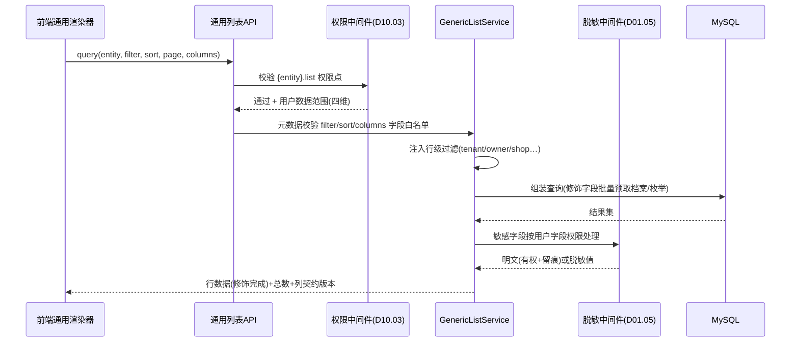

# SRS-D01.04 元数据驱动 CRUD 基础 需求规格说明书

> 文档编号：SRS-D01.04 · 版本 V1.0 · 2026-10-24 · 编写：小凯 · 状态：待审阅（批次⑤）
> 所属域：D01 平台底座域 · 分期：**P0（M0-M1）** · schema：oms_base
> 上游依据：SRS-00 §3 D01 清单（商派 dbschema DSL 思想）· 逆向文档 05 §7.0（ECOS 三件套：app.xml/dbschema/desktop.xml，安装自动建表、菜单权限声明）/ §7.4（`desktop_finder.{model}` 列表渲染器扩展点）/ §7.5（dbeav modifier 列修饰器）/ §7.7 重写建议 · 07 架构书 §4（元数据驱动 CRUD：Hyperf 注解 + 前端 schema 渲染，不绑定 PHP DSL）
> 消费方契约：SRS-D04.01（物料/条码/品牌档案页面）· SRS-D02.06（店铺档案）· SRS-D09.01（仓库档案与能力矩阵，IF-D09.01-D4 配置导入导出联动 D01.06）· SRS-D06.02 FR-08a（采购单打印模板可配置引用「D01.04 元数据」）· D10.03（权限点声明与行级过滤注入）· 全部配置类/档案类后台页面
> 定位：以**实体元数据**（字段/类型/枚举/校验/列表列/筛选器/权限点声明）为单一事实源，驱动后台**通用列表、通用表单、通用导出**的服务端能力与前端渲染契约。目标是配置类/档案类页面（预估 60% 后台页面）零前端定制开发；复杂业务界面（审单工作台/核销工作台等）**不走**本机制。

---

## 1. 模块概述

### 1.1 定位

商派 ECOS 用「dbschema PHP 数组定义表 + desktop.xml 声明菜单权限 + `desktop_finder.{model}` 渲染器扩展点 + dbeav modifier 列修饰」四件套实现「加模块=加声明文件，后台界面自动长出」（逆向文档 05 §7.0/§7.4/§7.5）。凯淳继承该思想、实现换新栈（07 架构书 §4）：实体元数据以 **PHP 注解 + 配置**声明（Hyperf 注解扫描），服务端提供元数据注册中心与通用 CRUD 服务，前端按**元数据契约**（schema JSON）通用渲染列表/表单/筛选器——不绑定任何 PHP DSL 到前端。

### 1.2 职责边界

**做**：实体元数据模型与注册（注解声明/扫描/版本化）、通用列表服务（查询/筛选/排序/分页/列配置的元数据驱动生成）、通用表单服务（字段渲染契约+服务端校验）、通用详情/删除（含软删与回收站语义）、与 D10.03 权限点/行级过滤的接线、与 D01.06 导入导出的接线（元数据驱动模板生成）、枚举与档案引用的统一取值服务、元数据变更管理（版本/兼容检查）。

**不做**：复杂业务界面（审单工作台 D03.03、核销工作台 D08.03、打印批次 D09.05 等定制页面——只消费本模块的字段元数据做局部渲染，不走通用 CRUD 骨架）；业务写逻辑（通用 CRUD 只覆盖标准增删改查；含状态机/联动/事务编排的保存动作由各域自定义服务实现，本模块提供「自定义动作挂接点」）；前端组件库实现（本模块定义渲染契约，前端通用渲染器按契约实现，属前端工程范畴）；物理建表（DDL 归 DB-Dxx 数据字典与迁移文件；元数据描述既有表，不生成表——与商派「dbschema 安装自动建表」的关键差异，见溯源）。

### 1.3 与其他模块关系

| 模块 | 关系 |
|---|---|
| 全部域的配置/档案页面 | 通用列表/表单/导出能力的消费方（物料、店铺、仓库、品牌、物流公司、供应商、字典…） |
| D10.02/D10.03 | 权限点由元数据声明自动生成注册；列表查询统一注入租户/货主/店铺行级过滤 |
| D10.06 审计 | 通用 CRUD 写操作自动接操作日志（字段级旧值新值） |
| D01.05 PIPL | 字段元数据含敏感级别声明，通用列表/表单/导出按级别自动脱敏 |
| D01.06 导入导出 | 导入模板/校验规则/导出列由元数据驱动生成（D01.06 FR 消费本模块契约） |
| D01.03 | 枚举字典与 D01.03 枚举服务同源（避免两套字典） |
| 前端 | 元数据契约（schema JSON）的唯一消费方，通用渲染器按契约工作 |

---

## 2. 业务场景（消费方场景）

**SC-D01.04-01 档案页面零前端开发（D04.01 品牌/条码）**
开发新增「品牌档案」管理页：在 Brand 实体类上以注解声明字段元数据（名称/英文名/归属货主-档案引用/状态枚举/列表列/筛选器/权限点）→ 重启扫描注册 → 后台自动出现：品牌列表页（列/筛选/排序/分页/列配置）、新建/编辑表单（控件类型/必填/长度校验自动渲染）、导出按钮（D01.06）。前端零代码。预估 60% 后台页面（各域配置类/档案类）按此模式交付。

**SC-D01.04-02 店铺档案（D02.06）——通用 CRUD + 自定义动作挂接**
店铺档案列表/编辑走通用 CRUD（平台类型枚举、货主档案引用、状态列筛选）；但「发起授权」「停用店铺」是含编排的业务动作（OAuth URL 生成、状态联动暂停拉单）——以**自定义动作**挂接（元数据声明 action → 路由到 D02.06 自己的服务方法），通用界面长出按钮、业务逻辑不外流到框架。

**SC-D01.04-03 敏感字段自动脱敏（D01.05 接线）**
仓库联系人电话、供应商银行账号等字段在元数据声明 `sensitive=L2`：通用列表默认脱敏展示（138****0000）、有明文权限点（D10.03 字段级）的用户点击「查看明文」触发 D01.05 授权留痕流程；导出时按 D01.05/D01.06 管控（审批+水印）。声明一次，列表/表单/导出/详情四处行为一致——消费方无需各自实现脱敏。

**SC-D01.04-04 行级过滤自动注入（D10.03 接线）**
品牌方门户用户访问「基础物料」通用列表（D04.01）：查询经统一入口自动注入 `owner_id=本货主 AND tenant_id=本租户` 过滤（元数据声明行级维度字段），越权数据不可见（D04.01 AC-09 的机制承载之一）；内部用户按店铺/货主/仓/品牌四维授权过滤。

**SC-D01.04-05 打印/文档模板的字段元数据（D06.02 FR-08a）**
采购单 PDF 打印模板配置界面需要「可用字段清单」（表头/明细字段名+类型+中文标签）：模板设计器从本模块拉取 PurchaseOrder 实体元数据渲染字段选择树，模板占位符与元数据绑定（字段改名/删除时模板兼容检查报警）——「模板可配置（D01.04 元数据）」的落点。

**SC-D01.04-06 元数据变更的兼容治理**
物料实体新增字段（低风险，自动兼容）；修改枚举值域（删除一个「物料属性」枚举项）：变更检查发现 3 条存量数据使用该值 + 1 个导入模板引用 → 阻断发布并输出影响清单（先迁移数据再变更）；字段改类型/删除 → 强制走「新增字段+数据迁移+废弃标记」三步流程，禁止破坏性直改。

---

## 3. 功能需求

### FR-D01.04-01 实体元数据模型与注册
- FR-01a 元数据声明（注解为主，配置补充——07 架构书「Hyperf 注解」路线）：实体类/属性上以 PHP8 注解声明：

| 声明层 | 内容 |
|---|---|
| 实体级 | 实体名/中文标签/归属域与 schema/主键/软删标记/回收站开关/行级过滤维度（tenant_id/owner_id/shop_id…）/权限点前缀/默认排序 |
| 字段级 | 字段名/中文标签/值类型（string/int/decimal/datetime/bool/enum/json/档案引用）/必填/长度与范围/默认值/枚举字典引用（D01.03 同源）/档案引用（目标实体+显示字段）/敏感级别（D01.05 分级：L0-L3）/只读标记（如建档后不可改——D04.01 owner_id） |
| 列表级 | 列表列（顺序/宽度/可排序/渲染修饰：枚举转中文、档案引用转名称、时间格式化、金额千分位——商派 modifier 思想）/默认筛选器集（字段+控件类型）/批量操作与行操作（含自定义动作挂接） |
| 表单级 | 新建/编辑表单字段集与分组（tab/分节）/控件类型（输入/下拉/多选/日期/开关/档案选择器）/联动显隐规则（简单：字段 A=值时显示字段 B）/编辑态差异（新建可填编辑只读） |

- FR-01b 注册机制：应用启动注解扫描 → 元数据注册中心（内存注册表 + DB 镜像 `entity_meta`/`entity_meta_field` 供跨进程与前端契约服务读取）；同实体重复注册/字段与物理表不一致（迁移后忘改注解）启动期校验报错（fail-fast，防元数据漂移）。
- FR-01c 元数据版本：实体元数据带版本号（代码版本+内容 hash）；注册时做兼容检查（FR-06）；前端契约响应携带版本（前端缓存失效依据）。
- FR-01d 权限点自动声明：实体注册时自动生成权限点（`{entity}.list/.create/.update/.delete/.export` + 敏感字段明文点 `{entity}.field.{f}.plain`）推送 D10.03 权限点注册表——权限点与元数据同源，杜绝「有页面无权限点」。

### FR-D01.04-02 通用列表服务
- FR-02a 统一查询入口：`GenericListService::query(entity, filter, sort, page, columns)`：按元数据组装查询（合法字段白名单——filter/sort 字段必须在元数据内，防 SQL 注入与任意字段探测）；自动注入行级过滤（D10.03 四维+租户，FR-01a 声明的维度字段）；自动应用敏感字段脱敏（D01.05 中间件，按当前用户字段权限决定明文/脱敏）。
- FR-02b 筛选器：元数据声明的筛选字段生成筛选契约（控件类型/枚举选项/档案引用数据源 URL）；支持操作符（eq/in/like/between/日期范围——与 D01.03 条件 DSL 操作符口径对齐，前后端同一套语义）；筛选方案保存（用户级常用方案）。
- FR-02c 列配置：用户级列显隐/顺序/宽度配置持久化（`user_list_pref`）；默认列由元数据声明；导出当前视图=按用户列配置交 D01.06。
- FR-02d 渲染修饰（服务端统一，商派 modifier 新栈化）：枚举 code→名称、档案引用 ID→显示名（批量预取防 N+1）、时间/金额格式化、状态色标；修饰结果直出（前端不做业务转换，保证列表/导出/详情口径一致）。
- FR-02e 分页与性能：游标/页码双分页；默认页 20 上限 200；列表查询 P95 ≤500ms（10 万级实体表+索引规范）；计数缓存（大表 count 降级为估算显示，可配）。

### FR-D01.04-03 通用表单服务
- FR-03a 表单契约：`GenericFormService::schema(entity, scene=create|edit, id?)` 返回字段渲染契约（分组/控件/校验规则/枚举选项/档案引用数据源/联动显隐/敏感字段标记/编辑态只读）——前端通用表单渲染器的唯一数据源。
- FR-03b 服务端校验：提交按元数据全量校验（类型/必填/长度/范围/枚举值域/档案引用存在性/唯一性约束声明字段）；校验错误结构化返回（字段+错误码+人读消息，前端定位显示）；**前端校验只是体验层，服务端校验是安全底线**。
- FR-03c 标准写路径：create/update 通用实现（含乐观锁版本字段、软删、回收站语义、操作人/时间自动填充）；写操作自动接 D10.06 字段级审计（旧值新值 diff，敏感字段密文存储——D03.08 FR-10b 同款口径）。
- FR-03d 自定义动作挂接：元数据声明 action（名称/权限点/参数 schema/确认提示/危险级别）→ 路由到消费方注册的服务方法（DI 标签 `#[EntityAction('shop.authorize')]`）；通用界面按声明渲染按钮，业务编排留在各域（SC-02）；action 执行结果结构化返回（成功消息/跳转/失败原因）。
- FR-03e 业务保存拦截：实体可声明「保存钩子」（前置校验/后置联动，消费方实现）——如物料保存后发 `material.updated` 事件（D04.01 IF-D04.01-06）；钩子失败整体回滚（通用写路径事务内）。

### FR-D01.04-04 通用导出（联动 D01.06）
- FR-04a 导出契约：通用列表页「导出」按当前筛选+用户列配置生成导出任务（D01.06 异步导出通道）；导出列/表头/修饰口径与列表一致（FR-02d 同源渲染）。
- FR-04b 敏感字段管控：含 sensitive ≥L2 字段的导出自动走 D01.05/D01.06 管控链路（审批+水印+脱敏默认）；元数据声明导出白名单例外（某些实体禁止导出）。
- FR-04c 导入模板生成：D01.06 模板管理从元数据生成模板列（表头中文标签/必填标记/枚举值域说明/示例行）——模板与元数据同源，字段变更模板自动更新（版本化留旧模板兼容窗口）。

### FR-D01.04-05 枚举与档案引用取值服务
- FR-05a 枚举统一：实体枚举字段一律引用 D01.03 枚举字典（dict_type+code），禁止实体私定义枚举（启动期校验）——全系统「一套枚举多处消费」（列表修饰/表单选项/筛选器/导入校验/导出转义同源）。
- FR-05b 档案引用选择器：引用型字段（owner_id/shop_id/branch_id…）声明目标实体+显示字段+过滤条件；前端档案选择器组件统一契约（搜索/分页/多选）；服务端校验引用存在性与有效性（停用档案引用提示）。

### FR-D01.04-06 元数据变更管理（版本/兼容）
- FR-06a 变更分级：
  - **兼容变更**（自动通过）：新增字段（带默认值）/新增列表列/新增 action/放宽校验（长度增加）；
  - **受限变更**（检查后通过）：收窄校验/枚举增值/修改显示标签——检查存量数据与模板引用，输出影响清单；
  - **破坏性变更**（阻断）：删字段/改类型/枚举删值/改主键——强制三步流程（新增替代字段→数据迁移→旧字段废弃标记，下个大版本物理清理）。
- FR-06b 变更检查器：发布流水线（CI）跑元数据 diff（新旧版本比对）→ 分级判定 → 受限/破坏性变更输出影响报告（存量数据统计+导入模板/打印模板/前端契约引用清单）；破坏性变更未走三步流程即发布 → CI 失败。
- FR-06c 前端契约兼容：契约响应带元数据版本；前端通用渲染器按版本容错（未知控件类型降级文本显示，不白屏）；契约不向后兼容的变更（删除渲染必需属性）视同破坏性变更管理。
- FR-06d 元数据变更审计（D10.06）：谁/何时/哪个实体/变更 diff/影响报告引用。

### FR-D01.04-07 通用 CRUD 覆盖边界（明确声明）
- FR-07a 适用范围：配置类/档案类实体（单表或主从两表、标准增删改查+简单自定义动作）——预估覆盖 60% 后台页面；适用清单由各域 SRS 页面清单标注（走通用 CRUD / 定制页面）。
- FR-07b 不适用范围（定制页面，只复用元数据做局部渲染）：审单工作台（D03.03）、售后工作台（D05.01）、核销工作台（D08.03）、打印批次与面单工作台（D09.05）、调度台/死信工作台（D01.01/D01.02）、监控看板（D11.03）等多面板/重交互/流程驱动界面。
- FR-07c 混合模式：定制页面的字段展示/表单局部可调用元数据契约（保证字段口径全域一致），但页面骨架不走通用渲染器。

---

## 4. 业务流程

### 4.1 元数据驱动渲染链路

```mermaid
flowchart TD
    subgraph DEV[开发期]
        A[实体类+PHP8注解声明<br/>字段/列表/表单/动作/敏感级/行级维度] --> B[启动注解扫描]
        B --> C{注册校验}
        C -- 与物理表不一致/枚举私定义/重复注册 --> C1[fail-fast 启动报错]
        C -- 通过 --> D[元数据注册中心<br/>内存注册表+DB镜像+版本号]
        D --> E[权限点自动注册 D10.03]
    end
    subgraph RUN[运行期·后台页面]
        F[前端通用渲染器] -->|GET /meta/entity/{name}| D
        D -->|schema JSON: 列/筛选器/表单契约/动作/版本| F
        F --> G[列表页: 列+筛选+排序+分页+列配置]
        F --> H[表单页: 控件+校验+联动显隐]
        F --> I[按钮: 标准CRUD+自定义action]
    end
    subgraph SRV[服务端通用服务]
        G --> J[GenericListService.query<br/>①字段白名单 ②行级过滤注入D10.03<br/>③敏感脱敏D01.05 ④渲染修饰]
        H --> K[GenericFormService.submit<br/>①元数据校验 ②通用写路径+乐观锁<br/>③保存钩子 ④审计D10.06]
        I --> L[action路由→消费方服务方法<br/>DI标签注册·业务编排留在各域]
        G --> M[导出→D01.06<br/>列口径同源·敏感管控·模板元数据生成]
    end
    subgraph GOV[变更治理]
        N[CI 元数据diff] --> O{变更分级}
        O -- 兼容 --> P[自动通过]
        O -- 受限 --> Q[影响报告·检查后通过]
        O -- 破坏性 --> R[阻断·强制三步流程]
    end
```

### 4.2 通用列表请求时序（一次查询经过的全部机制）



---

## 5. 处理逻辑

### 5.1 元数据注解示例（声明即页面）

```php
#[Entity(label: '品牌档案', domain: 'stock', schema: 'oms_stock',
         rowScope: ['tenant_id', 'owner_id'], softDelete: true,
         permPrefix: 'stock.brand', defaultSort: '-create_time')]
class Brand {
    #[Field(label: '品牌名称', type: 'string', required: true, length: 64, unique: true)]
    #[ListCol(order: 1, sortable: true)]  #[FormItem(group: '基础', scene: ['create','edit'])]
    public string $brand_name;

    #[Field(label: '归属货主', type: 'ref', ref: Owner::class, refDisplay: 'owner_name', nullable: true)]
    #[ListCol(order: 2, modifier: 'ref_name')]  #[Filter(op: 'in')]  #[FormItem(control: 'owner_picker')]
    public ?int $owner_id;

    #[Field(label: '状态', type: 'enum', dict: 'brand_status', default: 'active')]
    #[ListCol(order: 3, modifier: 'enum_label', colorTag: true)]  #[Filter(op: 'in')]
    public string $status;

    #[Field(label: '联系人电话', type: 'string', sensitive: 'L2')]
    #[ListCol(order: 4, modifier: 'mask')]   // 脱敏修饰, 明文走权限点+D01.05留痕
    public ?string $contact_phone;
}
```

### 5.2 通用查询组装（安全与性能要点）

```
query(entity, filter, sort, page):
    meta = Registry.get(entity)                       # 未注册实体直接404
    校验: filter/sort 每个字段 ∈ meta.可筛选/可排序集   # 白名单, 防注入与探测
    where = meta.rowScope注入(当前用户数据范围, D10.03)  # 行级过滤不可绕过
          + filter条件(操作符按字段类型白名单映射为参数绑定SQL)
    修饰预取: 收集结果中 enum/ref 字段 → 批量取字典与档案(一次IN查询)
    脱敏: sensitive字段 × 用户字段权限 → mask/plain(D01.05, plain留痕)
    软删/回收站: 默认过滤已删; 回收站视图独立权限点
```

### 5.3 通用写路径（事务骨架）

```
submit(entity, scene, data, version?):
    meta校验(类型/必填/值域/引用存在性/唯一性)         # FR-03b 结构化错误
    hook.before(data)                                  # 消费方前置校验(可回滚)
    事务 {
        scene==create: insert + 审计(新建)
        scene==edit:   UPDATE ... WHERE id=? AND version=?   # 乐观锁
                       0行→409冲突(他人已改, 前端刷新提示)
        审计: 字段级diff(旧值新值, 敏感字段密文) → D10.06
        hook.after(data)                               # 后置联动(发事件等)
    }
```

### 5.4 变更兼容检查算法

```
diff(oldMeta, newMeta):
    for 新增字段: 有默认值或nullable → 兼容; 否则 → 受限(存量数据回填方案必填)
    for 删除/改类型/改主键: → 破坏性 → 检查三步流程标记(替代字段+迁移任务+废弃标记)
    for 枚举删值: 扫描存量数据计数 + 模板引用 → >0 即阻断(先迁移)
    for 收窄校验(长度减小/必填化): 存量违规计数>0 → 阻断
    输出: 影响报告(存量统计/引用清单/迁移建议) → CI 判定
```

### 5.5 与商派机制的映射（实现差异）

| 商派机制 | 凯淳实现 | 差异要点 |
|---|---|---|
| dbschema PHP 数组定义表+安装建表 | 注解声明描述**既有表** | 建表权归迁移文件与 DB 数据字典（DBA 治理），元数据不生成 DDL——防「代码即库」失控 |
| `desktop_finder.{model}` 渲染器扩展点 | 前端通用渲染器+schema 契约 | 渲染逻辑收敛到前端一套组件，服务端只出数据契约 |
| dbeav modifier 列修饰器 | 服务端修饰器字典（enum_label/ref_name/mask/format…） | 修饰声明进元数据，口径列表/导出/详情一致 |
| dbeav EAV 动态扩展字段 | JSON 扩展列+元数据 schema 校验 | 扩展字段可读可索引（MySQL8 JSON 函数），不引入 EAV 值表复杂度 |
| desktop.xml 菜单/权限 workground | 权限点自动注册 D10.03+菜单声明进元数据 | 权限点与实体同源生成 |

---

## 6. 数据字段（业务字段描述，schema：oms_base）

### 6.1 实体元数据（entity_meta / entity_meta_field）

| 字段 | 业务含义 | 取值/校验 |
|---|---|---|
| entity_name / label / domain / schema_name | 实体标识/标签/归属 | 全局唯一 |
| row_scope | 行级过滤维度 | 字段名数组（D10.03 注入依据） |
| soft_delete / recycle_bin | 软删/回收站开关 | |
| perm_prefix / actions_json | 权限点前缀/自定义动作声明 | action 含权限点/参数 schema/危险级别 |
| list_config / form_config | 列表列与表单契约 | JSON（FR-01a 列表级/表单级声明） |
| version / content_hash / code_version | 元数据版本 | 兼容检查与前端缓存依据 |
| ——字段级—— | | |
| field_name / label / value_type | 字段标识 | 与物理表一致性启动校验 |
| required / length / range / default_val | 校验规则 | |
| enum_dict / ref_entity / ref_display / ref_filter | 枚举/档案引用 | FR-05 |
| sensitive_level | 敏感级别 | L0-L3（D01.05 分级字典） |
| readonly_scene / unique_flag | 只读场景/唯一约束 | 编辑只读（如 owner_id 建档后不可改） |

### 6.2 用户列配置（user_list_pref）

| 字段 | 业务含义 |
|---|---|
| account_id / entity_name | 用户×实体唯一 |
| columns_json / filters_json | 列显隐顺序宽度/常用筛选方案 |

### 6.3 元数据变更记录（entity_meta_change_log）

| 字段 | 业务含义 |
|---|---|
| entity_name / old_version / new_version | 变更定位 |
| change_level | 兼容/受限/破坏性 |
| diff_json / impact_report_ref | 变更明细/影响报告引用 |
| operator / create_time / note | 审计（D10.06 联动） |

---

## 7. 接口

### 7.1 内部接口（本模块提供）

| 编号 | 接口 | 消费方 | 说明 |
|---|---|---|---|
| IF-D01.04-01 | `GET /meta/entity/{name}` / `GET /meta/entities`（契约服务） | 前端通用渲染器 | schema JSON（列表/表单/动作/版本） |
| IF-D01.04-02 | `GenericListService::query(entity, filter, sort, page, columns)` | 通用列表 API/各域嵌入视图 | 统一查询（白名单+行级过滤+脱敏+修饰） |
| IF-D01.04-03 | `GenericFormService::schema(entity, scene, id?)` / `submit(entity, scene, data, version?)` | 通用表单 API | 表单契约与标准写路径 |
| IF-D01.04-04 | `#[EntityAction]` DI 标签注册 | 各域自定义动作（D02.06 授权/停用等） | 动作挂接（FR-03d） |
| IF-D01.04-05 | `EntityMetaService::get(entity)` / `fields(entity)` | D01.06（模板生成）/D06.02（打印模板字段树）/各域导出 | 元数据编程访问 |
| IF-D01.04-06 | 保存钩子接口 `EntityHookInterface { before/after }` | 各域实体（事件发布/联动校验） | FR-03e |
| IF-D01.04-07 | 权限点自动注册（启动推送） | D10.03 | FR-01d |

### 7.2 依赖接口

| 编号 | 接口 | 提供方 | 说明 |
|---|---|---|---|
| IF-D01.04-D1 | 行级过滤注入/字段级权限/权限点注册表 | D10.03 | 查询安全底座 |
| IF-D01.04-D2 | 敏感分级字典/脱敏与明文授权留痕 | D01.05 | 字段脱敏中间件 |
| IF-D01.04-D3 | 字段级审计 | D10.06 | 通用写路径自动接入 |
| IF-D01.04-D4 | 枚举字典服务 | D01.03（IF-D01.03-05） | 枚举同源 |
| IF-D01.04-D5 | 导出任务/导入模板管理 | D01.06 | 通用导出与模板生成 |

### 7.3 外部接口

无（契约服务仅内网前端消费，登录鉴权后访问）。

---

## 8. 非功能需求

| 项 | 要求 |
|---|---|
| 性能 | 通用列表查询 P95 ≤500ms（10 万级表+规范索引）；元数据契约接口 P95 ≤50ms（DB 镜像缓存+版本协商 304）；修饰预取零 N+1 |
| 安全 | filter/sort/columns 全字段白名单（防注入/防探测）；行级过滤不可绕过（服务层强制注入，非前端参数）；服务端校验为安全底线；敏感字段默认脱敏 |
| 一致性 | 元数据与物理表启动期一致校验（fail-fast）；枚举全系统同源 D01.03；列表/详情/导出口径同源修饰 |
| 兼容 | 破坏性变更 CI 阻断（FR-06b）；前端渲染器对未知控件降级容错 |
| 可扩展 | 新实体接入=注解声明零框架改动；修饰器/控件类型/操作符可注册扩展 |
| 覆盖目标 | 配置类/档案类页面通用 CRUD 覆盖率 ≥60%（页面清单审计口径，FR-07a） |
| 容量 | 注册实体 ≤300 个、字段 ≤6000（335 表规模内）；用户列配置按账户×实体 ≤10 万行 |

---

## 9. 验收标准

| 编号 | 验收条件 |
|---|---|
| AC-01 | 声明即页面：新实体完成注解声明并重启后，无需前端开发即获得完整列表页（列/筛选/排序/分页/列配置持久化）、新建/编辑表单（控件/校验/联动显隐）、详情页、导出按钮 |
| AC-02 | 服务端校验：绕过前端直接调 API 提交——必填缺失/超长/枚举非法值/引用不存在/唯一冲突五类均被拒且错误结构化返回（字段级定位）；前端校验与服务端校验规则同源（元数据） |
| AC-03 | 行级过滤：品牌方门户账户查询基础物料列表仅见本货主数据（D04.01 AC-09 口径）；构造越权 filter（显式传他人 owner_id）被行级注入覆盖，越权不可见 |
| AC-04 | 敏感字段：sensitive=L2 字段列表默认脱敏；无明文权限点用户查看明文请求被拒；有权用户查看触发 D01.05 留痕；导出默认脱敏且走管控链路 |
| AC-05 | 安全白名单：filter 传入未声明字段/物理表真实存在但未注册字段/SQL 片段注入，均被拒绝（不报库错误、不泄露表结构）；sort 同理 |
| AC-06 | 自定义动作：店铺档案「发起授权」按钮经 action 路由到 D02.06 服务方法，业务编排不进框架；action 权限点独立校验；危险级 action 二次确认生效 |
| AC-07 | 乐观锁与审计：两用户并发编辑同一档案，后提交者收到 409 冲突提示；保存成功写 D10.06 字段级 diff（旧值新值），敏感字段审计值密文 |
| AC-08 | 元数据一致性：故意使注解与物理表不一致（删列未改注解），应用启动 fail-fast 报错定位到实体与字段；枚举私定义（未引用 D01.03 字典）启动被拒 |
| AC-09 | 变更兼容：枚举删值且存量数据引用 >0 时 CI 阻断并输出影响清单（存量计数+模板引用）；走三步流程（替代字段+迁移+废弃标记）后通过；新增可空字段自动兼容通过 |
| AC-10 | 导出与模板同源：列表导出文件列=用户当前列配置且修饰口径一致（枚举中文/档案名称/脱敏）；D01.06 导入模板由元数据生成，字段变更后新模板自动更新、旧模板在兼容窗口内可用 |
| AC-11 | 打印模板字段树：D06.02 模板设计器从元数据接口拉取采购单字段清单（表头/明细分组），占位符绑定字段改名时兼容检查报警 |
| AC-12 | 覆盖率审计：按页面清单统计，配置类/档案类页面走通用 CRUD 比例 ≥60%；定制页面清单（FR-07b）未误用通用骨架（评审记录） |

---

## 变更记录

| 日期 | 版本 | 变更 | 原因 |
|---|---|---|---|
| 2026-10-24 | V1.0 | 首版 | — |

---

*参考实现溯源：商派 ECOS「约定优于配置」四件套（逆向文档 05 §7.0/§7.4/§7.5）——① dbschema PHP 数组定义表（列类型支持 `table:orders@ome` 外键语义、枚举 type=array、serialize/json 列），app 安装时自动建表；② desktop.xml 后台菜单/权限 workground 声明；③ `desktop_finder.{model}` 服务多播：后台列表渲染器按模型挂载（services.xml 注册即扩展）；④ dbeav modifier 列修饰器（modifier_obj_type 枚举转中文等列表页渲染钩子）+ `_filter` 查询过滤器约定 + EAV 动态扩展字段（meta_register+分类型值表）+ 操作日志/回收站基类钩子。重写差异：① PHP DSL → PHP8 注解声明（07 架构书 §4「不绑定 PHP DSL」），前端按 schema JSON 契约通用渲染（商派渲染逻辑在 PHP 侧 finder 输出 HTML，前后端耦合）；② **元数据不生成 DDL**（商派 dbschema 安装建表 → 凯淳建表归迁移文件与 DB 数据字典，元数据只描述既有表并启动期一致性校验——DBA 治理与代码解耦）；③ EAV 值表 → JSON 扩展列+schema 校验（MySQL8 JSON 能力替代，避免 EAV 查询复杂度）；④ 权限点从 desktop.xml 人工声明 → 实体注册自动生成推送 D10.03（同源防漏）；⑤ 新增敏感级别声明与 D01.05 脱敏接线（商派仅 modifier 展示脱敏无分级体系）；⑥ 新增元数据版本化与 CI 兼容检查（商派 dbschema 升级靠 post_update 脚本链人工保证，无破坏性变更防线）；⑦ 新增自定义动作挂接与保存钩子（商派业务动作与 finder 渲染混杂在 ctl 层，凯淳显式分离：通用骨架归框架、业务编排归各域）；⑧ 明确 60% 覆盖边界（复杂工作台定制，防「万能框架」过度设计）。*
