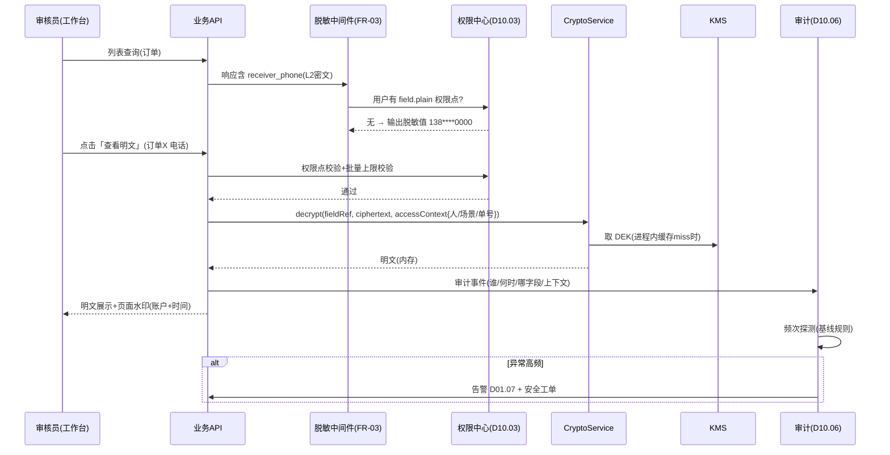
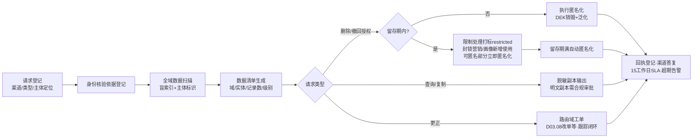

# SRS-D01.05 PIPL 隐私合规组件 需求规格说明书

> 文档编号：SRS-D01.05 · 版本 V1.0 · 2026-10-24 · 编写：小凯 · 状态：待审阅（批次⑤）
> 所属域：D01 平台底座域 · 分期：**P0（M0-M1）· Q8 决策：PIPL 合规是 P0 硬要求** · schema：oms_base
> 上游依据：《个人信息保护法》（PIPL）· SRS-00 §3 D01 清单 · 07 架构书 §5（消费者字段加密存储+展示脱敏+授权留痕，商派仅 modifier 脱敏需强化）· 逆向文档 05 §4（shop.config AES 凭证加密）· 差距分析表（PIPL 隐私合规层为凯淳新增底座，商派无对应体系）
> 消费方契约（本组件为其服务）：SRS-D03.12 跨境申报（身份证号=最高敏感级：信封加密+单独授权+明文访问仅申报服务账号+逐次审计+90 天最小化留存，FR-04a/04b/04d）· SRS-D02.06 店铺授权（session/token 凭证 KMS 信封加密+解密审计+缓存加密，FR-03/§5.2 加解密规约）· SRS-D03.01 FR-04f（收货人姓名/手机/详址加密存储+平台密文单原样保存+界面脱敏+明文授权留痕）· SRS-D03.03 FR-08c（「查看明文」按钮级授权+水印+留痕）· SRS-D02.03 FR-04b（缓冲落库即加密）· SRS-D02.01 FR-07c（api_log 报文敏感字段落库前脱敏）· SRS-D03.05 FR-01e（合单指纹哈希不可逆）· SRS-D03.08 FR-10b（审计值加密存储展示脱敏）· SRS-D10.03（字段级权限决定明文/脱敏）· SRS-D10.06（明文访问审计）· SRS-D01.04（字段元数据 sensitive 级别声明）· SRS-D01.06（导出敏感字段审批+水印）
> 定位：全系统**个人信息与敏感数据保护的统一机制层**：分级字典、字段级信封加密、脱敏中间件、授权留痕、数据主体权利响应、留存与匿名化、访问审计、导出管控。业务域声明「哪个字段什么级别」，本组件保证「存/展/出/删/查」五个环节行为一致合规。

---

## 1. 模块概述

### 1.1 定位

凯淳 OMS 处理大量消费者个人信息（收货人姓名/电话/地址、跨境身份证、买家标识）与商业敏感凭证（平台 session/token、WMS 账号密钥）。商派体系仅有展示层 modifier 脱敏与 AES 凭证加密（逆向文档 05 §4，无分级、无授权留痕、无留存治理——07 架构书 §5「需强化」）。本组件按 PIPL（《个人信息保护法》）要求建设统一机制层，**P0 硬要求**（Q8 决策）：M1 上线即全量生效，不允许「先明文跑起来后补加密」。

核心设计：**敏感数据分级字典**（L0-L3 四级）驱动全链路差异化保护——级别声明一次（D01.04 元数据/表结构注解），加密、脱敏、授权、审计、留存、导出管控六个环节自动按级别执行。

### 1.2 职责边界

**做**：敏感数据分级字典与字段登记、字段级信封加密服务（AES-256-GCM + KMS 密钥管理）、统一脱敏中间件（展示/日志/事件三处出口）、明文访问授权与留痕、授权与告知管理（平台订单默认授权链路登记、单独授权流程支撑）、数据主体权利响应流程（查询/更正/删除）、数据最小化与留存期治理（到期匿名化任务）、访问审计（联动 D10.06）、导出管控（联动 D01.06：审批+水印）、平台密文单（oaid 类）的透传规约、密钥轮换与重加密。

**不做**：各域业务字段的具体级别判定结果（本组件定分级标准与登记机制，级别由各域按标准申报、合规评审确认）；租户行级隔离与功能权限（→ D10.03，本组件的字段级明文权限挂接其权限点体系）；审计日志存储与检索（→ D10.06，本组件产生访问事件供其记录）；OA 审批流实现（→ D10.05，导出审批等路由到它）；平台侧加密体系（淘系 oaid/抖音密文是平台密钥体系，本组件只管「原样透传规约」不解密——D03.01 FR-04f）。

### 1.3 与其他模块关系

| 模块 | 关系 |
|---|---|
| 全域（存储层） | 字段加密服务与敏感字段登记（订单收货人/售后/申报/凭证…） |
| D01.04 | 字段元数据 sensitive 级别声明同源（登记即元数据，通用 CRUD 自动脱敏） |
| D10.03 | 字段级明文权限点（`{entity}.field.{f}.plain`）判定明文/脱敏 |
| D10.06 | 明文访问/导出/删除操作审计落库与检索 |
| D01.06 | 导出含敏感字段的审批路由+水印+默认脱敏 |
| D01.02 | 留存期扫描与匿名化任务、密钥轮换任务调度 |
| D01.07 | 异常访问告警（高频明文查看探测）、权利请求超期告警 |
| KMS（外部） | 主密钥托管（云 KMS，密钥不出 HSM） |

---

## 2. 业务场景（消费方场景）

**SC-D01.05-01 收货人字段全链路保护（D03.01/D02.03，L2 级）**
平台订单拉入：D02.03 缓冲落库时收货人姓名/手机/详址即经本组件加密（L2 字段级 AES-256-GCM，密文+key_version 落 `order_receiver`）；订单创建、审单上下文、发货单、快照、审计 diff 全部流转密文；人工审单工作台默认脱敏展示（张*/138****0000/上海市**区***）；审核员点「查看明文」（D03.03 FR-08c）→ 校验字段权限点 → 解密返回+页面水印+审计留痕（谁/何时/哪单/哪个字段）；个人明文查看次数进审计报表（异常高频触发泄露探测告警）。

**SC-D01.05-02 跨境身份证最高级保护（D03.12，L3 级）**
跨境订单采集收件人身份证号：采集页**单独授权**勾选（明示用途=海关申报，不与通用隐私协议合并——D03.12 FR-04a）授权记录不可篡改落库；身份证字段 L3 信封加密（独立 DEK+更严 KMS 策略）；任何界面/导出全脱敏（前1后1）；明文访问仅限申报组装服务账号（服务身份白名单，非人工权限点）且逐次审计；本地报文日志脱敏、申报原文密文单独存储；放行后 90 天（D03.12 FR-04d 可配）明文按需保留窗口到期→匿名化（保留密文与脱敏索引，销毁 DEK 即密码学擦除）。

**SC-D01.05-03 凭证加密（D02.06/D09.01，L3 级商业凭证）**
店铺 access_token/refresh_token/session、WMS 账号 secret：信封加密落库（D02.06 §5.2 规约即本组件契约的具体化——plaintext→DEK AES-256-GCM→ciphertext+key_version；解密只在 Gateway 进程内存；Redis 缓存值加密；日志/告警零明文）；每次解密取用写访问审计（调用方/方法/时间——D02.06 FR-03c）；KMS 主密钥年度轮换，key_version 支持渐进重加密（轮换任务后台重加密存量，业务无感）。

**SC-D01.05-04 消费者权利响应（客服场景）**
消费者经平台客服渠道要求删除个人信息：客服在权利响应工作台登记请求（类型=删除，主体标识=平台买家 ID/订单号定位）→ 系统扫描该主体全域数据（订单/售后/申报/风控统计）生成清单 → 按类型执行：查询=输出脱敏副本；更正=路由对应域工单（改地址走 D03.08 改单链路）；删除=法定留存期内（订单数据 3 年）**限制处理**（打标封锁新增使用+匿名化能匿名部分）而非物理删除，留存期满自动匿名化 → 处理结果回执登记（经平台渠道答复消费者）。全程留痕，超期（15 个工作日）告警。

**SC-D01.05-05 导出管控（D01.06 联动）**
运营导出订单清单（含收货人字段）：导出请求经本组件管控判定——L2 字段默认脱敏导出；确需明文（如物流商对账特殊场景）→ 触发 D01.05 审批流（D10.05 OA：申请人/用途/范围/时效）→ 审批通过生成带**水印**文件（操作人+时间+用途编号，明暗双水印）→ 下载链接时效控制 → 导出行为+审批单+文件指纹全审计。未审批的明文导出请求一律拒绝（导出中心无法绕过——管控内置在导出链路）。

**SC-D01.05-06 日志与事件出口脱敏（D02.01/D01.01）**
api_log 平台报文落库前经脱敏中间件（D02.01 FR-07c：收货人字段脱敏、sign/token/session 强制打码）；领域事件 payload 发布侧校验（D01.01 FR-02b：敏感字段只放加密引用或脱敏值）；结构化日志/告警内容过滤器统一拦截（正则+字段名双规则）——三个非结构化出口一套规则，防「界面脱敏了日志泄露」。

---

## 3. 功能需求

### FR-D01.05-01 敏感数据分级字典（全组件的驱动核心）
- FR-01a 分级标准（参考 PIPL 与商派 pipl 场景实践、行业电商惯例）：

| 级别 | 定义 | 字段实例（登记清单节选） | 存储 | 展示 | 导出 | 明文访问 |
|---|---|---|---|---|---|---|
| L0 公开 | 非个人信息 | 商品名/店铺名/物流公司名称 | 明文 | 明文 | 自由 | — |
| L1 内部 | 一般个人信息/内部标识 | 买家昵称/平台 open_id/订单号 | 明文或轻保护 | 内部明文 | 内部自由 | — |
| L2 敏感 | 个人敏感信息 | 收货人姓名/电话/详址/买家真实姓名 | **字段级信封加密** | 默认脱敏 | 默认脱敏，明文需审批+水印 | 字段权限点+留痕 |
| L3 高敏 | 个人敏感信息最高级+商业凭证 | 身份证号/银行卡号/平台 token/session/WMS secret/KMS 相关 | 信封加密（独立 DEK 策略） | 全脱敏（前1后1/完全掩码） | 原则禁止明文导出 | 服务账号白名单或最高权限点+逐次审计 |

- FR-01b 字段登记：敏感字段统一登记（实体/表.字段/级别/脱敏规则/授权模式/留存策略引用）；登记来源=D01.04 元数据 sensitive 声明（同一份数据，双向校验一致性）；新表上线 CI 扫描（未登记的疑似敏感字段名——phone/mobile/id_card/address/receiver/token/secret 等模式匹配——强制申报级别，防漏登记）。
- FR-01c 脱敏规则字典（按字段类型预置，可按登记覆盖）：姓名=首字+*（张*/欧阳**）；手机=前3后4（138****0000）；地址=省市+***；身份证=前1后1；银行卡=后4位；token/session=前4后0+长度掩码；open_id=中段掩码。脱敏值**不可逆**且同值稳定（同一手机脱敏结果一致，支撑人工比对场景）。
- FR-01d 平台密文单规约（L2P 特殊形态，D03.01 FR-04f/D02.03 FR-04b）：平台加密下发的收货人信息（淘系 oaid/抖音脱敏单）**原样保存平台密文+密文标识+解密通道标识**，本组件不解密（平台密钥体系）；推仓/打单/回传按平台规则以密文直传；展示层用平台提供的脱敏形态；密文标识字段参与合单指纹（D03.05 FR-01e：同密文即同指纹）。

### FR-D01.05-02 加密存储（字段级信封加密 + KMS）
- FR-02a 信封加密契约（D02.06 §5.2 规约为全系统统一标准）：

```
落库: plaintext → KMS 生成/取 DEK(数据密钥, 按实体×级别划分)
      → AES-256-GCM 加密(随机 IV, 认证标签防篡改) → ciphertext + key_version + iv 落库
读取: 应用进程 → KMS 解 DEK(服务账号权限最小化, 按域隔离:
      Gateway 凭证 DEK 仅 D02 服务账号可解; 订单收货人 DEK 仅订单域服务账号)
      → 进程内存解密 → 用完即弃(明文不落日志/不进事件/不进缓存明文)
```

- FR-02b 加密服务接口：`CryptoService::encrypt(fieldRef, plaintext)` / `decrypt(fieldRef, ciphertext, accessContext)` / `batchDecrypt`（批量场景性能优化）；decrypt 强制携带 accessContext（调用方身份/场景/业务单号）——**无上下文解密调用直接拒绝**（审计的最小信息单元）。
- FR-02c 密文格式规范：`{key_version}:{iv_b64}:{ciphertext_b64}:{tag_b64}`（自描述，支持轮换期新旧版本共存）；GCM 认证失败（篡改/密钥错）返回明确错误码并告警（完整性保护）。
- FR-02d 检索支撑：加密字段不可 like 查询——按需提供**盲索引**（HMAC(独立索引密钥, 明文) 前缀哈希落辅助列，等值/前缀检索）；手机号精确定位、姓名精确匹配走盲索引；模糊搜索需求引导走脱敏字段+其他维度（明示能力边界，防「为了搜索不加密」）。
- FR-02e 密钥管理：KMS 主密钥（CMK）年度轮换+紧急轮换通道（疑似泄露即时轮换）；DEK 按「实体×级别」划分+缓存（进程内加密缓存，TTL 1h，禁止落盘）；key_version 全量登记；轮换重加密任务（D01.02 调度，后台渐进重加密存量数据，双版本兼容读取）。
- FR-02f 禁止清单（CI 静态扫描+运行期拦截）：敏感字段明文写日志/明文进 MQ payload/明文进 Redis（缓存值加密——D02.06 FR-03b）/明文进异常堆栈上报（Sentry 过滤器）/明文进 URL 参数。

### FR-D01.05-03 展示脱敏（统一脱敏中间件）
- FR-03a 统一出口：所有 API 响应经脱敏中间件（Hyperf 中间件，全局注册）：按响应中字段的登记级别 × 当前用户字段权限（D10.03 `{entity}.field.{f}.plain` 权限点）决定输出明文或脱敏值；**默认无权限=脱敏**（白名单式明文，防新页面漏配）。
- FR-03b 明文查看流程：前端「查看明文」→ 权限点校验 → 解密 → 页面水印（账户+时间，前端契约要求）→ 审计留痕（FR-07）；批量明文查看（列表页全解密）默认禁止，需独立权限点+单次上限（默认 50 条）+更严审计。
- FR-03c 角色基线（与 D10.03 字段级权限协同）：审核员/客服=工作场景按需明文（按钮级）；普通运营=脱敏；品牌方门户=脱敏（本货主订单也脱敏收货人——消费者信息属平台/凯淳受托处理，品牌方非直接使用方，基线可合规评审调整）；开发/DBA=生产环境一律脱敏（排障走 SC-01 授权留痕通道或 D02.01 FR-07c「按授权流程临时查看 OSS 原文」同款机制）。
- FR-03d 非结构化出口（日志/事件/告警/异常上报）：统一脱敏过滤器（字段名规则+正则模式双层，如手机号/身份证正则兜底未登记场景）；api_log 报文落库前脱敏（D02.01 FR-07c）；事件 payload 发布侧校验（D01.01 FR-02b）；告警内容过滤（D01.07 出口）；Sentry 上报 scrubber。

### FR-D01.05-04 授权与告知（处理合法性基础留痕）
- FR-04a 平台订单默认授权链路（登记说明性机制）：消费者在平台下单即与平台成立服务协议，平台按开放平台协议将订单信息（含收货人）提供给商家/服务商（凯淳）用于履约——**合法性基础=履行合同所必需**（PIPL 第 13 条）；本组件登记该链路说明（数据来源平台×授权依据×处理目的=订单履约），供合规审计与个人信息保护影响评估（PIA）引用；凯淳角色=受托处理者，处理范围以履约必需为限（数据最小化 FR-06 的依据）。
- FR-04b 单独授权场景（超出履约必需的处理）：跨境申报身份证采集（D03.12 FR-04a：独立勾选、明示用途、不与通用协议合并、授权记录不可篡改——记录含授权文本版本号/时间/主体标识/渠道）；营销类使用（如短信回访，P2 预留）；授权撤回机制（撤回后停止新增处理，已处理数据按留存策略走 FR-06）。
- FR-04c 告知文本管理：隐私告知/单独授权文本版本化管理（版本号+生效期），授权记录关联文本版本（「当时同意的是哪份文本」可回放）。
- FR-04d 授权记录查询：按主体（买家标识/订单）查询授权链路完整性（哪个场景哪次授权哪个文本版本）——监管问询与内部审计的响应数据源。

### FR-D01.05-05 数据主体权利响应（查询/更正/删除）
- FR-05a 请求受理：权利响应工作台（客服/合规专员使用）：请求登记（来源渠道=平台客服/邮件/电话记录、类型=查询/复制/更正/删除/撤回授权、主体定位信息）；主体身份核验规则（经平台渠道的默认已核验，登记核验依据；直接渠道的核验步骤记录）。
- FR-05b 数据定位扫描：按主体标识（买家 open_id/收货手机盲索引/订单号）扫描全域登记实体，生成该主体数据清单（域/实体/记录数/敏感级别）——依赖 FR-01b 登记完整性。
- FR-05c 分类处置：
  - 查询/复制：生成**脱敏副本**响应（明文副本需合规审批，逐次审计）；
  - 更正：路由对应域业务流程（改地址=D03.08 改单；改收件人电话=平台侧修改同步），本组件跟踪工单闭环；
  - 删除：法定/合同留存期内（订单 3 年，FR-06）执行**限制处理**（主体打标 `restricted`：封锁新增使用场景——营销/画像/推荐，履约必需的存量查询保留）+可匿名化部分立即匿名化；留存期满自动完成删除/匿名化并回执；
  - 撤回授权：停止对应场景处理+打标（同删除的限制处理逻辑）。
- FR-05d SLA 与回执：15 个工作日内办结（PIPL 口径，平台渠道时限优先）；超期告警（D01.07）；处理结果登记（响应内容摘要/时间/经办人）供渠道答复；全程审计。
- FR-05e 拒绝与例外：可拒绝场景登记理由（留存义务/司法要求/公共利益），拒绝决定需合规负责人确认（双人复核）。

### FR-D01.05-06 数据最小化与留存期
- FR-06a 留存策略字典（按实体登记，PIA 评审确认）：订单履约数据（含收货人）=在线 3 年+归档（对齐 D03.13 冷热分离），归档期满匿名化；跨境申报要素明文=放行后 90 天（D03.12 FR-04d 可配）后仅存密文与脱敏索引；申报/回执原文密文 ≥3 年（海关稽查）；风控统计（D05.05 buyer_risk_stat）=滚动 30 天窗口+日终校准数据 90 天；审计日志 ≥3 年（D10.06）；凭证旧版本 7 天（D02.06 FR-03d）。
- FR-06b 匿名化任务：D01.02 调度日扫描到期数据 → 匿名化执行（直接标识符销毁：DEK 销毁=密码学擦除+字段置脱敏占位；准标识符泛化：地址泛化到市级、时间泛化到日）→ 匿名化流水登记（批次/范围/不可逆声明）；匿名化后数据不再属于个人信息，可供统计使用（D11 报表口径）。
- FR-06c 最小化采集校验：新实体/新字段登记时申报「采集必要性」（履约必需/法定要求/业务便利），业务便利类采集 L2+ 字段需合规评审通过——源头控制（配合 FR-01b CI 扫描）。
- FR-06d 留存期变更：策略调整（如海关要求延长）走合规评审+登记版本化，变更审计。

### FR-D01.05-07 访问审计（谁看过明文——联动 D10.06）
- FR-07a 审计事件（本组件产生，D10.06 落库检索）：明文查看（字段级：谁/何时/哪实体哪记录哪字段/场景上下文/来源 IP）；批量解密调用（服务账号级：调用方/场景/批量大小）；凭证解密取用（D02.06 FR-03c）；导出审批与执行（FR-08）；权利响应操作；授权记录访问；密钥操作（轮换/销毁）。
- FR-07b 异常探测：个人明文查看频次基线（默认 >50 次/日或 >10 次/小时告警，角色可配）；非工作时段批量查看；同账号短时跨大量无关订单查看（爬取模式）；服务账号解密量突增——探测规则命中 → 即时告警 D01.07（P1）+ 安全工单；凭证异常高频取用触发泄露探测（D02.06 AC-09 机制承载）。
- FR-07c 审计报表：个人维度明文访问月报（D03.03 FR-08c「明文查看次数进个人审计报表」）；实体维度访问热度（异常集中=风险信号）；审计数据不可篡改（append-only，D10.06 独立存储）。

### FR-D01.05-08 数据导出管控（联动 D01.06）
- FR-08a 管控判定（内置于导出链路，导出中心无法绕过）：导出列含 L2+ 字段 → 默认脱敏导出；申请明文导出 → 审批流（D10.05 OA：申请人/用途/数据范围/字段清单/时效一次性）→ 通过后本次导出任务绑定审批单。
- FR-08b 水印：明文导出文件强制水印（明水印=操作人+时间+审批单号平铺；暗水印=文件指纹+追溯码嵌入——泄露溯源）；水印参数不可配置关闭（红线）。
- FR-08c 交付管控：下载链接时效（默认 24h，一次性令牌）；文件加密（压缩包密码另通道送达——D08.06 FR-02b 同款口径）；导出完成通知含指纹登记。
- FR-08d L3 字段导出禁令：身份证/银行卡/token 类**任何场景禁止批量明文导出**（单条业务必需走服务账号通道+逐次审计）；导出申请含 L3 字段直接拒绝并提示替代路径。
- FR-08e 导出台账：全量导出行为登记（人/时间/实体/筛选条件/列/是否含敏感/审批单/文件指纹/下载次数），供 D10.06 检索与月度合规复盘。

---

## 4. 业务流程

### 4.1 敏感字段全生命周期保护链路

```mermaid
flowchart TD
    subgraph IN[采集入口]
        A1[平台订单报文<br/>D02.03 缓冲落库] --> B
        A2[跨境身份证采集<br/>D03.12·单独授权勾选<br/>授权记录不可篡改 FR-04b] --> B
        A3[平台密文单 oaid<br/>原样保存+密文标识 L2P<br/>不解密·密文直传规约]
        A4[客服补录/导入<br/>D01.06 导入即加密] --> B
    end
    B{分级字典 FR-01<br/>L2 / L3} --> C[信封加密落库<br/>DEK+AES-256-GCM+key_version<br/>盲索引辅助列(等值检索)]
    C --> D[流转: 全域只传密文<br/>事件payload加密引用/脱敏值<br/>快照·审计diff·MQ 零明文]
    D --> E{展示出口 FR-03}
    E -- 默认/无权限 --> E1[脱敏中间件输出脱敏值<br/>张* / 138****0000]
    E -- 字段权限点 D10.03 --> E2[查看明文: 解密+页面水印<br/>+审计留痕 FR-07a]
    E2 --> E3{频次异常探测 FR-07b?}
    E3 -- 是 --> E4[告警 D01.07+安全工单]
    D --> F{导出出口 FR-08}
    F -- L2 --> F1[默认脱敏导出]
    F -- L2明文申请 --> F2[OA审批→水印文件<br/>→时效链接→台账]
    F -- L3 --> F3[禁止批量明文导出<br/>单条走服务账号+逐次审计]
    C --> G{留存期扫描 FR-06<br/>D01.02 日任务}
    G -- 订单3年/申报明文90天到期 --> H[匿名化: DEK销毁=密码学擦除<br/>+标识符泛化+流水登记]
    H --> I[权利响应 FR-05:<br/>查询→脱敏副本 更正→域工单<br/>删除→限制处理→期满匿名化<br/>15工作日SLA·超期告警]
    C -.key_version.-> J[KMS 密钥治理 FR-02e<br/>年度/紧急轮换→渐进重加密]
```

### 4.2 明文查看与审计时序（SC-01）



### 4.3 删除请求处理流程（SC-04）



---

## 5. 处理逻辑

### 5.1 信封加密规约（全系统统一标准，D02.06 §5.2 的框架化）

```
密钥层级: KMS CMK(主密钥,HSM不出库,年度+紧急轮换)
          → DEK(数据密钥, 按 实体×级别 划分, CMK加密存储)
          → 字段密文(AES-256-GCM, 随机IV, 认证标签)
密文格式: {key_version}:{iv_b64}:{ct_b64}:{tag_b64}   # 自描述,轮换期双版本共存
DEK 缓存: 进程内存 TTL 1h, 禁落盘; KMS调用配额与降级(KMS不可用→已缓存DEK可用,
          新解密失败→拒绝+告警, 不降级明文存储)
DEK 权限: 按域服务账号最小化(Gateway凭证DEK仅D02; 订单DEK仅D03服务账号)
盲索引:   HMAC(独立索引密钥, 明文) 取前N字节 → blind_idx 辅助列(等值/前缀检索)
          索引密钥与加密密钥分离(泄露一个不连带另一个)
密码学擦除: 销毁DEK = 密文永久不可解(匿名化的技术手段, 免海量行改写)
```

### 5.2 脱敏决策矩阵（展示中间件核心逻辑）

```
mask(field, value, user, scene):
    level = 登记级别(field)                    # FR-01b 登记, D01.04元数据同源
    if level in (L0, L1): return value
    if scene == 结构化导出: 走 FR-08 管控链路(不在此决策)
    if user.has(perm: {entity}.field.{f}.plain) and scene允许明文:
        audit(明文访问事件); return decrypt(value, accessContext)
    return 脱敏规则字典(level, 字段类型)(value)   # 不可逆·同值稳定
特殊: L2P平台密文单 → 平台脱敏形态直出(本组件无明文可解)
服务身份: 申报组装服务账号(L3白名单) → 解密+逐次审计; 其他服务账号 → 拒绝
```

### 5.3 限制处理（restricted 打标）语义

```
restricted 主体标记(买家维度):
    封锁: 营销触达/画像分析/推荐/数据供给BI明细层(D11仅聚合匿名数据)
    保留: 履约必需的存量查询(在途订单继续履约——删除权不损害合同履行)
          法定留存(会计/海关/消保)与司法调取
    解除: 仅合规负责人+新请求(错误打标场景, 双人复核+审计)
```

### 5.4 留存与匿名化调度（FR-06b）

```
每日(D01.02 任务 pipl.retention_scan):
    for 实体 in 留存策略字典:
        到期数据集 = 按时间字段圈选(在线3年/明文90天/…)
        匿名化: 直接标识符 → DEK销毁(批次级独立DEK时) 或 字段置脱敏占位
                准标识符 → 泛化(地址→市, 时间→日, 年龄段化)
        登记: 匿名化流水(批次/范围/记录数/操作=auto/不可逆声明)
        校验: 抽样验证不可逆(原明文不可恢复)+统计可用性(D11聚合仍可跑)
批量擦除保护: DEK销毁前校验无未到期数据共用该DEK(DEK按实体×级别×年份粒度)
```

### 5.5 一致性设计
- 加密与业务写入同事务（密文落库即合规态，无「先明文后补加密」中间态）；
- 盲索引与密文同事务更新（检索一致性）；
- 密钥轮换期读取双版本兼容（key_version 路由），重加密任务渐进收敛（旧版本存量清零后废弃旧 DEK）；
- 脱敏中间件故障降级：**失败关闭**（fail-closed——中间件异常时输出脱敏值而非明文，可用性让位于合规）。

---

## 6. 数据字段（业务字段描述，schema：oms_base）

### 6.1 敏感字段登记（pipl_field_registry）

| 字段 | 业务含义 | 取值/校验 |
|---|---|---|
| entity_name / table_field | 实体与物理字段 | 与 D01.04 元数据双向一致校验 |
| level | 分级 | L0/L1/L2/L2P（平台密文）/L3 |
| mask_rule | 脱敏规则 | 字典预置或登记覆盖（FR-01c） |
| plain_access_mode | 明文访问模式 | 权限点（L2）/服务账号白名单（L3）/禁止 |
| blind_index_flag | 盲索引开关 | 等值检索需求字段开启 |
| retention_policy_ref | 留存策略引用 | FR-06a 字典 |
| necessity | 采集必要性 | 履约必需/法定要求/业务便利（合规评审标记） |
| register_time / reviewer | 登记与评审 | 合规评审人必填（L2+） |

### 6.2 授权记录（pipl_consent）

| 字段 | 业务含义 |
|---|---|
| consent_id / subject_key | 授权记录/主体标识（open_id+平台） |
| scene | 授权场景（cross_border_declare/marketing…） |
| consent_text_version / channel | 告知文本版本/授权渠道（采集页/客服） |
| consent_time / revoke_time | 授权/撤回时间（记录不可篡改：append-only+哈希链） |
| evidence_json | 授权证据快照（勾选状态/IP/会话引用） |

### 6.3 权利请求（pipl_dsr_request）

| 字段 | 业务含义 |
|---|---|
| dsr_id / type | 请求号/类型（查询/复制/更正/删除/撤回） |
| subject_locator / verify_evidence | 主体定位信息/身份核验依据 |
| source_channel / deadline | 来源渠道/SLA 截止（15 工作日） |
| scan_result_ref | 数据清单引用（FR-05b 扫描产物） |
| handle_status / handle_result / handler | 处置状态/结果摘要/经办人 |
| reject_reason / approver | 拒绝理由/合规负责人确认（FR-05e 双人） |

### 6.4 访问审计事件（本组件产生，落 D10.06 审计存储）

| 字段 | 业务含义 |
|---|---|
| access_type | 明文查看/批量解密/凭证取用/导出/权利操作/授权访问/密钥操作 |
| accessor_type / accessor | 人员账户 或 服务账号 |
| entity_name / record_ref / field_name | 访问对象定位 |
| scene_context | 场景上下文（业务单号/工作台/接口方法） |
| result / risk_flag | 结果/异常探测标记（FR-07b） |
| create_time / source_ip | 时间/来源 |

### 6.5 留存与匿名化（pipl_retention_policy / pipl_anonymize_log）

| 字段 | 业务含义 |
|---|---|
| 策略：entity_name / retention_period / archive_period / anonymize_rule | 留存/归档/匿名化规则（版本化，变更审计） |
| 流水：batch_id / entity / scope / record_count / method（DEK销毁/泛化/占位）/ execute_time / verify_result | 匿名化批次登记（不可逆声明+抽样校验结果） |

### 6.6 导出台账（pipl_export_ledger，联动 D01.06）

| 字段 | 业务含义 |
|---|---|
| export_task_id（D01.06 任务引用）/ applicant / purpose | 导出定位与用途 |
| entity / filter_digest / columns / sensitive_fields | 范围与敏感列清单 |
| approval_ref | OA 审批单（明文导出必填） |
| watermark_params / file_digest / download_count / link_expire | 水印/指纹/下载追踪 |

---

## 7. 接口

### 7.1 内部接口（本模块提供）

| 编号 | 接口 | 消费方 | 说明 |
|---|---|---|---|
| IF-D01.05-01 | `CryptoService::encrypt/decrypt/batchDecrypt(fieldRef, data, accessContext)` | 全域存储层（D02.06 凭证/D03.01 收货人/D03.12 身份证/D09.01 secret） | 信封加密服务（无上下文拒绝解密） |
| IF-D01.05-02 | `PiplCrypto::mask(fieldRef, value, user)` + 脱敏中间件（全局） | D03.03（IF-D03.03-D9）/D01.04 通用 CRUD/全域 API | 展示脱敏与明文授权查看 |
| IF-D01.05-03 | `BlindIndexService::build(fieldRef, plaintext)` / 等值检索辅助 | D03/D05（手机定位）/权利扫描 | 盲索引（FR-02d） |
| IF-D01.05-04 | `ConsentService::record/query/verify(subject, scene)` | D03.12（单独授权）/D02.03 | 授权留痕与校验（申报前置：授权缺失阻断） |
| IF-D01.05-05 | `DsrService::register/scan/handle/close` | 权利响应工作台（客服/合规） | 数据主体权利流程（FR-05） |
| IF-D01.05-06 | `ExportGuardService::check(exportTask)` / `bindApproval(task, approvalRef)` | D01.06 导出链路（内置管控点） | 导出管控判定/审批绑定/水印参数 |
| IF-D01.05-07 | `SensitiveRegistry::get(entity)/scanNewFields()` | D01.04 元数据/CI 流水线 | 分级登记查询与漏登记扫描 |
| IF-D01.05-08 | `LogScrubber::filter(content)` | 日志组件/D02.01 api_log/D01.07 告警出口/Sentry | 非结构化出口脱敏过滤器 |
| IF-D01.05-09 | 事件 `pipl.plain.accessed`（审计）/ `pipl.access.anomaly`（告警）/ `pipl.dsr.received` | D10.06/D01.07/工作台 | 审计与告警广播 |

### 7.2 依赖接口

| 编号 | 接口 | 提供方 | 说明 |
|---|---|---|---|
| IF-D01.05-D1 | 字段级权限点判定 | D10.03 | 明文/脱敏决策输入 |
| IF-D01.05-D2 | 审计存储与检索（append-only） | D10.06 | 全部访问事件落库 |
| IF-D01.05-D3 | OA 审批流 | D10.05 | 明文导出/明文副本/拒绝决定审批 |
| IF-D01.05-D4 | 留存扫描与匿名化调度、密钥轮换任务 | D01.02 | FR-06b/FR-02e |
| IF-D01.05-D5 | 告警发送 | D01.07 | 异常探测/DSR 超期/KMS 故障 |
| IF-D01.05-D6 | 导出任务管控执行（水印/链接时效/台账） | D01.06 | FR-08 落地 |

### 7.3 外部接口

| 编号 | 接口 | 方向 | 说明 |
|---|---|---|---|
| EF-D01.05-01 | 云 KMS（CMK 托管/DEK 加解/轮换/销毁） | 出 | 密钥不出 HSM；服务账号最小权限 |
| EF-D01.05-02 | 平台密文解密通道（oaid 类，经 D02 适配器） | 双向 | 仅履约必需场景（面单打印等），逐次审计 |

---

## 8. 非功能需求

| 项 | 要求 |
|---|---|
| 性能 | 单字段加解密 ≤2ms（DEK 缓存命中）；批量解密 100 字段 ≤50ms；脱敏中间件单响应开销 ≤5ms；盲索引等值查询与普通索引同级 |
| 可用性 | KMS 短时不可用：已缓存 DEK 路径正常；新 DEK 获取失败拒绝服务+告警（**不降级明文**）；脱敏中间件故障 fail-closed（输出脱敏值） |
| 安全 | AES-256-GCM 认证加密（防篡改）；DEK 按域隔离+最小权限；盲索引密钥与加密密钥分离；明文零落盘（日志/缓存/事件/异常上报五出口拦截）；L3 明文访问逐次审计 |
| 合规 | PIPL 硬要求 P0 生效（上线首日无明文存量）；权利响应 15 工作日 SLA；留存策略 PIA 评审留档；申报原文密文 ≥3 年（海关）；审计 ≥3 年 |
| 一致性 | 加密/盲索引与业务同事务；轮换双版本兼容读；匿名化不可逆（抽样校验） |
| 可观测 | 加解密量/失败率/KMS 延迟指标；明文访问热度与异常探测报表；DSR 台账与 SLA 看板 |
| 容量 | 加密字段存量：订单收货人 3 年 ≈2200 万单×3 字段；盲索引列随主表；授权记录/DSR/审计按事件量增长（审计归 D10.06 容量规划） |

---

## 9. 验收标准

| 编号 | 验收条件 |
|---|---|
| AC-01 | 存储加密：DB 直查 order_receiver/shop_auth/申报表，姓名/电话/地址/token/身份证全部为密文（`key_version:iv:ct:tag` 格式）；GCM 篡改密文（改 1 字节）解密报错并告警（完整性验证） |
| AC-02 | 展示脱敏：无字段权限用户全界面见脱敏值（张*/138****0000/前1后1 身份证）且同值稳定；有权限用户「查看明文」成功且页面水印+审计事件落 D10.06；脱敏中间件故障注入时输出脱敏值而非明文（fail-closed） |
| AC-03 | L3 服务账号管控：申报组装服务账号可解身份证明文且逐次审计；普通服务账号/人员账户请求解密被拒；D02.06 凭证 getToken 每次留痕、异常高频触发泄露探测告警（D02.06 AC-09 口径） |
| AC-04 | 零明文出口：注入含手机号/身份证的报文与日志——api_log 落库脱敏（D02.01 FR-07c）、MQ payload 校验拦截明文敏感字段、Sentry 上报 scrubber 生效、告警内容过滤生效；CI 静态扫描命中禁止清单代码即失败 |
| AC-05 | 盲索引：加密手机号等值检索命中正确记录（盲索引路径）；索引密钥与加密密钥独立（更换索引密钥不影响解密）；like 模糊查询加密字段被明确拒绝（能力边界提示） |
| AC-06 | 单独授权（D03.12 AC-04 口径）：跨境采集页授权勾选独立不可合并；授权缺失时申报服务被 ConsentService::verify 阻断；授权记录含文本版本+证据快照，append-only 哈希链篡改可检出 |
| AC-07 | 权利响应：登记删除请求→全域扫描出数据清单→留存期内打标 restricted（营销/画像场景封锁验证：BI 明细层与触达任务不再使用该主体）→可匿名部分即时匿名化；15 工作日 SLA 倒计时与超期告警生效；查询请求输出脱敏副本；拒绝决定需双人复核 |
| AC-08 | 留存与匿名化：申报明文 90 天到期批次自动匿名化（DEK 销毁后原密文不可解=密码学擦除验证；地址泛化到市）；匿名化流水与抽样校验报告可查；订单 3 年留存与 D03.13 归档联动一致 |
| AC-09 | 导出管控：含 L2 字段导出默认脱敏；明文导出无审批单被拒；审批通过后文件含明暗水印+一次性时效链接+台账登记（人/范围/指纹/下载次数）；含 L3 字段的批量导出申请直接拒绝并提示替代路径；D01.06 链路无法绕过管控（管控内置验证） |
| AC-10 | 密钥轮换：CMK 紧急轮换+DEK 渐进重加密任务执行期间，新旧 key_version 数据共存读取正确；重加密完成后旧版本存量清零；轮换全程业务无感（加解密成功率不降） |
| AC-11 | 平台密文单（L2P）：淘系 oaid 订单原样保存密文+标识，本组件不解密；推仓/打单密文直传；合单指纹基于密文标识计算（同密文同指纹，D03.05 FR-01e）；界面展示平台脱敏形态 |
| AC-12 | 登记完整性：CI 扫描含 phone/id_card/token 等模式的未登记字段阻断上线；D01.04 元数据 sensitive 声明与 pipl_field_registry 不一致时启动校验报错 |

---

## 变更记录

| 日期 | 版本 | 变更 | 原因 |
|---|---|---|---|
| 2026-10-24 | V1.0 | 首版 | — |

---

*参考实现溯源：商派无体系化 PIPL 能力（差距分析表：「PIPL 隐私合规层」为凯淳新增底座，商派仅 modifier 展示脱敏）——可考的点状机制：① shop.config AES 凭证加密（app/ome/model/shop.php:205 aes_encode/aes_decode，单一对称密钥硬编码，无 KMS/无版本/无审计，逆向文档 05 §4）；② modifier 列修饰器展示脱敏（dbeav_model 基类渲染钩子，纯展示层无存储加密）；③ encrypt_source_data/real_receiver_open_id/real_receiver_display_nick 等平台密文字段透传（商派被动保存平台加密数据——本 SRS L2P 规约的实践原型）；④ 隐私号 privacy_num_validity_seconds（虚拟号时效字段）。凯淳重写差异（商派→本组件）：① 单一 AES → **KMS 信封加密**（CMK/DEK 两层+key_version 轮换+GCM 完整性+DEK 按域隔离，D02.06 §5.2 规约框架化为全系统标准）；② 展示层脱敏 → **分级字典驱动的全链路保护**（存储/展示/日志/事件/导出五出口一致，L0-L3 分级+CI 漏登记扫描）；③ 无授权管理 → 授权与告知留痕（append-only 哈希链+文本版本化，跨境单独授权硬阻断）；④ 无权利响应 → DSR 工作台（扫描/限制处理/匿名化/15 工作日 SLA）；⑤ 无留存治理 → 留存策略字典+密码学擦除（DEK 销毁）+泛化匿名化+调度任务；⑥ 无访问审计 → 字段级明文访问审计+频次异常探测（凭证泄露/爬取模式）；⑦ 无导出管控 → 审批+明暗水印+一次性链接+台账（与 D01.06 链路内置集成，不可绕过）；⑧ 盲索引补检索能力（商派明文可搜但裸奔，凯淳加密且保住等值检索）。*
