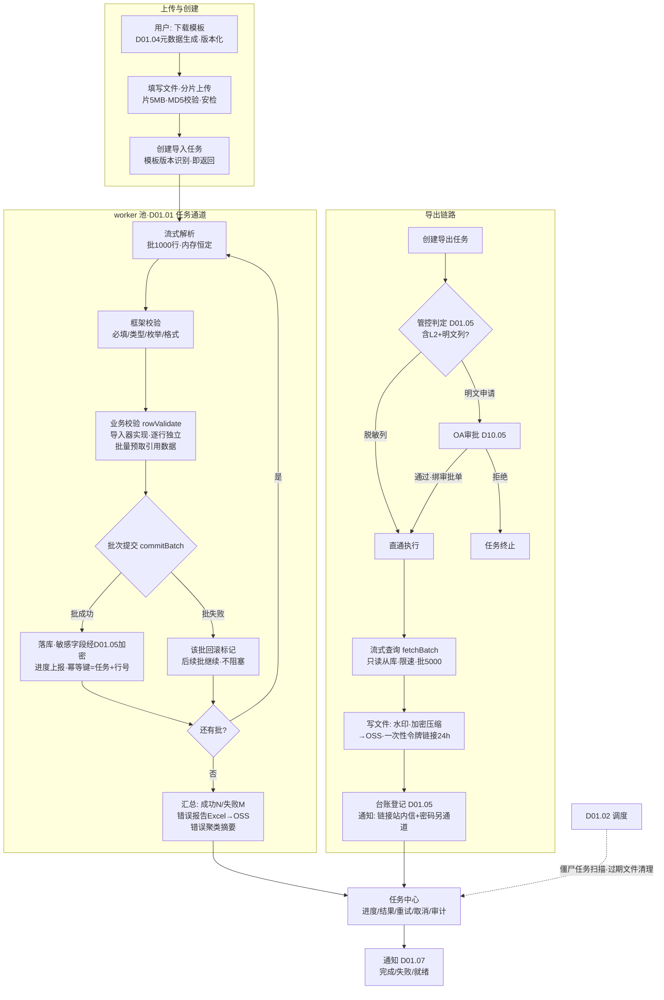
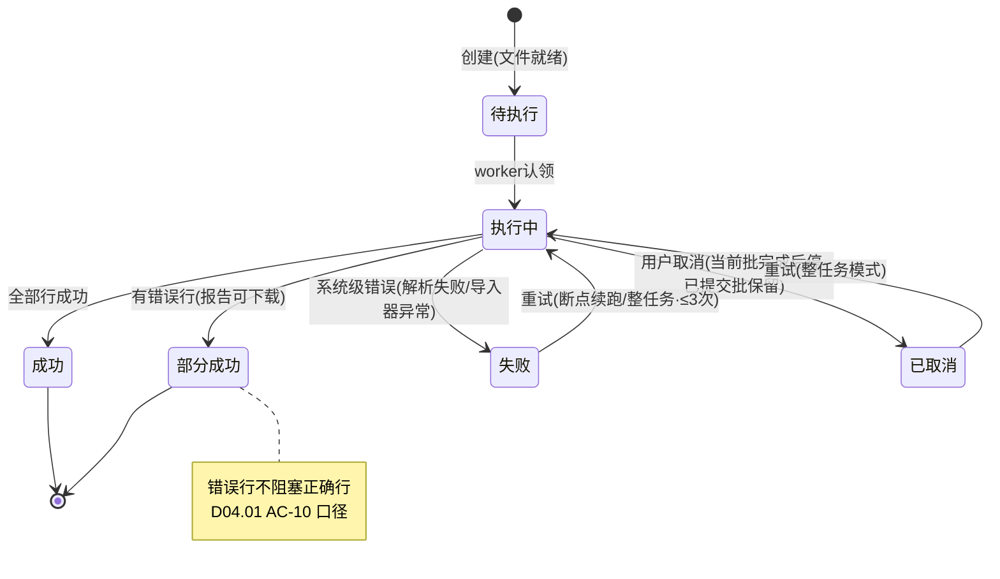
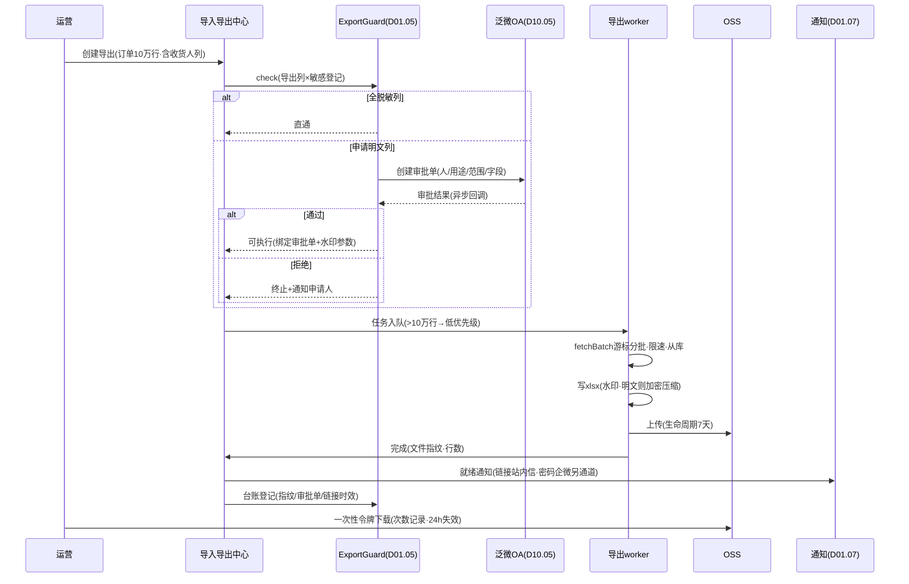

# SRS-D01.06 导入导出中心 需求规格说明书

> 文档编号：SRS-D01.06 · 版本 V1.0 · 2026-10-24 · 编写：小凯 · 状态：待审阅（批次⑤）
> 所属域：D01 平台底座域 · 分期：**P0（M0-M1）** · schema：oms_base
> 上游依据：SRS-00 §3 D01 清单 · 逆向文档 05 §7.1（taoexlib_queue NORMAL/REALTIME/TIMING 三级队列承载淘管系导入导出与批量任务）· 07 架构书 §1.3（OSS 存储/K8s）· 商派 omecsv 模块（差距分析表归入平台底座吸收范围）
> 消费方契约（本模块为其服务）：SRS-D04.01 AC-10（**5 万条基础物料导入 ≤10 分钟、错误行输出错误报告且不阻塞正确行**——本模块性能契约锚点）· SRS-D03.01 SC-05（5000 单导入建单：逐行校验/错误报告/正确行批量落库 createway=import/批次进度查询）· SRS-D06.01 FR-04（采购申请 Excel 模板导入：模板版本化/校验报告/1 万行 ≤5 分钟）· SRS-D08.04 FR-02（运费账单 10 万行级导入：行数勾稽/错误报告不阻塞正确行）· SRS-D03.04 FR-07e（批量手工拆单导入模板）· SRS-D09.01 FR-07c（仓库档案配置导入导出）· SRS-D01.04 FR-04（导出契约/导入模板元数据生成）· SRS-D01.05 FR-08（导出管控：审批+水印+台账，内置不可绕过）· D10.06（导出审计）
> 定位：全系统**大文件异步导入导出与批量任务的统一承载方**。业务域注册「导入器/导出器」实现，本中心提供：任务调度与进度、分片上传、逐行校验与错误报告、批次事务边界、流式导出、文件存储与下载管控、任务中心（列表/重试/取消）。

---

## 1. 模块概述

### 1.1 定位

商派导入导出散落在 omecsv 模块与 taoexlib_queue 三级队列（NORMAL/REALTIME/TIMING，逆向文档 05 §7.1），无统一任务中心与错误报告规范。凯淳把导入导出收敛为**一个中心**：异步任务化（大文件不占请求线程，经 D01.01 worker 池运行）、模板元数据驱动（D01.04 同源生成模板与校验规则）、**逐行校验+错误报告输出且错误行不阻塞正确行**（D04.01 AC-10 确立的全系统口径）、批次提交的事务边界、导出管控内置（D01.05 审批+水印链路无法绕过）、统一任务中心（进度/结果/重试/取消）。

### 1.2 职责边界

**做**：导入模板管理（元数据驱动生成/版本化/校验规则声明）、大文件分片上传与合并、导入任务编排（解析→逐行校验→批次提交→错误报告）、导出任务编排（流式查询→文件生成→OSS→下载链接）、导入导出任务中心（统一列表/进度/重试/取消）、进度与结果通知（D01.07）、导出管控接线（D01.05）、文件存储与生命周期（OSS+链接时效）、性能契约保障（分片/流式/批量）。

**不做**：逐行校验中的**业务规则**本身（物料存在性/货主类型/勾稽关系等由各域导入器实现，本中心提供校验框架与报告规范）；业务落库逻辑（各域导入器的 commit 实现）；导出数据的查询逻辑（各域导出器提供数据流）；审批流实现（→ D10.05）；水印生成算法细节（→ D01.05 提供参数，文件层执行）；打印类文件（面单/单据打印 → D09.05，非批量数据交换场景）。

### 1.3 与其他模块关系

| 模块 | 关系 |
|---|---|
| D04.01/D03.01/D06.01/D08.04/D03.04/D09.01 等 | 导入器/导出器注册方（业务校验与落库实现） |
| D01.04 | 模板列/校验规则/导出列由实体元数据驱动生成（FR-04c 同源） |
| D01.05 | 导出管控（审批/水印/台账）内置接线；导入敏感字段即加密 |
| D01.01 | 导入导出任务经任务通道异步运行（worker 池） |
| D01.02 | 过期文件清理、僵尸任务扫描调度 |
| D01.07 | 任务完成/失败通知、超期告警 |
| D10.03 | 任务数据权限（只见本人/本域任务）；导出权限点 |
| D10.06 | 导出行为审计（联动 D01.05 台账） |
| OSS（外部） | 文件存储（上传源文件/结果文件/错误报告） |

---

## 2. 业务场景（消费方场景）

**SC-D01.06-01 物料批量导入（D04.01 AC-10 锚点场景）**
商品专员导入 5 万条基础物料：下载模板（元数据生成：货号/名称/货主编码/分类/品牌/条码…列头含必填标记与枚举说明）→ 分片上传 8MB Excel → 创建导入任务即返回（异步）→ worker 流式解析（逐批 1000 行）：格式校验（框架层：必填/类型/长度/枚举）+ 业务校验（D04.01 导入器：货号唯一/货主存在/条码全局唯一冲突整批标错）→ 每批校验通过的行提交落库（批次事务）→ 完成通知：成功 49,200 行、失败 800 行，错误报告下载（Excel：原行数据+错误列+行号，**错误行不阻塞正确行**）；全程 ≤10 分钟，任务中心实时进度（已处理/总量/百分比）。

**SC-D01.06-02 导入建单（D03.01 SC-05）**
运营导入 5000 单：逐行校验同平台单规则+模板级校验（店铺存在/商品可解析/收货人字段完整）；收货人字段落库即经 D01.05 加密（导入通道不豁免）；正确行批量创建订单（createway=import）逐单进缓冲池；批次进度与结果可查；失败行错误报告带原因（第 N 行：店铺编码不存在）。

**SC-D01.06-03 运费账单大文件导入（D08.04 FR-02）**
财务导入快递公司月账单 10 万行：账单头登记（快递公司/周期/结算账号）→ 流式解析（内存恒定，不整文件载入）→ 行数勾稽（明细合计 vs 账单汇总行）+ 运单号格式校验 → 解析失败行落错误报告不阻塞正确行；对账数据入 D08.04 匹配池。

**SC-D01.06-04 订单大导出与管控（D01.05 联动）**
运营导出近 3 个月订单 10 万行（含收货人列）：创建导出任务 → 管控判定（L2 字段：默认脱敏列直通；申请明文列 → OA 审批 → 通过后任务绑定审批单）→ worker 流式查询（游标分批，每批 5000 行写文件，内存恒定）→ 生成 xlsx 至 OSS（明文文件加密压缩+明暗水印）→ 通知下载（一次性令牌链接 24h 时效）→ 台账登记（D01.05 FR-08e）。全程 ≤15 分钟；导出期间业务库压力可控（限速批查，只读从库）。

**SC-D01.06-05 任务重试与取消**
采购申请导入（D06.01）跑到 60% 时下游服务抖动失败：任务中心显示失败（原因摘要）→ 修复后点「重试」——按断点续跑（已成功批次不重复提交，幂等键=任务+行号）或整任务重跑（导入器声明支持模式）；另一场景：运营误传文件立即「取消」——运行中任务协作式终止（当前批次完成后停），已提交批次保留、任务标记取消（部分成功状态明示）。

**SC-D01.06-06 模板版本化与兼容（D06.01 FR-04a）**
采购申请模板升级（新增「期望到货日」必填列）：新版模板发布后旧模板导入在兼容窗口（默认 30 天）内仍可用（列映射按版本号解析），窗口后旧模板拒绝并提示下载新模板；模板历史版本可查（谁改了什么列）。

---

## 3. 功能需求

### FR-D01.06-01 导入模板管理
- FR-01a 模板定义：模板=列集（列名/字段映射/必填/类型/枚举值域/示例值/说明）+ 校验规则声明 + 目标导入器引用；**列集默认由 D01.04 实体元数据驱动生成**（FR-04c 同源：表头=中文标签、必填标记、枚举说明自动出），可人工增删调整（如导入专用列「货主编码」映射档案名称解析）。
- FR-01b 模板版本化：模板变更生成新版本（列 diff 登记）；文件解析按模板版本号（文件内嵌版本标识/表头指纹匹配自动识别）；旧版本兼容窗口（默认 30 天，可配）内可导入，窗口后拒绝并引导下载新模板（SC-06）。
- FR-01c 模板下载：标准模板文件生成（含表头/枚举说明 sheet/示例行 sheet）；按用户权限裁剪列（无敏感字段权限的用户下载的模板不含该列——导入同理管控）。
- FR-01d 模板登记：各域模板统一登记（模板编码/名称/归属域/导入器/权限点），任务中心按模板类型筛选。

### FR-D01.06-02 文件上传（大文件分片）
- FR-02a 分片上传：>5MB 文件走分片（片 5MB，前端切片直传 OSS 或经服务端中转，断点续传）；合并校验（片数/大小/MD5 完整性）；上限单文件 200MB / 100 万行（超限拒绝并提示拆分——超出部分建议走数据迁移通道）。
- FR-02b 支持格式：xlsx/csv（编码自动探测 GBK/UTF-8）；csv 分隔符声明；zip 打包多文件（按模板逐文件建任务）。
- FR-02c 病毒/宏安全检查：文件安全扫描（对象存储侧能力/ClamAV），macro 文件（xlsm）拒绝；上传源文件留存（审计与重跑依据，留存期 90 天）。

### FR-D01.06-03 导入任务编排（解析→校验→批次提交→报告）
- FR-03a 导入器注册：各域实现 `ImporterInterface`（DI 标签注册，模板编码绑定）：

```
interface ImporterInterface:
    templateCode(): string
    rowValidate(row, context): RowResult      # 业务校验(行级): 通过/错误(码+消息)
    commitBatch(rows[], context): BatchResult  # 批次提交(事务边界内落库, 幂等)
    crossRowCheck?(context): void              # 跨行勾稽钩子(可选: 行数合计/重复检测, D08.04 场景)
    supportMode(): 断点续跑|整任务重跑|两者
```

- FR-03b 执行流水线（worker 内，D01.01 任务通道运行）：流式解析（逐批读取，默认批 1000 行，内存恒定）→ 框架层校验（必填/类型/长度/枚举/格式——按模板声明，零业务代码）→ 业务校验（rowValidate，逐行独立：**单行错误不阻塞其他行**）→ 批次提交（校验通过行按批 commitBatch，批=事务边界：单批内原子、批间独立——批失败只回滚该批并标记，后续批继续）→ 汇总与报告。
- FR-03c 错误报告：标准 Excel 输出（原行数据全列 + 错误行号 + 错误码 + 人读错误消息 + 错误阶段[格式/业务/提交]）；报告上传 OSS 供下载；错误聚类摘要（按错误码 TOP 统计——「800 行失败中 600 行=货号重复」，帮助用户批量修表）。
- FR-03d 导入幂等：行级幂等键（任务 ID+行号，断点续跑不重复提交）；业务级幂等由导入器 commitBatch 保证（如 D04.01 货号唯一约束冲突转行错误而非批失败）；同文件重复创建任务提示（MD5 相同 24h 内警告确认）。
- FR-03e 进度上报：批次粒度更新（已处理行数/总行数/成功/失败/百分比/预估剩余）；任务中心与前端轮询/推送展示；进度停滞检测（10 分钟无推进告警——僵尸任务，D01.02 扫描）。
- FR-03f 取消与重试：取消=协作式终止（当前批完成后停，状态=已取消[部分成功]，已提交批保留）；重试=按导入器声明模式（断点续跑从失败批开始/整任务重跑先执行导入器 rollback 钩子可选清理）；重试次数上限 3。
- FR-03g 敏感字段导入：模板含 L2+ 字段时，落库前经 D01.05 加密（导入器 commitBatch 内调用，框架提供便利封装）；导入源文件（OSS 留存）按敏感等级管控访问（含 L2+ 数据的源文件下载需权限点）。

### FR-D01.06-04 导出任务编排（流式生成）
- FR-04a 导出器注册：各域实现 `ExporterInterface`（数据流提供：游标分批查询 `fetchBatch(cursor, size)`，每批 ≤5000 行；或复用 D01.04 通用列表服务的查询契约——档案类导出零代码）。
- FR-04b 管控前置（D01.05 FR-08 内置接线，**创建任务时判定，无法绕过**）：导出列含 L2+ → 默认脱敏列直通；明文列申请 → 返回「需审批」并创建 OA 审批单（D10.05）→ 审批通过任务转可执行（绑定审批单号）→ 拒绝则任务终止；L3 字段批量明文直接拒绝。
- FR-04c 文件生成：流式写入（xlsx 分 sheet 每 100 万行/csv 流式追加，内存恒定）；水印执行（明文导出：明水印平铺+暗水印追溯码，参数来自 D01.05 绑定）；明文文件加密压缩（密码另通道送达——D01.07 通知分离：链接走站内信、密码走企微/短信）；文件命名规范（实体_筛选摘要_时间_任务号）。
- FR-04d 交付：上传 OSS → 下载链接（一次性令牌+时效默认 24h，可配 1-72h）→ 通知（D01.07：任务完成+链接）；下载次数记录（超限链接失效）；文件留存 7 天后自动清理（OSS 生命周期规则，D01.02 核对）。
- FR-04e 限速与库保护：批间限速（可配 QPS/批间隔）；查询走只读从库；大导出（>10 万行）自动降为低优先级队列（不挤占在线导入与小型导出）。
- FR-04f 导出台账：全量登记（联动 D01.05 pipl_export_ledger：任务/人/范围/列/敏感/审批/指纹/下载次数）。

### FR-D01.06-05 导入导出任务中心
- FR-05a 统一任务列表：全类型任务（导入/导出，按模板/实体/状态/时间/发起人筛选）；数据权限（普通用户见本人任务，域管理员见本域，D10.03）；状态机：待执行/执行中/成功/部分成功/失败/已取消/待审批（导出管控）。
- FR-05b 任务详情：进度（FR-03e）/批次明细/错误报告下载/结果文件下载/审批单链接（导出）/操作按钮（取消/重试/下载源文件）。
- FR-05c 通知：任务完成（成功/部分成功/失败）通知发起人（D01.07 站内信+企微可配）；失败含原因摘要与重试入口；导出就绪含链接（密码分离通道）。
- FR-05d 运维视图：任务积压/worker 占用/平均时长/TOP 失败模板（供 D11.03）；僵尸任务扫描（D01.02 每 5 分钟：执行中超 30 分钟无进度 → 置失败+告警）。
- FR-05e 任务留痕：创建/取消/重试/审批操作审计（D10.06）；任务记录在线 90 天归档。

### FR-D01.06-06 性能契约（全系统统一口径）
- FR-06a 导入：5 万行 ≤10 分钟（D04.01 AC-10）；1 万行 ≤5 分钟（D06.01 §8 口径）；10 万行 ≤20 分钟（线性外推+批优化）；解析+校验吞吐 ≥1000 行/秒/worker（简单校验），业务校验含 DB 查询 ≥300 行/秒（批量预取优化：导入器可按批预加载引用数据——货号集合一次 IN 查询）。
- FR-06b 导出：10 万行 ≤15 分钟；100 万行 ≤2 小时（低优先级队列）；流式内存占用恒定 ≤256MB/worker（任何文件规模不 OOM）。
- FR-06c 并发：导入导出 worker 池独立配额（默认导入 4 并发/导出 4 并发，可热更）；同用户并发任务上限（默认 3，防刷）；大促模式导出降速配置（D01.02 模式联动，保业务库）。
- FR-06d 压测基线：上述契约为验收压测口径（AC 覆盖），性能不达标阻断上线。

---

## 4. 业务流程

### 4.1 导入导出异步架构



### 4.2 导入任务状态机



### 4.3 导出管控时序（SC-04）



---

## 5. 处理逻辑

### 5.1 导入流水线核心算法

```
runImport(task):
    reader = streamReader(task.file, task.templateVersion)   # 逐批游标, 内存恒定
    context = ImportContext(task, 批量预取缓存)
    importer = Registry.get(task.templateCode)
    for batchNo, rows in reader.batches(1000):
        if task.cancelRequested: break                        # 协作式取消
        if task.checkpoint >= batchNo: continue               # 断点续跑跳过已成功批
        for row in rows:
            r1 = frameworkValidate(row, template)             # 格式层(零业务代码)
            r2 = r1.ok ? importer.rowValidate(row, context)   # 业务层(逐行独立)
                       : r1
            r2.ok ? passRows.add(row) : errorRows.add(row, r2.errors)
        try:
            tx { importer.commitBatch(passRows, context) }    # 批=事务边界
            task.checkpoint = batchNo                         # 幂等断点
        except e:
            batchFail(batchNo, e)                             # 批回滚, 后续继续
        reportProgress(已处理/成功/失败)
    importer.crossRowCheck?(context)                          # 勾稽(D08.04)
    errorReport = buildExcel(errorRows + 错误聚类摘要) → OSS
    finish(成功N/失败M/报告链接)
# context 批量预取: rowValidate 前按批收集引用键(货号/编码集)一次 IN 查询,
#   杜绝逐行查库(N+1)——性能契约 ≥300 行/秒的关键
```

### 5.2 错误报告规范（全系统统一）

```
文件结构: sheet1=错误明细(原行全列+行号+错误阶段+错误码+错误消息)
          sheet2=聚类摘要(错误码×计数×示例行号 TOP10)
          sheet3=成功统计(总行/成功/失败/批次明细)
错误消息规范: 人读(「第3列货号 BM1001 已存在」)含定位信息(列名+值),
             禁止裸异常堆栈; 错误码登记模板级字典(可统计可聚类)
用户修复循环: 下载报告→修表→重新上传(新任务) 或 仅重传错误行(修正文件
             模式: 错误报告可直接作为重导文件, 成功行不重复——幂等键保障)
```

### 5.3 导出流式生成

```
runExport(task):
    guard = ExportGuard.bind(task)                # 管控前置结果(审批单/水印参数)
    writer = streamWriter(format, 内存缓冲≤64MB flush)
    cursor = null
    loop:
        batch = exporter.fetchBatch(cursor, 5000) # 只读从库·游标分页(禁深OFFSET)
        if empty: break
        batch = 脱敏/明文处理(D01.05, 按guard决定) + 修饰(D01.04同源渲染)
        writer.append(batch); 限速(批间隔可配); cursor = batch.last
    file = writer.finish(水印 if guard.明文, 加密压缩 if guard.明文)
    oss.upload(file, 生命周期7天); 台账登记; 通知(链接/密码分通道)
xlsx>100万行 → 自动分sheet或转csv(声明策略); 全程内存恒定
```

### 5.4 与 D01.04 通用 CRUD 的关系

```
档案类实体(D01.04 通用列表): 导出零代码——复用 GenericListService 查询契约
    + 元数据列/修饰/脱敏, ExporterInterface 由框架代理实现
定制实体(订单/账单等业务导出): 各域注册 ExporterInterface(fetchBatch 自实现)
导入模板列: 元数据驱动生成(FR-01a), 校验规则=元数据校验(FR-03b框架层)
    + 导入器业务校验(rowValidate), 两层同源不重复声明
```

### 5.5 一致性设计
- 批事务边界：批内原子（批失败整批回滚，无半批数据）；批间独立（部分成功是合法终态，明示用户）；
- 断点续跑幂等：checkpoint（批号）+ 行幂等键（任务+行号）+ 导入器业务唯一约束三层防重；
- 取消语义：协作式（当前批完成后停），已提交批不回滚（部分成功明示，用户可自行处理已入数据）；
- 导出与在线一致性：游标快照读（从库延迟容忍声明：导出文件含导出时点数据，文件头注明生成时间）。

---

## 6. 数据字段（业务字段描述，schema：oms_base）

### 6.1 导入模板（ie_template）

| 字段 | 业务含义 | 取值/校验 |
|---|---|---|
| template_code / name / domain | 模板标识/归属域 | code 全局唯一 |
| entity_ref / importer_ref | 元数据实体引用/导入器 | D01.04 同源生成依据 |
| columns_json | 列定义 | 列名/映射/必填/类型/枚举/示例/说明 |
| validate_rules_json | 校验规则声明 | 框架层规则（格式/值域） |
| version / status / compat_until | 版本/启停/旧版兼容截止 | FR-01b（默认 30 天窗口） |
| perm_point | 使用权限点 | D10.03 注册 |
| sensitive_columns | 敏感列清单 | L2+ 列（模板下载裁剪+导入加密依据） |

### 6.2 任务表（ie_task）

| 字段 | 业务含义 | 取值/校验 |
|---|---|---|
| task_id / task_no | 任务标识 | task_no 用户可见（IE+日期+序列） |
| task_type | 导入/导出 | |
| template_code / entity_ref / exporter_ref | 任务对象 | |
| source_file_ref / file_md5 / row_count_total | 源文件（OSS 引用）/指纹/总行数 | 重复文件警告依据 |
| filter_digest / columns_snapshot | 导出筛选条件摘要/列快照 | 台账与重跑依据 |
| status | 状态机 | §4.2 + 待审批（导出） |
| progress_json | 进度 | 已处理/成功/失败/百分比/checkpoint 批号/预估剩余 |
| result_json | 结果 | 成功行数/失败行数/错误报告引用/结果文件引用/聚类摘要 |
| approval_ref / watermark_params / file_digest | 审批单/水印参数/文件指纹 | 导出管控（联动 D01.05 台账） |
| download_token / download_expire / download_count | 下载令牌/时效/次数 | 一次性令牌 |
| retry_count / cancel_flag / fail_reason | 重试/取消标记/失败原因 | 重试 ≤3 |
| creator / tenant_id / owner_id | 发起人/租户/货主 | 数据权限维度 |
| create_time / start_time / end_time / cost_ms | 时间与耗时 | 性能统计 |

### 6.3 任务批次明细（ie_task_batch，断点与审计依据）

| 字段 | 业务含义 |
|---|---|
| task_id / batch_no | 任务×批次 |
| row_range / success_count / fail_count | 行区间与结果 |
| status / error_digest / commit_time | 批状态（成功/失败/跳过）/错误摘要/提交时间 |

---

## 7. 接口

### 7.1 内部接口（本模块提供）

| 编号 | 接口 | 消费方 | 说明 |
|---|---|---|---|
| IF-D01.06-01 | `ImporterInterface` / `ExporterInterface` + DI 标签注册 | 各域（D04.01/D03.01/D06.01/D08.04/D03.04/D09.01…） | 导入器/导出器接入规范（FR-03a/04a） |
| IF-D01.06-02 | `ImportTaskService::create(templateCode, fileRef, params)` / `TaskCenter::list/get/cancel/retry` | 各域页面/任务中心前端 | 任务生命周期 |
| IF-D01.06-03 | `ExportTaskService::create(entity/exporter, filter, columns, 明文申请?)` | D01.04 通用导出/各域导出入口 | 导出任务（管控自动接线） |
| IF-D01.06-04 | `TemplateService::download(templateCode)` / `list(domain)` | 各域页面 | 模板下载（权限裁剪列） |
| IF-D01.06-05 | `FileUploadService::initMultipart/complete` | 前端上传组件 | 分片上传（FR-02） |
| IF-D01.06-06 | `ProgressService::get(taskId)` | 前端轮询/推送 | 进度查询 |
| IF-D01.06-07 | 事件 `ie.task.completed` / `ie.task.failed` / `ie.export.ready` | D01.07/发起人通知 | 结果广播 |

### 7.2 依赖接口

| 编号 | 接口 | 提供方 | 说明 |
|---|---|---|---|
| IF-D01.06-D1 | `ExportGuardService::check/bindApproval` + 水印参数 | D01.05（IF-D01.05-06） | 导出管控（内置不可绕过） |
| IF-D01.06-D2 | `CryptoService::encrypt`（导入敏感字段）/ 脱敏 | D01.05 | 导入通道加密 |
| IF-D01.06-D3 | 实体元数据（模板生成/导出列/修饰） | D01.04（IF-D01.04-05） | 同源契约 |
| IF-D01.06-D4 | 任务通道 worker 运行 | D01.01（IF-D01.01-03） | 异步执行 |
| IF-D01.06-D5 | OA 审批 | D10.05 | 明文导出审批 |
| IF-D01.06-D6 | 通知发送 | D01.07 | 完成/失败/就绪（链接密码分通道） |
| IF-D01.06-D7 | 僵尸扫描/过期清理调度 | D01.02 | 运维任务 |
| IF-D01.06-D8 | 任务操作审计 | D10.06 | 留痕 |

### 7.3 外部接口

| 编号 | 接口 | 方向 | 说明 |
|---|---|---|---|
| EF-D01.06-01 | OSS 对象存储（分片上传/文件存储/生命周期规则/签名 URL） | 双向 | 源文件 90 天、结果文件 7 天留存 |
| EF-D01.06-02 | 文件安全扫描服务 | 出 | 病毒/宏检查（FR-02c） |

---

## 8. 非功能需求

| 项 | 要求 |
|---|---|
| 性能 | FR-06 契约全量达标（5 万行导入 ≤10 分钟/10 万行导出 ≤15 分钟/流式内存 ≤256MB）；批查询走从库+限速，在线业务零感知（导出期间核心接口 P99 劣化 ≤5%） |
| 可靠性 | 任务失败可重试（断点/整任务）；批事务边界（无半批数据）；worker 崩溃任务自动重入队（checkpoint 续跑）；文件 MD5 完整性校验 |
| 幂等 | 行幂等键+checkpoint+业务唯一约束三层防重；同文件重复任务警告 |
| 安全 | 导出管控内置不可绕过（D01.05）；水印+加密压缩+一次性链接+密码分离通道；源文件与结果文件 OSS 访问鉴权；模板敏感列权限裁剪 |
| 可观测 | 任务积压/时长/失败率/TOP 失败模板指标（D11.03）；僵尸任务 5 分钟扫描；进度停滞告警 |
| 容量 | 任务日均 ≈500（导入 200/导出 300）；任务记录在线 90 天；OSS 源文件 90 天/结果文件 7 天生命周期自动清理 |
| 并发 | worker 池独立配额（导入 4/导出 4 默认，热更）；同用户并发上限 3；大导出自动低优先级 |

---

## 9. 验收标准

| 编号 | 验收条件 |
|---|---|
| AC-01 | 性能契约（D04.01 AC-10 锚点）：5 万行基础物料导入 ≤10 分钟完成；10 万行订单导出 ≤15 分钟；导出期间在线核心接口 P99 劣化 ≤5%（压测并行验证） |
| AC-02 | 错误不阻塞：构造 5 万行含 800 错误行（货号重复/枚举非法/必填缺失混合）的文件——成功 49,200 行全部落库，错误报告含 800 行明细（行号+错误码+人读消息+阶段）与聚类摘要（按错误码 TOP）；修正错误报告文件直接重导，已成功行不重复入库（幂等验证） |
| AC-03 | 批事务边界：注入某批次 commitBatch 异常——该批整批回滚（无半批数据）、后续批正常继续、任务终态=部分成功且失败批可重试（断点续跑从失败批开始） |
| AC-04 | 流式与大文件：100 万行 csv 导入与 100 万行导出全程 worker 内存 ≤256MB（监控验证）；200MB/100 万行上限外文件被拒并提示；分片上传断点续传（中断后继续）与 MD5 完整性校验生效 |
| AC-05 | 导出管控：含 L2 明文列导出无审批被拒；审批通过后文件含明暗水印+加密压缩+一次性令牌链接（24h 失效、下载次数记录）；链接与密码分通道送达；L3 字段批量明文申请直接拒绝；台账登记完整（联动 D01.05 FR-08e）——管控无法从任何导出入口绕过 |
| AC-06 | 模板版本化：模板升级后旧模板文件在 30 天兼容窗口内可导入（版本自动识别），窗口后拒绝并提示下载新模板；模板列变更 diff 与操作审计可查；无敏感字段权限用户下载的模板不含敏感列 |
| AC-07 | 取消与重试：执行中取消——当前批完成后终止、已提交批保留、状态=已取消（部分成功明示）；失败任务重试 ≤3 次（按导入器声明模式）；worker 进程 kill 后任务自动重入队从 checkpoint 续跑无重复提交 |
| AC-08 | 敏感字段导入：含收货人电话列的订单导入（D03.01 模板），落库即密文（DB 直查验证）；源文件 OSS 访问需权限点；导入通道与在线通道保护一致 |
| AC-09 | 任务中心：统一列表按类型/状态/时间/发起人筛选，普通用户只见本人任务、域管理员见本域（数据权限验证）；进度实时（批次粒度）；完成/失败/就绪通知送达（D01.07） |
| AC-10 | 僵尸与运维：注入假死导入器（批内无限等待），30 分钟无进度任务被扫描置失败+告警；OSS 结果文件 7 天/源文件 90 天自动清理（生命周期规则验证）；任务积压/时长/TOP 失败模板指标可查 |

---

## 变更记录

| 日期 | 版本 | 变更 | 原因 |
|---|---|---|---|
| 2026-10-24 | V1.0 | 首版 | — |

---

*参考实现溯源：商派导入导出散落两处——① omecsv 模块（csv 导入导出工具类，同步执行+简单错误行输出，差距分析表归入平台底座吸收范围）；② taoexlib_queue（app/taoexlib/lib/queue.php，Redis 实现 NORMAL/REALTIME/TIMING 三级队列，承载淘管系导入导出与批量任务，逆向文档 05 §7.1「第三代旁路」）；批量任务另有 sdb_base_queue 伪队列游标分批思想（cursor_id/total/remaining）。重写差异：① 散落机制收敛为统一导入导出中心（任务/模板/报告/管控四位一体，全系统单一口径）；② 同步/伪队列执行 → D01.01 任务通道 worker 池异步（流式解析+批次事务+checkpoint 断点续跑——继承游标分批思想）；③ 新增模板版本化与兼容窗口（商派模板即文件无版本管理，字段变更后旧文件导入行为不可预期）；④ 错误报告规范化（原行+行号+错误码+人读消息+聚类摘要+可直接重导——商派仅 errmsg 文本）；⑤ 「错误行不阻塞正确行+批事务边界」确立为全系统契约（D04.01 AC-10 锚点，商派逐行提交无批次语义）；⑥ 导出管控内置（D01.05 审批+水印+一次性链接+密码分离通道+台账——商派导出无管控，明文直出）；⑦ 模板与导出列由 D01.04 元数据驱动生成（档案类导出零代码，商派每处导出各写 csv 列定义）；⑧ 性能契约显式化并纳入验收（5 万行 ≤10 分钟/10 万行 ≤15 分钟/流式内存恒定，商派无 SLA 且大文件常 OOM）；⑨ 任务中心统一运维（进度/取消/重试/僵尸扫描/积压指标，商派任务状态靠查 base_queue 表）。*
