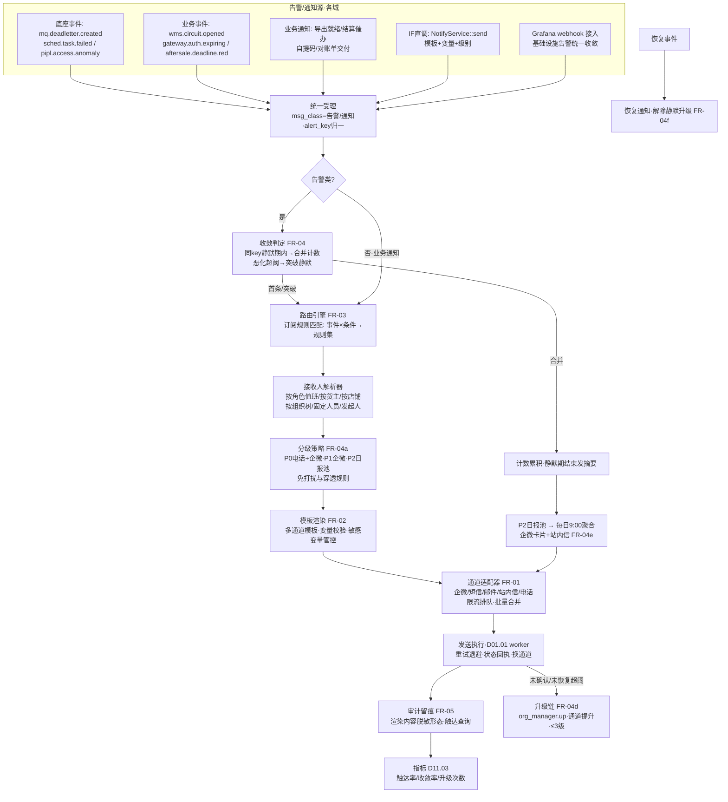
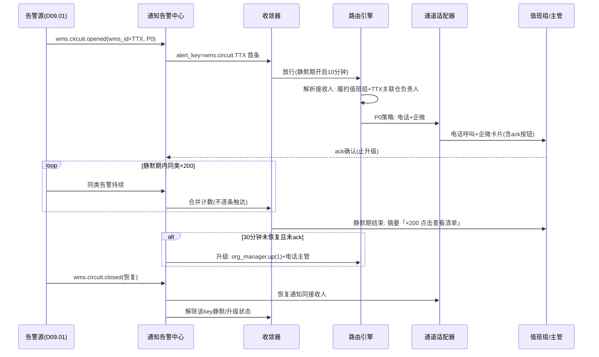

# SRS-D01.07 通知与告警中心 需求规格说明书

> 文档编号：SRS-D01.07 · 版本 V1.0 · 2026-10-24 · 编写：小凯 · 状态：待审阅（批次⑤）
> 所属域：D01 平台底座域 · 分期：**P1（M3；P0 期先落最小可用通道——企微告警是 D01.01/D01.02/D02 各模块 P0 验收的依赖项，机制先行、路由订阅等完整能力 P1 收口）** · schema：oms_base
> 上游依据：SRS-00 §3 D01 清单 · 逆向文档 05 §7.1（taskmgr notify/workwx.php 企业微信失败告警、monitor_event_notify::addNotify('rpc_warning')+库存批量接口硬编码降噪——告警风暴教训）· 07 架构书 §1.3（可观测性栈 Sentry+Prometheus+Grafana）
> 消费方契约（本模块为其服务）：SRS-D01.01（死信/积压/投递器停滞告警，含聚类摘要与 24h 升级）· SRS-D01.02（任务失败/超时/连续失败/DAG 阻断告警，含 Owner 寻址与恢复通知、30 分钟收敛静默）· SRS-D01.05（明文访问异常探测告警/DSR 超期/KMS 故障）· SRS-D01.06（任务完成/失败/导出就绪通知，链接与密码分通道）· SRS-D02.06 EF-D02.06-03（授权过期分级告警：7 天提醒/24h 告警/过期紧急，企微+短信）· SRS-D03.03（分派通知/超时升级）· SRS-D03.09（异常分派/超卖应急/推仓失败激增企微告警）· SRS-D03.11（门店接单提醒/消费者自提码短信）· SRS-D05.05 FR-05b（临期红色预警升级主管）· SRS-D06.04（供应商对账单邮件发送）· SRS-D08.01（账龄 >90 天红色预警/差异日报推财务负责人）· SRS-D08.02（结算确认催办：门户+短信+邮件）· SRS-D09.01（WMS 熔断/降级/绑定失效告警）· SRS-D09.05（面单水位预警/账号熔断告警）· SRS-D02.01 FR-08b（成功率骤降告警+高频失败降噪规则可配）
> 定位：全系统**消息触达的唯一出口**。业务域声明「什么事件通知谁」，本中心提供：多通道适配器（企微/短信/邮件/站内信，可插拔）、模板管理与变量渲染、通知路由（事件→订阅规则→接收人）、告警分级与收敛（合并/静默/升级）、审计留痕。**通知**（业务触达，面向运营/消费者/供应商）与**告警**（系统异常，面向值班/Owner）同一管道、不同策略。

---

## 1. 模块概述

### 1.1 定位

商派告警能力仅有 taskmgr 的企业微信失败通知（notify/workwx.php）与 monitor_event_notify 事件通知，且降噪靠硬编码排除（库存批量接口告警风暴，逆向文档 05 §7.1）；无模板管理、无订阅路由、无收敛升级体系。凯淳建设统一通知与告警中心：通道适配器可插拔（新通道=实现适配器+注册）、模板化（变量渲染/多通道同源）、**订阅路由规则化**（事件→按角色/货主/店铺解析接收人，商派「发给固定企微群」升级为精准触达）、告警分级（P0 电话+企微/P1 企微/P2 日报汇总）与收敛（同类合并/静默期/升级——把商派硬编码降噪升级为可配置收敛规则）。

### 1.2 职责边界

**做**：通道适配器框架（企微应用消息/企微群机器人/短信/邮件/门户站内信，可插拔注册）、通知模板管理（变量渲染/多通道模板/版本化）、通知路由（订阅规则：事件→接收人解析→通道选择→分级策略）、告警分级与收敛（同类合并/静默期/升级策略/恢复通知）、P2 日报汇总（低频告警聚合定时发送）、发送执行与状态跟踪（送达/失败/重试）、通知与告警审计留痕、消费者触达场景支撑（自提码/发票交付等经短信/邮件通道）、告警清单治理（各域声明汇总登记）。

**不做**：告警的**产生**（各域/底座模块自己判定异常并调本中心发送——本中心不扫描业务数据）；Prometheus/Grafana 指标告警体系（基础设施层告警走可观测栈，本中心承接**业务语义**通知与告警；Grafana 可经 webhook 接入本中心统一收敛与触达）；审批流催办的流程逻辑（→ D10.05，本中心只发催办消息）；站内信的门户前端实现（本中心提供数据与已读接口，界面归 D10 门户）；平台侧消费者消息（平台订单的买家通知走平台通道，D02.04 回传体系，非本中心）。

### 1.3 与其他模块关系

| 模块 | 关系 |
|---|---|
| 全部域 | 通知/告警发送的唯一出口（IF 调用或事件订阅） |
| D01.01 | 自身告警经 MQ 事件接入（mq.deadletter.created 等）；发送任务经任务通道异步执行 |
| D01.02 | 日报汇总/重试扫描调度；自身失败告警消费方 |
| D10.01/D10.02 | 接收人解析的数据源（组织树/角色/值班表/账户联系方式） |
| D01.05 | 通知内容脱敏（消费者手机等敏感字段在通知正文中的形态）；导出链接/密码分通道策略执行 |
| D10.06 | 发送与操作审计留痕 |
| D11.03 | 告警量/触达率/收敛率指标供数 |

---

## 2. 业务场景（消费方场景）

**SC-D01.07-01 授权过期分级告警（D02.06 SC-03/FR-04c）**
京东店铺 token 剩 7 天：巡检任务发「提醒」级告警（P2，企微通知授权负责人）→ 剩 24h 升级 P1（企微+短信）→ 已过期 P0（电话+企微，同时店铺状态联动暂停）；同一店铺同一告警项在静默期内不重复轰炸（收敛），状态变化（续期成功）自动发恢复通知闭环。

**SC-D01.07-02 WMS 熔断告警与升级（D09.01）**
通天晓接口连续失败触发熔断（`wms.circuit.opened` 事件）：告警路由解析接收人=履约值班组+该 WMS 关联仓的仓库负责人（按组织树解析）→ P0 级电话+企微；熔断持续 30 分钟未恢复 → 升级通知履约主管（升级策略）；恢复（`wms.circuit.closed`）→ 恢复通知同接收人。

**SC-D01.07-03 告警风暴收敛（商派教训的场景化）**
平台库存批量接口故障，5 分钟内产生 200 条同类失败告警：收敛规则（同 alert_key=事件+对象维度 合并）→ 首条即时发送+后续合并为「同类告警 ×200（点击查看清单）」摘要；静默期 30 分钟内该 key 不再逐条触达；D02.01 FR-08b 的降噪规则（高频失败接口默认降噪）在订阅规则层配置化实现——不再硬编码。

**SC-D01.07-04 结算确认催办（D08.02 FR-05d，多通道业务通知）**
品牌方结算单确认期限到期：催办通知按订阅规则触达——品牌方门户站内信+联系人短信+邮件（三通道同源模板，变量=结算单号/金额/期限）；超期再 5 天升级商务介入任务通知（内部企微）；发送状态跟踪（短信送达/邮件退信记录），未送达自动换通道重试。

**SC-D01.07-05 消费者自提码（D03.11 FR-04b，C 端触达）**
门店自提单生成自提码：通知消费者（平台消息通道优先，短信兜底）——短信模板变量=自提码/门店/期限；消费者手机号在通知正文按 D01.05 规约处理（发送必需明文经加密通道给短信服务商，本地留痕脱敏）；自提到期前 24h 再发提醒（D01.02 调度触发）。

**SC-D01.07-06 P2 日报汇总（低优先级聚合）**
非紧急告警（库存对账小额差异/面单水位 20% 预警/临期批次提示）声明 P2 级：不即时触达，进入日报池 → 每日 9:00 按接收人聚合发送日报（企微卡片：昨日 P2 告警 N 条，按类型分组 TOP+链接详情）——低频噪音不打扰，但不丢失。

**SC-D01.07-07 导出就绪分通道交付（D01.06 FR-04c）**
明文导出任务完成：站内信发下载链接（登录可见）、企微/短信发压缩包密码（另通道）——两通道关联同一任务但内容分离（D01.05 管控要求的通道级执行）；链接失效前 2h 站内信提醒。

---

## 3. 功能需求

### FR-D01.07-01 通道适配器框架（可插拔）
- FR-01a 适配器接口：`NotifyChannelInterface { code(); send(message): SendResult; healthCheck(); }`；DI 标签注册即接入（新通道零中心代码改动）；首批通道：企微应用消息（工作通知）、企微群机器人（webhook）、短信（服务商适配：腾讯云/阿里云，可配主备）、邮件（SMTP/服务商 API）、门户站内信（本地存储+已读接口）；预留：电话语音（P0 告警级依赖，接入服务商语音呼叫 API）、钉钉/飞书（按需）。
- FR-01b 通道配置：每通道实例配置（企微 corp/agent 凭证、短信签名与服务商密钥——凭证经 D01.05 L3 加密、SMTP 账号）；通道级开关与限流（服务商配额：短信条/日、企微应用消息频率限制——超限排队削峰不丢弃）。
- FR-01c 通道健康与故障转移：healthCheck 定时探活（D01.02）；通道故障→声明了备选通道的消息自动切换（短信主服务商故障→备服务商；企微故障→P0 告警切电话）；故障事件自身告警（元告警走独立最小通道，防「告警系统挂了没人知道」——电话直呼值班）。
- FR-01d 发送执行：异步化（发送任务经 D01.01 worker 池，业务调用即返回受理）；失败重试（通道级退避：短信 1/5/15 分钟×3，仍失败标记发送失败）；批量发送（同内容多接收人合并请求，服务商批量接口）。
- FR-01e 发送状态跟踪：受理→提交服务商→送达/失败（回执订阅：短信状态报告/邮件退信/企微已读可选）；未送达按策略换通道重试（SC-04）。

### FR-D01.07-02 通知模板管理
- FR-02a 模板模型：模板编码（全局唯一，`{域}.{场景}`如 `gateway.auth.expiring`）/名称/归属域/通道模板集（同场景企微卡片/短信文本/邮件 HTML/站内信各一份——多通道同源变量）/变量声明（名称/类型/必填/示例/**敏感标记**）/版本与状态。
- FR-02b 变量渲染：`{{变量}}` 占位符渲染（发送时变量表注入）；渲染校验（缺必填变量拒绝发送并报错——防「尊敬的 null」事故）；条件块（简单 if：`{{#if 升级}}【升级】{{/if}}`）；列表循环（日报聚合场景：`{{#each 告警项}}`）。
- FR-02c 敏感变量管控（联动 D01.05）：变量声明 sensitive 标记（消费者手机/身份证类）——渲染进正文前按通道规约处理（短信发送必需明文的走服务商加密通道，本地日志/留痕一律脱敏形态；非必要明文变量直接拒绝渲染）。
- FR-02d 模板治理：版本化（变更生成新版，发送记录关联模板版本——「当时发的什么内容」可回放）；预览（样例变量渲染测试）；审批（对 C 端/供应商外发模板变更需 Owner+合规确认，内部告警模板 Owner 自管）；模板审计。
- FR-02e 多语言/多主体预留：模板预留 locale 与发送主体（签名/发件人）维度（凯淳/品牌方名义外发，P2 场景占位）。

### FR-D01.07-03 通知路由（事件→订阅规则→接收人）
- FR-03a 订阅规则模型：`事件(alert_key 模式) × 条件(域/级别/对象维度：店铺/货主/仓/WMS) → 接收人解析器 × 通道集 × 分级策略`；规则可多条（同事件多组接收人：值班组+货主负责人各自通道）；优先级与兜底（无规则命中→域缺省值班组，禁止静默丢弃）。
- FR-03b 接收人解析器（动态解析，商派固定群升级）：
  - 按角色：`role(履约值班)` → 当前在班成员（值班表集成，D10.02 账户）；
  - 按货主：`owner_manager(事件.owner_id)` → 货主负责人（D10.01 组织关联）；
  - 按店铺：`shop_binder(事件.shop_id)` → 店铺授权负责人/运营绑定人（D02.06 档案）；
  - 按组织树：`org_manager(事件.branch_id).up(1)` → 仓负责人的上级（升级用）；
  - 固定人员/固定群：显式账户列表/企微群 webhook；
  - 发起人与关联人：任务发起人（D01.06 就绪通知）、审批申请人等事件内引用。
- FR-03c 通知 vs 告警双策略：业务通知（催办/就绪/对账单交付——发给业务相关人，无收敛不限时段）与系统告警（异常——发给值班/Owner，走 FR-04 分级收敛）在同一管道以 `msg_class` 区分，策略集不同。
- FR-03d 免打扰与例外：非工作时间策略（P2 通知延迟到工作时间发；P0/P1 告警全天候穿透）；个人免打扰设置（仅对 P2 与业务通知生效，P0/P1 不可屏蔽——值班责任红线）；C 端消费者通知时段限制（短信 8:00-21:00，超窗延迟）。
- FR-03e 订阅规则配置界面：规则 CRUD/启停/测试发送（模拟事件验证路由与渲染）；变更审计。

### FR-D01.07-04 告警分级与收敛
- FR-04a 告警分级（全系统统一口径，事件登记时声明级别）：

| 级别 | 定义 | 通道策略 | 响应 SLA |
|---|---|---|---|
| P0 | 业务停摆/资损进行中（消费停滞/WMS 熔断/授权全过期/KMS 故障/超卖批量） | **电话+企微**（即时，穿透免打扰） | 5 分钟响应 |
| P1 | 功能受损/SLA 违约（任务连续失败/积压超阈/回传失败超限/授权 24h 内过期/死信新增） | 企微即时（+短信可配） | 30 分钟响应 |
| P2 | 需关注非紧急（对账小额差异/水位预警/临期提示/低频任务失败） | **日报汇总**（FR-04e） | 当日知悉 |

- FR-04b 收敛——同类合并：alert_key（事件名+对象维度模板，如 `wms.circuit.{wms_id}`、`api.fail.{platform}.{method}`）相同且静默期内 → 首条即时发，后续合并计数；静默期结束发累计摘要（「静默期内同类 ×N」）；合并清单可下钻（详情链接）。
- FR-04c 收敛——静默期：按 alert_key 配置（默认 P0=10 分钟/P1=30 分钟/P2=进日报池）；静默期内状态恶化（计数超升级阈值）→ 突破静默再发（升级语义，SC-03 的 200 条不轰炸但 ×200 摘要必达）。
- FR-04d 升级策略：告警未确认（值班台 ack）或未恢复且持续超阈值（P0 持续 30 分钟/P1 持续 2 小时，可按 alert_key 配）→ 升级上一级接收人（org_manager.up）+提升通道（P1→加短信、P0 持续→电话主管）；升级链最多 3 级（防无限上探）；确认（ack）即止升级（值班台/企微卡片按钮）。
- FR-04e 日报汇总：P2 池按接收人聚合，每日 9:00（可配）企微卡片+站内信日报（按类型分组 TOP+计数+链接）；日报零条不发（免噪音）；日报留档可查历史。
- FR-04f 恢复通知：告警对象声明恢复事件（`wms.circuit.closed`/任务转成功）→ 自动向原告警接收人发恢复（闭环确认，D01.02 FR-09c 同款）；恢复同时解除该 key 静默/升级状态。
- FR-04g 降噪配置化（商派硬编码教训）：高频低价值告警源（库存批量同步失败类）在订阅规则声明降噪（仅计数进日报/阈值触发才即时发）——规则配置化而非代码排除（D02.01 FR-08b「降噪规则可配」的承载）。

### FR-D01.07-05 发送审计与留痕
- FR-05a 发送记录：每条消息全量留痕（消息 ID/事件与 alert_key/模板与版本/渲染后内容（敏感变量脱敏形态）/接收人解析结果/通道/发送状态与回执/重试记录/关联业务对象）；在线 90 天+归档（对账与「当时通知过谁」争议依据）。
- FR-05b 操作审计：订阅规则/模板/通道配置/降噪与静默手工操作、告警 ack/升级人工干预——全部写 D10.06。
- FR-05c 触达查询：按人（我收到过什么）/按事件（这个告警发给了谁、送达没有）/按业务对象（这个订单/店铺相关的全部通知）三维检索；催办类通知的送达凭证（D08.02 结算催办的合规依据）。
- FR-05d 指标供数（D11.03）：发送量/成功率/触达时长（事件→送达 P95）/收敛率（合并数/原始数）/升级次数/日报量；触达率 100% 承诺的监控口径（D05.02/D05.04 §8「预警触达率 100%」的度量源）。

### FR-D01.07-06 告警清单（各域已声明告警汇总登记）

> 汇总来源=各模块 SRS 对 D01.07 的告警引用；登记视图（级别为建议值，接入时按 FR-04a 口径评审确认），新告警接入前在此登记（alert_key/级别/接收人策略/降噪规则齐备才准入）。

| 域 | 告警/通知 | 建议级别 | 来源 |
|---|---|---|---|
| D01.01 | MQ 消费停滞（有积压零速率 5 分钟） | P0 | D01.01 FR-07b |
| D01.01 | outbox 投递器停滞（滞留 >5 分钟） | P0 | D01.01 FR-07b |
| D01.01 | 队列积压超阈/消费延迟超 SLA | P1 | D01.01 FR-07b |
| D01.01 | 死信新增（聚类摘要）/死信积压 >24h 升级 | P1→P0 | D01.01 FR-04e |
| D01.02 | 调度任务失败/超时/连续失败 ≥3 | 按任务声明（对账类 P0） | D01.02 FR-09a |
| D01.02 | DAG 阻断/窗口内未完成/重叠跳过 ≥3 | P1 | D01.02 FR-09a |
| D01.03 | 缓存失效延迟/沙箱副作用违例 | P1 | D01.03 §8 |
| D01.05 | 明文访问异常探测（高频/爬取模式） | P1 | D01.05 FR-07b |
| D01.05 | 凭证异常高频取用（泄露探测） | P0 | D01.05 FR-07b |
| D01.05 | KMS 故障/DSR 超期 | P0 / P1 | D01.05 §8/FR-05d |
| D01.06 | 导入导出任务失败/僵尸任务/进度停滞 | P1 | D01.06 FR-05d |
| D01.06 | 任务完成/部分成功/导出就绪（业务通知） | 通知 | D01.06 FR-05c |
| D02.01 | 平台接口成功率骤降（5 分钟 <80%）/持续限流 | P1（降噪可配） | D02.01 FR-08b |
| D02.01 | 连续 AUTH 失败 | P1 | D02.01 FR-08b |
| D02.03 | 拉单水位落后 >30 分钟（水位停滞） | P0 | D02.03 FR-07b |
| D02.03 | 消息缓冲积压超阈/投递连续失败/消息死信 | P1 | D02.03 FR-07b |
| D02.05 | api_fail 死信新增/死信积压 >24h/对账差异 | P1→P0 | D02.05 FR-05d |
| D02.06 | 授权过期分级（7 天提醒/24h 告警/已过期紧急） | P2/P1/P0 | D02.06 FR-04c |
| D03.03 | 审单分派通知/审核超时升级 | 通知/P1 | D03.03 IF-09 |
| D03.02 | 审单积压 >1000 组/通过率骤降 20% | P1 | D03.02 §8 |
| D03.09 | 异常单超期/类型数量突增（推仓失败激增=WMS 故障信号）/超卖应急 | P1/P0 | D03.09 FR-08c |
| D03.11 | 门店接单提醒/自提码与到期提醒（C 端） | 通知 | D03.11 FR-04b |
| D03.12 | 申报失败激增/报关通道不可用/备案失效/账册实质差异 | P0/P1 | D03.12 EF-04 |
| D04.02 | 库存对账差异（Redis-DB 连续差异升级人工） | P1→P0 | D04.02 FR-05c |
| D04.03 | 预占过期回收异常/对账兜底差异 | P1 | D04.03（SRS-00 清单） |
| D04.08 | 可售同步延迟/回写失败超阈（库存回写失败） | P1 | D04.08 |
| D04.09 | 临期批次预警（日报） | P2 | D04.09 |
| D04.10 | 库存红色预警即时/黄橙日报 | P1/P2 | D04.10 EF-01 |
| D05.01 | 售后临期黄色置顶提醒/红色升级主管/平台超时自动同意 | P1/P0 | D05.01 FR-06b |
| D05.05 | 临期兜底红色预警/风控拦截异常/改判率超 5% 告警规则 Owner | P0/P1 | D05.05 FR-05b/FR-06b |
| D05.02/04 | 退货差异等待/预报超期/处置超期/补发挂起预警 | P1 | D05.02/D05.04 §8 |
| D05.03 | 退款日终对账差异 | P1 | D05.03 §4 |
| D06.01/03 | 采购审批结果与驳回通知/到货超期 7 天未认领告警主管/跟催提醒 | 通知/P1 | D06.01 FR-02b、D06.03 FR-06c |
| D06.04 | 供应商对账单邮件交付 | 通知 | D06.04 FR-05a |
| D08.01 | 账龄 >90 天红色预警/账单差异日报/未决差异持续提醒 | P1/P2 日报 | D08.01 FR-09c/07d |
| D08.02 | 结算单生成失败告警/确认超期催办（门户+短信+邮件）/商务介入 | P1/通知 | D08.02 FR-02a/05d |
| D08.03 | 核销逾期预警（到期前 3 天+逾期当日红色）/月度差异超阈值 | P1 | D08.03 FR-04d/06b |
| D08.05/06 | 开票批量失败/金蝶供数缺失连续告警/结账检查报告推送 | P1/通知 | D08.05、D08.06 FR-02b/04f |
| D09.01 | WMS 熔断开启/降级/绑定失效 | P0/P1 | D09.01 IF-04/D3 |
| D09.02/03 | 出库/入库回传失败超限/超时未决/无主回传/缓冲超限/差异挂起超期 | P1 | D09.02 IF-D6、D09.03 IF-D7 |
| D09.04 | 分单配置校验失败/停运生效通知 | P1/通知 | D09.04 IF-D7 |
| D09.05 | 面单号池水位（预取 20%/告警 5%/限额 80%）/账号熔断 | P2/P1/P0 | D09.05 FR-01d/04b |
| D10.05 | 审批超时提醒（OA 联动催办） | 通知/P2 | D10.05 |

---

## 4. 业务流程

### 4.1 通知路由架构



### 4.2 告警收敛与升级时序（SC-02/SC-03）



---

## 5. 处理逻辑

### 5.1 路由决策（伪代码）

```
dispatch(message):
    key = alert_key(message)                    # 事件名+对象维度模板归一
    if message.class == 告警:
        if 收敛器.静默中(key):
            if 未恶化超升级阈值: 合并计数; return
            # 恶化 → 突破静默(摘要形态)
    rules = 订阅规则.match(message.event, 条件维度)   # 多条规则全执行
    if rules.empty: rules = [域缺省值班规则]          # 禁止静默丢弃
    for rule in rules:
        receivers = rule.解析器集.resolve(message)     # 角色/货主/店铺/组织树/固定
        level = rule.级别覆写 ?? message.声明级别
        channels = 分级通道策略(level, 时段, 免打扰例外)
        for ch in channels:
            content = 模板渲染(rule.template[ch], message.vars)  # 缺变量拒发报错
            发送队列.push(ch, receivers, content, 关联key)        # 异步worker执行
    审计.记录(全量)
```

### 5.2 收敛状态机（per alert_key）

```
[无状态] --首条--> [静默期开启] 即时发送
[静默期] --同类--> 计数+1(不发送)
[静默期] --计数超升级阈值--> 突破静默发摘要(重置计数, 静默续期)
[静默期] --到期--> 发累计摘要(「×N」) → [无状态]
[任意态] --恢复事件--> 发恢复通知 → 清零解除
[任意态] --P0/P1未ack且持续超阈--> 升级(接收人up+通道提升, ≤3级)
升级链记录入审计(何时升给谁, 复盘依据)
```

### 5.3 通道选择与降级矩阵

| 级别/类型 | 首选 | 降级/兜底 | 说明 |
|---|---|---|---|
| P0 告警 | 电话+企微 | 企微故障→短信；全故障→元告警电话直呼值班 | 穿透免打扰 |
| P1 告警 | 企微 | 企微故障→短信 | |
| P2 告警 | 日报池（企微卡片+站内信） | — | 零条不发 |
| 业务通知（内部） | 站内信+企微（按规则） | 未送达换通道 | 催办类记录送达凭证 |
| C 端消费者 | 平台通道优先，短信兜底（D03.11 口径） | 时段限制 8:00-21:00 | 敏感变量 D01.05 规约 |
| 外发（供应商/品牌方） | 邮件 | 退信→短信联系人 | 对账单类含附件走 OSS 链接 |
| 链接/密码分离（D01.06） | 链接=站内信；密码=企微/短信 | 双通道关联同任务 | 管控要求通道级执行 |

### 5.4 限流与配额保护

```
通道级令牌桶(服务商配额): 短信 日配额扣减+速率限制; 企微应用消息 频率限制
超限行为: 排队削峰(优先级=P0>P1>通知>P2), 不丢弃; 队列深度告警
批量合并: 同模板同内容多接收人 → 服务商批量接口一次请求
风暴保护: 单事件源1分钟内>100条 → 强制进收敛(即使未配静默)+通知源治理告警
         (防某域bug刷爆通道——商派库存接口告警风暴的机制化防线)
```

---

## 6. 数据字段（业务字段描述，schema：oms_base）

### 6.1 通知模板（notify_template）

| 字段 | 业务含义 | 取值/校验 |
|---|---|---|
| template_code / name / domain | 模板标识 | `{域}.{场景}` 全局唯一 |
| channel_contents | 通道模板集 | JSON：企微卡片/短信/邮件 HTML/站内信（多通道同源变量） |
| variables | 变量声明 | 名称/类型/必填/示例/敏感标记（FR-02c） |
| version / status / owner | 版本/启停/Owner | 变更版本化+审计；C 端模板变更需合规确认 |
| locale / sender_ref | 多语言/发送主体 | P2 预留 |

### 6.2 订阅规则（notify_subscription）

| 字段 | 业务含义 |
|---|---|
| rule_id / event_pattern | 事件匹配（alert_key 模式，支持通配） |
| condition_json | 条件维度（域/级别/店铺/货主/仓/WMS…） |
| receiver_resolvers | 接收人解析器声明（类型+参数：role/owner_manager/shop_binder/org_manager.up/fixed/initiator） |
| channels / level_override | 通道集与级别覆写 |
| silence_json / escalate_json | 静默期与升级策略（FR-04c/04d 可按 key 覆写默认） |
| denoise_flag | 降噪声明（FR-04g：仅计数进日报/阈值触发即时发） |
| priority / status / default_flag | 优先级/启停/域缺省规则标记（兜底不可删） |

### 6.3 发送记录（notify_send_log，按月分区，在线 90 天+归档）

| 字段 | 业务含义 |
|---|---|
| msg_id / biz_event / alert_key / msg_class | 消息定位（告警/通知） |
| template_code / version / rendered_content | 模板版本与渲染内容（敏感变量脱敏形态留存） |
| receiver_raw / receiver_resolved | 接收人（解析结果快照：账户/手机脱敏形态） |
| channel / send_status / receipt | 通道/状态（受理/提交/送达/失败）/服务商回执 |
| retry_count / fail_reason / fallback_channel | 重试与换通道记录 |
| merged_count / silence_ref | 合并计数（收敛摘要消息关联） |
| biz_ref / trace_id / create_time | 关联业务对象（订单/店铺/任务号）/追踪 |

### 6.4 告警状态（notify_alert_state，收敛与升级的运行态）

| 字段 | 业务含义 |
|---|---|
| alert_key / first_time / last_time | 告警键与首末次时间 |
| merged_count / silence_until | 静默期合并计数/静默截止 |
| level / ack_by / ack_time | 当前级别/确认人（止升级依据） |
| escalate_level / escalate_time | 升级层级（≤3）与时间 |
| recovered / recover_time | 恢复状态（闭环标记） |

### 6.5 值班表（notify_duty_roster，接收人解析数据源之一）

| 字段 | 业务含义 |
|---|---|
| role_code / date / shift | 角色×日期×班次（履约值班/财务值班/运维值班…） |
| account_ids / contact_snapshot | 值班成员与联系方式快照（解析时点固化） |

---

## 7. 接口

### 7.1 内部接口（本模块提供）

| 编号 | 接口 | 消费方 | 说明 |
|---|---|---|---|
| IF-D01.07-01 | `NotifyService::send(templateCode, vars, msg_class, biz_ref, 级别?)` | 全域（D03.03 IF-D10 `sendWecom` 等既有引用的统一实现） | 直调发送（模板+变量，路由自动） |
| IF-D01.07-02 | `AlertService::alert(alert_key, 级别, vars, 恢复事件?)` | 全域告警源 | 告警发送（收敛/升级/恢复闭环） |
| IF-D01.07-03 | 订阅事件：`mq.*` / `sched.task.*` / `pipl.*` / `ie.*` / `wms.circuit.*` / `gateway.auth.*` / `aftersale.*` / `order.exception.*` / `kd.*` 等（FR-06 清单全量） | 各域事件发布方 | 事件驱动通知（发布方零耦合——只发事件不关心谁收） |
| IF-D01.07-04 | `InboxService::list/markRead(account)` | D10 门户站内信界面 | 站内信数据与已读 |
| IF-D01.07-05 | `NotifyChannelInterface` + DI 标签注册 | 通道扩展方 | 适配器接入规范 |
| IF-D01.07-06 | `SendLogService::query(人/事件/业务对象)` / `ackAlert(alert_key, account)` | 触达查询界面/企微卡片 ack 回调/值班台 | 审计检索与告警确认 |
| IF-D01.07-07 | `TemplateService` / `SubscriptionService` CRUD+测试发送 | 配置后台 | 模板与订阅规则治理（审计） |
| IF-D01.07-08 | 指标暴露（发送量/成功率/触达时长/收敛率） | D11.03 | 触达率 100% 监控口径 |

### 7.2 依赖接口

| 编号 | 接口 | 提供方 | 说明 |
|---|---|---|---|
| IF-D01.07-D1 | 任务通道（发送 worker 异步执行） | D01.01 | 发送与重试承载 |
| IF-D01.07-D2 | 日报汇总/通道探活调度 | D01.02 | FR-04e/FR-01c |
| IF-D01.07-D3 | 账户/角色/组织树/联系方式 | D10.01/D10.02 | 接收人解析数据源 |
| IF-D01.07-D4 | 敏感变量管控规约 | D01.05 | 通知内容脱敏（FR-02c） |
| IF-D01.07-D5 | 配置与操作审计 | D10.06 | FR-05b |

### 7.3 外部接口

| 编号 | 接口 | 方向 | 说明 |
|---|---|---|---|
| EF-D01.07-01 | 企业微信（应用消息 API/群机器人 webhook） | 出 | 凭证 D01.05 L3 加密 |
| EF-D01.07-02 | 短信服务商（主备双商，状态报告回执订阅） | 双向 | C 端/催办/告警兜底 |
| EF-D01.07-03 | 邮件（SMTP/服务商 API，退信回执） | 出 | 外发对账单/催办 |
| EF-D01.07-04 | 电话语音服务商（P0 呼叫） | 出 | 分级最高通道 |
| EF-D01.07-05 | Grafana/Alertmanager webhook 接入 | 入 | 基础设施告警统一收敛触达 |

---

## 8. 非功能需求

| 项 | 要求 |
|---|---|
| 时效 | P0 告警事件→电话拨出 ≤60s；P1 →企微送达 ≤2 分钟；业务通知 ≤5 分钟；日报 9:00±5 分钟 |
| 可靠性 | 触达率 100% 承诺（D05.02/D05.04 §8 口径）：发送失败重试+换通道+兜底规则禁止静默丢弃；通道全故障→元告警独立最小通道；发送记录不丢（受理即落库） |
| 收敛有效性 | 告警风暴（单源 200 条/5 分钟）场景人工触达 ≤3 条（首条+摘要+升级如有）；风暴保护强制收敛（§5.4） |
| 吞吐 | 日常 ≤1 万条/日，大促峰值 ≤10 万条/日（含合并前原始量）；worker 池限流排队不丢弃 |
| 安全 | 通知内容敏感变量脱敏（D01.05）；通道凭证 L3 加密；C 端短信内容合规审查（模板报备）；链接类消息防钓鱼（域名白名单+一次性令牌） |
| 可观测 | 发送量/成功率/触达时长 P95/收敛率/升级次数指标（D11.03）；通道健康看板；日报历史留档 |
| 容量 | 发送记录日均 ≈5000 条（收敛后），在线 90 天按月分区；告警状态表 ≤1 万活跃 key |

---

## 9. 验收标准

| 编号 | 验收条件 |
|---|---|
| AC-01 | 通道可插拔：新注册一个通道适配器（模拟钉钉）零中心代码改动即可被订阅规则选用；通道 healthCheck 故障注入后消息自动切换声明的备选通道 |
| AC-02 | 分级触达：P0 告警（模拟 WMS 熔断）60 秒内电话拨出+企微送达，穿透免打扰设置；P1 仅企微；P2 进日报池次日 9:00 聚合送达（零条不发） |
| AC-03 | 收敛验证（SC-03）：单 alert_key 5 分钟注入 200 条——人工实际触达 ≤3 条（首条即时+静默期摘要），合并清单可下钻全部 200 条明细；静默期内计数超升级阈值时突破静默发摘要 |
| AC-04 | 升级链：P0 告警未 ack 持续 30 分钟自动升级 org_manager.up(1)+电话主管；ack 后止升级；升级链最多 3 级；全部升级动作审计可查 |
| AC-05 | 恢复闭环：告警后发恢复事件——原接收人收到恢复通知，该 key 静默/升级状态清零；恢复前后告警状态时间线完整（SC-02 全链路验证） |
| AC-06 | 接收人动态解析：按角色（值班表当日在班）/按货主（组织关联负责人）/按店铺（授权负责人）三类解析器命中正确人员；值班表换人后次日解析自动切换；无规则命中事件走域缺省值班规则（零静默丢弃验证） |
| AC-07 | 模板治理：缺必填变量的发送请求被拒并报错（不产生「null」内容）；模板变更后新发送用新版本、历史记录关联旧版本可回放渲染内容；C 端模板变更未合规确认无法发布 |
| AC-08 | 敏感内容管控：含消费者手机变量的短信——服务商通道正常发送明文，本地发送记录与日志中该变量为脱敏形态；非必要明文敏感变量渲染被拒 |
| AC-09 | 发送状态与换通道：短信服务商返回失败（空号）——按策略换通道（站内信+邮件）重试并记录；催办类通知送达凭证可查（D08.02 结算催办场景验证） |
| AC-10 | 分通道交付：明文导出就绪通知——链接经站内信、密码经企微分别送达且关联同一任务（D01.06 SC-07 联动验证）；链接 24h 失效前 2h 提醒 |
| AC-11 | 审计与触达查询：按人/按事件/按业务对象三维检索发送记录完整；订阅规则/降噪/静默手工操作全审计；触达率/收敛率/升级次数指标上报 D11.03 准确 |
| AC-12 | 风暴保护：模拟某域 bug 单事件源 1 分钟刷 500 条——强制收敛生效+通知源治理告警发出，通道配额不被耗尽（其他告警正常触达） |

---

## 变更记录

| 日期 | 版本 | 变更 | 原因 |
|---|---|---|---|
| 2026-10-24 | V1.0 | 首版 | — |

---

*参考实现溯源：商派告警能力仅两处点状实现——① taskmgr `notify/workwx.php` 企业微信失败通知（任务失败直发固定企微群，无分级无路由，逆向文档 05 §7.1）；② `monitor_event_notify::addNotify('rpc_warning')` API 调用失败告警，但**硬编码排除库存批量更新接口**（store.items.quantity.list.update 高频失败告警风暴，代码级降噪——本 SRS FR-04g 降噪配置化与 §5.4 风暴保护的直接教训来源）；③ 短信/邮件散落在各业务模块直连服务商（无统一模板与台账）。重写差异：① 点状直发 → 统一中心（全系统触达单一出口，发送记录/审计/指标集中）；② 固定企微群 → 接收人动态解析器（角色值班/货主负责人/店铺绑定人/组织树升级——精准触达与升级链）；③ 无分级 → P0/P1/P2 三级通道策略（电话+企微/企微/日报汇总）+免打扰穿透规则；④ 硬编码降噪 → alert_key 收敛状态机（同类合并/静默期/突破升级/恢复闭环）+订阅规则降噪声明+单源风暴强制保护；⑤ 无模板管理 → 多通道同源模板+变量校验+版本化回放+敏感变量 D01.05 管控；⑥ 通知与告警双策略同管道（催办/就绪/自提码类业务通知与系统告警分野，免打扰与收敛策略差异化）；⑦ 通道适配器可插拔+主备故障转移+元告警独立通道（告警系统自身可用性防线）；⑧ 各域 SRS 已声明告警全量登记为 FR-06 清单（alert_key/级别/接收人策略接入前评审准入——告警治理前置，防「上线才想发给谁」）。*
