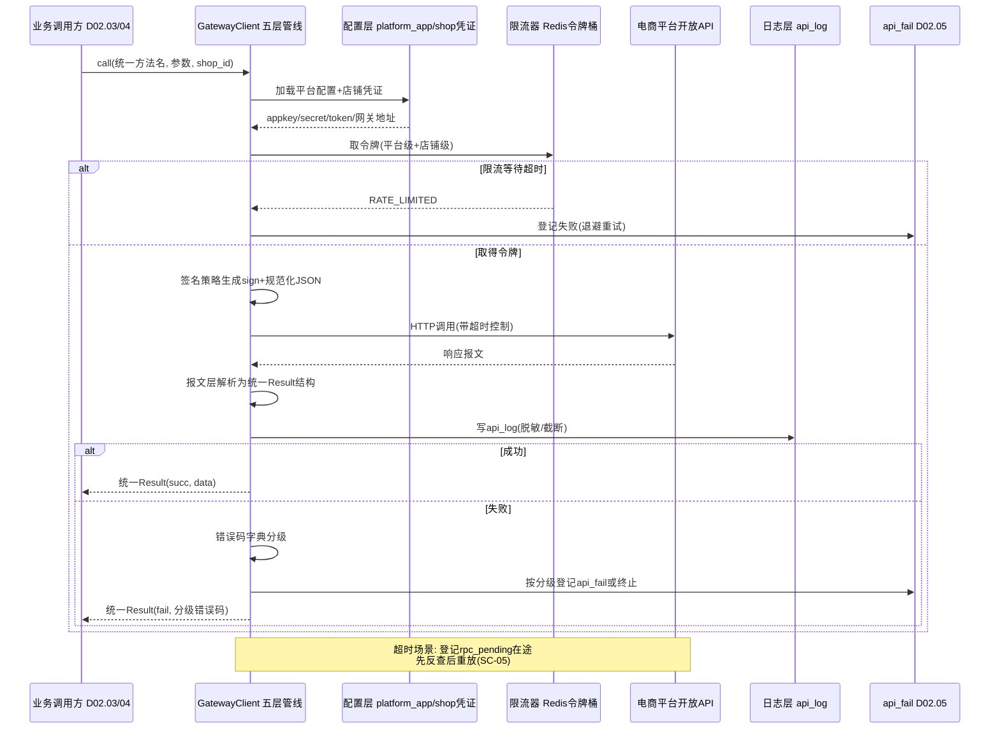
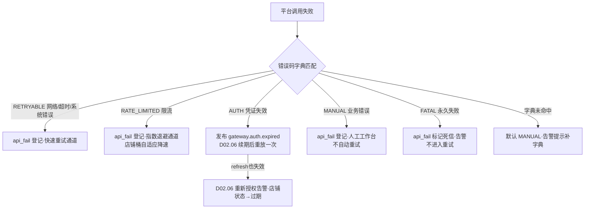

# SRS-D02.01 平台接入框架模块 需求规格说明书

> 文档编号：SRS-D02.01 · 版本 V1.0 · 2026-10-23 · 编写：小凯 · 状态：待审阅（批次②）
> 所属域：D02 平台 Gateway 域 · 分期：**P0（M1）**
> 上游依据：SRS-00 总纲 §3 D02 模块清单 · 逆向文档 05 §1（erpapi 五层架构/签名/api_log/errcode）· 阶段3 需求澄清决策（Q37 拉单延迟 ≤1 分钟）

---

## 1. 模块概述

### 1.1 定位

平台接入框架是 D02 平台 Gateway 域的**统一调用出口**：凯淳自研 OMS 不再经商派矩阵中心代理，所有对电商平台开放 API 的调用（订单下载、发货回传、库存回写、售后同步、商品查询等）均经由本框架完成。框架采用五层设计（配置层→签名层→传输层→报文层→日志层），把「平台协议差异」（签名算法、报文格式、网关地址、频控规则、错误码语义）收敛在框架与适配器（D02.02）内，业务域（D03/D04/D05）只面对统一的服务接口与标准模型。

**部署形态**：模块化单体中的一个域——同代码库、同部署单元，但使用独立数据库 schema `oms_gateway`，域间只通过服务接口与 MQ 事件交互，未来可整体拆分为独立 Gateway 服务而不影响业务域代码。

### 1.2 职责边界

**做**：
- 平台应用配置管理（appkey/secret 加密存储，与 D02.06 店铺授权联动）；
- 签名算法框架（各平台签名策略插件化：md5 拼接签名 / hmac-sha256 / OAuth Bearer 等）；
- session/access_token 托管与自动续期（凭证由 D02.06 管理，本框架负责调用时取用与失效反馈）；
- 限流器（平台级 + 店铺级令牌桶，遵守平台频控上限）；
- 统一错误码字典与分级（可重试/需人工/永久失败，供 D02.05 重试策略消费）；
- api_log 请求日志（全量报文留痕、大报文截断、按月分区）；
- 调用生命周期管理（同步调用 / 异步 MQ 应答 / 超时在途登记与扫描）。

**不做**：
- 平台报文的业务语义映射（→ D02.02 适配器）；
- 拉单三保险的业务编排（→ D02.03）、回传触发（→ D02.04）；
- 失败重试的调度执行（→ D02.05，本框架提供错误分级与 api_fail 登记入口）；
- 店铺档案与授权流程（→ D02.06，本框架是其凭证的消费方）。

### 1.3 与其他模块关系

| 模块 | 关系 |
|---|---|
| D02.02 平台适配器 | 适配器经本框架发起调用；框架把「怎么发」标准化，适配器决定「发什么」 |
| D02.03 拉单与消息接收 | 拉单/单拉/售后同步全部经本框架出口；消息推送接收的验签也走签名层策略 |
| D02.04 回传中心 | 发货/库存/售后回传经本框架出口；失败由框架登记 api_fail |
| D02.05 失败重试与对账 | 框架提供错误码分级结果与 api_fail 登记；重试执行时复用本框架调用链 |
| D02.06 店铺授权管理 | 框架调用前取店铺 session/access_token；token 失效错误反馈给 D02.06 触发续期 |
| D01.01 MQ / D01.02 调度 | 异步调用的应答通道与在途扫描任务依赖底座 |
| D01.05 PIPL 组件 | 日志中含消费者敏感字段时按 PIPL 规范脱敏后落库 |

---

## 2. 业务场景

**SC-D02.01-01 一次同步 API 调用（主流程）**
D02.03 拉单需要按单号单拉一笔淘宝订单：调用方以统一方法名 `shop.order.detail.get` + 参数（shop_id, 平台单号）请求框架。框架依次完成：加载平台配置与店铺凭证 → 令牌桶取令牌（限流）→ 按平台签名策略生成签名 → 组装应用级参数并发起 HTTP 调用 → 解析响应为标准结果结构 → 写 api_log → 返回。全程调用方无需感知淘宝 TOP 协议细节。

**SC-D02.01-02 平台频控限流保护**
大促期间库存回写高频调用拼多多接口，触发平台侧限流风险。框架在店铺级令牌桶按平台公布的频控上限（如拼多多单店 N 次/秒）配置速率，超限请求排队等待（有上限超时），避免打到平台被处罚；连续被平台限流时自动降速（自适应退避）并告警。

**SC-D02.01-03 session 失效自动续期**
调用京东接口返回「access_token 过期」错误码，框架识别为凭证类错误：不盲目重试，标记本次调用 `AUTH_EXPIRED`，异步通知 D02.06 执行 token 刷新；刷新成功后原调用由 D02.05 按可重试策略自动重放。若 refresh_token 也失效，D02.06 触发重新授权告警。

**SC-D02.01-04 大报文调用与日志截断**
拉取一笔 200 行的 B2B 大订单，响应报文超过截断阈值（默认 512KB）。api_log 完整保留请求参数，响应体截断存储并标记 `truncated=true`，原始报文另存对象存储（OSS）留引用地址，兼顾排查需要与日志表体积。

**SC-D02.01-05 网络超时与在途登记**
调用抖音发货回传接口 10 秒未响应。框架中断等待，登记在途请求（rpc_pending 表：方法/参数/业务单号/超时时间），返回 `TIMEOUT` 可重试错误。**不立即重发**（防止平台侧重复发货），由 D02.05 先反查平台侧单据状态确认未生效后再重放——「先对账后重发」是本框架与重试域的联合契约。

**SC-D02.01-06 平台新接口透传（逃生门）**
淘宝上线新接口尚未封装进适配器，运维经透传通道 `common.passthrough` 直接以平台原生方法名 + 原生参数发起调用（仍走签名/限流/日志全链路），用于紧急排障与新接口验证（参考商派 store.common.top.send 设计）。

---

## 3. 功能需求

### FR-D02.01-01 统一调用入口（五层管线）
- FR-01a 提供 `GatewayClient::call(method, params, options)` 唯一出口；method 为内部统一方法名（字典见 FR-06a），options 含 shop_id、业务单号 primary_bn、同步/异步、超时、是否写日志。
- FR-01b 五层管线固定顺序：配置层（平台/店铺配置加载）→ 签名层（凭证+签名）→ 传输层（限流+HTTP+超时）→ 报文层（格式化/解析）→ 日志层（api_log/告警）。各层接口化，可按平台注入差异实现。
- FR-01c 支持同步调用与异步调用两种模式；异步模式经 MQ 应答（替代商派 openapi.asynccallback 两跳回调），在途状态由 rpc_pending 表登记。

### FR-D02.01-02 平台应用配置管理
- FR-02a 平台应用配置表 `platform_app`：平台标识、appkey、app_secret（KMS 加密存储）、网关地址、API 版本、回调地址、频控参数、启停状态。一个平台可配多个应用（如淘系主备应用分流）。
- FR-02b 店铺-应用绑定：店铺（D02.06 shop_auth）关联到具体 platform_app；支持按店铺切换应用（灰度/分流）。
- FR-02c 配置热更新：配置变更经缓存失效广播即时生效，无需重启。

### FR-D02.01-03 签名算法框架
- FR-03a 签名策略接口 `SignStrategy`：输入（参数集、密钥、时间戳/随机数），输出（签名串+附加头）。内置策略：md5-参数排序拼接（淘系 TOP、拼多多）、hmac-sha256（京东 JOS、抖音）、OAuth2 Bearer 头（小红书、唯品会 VOP）等，策略与平台在配置层声明式绑定。
- FR-03b JSON 参数规范化：签名前对 JSON 字符串参数统一 decode→`JSON_UNESCAPED_UNICODE|JSON_UNESCAPED_SLASHES` 重编码（商派 openapi_sign::normalizeValue 教训，中文/\uXXXX 验签不一致是最常见坑，必须内建）。
- FR-03c 入站验签复用：平台推送消息（TMC/webhook）的验签使用同一策略接口反向执行（D02.03 消费）。

### FR-D02.01-04 session 托管与自动续期
- FR-04a 凭证读取：调用前从 D02.06 凭证缓存（Redis）取 session/access_token，缓存未命中回源 shop_auth 表解密；凭证明文不落日志。
- FR-04b 失效识别与反馈：错误码字典中标记为 `AUTH` 类的错误 → 发布 `gateway.auth.expired` 事件（payload：shop_id/platform/err_code）→ D02.06 执行续期；同一店铺续期加分布式锁防并发刷新。
- FR-04c 续期后重放：凭证刷新成功后，原失败调用转入 D02.05 可重试通道自动重放一次。

### FR-D02.01-05 限流器
- FR-05a 两级令牌桶：平台级（appkey 维度，遵守平台对应用的总频控）+ 店铺级（单店频控），Redis+Lua 原子实现，多实例共享配额。
- FR-05b 限流参数配置化：每平台每接口可配 QPS/日配额（如京东 JOS 按接口级限流、淘系按应用级限流），默认值内置平台公布上限的 80%（留安全余量）。
- FR-05c 超限行为：排队等待（最长等待时间可配，默认 3s），等待超时返回 `RATE_LIMITED` 可重试错误交 D02.05 退避重试；高频接口（库存回写）支持合并批量。
- FR-05d 自适应降速：收到平台限流类错误码时，该店铺桶速率临时降为 50%，5 分钟无异常后逐步恢复。

### FR-D02.01-06 统一方法名字典与错误码字典
- FR-06a 方法名字典 `gateway_method`：内部统一方法名（`shop.order.list.get`、`shop.order.detail.get`、`shop.delivery.send`、`shop.stock.sync`、`shop.aftersale.get`、`shop.product.get`、`common.passthrough` 等）→ 各平台原生 API 名的映射由 D02.02 适配器注册；字典带中文语义描述与业务域归属。
- FR-06b 透传通道 `common.passthrough`：入参为（平台原生方法名、原生参数），仅限运维角色使用，走全链路日志与限流，审计留痕操作人。
- FR-06c 统一错误码字典 `gateway_errcode`：平台错误码/错误文本（支持正则）→ 统一分级：`RETRYABLE`（网络/超时/系统内部错误，快速重试）、`RATE_LIMITED`（限流，退避重试）、`AUTH`（凭证失效，续期后重试）、`MANUAL`（业务错误需人工，如「订单已关闭」）、`FATAL`（永久失败，不重试，如接口不存在/无权限）。分级结果驱动 D02.05 的重试策略。
- FR-06d 字典管理后台：错误码字典可视化维护（平台/正则/分级/建议处置/备注），新增平台错误无需改代码。

### FR-D02.01-07 api_log 报文日志
- FR-07a 全量留痕：每次调用记录 log_id、统一方法名、平台原生方法名、shop_id、请求参数、响应报文、HTTP 状态、统一错误码与分级、耗时 spendtime、primary_bn 业务单号、msg_id（平台侧消息号）、重试关联（原 log_id）、调用来源（拉单/回传/重试/透传）。
- FR-07b 大报文截断：响应体超过阈值（默认 512KB，可配）截断入库并标记，原文转存对象存储留 URL；请求参数不截断。
- FR-07c 敏感脱敏：报文中的收货人姓名/电话/地址等消费者敏感字段，落库前经 D01.05 PIPL 组件脱敏；凭证类字段（sign/token/session）强制打码。
- FR-07d 分区与生命周期：按月分区，调度任务自动滚动分区（新增下月/淘汰过期月），在线保留 3 个月，归档转冷存储 1 年（审计要求）。
- FR-07e 日志查询与人工重放：按业务单号/店铺/方法/错误码/时间检索；从日志详情一键发起人工重试（复用 D02.05 通道，幂等键防重复生效）。

### FR-D02.01-08 调用监控与告警
- FR-08a 指标上报：按平台×方法×店铺维度上报调用量/成功率/平均耗时/限流次数（供 D11.03 监控看板）。
- FR-08b 告警规则：成功率骤降（5 分钟窗口 <80%）、连续 AUTH 失败、平台级限流持续触发 → 企微告警（经 D01.07）；库存批量同步类高频失败默认降噪（商派教训：避免告警风暴），降噪规则可配。

---

## 4. 业务流程

### 4.1 API 调用生命周期时序图



### 4.2 错误分级处理分支



---

## 5. 处理逻辑

### 5.1 五层管线的接口划分（伪代码）

```php
interface PlatformConfig  { // 配置层
    function gatewayUrl(method): string;
    function appCredential(shopId): AppCredential;   // appkey/secret/token
    function rateLimitRule(method, shopId): Rule;
}
interface SignStrategy    { // 签名层
    function sign(params, secret, ctx): string;      // md5/hmac-sha256/...
    function verify(payload, sign, secret): bool;    // 入站验签复用
}
interface Transport       { // 传输层
    function send(HttpRequest, timeout): HttpResponse; // 连接池/重试DNS/代理
}
interface MessageFormat   { // 报文层
    function encode(params): string;                 // json/xml/form
    function decode(response): UnifiedResult;        // {succ, data, errCode, msgId}
}
interface CallLogger      { // 日志层
    function log(callContext, UnifiedResult): void;  // api_log+脱敏+截断+指标
}
```

每平台由 D02.02 适配器声明五层的实现绑定（多为「默认实现 + 个别覆写」）。

### 5.2 令牌桶算法（Redis+Lua）

```
key = rl:{platform}:{scope}:{appkey|shop_id}
Lua 原子执行:
  tokens = min(capacity, tokens + (now - last_refill) * rate)
  if tokens >= 1 then tokens -= 1; return ALLOW
  else return WAIT(预估等待毫秒)
两级串联: 平台级 ALLOW 后再取店铺级; 任一 WAIT 超时 → RATE_LIMITED
capacity(突发) = rate * burst_factor(默认2); rate 默认=平台公布上限*0.8
```

### 5.3 超时与在途登记

- 每方法配置超时（默认 10s，拉单批量类 30s）；
- 超时 → 写 `rpc_pending`（method/params 快照/primary_bn/timeout_at/status=在途），返回 TIMEOUT；
- 扫描任务（每分钟，D01.02 调度）：对在途超过 2 倍超时的记录，调适配器反查接口核实平台侧是否已生效 → 已生效则补记成功日志并通知调用方；未生效则转 api_fail 可重试；无法反查（查询类幂等接口除外）保持人工处置。

### 5.4 敏感信息处理规则

| 场景 | 规则 |
|---|---|
| app_secret / session / access_token | KMS/AES-256 加密存储；日志与告警中强制打码（仅留前4后4） |
| 消费者姓名/电话/地址（报文内） | api_log 落库前经 PIPL 组件脱敏；排查需原文时按 D01.05 授权留痕流程临时查看 OSS 原文 |
| 签名串 | 不落日志（可复算） |

---

## 6. 数据字段（业务字段描述，schema：oms_gateway）

### 6.1 平台应用配置（platform_app）

| 字段 | 业务含义 | 取值/校验 |
|---|---|---|
| app_id | 应用 ID | 唯一 |
| platform | 平台标识 | taobao/jd/pdd/xhs/vop/douyin |
| app_key / app_secret_enc | 平台应用凭证 | secret KMS 加密存储，必填 |
| gateway_url / api_version | 网关地址与版本 | 支持沙箱/生产两套 |
| sign_strategy | 签名策略标识 | md5-top/hmac-sha256/bearer... |
| rate_limit_json | 默认频控配置 | 平台级 QPS/日配额/接口级覆写 |
| callback_url | 授权/消息回调地址 | 供 D02.06/D02.03 使用 |
| status | 状态 | 启用/停用/沙箱 |

### 6.2 调用日志（api_log，按月分区）

| 字段 | 业务含义 | 取值/校验 |
|---|---|---|
| log_id | 日志 ID | 唯一，雪花 ID |
| method / native_method | 统一方法名 / 平台原生方法 | 必填 |
| platform / shop_id | 平台 / 店铺 | 必填，索引 |
| primary_bn | 业务单号 | 订单号/发货单号，贯穿排查，索引 |
| request_params / response_body | 请求参数 / 响应报文 | 响应超阈值截断+OSS 引用 |
| is_truncated / oss_ref | 截断标记 / 原文引用 | |
| http_status / err_code / err_level | HTTP 状态 / 统一错误码 / 分级 | 分级枚举见 FR-06c |
| spendtime_ms | 耗时 | 毫秒 |
| msg_id | 平台消息号 | 平台侧对账用 |
| source / retry_of | 调用来源 / 重试关联 log_id | 拉单/回传/重试/透传/对账 |
| operator | 操作人（透传/人工重放时） | 审计 |

### 6.3 在途登记表（rpc_pending）

| 字段 | 业务含义 |
|---|---|
| pending_id / method / shop_id / primary_bn | 定位键 |
| params_snapshot | 参数快照（重放依据） |
| timeout_at / scan_times / status | 超时时间 / 已扫描次数 / 在途-已核实-已转失败 |

### 6.4 错误码字典（gateway_errcode）

| 字段 | 业务含义 |
|---|---|
| platform / native_code / err_pattern | 平台 / 原生错误码 / 错误文本正则（二选一或并用） |
| err_level | RETRYABLE / RATE_LIMITED / AUTH / MANUAL / FATAL |
| advice / note | 处置建议（人工工作台展示）/ 备注 |
| status | 启用/停用 |

---

## 7. 接口

### 7.1 内部接口

| 编号 | 接口 | 消费方 | 说明 |
|---|---|---|---|
| IF-D02.01-01 | `GatewayClient::call(method, params, options)` | D02.02/03/04/05 | 唯一调用出口，同步返回统一 Result |
| IF-D02.01-02 | `GatewayClient::callAsync(method, params, options, onResult)` | D02.03/04 | 异步调用，MQ 应答 |
| IF-D02.01-03 | `SignStrategy::verify(payload, sign, platformCfg)` | D02.03 | 入站消息验签（TMC/webhook） |
| IF-D02.01-04 | `ErrcodeService::classify(platform, errCode, errMsg)` | D02.05 | 错误分级查询 |
| IF-D02.01-05 | `RateLimiter::acquire(platform, shopId, method)` | 域内 | 令牌获取（供批量任务主动节流） |
| IF-D02.01-06 | 事件 `gateway.auth.expired` | D02.06 | 凭证失效反馈 |
| IF-D02.01-07 | 事件 `gateway.call.failed` / `gateway.call.succ` | D02.05/D11.03 | 调用结果事件（监控与重试联动） |

### 7.2 外部接口

| 编号 | 接口 | 方向 | 说明 |
|---|---|---|---|
| EF-D02.01-01 | 6 平台开放 API 网关 | 出 | 淘系 TOP/京东 JOS/拼多多/小红书/唯品会 VOP/抖音，HTTPS |
| EF-D02.01-02 | 对象存储 OSS | 出 | 大报文原文转存 |
| EF-D02.01-03 | 企微告警（经 D01.07） | 出 | 成功率骤降/连续鉴权失败/持续限流 |

---

## 8. 非功能需求

| 项 | 要求 |
|---|---|
| 性能 | 框架自身开销（签名+限流+日志）P99 ≤10ms；单实例支撑 ≥200 QPS 出站调用 |
| 可用性 | 框架无单点：限流配额 Redis 集群化，Redis 故障时限流降级为本地令牌桶（保守速率）并告警 |
| 幂等 | 写类调用（发货回传等）框架层不自动重发；超时一律走「先反查后重放」契约 |
| 安全 | secret/token 加密存储、日志打码、透传通道操作审计；出站仅允许白名单网关域名（SSRF 防护） |
| PIPL | 日志含消费者敏感字段必须脱敏后落库；原文访问走授权留痕 |
| 可观测 | 全链路 trace_id 贯穿（业务域→框架→平台响应）；指标/日志/告警三件套齐备 |
| 扩展性 | 新增平台仅需实现五层接口绑定 + 注册错误码字典，不改框架内核 |

---

## 9. 验收标准

| 编号 | 验收条件 |
|---|---|
| AC-01 | 通过统一出口完成 6 平台各一次真实（沙箱）调用：签名通过、api_log 完整记录请求/响应/耗时/错误分级 |
| AC-02 | JSON 含中文参数调用淘系沙箱接口验签通过（\uXXXX 规范化生效） |
| AC-03 | 店铺级令牌桶限速 5 QPS，压测 20 QPS：实际出站 ≤5 QPS，超限请求排队或返回 RATE_LIMITED，无丢失 |
| AC-04 | 模拟平台返回 token 过期：框架发布 gateway.auth.expired，续期成功后原调用自动重放成功且仅生效一次 |
| AC-05 | 模拟响应 2MB：api_log 响应体截断标记 truncated，OSS 可查到原文，日志表行大小 ≤ 阈值 |
| AC-06 | 模拟调用超时：rpc_pending 登记在途，扫描任务先反查平台状态，未生效才转 api_fail，全程无重复写类调用 |
| AC-07 | 错误码字典新增一条正则规则（不改代码），命中错误即按新分级处理；未命中错误默认 MANUAL 并提示补字典 |
| AC-08 | api_log 按月分区自动滚动：月初自动生成新分区，超期分区自动淘汰归档 |
| AC-09 | 日志中 session/sign/消费者手机号均不可见明文（打码/脱敏校验） |
| AC-10 | 透传通道非运维角色调用被拒绝；运维调用留痕操作人且走全链路限流与日志 |

---

## 变更记录

| 日期 | 版本 | 变更 | 原因 |
|---|---|---|---|
| 2026-10-23 | V1.0 | 首版 | — |

---

*参考实现溯源：商派 erpapi 五层结构（app/erpapi/lib/caller.php 调用入口 / config.php 签名与应用级参数 / app/base/lib/ego/ego.php rpc 传输 / lib/format json-xml 报文 / lib/result.php 结果解析，见逆向文档 05 §1.2-1.5）；签名 JSON 规范化教训（app/openapi/lib/sign.php normalizeValue）；错误码字典（app/erpapi/lib/errcode.php）；api_log 双表机制与 2MB 截断、按月分区（app/ome/dbschema/api_log.php + log_partition_event.ev）；rpcpoll 在途登记（app/base/dbschema/rpcpoll.php）；透传逃生门（apiname.php TAOBAO_COMMON_TOP_SEND/JD_COMMON_TOP_SEND）。关键差异：① 商派经矩阵中心代理、无平台签名/限流实现，本框架**自建签名策略插件、两级令牌桶、session 托管反馈闭环**；② 异步应答由 openapi 两跳 HTTP 回调改为 MQ 应答（少一跳）；③ 错误码由硬编码数组改为可视化管理字典并扩展为五级分级（商派仅 retry=1/0 二值）；④ 日志截断阈值 512KB + OSS 原文转存（商派 2MB 直接丢弃不存）；⑤ 限流为商派完全缺失的能力；⑥ 独立 schema oms_gateway 为未来拆分预留。*
