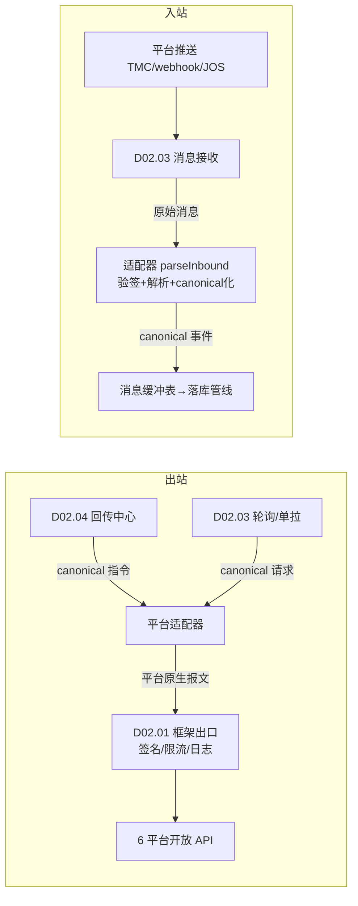
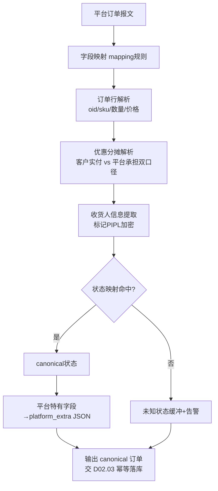
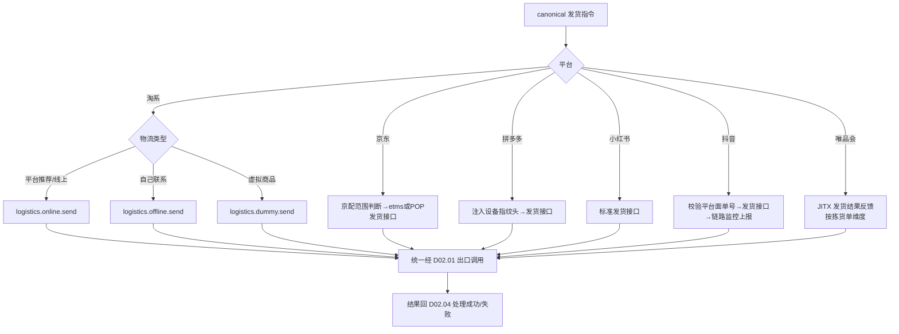

# SRS-D02.02 平台适配器模块 需求规格说明书

> 文档编号：SRS-D02.02 · 版本 V1.5 · 2026-10-24 · 编写：小凯 · 状态：待审阅（批次②，V1.2 增补即时零售适配器），V1.5 增补价格写回能力）
> 所属域：D02 平台 Gateway 域 · 分期：**P0（抖音 M2）**
> 上游依据：SRS-D02.01（五层调用框架）· 逆向文档 05 §1.2/§2（77 平台适配目录、能力矩阵、白名单裁剪）· 全局决策（canonical 标准模型 + JSON 扩展列）

---

## 1. 模块概述

### 1.1 定位

平台适配器是「平台协议 ↔ OMS 标准模型」的翻译层。每个电商平台一个适配器（淘系/京东/拼多多/小红书/唯品会/抖音），实现六类标准能力：订单下载、发货回传、库存回写、售后同步、商品查询、**价格写回（V1.5 新增，D04.11 消费）**。适配器**只管报文语义映射**（字段转换、状态映射、平台特有逻辑），调用出口统一走 D02.01 框架（签名/限流/日志由框架承担）。

架构目标：**加平台 = 加目录 + 加配置 + 加映射，纯增量操作**，不改框架与业务域代码（商派 77 平台目录「差异覆写」模式的现代实现）。

### 1.2 职责边界

**做**：适配器统一接口实现、平台报文 ↔ canonical 标准模型双向转换、平台状态机映射、平台特有字段落 JSON 扩展列、能力白名单声明、映射规则管理。
**不做**：签名/限流/日志/api_fail（→ D02.01）；拉单编排与幂等落库（→ D02.03）；回传触发时机（→ D02.04）；订单业务处理（→ D03）；店铺凭证管理（→ D02.06）。

### 1.3 与其他模块关系

| 模块 | 关系 |
|---|---|
| D02.01 接入框架 | 适配器的所有出站调用经框架出口；向框架注册方法名映射与错误码字典条目 |
| D02.03 拉单 | 消费适配器的「订单下载」「售后同步」「商品查询」能力；canonical 订单模型在本模块定义转换规则 |
| D02.04 回传中心 | 消费适配器的「发货回传」「库存回写」「售后回传」能力 |
| D04.01 商品物料 | 商品查询能力为未知商品建档提供平台商品原始数据 |
| D05.01 售后申请 | 售后同步能力输出 canonical 售后单模型 |

---

## 2. 业务场景

**SC-D02.02-01 拉单报文转换（主流程）**
淘系推送/拉取到一笔订单（TOP 报文：trade 结构，含全链路状态、优惠明细 tid/oid 两级）。淘系适配器执行：字段映射（tid→platform_order_bn、oid→行号）→ 优惠分摊解析（平台承担/商家承担双口径）→ 状态映射（WAIT_BUYER_PAY→待付款等）→ 淘系特有字段（天猫国际标识、预售阶段、分销来源）写入 `platform_extra` JSON 扩展列 → 输出 canonical 标准订单交 D02.03 落库。

**SC-D02.02-02 发货回传的平台差异**
同一「订单已发货」事件，六个平台回传报文完全不同：淘系调 taobao.logistics.online.send（线上物流）/offline.send（自己联系物流）/dummy.send（虚拟发货）三选一；京东需先判断是否京配、支持大头笔；拼多多要求设备指纹请求头；抖音要求先取平台面单号再回传；唯品会 JIT 走「拣货单结果反馈」而非订单发货接口。回传中心（D02.04）只发统一指令 `shop.delivery.send(canonical发货报文)`，各适配器翻译为平台原生调用。

**SC-D02.02-03 唯品会 JIT 预约制特殊链路**
唯品会 JIT 模式 = 平台下**采购单（预约单）** → 供应商（凯淳）确认 → 拣货单下载 → 送货入仓 → 平台收货后结算。适配器需实现：采购单下载（vop.purchase）、拣货单下载（vop.pick）、JITX 发货结果反馈（store.jitx.delivery.result.feedback 语义）、退供差异单。该平台的「订单」语义与其他平台不同（是采购预约而非消费者订单），canonical 模型以 `order_type=jit_purchase` 区分，履约走 D03 特殊单型分支。

**SC-D02.02-04 新平台接入（纯增量验证）**
假设未来接入快手：新建 `adapters/kuaishou/` 目录实现六类能力接口 + 在 platform_app 配置应用 + 注册能力白名单与错误码字典 + 配置映射规则，即完成接入；回归测试仅覆盖新适配器，存量平台零改动。

**SC-D02.02-05 抖音适配器从零开发（M2）**
抖音无商派报文映射可参考，需按抖店开放平台文档从零实现：订单查询/详情、webhook 消息解析（含验签）、发货（需平台电子面单）、售后（换货 exchange2 语义）、库存（含区域库存/预售库存 sell_type）。开发顺序：拉单→发货回传→售后→库存（按 M2 里程碑排期）。

---

## 3. 功能需求

### FR-D02.02-01 适配器统一接口规范
- FR-01a 定义 `PlatformAdapter` 接口，五类能力方法组：

| 能力组 | 接口方法 | 输入/输出 |
|---|---|---|
| 订单下载 | `orderListGet(时间窗/游标)` `orderDetailGet(平台单号)` | 平台报文 → canonical 订单（含行/优惠/收货人） |
| 发货回传 | `deliverySend(canonical发货单)` | 运单号/物流公司/包裹 → 平台原生发货调用 |
| 库存回写 | `stockSync(canonical库存[店铺,SKU,可售数])` | 支持批量；返回逐条成败 |
| 售后同步 | `aftersaleListGet` `aftersaleDetailGet` `aftersaleAction(同意/拒绝/确认收货/回传退货物流)` | 平台售后单 ↔ canonical 售后单 |
| 商品查询 | `productGet(平台商品ID/skuId)` `productListGet(时间窗)` | 平台商品 → canonical 商品（供建档与映射） |
| 价格写回（V1.5） | `priceUpdate(canonical价格[店铺,SKU,目标价])` | 支持批量按平台分片；返回逐条成败；调用方=D04.11 调价计划执行器；**资质依赖：各平台商品写接口权限需单独申请（淘系 item/sku 价格更新、京东价格 API、拼多多改价、抖音价格编辑等；集中登记见 DEP-01 §1）** |

- FR-01b 每类能力允许平台声明「不支持」（如唯品会无标准 deliverySend，以 JIT 反馈替代）；调用不支持的能力返回 `CAPABILITY_NOT_SUPPORTED`。
- FR-01c 适配器附带消息解析能力 `parseInbound(message)`：平台推送消息（TMC/webhook/JOS 推送）→ canonical 事件（订单创建/修改/关闭、售后创建/状态变更、库存占用变更等），含入站验签委托（调 D02.01 IF-03）。

### FR-D02.02-02 能力矩阵与白名单
- FR-02a 每适配器声明能力白名单（配置文件），框架按白名单裁剪可调用方法（商派 whitelist.php 思想）；白名单外的统一方法名调用直接拒绝。
- FR-02b 六平台能力矩阵（首期范围，✅=P0 实现，△=平台差异说明）：

| 能力 | 淘系 | 京东 | 拼多多 | 小红书 | 唯品会 | 抖音 |
|---|:-:|:-:|:-:|:-:|:-:|:-:|
| 订单下载 | ✅ TMC推送+TOP拉取 | ✅ JOS推送+拉取 | ✅ 消息+拉取 | ✅ 拉取为主 | △ JIT采购单/拣货单模式 | ✅ webhook+拉取（M2） |
| 发货回传 | ✅ 线上/线下/虚拟三分支 | ✅ 京配判断/大头笔 | ✅ 需设备指纹头 | ✅ | △ jitx.delivery.result.feedback | ✅ 需平台面单号 |
| 库存回写 | ✅ 批量接口 | ✅ | ✅ | ✅ | △ 占用单查询模式 | ✅ 含区域库存 sell_type |
| 售后同步 | ✅ 换货/补寄/协商全族 | ✅ ASC服务单 | ✅ 凭证体系 | ✅ | △ 退供差异单 | ✅ exchange2 换货 |
| 商品查询 | ✅ | ✅ | ✅ | ✅ | ✅ | ✅ |
| 消息推送接入 | TMC（长连接/HTTP） | JOS 推送 | 平台消息服务 | —（轮询为主） | —（定时下载） | webhook |
| 全链路状态上报 | ✅ 奇门 ERP 节点 | △ | — | — | — | ✅ 订单链路监控 |
| 价格写回（V1.5,P1） | ✅ item.price/sku 级（需商品写资质） | ✅ 价格 API | ✅ 改价接口 | △ 资质确认中 | △ JIT 价格随采购单协商 | ✅ 需价格编辑权限（M3） |

- FR-02c 平台特殊点清单（实现必须覆盖）：淘系 tbbusiness_type=B 按天猫处理、全链路节点上报（收单/审单/推仓/出库）；京东 NPS Token、京配范围判断；拼多多 X-PDD 设备指纹请求头；小红书电子面单模板接口；唯品会 JIT 预约制五单据（采购/拣货/发货反馈/退货/退供差异）；抖音资质校验（部分接口需服务商资质）、链路监控上报。

### FR-D02.02-03 适配器注册机制
- FR-03a 目录约定：`app/Gateway/adapters/{platform}/`，内含 `Adapter.php`（五能力实现）、`Inbound.php`（消息解析）、`capability.php`（白名单声明）、`mapping/`（映射规则文件）、`errcode.php`（错误码字典条目）。
- FR-03b 注册发现：适配器注册表（装饰器 `@register_adapter('taobao')` 或 entry_points）自动注册；platform 标识与 shop_auth.shop_type、platform_app.platform 三处一致。
- FR-03c 纯增量约束：适配器之间禁止相互依赖；公共逻辑放 `adapters/_abstract/` 基类（分页游标处理、批量分片、重试参数组装等），平台目录只做差异覆写。
- FR-03d 平台归一化映射：店铺 shop_type 别名归一（如 taobao+B→tmall 语义、xhs/xiaohongshu 双标识），在适配器工厂层处理（商派 channel/shop.php shop_mapping 思想）。
- FR-03e 即时零售平台适配器（V1.2 友商对标 G1，P1 随 D03.15/D09.06）：美团闪购/饿了么零售/京东到家秒送/抖音小时达/淘宝小时达按同一注册机制增量接入（`#[AdapterTag('meituan_sg')]` 等），订单报文含配送时效约束（期望送达时间）写入 canonical 扩展；商派参考：erpapi matrix 已有 meituan4sg/meituan4medicine/meituan4bulkpurchasing 等 5 个美团适配目录可作报文语义参考。能力矩阵特殊点：即时零售订单跳过审单缓冲（下单即锁定即履约，D03.15）、库存回写秒级通道（D04.08 高频模式）、配送状态回传（骑手状态经 D09.06 回传平台）。

### FR-D02.02-04 报文映射规则管理
- FR-04a 映射表 `field_mapping`：统一方法名 × 平台 → 字段映射规则集（平台字段路径 → canonical 字段、转换函数、默认值、必填校验）。**代码内映射为主、配置化为辅**：常规字段映射写在各适配器 mapping/ 目录（Python dict/Pydantic 模型声明，随代码评审），仅「高频变更的枚举映射」（订单状态、物流公司编码、售后原因）落库配置化，提供后台维护界面。
- FR-04b 状态映射表：每平台维护「平台状态 → canonical 状态」映射（如淘系 WAIT_SELLER_SEND_GOODS→待发货；抖音 2→待发货），映射未命中 → 订单进「未知状态」缓冲并告警（不静默丢弃）。
- FR-04c 物流公司编码映射：canonical 物流公司编码 ↔ 各平台编码对照表（D09.04 物流档案的编码为 canonical 基准），发货回传时翻译；未配置编码 → 拒绝回传并提示补配置（错编码会导致平台判虚假发货）。
- FR-04d platform_extra JSON 扩展列：平台特有字段不进 canonical 主结构，按 `{平台标识:{字段:值}}` 存扩展列；扩展列关键字段（如淘系预售阶段、抖音区域库存类型）建生成列索引供查询。
- FR-04e 映射版本化：映射规则变更留版本记录，历史订单可按当时版本追溯转换逻辑（对账排障需要）。

---

## 4. 业务流程

### 4.1 适配器在拉单/回传链路中的位置



### 4.2 订单报文转换流程（以任意平台为例）



### 4.3 发货回传翻译流程（平台差异分支）



---

## 5. 处理逻辑

### 5.1 优惠分摊解析（双口径）

```
canonical 订单金额模型:
  order.total_amount      商品原价合计
  order.customer_paid     客户实付（=平台应收给商家的对账口径之一）
  line[].sale_price       行原价 × 数量
  line[].discount_total   行优惠合计
  line[].platform_bear    平台承担部分（淘系 discount_fee/京东券/拼多多平台补贴…）
  line[].merchant_bear    商家承担部分
分摊规则: 平台报文中「优惠明细」逐条解析承担方；平台未给明细时按
  行金额比例分摊整单优惠（策略可配），并在 platform_extra 标记 apportioned=true
（口径供 D08.01 双口径应收使用）
```

### 5.2 分页与游标（订单/售后列表拉取）

- 各平台分页机制不同（淘系 page_no+page_size、京东 page、抖音游标 cursor、拼多多 page+size 上限 100），基类 `_abstract` 提供统一迭代器 `walkList(query, callback)`：内部处理翻页终止条件（总数/空页/游标耗尽）、单页失败重试（框架层）、翻页间限流让渡；
- 时间窗拉取一律由 D02.03 传入（含重叠窗口），适配器不管理水位。

### 5.3 批量接口的分片与部分失败

- 库存回写按平台批量上限分片（淘系 quantity.update 单次 ≤ 上限、京东按 SKU 数限制）；
- 返回逐条结果：canonical 结构 `{items:[{sku, platform_sku, succ, err_code}]}`，部分失败不整体回滚（由调用方 D04.08/D02.04 决定重试粒度）。

### 5.4 适配器测试策略

- 每适配器强制配套「录制回放」测试集：录制平台沙箱/生产真实报文（脱敏后）为 fixture，单元测试跑「报文 → canonical」快照断言；
- 平台接口变更监测：定期用录制报文跑转换回归，canonical 输出 diff 告警（平台悄悄改字段的常见故障模式）。

---

## 6. 数据字段（业务字段描述）

### 6.1 canonical 标准订单模型（概要，完整定义见 SRS-D02.03 §6）

适配器输出必须遵循 D02.03 定义的 canonical 订单结构；本模块关注的适配器侧字段：

| 字段 | 业务含义 |
|---|---|
| adapter_version / mapping_version | 转换器版本与映射规则版本（追溯用） |
| platform_extra | 平台特有字段 JSON 扩展列 |
| convert_warnings[] | 转换告警（未知状态/比例分摊/字段缺失降级） |

### 6.2 状态与编码映射表（enum_mapping）

| 字段 | 业务含义 | 取值/校验 |
|---|---|---|
| platform / map_type | 平台 / 映射类型 | order_status / logistics_code / aftersale_status / aftersale_reason |
| native_value | 平台原生值 | 字符串（保留原样） |
| canonical_value | 标准值 | 对应 canonical 枚举 |
| status / version | 启停 / 版本 | 变更留版本记录 |

### 6.3 能力白名单声明（capability，配置文件形态）

| 项 | 说明 |
|---|---|
| platform | 平台标识 |
| capabilities | 支持的能力组与方法级白名单（统一方法名列表） |
| native_methods | 统一方法名 → 平台原生 API 名映射（注册进 D02.01 字典） |
| special_flags | 特殊能力开关（设备指纹头/京配判断/面单前置校验等） |

---

## 7. 接口

### 7.1 内部接口

| 编号 | 接口 | 消费方 | 说明 |
|---|---|---|---|
| IF-D02.02-01 | `AdapterFactory::get(platform)` | D02.03/04/05 | 获取适配器实例（含归一化映射） |
| IF-D02.02-02 | `PlatformAdapter` 五能力接口（§3 FR-01a） | D02.03/04、D04.01/D05.01 间接 | canonical 进出 |
| IF-D02.02-03 | `PlatformAdapter::parseInbound(rawMessage)` | D02.03 | 推送消息 → canonical 事件 |
| IF-D02.02-04 | `MappingService::mapEnum(platform, type, nativeValue)` | D03/D09 | 状态/物流编码映射查询 |

### 7.2 外部接口

无直接外部接口（出站调用一律委托 D02.01 EF-D02.01-01；入站消息由 D02.03 接收后转交本模块解析）。

---

## 8. 非功能需求

| 项 | 要求 |
|---|---|
| 性能 | 单笔订单报文转换 ≤5ms；批量 100 单 ≤200ms；转换纯内存操作无 IO |
| 兼容性 | 平台报文字段缺失时按转换规则降级（默认值/告警），不抛未捕获异常中断整批 |
| 可扩展 | 新增平台纯增量（目录+配置+映射+字典），存量适配器零改动；能力白名单裁剪生效 |
| 可测试 | 每适配器 fixture 录制回放覆盖率 ≥ 核心字段 100%；快照回归纳入 CI |
| 正确性 | 金额分摊误差 ≤0.01 元且行合计=单合计（分摊尾差入指定行规则）；状态映射未命中必须告警不得静默 |
| 安全 | 适配器不得自行持久化凭证；parseInbound 验签失败的消息拒绝并记安全日志 |

---

## 9. 验收标准

| 编号 | 验收条件 |
|---|---|
| AC-01 | 淘系/京东/拼多多/小红书/唯品会 5 平台适配器完成五能力沙箱联调，canonical 输出通过 fixture 快照测试 |
| AC-02 | 抖音适配器（M2）完成拉单+发货回传+售后+库存四能力联调，webhook 消息验签与解析通过 |
| AC-03 | 含平台优惠的订单：customer_paid 与平台账单实付一致；分摊后行优惠合计=整单优惠，尾差规则正确 |
| AC-04 | 同一 canonical 发货指令在 6 平台各自翻译正确：淘系三分支路由、京东京配判断、拼多多带头、抖音面单号校验、唯品会 JITX 反馈 |
| AC-05 | 平台推送含未知状态值：订单进未知状态缓冲并企微告警，补齐映射后可重新转换 |
| AC-06 | 物流公司编码未配置时发货回传被拒绝并给出明确提示，不发起平台调用 |
| AC-07 | 调用白名单外方法返回 CAPABILITY_NOT_SUPPORTED；能力声明「不支持」的平台方法（如唯品会标准发货）同样拒绝 |
| AC-08 | 新增模拟平台适配器（测试桩）：只加目录+配置即注册成功，可完成一笔拉单转换，存量平台回归全绿 |
| AC-09 | 批量库存回写 500 SKU：按平台上限自动分片，部分失败逐条返回，成功条目不重复回写 |
| AC-10 | 映射规则后台修改状态枚举映射后热生效，且历史订单可按旧版本映射解释（版本化追溯） |

---

## 变更记录

| 日期 | 版本 | 变更 | 原因 |
|---|---|---|---|
| 2026-10-23 | V1.0 | 首版 | — |
| 2026-10-24 | V1.5 | 适配器能力五类→六类：新增价格写回 priceUpdate（调用方 D04.11 调价计划执行器）+ 能力矩阵价格写回行（各平台改价 API 与资质依赖标注） | S4 决策修正（Jason：价格要管，B档含批量改价回传） |
| 2026-10-24 | V1.2 | 新增 FR-03e 即时零售平台适配器（美团闪购/饿了么/京东到家/抖音小时达/淘宝小时达，P1 随 D03.15/D09.06） | 友商对标 G1（Jason 决策A：有业务补完整能力） |

---

*参考实现溯源：商派 app/erpapi/lib/shop/matrix/{platform}/ 77 平台目录「差异覆写」模式（类继承链 matrix_taobao_request_order extends shop_request_order extends request_abstract，通用逻辑在父类，见逆向文档 05 §1.2）；平台×能力矩阵（§2.2，whitelist.php+apiname.php 归纳）；白名单裁剪（lib/shop/whitelist.php，经销店铺只许单拉）；平台归一化（channel/shop.php shop_mapping，taobao+B→tmall）；拼多多设备指纹头（lib/shop/config.php:70-79）；唯品会 JIT 独立模块（app/vop，vopurchase/vopick/jit_vreturn_diff 任务族）；透传逃生门（apiname.php）。关键差异：① 商派经矩阵中心代理、报文映射面向矩阵协议（store.*），本设计**直连平台原生 API**，映射面向各平台官方协议，抖音从零开发；② 商派平台特有字段用 15 张售后镜像表垂直扩展，本设计统一 **platform_extra JSON 扩展列+生成列索引**（逆向文档 05 §6.6 权衡结论）；③ 映射规则显式版本化（商派无）；④ 状态映射未命中告警缓冲（商派硬编码分支静默处理）；⑤ 能力矩阵收敛为 5 组标准能力接口（商派 request/response 目录按业务域松散组织）。*
