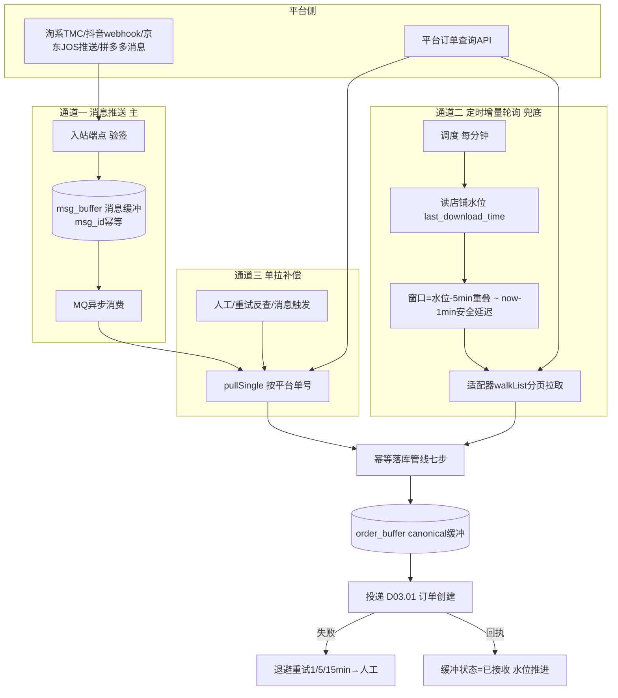
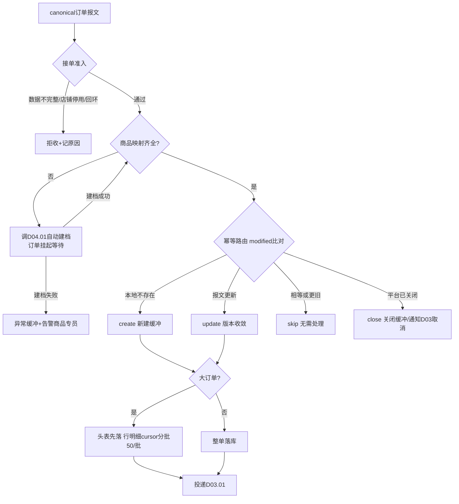
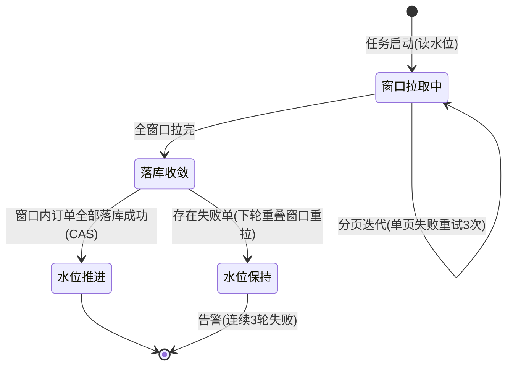

# SRS-D02.03 拉单与消息接收模块 需求规格说明书

> 文档编号：SRS-D02.03 · 版本 V1.0 · 2026-10-23 · 编写：小凯 · 状态：待审阅（批次②）
> 所属域：D02 平台 Gateway 域 · 分期：**P0（M1-M2）**
> 上游依据：SRS-D02.01/02 · 逆向文档 05 §3（拉单三保险/tmc_notify/水位/接收管线/幂等路由）· 澄清决策 Q37（拉单延迟 ≤1 分钟）· 全局决策（canonical 模型 + 三保险）

---

## 1. 模块概述

### 1.1 定位

拉单与消息接收是平台订单进入 OMS 的**唯一入口**，负责：以「消息推送为主 + 定时增量轮询兜底 + 单拉补偿」三保险机制从 6 平台获取订单/售后/消息事件，经适配器转换为 canonical 标准模型后**幂等落库缓冲**，再投递订单域（D03.01）创建正式订单；同步管理拉单水位、消息缓冲、未知商品自动建档联动。

**核心指标：拉单延迟 ≤1 分钟（Q37），订单零漏单、零重复建单。**

### 1.2 职责边界

**做**：推送通道接入（TMC/webhook/JOS 推送的接收、验签、缓冲、消费）、轮询通道（水位管理、增量窗口、分页拉取）、单拉补偿（按平台单号主动拉取）、消息幂等去重、canonical 订单缓冲落库、向 D03.01 投递、未知商品识别与建档触发、拉单监控水位看板供数。
**不做**：报文翻译（→ D02.02 适配器）；签名/限流（→ D02.01）；正式订单创建与状态初始化（→ D03.01）；售后单业务处理（→ D05.01，本模块只做售后消息接收与投递）；商品建档执行（→ D04.01）。

### 1.3 与其他模块关系

| 模块 | 关系 |
|---|---|
| D02.01 框架 | 所有出站拉取经框架出口；入站验签委托框架签名策略 |
| D02.02 适配器 | 消费其 orderListGet/orderDetailGet/parseInbound/aftersale 能力 |
| D02.06 店铺授权 | 拉单店铺清单与凭证来源；店铺停用/过期则暂停该店拉单 |
| D03.01 订单接入 | 缓冲订单投递对象（IF 契约见 §7）；投递回执驱动缓冲状态 |
| D04.01 商品物料 | 未知商品自动建档（调 IF-D04.01-01），建档结果回填映射 |
| D05.01 售后申请 | 售后消息转换后投递 |
| D11.03 监控看板 | 拉单水位/积压/延迟指标供数 |

---

## 2. 业务场景

**SC-D02.03-01 消息推送实时接单（主通道）**
淘系 TMC 推送「订单创建/修改」消息（或抖音 webhook 推 order 事件）。接收端验签 → 写消息缓冲表（msg_buffer，含平台消息 ID 幂等键）→ 立即应答平台成功（**先落缓冲再处理**，避免处理超时导致平台重推风暴）→ MQ 异步消费：按消息中的平台单号调适配器单拉全量详情（消息体仅作触发器，详情以单拉为准——商派验证过的防「消息体不全/乱序」设计）→ canonical 转换 → 幂等落库 → 投递 D03.01。正常链路端到端 ≤60 秒。

**SC-D02.03-02 定时增量轮询兜底（水位）**
消息通道故障或平台未推（部分平台推送不保证可靠）时，轮询通道按店铺水位增量拉单兜底：每分钟任务扫描启用店铺，以 `last_download_time - 重叠窗口(5分钟)` 为起点、`now - 安全延迟(平台侧落库延迟，默认1分钟)` 为终点，分页拉取该时间窗内修改的订单，与已有缓冲比对幂等落库；成功后水位推进到窗口终点。窗口重叠保证边界订单不漏（幂等键保证不重）。

**SC-D02.03-03 单拉补偿**
运营发现某订单平台已付款但 OMS 无单（消息丢失+轮询窗口异常）：在监控后台按「平台+店铺+平台单号」发起单拉，适配器 orderDetailGet 拉全量 → 走同一幂等落库管线。单拉也是消息消费的标准动作（SC-01）与失败重试的补偿手段（D02.05 反查）。

**SC-D02.03-04 订单修改消息的收敛更新**
买家在平台修改地址/客服改 SKU，推送订单修改消息。幂等路由比对平台 modified 时间戳与本地版本：新 → 更新缓冲订单并通知 D03.01 执行改单收敛（已审单订单触发改单流程 D03.08）；旧或相等 → 跳过（乱序消息防护）。

**SC-D02.03-05 未知商品自动建档**
订单行中的平台 skuId 在本地无商品映射：管线暂停该订单投递，调 D04.01 IF-01 以平台商品数据自动建档（生成待完善货品档案+平台映射），建档成功 → 订单继续投递；建档失败（如平台商品查询也失败）→ 订单进异常缓冲，告警商品专员人工处理。

**SC-D02.03-06 大订单流式落库**
一笔 300 行的 B2B 订单：主体先落缓冲头表，行明细分批（50 行/批，游标）追加，全部完成后标记缓冲完整再投递，防止大事务（商派 kvstore+cursor 分批方案思想）。

**SC-D02.03-07 售后消息接收**
平台推送退款/退货/换货创建与状态变更消息：转换 canonical 售后事件后投递 D05.01；未发货仅退款消息**同步发布拦截事件**（D03.09 拦截发货，时效敏感走实时通道）。

---

## 3. 功能需求

### FR-D02.03-01 推送通道（消息服务接入）
- FR-01a 消息服务接入：淘系 TMC（HTTP 推送端点，按店铺订阅分组管理 topic）、抖音 webhook（事件订阅+验签）、京东 JOS 推送、拼多多消息服务；每平台一个入站端点，端点只做「验签→落缓冲→应答」三件事，P99 ≤100ms。
- FR-01b 消息缓冲表 `msg_buffer`：平台消息 ID+店铺 唯一幂等键；存消息类型、原始报文（截断策略同 api_log）、状态（待消费/消费中/成功/失败/死信）、重试次数、下次重试时间。
- FR-01c 消费幂等：MQ 消费者按 msg_id 幂等（已成功的消息重复投递直接 ack）；同一订单的并发消息按「店铺+平台单号」分布式锁串行化（商派 concurrentKey 思想）。
- FR-01d 消息类型路由：订单类 → 本模块管线；售后类 → 投递 D05.01；其他（商品变更/账单等）→ 对应域订阅；未识别类型落缓冲标记 unknown 并告警补路由。
- FR-01e 消息乱序防护：以单拉详情的平台 modified 时间戳为准做版本收敛（FR-03c），不信任消息到达顺序。

### FR-D02.03-02 轮询通道（定时增量+水位）
- FR-02a 水位管理：每店铺维护 `last_download_time`（上次成功窗口终点）；水位只在窗口内订单全部落库成功后推进；推进采用 CAS（防并发任务重复推进）。
- FR-02b 增量窗口：`[last_download_time - overlap(默认5min), now - safety_delay(默认1min)]`；窗口跨度上限 2 小时（超限分片，防单次拉取过大）；店铺水位落后超阈值（默认 30 分钟）告警。
- FR-02c 分页拉取：调适配器 walkList 迭代器，按平台 modified 时间查询；单页失败重试 3 次仍失败 → 该窗口不推水位，下轮重拉（宁可重复不可漏，靠幂等去重）。
- FR-02d 调度频率：正常每分钟一轮（D01.02 调度）；大促模式可加密至 30 秒；店铺级可配置轮询开关（推送可靠的店铺可降频轮询）。

### FR-D02.03-03 单拉补偿与幂等落库管线
- FR-03a 单拉入口：`pullSingle(platform, shop_id, platform_order_bn, reason)`，reason 枚举（消息触发/人工补偿/重试反查/对账核实）；单拉一律拉全量详情（不信任消息体）。
- FR-03b 订单去重幂等：唯一键 `(platform, shop_id, platform_order_bn)`；缓冲表 `order_buffer` 以该键 upsert；重复到达按 FR-03c 版本路由。
- FR-03c 幂等路由（版本收敛）：比对报文 modified 与本地缓冲版本：`本地不存在→create`；`报文更新→update`；`报文相等或更旧→skip`；`平台状态=已关闭且本地未投递→close`。
- FR-03d 落库管线七步（商派接收管线的重构）：①预置日志 → ②canonical 转换（适配器）→ ③接单准入校验（数据完整性/店铺状态/回环防护，准入规则做成可插拔扩展点）→ ④商品映射与未知商品建档联动（FR-05）→ ⑤幂等路由 → ⑥缓冲落库（大订单分批）→ ⑦投递 D03.01。
- FR-03e 缓冲订单状态机：`待投递→已投递→已接收（D03 回执）`；异常分支：`建档等待/投递失败重试/人工处理`。投递失败按退避重试（1/5/15 分钟三轮），仍失败进人工工作台并告警。

### FR-D02.03-04 canonical 标准订单模型
- FR-04a 定义全域唯一的标准订单模型（结构见 §6.1），六平台订单全部转换为该模型后才允许进入 D03；D03 及下游**不得感知平台差异**（平台特有信息经 platform_extra 取用）。
- FR-04b 收货人敏感字段（姓名/手机/地址）在缓冲落库时即经 D01.05 PIPL 组件加密存储；平台加密收件人（淘系 oaid、抖音脱敏单）保留平台密文与解密通道标识，按平台规则处理（部分平台面单打印需以密文直传，不解密）。
- FR-04c 双口径金额字段（客户实付/平台承担）为必填校验项，缺失时按适配器分摊规则计算并标记。

### FR-D02.03-05 未知商品自动建档联动
- FR-05a 映射检查：订单行 platform_sku_id 查本地商品映射（D04.01）；未命中 → 调适配器 productGet 拉平台商品资料 → 调 `IF-D04.01-01 自动建档`（生成货品档案草稿+映射，标记 auto_created）。
- FR-05b 建档并发防护：同一 platform_sku_id 并发建档加锁去重；建档结果（成功/失败）回写管线继续或转异常。
- FR-05c 建档时效：单商品建档 ≤5s，不阻塞整批（建档等待的订单单独挂起，建档完成事件驱动恢复投递）。
- FR-05d 待完善提醒：自动建档的货品缺关键属性（重量/体积/条码）时通知商品专员补全（不阻塞履约，审单环节可拦截）。

### FR-D02.03-06 售后消息接收与投递
- FR-06a 售后消息（创建/状态变更/买家回填物流/类型变更换转退）经适配器转换 canonical 售后事件，投递 D05.01；投递契约与订单类似（幂等键=平台+店铺+平台售后单号+版本）。
- FR-06b 未发货仅退款/拦截类消息发布实时事件 `platform.aftersale.refund.created`（D03.09 订阅拦截发货），走 MQ 高优队列。

### FR-D02.03-07 拉单监控与看板供数
- FR-07a 指标：按店铺/平台的拉单延迟（平台创建时间→缓冲落库时间）、水位落后时长、缓冲积压量、投递失败量、消息死信量、建档等待量；供 D11.03。
- FR-07b 告警：水位落后 >30 分钟、缓冲积压 > 阈值、投递连续失败、消息死信 → 企微告警（含店铺与样例单号）。
- FR-07c 人工工作台：单拉补偿发起、未知状态订单处理、死信消息重放、缓冲订单手工重投。

---

## 4. 业务流程

### 4.1 三保险拉单全景



### 4.2 幂等落库管线（含版本收敛）



### 4.3 水位推进状态机



---

## 5. 处理逻辑

### 5.1 消息「先缓冲后处理」与触发器模式

```
入站端点(同步,≤100ms):
  验签失败 → 应答失败+安全日志(不落缓冲)
  验签通过 → msg_buffer upsert(msg_id幂等) → 应答平台成功
消费端(异步):
  订单类消息只取 platform_order_bn 作触发器 → pullSingle 拉全量详情
  （消息体可能不全/乱序/滞后，详情一律以平台查询接口为准）
  消费失败 → msg_buffer.fail_times+1，退避重试(1/5/15/60min)
  超上限 → status=死信，人工工作台重放
```

### 5.2 重叠窗口与漏单证明

```
窗口 W_n = [T_{n-1} - overlap, T_n - delay]，overlap=5min，delay=1min
漏单仅可能来源: 平台 modified 不落窗（平台时钟回拨/修改不更新modified）
兜底: ①每日全量对账轮询(近3天窗口粗拉比对缓冲单号集合)
      ②单拉补偿人工通道 ③D02.05 回传反查发现「平台有单本地无单」倒灌补拉
水位只进不退; 重叠区重复订单由幂等键吸收
```

### 5.3 并发与顺序保证

- 同一订单（店铺+平台单号）的所有处理（消息消费/轮询落库/单拉）经分布式锁串行化；锁内执行幂等路由，保证版本单调收敛；
- 不同订单完全并行；消费者并发度按店铺消息量配置（MQ 消费组）；
- 投递 D03.01 采用 MQ 事件 + 同步确认双通道：MQ 投递为主，D03 落单成功发布 `order.created` 回执事件更新缓冲状态；超过 10 分钟无回执触发反查（查 D03 是否已建单，防回执丢失导致重复投递——投递本身带幂等键，D03 侧按 `(platform, shop_id, platform_order_bn)` 拒绝重复建单）。

### 5.4 平台加密收件人处理

| 平台 | 模式 | 处理 |
|---|---|---|
| 淘系 | oaid 密文体系 | 存 oaid+解密通道标识；面单打印密文直传菜鸟，OMS 界面按需走平台解密接口（留痕） |
| 抖音/拼多多 | 平台脱敏+虚拟号 | 同上，密文原样保存；本地 PIPL 加密仅针对明文可得的字段 |
| 京东/小红书/唯品会 | 明文或半脱敏 | 明文部分经 D01.05 加密落库，展示脱敏 |

---

## 6. 数据字段（业务字段描述，schema：oms_gateway）

### 6.1 canonical 标准订单模型（order_buffer，本模型为 D02→D03 投递契约）

**订单头**：

| 字段 | 业务含义 | 取值/校验 |
|---|---|---|
| buffer_id | 缓冲单 ID | 唯一 |
| platform / shop_id / platform_order_bn | 平台/店铺/平台单号 | 三元唯一键（幂等） |
| order_type | 订单类型 | 普通/预售/团购/JIT采购(唯品会)/虚拟/换货0元单 |
| platform_status / canonical_status | 平台原始状态 / 标准状态 | 标准状态枚举：待付款/待发货/已发货/已关闭/已完成 |
| platform_modified | 平台最后修改时间 | 版本收敛依据，索引 |
| pay_time / create_time_platform | 平台付款/下单时间 | 时效考核基准 |
| total_amount / customer_paid / platform_bear_total | 商品总额/客户实付/平台承担合计 | 双口径必填 |
| freight / buyer_message / seller_memo | 运费/买家留言/卖家备注 | 备注含改单指令语义时由 D03 解析 |
| receiver_* (name/mobile/province/city/district/address/zip) | 收货人信息 | PIPL 加密存储；平台密文单存 oaid 类字段 |
| receiver_encrypted_channel | 收件人加密通道 | none/oaid/虚拟号，决定面单与解密路径 |
| warehouse_hint / logistics_hint | 平台指定仓/物流提示 | 如京东京配、天猫国际保税 |
| platform_extra | 平台特有字段 JSON | {platform:{...}}，关键字段生成列索引 |
| convert_warnings | 转换告警 | JSON 数组 |
| status | 缓冲状态 | 待投递/已投递/已接收/建档等待/投递失败/人工处理/已关闭 |
| deliver_times / last_deliver_time | 投递次数/时间 | 退避重试依据 |
| adapter_version / mapping_version | 转换版本 | 追溯 |

**订单行（order_buffer_item）**：line_no、platform_sku_id/platform_item_id、goods_name/sku_spec（平台侧）、local_sku_id（映射后，未映射为空）、num、sale_price、customer_paid_line、platform_bear/merchant_bear（分摊）、refund_status（行级退款标识）、gift_flag（赠品）、oid（平台子单号，售后对账键）、platform_extra。

**优惠分摊明细（order_buffer_promotion）**：promotion_id、type（平台券/店铺券/满减/补贴）、amount、bear_by（平台/商家/混合）、line_allocations（行分摊 JSON）。

### 6.2 消息缓冲表（msg_buffer）

| 字段 | 业务含义 |
|---|---|
| platform / shop_id / msg_id | 幂等键（platform+shop_id+msg_id 唯一） |
| msg_type / route_target | 消息类型 / 路由目标（order/aftersale/product/unknown） |
| payload_ref | 原始报文（截断+OSS 引用同 api_log 策略） |
| status / fail_times / next_retry_time | 待消费/消费中/成功/失败/死信 |
| received_time / consumed_time | 接收/消费时间（延迟指标） |

### 6.3 店铺拉单水位（pull_watermark，扩展 shop_auth 或独立表）

| 字段 | 业务含义 |
|---|---|
| shop_id / channel | 店铺 / 通道（order/aftersale 各自水位） |
| last_download_time | 已成功窗口终点（只进不退，CAS 更新） |
| overlap / safety_delay / poll_interval | 重叠/安全延迟/轮询间隔（店铺级可配，默认 5min/1min/1min） |
| lag_alert_threshold | 落后告警阈值（默认 30min） |
| version | CAS 版本号 |

---

## 7. 接口

### 7.1 内部接口

| 编号 | 接口 | 消费方 | 说明 |
|---|---|---|---|
| IF-D02.03-01 | `PullService::pullSingle(platform, shopId, orderBn, reason)` | D02.05 重试反查、人工工作台 | 单拉补偿入口，幂等 |
| IF-D02.03-02 | 事件 `gateway.order.buffered`（payload=buffer_id+canonical 概要） | D03.01 | 缓冲订单投递（MQ，D03 拉取全量缓冲） |
| IF-D02.03-03 | 事件 `platform.aftersale.*`（created/status_changed/logistics_updated） | D05.01/D03.09 | 售后事件投递；refund.created 走高优队列 |
| IF-D02.03-04 | 调用 `IF-D04.01-01 商品自动建档` | → D04.01 | 未知商品建档（入参：平台商品资料 canonical） |
| IF-D02.03-05 | 入站端点 `/gateway/inbound/{platform}/message` | 平台推送 | 验签→缓冲→应答；仅白名单来源 IP/签名可达 |
| IF-D02.03-06 | 订阅 `order.created`（D03.01 回执） | ← D03.01 | 缓冲状态闭环 |
| IF-D02.03-07 | `BufferQueryService`（水位/积压/明细查询） | D11.03 | 监控看板供数 |

### 7.2 外部接口

| 编号 | 接口 | 方向 | 说明 |
|---|---|---|---|
| EF-D02.03-01 | 淘系 TMC 消息服务 | 入 | 订阅管理+消息接收 |
| EF-D02.03-02 | 抖音 webhook / 京东 JOS 推送 / 拼多多消息服务 | 入 | 各平台推送端点 |
| EF-D02.03-03 | 各平台订单/商品/售后查询 API | 出 | 经 D02.01 框架与 D02.02 适配器 |

---

## 8. 非功能需求

| 项 | 要求 |
|---|---|
| 时效 | 推送到缓冲落库 P95 ≤30s、P99 ≤60s（Q37）；轮询兜底周期 ≤1 分钟 |
| 吞吐 | 大促峰值 500 单/分钟落库；消息缓冲写入 ≥1000 msg/s（批量插入） |
| 可靠性 | 零漏单（三保险+每日对账轮询）；零重复建单（幂等键+版本收敛+D03 侧二次防重） |
| 幂等 | 消息重复投递、轮询窗口重叠、单拉并发全部幂等安全 |
| 一致性 | 水位只进不退；缓冲与 D03 订单以回执事件+超时反查闭环 |
| 安全/PIPL | 入站端点验签+来源校验；收货人字段加密落库、展示脱敏；密文单不解密落地 |
| 数据治理 | msg_buffer 保留 30 天、order_buffer 已接收单保留 90 天后归档（原始报文追溯） |

---

## 9. 验收标准

| 编号 | 验收条件 |
|---|---|
| AC-01 | 6 平台各下一笔沙箱订单：从平台付款到缓冲落库 P99 ≤60 秒，投递 D03.01 成功建单 |
| AC-02 | 关闭某店铺消息推送通道，仅靠轮询：订单仍在一个轮询周期+窗口内进入缓冲，不漏单 |
| AC-03 | 同一消息重复推送 10 次/消息与轮询并发命中同一订单：order_buffer 仅一条记录，D03 仅一张订单 |
| AC-04 | 乱序消息（先修改后创建到达）：版本收敛正确，最终缓冲=平台最新 modified 版本 |
| AC-05 | 含未知商品的订单：自动建档成功后订单继续投递；模拟建档失败，订单进异常缓冲并企微告警，人工补档后恢复投递 |
| AC-06 | 300 行大订单：分批落库完整（行数一致），缓冲标记完整后才投递，无大事务告警 |
| AC-07 | 水位推进正确：窗口内存在落库失败单时水位不推进，下轮重叠窗口重拉补齐；连续 3 轮失败触发告警 |
| AC-08 | 投递失败退避重试 1/5/15 分钟后进人工工作台；人工重投成功闭环；D03 侧对重复投递按幂等键拒绝 |
| AC-09 | 未发货仅退款消息：高优事件 5 秒内送达 D03.09 拦截订阅方 |
| AC-10 | 收货人手机号/地址在 order_buffer 中为密文，界面展示脱敏；oaid 密文单密文完整保留供面单直传；每日对账轮询可检出人为删除的缓冲单并自动补拉 |

---

## 变更记录

| 日期 | 版本 | 变更 | 原因 |
|---|---|---|---|
| 2026-10-23 | V1.0 | 首版 | — |

---

*参考实现溯源：商派拉单三保险（逆向文档 05 §3.1：矩阵推送 ome.order.add + shop.last_download_time 水位 + store.trade.fullinfo.get 单拉补偿）；tmc_notify 消息缓冲表（app/erpapi/dbschema/tmc_notify.php：tmc_key/tid/oid/sdf）；接收管线七步（app/erpapi/lib/shop/response/order.php：add/_analysis/_canAccept 扩展点/formatItemsSdf/_operationSel lastmodify 幂等路由/创建更新插件链/concurrentKey 并发锁）；大订单 kvstore+cursor 分批落库（app/ome/lib/order/rpc/response/queue/order.php）；order_sync_status/sync_task 同步跟踪表。关键差异：① 商派由矩阵中心持 session 增量拉单后推送 OMS，本设计**自建推送接入（TMC/webhook/JOS）+ 自管水位轮询**，消息体仅作触发器、详情一律单拉（商派信任推送 sdf 全量，消息不全时靠补偿）；② 幂等路由从「比对后直接写业务表」改为**缓冲表 order_buffer 中转 + MQ 投递 D03.01 + 回执闭环**（域边界清晰，缓冲可重放）；③ 重叠窗口参数化（商派无显式重叠设计，靠中心侧控制）+ 每日对账轮询兜底；④ canonical 模型显式契约化（商派 sdf 结构隐式约定，平台字段经镜像表/插件链渗透进业务层）；⑤ 未知商品自动建档联动产品化（商派映射失败进 order_fail 后人工处理）。*
