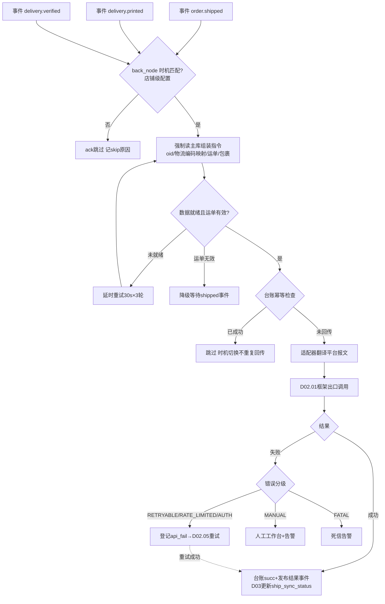
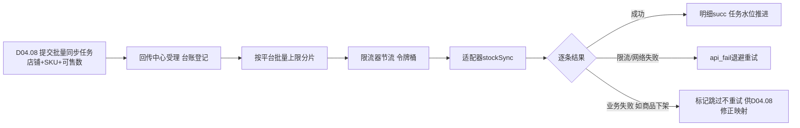
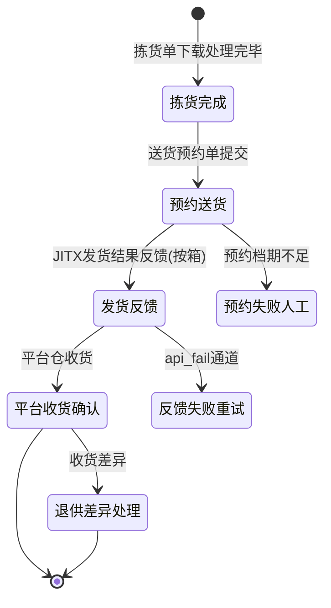

# SRS-D02.04 回传中心模块 需求规格说明书

> 文档编号：SRS-D02.04 · 版本 V1.5 · 2026-10-24 · 编写：小凯 · 状态：待审阅（批次②，V1.4 业务仿真增补，V1.5 增补 price 回传类型）
> 所属域：D02 平台 Gateway 域 · 分期：**P0（M1-M2）**
> 上游依据：SRS-D02.01/02 · 逆向文档 05 §3.3-3.5（发货回传 back_node/force_master/库存回传/全链路状态上报）· 全局决策（事件驱动回传）

---

## 1. 模块概述

### 1.1 定位

回传中心统一管理 OMS → 平台方向的三类回传：**发货回传**（运单号/物流信息同步平台）、**库存回写**（可售库存同步，D04.08 为调用方）、**售后回传**（同意/拒绝退款、确认收货、换货发货等，D05 为调用方），以及附属的**全链路状态上报**（淘系奇门节点/抖音链路监控）。回传中心负责：事件订阅与触发判定、回传时机控制（back_node 可配置）、canonical 回传指令组装、经适配器翻译后调用平台、结果处理与失败转重试（D02.05）、回传状态台账。

### 1.2 职责边界

**做**：三类回传的触发编排、时机策略、指令组装、结果处理、回传台账（sync_task 语义）、主从延迟防护、特殊平台回传差异编排（唯品会 JIT）。
**不做**：可售库存计算（→ D04.08，本模块只接收其回写指令）；发货业务判定（→ D03.07/D09.02，本模块消费其事件）；售后业务审批（→ D05）；平台报文翻译（→ D02.02）；失败重试执行与对账反查（→ D02.05，本模块负责登记失败与消费重试结果）。

### 1.3 与其他模块关系

| 模块 | 关系 |
|---|---|
| D03.07 发货单 / D09.02 出库回传 | 订阅 `order.shipped` / `delivery.printed` / `delivery.verified` 事件触发发货回传 |
| D04.08 可售计算 | 提交库存回写指令（批量），本模块执行回传与结果反馈 |
| D05 售后域 | 提交售后回传指令（同意退款/确认收货/换货发货等） |
| D02.02 适配器 | deliverySend/stockSync/aftersaleAction 能力消费方 |
| D02.01 框架 | 调用出口；失败分级结果消费 |
| D02.05 重试与对账 | 失败回传登记 api_fail；重试成功后状态回写台账 |
| D11.03 监控 | 回传成功率/延迟/积压指标供数 |

---

## 2. 业务场景

**SC-D02.04-01 发货回传（主流程，back_node=发货）**
WMS 出库回传 → D09.02 发货确认 → 发布 `order.shipped` 事件（含运单号/物流公司/包裹明细）。回传中心消费事件：读取店铺回传时机配置（默认 shipped）→ 组装 canonical 发货指令（订单号/子单号 oid/物流公司编码/运单号/包裹）→ 适配器翻译平台原生调用 → 成功则回传台账记 succ、订单标记已回传；失败按错误分级登记 api_fail 进重试。

**SC-D02.04-02 回传时机提前（back_node=打印/校验）**
某品牌店铺要求「打印面单即回传平台」（大促抢时效考核）：店铺级配置 back_node=print，发货单打印完成事件（delivery.printed 且面单号已生成）即触发回传；back_node=verify 则在校验（验货称重）完成时触发。同一发货单只回传一次，后续 shipped 事件到达时台账已 succ 则跳过（时机切换不产生重复回传）。

**SC-D02.04-03 主从延迟场景强制读主库**
出库回传写库后立即发布 shipped 事件，消费者读从库可能查不到刚落库的运单号（读写分离延迟）。回传中心组装指令时**强制读主库**（商派 force_master 教训）；查不到数据不视为失败，按「数据未就绪」延时重试（30 秒后重查，最多 3 轮），仍无数据才告警人工。

**SC-D02.04-04 库存回写**
D04.08 可售计算产出店铺级同步任务（批量 SKU 可售数）提交回传中心：按平台批量接口上限分片、经限流器节流后调适配器 stockSync；逐条结果回写同步任务明细（成功/失败/失败原因），失败条目按分级进重试或丢弃（限流类退避、业务类如「商品已下架」标记跳过不重试）。库存回写高频失败默认告警降噪（商派教训）。

**SC-D02.04-05 售后回传**
D05.03 审核同意仅退款 → 提交售后回传指令（action=agree_refund）→ 适配器调平台同意退款接口 → 成功台账闭环；D05.02 退货入库质检完成 → 回传确认收货；换货新单发货 → 复用发货回传通道 + 平台换货发货接口（淘系 exchange.consigngoods / 抖音 exchange2 语义）。

**SC-D02.04-06 唯品会 JIT 特殊回传**
JIT 模式无消费者订单发货语义：拣货单完成后走「JITX 发货结果反馈」（按拣货单+箱维度反馈），需先经唯品会预约入仓流程（送货预约单）。回传中心为唯品会维护独立回传编排：拣货确认→预约→发货反馈→平台收货确认，每步台账独立跟踪；退供差异单回传联动 D05。

**SC-D02.04-07 全链路状态上报（增值）**
淘系店铺开启全链路上报：订单在 OMS 的节点（收单 build/审单 check/推仓 to_wms/出库 dispatch）经奇门节点接口上报，消费者在平台看到「已转单/已客审/已通知配货/已出库」；抖音对应链路监控上报。上报失败不阻塞主流程（尽力而为，独立降噪队列）。

---

## 3. 功能需求

### FR-D02.04-01 事件驱动触发
- FR-01a 订阅事件：`order.shipped`（发货确认）、`delivery.printed`（面单打印完成）、`delivery.verified`（校验完成）、`sellable.changed`（可售变化，D04.08）、`aftersale.action.required`（售后回传指令，D05）、`order.lifecycle.node`（全链路节点，增值）、`order.flag.changed`（旗帜变更，V1.4：OMS 侧人工标旗回传平台，sync_type=flag）。
- FR-01b 触发判定：按店铺×回传类型配置的时机（back_node）过滤事件；不匹配的事件直接 ack 跳过。
- FR-01c 消费幂等：以回传台账幂等键 `(回传类型, 单据ID, 动作)` 去重，重复事件不产生重复回传。

### FR-D02.04-02 可配置回传时机（back_node）
- FR-02a 发货回传时机三档：`shipped`（发货确认，默认）/ `print`（打印完成，要求面单号已生成）/ `verify`（校验完成，要求 verify=true）；配置粒度：全局默认 → 店铺级覆写。
- FR-02b 时机前置的防护：print/verify 档触发时校验运单号有效性（非空且符合编码规则），无效则降级等待 shipped 事件（记 skip 原因，商派 _getDeliverySkipReason 思想）。
- FR-02c 每种跳过原因结构化记录（时机不匹配/数据未就绪/运单无效/台账已成功/店铺停用），可重试原因自动延时重试，不可重试原因告警。

### FR-D02.04-03 回传指令组装
- FR-03a canonical 发货指令：订单/子单（oid 级，平台按子单核销）、物流公司编码（经 D02.02 映射表翻译平台编码）、运单号、包裹列表（多包裹分次发货支持）、发货仓信息（平台要求时）。
- FR-03b **强制读主库**：组装指令的数据读取一律走主库连接（读写分离环境下防延迟）；数据未就绪按 FR-02c 延时重试。
- FR-03c 库存回写指令：批量（店铺,SKU,可售数）+ 同步策略标识（D04.08 计算结果，本模块不改数值）；按平台批量上限分片。
- FR-03d 售后回传指令：action 枚举（agree_refund/refuse_refund/agree_return/confirm_receive/exchange_consign/refill_logistics…）+ 平台售后单号 + 附加参数（拒绝原因/退货物流单号）。

### FR-D02.04-04 回传执行与结果处理
- FR-04a 执行：经 D02.02 适配器 + D02.01 框架出口调用；同步返回结果或异步 MQ 应答。
- FR-04b 成功处理：台账状态 succ、记录平台回执（msg_id/平台流水）、发布结果事件（`gateway.sync.delivery.succ` 等）供业务域更新单据同步状态（D03 订单 ship_sync_status、D09 发货单回传标记）。
- FR-04c 失败处理：按框架错误分级——RETRYABLE/RATE_LIMITED 登记 api_fail 自动重试；AUTH 走续期重放；MANUAL 进人工工作台（如「订单已被平台关闭」需人工核对）；FATAL 死信告警。失败登记成功后台账状态 fail_pending，防止同单重复触发新回传。
- FR-04d 部分成功（批量库存/多包裹）：逐条台账，失败条目独立重试。

### FR-D02.04-05 回传台账
- FR-05a `sync_task` 台账：回传类型/单据引用/店铺/平台/指令快照(canonical)/状态/失败原因分级/重试关联 api_fail_id/平台回执/耗时/触发事件 ID。
- FR-05b 台账查询：按订单号/运单号/店铺/状态/时间检索；一单多回传（多包裹/改单重传）全轨迹展示。
- FR-05c 手工重传：台账详情发起人工重传（幂等键防重）；平台侧已生效的（对账反查确认）不允许盲目重传，提示走反查修正。

### FR-D02.04-06 特殊平台回传差异编排
- FR-06a 唯品会 JIT：拣货确认→送货预约→JITX 发货反馈→收货确认四步编排，步骤间状态机管理（一步失败不越级）；退供差异单回传。
- FR-06b 抖音：发货前校验平台电子面单号一致性（非平台面单回传会被判违规）；发货后链路监控上报。
- FR-06c 京东：京配订单走京配确认接口（非通用发货）；大头笔信息随回传。
- FR-06d 淘系：线上/线下/虚拟物流三分支路由（由适配器翻译，本模块传物流类型语义）；天猫国际/家装等特殊发货接口按订单标识路由。
- FR-06e 改单重传：平台改运单号（resend 语义）——发货信息修正场景走「修改运单」接口而非重复发货。

### FR-D02.04-07 全链路状态上报（P1 增值）
- FR-07a 淘系奇门节点（build/check/to_wms/dispatch 四节点）与抖音链路监控上报；店铺级开关。
- FR-07b 上报独立低优队列，失败仅记日志不进重试通道（降噪），不阻塞履约主流程。

### FR-D02.04-08 监控与告警
- FR-08a 指标：回传成功率/平均延迟（事件发生→平台成功）/失败积压/重试中数量，按平台×店铺×类型维度；供 D11.03。
- FR-08b 告警：发货回传失败积压 > 阈值（默认 50 单）或成功率 5 分钟 <90% → 企微告警（发货回传时效影响平台考核，优先级最高）；库存回写告警默认降噪（阈值可配）。

### FR-D02.04-09 旗帜双向同步（V1.4 业务仿真 S1-A）
- FR-09a 出站：订阅 `order.flag.changed`（来源=人工），sync_type=flag，调适配器旗帜写回接口（淘系 seller_flag 1-5 映射；不支持写回的平台记 skip 留痕不报错）；低优先级队列（旗帜同步失败不影响履约）。
- FR-09b 入站：拉单/消息通道（D02.03）解析平台旗帜写入 canonical → D03.01 FR-04h 落 flag_color（来源=平台同步）；平台侧后续改旗经消息更新，冲突=后写覆盖+flag_change_log 留痕。
- FR-09c 映射配置：五色 ↔ 平台 flag 值映射表店铺级可配（各平台旗帜体系不同：淘系 5 色、京东/拼多多无旗帜则只维护 OMS 侧）。

---

## 4. 业务流程

### 4.1 发货回传主流程（事件驱动 + back_node）



### 4.2 库存回写批量流程



### 4.3 唯品会 JIT 回传状态机



---

## 5. 处理逻辑

### 5.1 回传时机判定规则表

| back_node | 触发事件 | 前置校验 | 适用 |
|---|---|---|---|
| shipped（默认） | order.shipped | 运单号非空 | 全平台 |
| print | delivery.printed | 面单号已生成且有效 | 抢发货时效店铺（平台考核「点击发货」时间） |
| verify | delivery.verified | verify=true（验货称重完成） | 高价值商品店铺 |

同一发货单三事件都会到达：**台账幂等键保证只有第一个匹配时机的事件产生回传**，其余 ack 跳过。

### 5.2 幂等键与重复回传防护

```
幂等键 = (sync_type, biz_ref, action)
  发货: (delivery, delivery_id, send)         多包裹: (delivery, delivery_id, send#package_no)
  库存: (stock, shop_id+batch_id, sync#sku)
  售后: (aftersale, platform_refund_id, action)
台账唯一索引兜底; 重试通道复用原台账(不新建), 台账上记 retry_count
平台侧防重: 发货类调用前先查台账是否 succ; api_fail 重试前由 D02.05 反查
  平台订单状态(已发货则台账直接置 succ, 不再调用) —— 「先对账后重发」契约
```

### 5.3 主从延迟防护

- 回传指令组装的所有读操作走主库连接标记（SQLAlchemy 读写分离 bind / force-master hint）；
- 「查无数据」不报错：返回 `DATA_NOT_READY`，延时任务 30s×3 轮重查；第 3 轮仍无 → 告警人工（可能是事件与数据不一致的 bug，不静默）；
- 事件 payload 自带关键字段快照（运单号/物流公司），payload 完整时可跳过回查直接组装（快路径），快照与主库数据以主库为准校验一次。

### 5.4 库存回写节流与合并

- 同一 SKU 短时间多次变更：合并窗口（默认 10s）内取最后一次可售数（D04.08 已做水位合并的则直接透传）；
- 批量分片大小 = min(平台批量上限, 100)；分片间经令牌桶节流；
- 失败重试粒度 = 分片内失败条目重组小批（不整片重发，减少平台调用量）。

---

## 6. 数据字段（业务字段描述，schema：oms_gateway）

### 6.1 回传台账（sync_task）

| 字段 | 业务含义 | 取值/校验 |
|---|---|---|
| task_id | 台账 ID | 唯一 |
| sync_type | 回传类型 | delivery/stock/aftersale/lifecycle/flag（V1.4）/price（V1.5：批量改价回传复用本台账与重试机制，调用方 D04.11） |
| biz_ref | 业务单据引用 | delivery_id/订单号/平台售后单号/批次#sku |
| platform / shop_id | 平台/店铺 | 必填，索引 |
| action | 动作 | send/resend(改单)/agree_refund/confirm_receive… |
| payload_snapshot | canonical 指令快照 | 重试与审计依据 |
| trigger_event_id / back_node | 触发事件 / 实际时机 | shipped/print/verify |
| status | 状态 | pending/processing/succ/fail_pending/retrying/manual/skipped |
| skip_reason | 跳过原因 | 结构化枚举（FR-02c） |
| err_code / err_level / api_fail_id | 失败码/分级/重试关联 | 失败时必填 |
| platform_msg_id / platform_receipt | 平台回执 | 对账依据 |
| retry_count / spendtime_ms | 重试次数/耗时 | |
| idempotent_key | 幂等键 | 唯一索引 |

### 6.2 库存同步批次（stock_sync_batch / _item）

| 字段 | 业务含义 |
|---|---|
| batch_id / shop_id / source | 批次 / 店铺 / 来源（D04.08 任务号） |
| total/succ/fail/skipped | 批次进度计数 |
| item: sku_id / platform_sku_id / sellable / status / err | 明细逐条结果（回写 D04.08 同步水位） |

---

## 7. 接口

### 7.1 内部接口

| 编号 | 接口 | 消费方 | 说明 |
|---|---|---|---|
| IF-D02.04-01 | 订阅 `order.shipped`/`delivery.printed`/`delivery.verified` | ← D03.07/D09.02 | 发货回传触发 |
| IF-D02.04-02 | `SyncService::submitStockSync(shopId, items[], sourceTask)` | D04.08 | 库存回写指令提交（批量，异步受理） |
| IF-D02.04-03 | `SyncService::submitAftersaleAction(指令)` | D05.01/02/03 | 售后回传指令提交（同步返回受理结果） |
| IF-D02.04-04 | 事件 `gateway.sync.delivery.succ/fail`、`gateway.sync.stock.item.result` | D03/D04.08/D09 | 回传结果反馈（业务域更新同步状态） |
| IF-D02.04-05 | `SyncTaskQuery::byBizRef(...)` | D03 界面/D11.03 | 台账查询（订单详情展示回传轨迹） |
| IF-D02.04-06 | `SyncService::manualResend(taskId, operator)` | 人工工作台 | 手工重传（含反查前置校验） |

### 7.2 外部接口

| 编号 | 接口 | 方向 | 说明 |
|---|---|---|---|
| EF-D02.04-01 | 各平台发货/库存/售后回传 API | 出 | 经 D02.01+D02.02（online/offline/dummy send、quantity.update、refund.agree 等语义） |
| EF-D02.04-02 | 淘系奇门全链路节点 / 抖音链路监控 | 出 | P1 增值上报 |

---

## 8. 非功能需求

| 项 | 要求 |
|---|---|
| 时效 | 发货回传：事件到达→平台成功 P95 ≤2 分钟（大促 ≤5 分钟）；print 档触发后面单号校验≤1s |
| 吞吐 | 发货回传峰值 300 单/分钟；库存回写批量 10 万 SKU/日/平台，分片节流不触发平台频控处罚 |
| 幂等 | 事件重投、时机切换、人工重传、api_fail 重试全路径幂等；写类回传「先对账后重发」 |
| 一致性 | 台账与平台侧状态以 D02.05 对账反查收敛；结果事件必达（本地消息表兜底） |
| 可靠性 | 回传失败不静默：100% 进入分级处置（重试/人工/死信告警） |
| 数据一致性防护 | 强制读主库组装指令；DATA_NOT_READY 延时重试不报错 |

---

## 9. 验收标准

| 编号 | 验收条件 |
|---|---|
| AC-01 | 发货确认后 2 分钟内平台侧显示已发货（6 平台沙箱各验证一笔），台账 succ 且订单 ship_sync_status 更新 |
| AC-02 | back_node=print 店铺：打印完成即回传成功；随后 shipped 事件到达不产生二次回传（台账仅一条 succ） |
| AC-03 | print 档触发但面单号为空：记 skip 原因「运单无效」并降级等待 shipped 事件，最终回传成功 |
| AC-04 | 模拟读写分离延迟（从库延迟 5s）：回传组装读到主库最新数据，一次成功；模拟数据缺失走 30s×3 延时重试后告警 |
| AC-05 | 一单三包裹分次发货：三次回传各自台账，平台侧三包运单号齐全 |
| AC-06 | 库存回写 5000 SKU：自动分片+限流，无平台频控报错；「商品已下架」条目标记 skipped 不重试，D04.08 收到明细结果 |
| AC-07 | 发货回传遇 token 过期：AUTH 通道续期后自动重放成功，全程无人工介入 |
| AC-08 | 发货回传失败（模拟网络错误）：api_fail 登记，D02.05 重试前先反查平台订单状态——平台已发货则台账直接置 succ 不重发 |
| AC-09 | 售后回传：同意退款/确认收货/换货发货三动作在淘系与抖音沙箱各验证通过，台账与 D05 单据状态闭环 |
| AC-10 | 唯品会 JIT：拣货确认→预约→发货反馈→收货确认四步状态机流转正确，任一步失败不越级且台账可追溯 |

---

## 变更记录

| 日期 | 版本 | 变更 | 原因 |
|---|---|---|---|
| 2026-10-23 | V1.0 | 首版 | — |
| 2026-10-24 | V1.4 | 新增 FR-09 旗帜双向同步（sync_type=flag 出站/入站解析/五色映射店铺级配置）；FR-01a 订阅 +order.flag.changed | 业务完整性仿真 S1（Jason 决策A） |
| 2026-10-24 | V1.5 | sync_type +price（批量改价回传复用回传台账与 api_fail 重试机制，触发方=D04.11 调价计划执行器） | S4 决策修正（价格要管，B档） |

---

*参考实现溯源：商派 ome_event_trigger_shop_delivery（app/ome/lib/event/trigger/shop/delivery.php：back_node 三时机 shipped/check/print、force_master(true) 主从延迟兼容、_getDeliverySkipReason 结构化跳过原因、_scheduleDeliveryConfirmRetry misc_task 延时重试，见逆向文档 05 §3.4）；发货接口族（store.logistics.online/offline/dummy.send、天猫国际 WLB_THREEPL、商家配送 resend 改单）；库存回写（store.items.quantity.list.update + inventorydepth 定时器 + 告警降噪硬编码，§3.5/§7.1）；全链路状态上报（taobao/request/order.php 四节点 QIMEN_ERP_* 映射 + store.tmc.message.produce / store.upload.order.record，§3.3）；唯品会 JIT（app/vop + store.jitx.delivery.result.feedback）；delivery_sync/sync_task 同步台账表（§3.1）。关键差异：① 商派事件触发器由业务代码显式调用，本设计改为**领域事件订阅**（order.shipped 等），触发与业务解耦；② back_node 的 check 档（校验后回写）语义调整为 verify（验货称重），与凯淳仓内流程对齐；③ 回传台账统一 sync_task 覆盖三类回传（商派 delivery_sync/order_sync_status/sync_task 三表分散）；④ 库存回写从「定时器全量深度回写」改为 D04.08 事件驱动+本模块执行（计算与传输分离）；⑤ 失败重试前置反查（商派 minute 任务对 deliveryBack 先重试后反查，本设计契约化为「先对账后重发」，防重复发货更严格）；⑥ 全链路上报降级为 P1 增值且独立降噪队列。*
