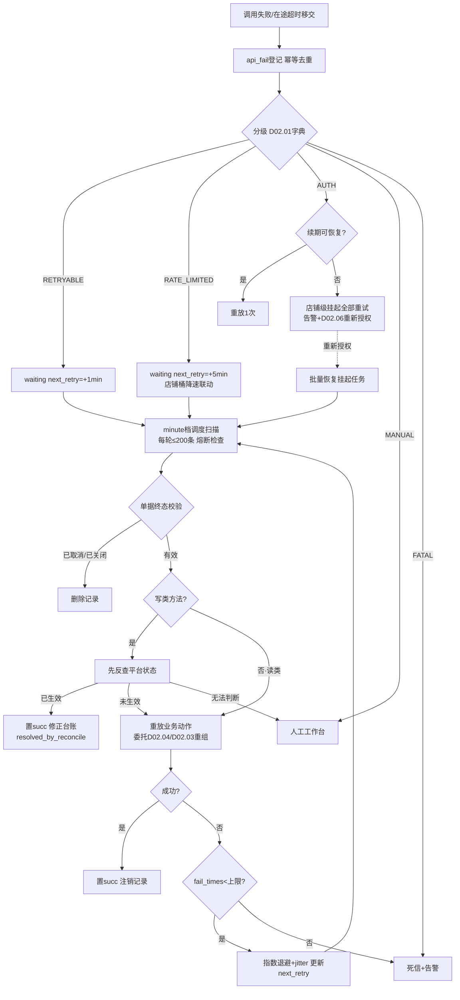
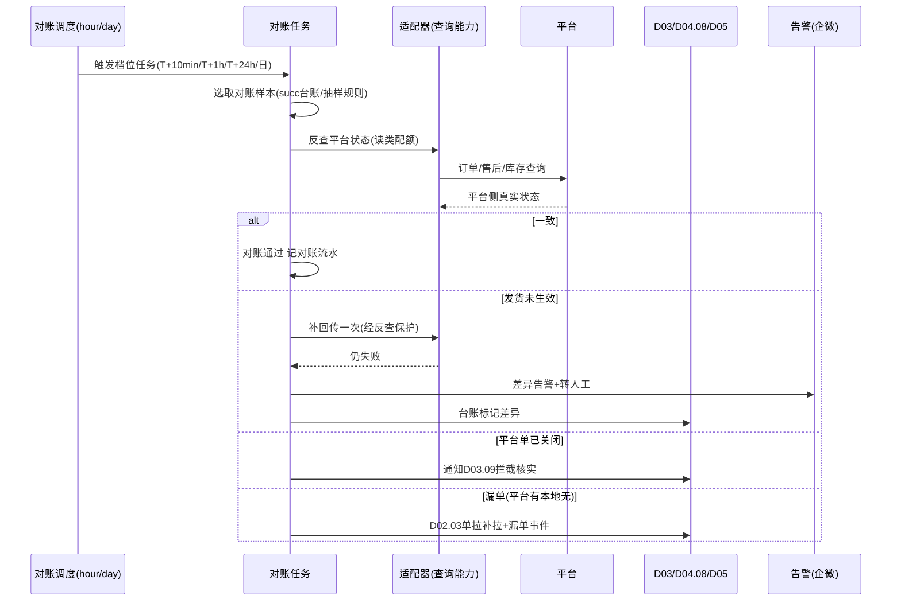

# SRS-D02.05 失败重试与对账模块 需求规格说明书

> 文档编号：SRS-D02.05 · 版本 V1.0 · 2026-10-23 · 编写：小凯 · 状态：待审阅（批次②）
> 所属域：D02 平台 Gateway 域 · 分期：**P0（M1-M2）**
> 上游依据：SRS-D02.01（错误分级）/D02.04（失败来源）· 逆向文档 05 §1.6-1.7/§3.6（api_fail/errcode/misc_task REGEXP 分级重试/反查对账双通道）

---

## 1. 模块概述

### 1.1 定位

失败重试与对账是 Gateway 域的**可靠性兜底层**：所有出站调用失败（拉单/回传/库存/售后）统一登记 api_fail 失败表，按错误码分级执行差异化重试策略（快速重试/指数退避/人工处理/死信），重试遵循「**重放业务动作 + 反查平台状态对账**」双通道（而非裸重发报文）；回传成功后由定时对账任务反查平台侧状态核实，差异告警修正。目标：可自动恢复的失败 100% 自动恢复，不可自动恢复的 100% 进入人工工作台且不遗漏。

### 1.2 职责边界

**做**：api_fail 失败登记与生命周期管理、分级重试调度（minute/hour 档）、指数退避算法、写类调用的重试前反查、死信与人工处理工作台、回传后对账反查与差异告警、重试效果统计。
**不做**：错误分级规则的定义（→ D02.01 错误码字典，本模块消费分级结果）；调用出口（→ D02.01）；回传指令组装（→ D02.04，重试时委托其重组）；业务单据状态修正的执行（发现差异后通知业务域修正）。

### 1.3 与其他模块关系

| 模块 | 关系 |
|---|---|
| D02.01 框架 | 失败登记入口（gateway.call.failed 事件/同步登记）；消费错误分级与 rpc_pending 在途扫描移交 |
| D02.04 回传中心 | 主要失败来源；重试成功/死信结果回写其 sync_task 台账；重试执行委托其重组指令 |
| D02.03 拉单 | 拉单失败重试；「平台有单本地无单」对账结果触发补拉（IF-D02.03-01） |
| D02.02 适配器 | 消费其反查能力（orderDetailGet/aftersaleDetailGet 等查询类接口做对账） |
| D01.02 调度器 | minute/hour 级重试扫描任务挂载 |
| D01.07 通知 | 死信告警/对账差异告警（企微） |
| D03/D04.08/D05 | 对账差异的业务修正通知对象 |

---

## 2. 业务场景

**SC-D02.05-01 网络类失败快速重试**
发货回传遇平台网关 502：框架分级 RETRYABLE → api_fail 登记（fail_times=1，next_retry=1 分钟后）。minute 档调度命中 → 重试前**先反查平台订单发货状态**：未发货 → 委托 D02.04 重组指令重放 → 成功则 api_fail 置 succ、删除或关闭记录、回写台账；平台已发货（前次实际生效）→ 直接置 succ 修正台账（防止重复回传）。

**SC-D02.05-02 限流类退避重试**
库存批量回写连续触发拼多多频控：分级 RATE_LIMITED → 指数退避（2^n 分钟，上限 60 分钟）+ 该店铺降速联动（D02.01 自适应桶）；退避期内不再产生新调用，恢复后批量续传。

**SC-D02.05-03 业务类需人工**
售后同意退款回传返回「退款单状态不允许该操作」（买家已撤销）：分级 MANUAL → 不自动重试，进人工工作台，展示错误原文+处置建议（D02.01 字典 advice 字段）+关联单据跳转；人工核实后选择「标记已处理/重组重试/转对账反查」。

**SC-D02.05-04 权限类告警停重试**
店铺 session 被平台侧吊销且 refresh 失败：分级 AUTH 且续期不可恢复 → 停止该店铺全部重试任务（挂起而非丢弃），企微告警授权负责人，D02.06 店铺状态→过期；重新授权后一键恢复挂起任务批量重放。

**SC-D02.05-05 重试超限进死信**
某回传重试 10 次（快速类）仍失败：置死信（dead），停止自动重试，进死信工作台（按错误码聚类展示，识别共性问题——如同批错误码集中出现通常是平台接口变更），人工修复根因后单条或批量重放。

**SC-D02.05-06 回传后对账反查**
发货回传成功后 T+10 分钟 / T+1 小时 / T+24 小时三档定时反查平台订单状态：平台侧仍「待发货」→ 差异告警（可能平台侧回传受理但未生效）→ 自动触发一次补回传或转人工；平台侧已关闭（发货前买家退款成功）→ 通知 D03 拦截核实。库存回写对账：抽样反查平台在售库存与本地同步水位比对，偏差超阈值告警 D04.08。

**SC-D02.05-07 平台有单本地无单（漏单倒灌）**
对账反查/重试过程中发现平台存在本地没有的订单（消息+轮询双漏）：调 D02.03 单拉补偿入口补拉，记漏单事件（三保险失效的证据，触发拉单通道健康告警）。

---

## 3. 功能需求

### FR-D02.05-01 api_fail 失败登记
- FR-01a 登记表 `api_fail`：来源（回传类型/拉单/在途移交）、统一方法名、业务单号 primary_bn 与单据类型 obj_type、重试参数快照（replay_params，可重组指令的引用 ID 优先于全量快照）、错误码/错误原文、框架分级、fail_times、next_retry_time、状态。
- FR-01b 登记幂等：同一 `(obj_type, primary_bn, method, action)` 已存在未终结记录时不新建，累加更新（防止重试期间业务再次触发产生重复记录）；**业务动作成功后注销对应失败记录**（商派 W90010「成功时删除失败列表记录」语义：成功与失败登记走同一入口，成功即清理，防旧失败被重复重放）。
- FR-01c 登记来源三通道：框架同步登记（调用失败即时）、`gateway.call.failed` 事件登记（异步调用）、rpc_pending 在途扫描移交（超时反查后确认未生效）。

### FR-D02.05-02 错误码分级重试策略
- FR-02a 分级驱动策略（消费 D02.01 errcode 字典，正则匹配分级）：

| 分级 | 策略 | 节奏 | 上限 |
|---|---|---|---|
| RETRYABLE（网络/超时/系统错误） | 快速重试（写类先反查） | 1min 起指数退避 ×2，封顶 30min | 10 次→死信 |
| RATE_LIMITED（限流） | 退避重试+店铺降速联动 | 5min 起 ×2，封顶 60min | 15 次→死信 |
| AUTH（凭证） | 续期成功后重放 1 次；不可恢复→店铺级挂起+告警 | 事件驱动 | 挂起至重新授权 |
| MANUAL（业务错误） | 不自动重试，进人工工作台 | — | — |
| FATAL（永久失败） | 直接死信+告警（接口下线/无权限，重试无意义） | — | — |
| 未命中字典 | 按 MANUAL 处理+提示补字典告警 | — | — |

- FR-02b 写类方法标记：字典按方法维护 `write_flag`（写类=发货/售后动作/库存更新；读类=查询）。写类重试前**强制反查**（FR-04）；读类可直接重放。
- FR-02c 单据终态清理：重试执行前校验业务单据当前状态（发货单已取消/订单已关闭 → 直接删除失败记录，商派 retryapi「delivery 已 succ/cancel/back 则删记录」思想），不做无效重试。

### FR-D02.05-03 指数退避与调度
- FR-03a 退避算法：`next_retry = now + min(base × 2^(fail_times-1), cap) + jitter(0~60s)`；jitter 防同批失败同时重试打爆平台。
- FR-03b 调度任务：minute 档（每分钟）扫描 `next_retry_time<=now AND status=waiting` 的快速/退避类记录，单轮限流（每轮 ≤200 条，按 fail_times ASC, next_retry_time ASC 排序——少失败优先、先到期优先）；hour 档处理低频类（发票上传语义的长周期重试、对账任务）。
- FR-03c 重试执行：委托原业务模块**重放业务动作**（D02.04 重组回传指令 / D02.03 重拉），而非重发原 HTTP 报文（报文可能已过时：改单后运单号变化）；replay_params 存业务引用 ID。
- FR-03d 店铺级熔断：同一店铺 5 分钟内失败 >50 条 → 该店铺重试暂停 10 分钟（防平台故障期无效风暴），恢复后半速续跑；熔断触发告警。

### FR-D02.05-04 重试前反查（先对账后重发）
- FR-04a 写类重试前置步骤：调适配器查询能力核实平台侧真实状态（发货回传→查订单发货状态；售后动作→查售后单状态；库存→查平台库存，抽样）。
- FR-04b 反查结论路由：平台已生效 → api_fail 置 succ（标记 resolved_by_reconcile）+ 修正 D02.04 台账；未生效 → 执行重放；无法判断（查询失败/接口不支持）→ 保守不重放，转人工。
- FR-04c 反查本身失败不消耗重试次数（区分「重放失败」与「反查失败」两个计数）。

### FR-D02.05-05 死信与人工处理工作台
- FR-05a 死信队列：重试超限/FATAL/反查无法判断的记录进入死信状态；按（平台×方法×错误码）聚类视图，识别批量共性故障。
- FR-05b 工作台操作：单条/批量重放（修复根因后）、标记已处理（业务侧已线下解决）、转对账反查、忽略（记录原因）；操作留痕（操作人/时间/动作/备注）。
- FR-05c 人工通道来源整合：api_fail 死信 + D02.04 MANUAL 台账 + api_log 人工重放请求（D02.01 FR-07e）统一进本工作台，一处处理。
- FR-05d 死信 SLA 告警：死信新增即时企微通知（含聚类摘要）；死信积压 >24h 未处理升级告警主管。

### FR-D02.05-06 平台对账反查（回传后核实）
- FR-06a 发货对账：回传 succ 的发货单按 T+10min/T+1h/T+24h 三档抽样或全量（店铺级配置）反查平台订单状态；差异（平台未生效）→ 自动补回传一次（走反查保护）→ 仍差异转人工+告警；平台单已关闭 → 通知 D03.09 拦截核实（货可能已出）。
- FR-06b 库存对账：每日低峰抽样（每店铺 Top 销量 SKU + 随机样本，默认 500 SKU/店）比对平台在售库存与 D04.08 最后同步值；偏差超阈值（默认 ±10%或绝对差>5）告警 D04.08 触发该店铺全量重同步。
- FR-06c 售后对账：售后回传 succ 的记录 T+1h 反查平台售后单状态收敛核实；「平台已同意但本地未收到消息」的倒灌修正本地状态（通知 D05）。
- FR-06d 订单对账（漏单检出）：每日全量对账轮询（近 3 天窗口，与 D02.03 §5.2 联合）——平台订单号集合 vs 本地缓冲/订单集合，差集触发单拉补拉并记漏单事件；漏单率指标供 D11.03，连续漏单告警拉单通道健康。
- FR-06e 对账任务独立调度（hour/day 档），对账调用走读类限流配额，不与业务调用抢令牌。

---

## 4. 业务流程

### 4.1 失败重试全景流程



### 4.2 回传后对账反查时序



---

## 5. 处理逻辑

### 5.1 指数退避参数表

| 分级 | base | 倍率 | cap | jitter | 次数上限 |
|---|---|---|---|---|---|
| RETRYABLE | 1min | ×2 | 30min | 0~60s | 10 |
| RATE_LIMITED | 5min | ×2 | 60min | 0~120s | 15 |
| AUTH 重放 | — | — | — | — | 1（续期成功后） |

`next_retry_time = now + min(base × 2^(fail_times-1), cap) + rand(jitter)`

### 5.2 调度扫描 SQL 语义（minute 档）

```
SELECT * FROM api_fail
WHERE status='waiting' AND next_retry_time<=NOW()
  AND err_level IN ('RETRYABLE','RATE_LIMITED')
  AND shop_id NOT IN (熔断店铺集)
ORDER BY fail_times ASC, next_retry_time ASC
LIMIT 200 FOR UPDATE SKIP LOCKED;   -- 多实例并行消费不冲突
逐条: 终态校验→(写类)反查→重放→更新计数/状态
```

### 5.3 对账抽样与偏差判定

```
发货对账: back_node=print/verify 的提前回传单 100% 对账(风险高)
          shipped 档抽样 20%(店铺可配 100%)
库存对账: 样本 = Top300 销量 SKU + 随机 200; 偏差判定:
          |平台值-本地同步值| > max(5, 10%×本地值) → 告警
售后对账: 回传 succ 且平台状态非终态的记录 100% T+1h 反查
漏单对账: 近3天平台订单号集合差集; 单日漏单>3 笔 → 通道健康告警
```

### 5.4 重试与业务域的边界契约

- 重试执行一律**委托原业务模块重放**（D02.04 SyncService 重组/D02.03 pullSingle），本模块只做调度、反查、计数、状态管理——保证重试用的是最新业务数据；
- 重试结果双向同步：本模块 api_fail 状态 ⇄ D02.04 sync_task 台账状态（事件 `gateway.retry.resolved/dead`）；
- 人工工作台的重放操作与自动重试共用同一执行路径与幂等键。

---

## 6. 数据字段（业务字段描述，schema：oms_gateway）

### 6.1 失败登记表（api_fail）

| 字段 | 业务含义 | 取值/校验 |
|---|---|---|
| fail_id | 失败记录 ID | 唯一 |
| obj_type / primary_bn / sub_bn | 单据类型 / 业务单号 / 子单号 | delivery/stock_batch/aftersale/order_pull… |
| method / native_method | 统一方法名 / 平台原生方法 | 必填 |
| platform / shop_id | 平台 / 店铺 | 索引（店铺熔断与挂起按店铺操作） |
| replay_params | 重放引用 | 业务引用 ID 优先（sync_task_id/buffer_id），非全量报文快照 |
| err_code / err_msg / err_level | 错误码 / 原文 / 框架分级 | 分级驱动策略 |
| write_flag | 写类标记 | 写类重试前强制反查 |
| fail_times / probe_fail_times | 重放失败次数 / 反查失败次数 | 分开计数（FR-04c） |
| next_retry_time / status | 下次重试时间 / 状态 | waiting/retrying/succ/manual/dead/suspended(店铺挂起)/deleted(终态清理) |
| resolved_by | 解决方式 | retry/reconcile(反查已生效)/manual/biz_closed |
| advice | 处置建议 | 来自错误码字典，工作台展示 |
| source_log_id / sync_task_id | 关联 api_log / 回传台账 | 追溯链 |
| create_time / last_retry_time / finish_time | 时间戳 | 重试时效统计 |

### 6.2 对账流水（reconcile_log）

| 字段 | 业务含义 |
|---|---|
| reconcile_id / reconcile_type | 类型：delivery/stock/aftersale/order_missing |
| shop_id / biz_ref / platform_ref | 对账对象 |
| local_snapshot / platform_snapshot | 本地值 vs 平台值（差异证据留存） |
| result | 一致/差异已修正/差异转人工/漏单补拉 |
| action_taken / alert_id | 处置动作 / 关联告警 |

### 6.3 死信聚类视图（虚拟，基于 api_fail 查询）

聚类键 =（platform, method, err_code）；展示：数量/最早发生/最近发生/样例单号/字典 advice/建议动作。

---

## 7. 接口

### 7.1 内部接口

| 编号 | 接口 | 消费方 | 说明 |
|---|---|---|---|
| IF-D02.05-01 | `ApiFailService::register(failContext)` | D02.01/04 | 失败登记（幂等）；成功注销同键记录 |
| IF-D02.05-02 | `ApiFailService::resolve(failId, result)` | D02.04/人工 | 结果回写 |
| IF-D02.05-03 | 事件 `gateway.retry.resolved` / `gateway.retry.dead` | D02.04/D11.03 | 重试终态通知（台账联动/监控） |
| IF-D02.05-04 | 事件 `gateway.reconcile.diff`（含漏单/库存偏差/状态差异子类） | D02.03/D03.09/D04.08/D05 | 对账差异通知业务域修正 |
| IF-D02.05-05 | `WorkbenchService`（死信/MANUAL 列表、重放、标记处理） | 运营后台 | 人工工作台 |
| IF-D02.05-06 | 订阅 `gateway.call.failed`、`gateway.auth.refreshed` | ← D02.01/D02.06 | 登记来源与 AUTH 恢复重放 |

### 7.2 外部接口

无直接外部接口（反查/重放均委托适配器经 D02.01 出口；告警经 D01.07）。

---

## 8. 非功能需求

| 项 | 要求 |
|---|---|
| 时效 | RETRYABLE 类失败 90% 在 15 分钟内自动恢复；对账差异检出 ≤ 对应档位周期 |
| 吞吐 | minute 档单轮 200 条、多实例 SKIP LOCKED 并行；死信工作台列表查询 ≤2s（百万级 api_fail） |
| 正确性 | 写类重试 100% 先反查，杜绝重复发货/重复退款；重试与人工操作共用幂等键 |
| 防风暴 | 店铺熔断+退避+jitter+读类对账独立配额，平台故障期不产生调用风暴 |
| 可观测 | 重试成功率/平均恢复时长/死信存量/漏单率指标供 D11.03；每条失败可追溯（log_id→fail_id→sync_task_id 链） |
| 数据治理 | api_fail 终结记录（succ/deleted）保留 90 天归档；死信未处理记录永久保留至人工闭环 |

---

## 9. 验收标准

| 编号 | 验收条件 |
|---|---|
| AC-01 | 模拟发货回传 502 失败：1 分钟内自动重试成功，api_fail 置 succ，D02.04 台账闭环 |
| AC-02 | 模拟「前次调用实际已生效但响应超时」：重试前反查发现平台已发货，直接置 succ（resolved_by_reconcile），平台侧无二次发货记录 |
| AC-03 | 限流类失败按 5/10/20/40/60min 退避节奏重试，含 jitter；15 次超限进死信并告警 |
| AC-04 | MANUAL 类错误不产生任何自动重试，工作台可见错误原文+advice+单据跳转链接 |
| AC-05 | 店铺 session 不可恢复失效：该店铺全部 waiting 记录转 suspended，重新授权后一键批量恢复重放且各自幂等 |
| AC-06 | 发货单已取消的失败记录：重试调度时终态校验命中，记录删除，不发起平台调用 |
| AC-07 | 死信聚类：同批 30 条相同错误码死信聚为一类展示，批量重放修复后全部闭环 |
| AC-08 | 发货对账 T+10min 档：人为在平台侧撤销发货状态（沙箱模拟），对账检出差异→补回传→仍差异转人工+企微告警 |
| AC-09 | 库存对账：人为制造 3 个 SKU 平台值与同步值偏差超阈值，日对账检出并告警 D04.08 触发店铺重同步 |
| AC-10 | 漏单对账：删除本地一条缓冲记录，次日订单对账检出差集、自动补拉成功、漏单事件告警生成；同店铺 5 分钟注入 60 条失败触发熔断暂停 10 分钟，恢复后半速续跑无丢失 |

---

## 变更记录

| 日期 | 版本 | 变更 | 原因 |
|---|---|---|---|
| 2026-10-23 | V1.0 | 首版 | — |

---

*参考实现溯源：商派 api_fail 表（app/erpapi/dbschema/api_fail.php：obj_bn/obj_type/method/retry_params/fail_times/status）与登记模型（model/api/fail.php：objTypeProperty 定义 search_delivery/search_reship/deliveryBack 等「反查对账型」重试，成功时 publish_api_fail 注销记录 W90010 语义，见逆向文档 05 §1.7/§7.1）；errcode.php 错误码→retry 映射（§1.6）；misc_task minute/hour 双档调度（lib/misc/task.php：err_msg REGEXP 可重试关键词字典 20+、排除词「请修改后重试」、每轮 50/30/100 条限额、last_modify>300s 冷却、fail_times<15/50 封顶、fail_times ASC 排序）；retryapi.php 按 method 重放业务事件+单据终态校验删除记录（§1.7）。关键差异：① 商派按错误**文本关键词正则**硬编码在代码中分级（仅可重试/不可重试二值+固定 5 分钟冷却），本设计升级为 **D02.01 可视化错误码字典五级分级 + 分级差异化指数退避（jitter 防风暴）**；② 商派「重放+反查」两通道并存但重放不强制先反查，本设计对写类方法**强制先反查后重放**（防重复发货契约化）；③ 新增店铺级熔断与 AUTH 店铺级挂起/恢复（商派无）；④ 死信工作台产品化+聚类分析（商派仅 finder 列表）；⑤ 对账反查从「重试附属手段」升级为独立三档定时对账体系（发货/库存/售后/漏单四类），差异结果事件化通知业务域。*
