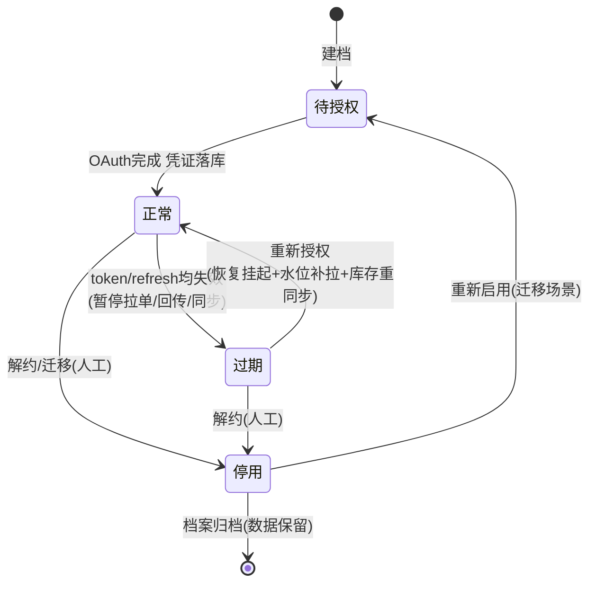
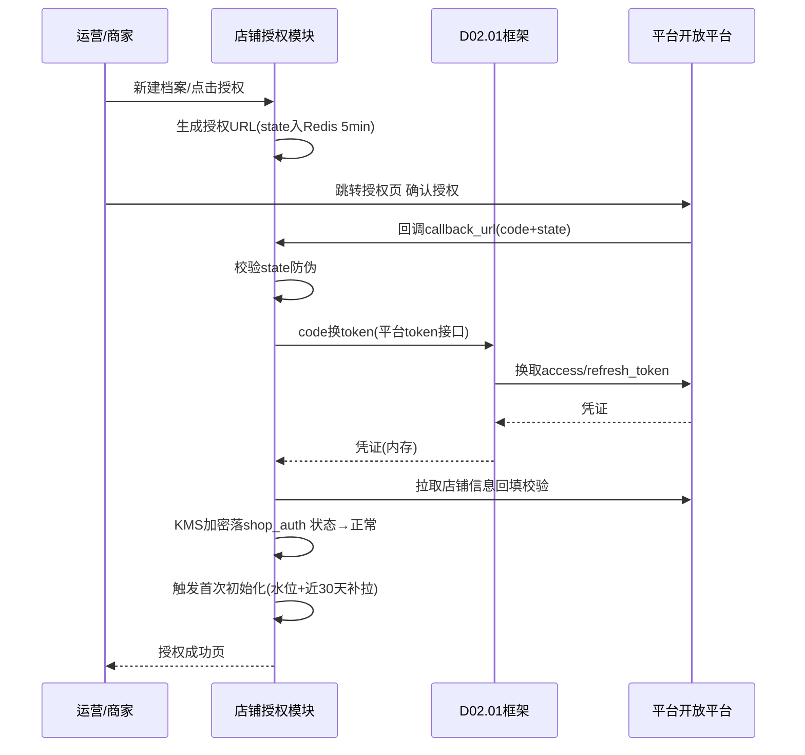
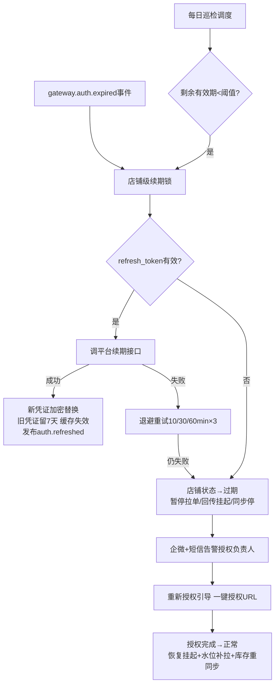

# SRS-D02.06 店铺授权管理模块 需求规格说明书

> 文档编号：SRS-D02.06 · 版本 V1.0 · 2026-10-23 · 编写：小凯 · 状态：待审阅（批次②）
> 所属域：D02 平台 Gateway 域 · 分期：**P0（M1）**
> 上游依据：SRS-D02.01（session 托管消费方）· 逆向文档 05 §4（shop 表/AES 凭证/绑定流程/多店铺隔离）· 全局决策（shop_auth PIPL 加密、替代矩阵中心的自建授权）

---

## 1. 模块概述

### 1.1 定位

店铺授权管理维护「店铺」这一平台对接的核心实体：店铺档案（店铺-平台-货主-租户-组织关联）、平台 OAuth 授权全流程（授权 URL 构建→回调→token 存储）、session/access_token 生命周期（有效期监控/自动续期/过期告警与重新授权引导）、授权凭证 PIPL/KMS 加密存储、店铺状态机，以及店铺与仓库/物流的绑定关系（分仓路由输入）。

商派模式下平台 session 由矩阵中心托管、OMS 只持节点凭证；**凯淳自研 Gateway 必须自建完整的授权托管体系**——本模块即商派矩阵中心「session 托管」职责的自建替代。

### 1.2 职责边界

**做**：店铺档案 CRUD 与多店铺隔离、OAuth 授权流程编排、凭证加密存储与解密供给、token 自动续期与失效告警、店铺状态机、店铺-仓/物流绑定、授权健康看板。
**不做**：调用时凭证的取用与失效反馈（→ D02.01 消费本模块服务）；平台应用 appkey/secret 管理（→ D02.01 platform_app，本模块店铺关联到应用）；组织/货主/租户主数据（→ D10.01/D10.02，本模块引用其 ID）；数据权限过滤（→ D10.03）。

### 1.3 与其他模块关系

| 模块 | 关系 |
|---|---|
| D02.01 框架 | 提供凭证读取服务与缓存；消费 `gateway.auth.expired` 事件执行续期 |
| D02.03 拉单 | 提供启用店铺清单与水位挂靠；店铺过期/停用即暂停拉单 |
| D02.05 重试 | 店铺级挂起/恢复联动（AUTH 不可恢复时） |
| D03.06 配货分仓 / D09.04 物流 | 店铺-仓/物流绑定关系是分仓路由与分单规则输入 |
| D10.01 组织 / D10.03 权限 | 店铺挂组织树节点与货主；店铺维度数据权限过滤 |
| D01.05 PIPL | 凭证加密组件 |
| D01.07 通知 | 过期告警/重新授权引导（企微+短信） |

---

## 2. 业务场景

**SC-D02.06-01 新店铺接入授权（主流程）**
运营在后台新建店铺档案（选择平台/关联货主/组织/绑定应用）→ 系统生成该平台 OAuth 授权 URL（含 state 防伪参数）→ 运营点击跳转平台开放平台授权页 → 商家账号确认授权 → 平台回调本系统 callback_url（code+state）→ 校验 state → 用 code 换取 access_token/refresh_token（或淘系 session）→ 凭证 KMS 加密落库 → 店铺状态 待授权→正常 → 自动触发首次全量拉单初始化（近 30 天订单+水位初始化）。

**SC-D02.06-02 token 自动续期**
调度任务每日扫描：access_token 剩余有效期 < 平台阈值（如淘系 session 剩 7 天、京东 token 剩 24h）→ 调平台续期接口（refresh_token 换新）→ 新凭证加密替换、旧凭证标记废弃（保留 7 天审计）→ 续期结果记录。续期失败重试 3 次后升级告警。

**SC-D02.06-03 授权过期应急**
调用中收到 AUTH 失效反馈（D02.01 事件）→ 尝试即时续期；refresh_token 也失效 → 店铺状态 正常→过期：暂停该店拉单/回传（D02.03/D02.05 联动挂起），企微+短信告警授权负责人，后台展示「重新授权」引导按钮（一键生成授权 URL）；重新授权完成 → 状态回正常 → 挂起任务批量恢复 + 过期期间订单自动补拉（水位机制天然覆盖）。

**SC-D02.06-04 多店铺隔离与货主关联**
凯淳同时代运营品牌 A 的淘系旗舰店、京东自营店、抖音小店（货主=品牌 A），以及凯淳买断业务的拼多多店（货主=凯淳）。每店铺独立授权、独立水位、独立凭证；店铺关联货主后，该店订单/库存/结算自动带货主维度（D10.01 组织树挂载）；品牌方门户（D10.04）按货主只见到自己店铺的汇总数据。

**SC-D02.06-05 店铺绑定仓与物流**
店铺档案配置：默认发货仓（可多仓带优先级，输入给 D03.06 分仓规则）、允许物流公司列表（D09.04 分单约束）、发货地址（面单与回传用）、回传时机 back_node（D02.04 消费）。绑定变更留审计。

**SC-D02.06-06 店铺停用与迁移**
与品牌方解约：店铺状态→停用（保留档案与历史数据，凭证吊销，停止一切平台交互）；店铺迁移（换主体重新授权）：新授权覆盖凭证，档案 ID 不变，历史连续。

---

## 3. 功能需求

### FR-D02.06-01 店铺档案
- FR-01a 档案字段：店铺编码/名称、平台类型（taobao/jd/pdd/xhs/vop/douyin）、平台店铺 ID（seller_id/shop_id 平台侧标识）、关联 platform_app（D02.01）、货主 owner_id、租户 tenant_id、组织节点 org_id、业务类型（直销/分销/预留经销）、店铺类型细分（如淘系 tbbusiness_type B→天猫语义，归一化交 D02.02）。
- FR-01b 唯一性约束：`(platform, 平台店铺ID)` 全局唯一；同一平台店铺不允许重复建档（重复授权覆盖原档案凭证）。
- FR-01c 多店铺隔离：所有 Gateway 域表带 shop_id 索引；店铺清单服务按状态/平台/货主过滤供 D02.03 轮询与 D04.08 同步消费；数据权限由 D10.03 按店铺维度注入。
- FR-01d 档案变更审计：关键字段（货主/组织/状态/绑定关系）变更留痕（旧值/新值/操作人）。

### FR-D02.06-02 OAuth 授权流程
- FR-02a 授权 URL 构建：按平台 OAuth 规范拼装（client_id=platform_app.appkey、redirect_uri、scope、state）；state 含随机数+店铺 ID+时间戳，Redis 存储 5 分钟有效（CSRF 防伪）。
- FR-02b 回调处理：校验 state → code 换 token（经 D02.01 框架出口调用平台 token 接口）→ 凭证加密落库 → 拉取平台店铺信息（店铺名/seller_id）自动回填校验（防授权错店铺：回填的平台店铺 ID 与档案不一致时提示确认）。
- FR-02c 平台差异适配：淘系（session 长效+主动续期语义）、京东 JOS（access+refresh token）、拼多多/小红书/抖音（OAuth2 标准）、唯品会 VOP（独立授权体系）——授权流程编排器按平台策略插件执行（与 D02.02 适配器同目录组织）。
- FR-02d 授权模式兼容：支持「商家自助授权」（发授权链接给品牌方自行完成）与「运营代授权」两种引导；授权链接可追踪（已点击/已完成）。

### FR-D02.06-03 凭证加密存储（PIPL/KMS）
- FR-03a 敏感凭证（access_token/refresh_token/session/平台侧密钥）经 D01.05 PIPL 组件 + KMS 信封加密落 `shop_auth` 表；密文不出库（解密只在 Gateway 进程内存中进行）。
- FR-03b 凭证缓存：解密后的 token 缓存 Redis（短 TTL，默认 30 分钟），D02.01 调用时优先走缓存；缓存 key 不含明文；凭证更新/吊销时主动失效缓存。
- FR-03c 访问审计：每次凭证解密取用记审计流水（调用方/方法/时间），异常高频取用告警（凭证泄露探测）。
- FR-03d 旧凭证保留策略：续期/重授权后旧凭证密文保留 7 天（对账排障）后物理清除。

### FR-D02.06-04 session 生命周期管理
- FR-04a 有效期监控：每店铺凭证记录 expires_at/refresh_expires_at；调度任务每日巡检，生成「授权健康度」（正常/<7 天/<24h/已过期）。
- FR-04b 自动续期：剩余有效期低于平台阈值时自动 refresh（SC-02）；续期加店铺级分布式锁（防 D02.01 事件触发与定时巡检并发续期）；续期失败退避重试 3 次（10/30/60 分钟）。
- FR-04c 过期告警分级：剩 7 天（提醒）→ 剩 24h（告警授权负责人）→ 已过期（紧急告警+店铺状态过期+业务暂停联动）。
- FR-04d 失效事件消费：订阅 `gateway.auth.expired`（D02.01 IF-06），执行即时续期或转重新授权流程；续期成功发布 `gateway.auth.refreshed`（D02.05 恢复重放依据）。

### FR-D02.06-05 店铺状态机
- FR-05a 状态定义与流转（见 §4.1）：待授权/正常/过期/停用；状态变更驱动联动：非「正常」状态 → D02.03 暂停拉单、D02.04 拒收新回传指令（存量重试按 D02.05 挂起）、D04.08 暂停库存同步。
- FR-05b 状态恢复：过期→正常（重新授权）自动触发：挂起任务恢复、水位补拉（过期期间订单）、库存全量重同步一次。

### FR-D02.06-06 店铺绑定关系
- FR-06a 店铺-仓库绑定：默认仓+备选仓优先级列表（D03.06 分仓输入）；货主约束校验（店铺货主与仓服务货主一致性提示）。
- FR-06b 店铺-物流绑定：允许物流公司列表+默认物流（D09.04 分单约束）；平台管控面单标识（抖音/拼多多等需平台面单的店铺自动标记，D09.05 消费）。
- FR-06c 店铺履约参数：发货地址（多地址支持）、back_node 回传时机（D02.04）、轮询参数覆写（D02.03）、库存同步策略引用（D04.08）。
- FR-06d 绑定关系变更即时生效（缓存失效广播）并审计。

### FR-D02.06-07 授权健康看板
- FR-07a 看板：全店铺授权状态总览（按平台/货主分组）、即将过期清单（7 天内）、过期店铺与影响面（在途订单/待回传量）、续期成功率；供 D11.03 集成。
- FR-07b 一键操作：重新授权引导、手工续期触发、店铺停用/启用。

---

## 4. 业务流程

### 4.1 店铺状态机



### 4.2 OAuth 授权时序



### 4.3 凭证续期与过期应急



---

## 5. 处理逻辑

### 5.1 平台授权参数差异表（策略插件依据）

| 平台 | 授权模式 | 凭证形态 | 有效期语义 | 续期方式 |
|---|---|---|---|---|
| 淘系 | OAuth2（TOP） | access_token(session)+refresh | session 长期有效但需定期刷新（R1/R2 级权限差异） | refresh_token 换新 |
| 京东 JOS | OAuth2 | access+refresh token | access 约 24h~30 天 | refresh 续期 |
| 拼多多 | OAuth2 | access+refresh | 按平台规范 | refresh 续期 |
| 小红书 | OAuth2 | access+refresh | 按平台规范 | refresh 续期 |
| 唯品会 VOP | 独立授权 | appkey+授权凭证 | 按 VOP 规范 | 平台特有流程 |
| 抖音 | OAuth2 | access+refresh | access 较短（小时级~天级） | refresh 续期，过期敏感需高频巡检 |

各平台续期阈值/巡检频率在平台策略配置中声明（抖音默认阈值最高、巡检最密）。

### 5.2 凭证加解密规约

```
落库: plaintext → DEK(数据密钥,KMS生成) AES-256-GCM → ciphertext+key_version
读取: Gateway进程 → KMS解DEK(权限仅Gateway服务账号) → 内存解密 → Redis缓存(30min TTL)
禁止: 明文写日志/api_log/告警/导出; 缓存value加密存储(Redis被读也拿不到明文)
轮换: KMS主密钥年度轮换, key_version标记支持渐进重加密
```

### 5.3 状态变更联动清单

| 状态变更 | 联动动作 |
|---|---|
| →正常（首次授权） | 水位初始化（now-30天）、近 30 天订单补拉、商品映射初始化、库存全量同步触发 |
| 正常→过期 | D02.03 店铺摘除轮询清单、消息缓冲暂停消费（不丢弃）、D02.05 该店 waiting→suspended、D04.08 暂停同步、D02.04 拒收新指令 |
| 过期→正常 | 挂起任务批量恢复、水位补拉过期期间订单、库存全量重同步、消息缓冲恢复消费 |
| →停用 | 全通道停止、凭证吊销（平台侧解除授权可选）、档案与历史数据保留 |

---

## 6. 数据字段（业务字段描述，schema：oms_gateway）

### 6.1 店铺授权表（shop_auth）

| 字段 | 业务含义 | 取值/校验 |
|---|---|---|
| shop_id / shop_code / shop_name | 店铺 ID/编码/名称 | shop_id 全域引用键 |
| platform / platform_shop_id | 平台 / 平台侧店铺标识 | (platform, platform_shop_id) 唯一 |
| app_id | 关联 platform_app | 必填（D02.01） |
| owner_id / tenant_id / org_id | 货主 / 租户 / 组织节点 | 必填（D10 主数据引用） |
| business_type | 业务类型 | 直销/分销/经销(预留) |
| access_token_enc / refresh_token_enc / session_enc | 凭证密文 | KMS 信封加密，禁止明文 |
| key_version | 加密密钥版本 | 轮换支持 |
| token_expires_at / refresh_expires_at | 凭证有效期 | 巡检依据，索引 |
| last_refresh_time / refresh_fail_times | 续期记录 | |
| status | 店铺状态 | 待授权/正常/过期/停用（§4.1） |
| seller_info_json | 平台店铺信息快照 | 店铺名/主体名回填校验 |
| auth_mode / auth_url_track | 授权模式 / 链接追踪 | 自助/代授权；已点击/已完成 |

### 6.2 店铺绑定与履约参数（shop_binding / shop_config）

| 字段 | 业务含义 |
|---|---|
| shop_id / branch_id / priority | 店铺-仓绑定与优先级 |
| shop_id / logistics_code / is_default | 店铺-物流绑定 |
| platform_waybill_flag | 平台管控面单标识（D09.05 消费） |
| sender_address_json | 发货地址（多地址） |
| back_node / poll_override / sync_strategy_ref | 回传时机 / 轮询参数覆写 / 库存同步策略引用 |

### 6.3 凭证审计流水（credential_audit）

| 字段 | 业务含义 |
|---|---|
| shop_id / action | 取用/续期/重授权/吊销 |
| caller / method / request_time | 调用方与场景 |
| result / old_key_version | 结果与旧凭证版本（7 天保留期标记） |

---

## 7. 接口

### 7.1 内部接口

| 编号 | 接口 | 消费方 | 说明 |
|---|---|---|---|
| IF-D02.06-01 | `CredentialService::getToken(shopId, scene)` | D02.01 | 凭证读取（缓存优先，解密审计） |
| IF-D02.06-02 | 订阅 `gateway.auth.expired`；发布 `gateway.auth.refreshed` | D02.01/D02.05 | 失效续期闭环 |
| IF-D02.06-03 | `ShopService::listActive(platform?)` / `getShop(shopId)` | D02.03/D04.08/D03 | 启用店铺清单与档案（含绑定关系） |
| IF-D02.06-04 | 事件 `shop.status.changed`（payload：shop_id/旧新状态） | D02.03/04/05、D04.08 | 状态联动 |
| IF-D02.06-05 | 授权回调端点 `/gateway/oauth/{platform}/callback` | 平台 OAuth | 公网可达，state 防伪 |
| IF-D02.06-06 | `ShopBindingService`（仓/物流/履约参数） | D03.06/D09.04/D09.05/D02.04 | 绑定关系读取 |

### 7.2 外部接口

| 编号 | 接口 | 方向 | 说明 |
|---|---|---|---|
| EF-D02.06-01 | 6 平台 OAuth 授权页与 token 接口 | 双向 | 授权跳转/回调/code 换 token/refresh |
| EF-D02.06-02 | 平台店铺信息查询接口 | 出 | 授权回填校验 |
| EF-D02.06-03 | 企微+短信告警（经 D01.07） | 出 | 过期分级告警 |

---

## 8. 非功能需求

| 项 | 要求 |
|---|---|
| 安全 | 凭证 KMS 信封加密、密文不出库、解密审计、缓存加密、日志/告警零明文；state 防伪防 CSRF；回调端点防重放（code 一次性） |
| PIPL | 凭证属敏感数据处理，适用 D01.05 组件规范；导出/展示全脱敏 |
| 可用性 | 凭证缓存 Redis 故障时降级直读 DB 解密（性能下降但不断服）；续期任务多实例互斥（分布式锁） |
| 时效 | token 续期在过期前完成成功率 ≥99.5%；过期发现→告警 ≤5 分钟 |
| 一致性 | 状态变更与联动动作最终一致（事件驱动+补偿巡检：每小时核对非正常店铺的通道是否确已暂停） |
| 审计 | 授权/续期/状态变更/绑定变更全留痕，保留 ≥3 年 |

---

## 9. 验收标准

| 编号 | 验收条件 |
|---|---|
| AC-01 | 6 平台各完成一次沙箱授权全流程：URL 构建→回调→换 token→加密落库→状态正常→触发初始化补拉 |
| AC-02 | 伪造/过期 state 的回调被拒绝并记安全日志；同一 code 重放第二次被拒 |
| AC-03 | 授权回填校验：授权了错误店铺（平台店铺 ID 与档案不符）时阻断并提示 |
| AC-04 | shop_auth 表中 token 字段均为密文；Redis 缓存值加密；api_log/告警/界面任何位置无明文凭证 |
| AC-05 | 自动续期：模拟 token 剩余 <24h（京东类），巡检自动续期成功，旧凭证保留 7 天标记，缓存刷新生效 |
| AC-06 | refresh_token 失效场景：店铺 5 分钟内转「过期」，拉单轮询摘除、回传挂起、同步暂停，企微+短信告警送达 |
| AC-07 | 重新授权后：状态回正常，挂起重试批量恢复，过期期间订单经水位补拉齐全，库存触发全量重同步 |
| AC-08 | 并发续期（事件触发+巡检同时）：分布式锁保证仅一次平台续期调用 |
| AC-09 | 凭证解密审计：每次 getToken 留痕；模拟异常高频取用触发泄露探测告警 |
| AC-10 | 店铺-仓/物流绑定变更后 D03.06/D09.04 即时读到新值（缓存失效广播 ≤5s）；变更审计可查旧值新值 |

---

## 变更记录

| 日期 | 版本 | 变更 | 原因 |
|---|---|---|---|
| 2026-10-23 | V1.0 | 首版 | — |

---

*参考实现溯源：商派 shop 表（app/ome/dbschema/shop.php：config 序列化凭证/last_download_time 水位/org_id/dealer_id/delivery_mode/tbbusiness_type，见逆向文档 05 §4.1）；AES 凭证加解密（app/ome/model/shop.php:205 aes_encode/aes_decode）；绑定流程（app/erpapi/lib/bind/request/bind.php app.applyNodeBind——但商派绑定的是矩阵节点而非平台 OAuth，平台 session 由矩阵中心托管不落 OMS）；直连模式配置说明（app/ome/lib/auth/config.php 列各平台开放平台入口）；多店铺隔离（shop_id 全表索引+org_id 组织过滤+channel_shop 按店加载快照，§4.3）。关键差异：① 商派依赖矩阵中心托管 session（SaaS 代理模式），本设计**自建完整 OAuth 授权托管**（六平台策略插件、state 防伪、code 换 token、回填校验）；② 凭证保护从单一 AES 升级为 **KMS 信封加密+解密审计+缓存加密+泄露探测**（PIPL 要求）；③ 店铺状态机显式化（商派仅 active/disabled 二值），过期状态带全通道联动暂停与恢复补偿；④ 续期从被动（调用失败才发现）升级为**主动巡检+分级告警**（剩 7 天/24h/过期三档）；⑤ 店铺-仓/物流绑定与履约参数（back_node/轮询覆写）集中在本模块管理，作为 D03.06/D09.04/D02.04 的统一配置源（商派分散在 shop 表多列与 shop_dly_corp 等附表）。*
