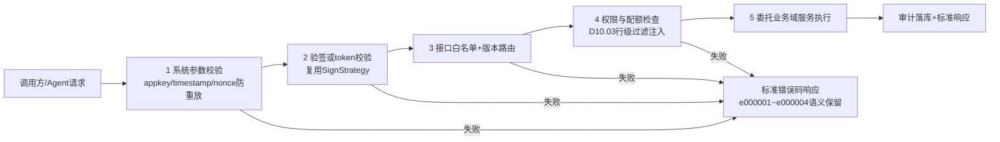
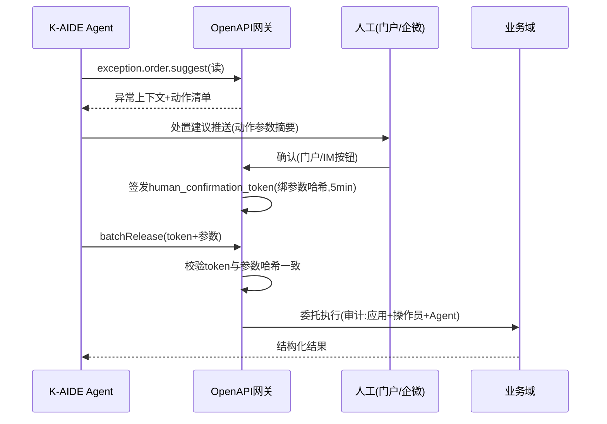

# SRS-D02.07 对外 OpenAPI 网关模块 需求规格说明书

> 文档编号：SRS-D02.07 · 版本 V1.0 · 2026-10-23 · 编写：小凯 · 状态：待审阅（批次②）
> 所属域：D02 平台 Gateway 域 · 分期：**P2 预留（M4 之后，本轮只写需求与接口规范，不展开实现细节）**
> 上游依据：SRS-00 §3 D02.07 · 逆向文档 05 §5.4（app/openapi 五步入口管线、app/channel 第三方应用渠道化）· 全局决策（K-AIDE Agent 集成）

---

## 1. 模块概述

### 1.1 定位

对外 OpenAPI 网关是 OMS **向外部调用方开放能力**的统一入口（与 D02.01「OMS 调平台」方向相反）：面向品牌方系统、第三方 ISV、物流/仓储合作方，以及 **K-AIDE Agent**（自然语言查单、异常单智能处理、审单规则建议）。提供标准化 REST/OpenAPI 接口、鉴权（appkey+签名 / OAuth2）、限流与配额、接口审计。

P0-P1 阶段预留：架构上复用 D02.01 的签名策略框架（入站验签）与 D10 权限体系（行级数据过滤），P2 启动实现。

### 1.2 职责边界

**做**（P2）：开放接口注册与版本管理、调用方（应用）档案管理、鉴权与验签、限流配额、接口审计、Agent 能力接口规范。
**不做**：业务逻辑实现（查询/操作委托各业务域服务接口）；品牌方门户页面（→ D10.04，门户是本网关的最大内部调用方）。

### 1.3 与其他模块关系

| 模块 | 关系 |
|---|---|
| D02.01 框架 | 复用签名策略接口（入站验签方向）与错误码字典框架 |
| D10.02/03 租户权限 | 调用方关联租户；数据权限行级过滤强制注入（货主/店铺维度） |
| D03/D04/D05/D08 各域 | 开放接口的数据与操作来源（经各域服务接口，不直连库） |
| D10.04 品牌方门户 | 门户后端经本网关调用（内部应用身份） |
| K-AIDE（外部） | Agent 调用方：结构化 API + Agent 能力接口（§3 FR-06） |

---

## 2. 业务场景

**SC-D02.07-01 品牌方系统对接（P2）**
品牌方 A 的自建 BI 系统每小时拉取其货主下的订单/库存/售后数据：以 OAuth2 client_credentials 换取 token → 调 `order.list`/`stock.query` 接口 → 网关按品牌方租户注入货主行级过滤（只见自己数据）→ 配额内返回；超配额拒绝并提示升级。

**SC-D02.07-02 K-AIDE Agent 自然语言查单**
运营对 Agent 说「查一下昨天抖音店发货失败的单」：Agent 将自然语言映射为结构化调用 `order.list(platform=douyin, ship_sync_status=fail, time=...)` → 网关鉴权（Agent 应用身份+操作员上下文双凭证）→ 返回结构化结果 → Agent 组织自然语言回答。

**SC-D02.07-03 Agent 异常单智能处理（P2 预留）**
Agent 发现异常单聚类（同地址黑名单命中批量挂起）→ 调 `exception.order.suggest` 获取处置建议上下文 → 经人工确认后调 `exception.order.batchRelease` 执行（写操作强制「Agent 提议 + 人工确认」双因子，Agent 无独立写权限）。

**SC-D02.07-04 第三方 ISV 电子面单回调（P2 预留）**
面单服务商经开放接口回传打印结果/单号消耗：appkey+签名验签 → 幂等处理 → 转发 D09.05。

---

## 3. 功能需求（P2 需求占位，粒度到接口规范级）

### FR-D02.07-01 开放接口注册与版本
- FR-01a 接口注册表：方法名、版本（v1/v2 并存）、所属域、读写类型、权限点、配额等级、状态（内测/公开/下线）。
- FR-01b 首批开放接口清单（P2 范围）：

| 分组 | 方法（示例） | 读/写 | 说明 |
|---|---|---|---|
| 订单 | order.list / order.detail / order.status.track | 读 | 货主行级过滤强制 |
| 库存 | stock.query / stock.sellable.query | 读 | 三元口径按权限裁剪 |
| 售后 | aftersale.list / aftersale.detail | 读 | |
| 财务 | settle.list / bill.detail | 读 | 品牌方对账场景 |
| 报表 | report.sales / report.fulfillment | 读 | D11 数据供给 |
| 异常处理 | exception.order.list / exception.order.suggest / exception.order.batchRelease | 读/写 | 写操作双因子（FR-06c） |
| 回传查询 | sync.task.query | 读 | 回传轨迹 |

- FR-01c 接口变更兼容承诺：字段只增不删（废弃字段标记 deprecated ≥6 个月后移除）；破坏性变更升版本号。

### FR-D02.07-02 鉴权
- FR-02a 双模式：①appkey+签名（服务端对服务端：参数排序+时间戳+nonce 防重放，签名算法复用 D02.01 SignStrategy 框架）；②OAuth2 client_credentials（token 有效期 2h，refresh 机制）。
- FR-02b 调用方应用档案（open_app）：应用 ID/密钥（加密存储同 shop_auth 规约）、关联租户、允许接口集合（白名单裁剪，商派 whitelist 思想）、IP 白名单（可选）、配额等级、状态。
- FR-02c Agent 双凭证：K-AIDE 应用身份 + 透传操作员身份（on-behalf-of），审计同时记录两者；操作员权限与应用权限取交集。

### FR-D02.07-03 限流与配额
- FR-03a 三级限流：应用级 QPS（令牌桶，复用 D02.01 限流器实现）、接口级 QPS、租户日调用配额。
- FR-03b 配额等级（示例）：free（1 万次/日）/ standard（50 万/日）/ premium（不限日额，QPS 提升）；超额返回标准错误码 `QUOTA_EXCEEDED`（含重置时间）。

### FR-D02.07-04 接口审计
- FR-04a 全量调用审计：应用/操作员/方法/参数摘要/结果/耗时/IP；写操作全参数留痕。
- FR-04b 数据导出类接口（列表大批量）记录数据范围（时间窗/单量），满足 PIPL 数据出境与提供第三方审计要求。
- FR-04c 审计保留 ≥3 年，可检索导出。

### FR-D02.07-05 数据权限强制注入
- FR-05a 所有查询接口经 D10.03 行级过滤（租户/货主/店铺维度），调用方不可绕过、不可指定越权过滤参数；越权参数静默收敛到权限范围内并记审计标记。

### FR-D02.07-06 Agent 能力接口规范（预留）
- FR-06a 自然语言查单映射规范：开放接口全部提供机器可读 Schema（OpenAPI 3.1 + 中文语义描述 + 枚举字典），供 Agent 做「意图→结构化参数」映射；提供 `meta.describe` 接口返回能力清单与参数说明（Agent 自发现）。
- FR-06b 异常单智能处理：`exception.order.suggest` 返回异常上下文+可选处置动作清单（动作 ID/前置条件/影响面），供 Agent 生成建议。
- FR-06c 写操作双因子：Agent 发起的写操作必须携带 `human_confirmation_token`（人工在门户/IM 确认后由 OMS 签发，一次性、5 分钟有效、绑定动作参数哈希）；无 token 的写请求一律拒绝。
- FR-06d 审单规则建议（预留占位）：`rule.audit.suggest`——Agent 基于历史审单数据生成规则草案，仅输出建议文本与规则 DSL 草案，生效必须走 D01.03 规则引擎的正式发布流程（人工评审）。

---

## 4. 业务流程

### 4.1 开放调用管线（五步，商派 openapi_entrance 管线现代化）

### 4.2 Agent 写操作双因子时序（预留）

---

## 5. 处理逻辑（P2 仅约定原则）

- 标准响应协议：`{code, msg, data, request_id, quota_remaining}`；错误码体系与 D02.01 统一字典同源（e00000x 系统级语义沿用商派 openapi 惯例：001 参数/002 验签/003 接口不存在/004 无权限，另增 005 配额超限）。
- 幂等：写接口要求调用方传 `idempotency_key`，网关 24h 去重。
- 分页与批量上限：列表接口强制分页（单页 ≤200）；批量写 ≤50 条/次。
- Webhook（预留）：网关可向调用方注册回调（订单状态变更订阅），出站签名+重试复用 D02.05 机制。

---

## 6. 数据字段（业务字段描述）

### 6.1 开放应用档案（open_app）

| 字段 | 业务含义 |
|---|---|
| app_id / app_secret_enc | 应用凭证（KMS 加密，规约同 shop_auth） |
| app_name / app_type | 名称 / 类型：品牌方系统/ISV/K-AIDE/门户内部 |
| tenant_id / owner_scope | 关联租户 / 数据范围（货主集合） |
| api_whitelist / quota_level / ip_whitelist | 接口白名单 / 配额等级 / IP 白名单 |
| status / audit_status | 启停 / 接入审核状态 |

### 6.2 接口注册表（open_api）与审计（open_api_audit）

| 字段 | 业务含义 |
|---|---|
| open_api: method/version/domain/rw_type/perm_point/quota_level/status | 接口元数据 |
| audit: request_id/app_id/operator/on_behalf_of/method/params_digest/result/spendtime/ip/confirmation_token_ref | 调用审计 |

---

## 7. 接口

### 7.1 内部接口

| 编号 | 接口 | 消费方 | 说明 |
|---|---|---|---|
| IF-D02.07-01 | `OpenApiRegistry`（接口注册/白名单校验） | 域内 | P2 实现 |
| IF-D02.07-02 | 委托各域服务接口（D03/D04/D05/D08/D11 查询服务） | → 各域 | 网关不直连业务库 |
| IF-D02.07-03 | `ConfirmationTokenService`（人工确认 token 签发/校验） | D10.04 门户/D01.07 | Agent 写操作双因子 |

### 7.2 外部接口

| 编号 | 接口 | 方向 | 说明 |
|---|---|---|---|
| EF-D02.07-01 | `POST /openapi/v1/{method}` 统一开放端点 | 入 | 品牌方/ISV/K-AIDE |
| EF-D02.07-02 | `GET /openapi/meta/describe` 能力自发现 | 入 | Agent 消费 |
| EF-D02.07-03 | Webhook 出站回调（预留） | 出 | 状态变更订阅推送 |

---

## 8. 非功能需求

| 项 | 要求 |
|---|---|
| 性能 | 网关自身开销 P99 ≤20ms；读接口整体 P95 ≤500ms |
| 安全 | 验签+防重放（timestamp±5min+nonce）、传输 TLS、凭证 KMS 加密、写操作双因子、越权参数收敛 |
| PIPL | 对外提供消费者数据默认脱敏（收货人字段仅授权场景开放且审计）；导出类接口数据范围留痕 |
| 隔离 | 开放网关故障不影响内部链路（独立进程组/连接池隔离，P2 部署时评估独立进程） |
| 可观测 | 按应用×接口的调用量/成功率/配额水位看板 |

---

## 9. 验收标准（P2 启动时生效）

| 编号 | 验收条件 |
|---|---|
| AC-01 | 品牌方应用以 OAuth2 调 order.list：仅返回本货主数据，越权 shop_id 参数被收敛且审计标记 |
| AC-02 | appkey+签名模式：时间戳超窗/nonce 重放/签名错误分别返回 e000001/e000002 标准错误 |
| AC-03 | 配额超限返回 QUOTA_EXCEEDED 含重置时间；限流三级（应用/接口/租户日配额）各自生效 |
| AC-04 | Agent 无 confirmation_token 的写请求 100% 被拒；token 与参数哈希不一致被拒；过期 token 被拒 |
| AC-05 | meta.describe 返回全部公开接口的 OpenAPI 3.1 Schema，Agent 可据此完成一次自然语言→结构化查单闭环 |
| AC-06 | 写接口幂等：同 idempotency_key 重复调用返回首次结果 |
| AC-07 | 全量调用审计可检索（应用/操作员/方法/时间），写操作全参数留痕，保留期校验 ≥3 年配置 |

---

## 变更记录

| 日期 | 版本 | 变更 | 原因 |
|---|---|---|---|
| 2026-10-23 | V1.0 | 首版（P2 需求占位与接口规范） | — |

---

*参考实现溯源：商派 app/openapi 五步入口管线（lib/entrance.php openapi_entrance::service：系统参数 e000001→验签 e000002→接口存在性 e000003→权限 e000004→统计监控，见逆向文档 05 §5.4）；openapi_sign 验签与 JSON 规范化（lib/sign.php）；app/channel 第三方应用渠道化（channel 表含水位、adapter 注册——「外部应用调用 OMS」的渠道思想）。关键差异：① 商派 openapi 主要服务矩阵中心推单与内部回调（准内部总线），本设计定位为**真正的对外开放网关**（品牌方/ISV/Agent 三类外部调用方）；② 新增 OAuth2 双模式鉴权、三级限流配额、OpenAPI 3.1 机器可读 Schema 与 meta.describe 自发现（商派无）；③ Agent 写操作双因子（human_confirmation_token）为 K-AIDE 集成新增设计，业界无现成参考，本文档为规范起点；④ 数据权限强制注入 D10.03 行级过滤（商派靠 org_id 手工过滤）。*
