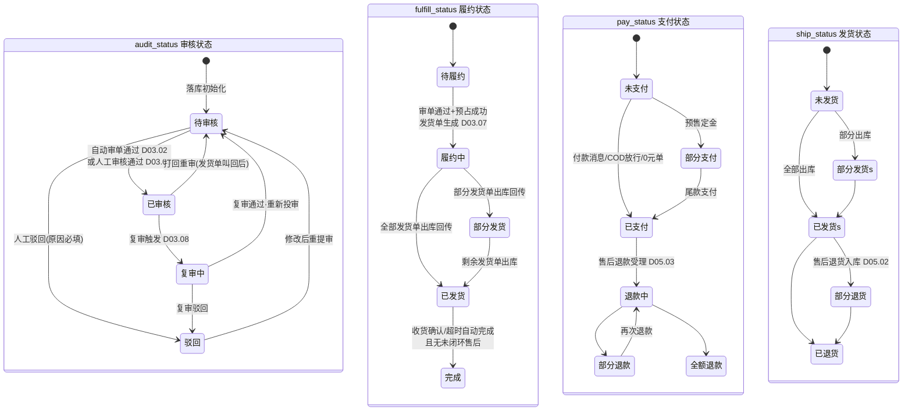
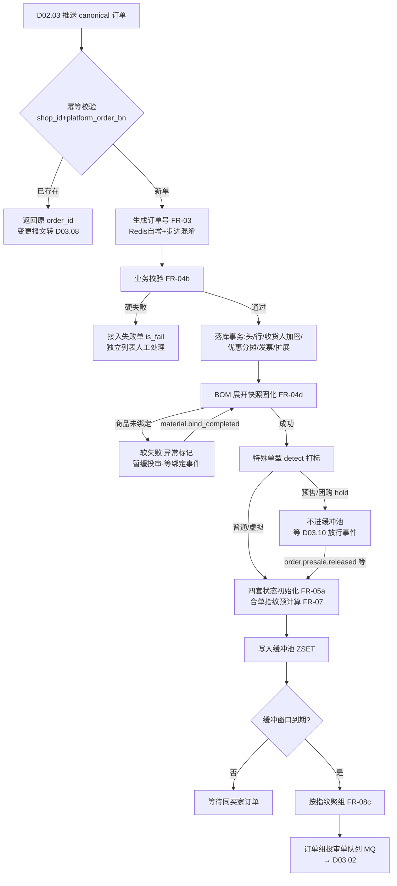
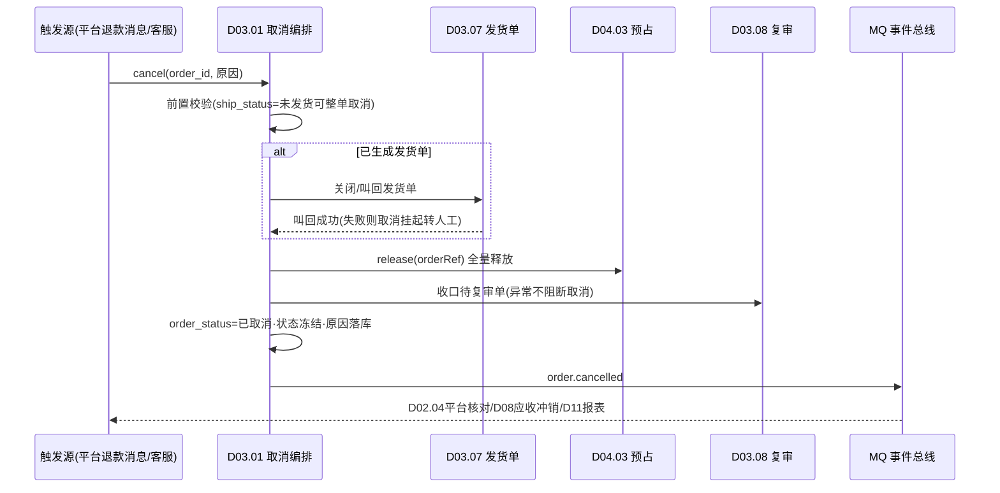

# SRS-D03.01 订单接入与创建模块 需求规格说明书

> 文档编号：SRS-D03.01 · 版本 V1.4 · 2026-10-24 · 编写：小凯 · 状态：待审阅（批次②，V1.1 增补推广来源，V1.4 增补客服协同标记）
> 所属域：D03 订单履约域 · 分期：**P0（M1-M2）**
> 上游依据：SRS-00 §4.4 契约「订单状态机」（**本模块为唯一定义源**）· 逆向文档 02 §2（状态机）/§3.1（订单创建）/§3.2（缓冲池）/§5（合单指纹）· 07 架构书决策（状态收敛、结构化审核原因、决策执行分离）· SRS-D04.01 §5.3（订单行 BOM 快照）· SRS-D04.03（预占契约）
> 定位：订单进入凯淳 OMS 的**唯一落库入口**与订单聚合根的**结构定义方**——五类来源统一接入、订单号生成、四套状态初始化、双口径金额与优惠分摊、缓冲聚组投审

---

## 1. 模块概述

### 1.1 定位

订单接入与创建是全链路（SRS-00 §4.3「一单的旅程」）的第一站：把 D02.03 推送的平台标准模型（canonical）订单、人工建单、批量导入、售后换货 0 元单、B2B 转入单（P2 预留）五类来源统一转化为 OMS 内部订单聚合根（订单头/订单行/收货人/优惠分摊/发票/扩展），完成幂等防重、金额双口径落库、BOM 展开快照固化、四套状态初始化与合单指纹预计算，最后送入**订单缓冲池**按聚组规则投递审单引擎（D03.02）。本模块同时是 SRS-00 §4.4「订单状态机」契约的定义源：audit_status × fulfill_status × pay_status × ship_status 四套状态的枚举、初始化、合法流转与联动关系以本文档 §4/§5 为准，D05/D08/D09/D11 等消费方只引用不重复定义。

### 1.2 职责边界

**做**：五类来源的接入编排与统一落库；订单聚合根数据结构与业务校验（头/行/收货人/优惠/发票/扩展）；订单号生成与幂等防重（平台单号+店铺唯一键）；四套状态初始化与状态机维护（本模块持有状态写入口，状态变迁由各消费模块经 IF 触发）；双口径金额与行级优惠分摊；合单指纹预计算；订单缓冲池与聚组投审；BOM 展开与订单行快照固化；订单取消入口编排（释放预占/收口复审的调用方，执行归各被调模块）；订单查询视图（列表/详情，数据权限过滤）。

**不做**：平台报文解析与标准化（→ D02.02/D02.03，本模块只消费 canonical 模型）；审单路由决策（→ D03.02）；人工审单与分派（→ D03.03）；拆单/合单策略本身（→ D03.04/D03.05，本模块只算指纹）；发货单生成与推仓（→ D03.07/D09）；预占/释放的记账执行（→ D04.03）；改单与复审（→ D03.08）；特殊单型的准入 hold 逻辑（→ D03.10，本模块只调其 detect 打标）；归档（→ D03.13）；导入文件解析引擎（→ D01.06，本模块定义订单导入模板与校验规则）。

### 1.3 与其他模块关系

| 模块 | 关系 |
|---|---|
| D02.03 拉单与消息接收 | 主链路输入：推送 canonical 标准订单模型 + 平台消息 ID（幂等键成分） |
| D04.01 商品物料 | 落库时调 `bomExpand` 展开销售物料为基础物料并固化行快照；未绑定 → 异常单 |
| D03.10 特殊单型 | 落库事务内调 `detect` 打标（presale/groupon/luckybag/virtual），初始化 special 扩展 |
| D03.05 合单 | 指纹字段口径由 D03.05 定义，本模块在落库时预计算写入（商派拉单即算 hash 的机制照搬） |
| D03.02 审单引擎 | 缓冲池聚组后投递审单；接收审单结果驱动 audit/fulfill 状态变迁 |
| D03.03 人工审单 | 待审队列的数据源为状态=待审核的订单 |
| D04.03 预占 | 订单取消/关闭时调 release 释放预占 |
| D03.08 改单复审 | 复审触发时 audit_status 置「复审中」；改单生效经本模块状态写入口落库 |
| D05.04 换货补发 | 换货 0 元单的创建调用方（createway=exchange） |
| D01.05 PIPL | 收货人字段加密存储、展示脱敏 |
| D01.06 导入导出 | 批量导入建单的文件解析与任务调度 |
| D10.03 数据权限 | 订单查询统一注入租户/货主/店铺/品牌行级过滤 |
| D08.01 应收 | 订单完成事件供给双口径应收 |
| D03.13 归档 | 订单聚合根结构=归档单元结构 |

---

## 2. 业务场景

**SC-D03.01-01 平台订单接入（主链路，占单量 ≥95%）**
天猫店铺消费者下单付款。D02.03 经消息推送/定时增量拉到平台订单，适配器转为 canonical 标准模型后调用本模块创建接口。系统按（shop_id + platform_order_bn）唯一键幂等防重 → 生成 OMS 订单号 → 收货人字段 PIPL 加密落库 → 逐行 BOM 展开固化基础物料快照 → 优惠按行分摊（双口径）→ 初始化四套状态（audit=待审核，pay 按报文，fulfill=待履约，ship=未发货）→ 特殊单型识别打标 → 合单指纹预计算 → 进入缓冲池等待聚组投审。全程无人工。

**SC-D03.01-02 重复消息防重**
平台消息推送与定时增量拉单同时到达同一笔订单（拉单三保险的常态）。两次创建请求命中同一唯一键：后到方直接返回已存在的 order_id（幂等成功），不产生重复订单、不重复投缓冲池；若后到报文携带变更（金额/地址），不走创建更新，转 D03.08 平台改单消息通道处理。

**SC-D03.01-03 商品未绑定异常**
新店铺首单含未绑定基础物料的平台商品（D04.01 自动建档后状态=未绑定）。订单正常落库（不因商品问题拒单），行快照标记「待解析」，订单挂「商品未绑定」异常（结构化原因，联动 D03.09）并**不进缓冲池**；商品专员完成绑定后事件驱动重解析，订单恢复投审。

**SC-D03.01-04 手工建单（线下/团购大客户）**
运营为线下渠道客户手工建单：选择店铺、录入商品（本地物料选择器，自动带出价格）、收货人、金额。手工单订单号前缀区分（L 单），createway=local；校验规则与平台单完全一致（地址校验/物料有效/货主一致/金额勾稽）；无平台单号，幂等键退化为「防连击锁 + 操作人确认」；默认 pay_status=已支付（线下已收款，可配置为未支付），直接进缓冲池。

**SC-D03.01-05 批量导入建单**
运营用标准 Excel 模板（订单号/店铺/商品编码/数量/单价/收货人/电话/地址/发票要素）批量导入 5000 单，经 D01.06 异步任务：逐行校验（同平台单规则 + 模板级校验），错误行输出错误报告不阻塞正确行；正确行批量落库（createway=import），逐单进缓冲池；导入批次可查询进度与结果。

**SC-D03.01-06 换货 0 元单（D05.04 调入）**
售后换货审核通过，D05.04 调用本模块创建 0 元新订单：createway=exchange，order_type=换货，金额全 0，收货人复制原单（或售后修改后的新地址），行=换货补发物料。0 元单跳过支付校验（pay_status 直接置已支付-0 元），复用正向履约（审单/预占/发货单/推仓），售后单号双向关联。

**SC-D03.01-07 B2B 销售单转入（P2 预留）**
经销商 B2B 销售单（D07.02）审核通过后转入履约：createway=b2b，携带经销商客户档案与批发价体系金额（D07.03）。P0 阶段仅在 createway/order_type 枚举、订单扩展字段（客户分类 class_id、账期标记）与接口签名上预留，不实现业务逻辑。

**SC-D03.01-08 优惠分摊与双口径金额**
消费者下单 3 件商品共 300 元，使用平台券 30 元（平台承担）+ 店铺满减 20 元（商家承担），实付 250 元。落库时：订单头记双口径（客户实付 250 / 优惠合计 50，其中平台承担 30）；每行按金额比例分摊优惠，行实付 = 行原价 − 行分摊优惠，尾差归入金额最大行（保证 Σ行实付 = 订单实付，分毫不差）；平台承担部分不摊薄行实付口径（供 D08 应收双口径与 D03.08 价格监控使用）。

**SC-D03.01-09 缓冲聚组投审（合单窗口）**
店铺开启合单（D03.05 店铺级开关，默认关）。买家 10:00 付款订单 A 落库进缓冲池；缓冲窗口 15 分钟内买家又付款订单 B（同收货人/手机/地址，指纹相同）。窗口到期后聚组任务将 A、B 按指纹聚为一组整体投审，审单通过后合并为一张母发货单。未开启合单的店铺每单独立成组即刻投审（缓冲窗口=0）。

**SC-D03.01-10 订单取消（发货前）**
平台退款消息/客服操作触发取消：校验当前 fulfill_status ∈ {待履约}（未生成发货单）→ order_status 置已取消、四套状态冻结现值 → 释放全部预占（D04.03）→ 收口进行中复审单（D03.08）→ 发布 order.cancelled 事件（D02.04 平台状态核对/D08 应收冲销/D11 报表）。已生成发货单的取消须先叫回（→ D03.07/D03.08 编排，本模块只提供取消状态写入与联动调用）。

---

## 3. 功能需求

### FR-D03.01-01 五类来源统一接入
- FR-01a 统一创建入口 `OrderCreateService::create(canonicalOrder, source)`：五类来源（platform/local/import/exchange/b2b-P2）全部收敛为 canonical 标准模型后调用同一入口，走同一套校验与落库逻辑；来源以 createway 字段区分。
- FR-01b canonical 模型最小必填集：店铺、平台单号（手工/导入单可为空，用外部单号）、下单/付款时间、订单金额组（原价/优惠/实付/运费，双口径）、商品行（平台 SKU 编码/数量/行价/行优惠）、收货人（姓名/手机/省市区/详址）、买家标识（平台 open_id/nick，可空）、发票要素（可空）、买家留言/商家备注（可空）、平台订单状态与扩展属性（JSON）。
- FR-01c 平台单主链路：D02.03 推送经 MQ 异步消费创建（削峰），消费失败进 D01.01 重试与死信；创建接口同步返回 order_id。
- FR-01d 换货 0 元单：D05.04 同步调用；0 元单免支付校验、免价格监控（金额恒 0）、售后单号关联必填。
- FR-01e B2B 转入（P2 预留）：接口签名与扩展字段（class_id/账期/经销价）P0 预留占位。

### FR-D03.01-02 幂等防重
- FR-02a 平台单幂等键 =（shop_id, platform_order_bn）DB 唯一索引；重复创建返回已存在 order_id + 重复标记，不报错不重落。
- FR-02b 消息通道幂等：platform_msg_id 二级防重（同一消息重复投递直接 ACK）；拉单三保险多通道并发到达时靠 FR-02a 唯一键兜底（插入冲突捕获 → 查询返回）。
- FR-02c 导入幂等：批次内外部单号去重 + 跨批次（shop_id, external_bn）唯一键校验，冲突行标记跳过并出报告。
- FR-02d 已存在订单收到变更报文：不在创建通道更新，转发 D03.08 改单消息通道（改地址/平台状态变更）；订单金额变更（如尾款支付）走 pay_status 更新接口（FR-05）。

### FR-D03.01-03 订单号生成
- FR-03a OMS 订单号（order_bn）规则：`前缀(1位) + yyMMdd(6位) + 店铺码(3位) + 序列(7位)`，共 17 位。前缀：P=平台单、L=手工单、I=导入单、C=换货单、B=补发单、R=B2B 单（预留）。店铺码为店铺档案分配的 3 位数字码（全局唯一，D02.06 维护）。
- FR-03b 序列生成：Redis `INCR order:seq:{yyMMdd}` 按日自增（原子、跨进程安全），日内序列空间 10^7；序列号经**步进混淆**（乘以与 10^7 互质的固定步长再取模）后输出，防外部按号遍历推测单量。
- FR-03c Redis 故障降级：DB 号段表（每次取 1000 号段缓存本地），号段内自增；降级期间不重号（号段唯一约束兜底）。
- FR-03d 订单号全局唯一（DB 唯一索引）；平台单号保留原文另存（platform_order_bn），两套号并存，界面默认展示 OMS 单号并支持平台单号检索。
- FR-03e 参考商派 gen_id 机制（前缀+时间+随机序号）但去除随机碰撞重试：Redis 原子自增无碰撞，性能与唯一性均优于随机方案。

### FR-D03.01-04 订单落库与业务校验
- FR-04a 落库范围（订单聚合根，一个本地事务）：订单头（orders）、订单行（order_items，含 BOM 展开快照）、收货人（order_receiver，加密）、优惠分摊（order_pmt，行级+单级）、发票信息（order_invoice）、扩展（order_extend：留言/备注/平台扩展 JSON/special 标记）、合单指纹字段、四套状态初始化。
- FR-04b 通用校验（五类来源同一套）：店铺有效且授权未过期；商品行非空且数量>0；金额勾稽（Σ行原价 − 优惠 = 实付 ± 运费，容差 0.01 元，超差拒单转人工核查）；收货人省市区可解析为标准行政区划（地址库校验，失败不拒单、打「地址待清洗」标记进审单校验）；物料映射（平台 SKU → 销售物料 → BOM 展开基础物料）；同单行货主一致性（跨货主商品允许同单存在，行级 owner_id 各自归属，审单按货主拆单——D03.04）。
- FR-04c 校验失败分级：**硬失败**（店铺无效/金额勾稽超差/行空）→ 拒单，落「接入失败单」（is_fail，独立列表人工处理，不进缓冲池，沿袭商派 fail 单机制）；**软失败**（地址待清洗/商品未绑定/发票要素缺失）→ 正常落库 + 结构化异常标记（联动 D03.09）+ 暂缓投审（未绑定类）或带标投审（地址类，由审单地址插件裁决）。
- FR-04d BOM 展开快照：逐行调 `MaterialService::bomExpand`，订单行固化（bm_id/数量/owner_id/virtual 标记/快照版本号），此后物料档案变更不回溯（SRS-D04.01 §5.3 审计要求）；组合装展开为多行基础物料明细（子行挂父行引用，金额按 rate/fixed_price 分摊）；多选一展开为候选集，审单择一（D03.02）。
- FR-04e 特殊单型打标：落库事务内调 `SpecialOrderService::detect`，写 order_type/special 扩展；预售/团购单的 hold 子状态由 D03.10 管理，本模块按 detect 返回结果决定是否暂缓进缓冲池（hold 单不投审，等 D03.10 放行事件）。
- FR-04f 收货人 PIPL：姓名/手机/详址经 D01.05 组件加密存储；平台密文单（抖音/拼多多加密面单场景）原样保存密文与密文标识（审单/打单必须用原密文，沿袭商派 is_encrypt 机制）；界面展示脱敏（张*/138****0000），明文查看需授权点+留痕。
- FR-04g 推广来源识别（佣金归因）：落库时从平台报文解析推广来源——淘客/联盟单（淘宝客 pid、京东联盟 subunionId、抖音精选联盟等）写 promotion_source=淘客联盟 + promotion_pid/promotion_id；直播带货/私域按平台标记识别。推广来源是 D08.01 平台扣费项（佣金/推广费）按订单归因的数据源（佣金本身在 D08.01 FR-06 登记，本模块只做来源标记）。无推广信息的自然流量单 promotion_source=自然流量。
- **FR-04h 客服协同标记体系（V1.4 业务仿真 S1-A）**：订单头承载三类运营协同标记，是客服/运营与审单员的核心协同语言：
  - **彩色旗帜 flag_color**：红/黄/绿/蓝/紫 五色（语义店铺级可配，缺省约定：红=停发暂缓、黄=待确认、绿=优先放行、蓝=已联系买家、紫=VIP/大客户关注）；来源双向——①拉单时解析平台旗帜（淘系 seller_flag 1-5，经 D02.03 canonical 带入）②OMS 侧人工标旗（客服360视图 D03.16/审单工作台 D03.03 操作）。**双向同步**：OMS 标旗变更经 D02.04 回传平台（平台支持写回时）；平台侧改旗经消息/轮询同步回 OMS；冲突策略=后写覆盖+变更留痕（flag_change_log：前色/后色/来源/操作者）。审单联动：红旗订单审单插件链强制 HOLD（不进自动通过），绿旗可配提权。
  - **卖家备注 seller_memo / 买家留言 buyer_message**：买家留言拉单落库（order_extend 已有）；卖家备注 OMS 侧维护（客服补录跟进记录，多条追加不覆盖，带操作者与时间）；备注关键词规则联动（如留言含"改地址/不要发顺丰"→审单插件提示，D03.02 留言校验插件消费）；敏感词过滤（PIPL/广告法）。
  - **催发货标记 urge_flag**：买家催单（平台催发货消息/客服代标）→ 订单提权：审单队列优先级提升（D03.03 时效优先排序的强插因子）+ 推仓指令加急标记（D09.02 报文加急位）+ 催单时效看板（D11.03：催单未发货时长告警）；催单次数累计 urge_cnt、首催时间留痕；发货后自动消标；平台「延迟发货赔付」风险的催单单独分级（临近平台承诺时效 48h→红色告警联动 D01.07）。

### FR-D03.01-05 四套状态初始化与状态写入服务
- FR-05a 初始化：audit_status=待审核；fulfill_status=待履约；pay_status 按报文（平台单=已支付/货到付款=未支付-COD/预售定金=部分支付；手工/导入单按录入；0 元单=已支付）；ship_status=未发货；order_status=进行中。
- FR-05b 状态写入唯一入口 `OrderStatusService::transit(order_id, 状态域, 目标值, 触发单据, 操作者)`：校验 §5.1 合法流转表，非法流转拒绝并告警；每次变迁写状态变迁日志（前值/后值/触发源/时间/操作者）；变迁成功后发布领域事件（order.audit.passed / order.fulfill.started / order.paid / order.shipped / order.completed / order.cancelled）。
- FR-05c pay_status 更新通道：平台付款/尾款/退款消息（经 D02.03 标准事件）驱动；退款态由 D05.03 触发。
- FR-05d ship_status 由发货单事件驱动（D03.07/D09.02 回传）：部分发货单出库 → 部分发货；全部出库 → 已发货；售后退货入库 → 部分退货/已退货（D05.02 触发）。
- FR-05e fulfill_status 由履约链路驱动：审单通过+预占成功 → 履约中；完成条件（ship=已发货 且 无未闭环售后 且 买家确认收货/发货后超时 N 天自动完成，N 全局可配默认 15 天）→ 完成，同时 order_status 置已完成。
- FR-05f 取消（见 SC-10）：order_status=已取消 + 取消原因结构化落库；取消前置校验（已发货不可整单取消，引导售后）；取消动作编排（释放预占/收口复审/关闭发货单）在本模块统一编排，各步骤失败进补偿重试（D01.01），不静默。

### FR-D03.01-06 双口径金额与优惠分摊
- FR-06a 双口径字段组（订单头+行两级同构）：原价（list_amount）、商家优惠（shop_discount）、平台承担优惠（platform_subsidy）、客户实付（paid_amount）、运费（freight，客户实付口径）。恒等式：`paid = list − shop_discount − platform_subsidy + freight`（运费不参与优惠分摊）。
- FR-06b 行级分摊算法（§5.2）：单级优惠（平台券/整单满减）按行原价比例分摊到行，逐行四舍五入到分，尾差归最大金额行；平台报文自带行级分摊（如淘宝 divide_order_fee）时**优先采用平台行级值**，OMS 只做勾稽校验（Σ行=单，超差回退比例分摊并记日志）。
- FR-06c 分摊结果落 order_pmt（单级+行级两层：优惠类型/承担方/金额/行引用），供 D08.01 应收（客户实付口径）与平台结算（平台承担口径）分别取数。
- FR-06d 组合装/福袋行分摊：BOM 展开子行按 rate/fixed_price（D04.01 §6.3）继承父行分摊额；退款按子行分摊额计算（D05 取数口径）。

### FR-D03.01-07 合单指纹预计算
- FR-07a 落库时计算 combine_hash = md5(收货人姓名密文标识 + 手机密文标识 + 区划码 + 详址密文标识 + COD 标记 + 店铺/货主维度参数)，字段口径由 D03.05 定义（本模块只执行计算与存储，商派拉单即算 hash 机制照搬）；combine_idx = 同店同指纹序号。
- FR-07b 密文单指纹用平台密文串参与计算（同买家密文稳定），不依赖解密。
- FR-07c 改地址生效后指纹重算（D03.08 触发）；指纹为空的订单（数据不全）不进聚组，带标投审（审单校验插件拦截）。

### FR-D03.01-08 订单缓冲池与聚组投审
- FR-08a 缓冲池：落库成功且满足投审前置（非 hold/非 is_fail/非暂缓类异常）的订单写入缓冲队列（Redis ZSET，score=付款时间，未付款 COD 用下单时间）；写池与落库同事务提交后经本地事务表投递，保证不丢。
- FR-08b 缓冲窗口：店铺级配置 buffer_minutes（默认 0=即投；开启合单的店铺建议 10-30 分钟，给同买家后续订单留「赶同一班车」窗口——商派 bufferTime 机制）；窗口内订单等待，窗口到期（付款时间 ≤ now − buffer）触发聚组。
- FR-08c 聚组：按 combine_hash + combine_idx 聚合成订单组（合单关闭的店铺组键追加 order_id 强制独立成组）；组内订单数超上限（店铺级配置，默认 10）切分为多组（商派 merge.limit 机制）。
- FR-08d 投审：订单组投递 D03.02 审单队列（MQ，每组一条消息，组内 ≤5 单一批——沿袭商派 5 单一批的批量粒度）；投审后订单标记「已投审批次号」（batch_no），防重复投审（缓冲池捞单条件：未投审或投审被打回）。
- FR-08e 聚组任务：常驻 worker（D01.01）每 10 秒轮询到期订单聚组投审；单轮处理上限可配（默认 5000 单，商派缓冲池单轮上限）；分布式锁防多实例重复聚组。
- FR-08f 手工/导入/换货单同样进缓冲池（合单指纹按收货人计算，允许与平台单同组——店铺开关控制）。

### FR-D03.01-09 手工建单与导入建单
- FR-09a 手工建单界面：店铺选择（权限内）、商品选择器（按店铺销售物料/基础物料检索，自动带 BOM 展开预览与价格）、收货人录入（地址级联+智能粘贴解析）、金额录入（自动勾稽校验，改价需备注）、发票要素、备注。提交即走 FR-04 全套校验落库。
- FR-09b 手工单可选「直接指定审核结果」：有权限账户可勾选「建单并免审」（跳过审单直接生成 plan 投执行，敏感操作推 OA 审批 D10.05）；默认走正常审单。
- FR-09c 导入建单：标准模板（D01.06 管理）+ 模板级校验（必填/格式/枚举/店铺权限）+ 行级业务校验（同 FR-04b）；异步任务，进度可查，错误报告按行输出（行号+错误码+说明）；单批次上限 5 万行。
- FR-09d 手工/导入单的收货人同样加密存储；导入文件中明文个人信息在任务完成后按 D01.05 策略删除临时文件。

### FR-D03.01-10 订单查询视图
- FR-10a 订单列表：多维筛选（订单号/平台单号/店铺/货主/品牌/四套状态/order_status/createway/异常标记/时间区间/收货人手机后四位）；数据权限行级过滤（D10.03）；脱敏展示。
- FR-10b 订单详情聚合视图：头/行（含 BOM 快照展开）/收货人/优惠分摊/发票/状态变迁日志/审核原因（D03.02 order_audit_reason）/发货单列表（D03.07）/售后单（D05）/改单复审历史（D03.08）/操作日志时间线。
- FR-10c 查询性能：近 90 天订单走在线库索引查询；历史单经 D03.13 归档库透明路由（用户无感）。

---

## 4. 业务流程

### 4.1 订单状态机总图（SRS-00 §4.4 契约定义源）

四套业务状态 + 一个总开关并行持有（同一订单同时携带五个状态字段）；总开关 order_status 表达订单生命周期（进行中/已完成/已取消），取消与完成时四套业务状态冻结现值。



> 拆单进度**不设状态字段**：「部分拆分/已拆完」是发货单集合的派生视图（订单行 split_num/sendnum 与发货单明细聚合计算，见 SRS-D03.07），此为对商派 process_status 混用语义的收敛改造（07 架构书决策）。

### 4.2 接入主流程（平台单为主链路）



### 4.3 订单取消编排时序



---

## 5. 处理逻辑

### 5.1 状态合法流转表（契约，全域唯一判定源）

`OrderStatusService::transit` 按下表校验，表外流转一律拒绝并告警（防状态机腐化）。

| 状态域 | 前值 | 合法后值 | 触发方 | 附加约束 |
|---|---|---|---|---|
| audit | 待审核 | 已审核 | D03.02/D03.03 | 须 pay_status ∈ {已支付, 部分支付-预售放行, 未支付-COD} 且预占成功 |
| audit | 待审核 | 驳回 | D03.03 | 驳回原因必填（结构化） |
| audit | 驳回 | 待审核 | D03.03/D03.08 | 修改后重提审 |
| audit | 已审核 | 待审核 | D03.07 打回/D03.08 | 发货单已全部叫回或关闭；预占释放或保持由触发方声明 |
| audit | 已审核 | 复审中 | D03.08 | 复审单已生成 |
| audit | 复审中 | 待审核 / 驳回 | D03.08 | 复审单终态 |
| fulfill | 待履约 | 履约中 | D03.07 | 首张发货单生成 |
| fulfill | 履约中 | 部分发货 / 已发货 | D09.02 回传 | 按发货单出库比例派生 |
| fulfill | 部分发货 | 已发货 | D09.02 回传 | 全部发货单出库 |
| fulfill | 已发货 | 完成 | D01.02 调度/D02.03 收货消息 | ship=已发货 且 无未闭环售后 且（买家确认收货 或 发货后 ≥N 天） |
| pay | 未支付 | 部分支付 / 已支付 | D02.03 支付消息 | 预售定金 → 部分支付 |
| pay | 部分支付 | 已支付 | D02.03 尾款消息 | |
| pay | 已支付 | 退款中 | D05.03 | 退款单受理 |
| pay | 退款中 | 部分退款 / 全额退款 | D05.03 | 按退款金额派生 |
| pay | 部分退款 | 退款中 | D05.03 | 再次退款 |
| ship | 未发货 | 部分发货 / 已发货 | D09.02 出库回传 | 按发货单明细 sendnum 聚合派生 |
| ship | 部分发货 | 已发货 | D09.02 | |
| ship | 已发货 | 部分退货 / 已退货 | D05.02 退货入库 | 按退货数量派生 |
| order_status | 进行中 | 已取消 | 本模块取消编排 | ship=未发货，或已发货部分走售后；预占已释放；发货单已关闭/叫回 |
| order_status | 进行中 | 已完成 | fulfill=完成 联动 | 同事务写入 |

联动规则（跨状态域约束）：
1. audit=已审核 是 fulfill 离开「待履约」的前置（未审单订单不可能生成发货单）；
2. fulfill=完成 ⇒ order_status=已完成（同事务）；order_status=已取消 ⇒ 四套状态冻结，仅允许 ship 的退货流转（取消后退款场景）；
3. pay=全额退款 且 ship=未发货 ⇒ 触发取消编排（自动，D05.03 事件驱动）；
4. ship=已发货 后不允许整单取消（引导售后）；
5. 复审中（audit）冻结 fulfill 推进（发货单生成前置校验 audit=已审核）。

### 5.2 行级优惠分摊算法（比例分摊 + 尾差处理）

```
输入: 行集合 items(原价 list_i), 单级优惠 D(商家优惠 Ds + 平台承担 Dp), 平台行级分摊 P_i(可空)
1. 若平台自带 P_i 且 |ΣP_i − D| ≤ 0.01: 采用 P_i, 结束(勾稽通过记日志)
2. 否则比例分摊:
   base = Σ list_i
   for i in items: raw_i = D × list_i / base
   alloc_i = round_down(raw_i, 0.01)                     # 逐行向下取整到分
   remainder = D − Σ alloc_i                              # 尾差(0 ≤ r < n×0.01)
   alloc_max = argmax(list_i)                             # 尾差归最大金额行
   alloc[alloc_max] += remainder
3. 双口径拆分: 每行 alloc_i 按 Ds:Dp 比例二次拆为 shop_i / platform_i(同尾差规则)
4. 行实付 paid_i = list_i − shop_i − platform_i
5. 校验: Σ paid_i == 订单实付(不含运费), 不等则整单落「金额勾稽异常」转人工
边界: 0 元行(赠品) list_i=0 → alloc_i=0, paid_i=0;
      退款行分摊额即退款计算基数(D05 取 paid_i);
      运费不分摊, 整单取消时随实付口径退还。
```

### 5.3 缓冲池聚组算法

```
投审前置(写入缓冲池条件, 沿袭商派缓冲池过滤思想的结构化重写):
  order_status=进行中 AND audit_status=待审核 AND ship_status=未发货
  AND 非 is_fail AND 非暂缓异常(未绑定类) AND 非特殊单型 hold
  AND (pay_status ∈ {已支付, 部分退款} OR (COD AND 未支付) OR 0元单)
  AND batch_no IS NULL(未投审)

聚组 worker(每 10 秒, 分布式锁, 单轮 ≤5000 单):
  1. 捞 score ≤ now − buffer_minutes(店铺级) 的到期订单, 按 paytime ASC
  2. 组键 = 合单开启 ? combine_hash||combine_idx : order_id(独立成组)
  3. 组内 > merge_limit(店铺级, 默认10) → 按 paytime 顺序切分多组
  4. 每组 ≤5 单切批, 投 D03.02 审单 MQ, 订单写 batch_no+投审时间
  5. 投审 MQ 失败 → 订单回池(batch_no 清空)下轮重试; 连续 3 轮失败告警
```

### 5.4 订单号生成（伪代码）

```
genOrderBn(prefix, shop):
    seq = REDIS.INCR("order:seq:{yyMMdd}")            # 原子, TTL 48h
    if Redis 故障: seq = 本地号段分配器.next()          # DB 号段, 每次取1000
    mixed = (seq × STEP) mod 10^7                      # STEP 与 10^7 互质, 混淆防遍历
    return prefix + yyMMdd + shop.code(3位) + pad7(mixed)
    # DB 唯一索引兜底; 冲突(理论不发生)→ 重新 INCR 重试一次后报错
```

### 5.5 接入失败单与软失败异常的分级处置

| 级别 | 判定 | 处置 | 出口 |
|---|---|---|---|
| 硬失败 | 店铺无效/授权过期、金额勾稽超差、商品行为空、canonical 缺必填 | 拒单：原始报文落接入失败表（含失败码），不进订单表 | 失败单列表人工修复重推；授权类联动 D02.06 告警 |
| 软失败-暂缓 | 商品未绑定、指纹缺失、BOM 展开异常 | 订单落库 + 结构化异常（D03.09）+ 不进缓冲池 | 绑定完成/数据修复事件 → 自动重解析投审 |
| 软失败-带标 | 地址待清洗、发票要素缺失、密文收货人 | 订单落库 + 打标 + 正常进缓冲池 | 审单插件裁决（地址插件/发票插件），不通过转人工 |

### 5.6 并发与一致性
- 创建幂等：唯一索引 + 插入冲突捕获，天然防并发重复（大促多通道同时到达）；
- 落库事务边界：订单聚合根七类子表同一本地事务；缓冲池写入经本地事务表（outbox）+ MQ 投递，保证「落库成功必进池、进池必投审」最终一致；
- 状态写入并发：`transit` 带乐观锁（version）+ 前值校验（CAS 语义），并发冲突方失败重试或拒绝；
- 取消与审单竞态：取消编排与审单执行以订单级分布式锁互斥（key=`order:lock:{order_id}`，同 D03.08 §5.5 粒度），取消优先（审单执行前二次校验 order_status）。

---

## 6. 数据字段（业务字段描述）

> 物理 DDL 见 DB-D03 数据字典；本模块为订单聚合根结构定义方（归档单元=本结构，SRS-D03.13 引用）。

### 6.1 订单头（orders）

| 字段 | 业务含义 | 取值/校验 |
|---|---|---|
| order_id / order_bn | 内部主键 / OMS 订单号 | order_bn 全局唯一（FR-03 规则） |
| platform_order_bn / shop_id | 平台单号 / 店铺 | 联合唯一（幂等键）；shop 必填 |
| createway | 来源 | platform/local/import/exchange/b2b(P2)/after |
| order_type | 订单类型 | 普通/换货/补发/预售/团购/福袋/虚拟（多标签走 special 扩展，D03.10） |
| audit_status / fulfill_status / pay_status / ship_status | 四套状态 | §4.1/§5.1 枚举，初始值 FR-05a |
| order_status | 总开关 | 进行中/已完成/已取消 |
| list_amount / shop_discount / platform_subsidy / paid_amount / freight | 双口径金额组 | 恒等式勾稽（FR-06a），精度分 |
| is_cod | 货到付款 | COD 单未支付可审 |
| promotion_source | 推广来源 | 自然流量/淘客联盟/直播带货/私域/其他；平台报文解析（淘客单标记），佣金归因与结算依据（联动 D08.01 FR-06） |
| promotion_pid / promotion_id | 推广位ID / 推广活动ID | 淘客/联盟单必填（如淘宝客 pid、京东联盟 subunionId）；佣金归属键，供 D08.01 扣费登记按订单归因 |
| buyer_id / buyer_nick | 买家标识 | 平台 open_id/nick，可空；PIPL 加密 |
| order_time / pay_time / create_time | 下单/付款/接入时间 | 缓冲池排序与时效考核基准 |
| combine_hash / combine_idx | 合单指纹/组序号 | FR-07；D03.05 口径 |
| batch_no | 投审批次号 | 防重复投审 |
| is_fail / fail_code | 接入失败标记与码 | 硬失败单专用 |
| cancel_reason_code / cancel_time | 取消原因码/时间 | 结构化原因（字典） |
| owner_id / tenant_id / brand_id | 货主/租户/品牌 | 全单据必填（SRS-00 契约）；多货主订单头级为空、行级归属 |
| warehouse_memo / buyer_memo | 商家备注/买家留言 | 留言含敏感词打标（审单 flag 插件用） |
| version | 乐观锁 | 状态写入 CAS |

### 6.2 订单行（order_items，含 BOM 快照）

| 字段 | 业务含义 | 取值/校验 |
|---|---|---|
| item_id / order_id | 行主键/归属 | |
| sm_id / platform_sku_code | 销售物料/平台商品编码 | 快照留档 |
| bm_id / bm_number / owner_id | **BOM 展开快照**：基础物料/数量/货主 | 落库固化，档案变更不回溯（D04.01 §5.3）；多选一为候选集 JSON，审单择一后回填 |
| parent_item_id | 组合装父行引用 | 展开子行必填 |
| nums / split_num / sendnum / refund_num | 数量/已拆/已发/已退 | 拆单进度派生视图的数据基础（D03.07） |
| list_price / list_amount | 行原价 | |
| shop_discount / platform_subsidy / paid_amount | 行级分摊（双口径） | Σ行=单（FR-06） |
| bom_version | BOM 快照版本 | 追溯用 |
| virtual / gift | 虚拟行/赠品行标记 | 虚拟行走 D03.10 免推仓分支 |
| parse_status | 行解析状态 | 已解析/待解析（未绑定）/解析失败 |
| estimate_con_time | 预售预计发货时间 | 行级，D03.10 用 |
| tenant_id | 租户 | 必填 |

### 6.3 收货人（order_receiver，PIPL）

| 字段 | 业务含义 | 取值/校验 |
|---|---|---|
| order_id | 1:1 关联 | |
| name / mobile / phone | 姓名/手机/电话 | **加密存储**（D01.05），展示脱敏；明文查看需授权点+留痕 |
| province / city / district / area_code | 省市区+标准区划码 | 地址库解析结果；解析失败 area_code 空+「地址待清洗」标 |
| address | 详址 | 加密存储 |
| is_cipher / cipher_blob | 平台密文标识/密文原文 | 密文单打单必须用原密文（商派 is_encrypt 机制） |
| zip / address_id_hash | 邮编/地址指纹辅助 | 密文单用平台稳定串 |

### 6.4 优惠分摊（order_pmt）与发票（order_invoice）

| 字段 | 业务含义 | 取值/校验 |
|---|---|---|
| pmt_id / order_id / item_id | 分摊记录归属 | item_id 空=单级，非空=行级 |
| pmt_type | 优惠类型 | 平台券/店铺满减/单品直降/运费券/其他（字典可扩展） |
| bearer | 承担方 | 平台/商家（双口径核心维度） |
| amount | 优惠金额 | >0；行级 Σ=单级 |
| platform_pmt_id | 平台优惠流水号 | 对账用（D08） |
| ——发票—— | | |
| invoice_type / title_type | 发票类型/抬头类型 | 电子普票/专票；个人/企业 |
| title / tax_no | 抬头/税号 | 企业必填税号（格式校验） |
| amount / status | 开票金额/状态 | 状态流转归 D08.05，本模块只落申请信息 |

### 6.5 订单扩展（order_extend）

平台扩展 JSON（原始报文关键属性留档：平台订单状态 source_status、step_trade_status、达人 orderhost、指定仓 store_code、 promised 时效等）、router_num（审单路由次数，D03.02 累加）、logistics_upgrade（物流升级服务）、self_delivery（自发货店铺标记）、special 扩展引用（D03.10 order_special 1:1）。

**协同标记字段组（V1.4，FR-04h）**：

| 字段 | 业务含义 | 取值/校验 |
|---|---|---|
| flag_color / flag_semantic | 旗帜颜色/语义快照 | 红/黄/绿/蓝/紫（0=无旗）；语义店铺级可配；与平台 seller_flag 1-5 映射 |
| seller_memo | 卖家备注（OMS 侧） | 多条追加（JSON 数组：内容/操作者/时间），敏感词过滤 |
| buyer_message | 买家留言 | 拉单落库原文（PIPL：可能含手机号地址，加密同收货人级别）；审单插件消费 |
| urge_flag / urge_cnt / first_urge_time | 催发货标记/次数/首催时间 | 平台催发货消息或客服代标；发货后自动消标 |
| flag_change_log（子表） | 旗帜变更留痕 | 前色/后色/来源（平台同步/人工）/操作者/时间 |

---

## 7. 接口

### 7.1 内部接口（本模块提供）

| 编号 | 接口 | 消费方 | 说明 |
|---|---|---|---|
| IF-D03.01-01 | `OrderCreateService::create(canonicalOrder, source)` | D02.03/D05.04/D01.06 导入任务/客服工作台/D07(P2) | 统一创建入口；幂等；返回 order_id + 重复标记 |
| IF-D03.01-02 | `OrderStatusService::transit(order_id, 域, 目标值, 触发单据, 操作者)` | D03.02/03/07/08、D05、D09.02 | **状态写入唯一入口**；§5.1 流转表校验；发布状态事件 |
| IF-D03.01-03 | `OrderQueryService::get(order_id)` / `list(filter, page)` | 全域/D10.04 门户 | 聚合根读取（行级过滤+脱敏） |
| IF-D03.01-04 | `OrderCancelService::cancel(order_id, 原因码, 操作者)` | 客服工作台/D05.03/平台消息 | 取消编排（§4.3），幂等（已取消直接返回） |
| IF-D03.01-05 | `OrderAmountService::getDualAmount(order_id)` | D08.01/D05.03 | 双口径金额与行级分摊取数 |
| IF-D03.01-06 | 事件 `order.created` / `order.cancelled` / `order.completed` | D03.02/D08/D11/D02.04 | 生命周期广播（DB-00 事件字典登记） |
| IF-D03.01-07 | 事件 `order.audit.passed` / `order.fulfill.started` / `order.shipped` / `order.paid` | D03.07/D08/D02.04/D11 | 状态变迁广播（transit 成功后发布） |
| IF-D03.01-08 | `OrderBufferService::requeue(order_ids)` | D03.09/D04.01 绑定事件/D03.10 放行 | 异常修复/hold 解除后重新入池投审 |
| IF-D03.01-09 | `OrderMarkService::setFlag / appendMemo / setUrge(order_id, ..., 操作者)`（V1.4） | D03.03 工作台/D03.16 客服视图/D02.03 平台同步 | 协同标记唯一写入口：旗帜（写变更留痕+触发 D02.04 回传平台）/备注追加/催单提权（发布 `order.urge.marked` 事件） |

### 7.2 依赖接口（本模块消费）

| 编号 | 接口 | 提供方 | 说明 |
|---|---|---|---|
| IF-D03.01-D1 | canonical 订单模型 + `platform_msg_id` | D02.03 | 主链路输入 |
| IF-D03.01-D2 | `MaterialService::bomExpand / autoCreate` | D04.01 | BOM 展开快照 |
| IF-D03.01-D3 | `SpecialOrderService::detect` | D03.10 | 特殊单型打标 |
| IF-D03.01-D4 | `FreezeService::release` | D04.03 | 取消释放预占 |
| IF-D03.01-D5 | `RetrialService::finishByOrderCancel` | D03.08 | 取消收口复审（异常不阻断） |
| IF-D03.01-D6 | `PiplCrypto::encrypt/decrypt/mask` | D01.05 | 收货人加密脱敏 |
| IF-D03.01-D7 | 事件 `material.bind_completed` / `order.presale.released` / `order.groupon.succeed` | D04.01/D03.10 | 暂缓单恢复投审 |
| IF-D03.01-D8 | `BlacklistService::match`（创建后置钩子，命中打复审标） | D03.09/D03.08 | 黑名单接入拦截 |

### 7.3 外部接口

| 编号 | 接口 | 方向 | 说明 |
|---|---|---|---|
| EF-D03.01-01 | 平台订单状态反查（经 D02.01/D02.05） | 出 | 接入存疑单（金额勾稽异常）人工核查时反查平台原单 |
| EF-D03.01-02 | OA 审批（经 D10.05） | 双向 | 手工建单免审、批量导入超阈值审批 |

---

## 8. 非功能需求

| 项 | 要求 |
|---|---|
| 性能 | 创建链路（校验+落库+BOM 展开+指纹）P95 ≤ 200ms/单；接入吞吐 ≥ 800 单/分钟（为审单 500 单/分钟留余量，Q37）；大促峰值削峰靠 MQ 消费限流，积压告警阈值可配 |
| 幂等 | 创建/取消/状态变迁全部幂等；重复消息零副作用 |
| 一致性 | 聚合根落库单事务；缓冲池 outbox 最终一致（丢失窗口 ≤1 分钟，对账任务每 5 分钟扫描「已落库未入池」订单补投） |
| 安全/PIPL | 收货人加密存储+脱敏展示+明文授权留痕；导入临时文件用后即焚；密文单不解密存储原文 |
| 数据权限 | 查询/操作按租户/货主/店铺/品牌四维行级过滤（D10.03 注入） |
| 容量 | 日均 2 万单 × 平均 3 行 × 3 年在线（D03.13 归档前）≈ 2200 万订单行；orders 按 create_time 月度分区；order_bn 前缀含日期天然支持冷热路由 |
| 可用性 | Redis 故障：订单号降级 DB 号段、缓冲池降级 DB 队列表（吞吐下降不停摆）；D04.01 服务故障：订单落库不阻塞（行置待解析，恢复后批量重解析） |

---

## 9. 验收标准

| 编号 | 验收条件 |
|---|---|
| AC-01 | 平台单经 canonical 推送落库后 1 秒内可在订单列表检索到；四套状态初始值正确（已支付平台单：待审核/待履约/已支付/未发货） |
| AC-02 | 同一平台订单号并发推送 100 次（模拟三保险多通道撞车），只产生 1 条订单，其余请求幂等返回原 order_id，无重复行/重复入池 |
| AC-03 | 订单号规则验证：连抽 1000 单，前缀/日期/店铺码正确，序列混淆后无连号可遍历特征；Redis 宕机期间建单不重号（号段降级验证） |
| AC-04 | 金额勾稽：构造 Σ行实付 ≠ 订单实付的报文（差 0.02 元），订单被拒入接入失败单并带失败码；差 0.01 元内平台行级分摊被采用且日志留痕 |
| AC-05 | 优惠分摊：300 元 3 行订单摊 50 元优惠（商家 20+平台 30），行分摊精确到分、尾差归最大行、Σ行=单级分毫不差；双口径字段各自勾稽通过 |
| AC-06 | 组合装订单行正确展开为多条基础物料快照行（数量/货主/分摊额正确）；展开后修改 BOM 档案，已落库订单行快照不变 |
| AC-07 | 商品未绑定订单：落库成功、挂结构化异常、不进缓冲池；绑定完成事件后 1 分钟内自动重解析并进池投审 |
| AC-08 | 收货人字段 DB 层为密文、列表/详情展示脱敏；无授权点账户请求明文被拒且留痕；平台密文单落库保留原密文且 is_cipher=true |
| AC-09 | 缓冲聚组：合单开启店铺（窗口 15 分钟）同买家两单在窗口内聚为一组整体投审；合单关闭店铺两单独立成组即刻投审；组内 12 单按上限 10 切分为两组 |
| AC-10 | 状态机契约：对 §5.1 表逐条验证合法流转成功、表外流转（如 待审核→完成、未支付→部分退款）被拒绝并告警；每次变迁日志含前值/后值/触发源/操作者 |
| AC-11 | 取消编排：未发货已预占订单取消后，预占 1 分钟内释放、复审单收口、order.cancelled 事件发布、四套状态冻结现值；已发货订单取消被拒并提示转售后 |
| AC-12 | 手工建单与导入建单执行与平台单完全一致的校验集（构造地址异常/金额勾稽错误的导入行被拦截进错误报告，正确行不阻塞）；导入 5 万行 ≤ 15 分钟完成 |
| AC-13 | 换货 0 元单：免支付校验直接可审、金额全 0、售后单号双向关联、复用正向履约生成发货单 |
| AC-14 | 压测：800 单/分钟持续 30 分钟接入，创建 P95 ≤ 200ms，缓冲池零丢失（outbox 对账零差异），投审批次无重复 |

---

## 变更记录

| 日期 | 版本 | 变更 | 原因 |
|---|---|---|---|
| 2026-10-23 | V1.0 | 首版 | — |
| 2026-10-24 | V1.1 | 订单头补 promotion_source/promotion_pid/promotion_id 推广来源字段组 + FR-04g 推广来源识别（淘客/联盟/直播佣金归因） | 复查缺口2：代运营品牌有淘客/联盟推广业务，佣金归因需订单侧来源标记 |
| 2026-10-24 | V1.4 | FR-04h 客服协同标记体系（彩色旗帜双向同步/卖家备注追加/买家留言联动/催发货提权）+ §6.5 协同标记字段组 + IF-D03.01-09 OrderMarkService + order.urge.marked 事件 | 业务完整性仿真 S1（Jason 决策A：天猫运营高频刚需） |

---

*参考实现溯源：商派 `ome_mdl_orders::create_order`（orders.php:2705，before_create 扩展点+七表落库）+ `orders::gen_id`（orders.php:2527，前缀 L/C/B + date('YmdH') + '10' + 6 位随机）+ 缓冲池 `omeauto_auto_combine::getBufferGroup/_getBufferFilter`（combine.php:502/614，op_id/group_id 为空+支付态过滤+paytime ASC 取 5000 单+bufferTime 等待窗口）+ 合单指纹 `order_combine_hash/idx` 拉单预计算（combine.php:741 md5 收货要素）+ `order_pmt` 优惠表 + `order_receiver` 密文独立存储 + is_fail 失败单独立列表 + createway 枚举（matrix/local/import/after/yjdf）。关键差异：① 四套状态收敛（process_status 拆为 audit_status+fulfill_status，拆单进度降级为发货单派生视图，07 架构书决策）；② 订单号从「随机碰撞重试」升级为「Redis 原子自增+步进混淆」（无碰撞+防遍历+店铺码可读）；③ 优惠分摊算法显式化（比例+尾差归最大行+平台行级值优先+双口径二次拆分，商派仅存 order_pmt 无分摊算法约定）；④ 校验收敛为硬失败/软失败-暂缓/软失败-带标三级分级处置（商派散落于各插件）；⑤ 缓冲池以 Redis ZSET+outbox 替代商派 SQL 轮询捞单，聚组投审 MQ 化；⑥ 收货人 PIPL 加密+授权留痕为商派缺失的合规增强；⑦ 状态写入收敛为 transit 唯一入口+合法流转表校验（商派状态散写于 confirm/cancel/mkDelivery 等十余处，为状态机腐化根因）。*
