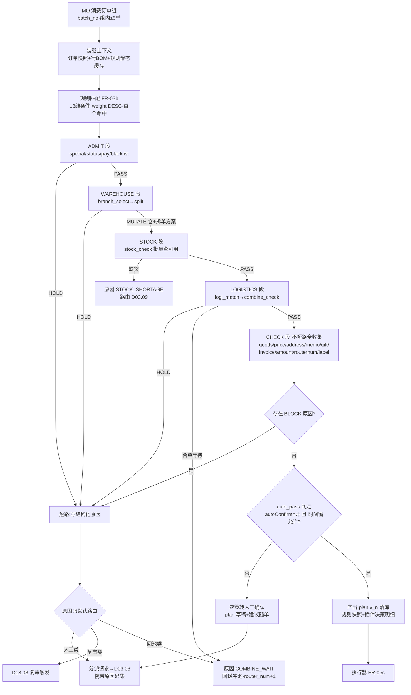
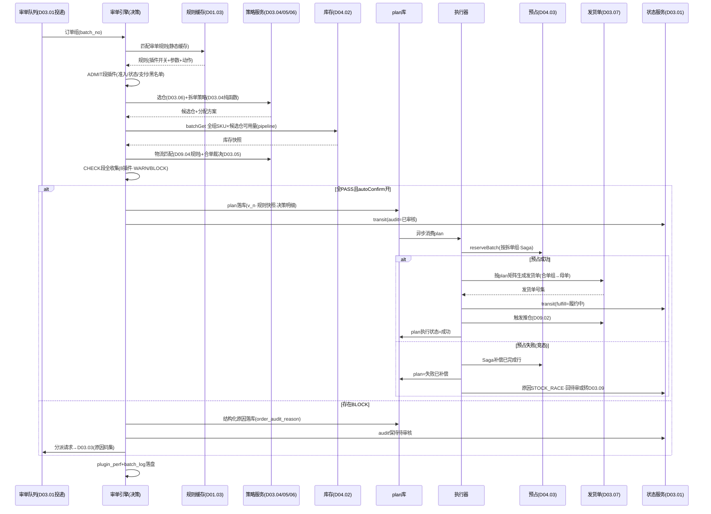

# SRS-D03.02 审单引擎模块 需求规格说明书

> 文档编号：SRS-D03.02 · 版本 V1.5 · 2026-10-24 · 编写：小凯 · 状态：待审阅（批次②，V1.2 友商对标增补风控插件），V1.5 价格基准升级）
> 所属域：D03 订单履约域 · 分期：**P0（M1-M2）· 系统最核心模块**
> 上游依据：SRS-D03.01 §4/§5（订单状态机契约）· SRS-00 §4.4 · 逆向文档 02 §3.3（插件链）/§6（规则引擎三层模型+位标记）/§7（选仓与库存校验）/§11.2（审核即路由、决策执行分离启示）· 07 架构书决策（结构化原因、plan 机制）· SRS-D04.03（reserveBatch Saga）· SRS-D01.03（规则引擎框架）
> 定位：审单 = **订单履约路由决策**。校验 + 选仓 + 拆单 + 合单 + 选物流一次完成，决策产出**履约方案（plan）**，执行器统一落库生成发货单——决策与执行分离，plan 可重算、可回放。

---

## 1. 模块概述

### 1.1 定位

审单引擎接收 D03.01 缓冲池投递的订单组，按「审单规则 → 插件链」执行履约路由决策：先跑校验类与决策类插件（选仓/拆单/库存/物流/合单裁决），全部通过且规则允许自动审核时产出结构化**履约方案（fulfillment plan）**并持久化；执行器读取 plan 统一执行「预占（D04.03 Saga）→ 生成发货单（D03.07）→ 推仓（D09.02）」；任一环节不通过则写**结构化审核原因（order_audit_reason）**并按原因路由：可人工处理的分派人工审单（D03.03），库存不足的转缺货流程（D03.09）。引擎承载于 D01.03 规则引擎框架，插件可插拔注册。

商派验证过的核心机制照搬：插件链依赖顺序（仓→拆→库存→物流→校验类）、缓冲池聚组消费、规则三层模型（订单分组条件→审单配置→插件参数）、批量审单与规则集静态缓存、插件级耗时记录。改造三点：位标记 → 结构化原因子表；就地生成发货单 → plan 决策执行分离；硬编码插件链 → D01.03 可插拔注册。

### 1.2 职责边界

**做**：审单规则配置模型（条件+插件链开关参数+通过动作）与命中逻辑；插件链的注册/编排/执行/短路；结构化审核原因的写入与清除；履约方案 plan 的产出、落库、版本管理与重算回放；审单执行的编排（预占→发货单→推仓的调用序列与失败补偿路由）；批量审单调度与性能设施（规则缓存/耗时记录/批次日志）；人工审核通过的同源执行通道（D03.03 决策后调本模块执行器）。

**不做**：订单落库与缓冲聚组（→ D03.01，本模块消费其投递的订单组）；拆单策略算法本身（→ D03.04，以插件形式注册进本链，纯函数输出分配方案）；合单指纹与合并前提校验细则（→ D03.05，本链的合单插件调用其服务）；分仓规则细则（→ D03.06，选仓插件调用）；发货单实体生成与指令状态机（→ D03.07，执行器调用其服务）；预占记账（→ D04.03）；缺货处理流程（→ D03.09）；人工审单界面与分派（→ D03.03）；规则引擎框架机制（→ D01.03，本模块是其首个业务承载方）。

### 1.3 与其他模块关系

| 模块 | 关系 |
|---|---|
| D03.01 订单创建 | 输入：订单组投审消息（batch_no）；输出：transit 驱动 audit/fulfill 状态；requeue 打回重投 |
| D01.03 规则引擎框架 | 插件注册表、条件表达式求值、规则缓存机制的承载框架 |
| D03.04 拆单 | 拆单插件调用策略注册表；策略=纯函数（订单明细→分配方案），不就地改单 |
| D03.05 合单 | 合单插件：组内裁决 + 「疑可合并」等待判定（shopcombine 语义）调 D03.05 服务 |
| D03.06 配货分仓 | 选仓插件调用分仓规则（仓库优先级/区域路由/库存深度）返回候选仓 |
| D04.03 预占 | 执行器调 `reserveBatch`（Saga 补偿）；失败转 D03.09 |
| D03.07 发货单 | 执行器按 plan 调发货单生成服务；合单组生成母单 |
| D09.02 出库指令 | 发货单生成后推仓（由 D03.07 发起，本模块 plan 携带推仓参数） |
| D03.03 人工审单 | 不通过订单的结构化原因供给工作台展示；人工决策后经本模块执行器同源执行 |
| D03.08 改单复审 | 改单生效/复审通过 → 订单回待审 → 重跑本引擎（plan 重算） |
| D03.09 异常缺货 | 库存不足/黑名单等原因路由目标；缺货单挂起与补货联动 |
| D03.10 特殊单型 | 准入插件（链首）：预售/团购 hold 判定、虚拟行强制拆单指令 |
| D10.05 OA | 跳过审单等敏感动作的审批结果作为插件输入 |
| D11.03 监控 | 审单积压/通过率/插件耗时指标供给 |

---

## 2. 业务场景

**SC-D03.02-01 自动审单一次通过（主链路，目标占比 ≥85%）**
大促期间订单组（2 单，同买家合单组）投审。引擎命中审单规则「美妆店铺-常规单」，执行插件链：准入通过 → 地址校验通过 → 选仓（华东仓，D03.06 规则）→ 拆单（单仓整单不拆）→ 库存校验通过 → 物流匹配（顺丰，区域+重量段）→ 合单裁决（组内 2 单合并）→ 校验类插件全过 → 规则 autoConfirm=开 → 产出 plan（仓库分配/拆单方案/物流方案/合单组四要素）落库 → 执行器：reserveBatch 预占成功 → 生成 1 张母发货单（2 子单）→ 推仓 → audit=已审核、fulfill=履约中。全程 ≤2 秒无人工。

**SC-D03.02-02 库存不足转缺货**
订单含 SKU-A×5，选仓后库存插件查华东仓可用仅 3：候选仓逐一校验均不足 → 插件链短路（库存类失败即停，后续物流插件无意义）→ 写结构化原因（plugin=stock，code=STOCK_SHORTAGE，明细：SKU-A 需 5 缺 2，候选仓与各自可用量快照）→ 路由 D03.09 缺货流程（挂起等补货/换仓重审/建议退款），同时发布 stock.shortage 联动 D04.10 补货建议。

**SC-D03.02-03 多原因并存与人工分派**
订单同时命中：买家留言含「发顺丰到付」（flag 插件拦截）+ 收货地址检出双省份（address 插件拦截）。校验类插件**不短路**（跑完收集全部原因），产出两条结构化原因记录 → 规则通过动作=转人工 → 订单 audit 保持待审核、写分派请求（原因码集合供 D03.03 按异常类型分派规则路由到对应审核组）。审核员在工作台看到完整原因列表与建议动作，处理后经人工决策通道执行。

**SC-D03.02-04 拆单决策（多仓/多货主）**
订单 5 行：3 行凯淳买断货主（华北仓有货）、2 行品牌 A 代销货主（华东仓有货）。拆单插件调 D03.04 策略链：按货主拆 → 按仓拆，产出拆单方案（2 个发货单组：组1=华北仓 3 行、组2=华东仓 2 行）写入 plan；执行器生成 2 张发货单分别预占推仓。订单头不产生新订单记录（拆单=发货单维度，SRS-00 术语）。

**SC-D03.02-05 plan 重算与回放（决策执行分离的价值）**
订单审单通过生成 plan v1 并预占成功，推仓前 WMS 故障暂停收单 2 小时。恢复后运营发现该店铺分仓规则当日配置错误，需重算：打回订单（audit 已审核→待审核，释放 v1 预占），修正规则后重跑审单产出 plan v2（换了仓库），执行器按 v2 重新预占生成发货单。plan 表保留 v1/v2 两个版本（含当时的规则快照与插件决策明细），审计可完整回放「为什么当时选了华东仓」。

**SC-D03.02-06 批量审单与耗时观测**
早高峰积压 3000 单。引擎按订单组批量消费（一轮 N 组，组内 ≤5 单）：规则集启动时加载进静态缓存（规则变更事件驱动失效重载）；每插件记录耗时（沿袭商派 api_log::record_start 机制，新栈写 plugin_perf 日志）；批次写 batch_log（组参数/结果/耗时）。监控看板（D11.03）实时展示：吞吐（单/分钟）、通过率、TOP 慢插件、原因码分布。

**SC-D03.02-07 规则时间窗（大促停自动审单）**
双 11 大促 0 点前运营给「全店铺-高额单」规则配置排除时间段（23:00-02:00 停自动审核，全部转人工复核防资损）。窗口内订单命中规则但 autoConfirm 被时间窗压制 → 插件链照常执行产出决策与原因，通过动作降级为转人工；窗口外恢复自动。

**SC-D03.02-08 路由次数超限防死循环**
某订单因「疑可合并」反复回池等待，但同买家后续订单始终未到。order_extend.router_num 每次投审 +1，达到上限（规则可配，默认 5）后 routernum 插件强制拦截转人工，防订单在缓冲池-审单间无限循环（商派 routernum 插件语义照搬）。

---

## 3. 功能需求

### FR-D03.02-01 插件链架构
- FR-01a 插件注册：插件实现统一接口 `AuditPluginInterface { name(); phase(); process(AuditContext): PluginResult; }`，经 D01.03 注册表注册（服务发现式，新增插件不改引擎代码）；PluginResult = PASS / HOLD(原因码集) / SHORT_CIRCUIT(原因码集) / MUTATE(决策数据变更，如选仓结果写入上下文)。
- FR-01b 顺序编排（依赖驱动，五段固定 phase + 段内 order 可配）：`ADMIT（准入）→ WAREHOUSE（仓：选仓/拆单）→ STOCK（库存校验）→ LOGISTICS（物流匹配）→ CHECK（校验类）`。段间顺序不可调（依赖关系：拆单需要仓、库存校验需要拆单结果、物流需要仓+重量），段内插件 order 值可配可插拔。
- FR-01c 短路规则：ADMIT/WAREHOUSE/STOCK/LOGISTICS 段内任一插件 HOLD 即短路（后续段无决策输入，跑了也无意义）；**CHECK 段不短路**（校验类并行收集全部原因，一次转人工带全问题清单，避免审核员修一个又冒一个——对商派逐插件 HOLD 的体验改进）。
- FR-01d 插件开关与参数：按审单规则配置逐插件启停与传参（如 flag 插件的敏感词表、price 插件的倍数阈值）；未配置插件走全局默认参数。
- FR-01e 插件耗时记录：每插件执行写 plugin_perf 日志（batch_no/order_id/plugin/耗时 ms/结果/原因码），供 TOP 慢插件分析与 SLA 告警（单插件 P99 > 500ms 告警）。
- FR-01f 插件异常容错：插件抛异常按配置降级（严格模式=整单 HOLD 转人工并记系统异常原因；宽松模式=跳过该插件并告警）；异常不吞、必留痕。

### FR-D03.02-02 插件清单（凯淳版，对照商派 23 插件位）

| # | 插件名 | 段 | 商派对应位 | 一句话职责 | 通过条件 | 失败动作（原因码→路由） |
|---|---|---|---|---|---|---|
| 1 | admit_special | ADMIT | —（新增） | 特殊单型准入：预售/团购 hold 判定、虚拟行标记 | 非 hold 态 | HOLD_SPECIAL → 回池等放行事件 |
| 2 | admit_status | ADMIT | abnormal | 订单硬状态校验：暂停/异常/平台取消/密文缺失/双地址检出 | 状态可审 | ABNORMAL_* → D03.03 人工 |
| 3 | admit_pay | ADMIT | pay+refundstatus | 支付态与退款态校验：已支付/COD/0 元放行；存在退款中明细拦截 | 支付态可审 | PAY_UNPAID / REFUND_PENDING → 人工或回池 |
| 4 | blacklist | ADMIT | —（新增，商派在 CRM） | 黑名单/风控名单匹配（收货手机/地址/买家账号） | 未命中 | BLACKLIST → D03.08 黑名单复审 |
| 5 | branch_select | WAREHOUSE | branch | 选仓：平台指定仓 > 分仓规则（D03.06）> 唯一发货仓 | 候选仓非空 | NO_BRANCH → 人工 |
| 6 | split | WAREHOUSE | split+checksplitgift | 拆单：调 D03.04 策略链输出分配方案（按仓/货主/SKU/重量/体积/品类/虚拟…）；仅赠品行拦截 | 方案产出成功 | SPLIT_FAIL / GIFT_ONLY → 人工 |
| 7 | stock_check | STOCK | store+oversold | 库存校验：按拆单方案逐发货单组查可用（D04.02 batchGet）；超卖检出 | 各组库存充足 | STOCK_SHORTAGE → **D03.09 缺货**（附缺口明细） |
| 8 | logi_match | LOGISTICS | logi+reclogi+arrived+logikeyword | 物流匹配：仓-物流绑定+区域可达+停运表+重量段费用；乡村件关键字提示 | 选出物流公司 | NO_LOGISTICS / LOGI_SUSPEND / LOGI_UNREACHED → 人工 |
| 9 | combine_check | LOGISTICS | shopcombine+ordermulti+ordersingle+member | 合单裁决：组内合并前提校验（D03.05）；「疑可合并」判定（库中同指纹订单数>组内数→回池等待）；同用户多地址提示 | 合并方案确定或独立发货 | COMBINE_WAIT → 回池（router_num 防死循环）；COMBINE_CONFLICT → 人工 |
| 10 | goods_match | CHECK | product | 商品映射复核：行 parse_status=已解析（未绑定拦截） | 全部行已解析 | GOODS_UNBOUND → 暂缓+联动 D04.01 待绑定 |
| 11 | price_check | CHECK | —（商派在创建时 retrial） | 价格校验：调 D03.08 checkPrice——**基准数据源=价格档案（V1.5）**：行实付 vs 下单时点生效底价红线 floor_price（`PriceService::getEffectivePrice`，D04.11）/日常价折扣率上限；价格档案缺失时降级为成本倍数粗校验（P0 兼容） | 无命中 | PRICE_ABNORMAL → D03.08 价格复审 |
| 12 | address_check | CHECK | abnormal 部分+logikeyword | 地址质量：区划可解析/详址长度/敏感词/禁运区（联动 D09.04 区域表）；**V1.2 增强：地图 API 智能校验（高德/腾讯，识别虚假地址/不可达地址/四级地址纠偏，结果缓存复用，API 故障降级规则校验）** | 地址可用 | ADDRESS_INVALID / ADDRESS_FORBIDDEN / ADDRESS_FAKE → 人工 |
| 13 | memo_flag | CHECK | flag+examine | 备注留言拦截：买家留言/商家备注含关键字（到付/指定快递/暗号）；备注暗号白名单可放行批量审单 | 无需人工确认的留言 | MEMO_HOLD → 人工（附命中关键字） |
| 14 | gift_check | CHECK | tbgift+crm | 赠品校验：平台优惠赠品/CRM 赠品策略匹配与库存联动 | 赠品方案有效 | GIFT_INVALID → 人工 |
| 15 | invoice_check | CHECK | tax | 发票校验：需开票订单的要素完整性/税号格式；开票能力就绪 | 要素完整或无需开票 | INVOICE_INVALID → 人工 |
| 16 | amount_check | CHECK | money 分组条件反向用 | 大额拦截：整单实付 ≥ 大额阈值（店铺/货主级配置） | 未超阈值 | BIG_AMOUNT → D03.08 大额复审 |
| 17 | routernum | CHECK | routernum | 路由次数超限拦截（order_extend.router_num ≥ 上限） | 未超限 | ROUTE_LIMIT → 强制人工 |
| 18 | label_mark | CHECK | —（商派 bill_label 散打） | 标记打标：按标签规则（D01.03 条件→动作）给订单/发货单组打标（加急/时效紧张/集运…），纯 MUTATE 不拦截 | 恒通过 | —（无失败态） |
| 19 | purchase_limit | CHECK | —（新增，V1.2 友商对标 G2） | 限购校验：同收货人/手机/地址/设备指纹在时间窗内订单数或件数超限购规则（大促防黄牛，规则承载于 D01.03） | 未超限购 | PURCHASE_LIMIT → 人工（附命中限购规则） |
| 20 | auto_pass | CHECK（末位） | autoConfirm 判定 | 自动审核通过判定：全部插件无 HOLD + 规则 autoConfirm=开 + 时间窗允许 → 产出 plan | 决策集完整 | 任一前置 HOLD → 按原因路由（见 FR-05） |

> 商派 23 位中标记类/查询辅助位（member 多地址、ordersingle、examine 已停用主体）合并入对应插件；新增 4 个凯淳位（admit_special/blacklist/price_check/amount_check）承接架构书决策（复审触发前移、风控接入）。位映射明细见文末溯源。

### FR-D03.02-03 审单规则配置模型
- FR-03a 规则三层结构（沿袭商派 order_type→autoconfirm 模型，D01.03 框架承载）：
  - **条件层**（订单分组维度）：店铺/品牌/货主/平台/金额区间/订单类型/商品分类/SKU 含指定/物料类型/SKU 种类数/明细件数/重量/COD/收货地区/有无备注/买家标签/达人/客户分类——18 种维度（商派 17 种 + 货主），条件间 AND，同维度多值 OR；
  - **插件层**：插件链开关与参数（逐插件启用/停用/参数覆盖，FR-01d）；
  - **动作层**：autoConfirm（自动通过开关）/ 通过动作（生成 plan 执行 | 仅决策转人工确认）/ 不通过动作路由表（原因码 → 人工分派 | 缺货 | 复审 | 回池）/ 时间窗（生效时段+排除时段）。
- FR-03b 优先级与命中：规则按 weight DESC 排序，订单组匹配**第一个全条件命中**的规则；末尾系统内置缺省规则兜底（autoConfirm=关，全转人工）；订单组内订单命中不同规则时按「组内最低 autoConfirm 权限」执行（合单组必须同规则裁决，冲突时拆组独立审——沿袭商派组粒度处理）。
- FR-03c 规则管理：CRUD+启停+复制；变更写审计（D10.06）；变更事件驱动静态缓存失效（FR-06b）；规则试算器（输入历史订单号，dry-run 展示命中规则与插件链执行明细，**不落库不执行**——配置上线前验证，plan 机制的天然收益）。
- FR-03d 缺省分派联动：规则可绑定默认审核组（不通过时分派请求携带，D03.03 分派规则优先）。

### FR-D03.02-04 结构化审核原因（order_audit_reason，替代商派位标记）
- FR-04a 每次审单为一单写入 0..N 条原因记录：插件名/原因码（字典）/级别（BLOCK 拦截|WARN 提示）/描述（人读文本，含数据快照：缺口数量/命中关键字/候选仓列表）/建议动作（换仓/改地址/联系买家/等补货…）/决策明细 JSON。
- FR-04b 原因码字典统一登记（D01.03 枚举管理），每码绑定默认路由（人工/缺货/复审/回池）与默认审核组建议（供 D03.03 分派）；字典可扩展不发版。
- FR-04c 生命周期：重审先清旧原因（按 order_id+batch_no 归档到历史表再写新）；审核通过清零（归档保留，统计用）；原因可检索（按码/插件/店铺/时间聚合统计——位标记做不到的运营分析：「本周地址类拦截 TOP 店铺」）。
- FR-04d WARN 级原因不拦截（如乡村件提示、多地址提示），随单流转供人工参考；BLOCK 级触发路由。

### FR-D03.02-05 决策与执行分离（plan 机制）
- FR-05a plan 数据结构（四要素+溯源）：
  - 仓库分配：每发货单组 → branch_id（含候选仓快照与选择依据）；
  - 拆单方案：订单行 → 发货单组的分配矩阵（行 ID/数量，含拆分依据策略 ID）；
  - 物流方案：每发货单组 → logi_id（含匹配依据：区域/重量/费用快照）；
  - 合单组：组内订单清单 + 母单标记；
  - 溯源：plan_version/规则快照 ID/插件决策明细（各插件 MUTATE 输出）/决策时间/决策者（auto 或人工账户）。
- FR-05b plan 落库先于执行：决策完成 → plan 写库（状态=待执行）→ 执行器异步消费。执行失败不回改 plan（plan 是决策事实），执行状态独立字段（待执行/执行中/部分成功/成功/失败已补偿）。
- FR-05c 执行器序列（每 plan 一个执行事务编排）：① `FreezeService::reserveBatch`（按拆单方案逐发货单组预占，Saga 补偿）→ ② 发货单生成（D03.07，按 plan 矩阵；合单组生成母单）→ ③ 状态 transit（audit=已审核，fulfill=履约中）→ ④ 推仓触发（D03.07→D09.02）。任一步失败：预占失败 → plan 置失败+订单转缺货（D03.09）或回待审（原因 STOCK_RACE，重审重算——决策到执行间隙库存被抢的竞态兜底）；发货单生成失败 → 释放预占+plan 失败+最高级告警人工介入；推仓失败不影响审单终态（发货单指令状态机自理，D03.07）。
- FR-05d plan 重算：打回重审（D03.07 打回/D03.08 改单生效）→ 旧 plan 置废弃+预占释放 → 重跑引擎产出新 version；plan 版本链完整保留（回放依据）。
- FR-05e plan 回放：按 plan_id 查询完整决策上下文（规则快照+插件明细+输入订单快照引用），审计与排障用；支持「以当前规则重放历史订单」的 dry-run 对比（规则调优依据）。
- FR-05f 人工审核同源执行：D03.03 人工决策（选仓/拆单/物流人工指定或采纳建议）同样产出 plan（决策者=账户 ID），走同一执行器——人工与自动仅决策来源不同，执行链路唯一（消除商派 mkDelivery 双路径不一致隐患）。

### FR-D03.02-06 性能设计
- FR-06a 批量审单：MQ 消费按订单组批量（一轮 N 组，N 可配默认 20 组）；组内订单共享规则匹配与上下文装载；库存查询按组聚合批量调 D04.02 batchGet（一次 Redis pipeline 查全组 SKU×候选仓，杜绝逐单逐行查询）。
- FR-06b 规则集静态缓存：启动全量加载进程内缓存（规则量小变更低频）；变更事件（D01.03 发布）驱动增量失效重载；缓存加载失败降级实时查库并告警。
- FR-06c 耗时记录与批次日志：plugin_perf（FR-01e）+ batch_log（批次/组数/单数/结果分布/总耗时，沿袭商派 batch_log log_type=ordertaking）；吞吐指标（单/分钟）实时上报 D11.03。
- FR-06d 吞吐目标：≥500 单/分钟（Q37）持续压测达标；单组决策 P95 ≤ 500ms（不含预占与发货单落库）；执行器端到端（决策→推仓发起）P95 ≤ 2s。
- FR-06e 消费并发与隔离：审单 worker 多实例并发消费，订单组级不拆分（同组必同实例，合单语义要求）；订单级分布式锁防同单并发审（重投/打回竞态）；大促模式可临时调大 N 与 worker 数（配置热更）。

---

## 4. 业务流程

### 4.1 插件链执行流程图



### 4.2 审单决策时序图（决策与执行分离）



---

## 5. 处理逻辑

### 5.1 引擎主循环（伪代码）

```
consume(group_msg):                          # 订单组消息, 组级不拆分
    lock = redis_lock(group.orders)          # 订单级锁, 防重投并发
    ctx = AuditContext.load(group.orders)    # 订单快照+行BOM+扩展 (只读装载)
    rule = RuleCache.match(ctx)              # 18维条件·weight DESC·首个命中·缺省兜底
    if rule.timeWindow.excluded(now):        # 排除时段
        rule = rule.degradeToManual()        # autoConfirm压制, 决策照跑
    plugins = PluginRegistry.chain(rule)     # 5段编排, 段内order, 开关过滤
    for p in plugins:
        t0 = now()
        r = p.process(ctx)                   # PASS/HOLD/SHORT_CIRCUIT/MUTATE
        perf_log(p, now()-t0, r)
        if r in (HOLD, SHORT_CIRCUIT):
            ctx.reasons += r.reasons
            if p.phase != CHECK: break       # CHECK段不短路(FR-01c)
    ctx.router_num += 1; persist()
    if ctx.hasBlockReason():
        AuditReasonRepo.write(ctx.reasons)   # 结构化原因(先归档旧批次)
        route(ctx.reasons)                   # 按原因码字典默认路由
    elif rule.autoConfirm and ctx.decisionComplete():
        plan = Plan.build(ctx, rule)         # 四要素+溯源快照
        PlanRepo.save(plan)                  # 决策落库(与执行解耦)
        StatusService.transit(audit=已审核)
        MQ.publish(plan.execute, plan_id)    # 执行器异步消费
    else:
        PlanRepo.saveDraft(plan)             # 决策草稿随单, 人工确认即执行
        dispatchToManual(ctx)
```

### 5.2 执行器与补偿（Saga 编排）

```
execute(plan_id):
    plan = PlanRepo.lock(plan_id)            # 状态=待执行 → 执行中(CAS)
    step1: fz = FreezeService.reserveBatch(plan.groups)   # 幂等键=plan_id+组+行
        失败 → 补偿: 无(Saga内部已回滚) → plan=失败已补偿
              → 原因 STOCK_RACE: 缺口明细回写, 路由 D03.09 或回待审重算(规则可配)
    step2: dlys = DeliveryService.createByPlan(plan, fz)  # 幂等键=plan_id
        失败 → 补偿: FreezeService.release(planRef) → plan=失败已补偿 → 最高级告警人工
    step3: StatusService.transit(fulfill=履约中) + 推仓触发
        失败 → 不回滚(发货单已生成, 推仓由指令状态机重试) → 告警
    plan=成功; publish order.fulfill.started
执行器崩溃恢复: 定时扫描「执行中超时(默认10分钟)」plan → 按幂等键续跑(各步幂等保证安全重入)
```

### 5.3 规则命中与组内冲突裁决

```
match(orderGroup):
    for rule in RuleCache.sorted(weight DESC, id ASC):
        if rule.allConditionsHit(orderGroup.leader):   # 组代表单匹配
            hits[rule] += 组内命中单数
    if 组内订单命中不同规则:
        if 差异仅参数级(同autoConfirm) → 用组代表单规则
        else → 拆组: 按规则归属切分子组各自独立审(合单让位于规则一致性)
    return rule or DEFAULT_RULE(autoConfirm=off)
```

### 5.4 原因码路由表（默认字典，可按规则覆盖）

| 原因码类 | 级别 | 默认路由 | 说明 |
|---|---|---|---|
| STOCK_SHORTAGE / STOCK_RACE | BLOCK | D03.09 缺货 | 附缺口明细与候选仓快照；补货联动 D04.10 |
| NO_BRANCH / SPLIT_FAIL / NO_LOGISTICS / LOGI_SUSPEND / LOGI_UNREACHED | BLOCK | D03.03 人工 | 决策类失败，人工指定仓/物流后经人工 plan 执行 |
| ABNORMAL_* / ADDRESS_INVALID / ADDRESS_FORBIDDEN / MEMO_HOLD / GIFT_INVALID / INVOICE_INVALID / GOODS_UNBOUND / COMBINE_CONFLICT / ROUTE_LIMIT | BLOCK | D03.03 人工 | 校验类失败，按原因码建议审核组（D03.03 分派维度） |
| PAY_UNPAID / COMBINE_WAIT / HOLD_SPECIAL | BLOCK | 回缓冲池 | 等待类：支付消息/同买家订单/放行事件到达后自动重投 |
| PRICE_ABNORMAL / BIG_AMOUNT / BLACKLIST | BLOCK | D03.08 复审 | 复审通过回待审重跑 |
| REFUND_PENDING | BLOCK | 挂起 | 等 D05.03 退款终态事件 |
| 乡村件/多地址/备注提示等 | WARN | 随单流转 | 不拦截，人工审单界面展示 |

### 5.5 plan 版本与回放

- plan_version 按 order_id 递增；同单同时只允许一个非终态 plan（DB 部分唯一约束）；
- 废弃路径：打回/改单/取消 → 旧 plan 置废弃（执行中的先走补偿）；
- 回放数据 = plan 行（四要素）+ rule_snapshot_id（规则全量快照）+ plugin_trace JSON（各插件输入摘要/输出/耗时）+ 订单快照引用（D03.08 快照机制复用）；保留期随订单归档（D03.13，≥3 年）；
- dry-run 重放：`PlanService::replay(order_id, rule_set?)` 以当前（或指定）规则集对历史订单快照重跑决策，输出新旧 plan diff，不产生任何执行副作用。

### 5.6 并发与一致性
- 同组必同实例消费（MQ 按组键 hash 路由），组内合单语义不被并发撕裂；
- 审单与取消/改单竞态：订单级分布式锁（同 D03.01 §5.6 key）+ 执行器 step 前二次校验 order_status/audit_status（已取消/复审中则放弃执行并废弃 plan）；
- 决策到执行的库存竞态：reserveBatch 失败即 STOCK_RACE 补偿路径（§5.2），不产生半执行状态；
- 原因写入与状态变迁同事务（审单终态原子落库）；plan 落库与执行经 MQ 解耦（at-least-once + 幂等键去重）。

---

## 6. 数据字段（业务字段描述）

### 6.1 审单规则（audit_rule）

| 字段 | 业务含义 | 取值/校验 |
|---|---|---|
| rule_id / rule_name | 规则标识 | 名称租户内唯一 |
| conditions | 条件层 | JSON：18 维度数组（维度/操作符/值集），AND 组合 |
| weight | 优先级 | DESC 排序，首个命中生效 |
| plugin_config | 插件层 | JSON：逐插件 enable/params 覆盖 |
| auto_confirm | 自动通过开关 | 关=决策草稿转人工确认 |
| pass_action / fail_route | 动作层 | 通过动作；原因码→路由覆盖表（缺省用字典默认） |
| effective_window / exclude_window | 生效/排除时段 | 支持周期时段（大促夜间停审） |
| default_audit_group | 缺省审核组 | 不通过分派建议（D03.03 规则优先） |
| router_num_limit | 路由次数上限 | 默认 5 |
| status / defaulted | 启停/缺省标记 | 系统内置缺省规则不可删 |
| owner_id / tenant_id | 货主/租户 | 规则可按货主隔离 |

### 6.2 履约方案（fulfillment_plan）

| 字段 | 业务含义 | 取值/校验 |
|---|---|---|
| plan_id / plan_bn | 方案标识 | plan_bn 规则 PL+日期+序列 |
| order_ids | 覆盖订单（合单组多单） | JSON；组内订单共享一 plan |
| plan_version | 版本 | 按 order_id 递增；同单唯一非终态 |
| warehouse_alloc | 仓库分配 | JSON：组→branch_id+候选快照+依据 |
| split_matrix | 拆单方案 | JSON：行→发货单组分配矩阵（行/数量/策略 ID） |
| logistics_alloc | 物流方案 | JSON：组→logi_id+匹配依据快照 |
| combine_group | 合单组 | JSON：母子单结构标记 |
| rule_snapshot_id | 规则快照 | 回放依据 |
| plugin_trace | 插件决策明细 | JSON：各插件输出/耗时/原因 |
| decision_by / decision_time | 决策者/时间 | auto 或账户 ID（人工同源） |
| plan_status | 决策状态 | 草稿/待执行/已废弃 |
| exec_status | 执行状态 | 待执行/执行中/成功/失败已补偿（§5.2） |
| owner_id / tenant_id / shop_id / brand_id | 四维 | 必填，行级过滤 |

### 6.3 审核原因（order_audit_reason，替代商派 auto_status 位图）

| 字段 | 业务含义 | 取值/校验 |
|---|---|---|
| reason_id / order_id / batch_no | 归属订单与审单批次 | 重审按批次归档旧记录 |
| plugin_name / reason_code | 插件/原因码 | 码属字典（D01.03 登记） |
| level | 级别 | BLOCK / WARN |
| description | 人读描述 | 含数据快照文本（缺口/命中词/候选仓） |
| detail | 决策明细 | JSON 结构化（供工作台渲染与统计下钻） |
| suggest_action | 建议动作 | 字典：换仓/改地址/联系买家/等补货/转复审… |
| route_target | 路由结果 | 人工/缺货/复审/回池/挂起 |
| status | 原因状态 | 未处理/已处理（人工处理后回填处理方式） |
| create_time / tenant_id | 时间/租户 | |

### 6.4 审单批次与插件耗时（audit_batch_log / audit_plugin_perf）

| 字段 | 业务含义 |
|---|---|
| batch_no / group_count / order_count | 批次规模 |
| result_dist | 结果分布 JSON（通过/人工/缺货/回池/复审计数） |
| total_cost_ms / consume_time | 批次耗时与时间 |
| ——perf—— | |
| batch_no / order_id / plugin_name / cost_ms / result / reason_codes | 插件级耗时与结果（TOP 慢插件分析源） |

---

## 7. 接口

### 7.1 内部接口（本模块提供）

| 编号 | 接口 | 消费方 | 说明 |
|---|---|---|---|
| IF-D03.02-01 | `AuditEngine::submit(groupMsg)`（MQ 消费入口） | D03.01 缓冲池 | 订单组投审；幂等（batch_no+order 锁） |
| IF-D03.02-02 | `AuditEngine::executeManualPlan(order_id, decision, operator)` | D03.03 | 人工决策同源执行：产出人工 plan 走同一执行器 |
| IF-D03.02-03 | `PlanService::get(order_id)` / `replay(order_id, ruleSet?)` | D03.03/D03.08/审计 | plan 查询与 dry-run 回放 |
| IF-D03.02-04 | `AuditReasonService::listByOrder(order_id)` / `stat(filter)` | D03.03/D11 | 原因查询与聚合统计 |
| IF-D03.02-05 | `AuditRuleService::match(order)` / `dryRun(order_id)` | D03.03/规则管理界面 | 规则命中查询与试算器 |
| IF-D03.02-06 | 事件 `order.audit.passed`（经 D03.01 transit 发布）/ `audit.plan.executed` / `audit.dispatch.requested`（原因码集+订单） | D03.03/D03.07/D11 | 审单结果广播 |
| IF-D03.02-07 | `PluginRegistry::register(plugin)` | D03.04/05/06/10 等策略方 | 插件注册入口（D01.03 框架） |

### 7.2 依赖接口（本模块消费）

| 编号 | 接口 | 提供方 | 说明 |
|---|---|---|---|
| IF-D03.02-D1 | `SplitStrategyRouter::split(orderItems, config)`（纯函数） | D03.04 | 拆单分配方案 |
| IF-D03.02-D2 | `CombineService::judge(group)` / 合并前提校验 | D03.05 | 合单裁决与疑可合并判定 |
| IF-D03.02-D3 | `BranchRouteService::candidates(order)` | D03.06 | 选仓候选与依据 |
| IF-D03.02-D4 | `StockLedgerService::batchGet / queryAvailable` | D04.02 | 库存校验批量查询（pipeline） |
| IF-D03.02-D5 | `FreezeService::reserveBatch / release` | D04.03 | 执行器预占（Saga）与补偿 |
| IF-D03.02-D6 | `DeliveryService::createByPlan(plan, freezeRefs)` | D03.07 | 按 plan 生成发货单（幂等键=plan_id） |
| IF-D03.02-D7 | `OrderStatusService::transit` / `OrderBufferService::requeue` | D03.01 | 状态驱动与回池 |
| IF-D03.02-D8 | `RetrialService::trigger` / `checkPrice` | D03.08 | 复审类原因路由与价格校验 |
| IF-D03.02-D9 | `BlacklistService::match` | D03.09 | 黑名单插件 |
| IF-D03.02-D10 | `SpecialOrderService::admitCheck` | D03.10 | 准入插件 |
| IF-D03.02-D11 | `LogisticsRouteService::match(branch, area, weight)` | D09.04 | 物流匹配（区域路由/停发表） |
| IF-D03.02-D12 | 规则引擎框架（注册表/条件求值/缓存/枚举字典） | D01.03 | 承载框架 |

### 7.3 外部接口

本模块无直接外部接口（平台交互经 D02，OA 经 D10.05，WMS 经 D09）。

---

## 8. 非功能需求

| 项 | 要求 |
|---|---|
| 性能 | 吞吐 ≥500 单/分钟持续达标（Q37）；单组决策 P95 ≤500ms；执行器端到端 P95 ≤2s；库存批查一次 pipeline 完成（组内 SKU×仓 ≤ 200 key） |
| 并发 | 多 worker 水平扩展；同组同实例（hash 路由）；订单级锁防重；plan 执行 CAS 状态机防重入 |
| 幂等 | submit 按 batch_no 幂等；执行器各步幂等键（plan_id+步骤）；MQ at-least-once 安全 |
| 一致性 | 原因+状态同事务；plan 与执行 MQ 解耦最终一致；执行器崩溃 10 分钟内恢复续跑；预占-发货单补偿闭环零残留（对账任务核验 plan 失败态与预占台账） |
| 可观测 | plugin_perf/batch_log 全量落盘；吞吐/通过率/原因分布/TOP 慢插件四组指标上报 D11.03；积压 >1000 组或通过率骤降 20% 告警 |
| 安全 | 规则与原因配置变更写审计（D10.06）；plan 回放数据含收货人引用为脱敏形态（明细经 D01.05）；dry-run 试算严禁产生执行副作用 |
| 降级 | 规则缓存故障降级实时查库（限流保护）；D04.02 Redis 故障时库存校验走 DB 降级口径（吞吐下降，决策正确性不变）；非关键插件（label_mark）故障宽松跳过 |
| 容量 | plan 日均 ≈2 万（重算率 5% 双版本）；原因记录日均 ≈6 千（通过率 85%+WARN）；plugin_perf 日均 40 万条按月分表，在线保留 3 个月聚合后归档 |

---

## 9. 验收标准

| 编号 | 验收条件 |
|---|---|
| AC-01 | 标准订单组自动审单端到端（投审→plan→预占→发货单→推仓发起）P95 ≤2s，audit=已审核、fulfill=履约中、order.audit.passed 事件发布 |
| AC-02 | 插件链顺序验证：ADMIT 段 HOLD 后 WAREHOUSE 及之后插件零执行（短路）；CHECK 段构造 3 个并发拦截项，3 条原因全部收集（不短路） |
| AC-03 | 规则命中：18 维条件组合规则按 weight 首个命中；无命中走缺省规则全转人工；排除时段内 autoConfirm 被压制但决策与原因照常产出 |
| AC-04 | 组内订单命中不同 autoConfirm 规则时自动拆组独立审，合单组不被撕裂错审 |
| AC-05 | 结构化原因：库存不足订单的 order_audit_reason 含原因码/缺口明细/候选仓快照/建议动作；D03.03 工作台按码渲染；重审后旧原因归档、通过时清零且历史可查 |
| AC-06 | 原因路由：STOCK_SHORTAGE 转 D03.09、PRICE_ABNORMAL 转 D03.08 复审、COMBINE_WAIT 回缓冲池、MEMO_HOLD 转人工分派——四类路由各自验证正确 |
| AC-07 | plan 决策执行分离：决策完成 plan 先落库（含规则快照与插件明细），执行异步；kill 执行器进程后恢复，按幂等键续跑无重复预占/重复发货单 |
| AC-08 | 预占竞态补偿：决策后人为清空库存再触发执行，reserveBatch 失败 → Saga 零残留（预占台账核验）、plan=失败已补偿、订单按配置转缺货或回待审重算 |
| AC-09 | plan 重算回放：打回重审产出 v2，v1 置废弃且预占释放；按 v1 plan_id 可回放当时规则快照与选仓依据；replay dry-run 输出新旧 diff 且零副作用（无新 plan/无状态变更） |
| AC-10 | 人工同源执行：D03.03 人工指定仓/物流审核后，plan（决策者=账户）走同一执行器生成发货单，与自动链路产物结构一致 |
| AC-11 | routernum 防死循环：COMBINE_WAIT 反复回池 5 次后强制转人工，router_num 落库可查 |
| AC-12 | 性能压测：500 单/分钟持续 30 分钟，决策 P95 ≤500ms、吞吐达标、plugin_perf 完整、无积压增长；规则集变更事件 5s 内全 worker 缓存生效 |
| AC-13 | 插件可插拔：停用 memo_flag 插件后含留言订单不再拦截（配置热生效）；注册新测试插件无需改引擎代码即入链执行 |
| AC-14 | 插件异常容错：模拟 stock_check 抛异常，严格模式整单 HOLD 转人工且原因=系统异常，宽松模式跳过并告警，两模式均不吞异常 |

---

## 变更记录

| 日期 | 版本 | 变更 | 原因 |
|---|---|---|---|
| 2026-10-23 | V1.0 | 首版 | — |
| 2026-10-24 | V1.5 | price_check 插件基准升级：限价基准从成本倍数粗校验→价格档案精确基准（D04.11 floor_price 下单时点生效价，缺失降级兼容） | S4 决策修正（Jason：价格要管，B档） |
| 2026-10-24 | V1.2 | 插件链 19→20：address_check 增强地图API智能校验（虚假地址/四级纠偏，降级规则校验）；新增 purchase_limit 限购插件（大促防黄牛） | 友商对标 G2（Jason 决策A：补地图校验+限购） |

---

*参考实现溯源：商派 `omeauto_auto_combine::process`（combine.php:86，订单组消费）+ `omeauto_auto_group::process/getPluginNames`（group.php:162/277，插件链固定顺序 branch→routernum→split→checksplitgift→store→logi→reclogi→refundstatus→abnormal→pay→arrived→flag→oversold→tbgift→crm→tax→member→ordermulti→shopcombine）+ 三层规则模型（sdb_omeauto_order_type 17 维分组条件 LEFT JOIN autoconfirm，weight DESC 首命中+缺省兜底，confirmStartTime/excludeStartTime 时间窗）+ 位标记 auto_status（const.php 23 位：0x01 款…0x800000 退，fetchAlertMsg 按位解码渲染旗标）+ `group_item::_processConfirm/_processDispatch`（item.php:902/1140，通过即 addDelivery+merge+推仓一体，不通过位图分派）+ routernum（order_extend.addRouterNum 累计）+ batch_log/ome_api_log::record_start（批次与耗时）+ 缓冲池单轮 5000/5 单一组/规则静态缓存。关键差异：① auto_status 位图 → order_audit_reason 结构化子表（可读/可检索/可统计，位标记 23 位上限且无法携带明细）；② _processConfirm「决策即执行」→ plan 决策执行分离（规则快照+插件 trace 可回放可重算，执行器幂等续跑，人工与自动同源执行——消除商派 mkDelivery 双路径）；③ CHECK 段不短路全收集原因（商派逐插件 HOLD 导致审核员「修一个冒一个」）；④ 插件段化编排（ADMIT/WAREHOUSE/STOCK/LOGISTICS/CHECK 五段，段间依赖固定段内可插拔，D01.03 注册表承载）；⑤ 新增 admit_special/blacklist/price_check/amount_check 四位（特殊单型准入、风控、复审触发前移）；⑥ 规则维度 +货主（18 维）；⑦ 组内规则冲突显式拆组裁决（商派按组代表单隐式处理）。*
