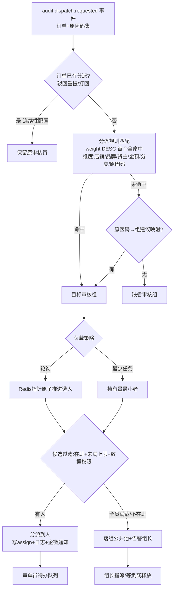
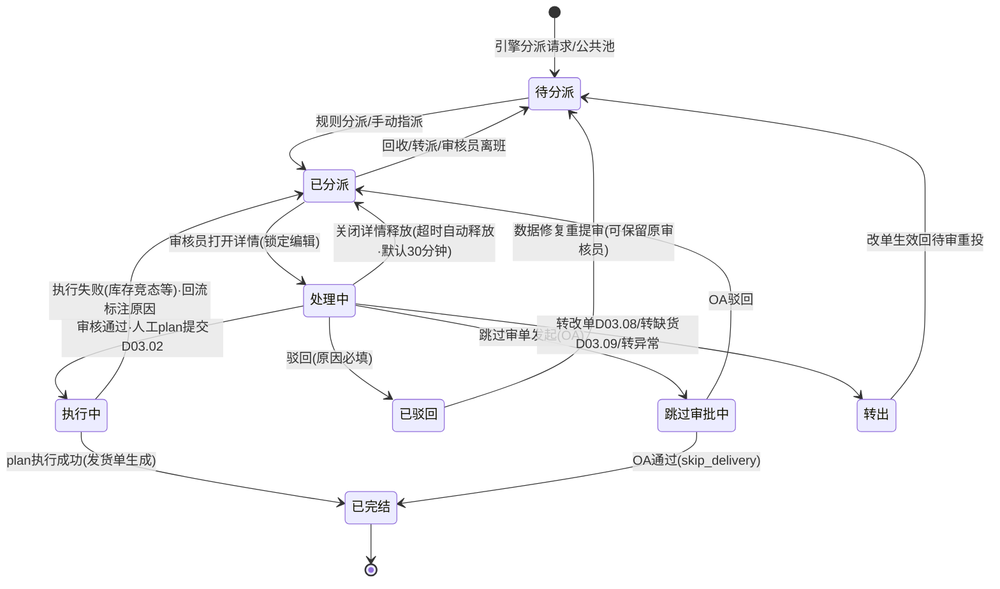
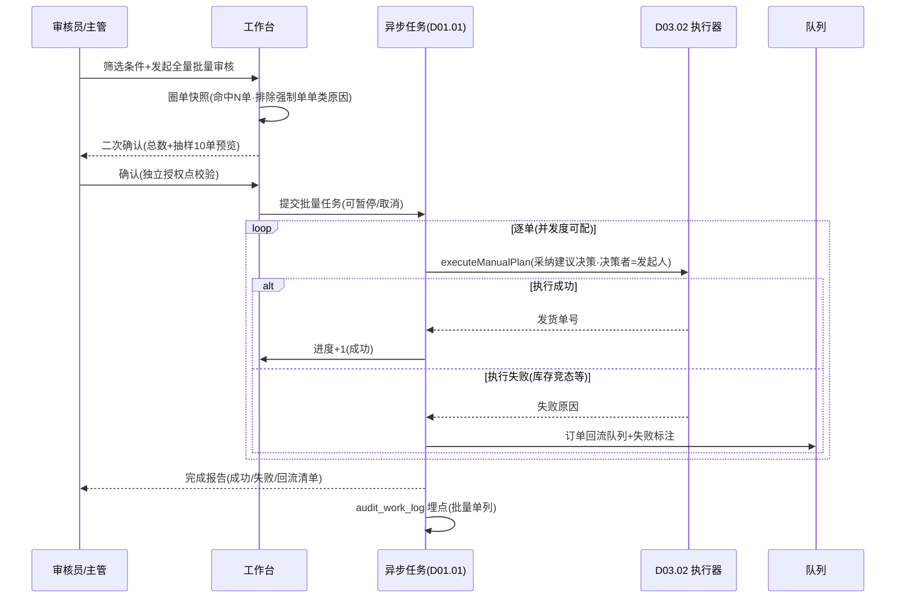

# SRS-D03.03 人工审单工作台模块 需求规格说明书

> 文档编号：SRS-D03.03 · 版本 V1.4 · 2026-10-23 · 编写：小凯 · 状态：待审阅（批次②，V1.4 业务仿真增补）
> 所属域：D03 订单履约域 · 分期：**P0（M1-M2）**
> 上游依据：SRS-D03.02（结构化原因 order_audit_reason、人工同源执行 executeManualPlan、分派请求事件）· SRS-D03.01 §4/§5（状态机契约）· 逆向文档 02 §3.5（_processDispatch 自动分派）/§6.6（autodispatch 分派规则）/§3.3（人工审单界面 mkDelivery）· SRS-D10.05（跳过审单 OA 审批）· SRS-D11（绩效数据供给）
> 定位：审单员的操作主界面——待审队列、多维规则分派、单单/批量审核、驳回与跳过审单、绩效统计；人机协同兜住自动审单通过率之外的全部订单。

---

## 1. 模块概述

### 1.1 定位

人工审单工作台承接 D03.02 分派请求（结构化原因驱动）与主动拦截的订单，为审单员提供「队列 → 分派 → 审核 → 执行」的完整作业闭环。核心设计：**多维规则分派**（店铺/品牌/货主/金额/分类/异常类型可配规则 + 负载均衡）替代商派单一分派规则表；人工决策（采纳建议或自行指定仓/拆/物流）产出人工 plan，经 D03.02 执行器**同源执行**（不存在人工专属落库路径）；键盘流交互保障审单员效率（人均日处理量是代运营履约成本的关键变量）。

### 1.2 职责边界

**做**：待审队列（多维筛选/分组视图/时效排序）；分派规则配置与自动分派引擎（规则匹配+负载均衡）；手动指派/转派/回收；单单审核工作台（详情+原因提示+修改建议+决策面板）；批量审核（勾选/按筛选条件全量）；驳回（原因必填结构化）；跳过审单（敏感操作→OA）；审核组与审核员管理（在班状态/任务上限）；审单绩效统计（时效/数量/驳回率，供给 D11）；键盘流交互与关联信息聚合展示。

**不做**：自动审单决策与插件链（→ D03.02）；人工决策的执行（plan 执行器 → D03.02，本模块只提交决策）；结构化原因的产生（→ D03.02，本模块消费展示与回填处理状态）；改单操作本身（→ D03.08，工作台提供跳转入口）；订单状态写入（→ D03.01 transit）；OA 审批流（→ D10.05，本模块发起）；绩效报表呈现（→ D11，本模块供数）；组织架构与账户（→ D10.01/D10.02，本模块维护审核组这一业务分组）。

### 1.3 与其他模块关系

| 模块 | 关系 |
|---|---|
| D03.02 审单引擎 | 输入：`audit.dispatch.requested` 事件（订单+原因码集）；输出：`executeManualPlan`（人工决策同源执行）；原因查询 `AuditReasonService` |
| D03.01 订单创建 | 订单查询（聚合根详情）；状态 transit（驳回/跳过审单驱动）；requeue 回池 |
| D03.06 配货分仓 | 审核面板「建议仓库+各仓可用库存」数据源（预选仓服务） |
| D09.04 物流路由 | 审核面板物流建议与可达性提示 |
| D04.02 库存 | 关联信息聚合：SKU 各仓可用/在途实时展示 |
| D03.09 异常缺货 | 缺货类订单的「转缺货处理」入口；异常单联动标记 |
| D03.08 改单复审 | 审核中发现数据问题 → 跳转改单；复审类订单不在本队列（复审工作台独立，复用本模块分派机制） |
| D10.05 OA | 跳过审单审批发起与回调 |
| D10.02/D10.03 | 账户/角色/数据权限（审核员只见权限内店铺订单） |
| D01.07 通知 | 分派通知（企微）、超时升级提醒 |
| D11.01/D11.03 | 绩效数据供给；审单积压监控看板 |

---

## 2. 业务场景

**SC-D03.03-01 自动分派（主场景）**
审单引擎分派请求到达：订单（天猫-品牌A店铺，原因码 ADDRESS_INVALID）。分派引擎按 weight 匹配分派规则「品牌A店铺+地址类异常 → 地址处理组」，组内负载均衡（最少任务优先）分给在班审核员小王（当前持有 12 单，未达上限 30）。小王收到企微提醒，工作台待办队列出现该单，原因区展示结构化提示（双省份地址快照+建议动作「联系买家确认」）。

**SC-D03.03-02 单单审核（键盘流）**
小王按 `J/K` 逐单浏览队列，`Enter` 打开侧滑详情：左侧订单聚合信息（行/收货人/金额/留言），右侧关联信息 Tab（客户历史订单/退货率、SKU 各仓库存、物流可达）。地址问题确认为买家笔误，按 `A` 唤起改单（跳 D03.08 改地址），改单生效订单自动回待审重跑引擎；或地址实际可解析，按 `P`（Pass）采纳引擎建议仓/物流直接审核通过 → 人工 plan 提交 D03.02 执行器 → 预占生成发货单推仓。全程键盘无需鼠标。

**SC-D03.03-03 批量审核（按筛选条件全量）**
大促后积压 800 单「备注提示类（MEMO_HOLD-WARN 升级）」订单，备注均为同一活动暗号「已确认」。主管在队列筛选：店铺=X + 原因码=MEMO_HOLD + 备注含「已确认」，预览命中 800 单 → 发起「按筛选条件全量审核」：二次确认弹窗展示命中数与抽样 10 单 → 提交后异步逐单走人工 plan 执行（采纳引擎建议决策），进度条展示成功/失败数；执行失败单（库存竞态）自动回流队列并标注失败原因。

**SC-D03.03-04 驳回**
订单收货人电话为空且平台密文缺失，无法履约。小王按 `R` 驳回：驳回原因必填（结构化字典：收货信息缺失-电话）+ 备注说明；驳回后 audit_status=驳回，订单退出待审队列；后续买家补充信息（平台消息）或客服改单后重提审（回待审核重新投审）。驳回自动通知店铺客服组（企微，含原因）。

**SC-D03.03-05 跳过审单（敏感操作走 OA）**
大客户团购单（B2B 转入预留场景/线下自提），无需仓储履约。运营发起「跳过审单」：填写理由 → 推泛微 OA 审批（D10.05，审批要素：订单号/金额/理由/发起人）→ 审批通过：订单 audit=已审核（决策者=跳过审批单号）、fulfill 置完成态特例（不生成发货单，标记 skip_delivery）、写审计；驳回：订单留在队列。跳过审单权限为独立授权点，且发起人不可为审批人（OA 回避）。

**SC-D03.03-06 手动指派/转派/回收**
组长发现审核员小李积压 40 单（超上限）且即将下班：批量勾选小李名下 20 单「回收」至组公共池，再按技能「指派」给熟悉该品牌的小张；小张请假，其名下未处理单一键「转派」回组池由负载引擎重新分配。全部操作留痕（谁/何时/从谁到谁/原因）。

**SC-D03.03-07 分派规则调整与灰度**
新接品牌 C 店铺，运营配置分派规则「品牌C → 品牌C专属组（3 人）」，weight 高于缺省规则；规则保存即生效（缓存刷新），新分派请求按新规则路由；已在途订单不受影响（分派只作用于新请求）。无规则命中的订单走缺省分派（默认审核组+负载均衡）。

**SC-D03.03-08 审单绩效与超时升级**
月末主管查看绩效报表：小王本月审核 4200 单、平均处理时效 3.2 分钟/单、驳回率 1.8%、批量审核占比 35%；组维度积压趋势与人均负载。订单在队列停留超 SLA（按原因码分级：缺货类 24h、地址类 4h、默认 8h，可配）自动升级提醒组长；超 SLA 2 倍触发企微告警店铺运营（联动 D11.03 积压看板）。

**SC-D03.03-09 高峰期公共池调度**
大促凌晨自动审单通过率下降（平台报文质量波动），分派请求激增，某组 5 名审核员全部满载（各持有 50 单达上限）。后续订单持续落组公共池，组长收到企微告警后进入组长工作台：查看组内负载总览与公共池积压（按原因码分组），临时上调 2 名在班审核员任务上限至 80（留痕），公共池单按负载引擎自动补分派；同时把「备注提示类」低风险单圈出发起批量审核快速泄洪。高峰过后恢复默认上限。

**SC-D03.03-10 质检抽查（P1 占位）**
质检员按周抽取样本：驳回率异常低+批量占比异常高的审核员各抽 20 单，回放其审核决策（人工 plan 快照+当时原因清单+关联信息），标注质检结论（合格/误审/漏检）；误审单联动 D03.08 改单或 D05 售后补救并计入个人质量档案。P0 仅落 audit_work_log 埋点保证数据可回溯，质检工作台 P1 实现。

---

## 3. 功能需求

### FR-D03.03-01 待审队列
- FR-01a 队列数据源：audit_status=待审核 且已分派（op_id=本人/组池）的订单；未分派订单在「公共池」视图（组长可见）。数据权限四维过滤（D10.03）。
- FR-01b 多维筛选：店铺/品牌/货主/原因码（多选，来自 order_audit_reason）/金额区间/订单类型/createway/付款时间区间/分派时间/是否超时/买家标签；筛选条件可保存为个人常用方案。
- FR-01c 分组视图：按店铺/品牌/原因码/审核员四种维度分组聚合（组头显示单数与最早付款时间），支持组内展开。
- FR-01d 排序：默认**时效优先**（SLA 剩余时间 ASC，超时置顶标红）；可切换付款时间 ASC（先进先出）/金额 DESC；排序口径队列级统一。
- FR-01e 队列角标与原因摘要：列表行内直接渲染原因码徽章（人读短文本，替代商派单字旗标）+ WARN 级提示图标；悬停展示完整原因与建议动作。
- FR-01f 实时刷新：分派/回收/状态变更经 WebSocket 推送（或 ≤10s 轮询降级），队列不重排抖动（新单追加提示「有 N 单新分派，点击加载」）。

### FR-D03.03-02 多维规则分派
- FR-02a 分派规则配置：条件维度 = 店铺/品牌/货主/平台/金额区间/订单分类（order_type/special）/原因码（异常类型，支持多值）/商品分类/买家标签 + weight 优先级；动作 = 目标审核组（或直接审核员）+ 负载策略（轮询/最少任务）+ 在班过滤开关。规则命中逻辑与审单规则同构（weight DESC 首个全命中，D01.03 框架承载）；缺省规则兜底（默认组）。
- FR-02b 负载均衡：组内按策略选人——轮询（Round-Robin，指针 Redis 原子推进）或最少任务（当前持有未处理单数最小者）；候选人过滤：在班状态 + 持有量 < 个人任务上限（可配，默认 50）+ 数据权限覆盖该店铺；全员满载 → 落组公共池 + 告警组长。
- FR-02c 自动分派触发：消费 `audit.dispatch.requested` 事件即时分派（秒级）；分派结果写订单（assign_group/assign_op/assign_time）+ 分派日志；企微通知审核员（可配免打扰时段汇总推送）。
- FR-02d 手动指派/转派/回收：组长权限——公共池单指派到人；个人单转派他人/回收至公共池；批量操作（勾选或按筛选条件）；全部留痕（操作人/时间/从→到/原因可选）。
- FR-02e 重分派：审核员离职/长期请假，其名下未处理单批量回收重分派；订单被驳回后重提审、打回重审的订单**保留原审核员**（连续性优先，可配改走重分派）。
- FR-02f 原因码→审核组建议映射：D03.02 原因字典携带默认组建议，分派规则未命中时按映射兜底（地址类→地址处理组、缺货类→库存协调组…）。

### FR-D03.03-03 单单审核
- FR-03a 审核详情面板：订单聚合展示（头/行含 BOM 快照/收货人脱敏+授权看明文/双口径金额/优惠分摊/留言备注/发票）+ 结构化原因区（BLOCK/WARN 分列，含明细快照与建议动作）+ 引擎决策草稿（autoConfirm 关时的建议仓/拆/物流方案，可一键采纳）。
- FR-03b 决策面板：仓库选择（建议仓+各仓可用库存实时对比，D03.06 预选仓数据）/物流选择（建议物流+可达性+费用对比）/手工拆单调整（行→发货单组分配矩阵可编辑，调 D03.04 策略试算）/合单勾选（同指纹候选单列表，D03.05 规则校验）；决策变更即时试算校验（库存不足红字提示，不可提交）。
- FR-03c 审核通过：提交人工 plan（决策者=账户）→ D03.02 `executeManualPlan` 同源执行 → 执行结果回显（成功：发货单号链接；失败：原因+订单回流队列）；通过前二次校验（order_status/支付态/预占竞态由执行器兜底）。
- FR-03d 关联信息聚合（右侧 Tab，减少跳转）：客户历史（近 90 天订单数/退货率/驳回史）；库存视图（行 SKU 各仓可用/在途/锁定）；物流视图（区域可达/停运提示/时效参考）；售后史（该买家售后单列表 D05）。
- FR-03e 辅助操作：跳转改单（D03.08，改后订单自动回待审）；转异常（D03.09 设置异常/暂停）；转缺货处理（缺货类原因单一键转 D03.09 工作台）；加备注（同步订单商家备注）。

### FR-D03.03-04 批量审核
- FR-04a 勾选批量：队列勾选 N 单（≤200/次）批量审核通过——逐单采纳引擎建议决策（无建议草稿的单不可入批量，转单单审核）；异步执行逐单走人工 plan，进度与结果（成功/失败/失败原因）可查；失败单自动回流队列。
- FR-04b 按筛选条件全量：命中数 >200 时使用；二次确认展示命中总数+抽样 10 单预览；异步任务执行（D01.01 白名单任务，可暂停/取消）；执行期间新流入订单不纳入（快照式圈单）。
- FR-04c 批量安全阀：单次全量上限可配（默认 5000 单）；含 BLOCK 级原因为「缺货/复审/黑名单」的订单强制排除出批量（必须单单处理）；批量操作独立授权点。
- FR-04d 批量驳回：同机制，驳回原因统一必填（字典+备注）。

### FR-D03.03-05 驳回与跳过审单
- FR-05a 驳回：原因必填（结构化字典：收货信息缺失/买家风险/商品问题/价格争议/平台状态异常/其他+备注）；audit_status=驳回（D03.01 transit）；退出队列并通知店铺客服组；驳回单独立视图（可重提审：数据修复后回待审核重新投审）。
- FR-05b 跳过审单：独立授权点；发起必填理由 → OA 审批（D10.05）→ 通过后 audit=已审核（决策者=审批单号引用）+ skip_delivery 标记（不生成发货单，fulfill 直接完成态特例，虚拟/自提/线下场景）+ 字段级审计；驳回留队列。审批中订单置「跳过审批中」冻结其他审核操作。
- FR-05c 驳回/跳过全量写审计（D10.06）与操作日志（订单时间线可见）。

### FR-D03.03-06 审核组与审核员管理
- FR-06a 审核组：CRUD（组名/归属组织/成员/组长）；组与店铺/品牌/货主的默认数据范围（分派规则引用）。
- FR-06b 审核员状态：在班/离班/请假（在班才参与自动分派）；个人任务上限；技能标签（品牌/异常类型专长，供指派参考与 P1 智能分派）。
- FR-06c 组长工作台：组内成员负载总览（持有量/处理中/今日完成）、公共池管理（按原因码分组视图+批量补分派）、超时单清单、成员任务上限临时调整（高峰调度，调整留痕并自动到期恢复默认值）。
- FR-06d 公共池自动补分派：成员负载释放（完结/回收）后，公共池积压单按负载策略自动补分派（每 30 秒一轮，可配）；组长可关闭自动补分派改为纯手动指派模式。

### FR-D03.03-07 审单绩效（供数 D11）
- FR-07a 绩效指标：个人/组维度——审核量（单单/批量分列）、平均处理时效（分派→终态）、队列停留时效（付款→终态，SLA 口径）、驳回率、跳过审单数、超时单数、原因码处理分布；日/周/月粒度。
- FR-07b 数据采集：审核动作埋点（分派/通过/驳回/跳过/转派时间戳）落 audit_work_log；绩效汇总任务（D01.02 日结）写绩效表；D11.01 报表与 D11.03 看板取数。
- FR-07c 绩效仅统计不排名强制（避免诱导盲审）：批量审核通过率异常高（>99%）且驳回后异常率上升的审核员触发质检抽查（P1 质检功能占位，埋点 P0 落地保证可回溯，见 SC-10）。
- FR-07d 时效基线报表：按原因码维度统计各类订单的人工处理时效分布（识别培训需求与流程瓶颈，如「地址类平均时效显著高于其他类」提示地址清洗工具优化），供 D11 汇总。

### FR-D03.03-08 工作台交互要求
- FR-08a 键盘流：全操作快捷键覆盖（J/K 上下、Enter 详情、P 通过、R 驳回、A 改单、S 跳过申请、B 批量勾选、/ 聚焦筛选、Esc 关闭侧滑）；快捷键面板 `?` 唤出；快捷键方案可按个人习惯重映射（P1）。
- FR-08b 订单详情侧滑：不离开队列页（保持筛选与滚动位置）；侧滑内 Tab 切换（订单/原因/决策/关联信息）；处理完自动跳下一单（可配）。
- FR-08c 敏感信息交互：收货人默认脱敏，「查看明文」按钮级授权+水印+留痕（D01.05）；明文查看次数进个人审计报表。
- FR-08d 防呆：通过提交前库存/物流即时校验红字拦截；批量操作二次确认含命中数；不可逆操作（驳回全量/跳过）明确警示文案。

### FR-D03.03-09 协同标记操作（V1.4 业务仿真 S1-A）
- FR-09a 旗帜操作：审单员/客服在工作台对订单标旗/改旗/清旗（调 IF-D03.01-09 `OrderMarkService::setFlag`，变更留痕+回传平台联动 D02.04）；列表页旗帜色块展示+按旗帜筛选（「今日全部红旗停发单」一键过滤）；快捷键 1-5 对应五色（键盘流延续）。
- FR-09b 催单提权消费：`order.urge.marked` 事件驱动队列重排——催单单据在「时效优先」排序中强插提权因子（催单次数×权重，可配）；催单单据列表红色角标+「催单未处理时长」列；临近平台承诺发货时效 48h 的催单单据置顶+D01.07 告警审核组长。
- FR-09c 备注与留言联动展示：详情侧滑固定区块展示买家留言（原文，敏感词高亮）+卖家备注（时间线追加）；审单员可快捷追加备注（调 `OrderMarkService::appendMemo`）；留言命中改单关键词（改地址/改规格/不要发某快递）→ 侧滑顶部黄条提示并联动 D03.08 改单入口。
- FR-09d 权限：标旗/备注=审单员与客服角色均可；清他人旗帜需组长权限；全部操作 D10.06 审计。

---

## 4. 业务流程

### 4.1 分派规则流程



### 4.2 人工审核流转



### 4.3 批量审核（按筛选条件全量）时序



---

## 5. 处理逻辑

### 5.1 分派引擎（伪代码）

```
dispatch(order, reasonCodes):
    if order.assign_op and config.keep_on_reentry: return 原审核员
    rule = DispatchRuleCache.match(order, reasonCodes)   # weight DESC 首命中
    group = rule?.group ?? ReasonGroupMap(reasonCodes) ?? DEFAULT_GROUP
    candidates = group.members.filter(在班 and 持有量<上限 and 数据权限覆盖(order.shop))
    if candidates.empty:
        assignToPool(group); alert(组长); return
    op = (rule.strategy == 轮询) ? rrNext(group, candidates)      # Redis INCR 指针
                                 : minBy(candidates, 持有量)       # 并列取工号小者(稳定)
    assign(order, group, op)   # 写 assign_group/op/time + 日志 + 通知
并发防护: 分派按 order_id 幂等(已分派跳过); 组指针原子推进防重号
```

### 5.2 SLA 与超时升级

```
SLA(订单) = 原因码分级时限表(可配): 缺货类24h / 地址类4h / 默认8h
剩余 = SLA − (now − 分派时间); 队列按剩余 ASC 排序
超时 1 倍 → 升级提醒组长(企微); 超时 2 倍 → 告警店铺运营 + D11.03 看板标红
处理中锁定超时(默认30分钟无操作) → 自动释放回「已分派」(防占单)
```

### 5.3 批量圈单与安全阀

```
圈单 = 按筛选条件查询命中订单 ID 快照(分页游标, 上限 config.batch_max 默认5000)
强制排除: 原因码 ∈ {STOCK_SHORTAGE, PRICE_ABNORMAL, BIG_AMOUNT, BLACKLIST, REFUND_PENDING}
          或无引擎建议草稿(autoConfirm 关且决策不完整) → 只能单单处理
执行: 逐单 executeManualPlan(决策=建议草稿, 决策者=发起人), 并发度可配(默认4)
失败回流: 执行失败订单回队列 + 标注失败原因徽章; 任务可暂停/取消(已执行单不回滚)
```

### 5.4 绩效口径定义

| 指标 | 口径 |
|---|---|
| 审核量 | 终态为「已完结（通过/跳过）」的单数；批量与单单分列 |
| 处理时效 | 分派时间 → 审核终态时间（不含执行器耗时）；均值+P90 |
| 队列停留时效 | 付款时间 → 审核终态（SLA 考核口径，含待分派时长） |
| 驳回率 | 驳回单数 / (通过+驳回)；按原因字典分布下钻 |
| 超时单数 | 终态时已超 SLA 的单数（按原因码分级判定） |
| 明文查看次数 | PIPL 授权查看留痕计数（合规观测项） |

### 5.5 并发与一致性
- 订单「处理中」软锁定（Redis TTL 锁，30 分钟自动释放）：防两审核员同单操作；锁定期间他人只读；
- 审核通过提交与订单状态竞态：执行器侧二次校验兜底（D03.02 §5.6），工作台提交前乐观锁 version 校验（订单已被取消/改单则提示刷新）；
- 分派/回收/转派对同一订单串行化（订单级锁，操作原子）；
- 批量任务与单单操作撞车：批量圈单后订单被单独处理 → 执行时幂等跳过（已终态单直接计成功跳过）。

---

## 6. 数据字段（业务字段描述）

### 6.1 分派规则（audit_dispatch_rule）

| 字段 | 业务含义 | 取值/校验 |
|---|---|---|
| rule_id / rule_name | 规则标识 | 租户内唯一 |
| conditions | 条件维度 | JSON：店铺/品牌/货主/平台/金额区间/订单分类/原因码集/商品分类/买家标签，AND 组合 |
| weight | 优先级 | DESC 首命中 |
| target_group_id / target_op_id | 目标组/直接指定人 | 组必填，人可选（指定人跳过负载均衡） |
| strategy | 负载策略 | round_robin / least_task |
| filter_on_duty | 在班过滤开关 | 默认开 |
| status / tenant_id | 启停/租户 | |

### 6.2 审核组与成员（audit_group / audit_group_member）

| 字段 | 业务含义 | 取值/校验 |
|---|---|---|
| group_id / group_name / org_id | 组标识与归属组织 | |
| leader_op_id | 组长 | 回收/指派权限载体 |
| default_shop_scope | 默认数据范围 | 店铺/品牌/货主集合（分派候选过滤用） |
| ——成员—— | | |
| op_id / duty_status | 审核员/在班状态 | 在班/离班/请假 |
| task_limit | 个人任务上限 | 默认 50 |
| skill_tags | 技能标签 | JSON（品牌/异常类型专长） |

### 6.3 审核任务与作业日志（audit_task / audit_work_log）

| 字段 | 业务含义 | 取值/校验 |
|---|---|---|
| task_id / order_id | 任务与订单 | 一单一活跃任务（驳回重提生成新任务，历史留档） |
| assign_group / assign_op / assign_time / assign_way | 分派组/人/时间/方式 | 方式：规则/手动指派/转派/回收重分 |
| task_status | 任务状态 | §4.2 状态机枚举 |
| lock_op / lock_expire | 处理中锁定人/过期时间 | 软锁 |
| sla_deadline / overtime_level | SLA 截止/超时级别 | §5.2 |
| result / result_reason_code | 终态结果/驳回原因码 | 通过/驳回/跳过/转出 |
| plan_id | 关联人工 plan | 通过/跳过时必填（D03.02） |
| approval_id | OA 审批单号 | 跳过审单必填 |
| ——work_log—— | | |
| op_id / action / action_time / from_op / to_op / memo | 埋点流水 | 动作：分派/指派/转派/回收/打开/通过/驳回/跳过/批量项；绩效统计源 |

### 6.4 绩效汇总（audit_performance，日结表）

| 字段 | 业务含义 |
|---|---|
| stat_date / dim（op/group）/ dim_id | 统计日与维度 |
| pass_count / batch_pass_count / reject_count / skip_count | 各类终态量 |
| avg_handle_sec / p90_handle_sec / avg_stay_sec | 时效指标 |
| reject_rate / overtime_count / cipher_view_count | 驳回率/超时/明文查看 |
| reason_dist | 处理原因码分布 JSON |
| tenant_id / owner_id | 租户/货主（品牌方门户可见本货主维度汇总，P1） |

---

## 7. 接口

### 7.1 内部接口（本模块提供）

| 编号 | 接口 | 消费方 | 说明 |
|---|---|---|---|
| IF-D03.03-01 | `DispatchService::auto(order_id, reasonCodes)`（事件消费） | D03.02 | 自动分派；幂等 |
| IF-D03.03-02 | `DispatchService::assign/transfer/recall(task_ids, target, operator)` | 组长工作台 | 手动指派/转派/回收（批量） |
| IF-D03.03-03 | `AuditWorkbenchService::pass(order_id, decision, operator)` | 工作台前端 | 单单审核通过：组装人工 plan → 调 D03.02 executeManualPlan |
| IF-D03.03-04 | `AuditWorkbenchService::batchPass(filter|task_ids, operator)` | 工作台前端 | 批量审核（勾选/全量），返回任务号 |
| IF-D03.03-05 | `AuditWorkbenchService::reject(order_id, reasonCode, memo, operator)` | 工作台前端 | 驳回（驱动 D03.01 transit） |
| IF-D03.03-06 | `AuditWorkbenchService::applySkip(order_id, reason, operator)` + OA 回调 | 工作台/D10.05 | 跳过审单申请与审批回调处理 |
| IF-D03.03-07 | `AuditQueueService::query(filter, page, sort)` | 工作台前端 | 待审队列（行级过滤+脱敏） |
| IF-D03.03-08 | `PerformanceService::stat(dim, period)` | D11.01/D11.03 | 绩效取数 |
| IF-D03.03-09 | 事件 `audit.task.assigned` / `audit.task.overtime` | D01.07 通知/D11.03 | 分派通知与超时告警 |

### 7.2 依赖接口（本模块消费）

| 编号 | 接口 | 提供方 | 说明 |
|---|---|---|---|
| IF-D03.03-D1 | 事件 `audit.dispatch.requested` | D03.02 | 分派请求输入 |
| IF-D03.03-D2 | `AuditEngine::executeManualPlan` / `PlanService::get`（建议草稿） | D03.02 | 同源执行与决策草稿 |
| IF-D03.03-D3 | `AuditReasonService::listByOrder` + 原因字典（含组建议映射） | D03.02/D01.03 | 原因展示与兜底分派 |
| IF-D03.03-D4 | `OrderQueryService::get` / `OrderStatusService::transit` | D03.01 | 详情与状态驱动 |
| IF-D03.03-D5 | 预选仓+各仓库存（`BranchRouteService::preSelect`、`StockLedgerService::batchGet`） | D03.06/D04.02 | 决策面板数据 |
| IF-D03.03-D6 | `SplitStrategyRouter` 试算 / `CombineService` 候选 | D03.04/D03.05 | 手工拆合调整 |
| IF-D03.03-D7 | `ApprovalService::submit(模板=跳过审单)` + 回调 | D10.05 | OA 审批 |
| IF-D03.03-D8 | `AuditService::fieldChange`（驳回/跳过/转派留痕） | D10.06 | 审计 |
| IF-D03.03-D9 | `PiplCrypto::mask` + 明文授权查看接口 | D01.05 | 脱敏与授权留痕 |
| IF-D03.03-D10 | `NotifyService::sendWecom` | D01.07 | 分派/超时通知 |

### 7.3 外部接口

| 编号 | 接口 | 方向 | 说明 |
|---|---|---|---|
| EF-D03.03-01 | 泛微 OA 跳过审单审批（经 D10.05 适配层） | 双向 | 审批单创建与结果回调 |
| EF-D03.03-02 | 企业微信通知（经 D01.07） | 出 | 分派提醒/超时升级/批量完成报告 |

---

## 8. 非功能需求

| 项 | 要求 |
|---|---|
| 性能 | 队列查询 P95 ≤500ms（百万级待审历史下单表分页走索引）；分派事件消费秒级（P95 ≤3s）；单单审核提交→执行结果回显 P95 ≤3s；批量全量 5000 单 ≤30 分钟（并发度 4，可调） |
| 并发 | 处理中软锁防同单双审；分派指针原子推进；批量与单单撞车幂等跳过 |
| 幂等 | 分派/通过/驳回/跳过均幂等（任务状态机 CAS）；OA 回调重复投递只生效一次 |
| 一致性 | 任务状态与订单状态经 D03.01 transit 单点写入；执行失败回流与队列视图最终一致（≤10s） |
| 安全/PIPL | 收货人脱敏展示+明文按钮级授权+水印+留痕；跳过审单独立授权点+OA 回避（发起人≠审批人）；批量审核独立授权点；全部操作写审计 |
| 可用性 | WebSocket 故障降级轮询；分派引擎故障时订单落公共池不丢失（事件重试兜底） |
| 容量 | 日均人工审单 ≈3000 单（自动通过率 85%）；任务表按年归档；work_log 日均 ≈5 万条按月分表 |

---

## 9. 验收标准

| 编号 | 验收条件 |
|---|---|
| AC-01 | 分派规则命中：构造「品牌A+地址类原因」规则后，新分派请求秒级路由到目标组并按最少任务策略选人；未命中任何规则时按原因码组建议映射兜底；映射也无则落缺省组 |
| AC-02 | 负载均衡：组内 3 人在班（持有 5/10/15 单），least_task 策略连续分派 3 单后持有量趋于均衡；1 人请假后新单不再分派给该人；全员满载时订单落公共池且组长收到告警 |
| AC-03 | 队列能力：多维筛选（店铺+原因码+金额区间组合）结果正确；时效优先排序下超时单置顶标红；分组视图按原因码聚合单数准确；新分派单 ≤10s 出现在审核员队列 |
| AC-04 | 单单审核：采纳引擎建议决策通过后，人工 plan（决策者=账户 ID）经 D03.02 执行器生成发货单，与自动链路产物结构一致；执行失败（人为清空库存模拟竞态）订单回流队列并标注失败原因 |
| AC-05 | 键盘流：全程键盘完成「浏览→详情→通过/驳回→下一单」闭环（快捷键覆盖率验证）；侧滑处理完自动跳下一单且队列筛选与滚动位置保持 |
| AC-06 | 驳回：原因字典必选+备注，驳回后 audit_status=驳回、退出队列、客服组收到通知；数据修复重提审后回待审核并按配置保留原审核员 |
| AC-07 | 跳过审单：无独立授权点账户不可见入口；发起后 OA 审批中订单冻结其他审核操作；通过后 skip_delivery 标记、不生成发货单、审计含审批单号；发起人=审批人被 OA 回避规则拦截 |
| AC-08 | 批量审核：勾选 200 单批量通过全部走人工 plan 异步执行，进度与成功/失败清单可查；按筛选条件全量时缺货/复审/黑名单类原因单被强制排除；执行期间被单独处理的订单幂等跳过；批量任务可暂停取消 |
| AC-09 | 转派/回收/指派全留痕（操作人/时间/从→到）；回收后订单回公共池可被重新分派；审核员离班后其未处理单可批量回收重分派 |
| AC-10 | SLA 与超时：地址类原因单 4h 未处理升级提醒组长、8h 告警店铺运营；处理中锁定 30 分钟无操作自动释放回已分派 |
| AC-11 | 绩效统计：日结后个人/组的审核量（单单/批量分列）、处理时效、驳回率、超时数与作业日志逐条核对一致；D11 报表取数口径与 §5.4 定义一致 |
| AC-12 | PIPL：队列与详情默认脱敏；无授权账户请求明文被拒；有授权账户查看明文留痕且次数进个人审计报表 |
| AC-13 | 公共池调度：全员满载时新分派请求全部落公共池且组长告警；成员负载释放后 30 秒内公共池单自动补分派；任务上限临时调整即时生效、到期自动恢复且全程留痕 |
| AC-14 | 处理中软锁：审核员 A 打开详情期间审核员 B 只读不可提交；A 30 分钟无操作锁自动释放后 B 可正常处理；A 提交时订单已被取消则乐观锁拦截提示刷新，无脏写 |

---

## 变更记录

| 日期 | 版本 | 变更 | 原因 |
|---|---|---|---|
| 2026-10-23 | V1.0 | 首版 | — |
| 2026-10-24 | V1.4 | 新增 FR-09 协同标记操作（旗帜标改清+快捷键1-5/催单提权消费与48h告警/买家留言卖家备注联动展示） | 业务完整性仿真 S1（Jason 决策A），协同标记模型定义源在 D03.01 FR-04h V1.4 |

---

*参考实现溯源：商派 `omeauto_auto_dispatch::getAutoDispatchUser`（lib/auto/dispatch.php:88，sdb_omeauto_order_type LEFT JOIN autodispatch，weight DESC 首命中+defaulted 缺省兜底，写 op_id/group_id/dispatch_time）+ `orders::dispatch`（orders.php:2988，手动分派/撤销分派/_ALL_ 按 filter 批量+日志）+ 人工审单界面（controller/admin/order.php：auto_status 位图角标 fetchAlertMsg 渲染、fetchCombineOrder 手工合单、mkDelivery 人工审核生成发货单、preSelect 预选仓+getItemBranchStore 各仓库存）+ group_id=16777215 系统用户语义。关键差异：① 分派规则从「与审单共用 17 维分组条件」升级为独立多维规则（+原因码/异常类型维度——结构化原因子表使「按异常类型分派」成为可能，位标记时代无法检索）；② 负载均衡产品化（轮询/最少任务+在班过滤+任务上限+公共池兜底，商派仅静态指组/指人）；③ 人工审核决策产出人工 plan 走 D03.02 执行器同源执行（商派 mkDelivery 为独立第二执行路径，与自动路径校验逻辑重复且易漂移）；④ 角标单字旗标（款/仓/库/异…）→ 结构化原因徽章+明细快照+建议动作；⑤ 新增跳过审单 OA 审批闭环、SLA 分级超时升级、批量安全阀（强制单单类原因排除）、绩效口径标准化——均为商派缺失的团队管理与合规能力；⑥ 键盘流与侧滑交互为效率专项设计（商派传统页面跳转式审单）。*
