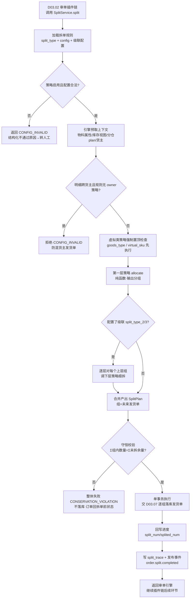
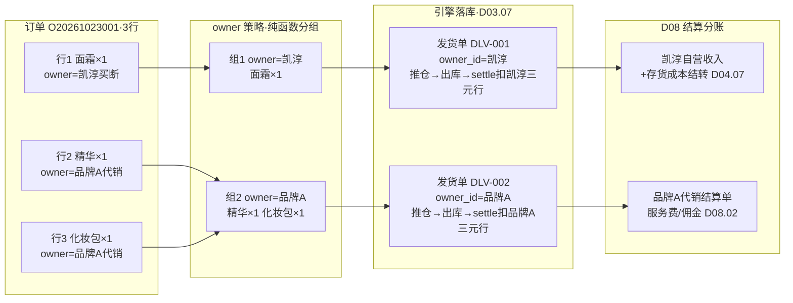
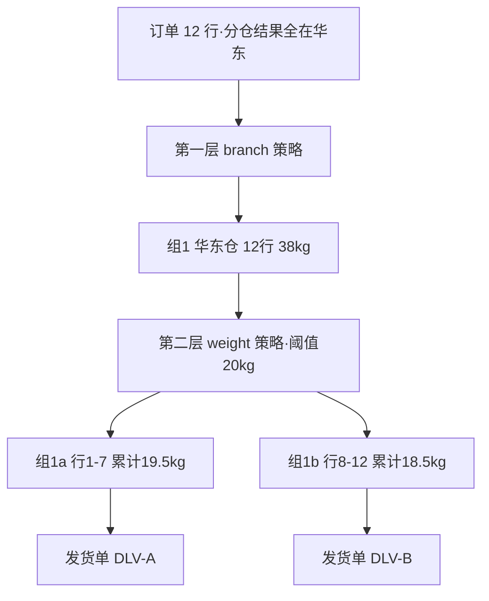
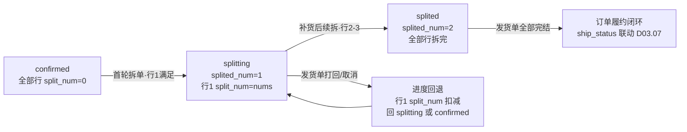
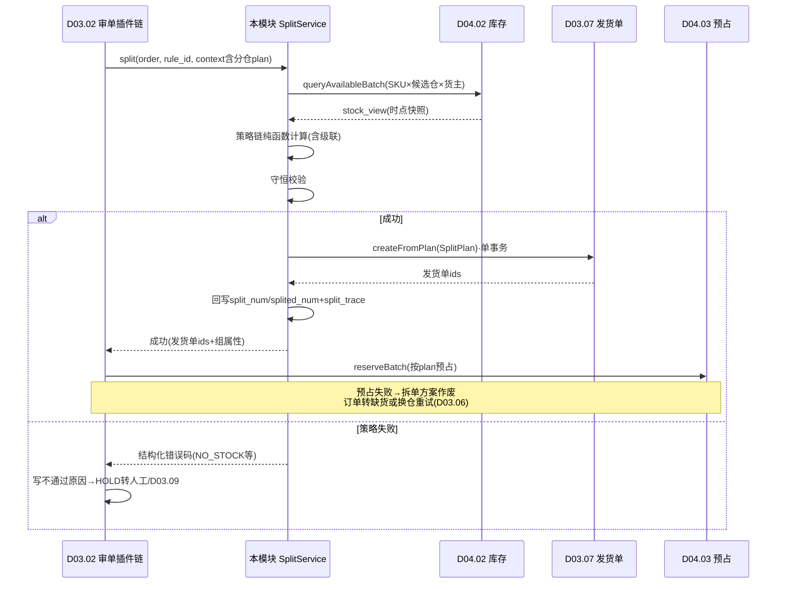

# SRS-D03.04 拆单策略中心模块 需求规格说明书

> 文档编号：SRS-D03.04 · 版本 V1.0 · 2026-10-23 · 编写：小凯 · 状态：待审阅（批次②）
> 所属域：D03 订单履约域 · 分期：**P0（M1-M2）**
> 上游依据：SRS-00 §4.4 契约（拆单不产生新订单）· 逆向文档 02 §4（16 拆单策略 lib/split）· SRS-D04.02（三元记账键 owner_id 契约）· SRS-D04.01（跨货主 BOM 走拆单）· SRS-D03.02（审单插件链调用方）· SRS-D03.07（发货单落库执行方）

---

## 1. 模块概述

### 1.1 定位

拆单策略中心是履约路由的「分配决策器」：一张订单的明细，按何种规则分成几组、每组走哪个仓/哪种履约通道，最终**每组产出一张发货单（delivery）**。本模块把商派 `lib/split/` 的 16 种拆单策略重写为**可插拔策略注册表**，并升级为凯淳特有的**按货主拆单**（货权分离核心）与**纯函数策略契约**（策略只算不落库，引擎统一执行）。

**核心契约（SRS-00 已定死，本模块为定义源之一）**：
- 拆单**不产生新订单记录**：订单主档恒为一张，拆单产物是多张发货单；
- 拆单进度用 `orders.splited_num`（已生成发货单次数）+ `order_item.split_num`（每行已拆数量）表达；
- 拆单是 D03.02「审核即履约路由」插件链中的一环，本模块被审单引擎**同步调用**，返回分配方案。

### 1.2 职责边界

**做**：策略注册表（接口规范/注册机制/启停管理）、16 种拆单策略实现、级联拆分编排（策略多级串联+顺序配置）、策略执行引擎（收集上下文→逐策略计算→合并分配方案→校验守恒→统一落库交付 D03.07）、拆单进度管理（splited_num/split_num 维护）、手工拆单（人工介入自由拆）、拆单结果追溯（每次拆分的策略快照）。

**不做**：拆单策略的**触发决策**（何时拆、用哪条拆单规则——由 D03.02 审单引擎按订单分组规则匹配后传入 split_rule_id）；发货单实体落库与状态机（→ D03.07，本模块输出分配方案由其执行）；分仓选仓决策（→ D03.06，「按仓库拆单」策略消费其分仓结果）；库存可用量查询（→ D04.02 queryAvailable，「按库存深度拆单」策略调用）；合单（→ D03.05，拆与合互逆，合单在拆单之后的发货单层面进行）。

### 1.3 与其他模块关系

| 模块 | 关系 |
|---|---|
| D03.02 审单引擎 | 插件链「拆单」环节调用本模块 `SplitService::split(order, split_rule_id, context)`；拆单失败→结构化不通过原因→转人工 |
| D03.06 配货分仓 | 「按仓库拆单」策略消费分仓结果（plan 中的 branch 分配）；分仓多仓不满足时反向触发本模块拆单 |
| D03.07 发货单管理 | 分配方案（split_plan）交其执行落库为发货单；split_num/splited_num 回写由引擎统一完成 |
| D03.05 合单 | 拆单产物（多张发货单）可再被合单模块 merge 为母子单；两模块在发货单层面互逆 |
| D03.10 特殊单型 | 虚拟商品行强制拆出（复用「按商品类型」「按虚拟SKU」策略）；福袋派发展开后按基础物料参与拆单 |
| D04.01 商品物料 | 物料属性（类型/分类/重量/体积/货主）是策略计算的输入维度；跨货主 BOM 校验失败→必须按货主拆 |
| D04.02 库存记账 | 「按库存深度拆单」策略读三元可用量（branch×sku×owner） |
| D07.04 转单货权拆分（P2） | 按货主拆单机制为经销货权拆分预留（SRS-00 §D07 P0 预留要求） |
| D08 财务对账 | 按货主拆单产生的发货单是**货主分账/结算分账的单据依据**（IF-D03.04-05） |

---

## 2. 业务场景

**SC-D03.04-01 按货主拆单（凯淳货权分离核心场景）**
天猫某品牌旗舰店一张订单含 3 行商品：面霜×1（货主=凯淳买断）、精华×1（货主=品牌 A 代销）、化妆包×1（货主=品牌 A 代销）。审单时「按货主」策略按明细行货主分组：组1={面霜}（owner=凯淳）、组2={精华,化妆包}（owner=品牌A）→ 产出 2 张发货单，各自携带 owner_id。财务意义：发货单是 D08 结算分账依据——组1 计入凯淳自营销售收入与存货成本结转（D04.07），组2 只记品牌 A 代销收入（服务费/佣金口径），两货主的钱与货从单据层面天然分离，杜绝混货主发货导致的结算纠纷。

**SC-D03.04-02 按仓库拆单（多仓履约）**
订单 5 行商品，D03.06 分仓结果：行1-3 华东仓满足、行4-5 华南仓满足。「按仓库」策略按分仓分组产出 2 张发货单，分别推华东/华南 WMS。消费者收到 2 个包裹（平台侧按多包裹发货回传，D02.04）。

**SC-D03.04-03 级联拆分（先按仓、再按重量）**
大促订单 12 行全在华东仓，但总重 38kg 超快递单包上限（配置 20kg）。级联规则 split_type=仓库 → split_type_2=重量：第一层按仓分 1 组；第二层对组内按累计重量切包 → 2 张发货单（20kg+18kg）。级联顺序在拆单规则中可配。

**SC-D03.04-04 虚拟商品强制拆出**
订单含实物 2 行 + 电子券 1 行（物料 type=虚拟）。「按商品类型」策略把虚拟行拆出独立发货单：实物单走标准推仓；虚拟单免推仓，交 D03.10 自动发货通道（卡密领取+平台回传）。虚拟拆单策略在规则加载时**强制置顶**（继承商派设计：虚拟行不拆出会阻塞实物履约）。

**SC-D03.04-05 赠品分离**
快手平台订单主品 2 行 + 平台赠品 1 行（赠品由品牌方另行直发）。「按赠品分离」策略把赠品行拆出独立发货单（可配置：不发/单独发/随主品发三种处置），主品单正常履约。避免仓库把不该发的赠品发出（资损）。

**SC-D03.04-06 平台单拆（按订单宿主）**
京东一单多子单（oid）场景：平台侧已按子单管理发货与售后，OMS 必须按 oid 拆开各自出单，否则平台发货回传与售后行对不上。「按订单宿主」策略按平台子单号分组拆单，拆单映射落 split_trace。含赠品或改过商品的订单不允许平台单拆（校验拒绝，转人工）。

**SC-D03.04-07 手工拆单（人工介入）**
审单员发现订单 2 行商品中 1 行外包装破损需单独走顺丰（其余走通达系），自动规则无法表达。审单员在人工审单工作台（D03.03）发起「手工拆单」：勾选明细行与数量自由分组 → 系统按分组产出多张发货单（可分别指定仓与物流）→ split_num/splited_num 同步累加，全程写审计与操作日志（操作人=真实账号，区别于自动拆单 system）。

**SC-D03.04-08 部分拆分与续拆（splitting → splited）**
订单 3 行，首轮审单仅行1 库存满足（按库存深度策略）：先为行1 生成发货单，`order_item(行1).split_num=nums`，订单拆分进度（派生视图）=部分拆分、splited_num=1。行2-3 待补货后（D03.09 缺货联动）重进审单，续拆生成第二张发货单，全部行 split_num=nums → 拆分进度派生视图=已拆完。

**SC-D03.04-09 拆单失败的兜底**
「按库存深度」策略计算时所有候选仓均无法满足任何一行 → 策略返回失败码（NO_STOCK），引擎不产出任何发货单，审单插件链记结构化不通过原因 `{code: SPLIT_FAILED, strategy: stock_depth, detail: 全仓无可用}`，订单 HOLD 转人工/缺货流程（D03.09）。**禁止策略静默产出部分方案导致丢行**（守恒校验 §5.4）。

---

## 3. 功能需求

### FR-D03.04-01 策略注册表架构
- FR-01a 策略接口规范（纯函数契约）：每个策略实现统一接口 `SplitStrategy::allocate(SplitInput): SplitResult`；**输入**=订单明细快照（只读）+ 拆单上下文（分仓结果/规则配置/库存视图/物料属性），**输出**=分配方案（明细行→组的映射+组属性），**策略内禁止任何落库/改单副作用**（对商派 splitOrder 就地修改内存订单组的关键修正——逆向文档 02 §11.5 教训）。
- FR-01b 注册机制：策略以类型码注册（`split_type` 唯一），注册项含：类型码/名称/说明/配置 schema（该策略 split_config 的字段定义与校验规则）/启停状态/版本号；基于 D01.03 规则引擎框架的策略容器，新增策略=实现接口+注册，不改引擎代码。
- FR-01c 拆单规则（split_rule）：审单配置引用的规则实体 = split_type + split_config（JSON，按策略 schema 校验）+ 级联配置（split_type_2/split_type_3，见 FR-04）+ 生效范围；规则保存前经策略 `validateConfig(config)` 预校验（继承商派 preSaveSdf 强校验思想，如按客户分类拆必选分类字段）。
- FR-01d 策略执行顺序配置：同一拆单规则内多策略的串联顺序（级联层级）可配；跨规则的触发顺序由 D03.02 订单分组规则决定，本模块不感知。
- FR-01e 策略启停与灰度：策略可停用（停用后引用它的规则保存报错、执行时拒绝并给出明确错误码）；新策略上线支持按店铺灰度（规则生效范围限定）。

### FR-D03.04-02 十六种拆单策略（全实现为可插拔插件）

| # | split_type | 名称 | 触发场景 | 分配算法要点 |
|---|---|---|---|---|
| 1 | `branch` | 按仓库拆 | 分仓结果（D03.06）中明细归属多个仓 | 按 plan 中每行的 branch_id 分组；同仓行归一组；组属性携带仓 ID；分仓未出结果时策略拒绝（前置依赖校验） |
| 2 | `owner` | **按货主拆（凯淳特色）** | 订单明细跨货主（买断+代销混单），或 D07 经销货权拆分（P2 预留） | 按明细行物料绑定的 owner_id 分组（三元记账键之一）；组属性携带 owner_id→发货单必填；跨货主 BOM 的销售物料行以 BOM 展开后基础物料货主为准（D04.01 校验同货主 BOM，跨货主组合强制展开拆分）；详见 §5.2 |
| 3 | `sku` | 按 SKU 拆 | 一单一件式履约（贵重品独立包裹/指定物料独立发） | 配置 split_goods=任意商品/指定物料清单；每命中行独立成组（或按 split_goods_num 指定每次拆出数量，'all'=整行一组）；支持逐次拆（首轮拆一组，余量续拆） |
| 4 | `goods_type` | 按商品类型拆（实物/虚拟） | 订单混合实物与虚拟物料 | 按物料 type（实物/虚拟/卡券）分组；虚拟组打 `virtual_delivery` 标记（D03.07 免推仓、D03.10 自动发货）；本策略族在规则加载时强制置顶执行 |
| 5 | `customer_classify` | 按客户分类拆 | B2B/分销客户与普通客户混单（D07 预留），不同客户分类履约策略不同 | 按订单客户 class_id 映射的履约组配置分组（同单同客户时退化为不拆）；规则保存强校验客户分类字段必选 |
| 6 | `sku_category` | 按商品分类拆 | 不同品类不能同包（食品与化工/液体与普货） | 按物料分类树的配置分组键（一级分类或指定分类节点）分组；同分类行归一组；支持与仓/重量级联（作为下层策略） |
| 7 | `weight` | 按重量拆 | 单包重量超快递/仓配上限 | 组内按行重量累加切包：超阈值即开新组；单行超阈值时按数量再切（行内拆，split_num 支持行级部分数量）；阈值来自 split_config（默认读物流商重量上限 D09.04） |
| 8 | `volume` | 按体积拆 | 单包体积超限（大件/泡货） | 同重量算法，维度换体积（物料长宽高档案 D04.01）；重量+体积可同时配置（双阈值取先到者切包，级联场景） |
| 9 | `store` | 按门店拆 | O2O 订单明细由多个门店仓履约（D03.11） | 按门店分单结果的 store_branch_id 分组；每组打门店履约标记（发货单推门店作业台而非 WMS）；门店自提行不拆（整单自提） |
| 10 | `gift_separate` | 按赠品分离 | 平台赠品/营销赠品需独立处置（品牌直发/不发/随主品） | 识别赠品行（item_type=gift 或平台赠品标记）按配置分离成组；处置方式三选：单独发货单/标记不发（组产物为「无需履约组」，引擎跳过出单但记 split_num 闭环）/不分离；仅赠品订单（全部行都是赠品）拒绝出单（继承商派 checksplitgift：仅赠品不生成发货单，转人工） |
| 11 | `presale` | 按预售/现货拆 | 订单混合预售行（estimate_con_time 未到期）与现货行 | 预售行按预计发货日分组（同日归组），现货行一组；预售组发货单生成后 hold（联动 D03.10 预售到期放行）；现货组立即履约——避免预售拖住现货 |
| 12 | `order_host` | 按订单宿主拆（平台单拆） | 京东多子单（oid）/抖音达人单等按平台宿主维度独立发货结算 | 按明细行的平台子单号（oid）或宿主标识（达人 ID）分组；前置校验：含赠品或改过商品的订单拒绝（平台 oid 对不上，转人工）；拆单映射写 split_trace（obj→oid） |
| 13 | `stock_depth` | 按库存深度拆 | 单仓不满足全部明细，按各仓可用量「能发多少发多少」 | 对每行按候选仓优先级（D03.06 提供）查询三元可用量，贪心分配：整行满足→归该仓组；部分满足→行内按量拆（该仓组占可用量，余量进入下一仓或留待续拆）；全仓不满足→策略失败码 NO_STOCK（§SC-09）；输出组属性=仓+分配量 |
| 14 | `channel` | 按渠道拆 | 同订单明细需走不同履约渠道（平台仓直发/商家仓/供应商直发 VOP） | 按明细行渠道标记（平台报文带入的渠道 ID/直发标记）分组；渠道组属性决定发货单推仓通道（D09.01 wms_binding）；供应商直发组打 `dropship` 标记 |
| 15 | `virtual_sku` | 按虚拟 SKU 拆 | 虚拟 SKU 细粒度拆出并自动发货（比 goods_type 更细：指定虚拟物料清单） | 配置虚拟 SKU 清单（或按物料 type=虚拟+指定分类）；命中行独立成组+`auto_delivery` 标记；组产物直接进 D03.10 自动发货队列；规则存在时被引擎强制置顶（同 #4） |
| 16 | `cascade` | 级联拆分 | 单一策略不够，需「先按仓→再按重量→再按分类」多级组合 | 非独立策略而是**编排器**：split_type_2/split_type_3 二三级配置，逐层对上层分组结果调用下层策略细拆（详见 FR-04）；三层不允许同类型（防死循环，继承商派约束） |

- FR-02a 每策略实现四接口（继承商派 abstract 抽象类设计）：`allocate`（分配主逻辑）、`validateConfig`（规则保存校验）、`getSpecial`（返回可作级联下层的策略类型清单）、`describe`（元信息：名称/说明/配置 schema）。
- FR-02b 策略配置 split_config 按注册 schema 校验（类型/范围/必填），配置错误在保存期暴露而非运行期。
- FR-02c 策略计算中需要的库存视图由引擎统一预取（一次批量查询注入 context），策略内**不允许自行查库**（保证纯函数与性能，见 §5.3）。

### FR-D03.04-03 策略执行引擎
- FR-03a 统一入口：`SplitService::split(order_id, split_rule_id, context)` 由 D03.02 审单插件链调用；context 含分仓结果（plan）、物料属性快照、库存视图、店铺/货主配置。
- FR-03b 引擎流程：加载规则→校验策略启用→预取上下文→执行策略（或级联编排）→**守恒校验**（§5.4）→产出 SplitPlan→交 D03.07 落库发货单→回写拆单进度（split_num/splited_num；拆分状态为发货单派生视图，见 D03.01 契约）→写 split_trace（策略快照+分组结果，追溯用）。
- FR-03c 引擎统一落库：策略输出与发货单生成解耦——策略只出方案，落库/回写/事件发布全部由引擎在单事务编排（失败整体回滚，订单回到拆单前状态，杜绝商派「就地改内存组、失败后现场脏」问题）。
- FR-03d 拆单幂等：幂等键=（order_id, split_rule_id, 触发轮次）；同轮重复调用返回首次方案；引擎执行加订单级分布式锁（与 D03.08 改单锁同一 key 空间 `order:lock:{order_id}`，互斥）。
- FR-03e 失败结构化返回：策略失败不抛裸异常，返回错误码族（NO_STOCK/CONFIG_INVALID/PRECONDITION_UNMET/CONSERVATION_VIOLATION/…）+ 明细，供 D03.02 写结构化不通过原因（替代商派位图旗标「拆」）。

### FR-D03.04-04 级联拆分
- FR-04a 级联配置：拆单规则支持二三级（split_type_2/split_type_3），各级独立 split_config；三层类型互不相同（保存期校验）。
- FR-04b 级联语义：第一层对全单明细分组；第二层对**每个上层分组内部**再分组（不跨上层组）；第三层同理。产物组 = 各层分组键的笛卡尔交集（如 仓×重量段）。
- FR-04c 级联执行：编排器逐层调用 `allocate`，下层策略的输入是上层组内明细；任一层失败→整体失败（不允许部分层级生效）；下层策略须在上层策略 `getSpecial` 声明的兼容清单内（保存期校验，防语义冲突组合如 gift_separate 之下再挂 order_host）。
- FR-04d 级联顺序可配：同一组策略类型调换层级顺序（先重量后仓 vs 先仓后重量）产出不同分组结果，顺序即配置，无硬编码优先级（虚拟类策略强制置顶除外）。

### FR-D03.04-05 按货主拆单（凯淳货权分离核心，详细规格）
- FR-05a 分组依据：明细行货主 = 该行物料在三元记账中的 owner_id（销售物料经 BOM 展开取基础物料货主，D04.01 保证同销售物料 BOM 同货主）；一单含 N 个货主 → 至少 N 组 → N 张发货单。
- FR-05b 发货单货主必填：每张产物发货单携带唯一 owner_id（SRS-00 契约「全单据 owner_id+tenant_id」），发货单行不允许混货主（落库强校验）。
- FR-05c 结算分账依据：按货主拆出的发货单是 D08 分账的单据粒度——买断货主发货单→凯淳销售收入+存货成本结转（D04.07 出库成本按货主行核算）；代销货主发货单→品牌方结算单（D08.02 代销服务费/佣金）；发货单出库转扣减（D04.03 settle）时按行货主扣对应三元行，账务与单据闭环一致。
- FR-05d 与借调的关系：借调预占（D04.03/D04.05）场景下发货单货主仍=记账行货主（借出方），借调标记（lend_flag+台账ID）冗余在发货单行——**按货主拆单按记账货主分组，不按业务归属分组**（继承 D04.05 §5.1「货主行恒定+台账第二本账」设计），保证库存账不混乱。
- FR-05e 优先级：按货主拆在级联中通常作**第一层**（货权分离是硬约束，先分货权再分仓/重量）；引擎对含多货主订单强制校验：若审单规则未含 owner 策略且明细跨货主 → 拒绝执行并返回 CONFIG_INVALID（防混货主发货单落库），提示配置修正。
- FR-05f 经销扩展预留（P2）：D07.04 转单货权拆分复用本策略（货主类型=经销商/贸易公司），机制 P0 预留、业务界面 P2。

### FR-D03.04-06 拆单进度管理
- FR-06a 行级进度：`order_item.split_num`（已拆数量）随每张发货单落库累加（行内拆时按分配量累加）；`split_num ≤ nums` 强校验；`split_num = nums` 行拆完。
- FR-06b 单级进度：`orders.splited_num` 每生成一批发货单自增（记录拆单轮次而非发货单张数）；全部行 split_num=nums 则拆分进度派生视图=已拆完，否则=部分拆分——拆分进度为发货单派生视图（不设独立状态字段），遵循 D03.01 状态机契约，本模块只回写 split_num/splited_num 计数。
- FR-06c 续拆：splitting 订单重进审单池（补货后/人工触发），引擎只对「未拆余量行」（nums−split_num>0）重新执行策略；已拆行的发货单不受影响。
- FR-06d 回退：发货单取消/打回（D03.07）→ 对应行 split_num 扣减、splited_num 不回退（轮次历史保留）、拆分进度派生视图按剩余 split_num 自动回退（部分拆分/待履约）；回退与发货单状态变更同事务。
- FR-06e 不拆单闭环：策略判定无需拆（单一组覆盖全部明细）时同样产出一张发货单并写满 split_num——**「不拆」是拆单的特例（组数=1）**，进度口径统一，避免「未拆」与「拆成 1 组」两种状态并存。

### FR-D03.04-07 手工拆单（人工介入）
- FR-07a 入口：人工审单工作台（D03.03）订单详情「手工拆单」；适用：自动规则无法表达的特殊履约要求、拆单失败转人工后的兜底处置。
- FR-07b 交互：按明细行勾选+填数量自由分组（支持行内部分数量），每组可指定仓/物流/发货备注；分组预览（各组明细+重量体积合计）确认后提交。
- FR-07c 校验：各组数量之和 ≤ 行未拆余量；组内货主唯一（FR-05b 同规则，手工不豁免）；指定仓须在订单候选仓内或走 D03.06 手工改仓审计通道。
- FR-07d 落库：走同一引擎通道（source=manual，操作人=真实账号），split_trace 记录手工分组快照；写操作日志+审计（D10.06）。
- FR-07e 权限：手工拆单为独立授权点（D10.03）；批量手工拆单（大促应急）走导入中心（D01.06）模板，逐单校验逐单留痕。

### FR-D03.04-08 拆单追溯与查询
- FR-08a split_trace（拆单轨迹）：每轮拆单记录（订单/轮次/规则 ID/策略链与各级 config 快照/输入明细快照/输出分组结果/耗时/执行来源 auto|manual/操作人）；不可变只追加。
- FR-08b 订单详情「拆单历史」时间线：按轮次展示分组结果与产物发货单链接；支持按策略/时间/店铺检索（拆单质量分析：各策略命中率、拆单率、平均组数，供 D11 报表）。

---

## 4. 业务流程

### 4.1 策略链执行流程（引擎主流程）



### 4.2 按货主拆单示例（SC-01 的分配过程）



### 4.3 级联拆分执行示意（先按仓再按重量）



### 4.4 部分拆分与续拆状态流（进度管理）



---

## 5. 处理逻辑

### 5.1 策略纯函数契约（接口规范）

```
interface SplitStrategy:
    allocate(input: SplitInput): SplitResult
    validateConfig(config: JSON): bool + errors[]
    getSpecial(): 可作级联下层的策略类型清单
    describe(): 元信息(名称/说明/config schema/版本)

SplitInput = {
    items[]:        # 只读明细快照：行ID/sku/数量(未拆余量)/货主/物料属性(类型/分类/重量/体积)/oid/渠道/赠品标记/预售信息
    context: {
        branch_plan,      # D03.06 分仓结果(行→仓)
        stock_view,       # 引擎预取的三元可用量 {branch×sku×owner: available}
        rule_config,      # 本级 split_config
        shop/owner 配置,  # 店铺级开关/货主配置
        source            # auto | manual
    }
}
SplitResult = {
    groups[]: { group_key(分组维度值), items[]{行ID, 分配数量}, attrs{branch_id/owner_id/virtual/auto_delivery/dropship/hold...} },
    fail_code?: 错误码 + detail        # 失败时无 groups
}
# 硬约束：allocate 无副作用（不落库/不改单/不自行查库/无随机——随机类如福袋派发在 D03.10 完成后才进拆单）
```

### 5.2 按货主分组算法（owner 策略）

```
allocate_owner(input):
    for item in input.items:
        owner = item.物料.owner_id            # 销售物料经 BOM 展开取基础物料货主(D04.01 保证同货主)
        if item.借调标记: owner = 记账行货主(借出方)   # FR-05d：按记账货主分组，不按业务归属
        bucket[owner].append(item)
    if len(bucket) == 1: return 单组(仍产出方案，组数=1，FR-06e 口径)
    return [ {group_key: owner, items: 全量, attrs: {owner_id: owner}} for owner in bucket ]
# 后置联动：每组发货单 owner_id 必填唯一；D08 按发货单货主分账；
# 混货主拦截(FR-05e)在引擎层：跨货主明细 + 规则链无 owner → CONFIG_INVALID
```

### 5.3 库存视图预取（性能与纯函数保障）

- 引擎在执行前按「订单全部 SKU × 候选仓 × 货主」一次性批量调 `StockLedgerService::queryAvailable`（IF-D04.02-03，Redis 热路径），组装 stock_view 注入 context；
- 策略内零查库 → 单次拆单 DB/Redis 交互次数与策略数无关（恒定 1 次批量预取），支撑审单洪峰（500 单/分钟）；
- stock_view 为**时点快照**：拆单方案落库后由 D03.02 走预占（D04.03 reserveBatch）做真正的库存承诺，快照与预占之间的竞态由预占 Saga 兜底（预占失败→订单转缺货，拆单方案作废重算）——**拆单不做库存承诺，只做分配决策**（决策与执行分离，SRS-00 逆向启示 §11.2）。

### 5.4 守恒校验（防丢行/防多拆）

```
conserve_check(plan, items):
    for item in items:
        Σ(plan 中该行的分配数量) 必须 == item.未拆余量(nums - split_num)
        且每条分配数量 > 0
    违反 → CONSERVATION_VIOLATION，整体失败不落库
# 覆盖两类 bug：策略漏行(丢单资损)、策略重复分配(超发)；
# 允许例外：gift_separate 配置「赠品不发」时，该组标记 skip_delivery，
# 守恒按「分配数量+跳过数量=余量」口径校验，split_num 照常写满闭环。
```

### 5.5 行内拆（数量级拆分）规则

- 支持行内拆的策略：stock_depth（部分满足）、weight/volume（单行超阈值按数量切）、sku（split_goods_num 指定量）、手工拆单；
- 行内拆产物：同一订单行出现在多组，各组携带分配数量；split_num 按组累加；
- 发货单行与订单行多对一映射由 D03.07 delivery_item_detail（明细溯源表）承载。

### 5.6 策略失败与兜底矩阵

| 失败码 | 典型场景 | 引擎动作 | 订单去向 |
|---|---|---|---|
| NO_STOCK | stock_depth 全仓不满足 | 不落库 | 缺货流程 D03.09（可触发补货/借调建议 D04.05） |
| CONFIG_INVALID | 跨货主无 owner 策略/级联类型重复/配置缺必填 | 不落库 | 转人工+规则修正提示（告警店铺运营） |
| PRECONDITION_UNMET | branch 策略但分仓无结果/oid 缺失 | 不落库 | 回审单链前置环节重跑或转人工 |
| CONSERVATION_VIOLATION | 策略 bug 丢行/重行 | 不落库+最高级告警 | 转人工（策略缺陷需开发介入） |
| STRATEGY_DISABLED | 规则引用的策略被停用 | 不落库 | 转人工+规则治理待办 |

### 5.7 典型策略 split_config 配置示例（注册 schema 节选）

| 策略 | split_config 示例 | 说明 |
|---|---|---|
| `sku` | `{"split_goods":2,"split_goods_product":["BM1001","BM1002"],"split_goods_num":"all"}` | 指定物料清单逐行独立成组，'all'=整行一组；填数量则行内拆 |
| `weight` | `{"weight_limit":20000,"unit":"g","split_oversize_line":true}` | 单包重量上限 20kg；单行超限按数量切（行内拆） |
| `volume` | `{"volume_limit":0.12,"unit":"m3"}` | 单包体积上限 0.12 方 |
| `stock_depth` | `{"branch_seq_source":"plan","allow_partial":true,"lack_route":"D03.09"}` | 仓序取分仓结果；允许部分满足出单；缺口转缺货 |
| `gift_separate` | `{"gift_disposal":"separate","only_gift_action":"reject"}` | 赠品独立成单；仅赠品订单拒绝出单转人工 |
| `order_host` | `{"host_field":"oid","reject_when_has_gift":true}` | 按平台子单号分组；含赠品拒绝（oid 对不上） |
| `presale` | `{"group_by":"estimate_con_time","hold_presale_group":true}` | 预售行按预计发货日分组，预售组发货单 hold |
| `cascade` | `{"split_type":"branch","split_type_2":"weight","split_config_2":{"weight_limit":20000}}` | 先按仓再按重量（split_type_3 同构） |

- 所有示例配置在规则保存期经对应策略 `validateConfig` 校验（类型/范围/必填/级联兼容），错误在配置期暴露。

### 5.8 与审单链路集成时序（D03.02 视角）



### 5.9 与合单的次序关系

拆单（订单→多发货单）与合单（多发货单→母子单）在流水线上的固定次序：**审单 → 拆单 → 各组落库发货单 → 合单 merge（若开启且命中指纹组）**（D03.05）；本模块不感知合单，产物发货单是否被 merge 由 D03.05 决定；合单拆回（D03.05）不影响 split_num（拆单进度以订单行口径恒定）。

---

## 6. 数据字段（业务字段描述）

### 6.1 拆单规则（split_rule）

| 字段 | 业务含义 | 取值/校验 |
|---|---|---|
| rule_id / rule_name | 规则标识/名称 | 唯一 |
| split_type | 一级策略类型码 | FR-02 表中 16 选 1（cascade 为编排器类型） |
| split_config | 一级策略配置 | JSON，按策略注册 schema 校验 |
| split_type_2 / split_config_2 | 二级级联策略/配置 | 可空；类型 ≠ 一级 |
| split_type_3 / split_config_3 | 三级级联策略/配置 | 可空；类型 ≠ 一二级；须在一级 getSpecial 兼容清单内 |
| scope_type / scope_ref | 生效范围 | 全局/店铺/订单分组（由 D03.02 审单配置引用） |
| confirm_source | 适用审单来源 | 自动/手工/全部（继承商派 split_config.confirm_source） |
| status / version | 启停/版本 | 停用后引用报错 |
| owner_id / tenant_id | 货主/租户 | 必填（SRS-00 契约） |

### 6.2 拆单方案与轨迹（split_plan / split_trace）

| 字段 | 业务含义 | 取值/校验 |
|---|---|---|
| plan_id | 方案 ID | 唯一，一轮拆单一份 |
| order_id / round_no | 订单/拆单轮次 | round_no = splited_num 递增值 |
| rule_snapshot | 规则快照 | JSON：策略链+各级 config（不可变，追溯依据） |
| input_snapshot | 输入明细快照 | JSON：行/数量/货主/关键属性 |
| groups | 分组结果 | JSON：组键/行分配/组属性（branch/owner/virtual/…） |
| source | 执行来源 | auto / manual（手工含操作人账号） |
| result_status | 结果 | 成功（产物发货单 ID 列表）/ 失败（错误码+detail） |
| cost_ms / create_time | 耗时/时间 | 策略性能观测（D11.03） |
| operator | 操作人 | auto=system；manual=真实账号 |
| owner_id / tenant_id / shop_id | 归属维度 | 必填，行级过滤 |

### 6.3 订单/明细上的拆单进度字段（归属 D03.01 表，本模块按契约读写）

| 字段 | 业务含义 | 读写规则 |
|---|---|---|
| orders.splited_num | 拆单轮次计数 | 每轮落库成功 +1；发货单取消不回退（历史轮次保留） |
| orders.splited_num | 拆单轮次计数 | 按 §FR-06b 回写；拆分状态为派生视图（不设字段），状态机契约归 D03.01 |
| order_item.split_num | 行已拆数量 | 发货单落库累加/取消打回扣减；≤nums 强校验 |

---

## 7. 接口

### 7.1 内部接口（本模块提供）

| 编号 | 接口 | 消费方 | 说明 |
|---|---|---|---|
| IF-D03.04-01 | `SplitService::split(order_id, split_rule_id, context)` | D03.02 审单插件链 | 拆单统一入口；返回 SplitPlan 或结构化失败码；幂等（FR-03d） |
| IF-D03.04-02 | `SplitService::manualSplit(order_id, groups[], operator)` | D03.03 人工工作台 | 手工拆单（FR-07），走同一引擎落库通道 |
| IF-D03.04-03 | `SplitRuleService::save/validate/disable(rule)` | 规则配置后台 | 规则 CRUD+策略 schema 校验+级联兼容校验 |
| IF-D03.04-04 | `SplitStrategyRegistry::register/list/get(type)` | 开发扩展/D01.03 | 策略注册表管理 |
| IF-D03.04-05 | 事件 `order.split.completed`（order_id/plan_id/发货单ids/组属性含 owner_id） | D03.07/D08（分账依据）/D11 | 拆单完成广播；发货单货主维度的下游消费入口 |
| IF-D03.04-06 | `SplitTraceService::query(order_id)` | 订单详情页/D11 | 拆单历史时间线 |
| IF-D03.04-07 | `SplitService::rollbackProgress(order_id, delivery_id)` | D03.07 发货单取消/打回 | split_num 回退（FR-06d），与发货单状态变更同事务 |

### 7.2 依赖接口（本模块消费）

| 编号 | 接口 | 提供方 | 说明 |
|---|---|---|---|
| IF-D03.04-D1 | `StockLedgerService::queryAvailable(branch, bmIds[])` | D04.02 | 库存视图批量预取（stock_depth 策略） |
| IF-D03.04-D2 | 分仓结果 plan（行→仓/满足度） | D03.06 | branch/stock_depth 策略输入 |
| IF-D03.04-D3 | `DeliveryService::createFromPlan(plan)` | D03.07 | 分配方案落库为发货单 |
| IF-D03.04-D4 | 物料属性（type/分类/重量/体积/owner_id/BOM） | D04.01 | 策略计算维度来源 |
| IF-D03.04-D5 | `AuditService::fieldChange` / 操作日志 | D10.06 | 手工拆单审计 |

### 7.3 外部接口

| 编号 | 接口 | 方向 | 说明 |
|---|---|---|---|
| EF-D03.04-01 | 无直接外部接口 | — | 拆单为纯内部决策；平台子单（oid）信息由 D02 适配器落库后经订单明细提供 |

---

## 8. 非功能需求

| 项 | 要求 |
|---|---|
| 性能 | 单订单拆单（含上下文预取+级联三层）P99 ≤100ms；策略纯计算部分 ≤10ms；支撑审单洪峰 500 单/分钟（批量审单场景策略结果不跨单共享，逐单独立） |
| 幂等/并发 | 拆单幂等键（订单+规则+轮次）；订单级分布式锁与改单/取消互斥；落库单事务（发货单+进度+trace 原子） |
| 一致性 | 守恒校验强制（§5.4）；split_num 与发货单行数量、发货单取消回退三方对账任务（每日，差异告警）；拆单不做库存承诺，竞态由预占 Saga 兜底（§5.3） |
| 可扩展 | 新增策略零引擎改动（注册即生效）；策略版本化（rule_snapshot 记版本，历史方案可回放） |
| 可观测 | 策略命中率/失败码分布/耗时监控（D11.03）；CONSERVATION_VIOLATION 最高级告警（策略缺陷） |
| 安全/权限 | 手工拆单独立授权点；规则配置变更审计（D10.06）；货主维度行级过滤（品牌方只见本货主发货单，D10.03/D10.04） |
| 容量 | split_trace 随订单归档（D03.13）；快照 JSON 单份 ≤100KB（超大订单行截断存引用） |

---

## 9. 验收标准

| 编号 | 验收条件 |
|---|---|
| AC-01 | 按货主拆单（SC-01）：买断+代销混单产出 2 张发货单，各单 owner_id 唯一；出库转扣减分别扣对应货主三元行；D08 按发货单货主生成分账数据，买断计自营收入、代销计服务费口径 |
| AC-02 | 跨货主订单配置的规则链不含 owner 策略时，引擎拒绝执行（CONFIG_INVALID），不产出任何混货主发货单 |
| AC-03 | 按仓库拆单：分仓结果 2 仓 → 2 张发货单分别推对应仓；分仓无结果时策略返回 PRECONDITION_UNMET 不落库 |
| AC-04 | 级联拆分（先仓后重量）：12 行 38kg 阈值 20kg → 2 组且每组 ≤20kg；三层同类型配置保存被拒；级联中任一层失败整体失败无部分落库 |
| AC-05 | 虚拟商品订单：虚拟行强制拆出独立发货单（免推仓标记），实物行正常推仓；virtual_sku 规则存在时置顶执行验证 |
| AC-06 | stock_depth 部分满足（SC-08）：行1 满足即出单，订单 splitting、splited_num=1、行1 split_num 写满；补货后续拆第二张发货单后订单 splited |
| AC-07 | stock_depth 全仓不满足：返回 NO_STOCK，无发货单产出，订单进缺货流程（D03.09）且结构化原因含策略与明细 |
| AC-08 | 守恒校验：注入模拟策略 bug（漏 1 行），引擎整体失败 CONSERVATION_VIOLATION+最高级告警，订单现场无任何变化 |
| AC-09 | 手工拆单（SC-07）：自由分组产出多张发货单，source=manual、操作人真实账号、审计完整；组内混货主提交被拒；超未拆余量提交被拒 |
| AC-10 | 发货单打回/取消：对应行 split_num 扣减、拆分进度派生视图正确回退、续拆可重新分配该余量；splited_num 不回退 |
| AC-11 | 幂等：同轮拆单请求重复调用 10 次只产出一次发货单；拆单与改单并发时锁互斥（一方等待或失败提示） |
| AC-12 | 平台单拆（oid）：京东多子单按 oid 分组出单且 split_trace 记录 obj→oid 映射；含赠品订单发起 oid 拆被拒转人工 |
| AC-13 | 赠品分离三种处置（单独发/不发/不分离）行为符合配置；「不发」组 split_num 照常闭环且无发货单产出；仅赠品订单拒绝出单转人工 |
| AC-14 | 策略停用后引用规则保存报错、执行返回 STRATEGY_DISABLED；新策略注册后不改引擎代码即可被规则引用（插件化验证） |
| AC-15 | 单订单拆单 P99 ≤100ms（压测 500 单/分钟洪峰）；split_trace 可按订单完整回放每轮策略链与分组结果 |

---

## 变更记录

| 日期 | 版本 | 变更 | 原因 |
|---|---|---|---|
| 2026-10-23 | V1.0 | 首版 | — |

---

*参考实现溯源：商派 `app/omeauto/lib/split/` 16 文件（router.php 路由分发 + abstract.php 四抽象方法 getSpecial/preSaveSdf/splitOrder/splitOrderFromSplit + storemax.php 708 行按库存就全拆含 split_type_2/3 级联 + sku/skuweight/skuvolume/skucategory/branchgroup/branchappoint/virtualsku/oid/orderhost/customerclassify/skuchannel/skustorecode/goodstype 各策略）+ `omeauto_mdl_order_split::$split_type` 注册表（model/order/split.php:19-32）+ `plugin/split.php` 审单插件（跳过条件：唯一非管控仓/门店仓/COD/门店自提/猫超）+ `_splitDeliveryOne`（combine.php:1471 递归拆一份出一单）+ `orders::mkDelivery`（splited_num/split_num 进度）+ `order_platformsplit`（平台子单映射）+ 手工自由拆单（lib/order/split.php split_model=2）。关键差异：① 策略重构为**纯函数**（输入明细+上下文→输出分配方案），引擎统一落库——商派 splitOrder 就地修改内存订单组、失败现场脏（逆向文档 02 §11.5 教训）；② 新增**按货主拆单**策略（商派无货主模型，凯淳货权分离核心，发货单 owner_id 为 D08 分账依据，D07.04 经销货权拆分 P2 复用）；③ 策略清单重整：商派 branchappoint（指定仓）/skustorecode（SKU 指定仓）并入分仓前置（D03.06），skuchannel（京东开普勒，已停用）归并入「按渠道」，goodstype 与 virtualsku 分立为「按商品类型」+「按虚拟SKU」两策略，新增「按赠品分离」「按预售/现货」「按门店」独立策略（商派散落于插件与 o2o 模块）；④ 守恒校验显式化（防丢行/重行，商派无此机制）；⑤ 位图旗标「拆」改为结构化错误码族；⑥ 库存视图引擎统一预取，策略内禁止查库；⑦ 手工拆单与自动拆单共用引擎落库通道（商派手工拆走独立代码路径）。*
