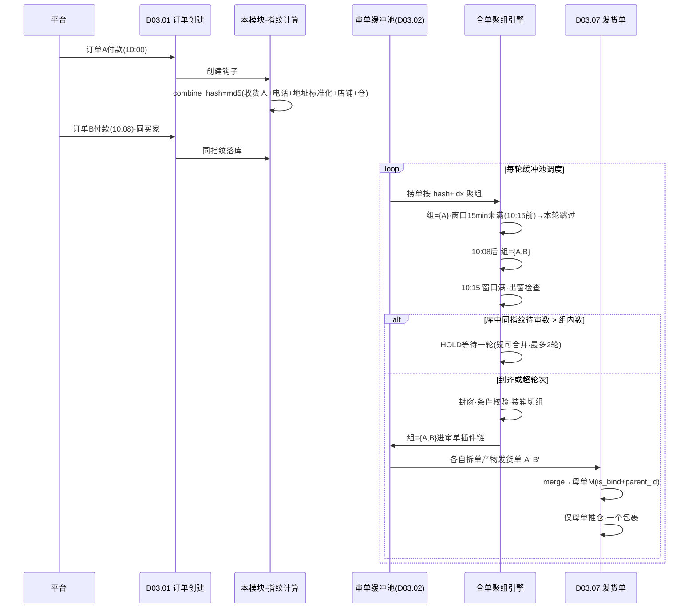
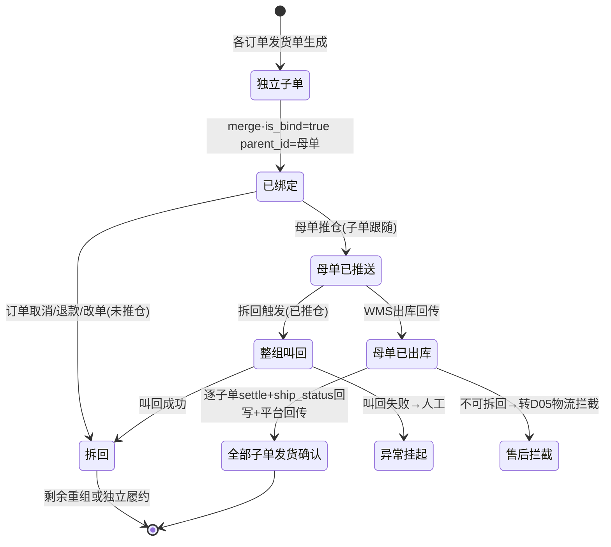

# SRS-D03.05 合单模块 需求规格说明书

> 文档编号：SRS-D03.05 · 版本 V1.0 · 2026-10-23 · 编写：小凯 · 状态：待审阅（批次②）
> 所属域：D03 订单履约域 · 分期：**P0 预留能力（机制 M1-M2 建成，店铺级开关默认关）**
> 上游依据：SRS-00 §4.4 契约（发货单指令状态机）· 逆向文档 02 §5（合单指纹 combine_hash+缓冲窗+母子单 merge）· 需求决策 Q17（合单店铺级开关默认关）· SRS-D03.04（拆单产物为本模块输入）· SRS-D03.07（母子发货单模型归属）

---

## 1. 模块概述

### 1.1 定位

合单把「同买家、同店铺、同收货信息、同仓」的多张订单（或其拆单产物发货单）聚合成一组，共用一个包裹履约（母子发货单），降低运费与包材成本、提升消费者体验（一次收货）。机制照搬商派验证过的**指纹预计算 + 缓冲时间窗**设计：拉单时即算好合单指纹，审单时按指纹聚组「等一等再发」，用 N 分钟等待换合单率。

**Q17 决策落地**：合单为**店铺级开关，默认关**——凯淳代运营店铺多数平台要求单订单独立发货回传，合单仅对明确允许的店铺/业务（私域、B2B）启用。开关关闭时本模块全部旁路（订单强制独立成组），零性能开销。

### 1.2 职责边界

**做**：合单指纹计算与落库（拉单时预计算）、缓冲时间窗聚组机制、合单条件校验（同店铺/同收货人/同仓/重量体积限制/平台允许）、合单组管理（组建/扩组/封窗）、母子发货单编排指令（交 D03.07 执行 merge）、合单拆回（部分取消/部分退款时母单拆分）、平台合单黑名单维护、手工合单（人工审单界面）。

**不做**：母子发货单实体模型与状态联动（→ D03.07 定义源，本模块只发起 merge/split 编排）；订单拉单落库（→ D02.03/D03.01，本模块在创建钩子上计算指纹）；审单何时触发合单检查（→ D03.02 插件链「合单」环节调用本模块）；发货回传平台的单号口径（→ D02.04，母子单回传规则由其按平台适配）。

### 1.3 与其他模块关系

| 模块 | 关系 |
|---|---|
| D03.01 订单创建 | 落库钩子调用本模块计算合单指纹（combine_hash/combine_idx）写入订单 |
| D03.02 审单引擎 | 缓冲池捞单按指纹聚组进审单；插件链「合单校验」环节调用本模块 canCombine/等待判定 |
| D03.04 拆单 | 拆单产物发货单是合单的操作对象（先拆后合）；拆单不感知合单 |
| D03.07 发货单 | merge（母子单绑定）/ splitBack（拆回）的执行方；母子单状态联动规则定义源 |
| D03.08 改单 | 已推仓改单叫回时合单组级联叫回（组内全部发货单） |
| D03.09 异常/取消 | 组内订单取消/退款 → 触发合单拆回或整组重排 |
| D02.04 回传中心 | 母子单发货回传口径（一单多包裹/多单一包）按平台规则适配 |
| D09.05 面单打印 | 母单一张面单（一个包裹），子单不单独取号 |

---

## 2. 业务场景

**SC-D03.05-01 缓冲窗聚组（主流程）**
店铺开启合单（缓冲窗 15 分钟）。买家 10:00 付款订单 A，10:08 又下订单 B（同收货人同地址）。拉单时 A、B 计算得相同 combine_hash。审单缓冲池：A 在 10:00+15min=10:15 前不出组（等待窗未满）；10:08 B 进入同组。10:15 窗口到期，组={A,B} 一起进审单插件链 → 各自拆单产物发货单生成 → merge 为母单 M（子单 A'、B' 挂 parent_id=M）→ 母单推仓一个包裹 → 出库回传后 A、B 两订单同时发货确认，平台各自回传同一运单号。

**SC-D03.05-02 「疑可合并」等待拦截**
组内订单 A 窗口将满时，同指纹订单 C 刚付款还在窗口内。合单校验插件检出「库中同指纹可合并订单数 > 当前组内订单数」→ A 组 HOLD 等待（结构化原因=疑与其它订单可合并），下一轮缓冲池 A+C 同组处理。避免 A 先发、C 后到拆成两包（商派 shopcombine 插件思想的新栈实现）。

**SC-D03.05-03 平台黑名单拦截**
抖音某店铺订单命中平台合单黑名单（平台要求独立发货回传/风控限制）→ 指纹照算但 canCombine=false，订单强制独立成组，不参与任何合并。黑名单按平台/店铺类型/标签三级维护（如：唯品会 JIT 不合、集运标签单只与同标签合）。

**SC-D03.05-04 合单拆回（部分取消）**
母单 M（子单 A'、B'）已生成未推仓，买家取消订单 B。系统：解除 B' 与 M 的绑定 → 若组内仅剩 A'，母单 M 撤销（A' 升级为独立发货单，或重新 merge 语义等价）；释放 B 订单预占（D04.03）；M 若已推仓 → 先整组叫回（D03.07 指令状态机），叫回成功后再拆回重推。已出库不可拆回 → 转售后拦截（D05）。

**SC-D03.05-05 手工合单**
人工审单工作台，审单员勾选同买家的 2 张待审订单发起「手工合单」：系统按与自动合单同一套条件校验（FR-04）过滤出可合并候选列表，确认后两单同组进审单、产物发货单 merge。手工合单同样受店铺开关与平台黑名单约束（不豁免），操作写审计。

**SC-D03.05-06 重量体积超限拆组**
组内 3 单合计重量 25kg 超母单包裹上限（配置 20kg）：封窗时按「先到先装」贪心装箱切成 2 个合单组（A+B 18kg 一组、C 7kg 独立），避免合出无法履约的超大包裹。

---

## 3. 功能需求

### FR-D03.05-01 合单指纹预计算
- FR-01a 计算时机：订单落库时（D03.01 创建钩子）同步计算写入 `combine_hash`（char32）+ `combine_idx`；改地址生效（D03.08）后重算（旧指纹作废）。
- FR-01b 指纹维度可配（店铺级配置参与维度集合，默认全集）：收货人姓名（标准化：去空格/繁简归一）+ 电话（密文单号场景用平台密文标识）+ 地址（**标准化后哈希**：省市区编码+详址清洗（去标点/全半角/别名楼层号归一））+ 店铺 + 分仓结果仓 ID（分仓前用店铺默认仓占位，分仓后修正）。
- FR-01c 指纹算法：`combine_hash = md5(join('|', 维度值按固定序))`；维度缺失（如无会员/地址为空）→ 指纹置空，订单不参与合单（数据不全兜底，商派 abnormal 插件同思想）。
- FR-01d `combine_idx`：同店同买家（member_id 可得时）的序号索引，用于无 member 场景按地址判同组的过渡判定（配置：无用户订单 1=按地址判同组 / 0=只取本单）。
- FR-01e 敏感合规：指纹为哈希不可逆；姓名/电话/地址原文不落本模块任何表（PIPL，D01.05）；密文收货人场景（平台加密单）指纹基于平台密文标识计算，同密文即同指纹。

### FR-D03.05-02 缓冲时间窗机制
- FR-02a 窗口大小店铺级配置（默认 15 分钟，范围 0-1440；0=不等窗，即时成组）。窗口起点=组内最早订单的付款时间（COD 用下单时间）。
- FR-02b 聚组规则：审单缓冲池捞单后按 `combine_hash + combine_idx` 聚合；开关关闭或指纹为空的订单追加 `order_id` 强制独立成组（商派 combine.php:536 机制）。
- FR-02c 出窗条件：组内最早付款订单等待时长 ≥ 窗口 → 组可进审单；未到 → 本轮跳过（下轮再查）。
- FR-02d 封窗与装箱：出窗时执行合单条件校验（FR-04）与重量体积装箱（SC-06）：不满足的订单被切出独立组或子组；封窗后组锁定（新到同指纹订单不再加入本组，等待下一组——防止无限等待）。
- FR-02e 合并条数上限：组内订单数上限（店铺级配置，默认 10），超限切分为多组（商派 _restrictCombineLimit 机制）。
- FR-02f 「疑可合并」等待（SC-02）：出窗时若库中同指纹待审订单数 > 组内订单数 → 组 HOLD 一轮（可配最大等待轮次，默认 2 轮，超限强制放行防饿死）。

### FR-D03.05-03 店铺级开关与平台黑名单
- FR-03a 合单总开关：全局开关（默认关）→ 店铺级开关（默认继承全局=关，Q17 决策）；开关变更即时生效（缓冲中的组按新开关重判）。
- FR-03b 平台黑名单（三级，命中即 canCombine=false）：平台级（如唯品会 JIT/得物品牌直发禁合——继承商派十余种特判，收敛为配置化黑名单而非硬编码）；店铺类型级（跨境店/矩阵单线上线下不互合）；标签级（集运标签单只与同标签合、赠品单独处置单不合）。
- FR-03c 黑名单可配置可追溯：黑名单规则表（平台/店铺类型/标签/禁合原因/生效期），变更审计；新平台接入时默认进黑名单（白名单式放开，稳妥优先）。

### FR-D03.05-04 合单条件校验（封窗与 merge 前双重校验）
- FR-04a 必要条件（全部满足才可同组）：同店铺（跨店合单为 P2 预留开关，默认禁）、同 combine_hash（收货信息一致）、同分仓结果仓、同 is_cod、支付状态均为已付款可审、订单状态 active 且未发货、平台允许（黑名单外）、收货人信息非独立密文冲突（不同密文标识视为不同人）。
- FR-04b 物理限制：组合计重量 ≤ 包裹重量上限、合计体积 ≤ 包裹体积上限（店铺/物流商级配置，装箱算法见 FR-02d）；组内 SKU 种类数 ≤ 上限（可配，防拣货复杂度）。
- FR-04c 业务限制：组内含预售行（未到期）不与现货合（预售组独立，D03.10）；含虚拟发货单不参与实物母单；改单进行中（D03.08）订单暂不入组；部分退货中订单不合（商派 splitting+ship_status=3 拒绝思想）。
- FR-04d 校验时点：封窗时（组级）+ merge 前（发货单级终检，防窗口期内状态变化）；任一订单校验失败 → 该订单切出独立履约，不阻塞组内其余订单。

### FR-D03.05-05 母子发货单编排（模型归 D03.07）
- FR-05a merge 指令：组内各订单发货单生成后（D03.04 拆单产物），本模块向 D03.07 发起 `merge(delivery_ids)`：母单聚合子单明细/收货人/包裹，子单 `is_bind=true`+`parent_id=母单`；母单打合单标签；组内订单打标（可合单追溯）。
- FR-05b 推仓口径：仅母单推仓（一个包裹一张面单，D09.05）；子单指令状态跟随母单（联动规则定义见 SRS-D03.07）。
- FR-05c 发货确认联动：母单出库回传 → 子单逐一发货确认 → 各订单 ship_status 回写 + 平台回传（D02.04 按平台口径：多单同运单号回传）。
- FR-05d 预占口径：合单不改变预占——各订单独立预占（D04.03 台账对象=各自订单），母单出库按子单行分别 settle 转扣减（部分出库场景见 D03.07）。

### FR-D03.05-06 合单拆回
- FR-06a 触发：组内订单取消/整单退款（D03.09/D05）、改单叫回（D03.08）、母单推仓失败需重排。
- FR-06b 未推仓拆回：解除子单绑定 → 母单撤销或重组（剩余子单 ≥2 重新 merge，=1 母单撤销子单独立）；全程单事务，split_num 不受影响（拆单进度订单口径恒定，§D03.04 FR-5.7）。
- FR-06c 已推仓拆回：先整组叫回（母单叫回级联全部子单，D03.07 指令状态机）→ 叫回成功后按 FR-06b 拆回 → 保留的订单重新走审单（重新分仓/合单判定）；叫回失败 → 组保持，异常挂起转人工（SC-04）。
- FR-06d 已出库不可拆回：转售后拦截/物流拦截流程（D05），本模块记录拦截请求留痕。
- FR-06e 拆回幂等：拆回请求以（母单 ID+触发动作）幂等；并发拆回与出库回传互斥（母单级锁，出库先到则拆回失败转 FR-06d）。

### FR-D03.05-07 手工合单
- FR-07a 候选列表：人工审单界面按当前订单指纹查询可合并候选（同规则过滤：开关/黑名单/FR-04 全条件+未发货），展示付款时间/金额/明细摘要（敏感字段脱敏）。
- FR-07b 勾选合单：与当前单同组进审单，产物 merge 同自动流程；手工合单不豁免任何校验（与自动一致，商派 mkDelivery 全校验思想）。
- FR-07c 手工合单开关（系统设置，独立于店铺自动合单开关）；操作审计（操作人/组内订单/时间）。

### FR-D03.05-08 合单观测
- FR-08a 指标：合单率（合并订单数/总订单数）、平均等待时长、拆回率、按店铺/平台分布（供 D11 报表与开关决策复盘）。
- FR-08b 组追溯：合单组台账（组 ID/指纹/成员订单/窗口起止/封箱结果/母单 ID/状态），订单详情可见「合并于母单 X」。

---

## 4. 业务流程

### 4.1 缓冲窗聚组时序（SC-01/02）



### 4.2 母子单状态联动与拆回



---

## 5. 处理逻辑

### 5.1 指纹标准化算法

```
calc_hash(order, shop_cfg):
    if not shop_cfg.combine_enabled: return null        # 开关关·不算(旁路零开销)
    if in_blacklist(order.platform, order.shop_type, order.labels): return null
    dims = []
    name  = normalize(order.收货人姓名)                  # 去空格/繁简/大小写
    phone = order.电话密文标识 or normalize(order.电话)   # 加密单用密文标识
    addr  = addr_code(省市区) + normalize(详址)          # 清洗:去标点/全半角/楼层别名归一
    dims = [name, phone, addr, order.shop_id, order.分仓仓ID or 默认仓占位]
    if any(dims 为空): return null                       # 数据不全不参与(FR-01c)
    return md5(join('|', dims))
# 分仓完成后修正：仓ID占位替换为实际仓→重算hash（同组不同仓的单在封窗校验FR-04a再拦截，双保险）
```

### 5.2 缓冲窗判定（每轮调度）

```
group_check(group):
    anchor = min(组内付款时间)                            # COD用下单时间
    if now - anchor < window_minutes: return WAIT
    pending = count(同指纹待审订单) - len(group)
    if pending > 0 and group.等待轮次 < max_rounds: return HOLD_ONE_ROUND
    return SEAL                                           # 封窗
seal(group):
    过滤: FR-04 条件校验逐单 → 不合格切出独立组
    装箱: 按付款时间先到先装,重量/体积/SKU种类上限 → 切子组
    条数: >merge_limit → 切页
    锁定组(新单不再入) → 交审单插件链
```

### 5.3 拆回与出库竞态处理

- 母单级分布式锁（`delivery:lock:{母单id}`）：拆回、出库回传、叫回三动作互斥；
- 竞态次序：出库回传先获锁 → 拆回请求返回「已出库不可拆回」→ 转售后拦截；拆回先获锁 → 母单置拆回中，出库回传进重试队列等待人工核对（罕见，告警）；
- 部分拆回不影响已发货子单（已发货子单保持绑定关系仅状态完结，母单聚合口径按剩余活跃子单重算）。

### 5.4 性能旁路设计

开关关闭（默认态）时：指纹不计算（钩子直接返回）、缓冲池聚组退化为 `hash=order_id` 独立成组、无封窗/装箱开销——关闭态与「无合单模块」行为完全一致，保证 P0 预留能力不影响主链路性能。

---

## 6. 数据字段（业务字段描述）

### 6.1 订单上的合单字段（归属 D03.01 表，本模块按契约读写）

| 字段 | 业务含义 | 取值/校验 |
|---|---|---|
| combine_hash | 合单指纹 | char(32) md5；空=不参与合单；改地址后重算 |
| combine_idx | 同店同买家序号 | 无 member 场景过渡判定用 |
| combine_group_id | 当前所属合单组 | 封窗后写入；拆回清空 |

### 6.2 合单组台账（combine_group）

| 字段 | 业务含义 | 取值/校验 |
|---|---|---|
| group_id | 组 ID | 唯一 |
| combine_hash / shop_id | 指纹/店铺 | |
| member_order_ids | 成员订单集 | JSON；封窗后锁定 |
| window_start / window_end | 窗口起止 | 起点=最早付款时间 |
| status | 组状态 | 聚组中/等待(HOLD)/已封窗/已merge/已拆回/已作废 |
| seal_result | 封箱结果 | JSON：切组明细/被切出订单与原因 |
| parent_delivery_id | 母发货单 | merge 后写入（D03.07） |
| source | 自动/手工 | 手工含操作人 |
| owner_id / tenant_id | 货主/租户 | 组内订单货主须一致才可 merge（发货单 owner 唯一约束传导） |

### 6.3 合单配置（combine_config，店铺级）

| 字段 | 业务含义 | 取值/校验 |
|---|---|---|
| shop_id | 店铺 | |
| enabled | 合单开关 | **默认 false（Q17）**；继承全局 |
| buffer_minutes | 缓冲窗大小 | 0-1440，默认 15 |
| merge_limit | 组内订单数上限 | 默认 10 |
| max_wait_rounds | 疑可合并最大等待轮次 | 默认 2 |
| hash_dims | 指纹维度集合 | 默认全集（FR-01b） |
| weight_limit / volume_limit / sku_kind_limit | 包裹物理限制 | 装箱用 |
| manual_merge_enabled | 手工合单开关 | 独立配置 |
| cross_shop（P2 预留） | 跨店合单 | 默认禁 |

### 6.4 平台合单黑名单（combine_blacklist）

| 字段 | 业务含义 |
|---|---|
| level | 平台/店铺类型/标签 三级 |
| match_key | 平台码/店铺类型/标签码 |
| rule | 禁合 / 仅同标签合 |
| reason / effective_period | 原因/生效期（变更审计） |

---

## 7. 接口

### 7.1 内部接口（本模块提供）

| 编号 | 接口 | 消费方 | 说明 |
|---|---|---|---|
| IF-D03.05-01 | `CombineService::calcHash(order)` | D03.01 创建钩子/D03.08 改地址后 | 指纹预计算（开关关返回 null） |
| IF-D03.05-02 | `CombineService::groupOrders(orders[])` | D03.02 缓冲池 | 聚组+窗口判定，返回 组列表/WAIT/HOLD |
| IF-D03.05-03 | `CombineService::canCombine(order)` | D03.02 合单校验插件/D03.03 手工界面 | 开关+黑名单+条件校验（结构化原因） |
| IF-D03.05-04 | `CombineService::sealAndMerge(group_id)` | 审单通过链路 | 封箱→调 D03.07 merge→组台账落库 |
| IF-D03.05-05 | `CombineService::splitBack(母单id, 触发动作)` | D03.09 取消/D05 退款/D03.08 改单 | 合单拆回（含叫回编排委托），幂等 |
| IF-D03.05-06 | 事件 `combine.group.sealed` / `combine.merged` / `combine.split_back` | D03.07/D11 监控 | 组生命周期广播 |

### 7.2 依赖接口（本模块消费）

| 编号 | 接口 | 提供方 | 说明 |
|---|---|---|---|
| IF-D03.05-D1 | `DeliveryService::merge(ids)/splitBack(母单)` + 母子状态联动 | D03.07 | 母子发货单执行方 |
| IF-D03.05-D2 | `DeliveryCommandService::recall(组内全部发货单)` | D03.07/D09.02 | 已推仓拆回的级联叫回 |
| IF-D03.05-D3 | `FreezeService::release(订单)` | D04.03 | 拆回时取消订单的预占释放 |
| IF-D03.05-D4 | 分仓结果（行→仓） | D03.06 | 同仓校验/指纹仓维度 |

### 7.3 外部接口

| 编号 | 接口 | 方向 | 说明 |
|---|---|---|---|
| EF-D03.05-01 | 无直接外部接口 | — | 母子单平台回传口径由 D02.04 适配（多单同运单号） |

---

## 8. 非功能需求

| 项 | 要求 |
|---|---|
| 性能 | 指纹计算（创建热路径）≤5ms；缓冲池聚组单轮 5000 单 ≤2s；开关关闭态零额外开销（旁路，§5.4） |
| 幂等/并发 | 封窗/merge/拆回以组 ID+动作幂等；母单级锁保证拆回与出库回传互斥；重复取消消息不重复拆回 |
| 一致性 | 组台账与母子发货单绑定关系对账任务（每日，孤儿母单/绑定不一致告警）；拆回单事务（解绑+预占释放+状态回退原子） |
| 防饿死 | 疑可合并等待轮次上限强制放行；封窗后组锁定防无限扩组 |
| 安全/PIPL | 指纹不可逆哈希；姓名/电话/地址原文不落本模块表；候选列表展示脱敏 |
| 可观测 | 合单率/等待时长/拆回率看板（D11.03）；黑名单命中统计（辅助放开决策） |

---

## 9. 验收标准

| 编号 | 验收条件 |
|---|---|
| AC-01 | 店铺开关默认关：订单不计算指纹、独立成组、行为与无合单模块一致（旁路验证）；开启后指纹正确落库 |
| AC-02 | 缓冲窗聚组（SC-01）：15 分钟窗口内同指纹 A/B 合为一组，产出一张母单+两张绑定子单，仅母单推仓一个包裹；出库后两订单同时发货确认且平台各自回传同一运单号 |
| AC-03 | 窗口未满时组不出窗；窗口=0 配置时即时成组不等待 |
| AC-04 | 疑可合并 HOLD：同指纹订单 C 在途时 A/B 组等待一轮后与 C 合并；等待超 2 轮强制放行不饿死 |
| AC-05 | 平台黑名单：命中平台/店铺类型/标签三级黑名单的订单 canCombine=false 强制独立；新平台默认在黑名单内（白名单式放开） |
| AC-06 | 重量超限装箱（SC-06）：组内合计 25kg 上限 20kg → 按先到先装切为 18kg 母单+独立单，无超限母单产生 |
| AC-07 | 封窗校验：组内一单分仓改到他仓 → 该单切出独立履约，其余正常 merge；切出原因落 seal_result |
| AC-08 | 拆回-未推仓（SC-04）：取消订单 B → 子单解绑、母单撤销/重组、B 预占释放、A 正常履约；重复取消消息幂等 |
| AC-09 | 拆回-已推仓：整组叫回成功后拆回重排；模拟叫回失败 → 组保持+异常挂起+告警，无部分拆回脏状态 |
| AC-10 | 拆回与出库竞态：出库回传先获锁时拆回请求返回「已出库」转售后拦截流程，无脏写 |
| AC-11 | 手工合单：候选列表按同规则过滤（黑名单/条件），勾选后 merge 成功；手工合单开关独立于自动开关生效；审计完整 |
| AC-12 | 改地址后指纹重算：原组关系解除，按新指纹重新参与聚组；密文收货人订单以密文标识计算指纹可正确同组 |

---

## 变更记录

| 日期 | 版本 | 变更 | 原因 |
|---|---|---|---|
| 2026-10-23 | V1.0 | 首版 | — |

---

*参考实现溯源：商派 `omeauto_auto_combine`（combine.php：getBufferGroup 缓冲池捞单:502、_getBufferFilter 入池条件:614、vaildBufferGroup 缓冲窗判定 group/item.php:633、_restrictCombineLimit 条数切页、fetchCombineOrder 手工合单候选:889、mkDelivery 全校验:1138）+ 拉单预计算 `order_combine_hash/order_combine_idx`（md5(收货人-手机-地区-地址)，combine.php:741 同源）+ `plugin/shopcombine.php` 疑可合并 HOLD（getCombineShopMemberCount 计数比对）+ `plugin/pay.php` 同买家未付款拦截 + `delivery::merge`（is_bind+parent_id 母子单:771）+ 平台特判黑名单（当当COD/亚马逊代发/爱库存/猫超/唯品会仓中仓/360buy集运/京东厂直工小达/得物品牌直发/分销一件代发等十余种，combine.php:916-1030/1190-1219）+ 标签 SOMS_COMBINE_ORDER。关键差异：① **店铺级开关默认关（Q17 决策）+关闭态完全旁路**——商派为全局配置常开；② 平台黑名单从硬编码特判收敛为**三级可配置规则表**（逆向文档 02 §11.4 启示：合单规则应做成可配置策略链）；③ 指纹维度可配+地址标准化算法显式化（商派固定拼接）；④ 封窗装箱（重量/体积/SKU 种类切组）产品化，商派仅有条数上限；⑤ 疑可合并等待增加轮次上限防饿死；⑥ 母子单模型与状态联动归 D03.07 定义源，本模块只做组编排（职责分离）；⑦ 拆回竞态显式锁设计（商派部分取消场景靠订单级散乱判断）；⑧ 组台账（combine_group）新增，商派无组实体（靠 hash 临时聚合，不可追溯）。*
