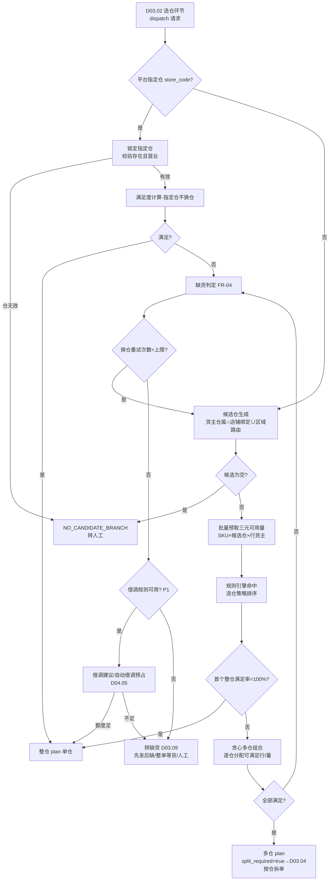
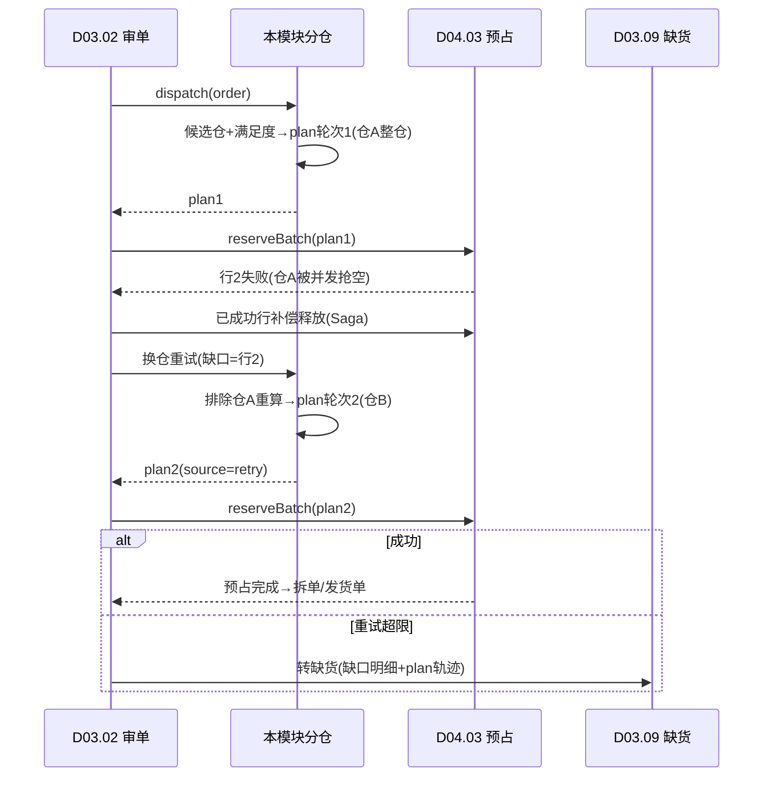
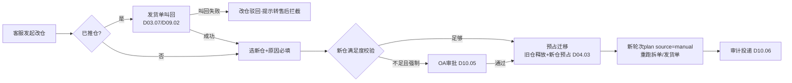

# SRS-D03.06 配货分仓模块 需求规格说明书

> 文档编号：SRS-D03.06 · 版本 V1.2 · 2026-10-24 · 编写：小凯 · 状态：待审阅（批次②，V1.2 友商对标增补DOM埋点）
> 所属域：D03 订单履约域 · 分期：**P0（M1-M2）· 门店仓 O2O 路由 P1（M3）**
> 上游依据：SRS-00 §4.4 契约 · 逆向文档 02 §7（选仓 branch 插件/库存校验 store 插件/冻结体系）· SRS-D04.02（queryAvailable 三元可用量）· SRS-D04.03（预占 Saga）· SRS-D04.05（借调建议）· SRS-D03.02（决策执行分离，plan 消费方）· SRS-D03.04（按仓拆单消费分仓结果）· SRS-D03.09（缺货处理）· SRS-D03.11（O2O 门店路由插件）

---

## 1. 模块概述

### 1.1 定位

配货分仓回答履约路由的第一个问题：**这张订单的货从哪个（些）仓发**。本模块是分仓**决策器**：按规则引擎计算候选仓、评估各仓满足度、输出分仓结果 plan（行→仓+满足状态）；决策与执行分离——plan 交 D03.02 审单链路继续（拆单 D03.04 消费 plan、预占 D04.03 按 plan 承诺库存、发货单 D03.07 按 plan 落库），本模块不直接产生任何单据或库存动作。

### 1.2 职责边界

**做**：分仓规则引擎（店铺绑定仓优先级/收货地址区域路由/库存深度优先/货主指定仓/门店仓 O2O 路由 P1）、候选仓生成与过滤、多仓满足度计算（整仓优先→拆单兜底）、缺货判定（部分缺货/全缺）与处理路径编排（换仓重试/借调建议/转缺货）、分仓结果 plan 输出与修正、手工改仓（敏感操作审计）、平台指定仓承接。

**不做**：库存可用量口径与查询实现（→ D04.02，本模块调用 queryAvailable）；预占执行（→ D04.03，plan 只是决策依据不做库存承诺）；借调额度判定（→ D04.05，本模块发起建议）；缺货单挂起与补货联动（→ D03.09，本模块移交判定结果）；仓库档案与 WMS 绑定（→ D09.01）；门店优选评分细则（→ D03.11 提供 StoreRouteService，本模块作为插件消费）；拆单执行（→ D03.04，多仓不满足时由其按仓/库存深度拆）。

### 1.3 与其他模块关系

| 模块 | 关系 |
|---|---|
| D03.02 审单引擎 | 插件链「选仓」环节调用本模块 `DispatchService::dispatch(order, context)`；plan 挂入履约方案继续链路 |
| D03.04 拆单 | plan 中多仓分组是「按仓库拆单」策略输入；部分满足时「按库存深度拆单」消费满足度明细 |
| D03.05 合单 | 同仓是合单必要条件（plan 仓 ID 参与合单指纹与封窗校验） |
| D03.07 发货单 | plan 经拆单方案最终落库为发货单的 branch_id |
| D04.02 库存记账 | 三元可用量批量查询（branch×sku×owner）；候选仓库存视图数据源 |
| D04.03 预占 | plan 确定后由审单链路调 reserveBatch 做真正库存承诺；预占失败回传触发本模块换仓重试 |
| D04.05 调拨借调 | 缺货时读借调可用量（借入货主视角）生成借调建议 |
| D03.09 异常缺货 | 全缺/部分缺判定结果移交，缺货单挂起与补货联动 |
| D03.11 O2O | 门店仓 O2O 路由插件（P1）：消费 StoreRouteService 候选门店评分 |
| D09.01 仓库路由 | 仓库档案（类型/归属货主/对接 WMS/营业状态）候选集来源 |
| D02 平台 | 平台指定仓（store_code）报文承接，最高优先级 |

---

## 2. 业务场景

**SC-D03.06-01 店铺绑定仓优先（默认主流程）**
天猫旗舰店绑定华东仓（主）+华南仓（备）。订单收货地杭州：候选仓按绑定优先级排序 [华东, 华南]，华东仓全部明细可用量满足 → 整仓分配，plan=单仓全满足，后续单张发货单履约。

**SC-D03.06-02 区域路由**
京东自营店配置区域路由规则：华北/东北→廊坊仓，华东→昆山仓，华南→东莞仓。广州订单命中华南规则 → 候选仓首位=东莞仓；东莞仓满足即整仓分配（就近发货省运费提时效）。

**SC-D03.06-03 库存深度优先（多仓比选）**
店铺 3 仓均覆盖收货区域。规则配置「库存深度优先」：查各仓该订单 SKU 组合的可用量与满足率，选择满足率最高且库存深度（可用/需求）最优的仓；深度相同按绑定优先级破序。避免把货分到即将售罄的仓（随后被预占竞争失败）。

**SC-D03.06-04 货主指定仓（货权分离）**
品牌 A 代销合同指定其货品仅存于华东仓（货主仓属，D09.01 仓库档案 owner 归属）。含品牌 A 明细的订单：该部分行候选仓强制限定为品牌 A 货主仓属清单内仓库；与凯淳买断行（可发任意凯淳仓）混单时各行独立分仓，多仓结果由 D03.04 按货主+按仓拆单产出多张发货单。

**SC-D03.06-05 多仓不满足 → 拆单兜底**
订单 5 行：华东仓满足行1-3，行4-5 仅华南仓有货。满足度计算判定「无单一仓整单满足」→ plan 输出多仓分组（行1-3→华东、行4-5→华南），标记 split_required=true → D03.04 按仓库拆单产出 2 张发货单。消费者收 2 个包裹（多包裹回传 D02.04）。

**SC-D03.06-06 部分缺货与换仓重试**
订单 3 行，全部候选仓中行3 均无可用：plan 标记行3 缺货（部分缺货）。处理路径编排：① 查借调规则（D04.05）——同货号凯淳买断行有货且规则允许 → 生成借调建议（人工确认或按配置自动借调预占）；② 无借调 → 移交 D03.09 缺货流程（挂起等补货/与买家协商/部分发货决策）。行1-2 满足部分可配置「先发后缺」（拆单先发满足行）或「整单等货」。审单预占阶段若行1 预占被并发抢空（D04.03 失败回传）→ 触发换仓重试：以剩余行为输入重跑分仓（重试次数上限可配，超限转缺货）。

**SC-D03.06-07 平台指定仓**
翱象/全渠道订单报文带 store_code（平台指定仓）：跳过规则计算，直接按指定仓出 plan（校验仓存在且营业中；指定仓不存在 → 结构化不通过原因转人工）。指定仓满足度不足时**不换仓**（平台约束），直接走缺货路径。

**SC-D03.06-08 手工改仓（敏感操作审计）**
客服发现订单被分到远仓（运费高），在订单详情发起「改仓」：候选仓列表展示各仓可用量/满足度/预估运费时效 → 选择新仓提交 → 校验（未推仓或已叫回；新仓满足度足够；货主仓属允许）→ plan 修正+重跑后续链路（重拆/预占迁移/发货单重建或修正）→ 写审计（旧仓/新仓/原因/操作人）。已推仓订单改仓必须先叫回（联动 D03.08 改单编排同构逻辑）。

**SC-D03.06-09 门店仓 O2O 路由（P1）**
全渠道订单按收货地址坐标匹配覆盖门店（D03.11 StoreRouteService 评分：距离/库存/当日派单量/接单上限/已拒门店过滤）→ 最优门店仓出 plan（履约方式=门店配送或到店自提）；门店不满足 → 回退电商仓标准分仓。

---

## 3. 功能需求

### FR-D03.06-01 候选仓生成
- FR-01a 候选来源（按序合并去重）：平台指定仓（store_code，命中即锁定唯一候选）＞ 货主仓属限定（明细行货主的归属仓清单，D09.01 档案，硬过滤）＞ 店铺绑定仓（shop_warehouse 关联，含优先级序号）＞ 区域路由命中仓 ＞ 全局兜底仓（可配）。
- FR-01b 硬过滤：仓库营业状态（disabled/停用剔除）、仓类型匹配（电商仓/门店仓/虚拟仓不混用；卡密虚拟仓不参与实物分仓）、禁运限制（仓库物流不到区域剔除，联动 D09.04 到达表）。
- FR-01c 行级候选：混货主/多仓属订单按**明细行**分别生成候选集（行货主仓属 ∩ 店铺可用仓），整单候选=各行候选并集。
- FR-01d 候选为空 → 结构化不通过原因（NO_CANDIDATE_BRANCH）转人工，不静默失败。

### FR-D03.06-02 分仓规则引擎
- FR-02a 规则模型：「条件 → 仓序」规则表（复用 D01.03 规则引擎框架）；条件维度：店铺/平台/收货地址区域（省市区）/订单类型/货主/物料分类/重量体积区间/订单标签；输出：候选仓优先级序列 + 选仓策略类型。
- FR-02b 选仓策略类型（对候选集排序定仓）：
  - `binding_priority` 店铺绑定仓优先级（默认）；
  - `region_route` 区域路由（就近，地址区域→仓映射表）；
  - `stock_depth` 库存深度优先（满足率+深度评分，SC-03）；
  - `owner_assign` 货主指定仓（货主仓属强制，SC-04）；
  - `store_o2o` 门店仓 O2O 路由（P1，委托 D03.11 评分）；
  - `round_robin` 轮询均衡（多仓负载摊平，P1 预留）。
- FR-02c 匹配顺序：weight DESC 首个全条件命中生效；缺省规则兜底（无任何命中 → 按店铺绑定仓优先级）。
- FR-02d 规则支持生效/排除时间段（大促临时切仓）；规则变更审计（D10.06）。
- FR-02e 平台指定仓/门店自提单不参与规则计算（FR-01a 锁定/整单自提）。

### FR-D03.06-03 多仓满足度计算
- FR-03a 满足度定义：对候选仓 W 与明细集 I，`满足率(W) = Σ min(available(W,i), need(i)) / Σ need(i)`（available 走 D04.02 queryAvailable 三元口径：仓×SKU×**行货主**；借调可用量按配置纳入，P1）。
- FR-03b 决策次序（**整仓优先→拆单兜底**）：① 按 FR-02b 策略排序遍历候选仓，首个满足率=100% 的仓 → 整仓分配（单仓 plan）；② 无整仓满足 → 贪心多仓组合：按仓序逐仓分配其可满足的行/量，直至全部满足（多仓 plan，split_required=true）；③ 组合后仍有缺口 → 缺货判定（FR-04）。
- FR-03c 满足度快照：plan 附各候选仓满足率明细（人工审单界面「建议仓+各仓库存」数据来源，继承商派 preSelect/getItemBranchStore 思想）；快照为时点值，真正承诺以预占为准（决策执行分离）。
- FR-03d 库存不管控仓白名单：物料在「不管控库存」清单（D04.02 配置）内时跳过满足度校验（视同满足，如低值包材）。
- FR-03e 批量性能：满足度计算所需可用量由本模块**一次批量预取**（订单全部 SKU × 候选仓 × 货主），逐仓内存计算，不逐仓逐 SKU 查询。

### FR-D03.06-04 缺货判定与处理路径
- FR-04a 判定分级：全满足 / **部分缺货**（部分行或部分量缺口）/ **全缺**（所有行无仓满足）；缺口明细结构化（行/SKU/需求量/最佳可用量/候选仓分布）。
- FR-04b 处理路径编排（按优先级，可配置自动或建议）：
  1. **换仓重试**：预占失败回传（D04.03 竞态抢空）或候选仓未穷尽时，以缺口行为输入重跑分仓（重试上限可配默认 2 次，超限进入 2/3）；
  2. **借调建议**（P1）：查 D04.05 借调规则与可借调量（同货号跨货主），有额度 → 生成借调建议（自动借调预占或人工确认，店铺级配置）；
  3. **转缺货**：移交 D03.09（缺货挂起+补货建议 D04.10+买家协商），plan 标记 lack 状态与缺口明细。
- FR-04c 部分缺货的履约策略（店铺级配置）：`先发后缺`（满足行先拆单发货，缺货行挂起续拆——联动 D03.04 SC-08 splitting 口径）/ `整单等货`（全单挂起，齐套再履约）/ `人工决策`（转 D03.09 工作台）。
- FR-04d 缺货判定结果发布事件（含缺口明细），供 D03.09/D04.10/D11.03 消费；同一订单重复判定幂等（以最新 plan 覆盖）。

### FR-D03.06-05 分仓结果 plan 输出（决策执行分离）
- FR-05a plan 结构：订单 ID/轮次/行级分配（行→仓→分配量）/整仓或多仓标记/split_required/满足度快照/缺货明细/策略与规则命中记录/时点戳；plan 是**不可变决策记录**（每轮一份，落库可追溯可回放）。
- FR-05b plan 消费方：D03.02（挂入履约方案）、D03.04（branch/stock_depth 策略输入）、D03.05（同仓校验）、D04.03（预占的仓维度）、D03.07（发货单 branch_id 溯源）。
- FR-05c plan 失效与重算：订单变更（改地址/改商品 D03.08）、换仓重试、手工改仓、预占失败均触发重算（新轮次 plan，旧 plan 标记 superseded）；已生成发货单后重算须先走叫回/取消编排（不允许 plan 漂移于既成单据之后）。

### FR-D03.06-06 手工改仓（敏感操作）
- FR-06a 入口与展示：订单详情「改仓」；展示候选仓清单+各仓可用量/满足率/预估运费与时效（D09.04 运费模板），辅助决策。
- FR-06b 校验：订单未推仓（或已推仓先叫回成功——编排复用 D03.08 FR-06 叫回机制）；新仓在该行货主仓属允许范围内；新仓满足度校验（不足时警示可强制，强制走审批）；改仓后重跑后续链路（重拆/预占迁移=旧仓释放+新仓预占，D04.03 补偿接口）。
- FR-06c 审计（敏感操作）：旧仓/新仓/满足度对比/原因必填/操作人/时间，投递 D10.06 字段级审计；强制低满足度改仓推 OA 审批（D10.05，阈值可配）。
- FR-06d 手工改仓结果落为新轮次 plan（source=manual），与自动 plan 同构可追溯。

### FR-D03.06-07 门店仓 O2O 路由（P1）
- FR-07a O2O 订单识别后走门店路由插件：调 D03.11 `StoreRouteService::match(order, geo)` 取评分排序候选门店（距离/门店库存/当日派单量/接单上限/本单已拒门店过滤）。
- FR-07b 门店满足度：门店仓可用量（管控库存门店查三元行，不管控门店视同满足）；选定门店=评分最高且满足的门店；履约方式（门店配送/到店自提）写入 plan 组属性。
- FR-07c 门店不满足/无覆盖 → 回退电商仓标准分仓（plan 标记 fallback）；转仓决策留痕。
- FR-07d P0 期预留：分仓规则引擎的策略类型枚举与插件挂载点先行定义，门店路由实现随 D03.11 M3 交付。

### FR-D03.06-08 DOM 决策埋点与算法演进预留（V1.2 友商对标 G4，Jason 决策A：规则式起步+埋点）
- FR-08a **路由决策日志埋点**（首期必做，为未来算法寻源积累训练数据）：每次分仓决策记录完整特征快照——候选仓集合、各仓特征（可用量/库存深度/区域距离/预估运费/预估时效/当前作业负载 backlog）、命中规则、最终选仓、决策耗时；落 `ord_routing_decision_log`（只增，按月分表）。此埋点是 Gartner DOM「多目标优化寻源」的数据地基，无埋点则未来无法训练/评估算法。
- FR-08b **拆单 vs 等货/调拨的成本对比决策**（对标 Gartner DOM split shipment logic）：当单仓不满足整单时，除现有「拆单」外，增加成本对比维度——拆单成本（多包裹运费+包材）vs 等货成本（延迟履约时效损失）vs 调拨成本（D04.05 仓间调拨），按可配置权重给出建议（首期规则式打分，非算法）；决策依据写 plan 与埋点日志。
- FR-08c **可视化规则编排增强**（对标万里牛拖拽式路由编排器）：分仓规则支持图形化配置（条件拖拽+优先级排序+回退链可视化），替代纯表单配置；规则试跑（给定订单样本看分仓结果，复用 D01.03 沙箱）。
- FR-08d **算法寻源与仿真沙盘（P2 预留）**：多目标优化寻源（成本×时效×负载加权）、路由仿真沙盘（上线前用历史订单推演规则、预估运费节省与时效提升）标注 P2；首期通过 FR-08a 埋点积累数据 + FR-08b 规则式成本打分过渡，待仓网成熟与单量增长后启动算法化。接口预留 `RoutingOptimizer` 扩展点（规则式/算法式可切换）。

---

## 4. 业务流程

### 4.1 分仓决策树（主流程）



### 4.2 预占失败换仓重试时序（决策执行闭环）



### 4.3 手工改仓编排



---

## 5. 处理逻辑

### 5.1 满足度计算与贪心多仓组合（伪代码）

```
dispatch(order, context):
    candidates = genCandidates(order)            # FR-01：指定仓/货主仓属/绑定/区域，硬过滤
    if empty(candidates): return fail(NO_CANDIDATE_BRANCH)
    stockView = StockLedger.queryAvailableBatch( # FR-03e 一次批量预取
        order.skus × candidates × 行货主)
    order_by_strategy = ruleEngine.match(order).sort(candidates)   # FR-02

    # ① 整仓优先
    for W in order_by_strategy:
        if fulfillRate(W, order.items, stockView) == 1.0:
            return plan(single=W)

    # ② 贪心多仓组合（整仓不满足→拆单兜底）
    remain = order.items.未分配量
    alloc = {}
    for W in order_by_strategy:
        for i in remain:
            take = min(stockView[W][i.sku][i.owner], remain[i])
            if take > 0: alloc[i] += (W, take); remain[i] -= take
        if remain 全零: break
    if remain 全零: return plan(multi=alloc, split_required=true)

    # ③ 缺货判定
    return lackPlan(gap=remain, best=alloc,
                    处理路径=换仓重试/借调建议/转缺货)   # FR-04b 编排

fulfillRate(W, items, view) = Σ min(view[W][i.sku][i.owner], i.need) / Σ i.need
# 不管控库存物料(D04.02白名单)视同满足；借调可用量(P1)按配置并入 view
```

### 5.2 缺货处理路径编排规则

| 条件 | 路径 | 说明 |
|---|---|---|
| 候选仓未穷尽且重试次数<上限（默认2） | 换仓重试 | 以缺口行为输入、排除已试仓重跑 |
| 重试超限 + 存在生效借调规则且额度≥缺口（P1） | 借调建议 | 店铺配置=自动 → 直接借调预占（D04.03 FR-01c）；=建议 → 人工确认 |
| 无借调或额度不足 | 转缺货 D03.09 | 携带缺口明细+plan 轨迹；按店铺策略先发后缺/整单等货/人工 |
| 平台指定仓不满足 | 直接转缺货 | 不换仓（平台约束，SC-07） |

### 5.3 plan 生命周期与一致性

- plan 不可变、按轮次追加（round_no 递增）；生效 plan=最新未被 superseded 的一份；
- 单据锚定：发货单落库时记录 plan_id+轮次（发货单 branch 溯源）；已出单后重算 plan 必须先取消/叫回旧发货单（FR-05c），杜绝「plan 说仓 A、发货单在仓 B」漂移；
- 预占迁移原子性（改仓/换仓）：旧仓释放+新仓预占经 D04.03 补偿接口以 plan 轮次为幂等键编排，失败回滚保持旧 plan 现场。

### 5.4 并发与热点

- 同订单分仓请求串行化（订单级锁 `order:lock:{order_id}` 复用）；
- 大促热 SKU 可用量剧烈变动：满足度快照允许短暂过期（读 Redis 时点值），以预占为最终裁决——预占失败换仓重试闭环兜底（§4.2），**分仓不追求决策时点绝对准确，追求失败可恢复**；
- 区域路由映射表与仓库档案缓存（Redis，变更事件失效），单订单分仓 P99 ≤50ms。

---

## 6. 数据字段（业务字段描述）

### 6.1 分仓方案（dispatch_plan）

| 字段 | 业务含义 | 取值/校验 |
|---|---|---|
| plan_id / order_id / round_no | 方案标识/订单/轮次 | 一轮一份，不可变 |
| alloc | 行级分配 | JSON：行ID→仓ID→分配量 |
| mode | 分配模式 | single 整仓 / multi 多仓 / lack 缺货 / appointed 指定仓 |
| split_required | 需拆单标记 | multi 时 true（D03.04 消费） |
| fulfill_snapshot | 满足度快照 | JSON：各候选仓满足率/可用量明细（人工界面数据源） |
| lack_detail | 缺货明细 | JSON：行/SKU/需求量/最佳可用/候选分布（D03.09 消费） |
| rule_hit | 规则命中记录 | 规则ID/策略类型/仓序（可回放） |
| source | 来源 | auto / retry / manual（改仓，含操作人）/ platform（指定仓） |
| status | 状态 | effective / superseded |
| lack_route | 缺货路径 | 换仓重试中/借调建议/转缺货（FR-04b 编排结果） |
| owner_id / tenant_id / shop_id | 归属维度 | 必填（SRS-00 契约） |
| create_time | 时点戳 | 快照时点 |

### 6.2 分仓规则（dispatch_rule）

| 字段 | 业务含义 | 取值/校验 |
|---|---|---|
| rule_id / rule_name | 规则标识 | |
| conditions | 条件集 | JSON：店铺/平台/区域(省市区)/订单类型/货主/物料分类/重量体积/标签 |
| strategy_type | 选仓策略 | binding_priority/region_route/stock_depth/owner_assign/store_o2o/round_robin |
| branch_seq | 输出仓序 | 策略为绑定/区域时显式仓序；region_route 附区域→仓映射表引用 |
| weight | 匹配权重 | DESC 首个命中 |
| effective_period / exclude_period | 生效/排除时间段 | 大促临时切仓 |
| default_flag | 缺省规则 | 兜底唯一 |
| status | 启停 | |

### 6.3 店铺分仓配置（dispatch_shop_config）

| 字段 | 业务含义 |
|---|---|
| shop_id | 店铺 |
| lack_fulfill_mode | 部分缺货履约策略：先发后缺/整单等货/人工 |
| retry_limit | 换仓重试上限（默认 2） |
| lend_auto_mode | 借调建议处置：自动借调/人工确认（P1） |
| include_lend_in_view | 借调可用量纳入满足度（P1，默认否） |
| force_change_approval | 强制低满足度改仓审批阈值 |

### 6.4 手工改仓记录（branch_change_log）

| 字段 | 业务含义 |
|---|---|
| order_id / plan_round | 目标订单与产生轮次 |
| old_branch / new_branch | 旧仓/新仓 |
| old_fulfill / new_fulfill | 改前后满足度对比 |
| reason | 原因（必填） |
| forced | 是否强制（低满足度） |
| approval_id | OA 审批单号（强制时） |
| recall_ref | 叫回引用（已推仓场景） |
| operator / create_time | 操作人/时间（审计投递 D10.06） |

---

## 7. 接口

### 7.1 内部接口（本模块提供）

| 编号 | 接口 | 消费方 | 说明 |
|---|---|---|---|
| IF-D03.06-01 | `DispatchService::dispatch(order_id, context)` | D03.02 选仓插件 | 分仓主入口；返回 plan（含缺货判定）或结构化失败；幂等键=订单+触发轮次 |
| IF-D03.06-02 | `DispatchService::retryWithGap(order_id, gap_items, exclude_branches)` | D03.02/D04.03 预占失败回传 | 换仓重试（缺口行重算） |
| IF-D03.06-03 | `DispatchService::changeBranch(order_id, new_branch, reason, operator)` | D03.03 工作台 | 手工改仓（含叫回编排委托/预占迁移/审计） |
| IF-D03.06-04 | `DispatchService::getFulfillView(order_id)` | D03.03 人工审单界面 | 建议仓+各仓库存满足度快照（商派 getItemBranchStore 对应物） |
| IF-D03.06-05 | `DispatchRuleService::save/match/list(rule)` | 规则配置后台 | 规则 CRUD 与命中回放 |
| IF-D03.06-06 | 事件 `dispatch.plan.created`（plan/模式/缺货明细） | D03.04/D03.09/D04.10/D11.03 | 分仓结果广播（缺货联动触发源） |

### 7.2 依赖接口（本模块消费）

| 编号 | 接口 | 提供方 | 说明 |
|---|---|---|---|
| IF-D03.06-D1 | `StockLedgerService::queryAvailable(branch, bmIds[])`（批量） | D04.02 | 三元可用量（仓×SKU×货主）热路径 |
| IF-D03.06-D2 | `LendQuotaService::available(ruleMatch)`（P1） | D04.05 | 借调可用量与建议 |
| IF-D03.06-D3 | `FreezeService::release/migrate`（幂等键=plan 轮次） | D04.03 | 改仓/换仓预占迁移 |
| IF-D03.06-D4 | `StoreRouteService::match(order, geo)`（P1） | D03.11 | 门店候选评分 |
| IF-D03.06-D5 | 仓库档案（类型/货主归属/营业状态/WMS 绑定） | D09.01 | 候选集与硬过滤 |
| IF-D03.06-D6 | 物流到达/运费模板 | D09.04 | 禁运过滤/改仓运费时效展示 |
| IF-D03.06-D7 | `DeliveryCommandService::recall` | D03.07/D09.02 | 已推仓改仓的叫回 |
| IF-D03.06-D8 | `ApprovalService` / `AuditService` | D10.05/D10.06 | 强制改仓审批/审计 |

### 7.3 外部接口

| 编号 | 接口 | 方向 | 说明 |
|---|---|---|---|
| EF-D03.06-01 | 无直接外部接口 | — | 平台指定仓报文由 D02 适配器落库至订单对象（store_code），本模块读取 |

---

## 8. 非功能需求

| 项 | 要求 |
|---|---|
| 性能 | 单订单分仓（候选生成+批量预取+满足度计算）P99 ≤50ms；人工界面满足度视图 ≤200ms；支撑审单洪峰 500 单/分钟 |
| 一致性 | plan 不可变+轮次追溯；单据锚定 plan_id 防漂移（§5.3）；预占迁移失败回滚保持现场 |
| 幂等/并发 | 分仓请求订单级锁串行；重复触发返回最新 plan；缺货判定幂等覆盖 |
| 容错 | 满足度快照允许时点过期，预占为最终裁决，失败可恢复（换仓重试闭环）；D04.02 查询降级走 DB（继承 D04.02 miss 降级契约） |
| 审计/权限 | 规则变更/手工改仓全审计；改仓独立授权点；货主仓属硬约束不可被手工绕过（强制改仓仅限满足度维度且走审批） |
| 可观测 | 分仓命中率/整仓率/拆单率/缺货率/重试次数分布监控（D11.03）；规则命中回放能力 |

---

## 9. 验收标准

| 编号 | 验收条件 |
|---|---|
| AC-01 | 店铺绑定仓优先：主仓满足时整仓分配单仓 plan；主仓不满足备仓满足时自动切备仓（候选序遍历验证） |
| AC-02 | 区域路由：广州订单命中华南规则分至东莞仓；区域映射变更（新规则+生效时间段）后新订单按新映射分仓，时间段外回落原规则 |
| AC-03 | 库存深度优先：构造两仓满足率相同但深度不同场景，选择深度优仓；深度相同按绑定优先级破序 |
| AC-04 | 货主仓属硬约束：品牌 A 代销行仅分配至其货主仓属清单内仓库；手工改仓至非仓属仓被拒 |
| AC-05 | 多仓不满足拆单兜底（SC-05）：5 行两仓分配产出 split_required plan，D03.04 按仓拆出 2 张发货单，行级分配量与 plan 一致 |
| AC-06 | 缺货判定分级：部分缺货/全缺结构化明细正确（行/SKU/缺口/候选分布）；事件发布且 D03.09 收到缺口明细 |
| AC-07 | 换仓重试：预占失败回传后以缺口行重算并排除已试仓；重试超限（2 次）后正确进入借调建议或转缺货路径；全程 plan 轮次可追溯 |
| AC-08 | 借调建议（P1 预演）：同货号凯淳买断有货且规则允许时生成借调建议；配置=自动时直接借调预占成功出单；额度不足转普通缺货 |
| AC-09 | 部分缺货三种履约策略（先发后缺/整单等货/人工）行为符合店铺配置；先发后缺场景满足行先出单订单 splitting、缺货行补货后续拆闭环 |
| AC-10 | 平台指定仓：store_code 直接锁定出 plan；指定仓无效转人工（NO_CANDIDATE_BRANCH）；指定仓不满足不换仓直接缺货路径 |
| AC-11 | 手工改仓（SC-08）：未推仓改仓成功且预占迁移原子（旧仓释放+新仓预占）、审计完整（旧仓/新仓/原因/操作人）；已推仓改仓先叫回，叫回失败改仓驳回；强制低满足度改仓触发 OA 审批 |
| AC-12 | plan 生命周期：改地址后重算新轮次 plan、旧 plan superseded；已出发货单未叫回时重算被拒（防漂移）；发货单可溯源到 plan_id+轮次 |
| AC-13 | 性能：单订单分仓 P99 ≤50ms（500 单/分钟压测）；可用量批量预取一次完成（无逐仓逐 SKU 查询，SQL/Redis 调用次数验证） |
| AC-14 | 门店仓 O2O 路由（P1）：门店评分选定+履约方式入 plan；门店不满足回退电商仓并留痕；已拒门店不再分配 |

---

## 变更记录

| 日期 | 版本 | 变更 | 原因 |
|---|---|---|---|
| 2026-10-23 | V1.0 | 首版 | — |
| 2026-10-24 | V1.2 | 新增 FR-08 DOM 决策埋点（路由决策日志）+ 拆单vs等货vs调拨成本对比决策 + 可视化规则编排增强 + RoutingOptimizer 算法预留（P2） | 友商对标 G4（Jason 决策A：规则式起步+埋点，对标 Gartner DOM/万里牛仿真沙盘） |

---

*参考实现溯源：商派 `plugin/branch.php:88-190` 选仓六级优先（平台指定仓 sys_appoint→淘宝流转单店铺配置→全渠道门店仓 o2o_autostore/覆盖区域→唯一发货仓→仓库规则 autobranch(weight/is_default)→HOLD 旗标「仓」）+ `plugin/store.php` 库存校验（getGroupStore 汇总、门店仓 getO2oBranchFreeze 减冻结+pickBranchByLowestDispatch 派单量最低负载均衡、电商仓 getDelivBranch 绑定仓合并+getBranchFreeze 减冻结+不管控物料白名单 getNotCtrlStoreProducts+branch_choose 优选、全不合格 HOLD 旗标「库」+lackNotify 缺货通知）+ `ome_order_branch::preSelect/getItemBranchStore`（人工界面建议仓+各仓库存）+ `autobranch/autobranchget` 仓库规则表 + 缺货列表 lack.php（生成采购/等货/换仓/退款出口）。关键差异：① 分仓输出升级为**不可变 plan 决策记录**（轮次化/可回放/单据锚定），商派选仓结果就地写内存订单组与发货单、无决策留痕；② 满足度计算三元化（仓×SKU×**货主**），货主仓属为硬约束（商派无货主维度）；③ 缺货处理路径产品化编排（换仓重试上限+借调建议 D04.05+先发后缺/整单等货策略），商派仅 lackNotify+人工列表；④ 借调可用量纳入满足度（P1，凯淳特色）；⑤ 手工改仓独立单据化（对比快照+预占迁移+OA 审批+审计），商派为审核界面直接改仓字段；⑥ 位图旗标「仓/库」改结构化错误码；⑦ 门店路由委托 D03.11 StoreRouteService 插件化（商派 o2o 逻辑内嵌 branch 插件）；⑧ 冻结体系并入 D04.03 统一预占（商派 branch_freeze/material_freeze 多套并行冻结表收敛）。*
