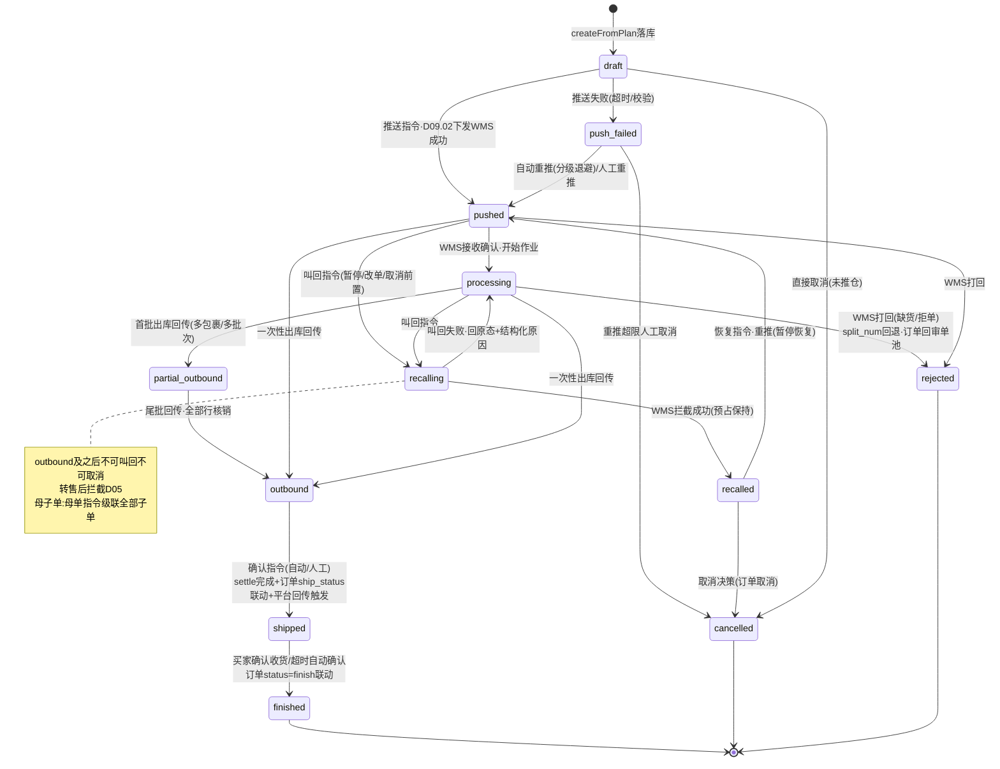
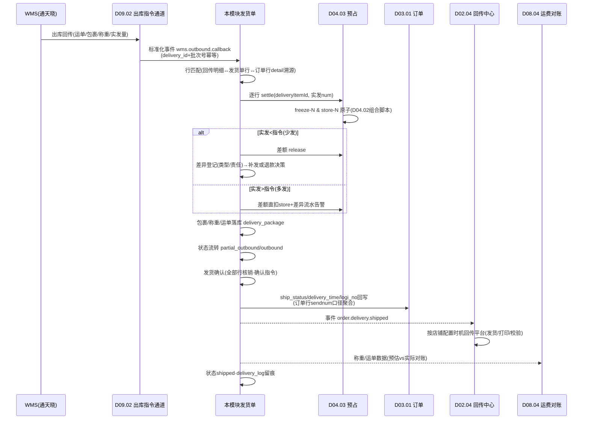
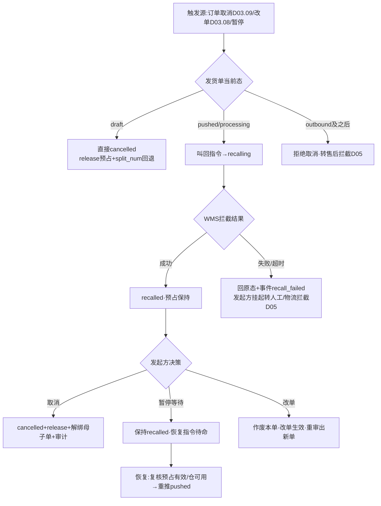

# SRS-D03.07 发货单管理模块 需求规格说明书

> 文档编号：SRS-D03.07 · 版本 V1.0 · 2026-10-23 · 编写：小凯 · 状态：待审阅（批次②）
> 所属域：D03 订单履约域 · 分期：**P0（M1-M2）**
> 上游依据：SRS-00 §4.4 契约（**发货单指令状态机定义源=D03.07/D09.02，本文档 §4.1 为权威定义**）· 逆向文档 02 §3.4（mkDelivery/addDelivery）/§3.6（仓库作业与发货）/§4.4（merge/splitDelivery）/§11.7（指令状态机启示）· SRS-D03.04（拆单产物=发货单）· SRS-D03.05（母子单编排）· SRS-D04.03（settle 转扣减）· SRS-D09.02（推仓通道）· SRS-D02.04（平台回传）

---

## 1. 模块概述

### 1.1 定位

发货单（delivery）是**履约执行单元**：订单经审单→拆单后的产物，推 WMS 的载体，出库回传的锚点，平台发货回传的依据。本模块管理发货单全生命周期——从分配方案落库生成、母子单合并拆分、推仓指令与状态机流转、出库回传处理（运单/包裹/称重→预占转扣减→订单发货联动→平台回传触发），到取消/叫回闭环。商派验证过的核心模型（delivery 头/行/明细溯源/包裹、is_bind+parent_id 母子单）在新栈重建，并按逆向文档 02 §11.7 启示把商派订单级 pause 布尔升级为**发货单级指令状态机**（推送/叫回/恢复/确认四指令）。

**核心契约（SRS-00 §4.4，本模块为定义源）**：拆单不产生新订单，发货单是拆单的唯一产物；发货单指令状态机四指令（推送/叫回/恢复/确认）与失败补偿；出库回传驱动 D04.03 settle 预占转扣减与 D02.04 平台回传。

### 1.2 职责边界

**做**：发货单数据模型（头/行/明细溯源/包裹）与单号生成、plan 执行器（分配方案→发货单落库）、指令状态机完整定义与流转执行、推仓编排（经 D09.02 通道）与失败重推、出库回传处理（运单号/包裹/称重接收→settle→订单发货状态联动→平台回传触发）、部分发货（多包裹/多批次）处理、母子单 merge/splitBack 执行、发货单取消与叫回、虚拟商品发货单（免推仓直发）、发货单查询/打印分组/操作日志。

**不做**：拆单分配决策（→ D03.04，本模块是其落库执行方）；分仓决策（→ D03.06 plan 来源）；合单组编排（→ D03.05，本模块执行其 merge 指令）；WMS 协议适配与报文转换（→ D09.02 通道，本模块下发指令/接收标准化回传事件）；预占台账与 settle 记账执行（→ D04.03）；平台发货 API 调用（→ D02.04，本模块发布触发事件）；面单取号与打印执行（→ D09.05，本模块提供发货单数据与打印分组）；订单三套状态机定义（→ D03.01，本模块按契约回写 ship_status）。

### 1.3 与其他模块关系

| 模块 | 关系 |
|---|---|
| D03.04 拆单 | `createFromPlan(SplitPlan)` 落库发货单；split_num/splited_num 回写；取消/打回时回调其 rollbackProgress |
| D03.05 合单 | 执行 merge（母子单绑定）/splitBack（拆回）；母单推仓口径 |
| D03.06 分仓 | 发货单 branch_id 溯源 plan_id+轮次 |
| D03.02/D03.03 审单 | 审核通过即路由的终端执行环节；人工审单指定仓/物流后出单 |
| D03.08 改单 | 叫回指令提供方（改单/改仓前置）；叫回结果事件回传 |
| D03.09 异常/暂停 | 订单暂停→发货单叫回编排；缺货打回处理 |
| D03.10 特殊单型 | 虚拟发货单免推仓直发通道（auto_delivery 联动）；预售发货单 hold 放行 |
| D04.03 预占 | 出库回传→`settle(deliveryItemId, num)` 转扣减；取消→release |
| D09.02 出库指令 | 推仓/叫回/恢复/确认四指令的实际收发通道（WMS 适配）；回传事件标准化来源 |
| D09.05 面单打印 | 包裹与面单关联（一母单一面单）；打印分组数据 |
| D02.04 回传中心 | 发货确认→发布平台回传触发事件（发货/打印/校验时机可配置） |
| D03.01 订单 | ship_status/delivery_time/logi_no 回写（契约口径） |
| D08 财务 | 发货单（货主维度）为应收/结算分账单据依据；运费对账按运单号匹配（D08.04） |
| D03.13 归档 | 发货单及包裹/明细随订单一致性归档 |

---

## 2. 业务场景

**SC-D03.07-01 发货单生成与推仓（主流程）**
审单通过，拆单方案（2 组：华东仓组/华南仓组）交本模块执行：单事务落库 2 张发货单（头/行/明细溯源）+ 订单进度回写（split_num/splited_num，拆分进度派生视图=已拆完）→ 各自进入指令状态机「草稿」→ 推仓指令经 D09.02 下发对应 WMS（按仓路由 wms_binding）→「已推送」→ WMS 接收确认 →「出库中」→ 拣货打包出库回传 →「已出库」→ 发货确认 →「已发货」→ 平台回传+订单 ship_status 联动 → 买家确认收货/超时 →「完成」。

**SC-D03.07-02 出库回传处理（运单/包裹/称重）**
通天晓 WMS 出库回传：运单号（顺丰 SF123…）、包裹 2 件（每包裹明细+重量+体积）、称重 3.2kg、实际出库量（可能与指令量有差）。本模块处理：① 按回传明细行匹配发货单行→逐行调 D04.03 `settle`（预占转扣减，freeze-N & store-N 原子）；② 包裹/称重/运单落库（delivery_package）；③ 发货确认：订单 ship_status=已发货（全部行发完）或部分发货、delivery_time、logi_no 回写；④ 发布 `order.delivery.shipped` → D02.04 按店铺配置时机（发货/打印/校验）回传平台；⑤ 称重数据供 D08.04 运费对账。

**SC-D03.07-03 实发差异（少发/多发）**
WMS 回传实发 8 件（指令 10 件，仓内破损 2 件）：settle 按实发 8 转扣减，差额 2 件预占释放（D04.03）；差异登记（差异类型+责任），发货单差异完结；订单行 sendnum=8，剩余 2 件按店铺策略生成补发单（D05.04）或缺口退款（D05.03）。多发（实发 11>10）：差额 1 件直接扣实际库存（D04.03 FR-03c 超发口径），差异流水+告警对账。

**SC-D03.07-04 部分发货（多包裹/多批次）**
一张发货单 3 行，WMS 分 2 批次出库：首批回传行1-2（包裹1）→ 发货单置「部分出库」（已出库的子状态），订单 ship_status=部分发货、平台按多包裹口径回传；次批回传行3（包裹2）→ 全部出库，发货单「已出库」→ 发货确认闭环。母子单场景：子单 A' 出库、B' 未出库 → 母单保持「出库中」，已出库子单先行发货确认（各自订单 ship_status 独立联动），母单在全部子单出库后聚合完结。

**SC-D03.07-05 叫回（改单/暂停触发）**
买家申请退款（平台收订），订单暂停（D03.09）：对未出库发货单发起叫回指令 →「叫回中」→ WMS 确认拦截成功 →「已叫回」→ 预占保持（暂停语义，恢复时重新推送）或释放（取消语义）；改单场景（D03.08）叫回成功后发货单作废、改单生效重审出新单。WMS 已开始拣货拒绝叫回 →「叫回失败」回原状态（出库中）+ 结构化原因 → 发起方按失败路径处理（挂起转人工/物流拦截 D05）。

**SC-D03.07-06 推仓失败与重推**
WMS 接口超时/报文校验失败：指令状态「推送失败」（sync_status=failed+失败原因）→ 自动重推（D02.05 同款分级退避重试，错误码分级：可重试/不可重试）→ 重试超限告警人工介入（重推按钮/改仓/取消）。失败期间发货单不阻塞订单其余发货单履约。

**SC-D03.07-07 虚拟商品发货单（免推仓直发）**
拆单产物含虚拟组（D03.04 goods_type/virtual_sku 策略，attrs.virtual_delivery=true）：发货单落库即标记「无需推仓」，跳过 WMS 指令链 → 直接进 D03.10 自动发货通道（卡密领取→平台回传）→ 回传成功即发货确认（无出库回传环节，settle 卡密虚拟仓行）。卡密不足/回传失败走 D03.10 异常路径，发货单挂起可人工重发。

**SC-D03.07-08 发货单取消**
订单取消（D03.09/D05 联动）：未推仓发货单直接取消（草稿→已取消，无 WMS 动作）；已推送未出库 → 叫回成功后取消（叫回是取消前置）；已出库不可取消 → 转售后拦截。取消动作：释放全部未核销预占（D04.03 release）+ 回调 D03.04 rollbackProgress（split_num 回退）+ 母子单解绑（联动 D03.05 拆回）+ 审计留痕。

**SC-D03.07-09 打回（仓库拒单/缺货回传）**
WMS 回传仓库缺货/拒单（打回）：发货单「已打回」→ 订单行 split_num 回退、拆分进度派生视图回退（D03.04 FR-06d）→ 释放该行预占 → 订单重回审单池（重新分仓/换仓重试 D03.06/缺货 D03.09）。打回原因结构化落库（缺货/地址不可达/仓内异常），供分析。

---

## 3. 功能需求

### FR-D03.07-01 发货单数据模型
- FR-01a 四层结构：**头**（delivery：单号/订单关联/仓/物流/收货人/状态/货主/租户/店铺）→ **行**（delivery_item：物料/数量/货主，行内货主唯一）→ **明细溯源**（delivery_item_detail：发货单行↔订单行 split_num 映射，行内拆多对一溯源）→ **包裹**（delivery_package：包裹号/运单号/重量/体积/装箱明细，出库回传落库）。
- FR-01b 订单关联：delivery_order 多对多关联表（合单场景一发货单多订单；拆单场景一订单多发货单）；发货单恒有唯一 owner_id+tenant_id（SRS-00 契约，行货主一致校验落库强约束）。
- FR-01c 单号规则：DLV+日期+序列（唯一索引）；母子单号可视关联（母单号-子序号展示，物理独立单号）。
- FR-01d 收货人敏感字段加密存储/脱敏展示（PIPL，D01.05）；平台密文单保留密文标识（推仓按 WMS 解密通道或密文透传，D09.02 适配）。
- FR-01e 溯源字段：plan_id+轮次（分仓溯源）、split_plan_id（拆单溯源）、source（auto/manual/virtual）。

### FR-D03.07-02 指令状态机（SRS-00 §4.4 契约定义源）
- FR-02a 状态枚举（见 §4.1 状态机图与 §5.1 流转表）：`草稿 draft → 已推送 pushed →（WMS接收）出库中 processing → 已出库 outbound → 已发货 shipped → 完成 finished`；分支：`推送失败 push_failed`（可重推）、`叫回中 recalling → 已叫回 recalled`（可恢复重推或取消）、`已打回 rejected`、`已取消 cancelled`、`部分出库 partial_outbound`（已出库的子状态）。
- FR-02b 四指令（契约口径）：**推送**（draft/recalled→pushed，经 D09.02 下发 WMS）、**叫回**（pushed/processing→recalling，暂停/改单/取消前置）、**恢复**（recalled→pushed 重推，暂停恢复语义）、**确认**（outbound→shipped，发货确认动作，可自动可人工）。
- FR-02c 失败补偿：推送失败→自动重推（分级退避，超限告警人工）；叫回失败→回原状态+结构化原因+发起方失败路径（挂起/物流拦截）；确认失败（settle 异常）→状态保持已出库+补偿重试队列+对账兜底；回传乱序（未推送先收到出库回传）→进异常缓冲人工核对。
- FR-02d 状态变更全留痕（delivery_log：状态/指令/操作者 system|账号/时间/原因/关联引用）；状态机强校验不可跳态（非法流转拒绝+告警）。
- FR-02e 母子单状态联动：子单状态跟随母单指令（母单叫回=级联叫回全部子单）；出库与发货确认按子单独立结算、母单聚合完结（§5.4）。
- FR-02f 虚拟发货单状态机裁剪：draft→（免推仓）→auto_delivery 中→shipped→finished；无 pushed/processing/outbound 态（sync_status=无需推仓）。

### FR-D03.07-03 发货单生成（plan 执行器）
- FR-03a 统一入口：`createFromPlan(SplitPlan)`（D03.04 引擎调用）——单事务：发货单头/行/明细溯源落库 + 订单进度回写（split_num/splited_num）+ delivery_order 关联 + 操作日志；任一步失败整体回滚（订单回拆单前状态）。
- FR-03b 组属性映射：plan 组 attrs → 发货单字段（branch_id/owner_id/virtual/hold/dropship/门店履约标记）；virtual 组走 FR-02f 裁剪状态机；hold 组（预售）生成后暂缓推仓（D03.10 到期放行指令触发推送）。
- FR-03c 生成时不重复预占：预占已在审单链路完成（D03.02→D04.03），发货单行与预占台账以（订单行,仓,货主）关联引用（settle 时按此匹配）。
- FR-03d 物流与运费：按 D09.04 分单规则确定 logi_id，预估运费/保价费计算落库（实际运费以称重对账 D08.04）；菜鸟智选类场景运单号预取写入。
- FR-03e 人工出单：人工审单（D03.03）指定仓/物流后走同一执行器（source=manual）；打印分组/短信分组数据随生成落库（D09.05 消费）。

### FR-D03.07-04 母子单合并与拆分
- FR-04a merge 执行（D03.05 指令）：生成母单（聚合子单明细/收货人/包裹上限校验）→ 子单 is_bind=true+parent_id=母单 → 母单打合单标签；merge 前置校验：子单均处 draft（已推送不可 merge）、同仓同货主同收货人、物理限制复核。
- FR-04b splitBack 执行（拆回）：解绑子单→母单撤销（剩余子单=1）或重组（≥2 重新 merge）；已推仓先整组叫回（FR-02e）；单事务+幂等（D03.05 FR-06e 锁契约）。
- FR-04c 母单推仓口径：仅母单下发 WMS（一包裹一面单）；子单指令状态跟随，子单独立保留结算粒度（settle/ship_status 按子单行）。
- FR-04d 发货单层面再拆：已生成母单/大单可按明细拆出子发货单（splitDelivery，仓内作业需求：超箱拆分），拆出行 split_num 不变（订单口径恒定），发货单间数量守恒校验。

### FR-D03.07-05 推仓与出库回传处理
- FR-05a 推仓编排：发货单 draft→调 D09.02 `OutboundCommandService::push(delivery)`（报文组装/仓路由/WMS 适配归 D09.02）→ 成功置 pushed；按仓 wms_binding 多 WMS 路由；推送幂等键=delivery_id+推送轮次（WMS 侧防重）。
- FR-05b 回传接收：订阅 D09.02 标准化回传事件 `wms.outbound.callback`（运单号/物流公司/包裹明细/称重/实发量/批次），按 delivery_id+回传批次幂等（重复回传忽略）。
- FR-05c 回传处理编排（顺序，§4.2 时序）：① 行匹配（回传明细↔发货单行，按 detail 溯源到订单行）；② 逐行 settle（D04.03 转扣减，部分核销支持多批次）；③ 差异处理（少发释放/多发直扣+差异登记，SC-03）；④ 包裹/称重/运单落库；⑤ 状态流转（部分出库/已出库）；⑥ 发货确认（FR-06）；⑦ 发布事件。settle 失败不阻塞状态落库——进补偿队列重试+对账兜底（最终一致，D04.03 幂等键重投安全）。
- FR-05d 发货确认（确认指令）：全部行核销完成→自动确认（默认）或人工确认（店铺配置：需校验称重/面单后确认）；确认动作=状态 shipped+订单联动（FR-06）+平台回传触发；确认幂等。
- FR-05e 称重与包裹数据供给：包裹重量/体积/运单号供 D08.04 运费对账（预估 vs 实际双账单）与 D09.05 包裹合并打印。

### FR-D03.07-06 订单发货状态联动（契约口径）
- FR-06a 回写规则：发货确认时按订单全部行的 sendnum（累计实发）判定——全部行 sendnum=nums → ship_status=已发货(1)；部分 → 部分发货(2)；首次发货写 delivery_time、logi_no/logi_id（多运单取首+清单存包裹表）。
- FR-06b 母子单/多发货单聚合：订单 ship_status 以**订单行口径**聚合（跨发货单汇总 sendnum），不以单张发货单状态直译。
- FR-06c 平台回传触发：发布 `order.delivery.shipped`（订单/发货单/运单/包裹/合单组）→ D02.04 按店铺配置时机（发货即传/打印即传/校验后传）与平台口径（多单一包=合单组各订单回传同运单号；一单多包=包裹清单回传）执行；回传结果（sync 状态）回写订单（none/run/succ/fail+fail_type，D02.05 重试）。
- FR-06d 完成态：买家确认收货消息（D02.03）或发货超时自动确认（平台规则）→ 订单 status=finish 联动（D03.01 状态机）→ 发货单 finished；订单完成事件供 D08.01 应收。

### FR-D03.07-07 部分发货处理（多包裹/多批次）
- FR-07a 批次回传：同一发货单支持多次部分回传（多包裹/多批次），每次回传独立幂等批次号；发货单累计核销量=Σ批次实发。
- FR-07b 部分出库状态：部分行核销→partial_outbound（已出库子状态），订单 ship_status=部分发货；平台按店铺配置「部分即传」或「齐套再传」（可配）。
- FR-07c 尾差闭环：最后一批回传后全部行核销→自动发货确认；长期尾差（超期未齐套，阈值可配默认 7 天）→ 告警人工决策（强制确认+缺口转售后/继续等待）。
- FR-07d 母子单部分出库：见 §5.4 联动矩阵（子单独立结算、母单聚合）。

### FR-D03.07-08 发货单取消与叫回
- FR-08a 取消：入口=订单取消联动（D03.09/D05）/人工取消（授权点）；规则：draft 直接取消；pushed/processing 先叫回成功再取消；outbound 及之后不可取消（转售后拦截 D05）；取消动作原子编排=状态 cancelled+预占 release（D04.03）+split_num 回退（D03.04 IF-07）+母子解绑（D03.05）+审计。
- FR-08b 叫回服务（对 D03.08/D03.09 提供）：`DeliveryCommandService::recall(delivery_ids, 业务引用)`——指令状态机 recalling→WMS 叫回（D09.02）→成功 recalled（预占保持，等待恢复/取消决策）/失败回原态+事件 `delivery.command.recalled`/`recall_failed`；叫回超时阈值可配（默认 30 分钟，超时按失败）；合单组级联叫回（任一失败按整体失败，D03.08 FR-06c 契约）。
- FR-08c 恢复指令：recalled→pushed 重推（暂停恢复 D03.09 renewOrder 语义）；恢复前复核（订单未取消/预占仍有效/仓仍可用），失效则拒绝恢复转人工。
- FR-08d 打回（WMS 主动）：rejected 状态+结构化原因→订单回审单池（SC-09）；打回与叫回互斥（打回后不可再叫回，直接走重审）。

### FR-D03.07-09 虚拟商品发货单（免推仓直发）
- FR-09a 识别与裁剪：virtual 标记发货单 sync_status=无需推仓，状态机走 FR-02f 裁剪路径；不进 WMS 指令链。
- FR-09b 直发联动：生成后发布 `delivery.virtual.ready` → D03.10 自动发货通道（卡密领取→平台回传）→ 回传成功回执触发发货确认（settle 卡密虚拟仓三元行）；失败挂起可人工重发（D03.10 FR-05e 口径）。
- FR-09c 混合订单：实物单与虚拟单独立流转互不阻塞（各自状态机）；订单 ship_status 按行口径聚合（FR-06b），全部行（实物+虚拟）发完才置已发货。

### FR-D03.07-10 发货单工作台与查询
- FR-10a 列表/详情：多维筛选（状态/仓/店铺/货主/物流/时间/异常标记），数据权限四维行级过滤（D10.03）；品牌方门户只见本货主发货单（D10.04）。
- FR-10b 异常视图：推送失败/叫回失败/回传超时/尾差超期/差异登记五类异常队列（D11.03 监控数据源）。
- FR-10c 操作日志时间线：状态流转/指令/人工操作全记录展示；发货单与订单/包裹/运单/预占台账/plan 的多向钻取。

---

## 4. 业务流程

### 4.1 发货单指令状态机（SRS-00 §4.4 契约权威定义）



### 4.2 出库回传处理时序（SC-02 完整链路）



### 4.3 取消/叫回/恢复编排（SC-05/08）



---

## 5. 处理逻辑

### 5.1 指令状态机流转表（契约权威，状态枚举见 §4.1）

| 当前态 | 指令/事件 | 目标态 | 前置校验 | 失败补偿 |
|---|---|---|---|---|
| draft | 推送 | pushed | 仓 WMS 绑定有效；非 hold（预售到期才可推）；母子单仅母单推 | push_failed→分级退避重推（可重试错误码）/人工（不可重试）；超限告警 |
| push_failed | 重推 | pushed | 错误已修复（配置/报文） | 同推送 |
| pushed | WMS 接收确认 | processing | 回执 delivery_id 匹配 | 回执超时（阈值可配）→查询对账（D09.02 反查） |
| pushed/processing | 叫回 | recalling | 未出库 | WMS 拒绝/超时→回原态+recall_failed 事件 |
| recalling | 拦截成功 | recalled | — | 预占保持；等待恢复/取消决策 |
| recalled | 恢复 | pushed | 订单未取消、预占有效、仓可用 | 复核不过拒绝恢复→转人工 |
| recalled/触发取消 | 取消 | cancelled | 取消决策明确 | release+split_num 回退+解绑，单事务原子 |
| processing/pushed | 出库回传 | partial_outbound/outbound | 批次幂等；行匹配成功 | 乱序回传（未推送先回传）→异常缓冲人工核对 |
| outbound | 确认 | shipped | 全部行 settle 完成（或人工强制确认+差异登记） | settle 失败→补偿队列重试+每日对账兜底（状态不回退） |
| shipped | 收货确认/超时 | finished | 订单完成联动 | 平台确认消息丢失→定时对账反查（D02.05） |
| pushed/processing | WMS 打回 | rejected | 打回原因结构化 | split_num 回退+release+订单回审单池；与叫回互斥 |

### 5.2 状态机实现约定

- 状态变更唯一入口 `DeliveryStateMachine::transit(delivery_id, command, payload)`：当前态+指令合法性校验（§5.1 表驱动）→ 行级锁（delivery_id）→ 状态落库+delivery_log 同事务 → 后置动作异步化（settle/回写/事件经本地事务表+MQ，最终一致）；
- 非法流转（跳态/重复指令）拒绝并告警；重复指令幂等（同指令同轮次返回首次结果）；
- 指令与状态分离：recalling 等中间态保证分布式动作（WMS 异步回执）期间状态可观测、可对账。

### 5.3 回传行匹配与 settle 编排

```
handleCallback(delivery_id, batch):
    幂等: (delivery_id, batch_no) 已处理 → 忽略
    for cb_line in batch.lines:
        d_item = 匹配发货单行(物料+批次线索)         # 匹配失败→差异登记人工
        num = min(cb_line.实发, d_item.未核销量)      # 超发差额走直扣口径(D04.03 FR-03c)
        FreezeService.settle(d_item.detail_id, num)   # 幂等键=detail_id+batch
        d_item.核销量 += num; 订单行.sendnum += num   # detail溯源到订单行
    差额(指令-实发>0且终批): release余量 + 差异登记(类型/责任)
    落包裹/称重/运单 → 状态流转 → 齐套判定 → 发货确认
    settle失败行: 进补偿队列(重试N次)→仍失败人工对账;不阻塞其余行与状态落库
```

### 5.4 母子单状态联动矩阵

| 动作 | 母单 | 子单 |
|---|---|---|
| 推仓 | 母单 pushed（唯一推仓对象） | 跟随置 pushed（虚拟态，不下发） |
| 叫回/恢复/取消 | 级联全部子单（任一子单失败=整体失败） | 跟随母单 |
| 出库回传 | 回传挂母单，按明细溯源分摊到子单行 | 各自 settle/核销独立结算 |
| 部分出库 | 部分子单核销→母单 partial_outbound | 已核销子单先行 shipped（各自订单联动） |
| 发货确认 | 全部子单核销→母单 shipped 聚合完结 | 子单独立 shipped（订单 ship_status 按子单行口径） |
| 拆回 | splitBack：撤销或重组（D03.05 FR-06） | 解绑后独立履约或入新母单 |

### 5.5 与预占的绑定时序（全链路库存足迹）

```
审单预占(D04.03 reserveBatch·对象=订单行) → 发货单生成(行引用预占台账)
→ 出库回传 settle(转扣减·按 detail 溯源部分核销) → 发货确认
→ 取消/打回 release(未核销余量) → 少发差额 release / 多发差额直扣
对账兜底: 发货单核销量 vs 预占台账 settled_num vs D04.04 出库流水 三方每日对账
```

### 5.6 性能与批量

- 大促峰值出库回传洪峰（WMS 批量回传）：回传事件 MQ 削峰，消费并发按仓分组（同仓串行防乱序，跨仓并行）；
- 单发货单回传处理 P95 ≤200ms（含 settle 逐行）；批量确认任务（超时自动确认）走调度批处理（D01.02）。

---

## 6. 数据字段（业务字段描述）

### 6.1 发货单头（delivery）

| 字段 | 业务含义 | 取值/校验 |
|---|---|---|
| delivery_bn | 发货单号 | 唯一，DLV+日期+序列 |
| status | 指令状态 | §4.1 枚举（draft/pushed/push_failed/processing/partial_outbound/outbound/shipped/finished/recalling/recalled/rejected/cancelled） |
| sync_status / sync_msg | 推仓同步状态 | 成功/失败/无需推仓（虚拟）+失败原因 |
| branch_id / wms_channel_id | 发货仓/WMS 通道 | D09.01 路由依据 |
| logi_id / logi_no | 物流公司/运单号 | 回传落库；多运单存包裹表 |
| is_bind / parent_id | 母子单标记 | 母单 is_bind=true；子单 parent_id=母单 |
| virtual_flag | 虚拟发货单 | 免推仓直发（FR-09） |
| hold_flag / hold_until | 暂缓推仓（预售） | D03.10 放行指令触发推送 |
| receiver_*（加密） | 收货人信息 | PIPL 加密存储脱敏展示；密文单存平台密文标识 |
| weight / volume / est_freight | 预估重量体积运费 | 实际以回传称重为准（D08.04 对账） |
| plan_id / split_plan_id / source | 溯源 | 分仓轮次/拆单方案/auto-manual-virtual |
| owner_id / tenant_id / shop_id / brand_id | 归属四维 | 必填（SRS-00 契约），行级过滤 |
| delivery_time / finish_time | 发货/完成时间 | 确认与完结时点 |
| version | 乐观锁 | 状态机并发防护 |

### 6.2 发货单行与明细溯源（delivery_item / delivery_item_detail）

| 字段 | 业务含义 | 取值/校验 |
|---|---|---|
| item：bm_id/sm_id、num、owner_id | 物料/数量/货主 | 行内货主唯一（落库强校验） |
| item：settled_num | 已核销量（出库累计） | ≤num；settle 累加 |
| item：lend_flag/lend_ledger_id | 借调标记 | D04.05 台账引用（结算归属） |
| detail：order_id/order_item_id/split_qty | 发货单行↔订单行映射 | 行内拆多对一溯源；Σsplit_qty=item.num（守恒） |
| detail：freeze_ref | 预占台账引用 | settle 匹配依据 |

### 6.3 包裹（delivery_package）

| 字段 | 业务含义 |
|---|---|
| package_no / delivery_id | 包裹号/归属发货单 |
| waybill_no / logi_id | 运单号/物流公司（D09.05 面单关联） |
| weight / volume / 装箱明细 | 称重与装箱（回传落库） |
| batch_no / callback_time | 回传批次/时间（幂等与追溯） |

### 6.4 发货单日志与差异（delivery_log / delivery_diff）

| 字段 | 业务含义 |
|---|---|
| log：delivery_id/命令/旧态新态/操作者(system-账号)/原因/关联引用/时间 | 状态机全留痕 |
| diff：类型(少发/多发/破损)/数量/责任(WMS-物流-品牌方)/处理(补发/退款/对账)/关联售后单 | 差异登记（SC-03） |

---

## 7. 接口

### 7.1 内部接口（本模块提供）

| 编号 | 接口 | 消费方 | 说明 |
|---|---|---|---|
| IF-D03.07-01 | `DeliveryService::createFromPlan(SplitPlan)` | D03.04 引擎 | 发货单生成执行器（单事务，FR-03a） |
| IF-D03.07-02 | `DeliveryCommandService::push/recall/resume/confirm(delivery_ids, 业务引用)` | D03.08 改单/D03.09 暂停取消/D03.10 预售放行/工作台 | 四指令统一入口（契约）；幂等；返回受理结果 |
| IF-D03.07-03 | `DeliveryService::merge(ids)/splitBack(母单)` | D03.05 | 母子单执行 |
| IF-D03.07-04 | `DeliveryService::cancel(delivery_id, reason)` | D03.09/D05/工作台 | 取消原子编排（release+回退+解绑） |
| IF-D03.07-05 | 事件 `delivery.command.recalled` / `recall_failed` | D03.08/D03.09 | 叫回结果（改单/暂停编排依赖） |
| IF-D03.07-06 | 事件 `order.delivery.shipped`（订单/发货单/运单/包裹/合单组） | D02.04 平台回传/D08.01 应收/D11 | 发货确认广播（契约事件字典登记） |
| IF-D03.07-07 | 事件 `delivery.virtual.ready` | D03.10 | 虚拟发货单直发触发 |
| IF-D03.07-08 | `DeliveryQueryService::get/list/trace(条件)` | 工作台/D10.04 门户/D11 | 查询与多向钻取（行级过滤） |
| IF-D03.07-09 | `DeliveryService::reject(delivery_id, 原因)` | D09.02 打回回传 | 打回处理（split_num 回退+回审单池） |

### 7.2 依赖接口（本模块消费）

| 编号 | 接口 | 提供方 | 说明 |
|---|---|---|---|
| IF-D03.07-D1 | `OutboundCommandService::push/recall/resume` + 事件 `wms.outbound.callback`/接收确认/打回 | D09.02 | 推仓四指令通道与回传（WMS 适配归其） |
| IF-D03.07-D2 | `FreezeService::settle/release/queryByOrder` | D04.03 | 转扣减/释放/台账匹配 |
| IF-D03.07-D3 | `SplitService::rollbackProgress(order_id, delivery_id)` | D03.04 | 取消/打回进度回退 |
| IF-D03.07-D4 | 订单 ship_status/delivery_time 回写（状态机契约） | D03.01 | 发货联动 |
| IF-D03.07-D5 | 物流分单/运费模板 | D09.04 | logi_id 确定与预估运费 |
| IF-D03.07-D6 | 面单/打印分组数据消费方 | D09.05 | 包裹合并与打印 |
| IF-D03.07-D7 | `AuditService` | D10.06 | 取消/强制确认/人工操作审计 |

### 7.3 外部接口

| 编号 | 接口 | 方向 | 说明 |
|---|---|---|---|
| EF-D03.07-01 | WMS 出库指令/回传（经 D09.02 适配层） | 双向 | 本模块不直连 WMS |
| EF-D03.07-02 | 平台发货回传（经 D02.04） | 出 | 事件触发，回传结果回写 sync 状态 |

---

## 8. 非功能需求

| 项 | 要求 |
|---|---|
| 性能 | 发货单生成（5 行）单事务 ≤100ms；回传处理单发货单 P95 ≤200ms；大促回传洪峰 MQ 削峰（同仓串行跨仓并行），日处理 50 万发货单回传 |
| 幂等 | 四指令/回传批次/settle/确认全幂等（幂等键见 §5.1/§5.3）；MQ 重投安全；WMS 重复回执无副作用 |
| 一致性 | 生成落库单事务（发货单+进度+关联）；状态落库与后置动作（settle/回写/事件）经本地事务表+MQ 最终一致；三方对账（发货单核销 vs 预占台账 vs 出库流水）每日兜底 |
| 状态机完整性 | 表驱动流转强校验不可跳态；非法流转拒绝+告警；中间态（recalling/push_failed）可观测可对账；全留痕 |
| 容错 | 回传乱序进异常缓冲；settle 失败补偿队列不阻塞；确认失败状态不回退（对账兜底）；叫回超时按失败处理 |
| 安全/PIPL | 收货人全链路加密+脱敏；取消/强制确认独立授权点；品牌方门户行级隔离（本货主发货单） |
| 容量 | 发货单量≈订单量×1.3（拆单系数）；包裹/日志随订单归档（D03.13）；delivery_log 按月分表 |

---

## 9. 验收标准

| 编号 | 验收条件 |
|---|---|
| AC-01 | 主流程（SC-01）：拆单方案 2 组→2 张发货单单事务落库，split_num/splited_num 同步回写、拆分进度派生视图=已拆完；落库中途失败整体回滚订单无残留 |
| AC-02 | 状态机完整流转：draft→pushed→processing→outbound→shipped→finished 全链路按 §4.1 流转；非法跳态（draft 直接 confirm）被拒并告警；每次流转 delivery_log 留痕 |
| AC-03 | 出库回传（SC-02）：运单/包裹/称重正确落库；逐行 settle 转扣减（freeze-N & store-N）；订单 ship_status=已发货、delivery_time/logi_no 回写；`order.delivery.shipped` 事件触发 D02.04 按店铺配置时机回传平台 |
| AC-04 | 实发差异：少发 2 件差额预占释放+差异登记+补发/退款决策入口；多发 1 件直扣实际库存+差异流水+告警对账 |
| AC-05 | 部分发货（SC-04）：2 批次回传，首批后 partial_outbound+订单部分发货，尾批后齐套自动确认；批次重复回传幂等忽略 |
| AC-06 | 母子单联动：仅母单推仓；母单叫回级联全部子单（任一失败整体失败）；子单独立 settle 与发货确认，母单聚合完结；拆回后剩余子单重组/独立正确 |
| AC-07 | 叫回三态（SC-05）：pushed/processing 可叫回成功置 recalled 且预占保持；WMS 拒绝叫回回原态+recall_failed 事件；outbound 后叫回被拒转售后拦截；叫回超时（30 分钟）按失败处理 |
| AC-08 | 恢复指令：recalled→重推 pushed 成功续履约；恢复前预占已失效（过期回收）时拒绝恢复转人工 |
| AC-09 | 推送失败补偿：模拟 WMS 超时→push_failed+自动退避重推成功；不可重试错误码直接告警人工；重推幂等（WMS 侧无重复单） |
| AC-10 | 取消编排（SC-08）：draft 直接取消；pushed 叫回成功后取消（release+split_num 回退+母子解绑+审计原子完成）；已出库取消被拒转拦截 |
| AC-11 | 打回（SC-09）：WMS 缺货打回→rejected+结构化原因+split_num 回退+预占释放+订单回审单池重分仓 |
| AC-12 | 虚拟发货单（SC-07）：免推仓（sync_status=无需推仓）直接进 D03.10 通道；平台回传成功即发货确认+settle 卡密仓行；混合订单实物/虚拟独立流转，订单 ship_status 全行发完才置已发货 |
| AC-13 | settle 失败补偿：模拟 D04.03 异常→状态照常落库、失败行进补偿队列重试成功；每日三方对账（发货单核销/预占台账/出库流水）人为制造 3 条不一致全部检出修复 |
| AC-14 | 尾差超期：部分出库 7 天未齐套→告警+人工强制确认（差异登记）或继续等待，两路径行为正确 |
| AC-15 | 权限与合规：品牌方门户仅见本货主发货单；收货人字段界面脱敏；取消/强制确认无授权账号被拒 |

---

## 变更记录

| 日期 | 版本 | 变更 | 原因 |
|---|---|---|---|
| 2026-10-23 | V1.0 | 首版 | — |

---

*参考实现溯源：商派 `ome_mdl_delivery`（delivery.php：addDelivery 生成:2066、merge 母子单 is_bind+parent_id:771、splitDelivery 发货单再拆:694、rebackDelivery 打回:1354、gen_id 单号）+ delivery 9 态枚举（dbschema/delivery.php:327：succ/failed/cancel/progress/timeout/ready/stop/back/return_back）+ 四层表（delivery/delivery_items/delivery_items_detail 明细溯源/delivery_order 多对多）+ delivery_package 包裹/delivery_items_serial 序列号/delivery_sync 回写 + `orders::mkDelivery`（splited_num 进度比较:2587）+ `ome_delivery_notice::create/cancel/renew`（推仓/叫回/恢复，forbid_notice_wms_create 禁推扩展点）+ `pauseOrder/renewOrder`（订单级暂停=叫回分布式动作，cancel_fail 部分成功处理:741/1344）+ 发货确认回写（ship_status/delivery_time/sendnum 累加）+ sync 回写状态机（none/run/succ/fail+sync_fail_type 四分类）+ 自发货 print_finish。关键差异：① 商派订单级 pause 布尔+delivery 9 平铺态升级为**发货单级指令状态机**（推送/叫回/恢复/确认四指令+中间态 recalling/push_failed，逆向文档 02 §11.7 启示，本文档为 SRS-00 §4.4 契约定义源）；② 出库回传处理编排显式化（行匹配→settle→差异→包裹→确认→事件七步，settle 失败补偿不阻塞），商派散落于 delivery::succ 回调链；③ 实发差异（少发/多发）产品化闭环（补发/退款/直扣口径对接 D04.03 FR-03c），商派仅记日志；④ 部分发货多批次幂等+尾差超期治理新增；⑤ 母子单结算粒度=子单、推仓粒度=母单的联动矩阵显式定义；⑥ 虚拟发货单状态机裁剪（免推仓直发对接 D03.10），商派 virtualsku 拆单后走 base_queue 自动发货但状态机不区分；⑦ 发货单货主唯一强约束（owner_id 契约，D08 分账依据）；⑧ 状态机表驱动+全留痕+非法流转告警，替代商派散点 if 判断。*
