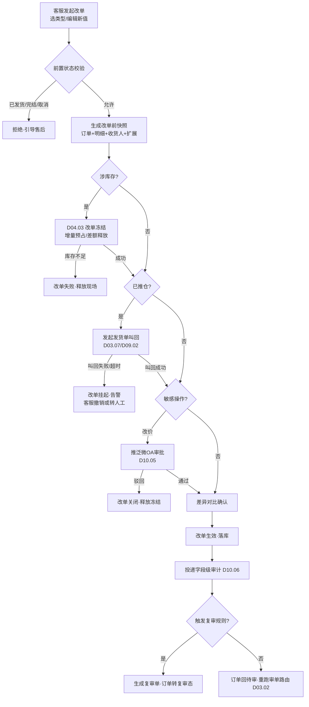
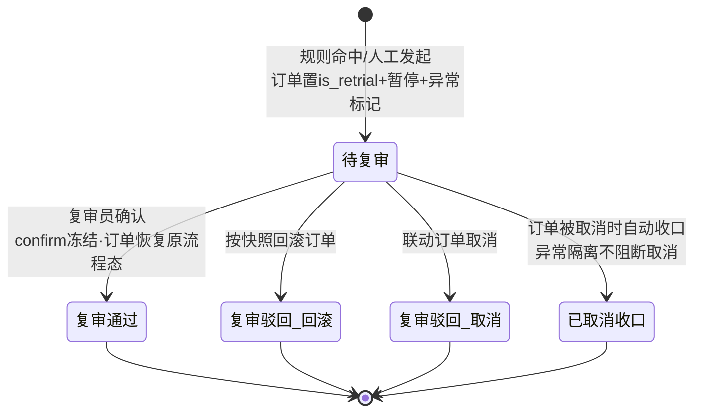
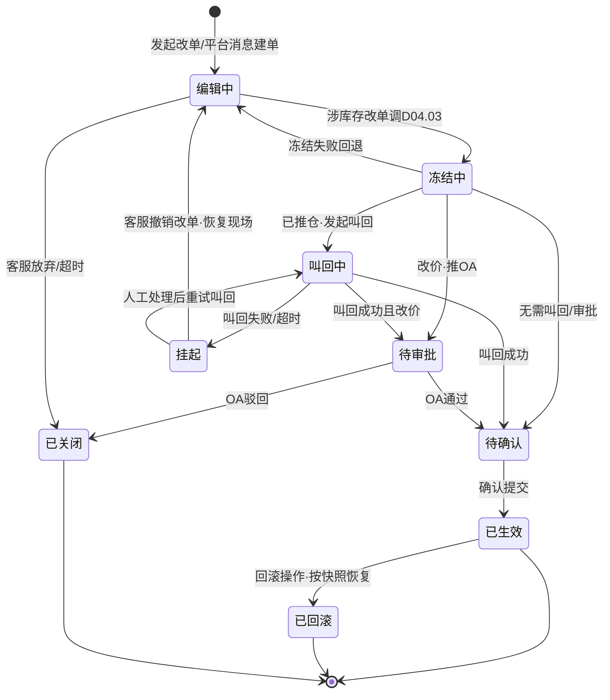
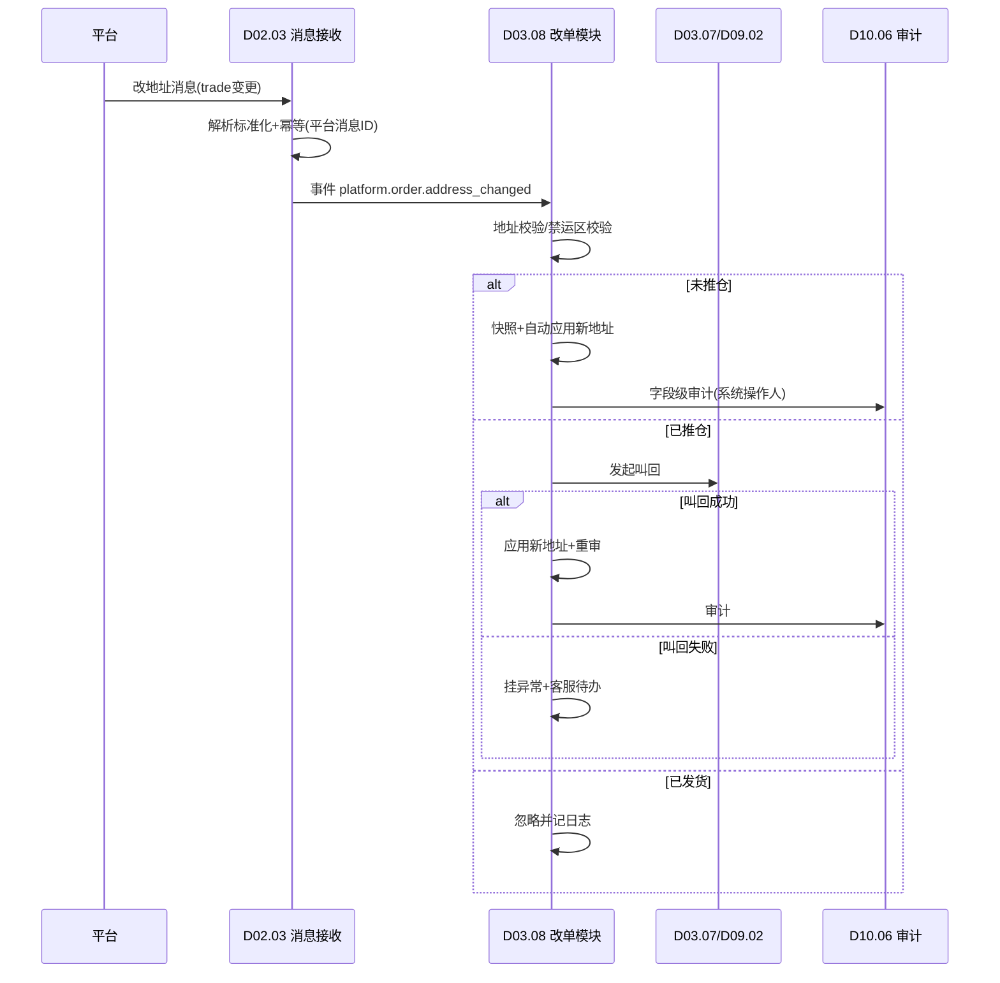

# SRS-D03.08 订单修改与复审模块 需求规格说明书

> 文档编号：SRS-D03.08 · 版本 V1.0 · 2026-10-23 · 编写：小凯 · 状态：待审阅
> 所属域：D03 订单履约域 · 分期：**P1（M3）**
> 上游依据：SRS-00 §4.4「发货单指令状态机」「订单状态机」契约 · 逆向文档 02 §8.3（复审单 retrial）/§8.4（暂停恢复）/§11.6（复审快照启示）· SRS-D03.07 发货单管理 · SRS-D04.03 预占与释放 · SRS-D10.05 审批流 · SRS-D10.06 操作审计
> 定位：客服/运营在订单生命周期内**安全改单**的统一机制层——改单前快照、库存冻结、差异对比、一键回滚，以及价格异常/大额/黑名单三类复审的队列化流转

---

## 1. 模块概述

### 1.1 定位

订单进入 OMS 后，客服/运营经常需要修改订单（买家改地址、加购、改价、改发票、补备注）。改单是**高风险敏感操作**：改错商品导致错发、改价绕过监控导致资损、已推仓订单改单导致货不对单。本模块以商派 `order_retrial` 复审快照机制为参考原型，在新栈上实现「**改单必经快照与冻结、差异必对比、风险必复审、错误可回滚、全程可审计**」的统一改单安全层，并承接平台侧买家改地址消息的自动应用。

### 1.2 职责边界

**做**：改单单据（修改申请）的生命周期管理；改单前快照生成与库存冻结；五类改单（地址/商品/价格/发票/备注）的校验、差异对比、生效与回滚；三类复审（价格异常/大额订单/黑名单命中）的触发、复审队列、通过/驳回流转；平台改单消息（改地址）的接收与自动应用；改单与发货单叫回的联动编排；改单字段级审计留痕。

**不做**：改单是否触发审批的路由决策（→ D10.05，本模块只发起）；库存冻结/释放的记账执行（→ D04.03 FreezeService，本模块只调用）；发货单叫回指令的收发与状态机维护（→ D03.07/D09.02，本模块只消费其结果）；平台消息的接收解析与幂等（→ D02.03，本模块订阅其标准化事件）；审计日志的存储与检索（→ D10.06，本模块投递）；改单后的重审单路由决策（→ D03.02 审单引擎重跑）。

### 1.3 与其他模块关系

| 模块 | 关系 |
|---|---|
| D03.01 订单创建 | 改单作用于订单主档/明细/收货人/扩展；订单号与三套状态为改单前置校验依据 |
| D03.02/D03.03 审单 | 改单生效后需重新审单（重跑路由）；复审通过前订单停在复审态不进审单池 |
| D03.07 发货单管理 | 已推仓订单改单前须叫回发货单；叫回失败则改单挂起或驳回 |
| D09.02 出库指令 | 叫回指令的实际执行方；指令状态机（推送/叫回/恢复/确认）结果回传本模块 |
| D04.03 FreezeService | 改单冻结（freeze）/解冻（release）/差额预占（增减 SKU）统一走 FreezeService，三元键（仓×SKU×货主） |
| D02.03 拉单与消息接收 | 订阅平台标准化改地址消息事件 |
| D10.05 审批流 | 改价、超额退款关联改单等敏感操作推泛微 OA |
| D10.06 操作审计 | 改单字段级旧值/新值投递审计中心 |
| D03.09 异常单 | 黑名单命中复审与异常标记联动 |
| D05 售后域 | 已发货订单不接受 OMS 改单，引导走售后（换货/补发） |

---

## 2. 业务场景

**SC-D03.08-01 买家申请改地址（客服代改）**
买家下单后联系客服要求改收货地址（同省市区变更详址）。客服在订单详情页发起「改地址」，系统校验订单未推仓 → 生成改单前快照（订单+明细+收货人+扩展四张表的业务快照）→ 应用新地址 → 差异对比页确认 → 生效并写审计。若订单已推仓：系统自动发起发货单叫回（D03.07 指令状态机），叫回成功后才允许改地址；叫回失败（WMS 已出库）则改单驳回，提示客服走物流拦截或售后。

**SC-D03.08-02 改商品（加 SKU）触发复审**
买家要求加购一件赠品装 SKU。客服发起「改商品-加 SKU」：系统冻结当前订单预占现场（D04.03），对新 SKU 按目标仓×货主做增量预占；增量预占失败（可用不足）则改单失败、原预占保持不动。改单生效后订单回到待审（重跑审单路由，可能换仓/重拆）。若加改后订单实付低于成本阈值，自动转入价格复审队列（见 SC-05）。

**SC-D03.08-03 改价走 OA 审批**
运营为大客户订单手工调价（行价 8 折 → 7 折）。系统识别「改价」为敏感操作：生成快照后推泛微 OA 审批（经 D10.05，审批要素含订单号/原总价/新总价/折让率/操作人/理由）；审批通过 → 改单生效 + 金额重算（优惠分摊、双口径金额联动 D08.01 应收）+ 审计；驳回 → 改单关闭、快照废弃、冻结释放。

**SC-D03.08-04 已推仓订单改单的叫回编排**
订单已生成发货单并推送通天晓 WMS。客服改商品（减 SKU）。系统：① 暂停订单（联动 D03.09 pause 语义）；② 逐张发货单发起叫回指令（D09.02 指令状态机：推送→叫回中）；③ 全部叫回成功 → 释放原预占 → 应用改动 → 重新审单生成新发货单；④ 任一叫回失败 → 改单挂起（pending_recall）并告警，客服可选择撤销改单（恢复现场）或转人工处理。合单场景（母子发货单）叫回需级联到同组全部发货单（联动 D03.05/D03.07）。

**SC-D03.08-05 价格异常自动复审**
订单创建/改单生效时价格监控插件校验：行实付 < 成本 × 成本倍数阈值（按货主可配，买断货主用存货成本、代销货主用最低限价），或整单折扣率超限。命中 → 订单置复审态（is_retrial）+ 暂停 + 异常标记，生成复审单（type=audit）入复审队列，附命中明细（SKU/实付/成本/倍数）。复审专员在复审工作台查看快照对比，判定「活动价合理」→ 复审通过，订单恢复流程；判定「价格配错」→ 复审驳回，按快照回滚订单（或联动取消）。

**SC-D03.08-06 大额订单复审**
店铺配置大额阈值（如整单实付 ≥ 2 万元）。命中订单自动进复审队列（type=amount），复核收货信息、支付一致性、客户历史后才放行审单。大额复审与价格复审可叠加，全部复审通过订单才恢复。

**SC-D03.08-07 黑名单命中复审**
订单接入时命中风控黑名单（收货手机/地址/账号维度，D03.09 维护名单），自动进复审队列（type=blacklist）。复审员核实后：误报 → 通过并可选加白；确认风险 → 驳回并联动取消/退款。

**SC-D03.08-08 平台侧买家自助改地址同步**
买家在淘宝端自助修改收货地址，平台推送改地址消息（trade 变更）。D02.03 接收解析为标准事件 `platform.order.address_changed`，本模块订阅：订单未推仓 → 自动应用新地址（免复审、系统操作人、写审计）；已推仓 → 尝试叫回后应用，叫回失败则挂异常提醒客服联系买家；已发货 → 忽略并记日志。全部处理结果回执 D02.04（平台要求确认的场景）。

**SC-D03.08-09 改单回滚（错误恢复）**
客服改完商品后发现改错（买家实际要另一 SKU）。在改单生效且订单未重新推仓前，客服可在改单记录上发起「回滚」：系统按快照恢复订单四表数据 + 预占恢复（新增 SKU 释放、原 SKU 恢复冻结）+ 状态回退至改单前，全程写审计。已重新推仓的回滚需先叫回，规则同 SC-04。

---

## 3. 功能需求

### FR-D03.08-01 改单申请与前置校验
- FR-01a 改单入口：订单详情页发起，改单类型五选（地址/商品/价格/发票/备注），一单同一时刻只允许一张进行中的改单单（并发互斥，DB 唯一约束 + Redis 锁）。
- FR-01b 前置状态校验矩阵（见 §5.1）：按订单三套状态 × 发货单指令状态判定该类型改单是否允许、是否需叫回、是否需复审、是否需审批。
- FR-01c 已发货/已完成/已取消订单一律拒绝改单，提示走售后（D05）或不可操作。
- FR-01d 平台改地址消息通道（SC-08）视为系统发起的改单单，走同一套快照/生效/审计流程，免人工确认但不可免校验。

### FR-D03.08-02 改单前快照
- FR-02a 快照范围：订单主档（状态/金额/优惠/标记位）、订单明细行（SKU/数量/行价/行实付/分摊）、收货人信息（密文存储的姓名/电话/地址，快照同样加密）、订单扩展（发票/备注/物流要求）。快照为**不可变副本**（JSON 结构化 + 关键列平铺），一次改单一份快照。
- FR-02b 快照与预占现场绑定：生成快照同时记录当前预占流水号集合（D04.03 freeze_id 列表），回滚时按此恢复。
- FR-02c 快照保留策略：改单闭环（生效/回滚/驳回）后快照转入审计归档（保留 ≥3 年，随 D03.13 归档），供追溯与对账。

### FR-D03.08-03 改单冻结（库存现场保护）
- FR-03a 改商品/改价涉库存的改单，生效前经 D04.03 FreezeService 以订单号为幂等键做**改单冻结**：原预占保持 + 增量 SKU 追加预占 / 减量 SKU 差额释放，全部在改单事务内原子编排（逐行调用 + Saga 补偿，同 SRS-D04.02 §5.4 口径）。
- FR-03b 纯地址/发票/备注改单不动库存，免冻结。
- FR-03c 改单挂起超时可配（默认 24h）：超时未闭环的改单自动释放增量冻结、恢复原预占，改单置超时关闭并通知发起人。

### FR-D03.08-04 五类改单的处理逻辑与限制

| 类型 | 允许阶段 | 附加动作 | 限制/审批 |
|---|---|---|---|
| 改地址 | 未推仓直接改；已推仓先叫回 | 重算物流分单路由（D09.04）；跨省改址可能换仓 → 强制重审 | 新地址过地址校验与禁运区校验；平台已发货不可改 |
| 改商品-加 SKU | 未推仓；已推仓先叫回 | 增量预占；赠品/组合装按 BOM 展开（D04.01）；重审重拆 | 加 SKU 货主须与原行货主一致（禁止跨货主 BOM/混货主行，SRS-00 契约）；可用不足即失败 |
| 改商品-减 SKU | 同上 | 差额释放预占；金额重算 | 减量后行数量 ≥0；整单减空 → 引导走取消而非改单 |
| 改商品-换 SKU | 同上 | = 减 + 加原子组合，任一失败整体回退 | 同上加/减限制 |
| 改价格 | 未推仓；已推仓先叫回（金额影响发票与应收） | 行价/整单折让二选一；优惠分摊重算（双口径金额）；应收联动（D08.01） | **必推 OA 审批**（D10.05）；改后价格重跑价格监控，命中转复审；改价不可低于行成本 × 硬底线倍数（防呆，绕过需 OA 特批备注） |
| 改发票 | 未开票前 | 发票类型/抬头/税号变更；联动 D08.05 | 已开票订单改发票 = 冲红重开流程，不在本模块（转 D08.05） |
| 改备注 | 全阶段（已推仓改备注不叫回，仅同步客服备注，仓内作业备注不可改） | 备注同步至发货单（未推仓时） | 备注不得含消费者敏感信息明文（PIPL，D01.05 校验） |

### FR-D03.08-05 差异对比与确认
- FR-05a 改单编辑完成后生成**字段级差异对比视图**（旧值/新值/差异类型），人工改单须客服在对比页二次确认后提交；系统改单（平台消息）自动确认。
- FR-05b 差异对比数据同时供复审工作台复用（复审员看的就是快照 vs 当前值的 diff）。

### FR-D03.08-06 叫回联动（已推仓改单）
- FR-06a 改单前置校验判定需叫回时，本模块向 D03.07 发起叫回请求（携带改单单号作为业务引用），订阅指令状态机事件 `delivery.command.recalled` / `delivery.command.recall_failed`。
- FR-06b 叫回期间改单单置 `recalling` 态，订单置暂停（联动 D03.09，暂停原因=改单叫回）。
- FR-06c 叫回成功 → 继续改单流程；失败 → 改单挂起 + 告警 + 客服决策（撤销改单恢复现场 / 转人工）。合单组级联叫回，任一失败按整体失败处理。
- FR-06d 叫回超时阈值可配（默认 30 分钟），超时按失败处理。

### FR-D03.08-07 复审触发与规则
- FR-07a 三类复审触发器（规则可配，按店铺/货主/品牌维度）：
  - **价格复审（audit）**：行模式——行实付 < 成本价 × 成本倍数 或 < 最低限价 × 限价倍数；整单模式——整单折扣率 > 折让上限。监控开关、倍数、模式沿用商派配置思想（is_monitor/cost_multiple/sales_multiple/monitor.ordergoods），配置粒度升级为**货主级**（买断用存货成本、代销用协议最低限价）。
  - **大额复审（amount）**：整单实付 ≥ 大额阈值（店铺级配置）。
  - **黑名单复审（blacklist）**：命中风控名单（D03.09 名单服务）。
- FR-07b 触发时机：① 订单接入创建时（D03.01 后置钩子）；② 改单生效后（改价/改商品必检）；③ 人工审单工作台可手动发起复审。
- FR-07c 命中动作（原子）：订单流程状态置 `is_retrial` + 暂停标记 + 异常标记（结构化原因=复审类型+命中明细，替代商派位图）+ 生成复审单（status=待复审）+ 订单日志。多规则命中生成多条复审单，全部通过才恢复。

### FR-D03.08-08 复审队列与流转
- FR-08a 复审工作台：待复审队列按店铺/品牌/货主/复审类型分组过滤（数据权限四维行级过滤，D10.03）；支持分派复审组/复审员（复用 D03.03 分派机制）。
- FR-08b 复审处理动作：**通过**（确认冻结 → 订单恢复原流程态，回待审/已审继续）；**驳回-回滚**（按快照回滚订单至触发前，复审单关闭）；**驳回-取消**（联动订单取消，D03.01 取消链路，复审收口不阻断取消——继承商派容错边界）。
- FR-08c 复审 SLA：待复审超时可配（默认 4h）升级提醒复审组长；复审单全程操作写审计。
- FR-08d 订单取消时自动收口全部待复审单（status=已取消收口），收口失败不回滚取消（异常隔离）。

### FR-D03.08-09 平台改单消息同步
- FR-09a 订阅 D02.03 标准事件 `platform.order.address_changed`（payload：平台单号/店铺/新收货人密文/变更时间/平台消息 ID），按平台消息 ID 幂等。
- FR-09b 应用规则见 SC-08；自动应用失败（校验不过/叫回失败）降级为人工改单待办 + 异常提醒，不静默丢弃。
- FR-09c 其他平台改单消息类型（改手机、买家留言变更）按同框架扩展，P1 先做地址，其余占位。

### FR-D03.08-10 改单审计
- FR-10a 每次改单生效/回滚/复审动作投递 D10.06 字段级审计事件：改单单号、订单号、操作人（人工账号/系统来源）、字段路径、旧值、新值、改单类型、关联审批单号、关联复审单号。
- FR-10b 涉消费者敏感字段（姓名/电话/地址）的审计值**加密存储、展示脱敏**（PIPL，D01.05）；审计查看权限单独控制。
- FR-10c 订单详情页「改单历史」时间线：按时间列出全部改单/复审/回滚记录，可下钻查看快照与 diff。

---

## 4. 业务流程

### 4.1 人工改单主流程（含叫回与审批分支）



### 4.2 复审流转状态机



### 4.3 改单单据状态机



### 4.4 平台改地址消息时序



---

## 5. 处理逻辑

### 5.1 改单前置校验矩阵（核心规则表）

| 订单状态组合 | 改地址 | 改商品 | 改价格 | 改发票 | 改备注 |
|---|---|---|---|---|---|
| 待审核（未拆单） | ✅ 直接 | ✅ 冻结后 | ✅ OA 后 | ✅ | ✅ |
| 已审核未推仓 | ✅ 直接 | ✅ 冻结后 | ✅ OA 后 | ✅ | ✅ |
| 已推仓未出库 | ⚠️ 叫回后 | ⚠️ 叫回后 | ⚠️ 叫回后 | ⚠️ 叫回后 | ✅ 仅客服备注 |
| 部分发货 | ❌ 未发部分走拆单调整 | ❌ | ❌ | ⚠️ 未开票部分 | ✅ 仅客服备注 |
| 已发货/完成/取消 | ❌ 转售后 D05 | ❌ | ❌ | ❌ 转 D08.05 冲红 | ❌ |
| 复审中/暂停中 | ❌ 先处理复审/暂停 | ❌ | ❌ | ❌ | ✅ |

> ⚠️=需叫回编排（FR-06）；叫回能力依赖发货单指令状态机当前态：仅「已推送未确认」可叫回，「已确认/已出库」不可叫回直接判失败。

### 5.2 快照与回滚算法

```
snapshot(order_id) -> snap_id:
    读取订单主档/明细/收货人/扩展四实体当前值
    读取当前预占流水集合 freeze_ids（D04.03 按订单号查询）
    整体序列化落 order_modify_snapshot（不可变，唯一 snap_id）

rollback(snap_id):
    校验订单当前未重新推仓（否则先走叫回编排）
    预占恢复：释放快照后新增的 freeze、恢复快照中已释放的 freeze（按 freeze_ids 差额，D04.03 补偿接口，幂等键=改单单号+rollback）
    四实体按快照覆写（收货人密文原样恢复）
    订单状态回退至快照记录的三套状态
    金额重算跳过（快照即终值）；写审计 action=rollback
```

- 回滚窗口：改单生效后、订单重新推仓确认前。推仓后回滚 = 叫回 + 回滚两段编排，任一失败保持现场并告警。
- 快照覆写采用**整实体覆写**而非字段级 patch，避免部分字段回滚导致状态撕裂；快照生成后订单若被其他通道变更（平台消息改地址），回滚前做版本比对（乐观锁 version），冲突则拒绝回滚转人工。

### 5.3 价格监控算法（继承商派 checkMonitorAbnormal，升级货主维度）

```
check_price(order):
    cfg = 监控配置(货主级): is_monitor, cost_multiple, limit_multiple, mode(行/整单)
    if not cfg.is_monitor: return PASS
    for item in order.items:
        基准价 = 货主类型==凯淳买断 ? 存货成本(D04.07) : 协议最低限价(D04.01)
        if mode==行 and item.行实付 < 基准价 × item.数量 × cfg.倍数:
            yield 命中(item, 行实付, 基准价, 倍数)
    if mode==整单 and order.实付总额 < Σ(基准价×数量) × cfg.倍数:
        yield 命中(整单)
    折扣率校验: order.折让率 = 1 − 实付/标价合计; > 店铺折让上限 → yield 命中(折扣率)
```

- 行实付口径 = 双口径金额中的**客户实付**分摊值（SRS-00 术语「双口径金额」）；平台承担优惠不计入异常判定（避免大促平台券误报）——此为对商派逻辑的关键修正。
- 命中明细结构化写入复审单 `hit_detail` JSON（SKU/实付/基准价/倍数/命中规则），替代商派拼接字符串。

### 5.4 改单冻结编排（Saga）

```
apply_freeze(modify_id, diff_items):   # diff = 目标明细 − 原明细
    加项: 逐行 FreezeService.freeze(仓, SKU, 货主, num, 幂等键=modify_id+行)
    减项: 逐行 FreezeService.release(原freeze_id, num, 幂等键=modify_id+行)
    任一步失败 → 逆序补偿已执行步骤（release 撤销 freeze / re-freeze 撤销 release）
    补偿结果写改单单 saga_log；补偿也失败 → 改单置异常挂起 + 最高级告警 + 人工对账入口
```

### 5.5 并发与互斥
- 同一订单的改单、复审、取消、平台消息应用四通道互斥：订单级分布式锁（Redis SETNX，key=`order:lock:{order_id}`，持锁超时 30s 自动释放）+ 改单单唯一进行中约束双保险。
- 平台改地址消息与人工改单撞车：先到先得，后到方若为人工则提示刷新，若为平台消息则进入重试队列（D01.01 退避重试），最终失败降级人工待办。

---

## 6. 数据字段（业务字段描述）

### 6.1 改单单据（order_modify）

| 字段 | 业务含义 | 取值/校验 |
|---|---|---|
| modify_bn | 改单单号 | 唯一，规则 MO+日期+序列 |
| order_id / order_bn | 目标订单 | 必填 |
| modify_type | 改单类型 | address/item_add/item_sub/item_swap/price/invoice/remark |
| source | 发起来源 | 人工（客服/运营账号）/平台消息/系统 |
| snapshot_id | 改单前快照 | 必填，关联 6.2 |
| status | 改单状态 | §4.3 状态机枚举 |
| need_recall / recall_status | 是否需叫回及叫回结果 | 关联发货单指令引用列表 |
| approval_id | OA 审批单号 | 改价必填（生效后） |
| diff_summary | 差异摘要 | JSON：字段路径/旧值引用/新值引用（敏感字段存密文引用） |
| saga_log | 冻结补偿日志 | JSON，排障用 |
| operator / create_time / effective_time | 操作人/发起/生效时间 | |
| owner_id / tenant_id / shop_id / brand_id | 货主/租户/店铺/品牌 | 必填（SRS-00 契约），行级过滤四维 |
| version | 乐观锁 | 回滚冲突检测 |

### 6.2 改单快照（order_modify_snapshot）

| 字段 | 业务含义 | 取值/校验 |
|---|---|---|
| snapshot_id | 快照号 | 唯一，不可变 |
| order_id / modify_bn | 关联 | |
| snap_order / snap_items / snap_receiver / snap_extend | 四实体业务快照 | JSON；收货人字段加密（PIPL，D01.05 组件加密后存） |
| freeze_ids | 快照时点预占流水集合 | JSON 数组，回滚恢复依据 |
| order_status_snap | 三套状态快照 | audit/fulfill/pay/ship 四态值 |
| create_time | 快照时间 | 毫秒级 |

### 6.3 复审单（order_retrial）

| 字段 | 业务含义 | 取值/校验 |
|---|---|---|
| retrial_bn | 复审单号 | 唯一 |
| order_id / modify_bn | 关联订单/触发改单单（自动触发时为空） | |
| retrial_type | 复审类型 | audit 价格 / amount 大额 / blacklist 黑名单 / normal 人工发起 |
| status | 复审状态 | 待复审/通过/驳回-回滚/驳回-取消/已取消收口 |
| hit_detail | 命中明细 | JSON 结构化（规则/实付/基准价/倍数），替代商派字符串拼接 |
| snapshot_id | 对比与回滚依据 | 价格复审触发时生成订单快照 |
| assign_group / assign_op | 复审组/复审员 | 分派机制复用 D03.03 |
| handle_opinion / handle_time / handle_op | 处理意见/时间/人 | 通过或驳回必填意见 |
| sla_deadline | 复审时限 | 超时升级提醒 |
| owner_id / tenant_id / shop_id / brand_id | 四维 | 必填，行级过滤 |

### 6.4 复审监控配置（retrial_monitor_config）

| 字段 | 业务含义 | 取值/校验 |
|---|---|---|
| owner_id / shop_id | 配置粒度 | 货主级优先，店铺级覆盖细化 |
| is_monitor | 价格监控开关 | 默认开 |
| monitor_mode | 监控模式 | item 行级 / order 整单 |
| cost_multiple / limit_multiple | 成本倍数/限价倍数阈值 | 正数，支持小数（如 0.8） |
| discount_ceiling | 折扣率上限 | 0-1 |
| big_amount_threshold | 大额复审阈值 | 金额，0=关闭 |
| blacklist_switch | 黑名单复审开关 | |

---

## 7. 接口

### 7.1 内部接口（本模块提供）

| 编号 | 接口 | 消费方 | 说明 |
|---|---|---|---|
| IF-D03.08-01 | `OrderModifyService::createModify(order_id, type, payload, source)` | 客服工作台/D02.03 消息通道 | 统一改单入口；返回改单单号；内部完成校验矩阵+快照+锁 |
| IF-D03.08-02 | `OrderModifyService::rollback(modify_bn, operator)` | 客服工作台 | 快照回滚；含推仓后叫回编排 |
| IF-D03.08-03 | `RetrialService::trigger(order_id, type, hit_detail)` | D03.01 创建钩子/D03.02 审单/本模块改单生效钩子 | 复审触发统一入口；幂等键=order_id+type+触发时点 |
| IF-D03.08-04 | `RetrialService::checkPrice(order)` | D03.01/D03.02/D03.03 | 价格监控校验（§5.3），返回命中明细 |
| IF-D03.08-05 | 事件 `order.modify.effective`（改单单号/订单/类型/diff 摘要） | D03.02 重审、D08.01 应收重算、D02.04 平台回传、D10.06 审计 | 改单生效广播 |
| IF-D03.08-06 | 事件 `order.retrial.status_changed`（复审单/订单/新状态） | D03.03 工作台、D03.09 异常联动、D11.03 监控 | 复审流转广播 |
| IF-D03.08-07 | `OrderModifyService::getModifyHistory(order_id)` | 订单详情页 | 改单/复审/回滚时间线 |

### 7.2 依赖接口（本模块消费）

| 编号 | 接口 | 提供方 | 说明 |
|---|---|---|---|
| IF-D03.08-D1 | `FreezeService::freeze/release/compensate`（幂等键=改单单号+行） | D04.03 | 改单冻结与 Saga 补偿 |
| IF-D03.08-D2 | `DeliveryCommandService::recall(发货单ids, 业务引用)` + 事件 `delivery.command.recalled/recall_failed` | D03.07/D09.02 | 叫回编排 |
| IF-D03.08-D3 | `ApprovalService::submit(模板=改价审批, 要素)` + 回调 | D10.05 | OA 审批 |
| IF-D03.08-D4 | `AuditService::fieldChange(实体, 字段, 旧值, 新值, 操作人, 单据引用)` | D10.06 | 字段级审计 |
| IF-D03.08-D5 | 事件 `platform.order.address_changed` | D02.03 | 平台改地址 |
| IF-D03.08-D6 | `BlacklistService::match(收货人/手机/账号)` | D03.09 | 黑名单校验 |
| IF-D03.08-D7 | `CostService::getBasePrice(货主, SKU)`（买断=存货成本/代销=最低限价） | D04.07/D04.01 | 价格监控基准价 |

### 7.3 外部接口

| 编号 | 接口 | 方向 | 说明 |
|---|---|---|---|
| EF-D03.08-01 | 泛微 OA 审批推送/回调（经 D10.05 适配层） | 双向 | 改价审批单创建与结果回调 |
| EF-D03.08-02 | 平台改地址确认回执（经 D02.04，仅要求确认的平台） | 出 | 处理结果回执平台 |

---

## 8. 非功能需求

| 项 | 要求 |
|---|---|
| 性能 | 改单校验+快照生成 P95 ≤500ms；叫回编排端到端（含 WMS 响应）P95 ≤3 分钟；价格监控校验单订单 ≤50ms（创建链路热路径，同步执行不得拖慢拉单落库，超 200ms 降级异步补检） |
| 并发 | 订单级互斥锁；同单改单/复审/取消/平台消息四通道串行化；锁持有超 30s 自动释放并告警 |
| 幂等 | 改单生效、回滚、复审触发、平台消息应用均以业务幂等键防重（改单单号+动作 / 平台消息 ID）；FreezeService 调用幂等键=改单单号+行 |
| 一致性 | 快照-冻结-生效-审计四步最终一致：生效落库与审计投递经本地事务表+MQ，审计丢失可补偿重投；Saga 补偿失败必须产生最高级告警与人工对账入口，不允许静默 |
| 安全/PIPL | 收货人姓名/电话/地址在改单单、快照、审计、diff 展示全链路加密存储+脱敏展示（D01.05）；改单与复审操作权限独立授权点（D10.03）；改价审批不可由改单发起人自审（OA 侧回避规则） |
| 可用性 | 复审触发失败不阻断订单主流程（降级为异常标记+人工补录，继承商派「复审收口不阻断取消」的异常边界思想）；D02 消息通道故障时改地址消息按 D02.05 重试策略兜底 |
| 容量 | 改单率预估 ≤5% 订单（日均 2 万单 → ≤1000 改单/日）；快照 JSON 单份 ≤50KB；复审单日均 ≤500；快照与改单单随订单归档（D03.13）3 年后转历史库 |

---

## 9. 验收标准

| 编号 | 验收条件 |
|---|---|
| AC-01 | 五类改单在 §5.1 矩阵各状态组合下的允许/拒绝行为与矩阵完全一致；已发货订单发起任何改单均被拒绝并提示转售后 |
| AC-02 | 任意改单生效前均存在完整快照（四实体+freeze_ids+状态）；对生效后未推仓订单执行回滚，订单四实体、预占余额、三套状态与改单前逐字段一致 |
| AC-03 | 已推仓订单改商品：叫回成功后改动生效并重新审单生成新发货单；模拟 WMS 叫回失败，改单进入挂起态且原发货单/预占现场无任何变化，告警产生 |
| AC-04 | 改价改单必推 OA：审批通过前订单金额不变；驳回后改单关闭、增量冻结释放、预占恢复原状；OA 回调重复投递只生效一次 |
| AC-05 | 加 SKU 增量预占在可用不足时整体失败，原预占保持不变（Saga 补偿验证）；换 SKU 的减+加两步中加步失败时减步自动恢复 |
| AC-06 | 价格复审：构造行实付低于成本×倍数阈值的订单，自动进入复审队列且 hit_detail 结构化记录命中规则；买断货主按存货成本、代销货主按最低限价分别验证；平台承担优惠不计入误报验证（大促券订单不触发） |
| AC-07 | 大额与黑名单复审独立触发、可与价格复审叠加；多复审单全部通过后订单才恢复待审；订单取消时待复审单自动收口且取消主流程不受复审收口异常影响 |
| AC-08 | 复审驳回-回滚按快照恢复订单；驳回-取消联动取消链路并释放全部预占 |
| AC-09 | 平台改地址消息：未推仓订单自动应用（系统操作人+审计+脱敏展示）；重复消息（同平台消息 ID）只应用一次；已发货订单忽略且留日志 |
| AC-10 | 字段级审计完整：每次改单/回滚/复审动作在 D10.06 可检索到字段路径+旧值+新值+操作人+单据引用；地址电话等敏感字段审计值密文存储、界面脱敏 |
| AC-11 | 同一订单并发发起人工改单与平台改地址消息，仅一方成功，另一方按互斥规则排队或提示，无脏写；改单单进行中唯一约束生效 |
| AC-12 | 改单挂起超 24h 自动关闭：增量冻结释放、原预占恢复、发起人收到通知；复审待处理超 4h 触发升级提醒 |

---

## 变更记录

| 日期 | 版本 | 变更 | 原因 |
|---|---|---|---|
| 2026-10-23 | V1.0 | 首版 | — |

---

*参考实现溯源：商派 `sdb_ome_order_retrial`（retrial_type normal/audit，status 0-4）+ `order_retrial_snapshot`（订单快照）+ `order_retrial_store_freeze`（复审独立冻结，record/up/recover/confirm_stock_freeze 四动作，model/order/retrial.php:1236-1621）+ 价格监控 `checkMonitorAbnormal`（lib/order/retrial.php:34，is_monitor/cost_multiple/sales_multiple/monitor.ordergoods 四配置）+ `contrast_order/rollback_order`（对比与回滚）+ `finish_by_order_cancel`（取消收口，异常不阻断主流程）+ `orders::pauseOrder/renewOrder`（叫回推仓联动）。关键差异：① 复审独立冻结表并入 D04.03 FreezeService 统一预占体系（幂等键=改单单号+行，Saga 补偿），不再自建平行冻结账；② 改单收敛为独立单据（order_modify）承载五类修改与状态机，商派仅有复审单+operation_log 散记；③ 命中明细/差异对比结构化 JSON，替代商派字符串拼接与位图标记；④ 价格监控基准价升级货主维度（买断=存货成本、代销=最低限价），实付口径改为客户实付（剔除平台承担优惠防大促误报）；⑤ 暂停/恢复的订单级布尔升级为发货单指令状态机（SRS-00 §11.7 启示）驱动的叫回编排；⑥ 改价强制 OA 审批（D10.05）与字段级审计（D10.06）为商派缺失的合规增强；⑦ 平台改地址消息经 D02 标准化事件订阅，商派为矩阵中心同步代理。*
