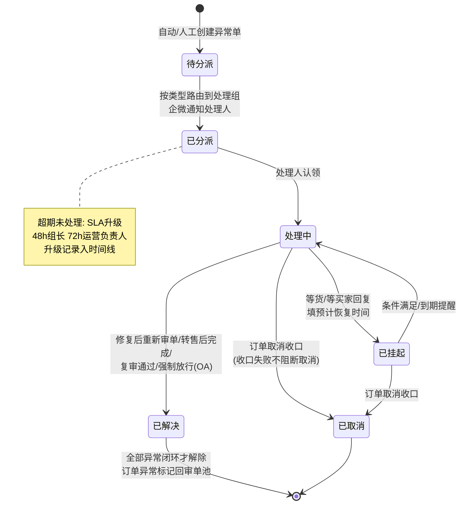
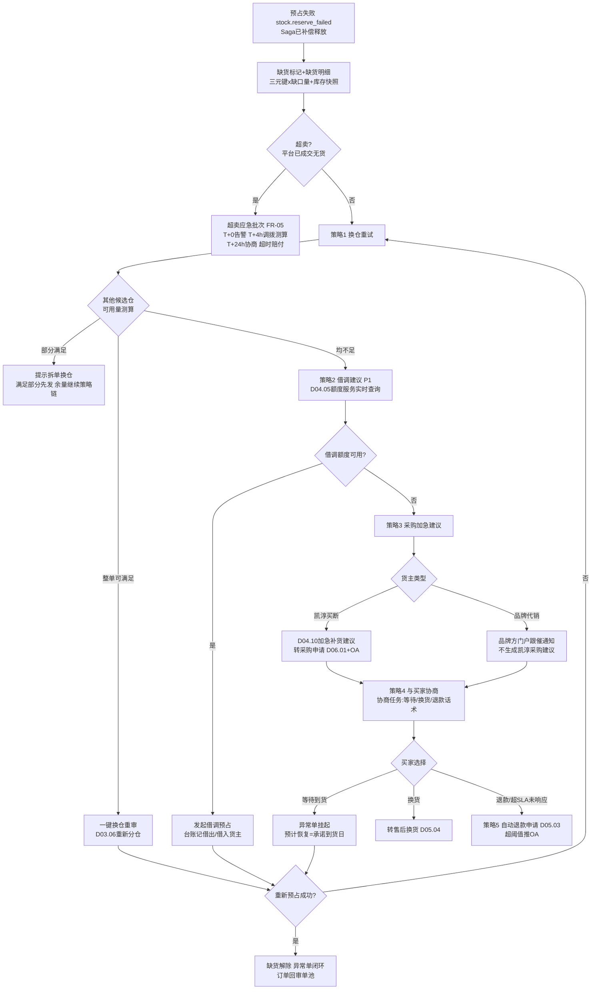
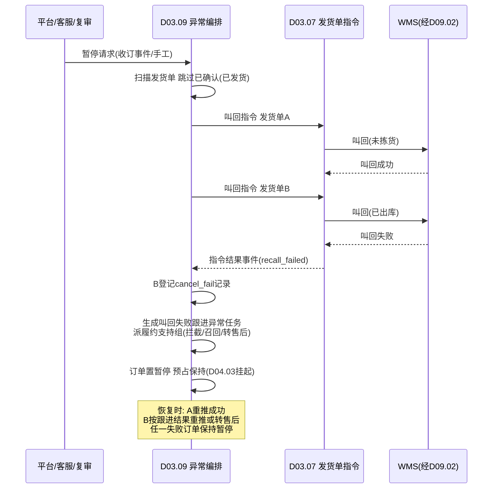

# SRS-D03.09 异常单与缺货处理模块 需求规格说明书

> 文档编号：SRS-D03.09 · 版本 V1.2 · 2026-10-24 · 编写：小凯 · 状态：待审阅（批次②，V1.2 增补风控异常类型）
> 所属域：D03 订单履约域 · 分期：**P0（M2）**
> 上游依据：SRS-00 §4.4「发货单指令状态机」契约 · SRS-D03.02 审单引擎（order_audit_reason 结构化原因契约）· SRS-D03.07 发货单管理（叫回/恢复指令）· SRS-D04.03 预占与释放（Saga 补偿/缺货转入）· 逆向文档 02 §8（异常/缺货/复审/暂停）与 §11.3/11.7（位图教训、指令状态机启示）

---

## 1. 模块概述

### 1.1 定位

订单履约链路的「异常中枢」：把散落在审单插件、预占补偿、推仓回传、平台消息、人工操作中的各类异常，收敛为**统一的异常单单据**（结构化类型 + 生命周期 + 分派路由 + 闭环统计），并承载两条专项流程——**缺货处理策略链**（换仓→借调→采购加急→与买家协商）与**暂停/恢复编排**（暂停=叫回发货单+预占保持的分布式动作）。

商派教训的直接回应：① 异常用两张表并存（abnormal + order_abnormal）且原因靠位图，检索与统计困难 → 本模块统一为一张异常单表 + 异常类型字典，原因全部结构化（继承 D03.02 order_audit_reason 契约）；② pause 是订单级布尔，但实际是「叫回 WMS 发货单」的分布式动作，部分失败只记 console_delivery 日志、无人跟进 → 本模块引入指令级结果登记（cancel_fail）+ 人工跟进任务。

### 1.2 职责边界

**做**：异常类型字典维护；异常单生命周期（标记→分派→处理→闭环）；异常自动识别接入（订阅审单不通过原因、预占失败事件、推仓/回传失败事件、风控命中）；缺货单标记与处理策略链编排（含超卖应急分级处置）；暂停/恢复的业务编排（调 D03.07 指令、处理部分叫回失败）；黑名单/风控名单服务（名单数据归属本模块，复审联动 D03.08）；异常单看板供数（D11.03）。
**不做**：审单规则与不通过原因的**产生**（→ D03.02，本模块消费其 order_audit_reason）；复审队列流转（→ D03.08，价格/大额/黑名单复审在彼处处理，本模块只做异常标记联动）；预占/释放执行（→ D04.03）；发货单指令状态机本体（→ D03.07/D09.02，本模块是叫回/恢复的**发起方与编排方**）；补货建议计算（→ D04.10）；借调额度判定（→ D04.05）；采购单流程（→ D06）。

### 1.3 与其他模块关系

| 模块 | 关系 |
|---|---|
| D03.02 审单引擎 | 审单不通过原因（order_audit_reason）中「需异常单化」的类型自动落入本模块；异常解除后订单回审单池重审 |
| D03.03 人工审单工作台 | 异常单分派复用工作台分派机制（组/人）；异常队列在工作台呈现角标 |
| D03.07 发货单管理 | 暂停=对全部未发货发货单发起叫回指令；恢复=重推指令；订阅指令结果事件处理部分失败 |
| D03.08 修改与复审 | 价格异常/黑名单命中 → 生成异常标记 + 转复审队列（复审单据在 D03.08）；复审结果回写异常单闭环 |
| D04.03 预占释放 | 预占 Saga 补偿失败事件 → 缺货异常单；暂停期间预占保持（挂起不释放）；取消 → 全量释放 |
| D04.05 调拨借调 | 缺货策略链「借调建议」（P1）：调用借调额度服务，额度可用则提示发起借调预占 |
| D04.10 预警补货 | 缺货策略链「采购加急建议」：缺货明细推送补货建议（加急标记），买断货转采购申请（D06.01） |
| D05 售后 | 缺货协商路径「退款/换货」→ 引导创建售后申请单；超卖自动退款申请走 D05.03 |
| D02.04/D02.05 回传与重试 | 回传失败超过重试上限 → 回传失败异常单 |
| D09.02 出库指令 | 推仓失败（sync_status=失败且重试耗尽）→ 推仓失败异常单 |
| D10.05 审批流 | 敏感动作推泛微 OA：超卖自动退款超阈值、强制发货（跳过库存校验）、黑名单加白/移除 |
| D11.03 履约监控看板 | 异常单实时统计（按类型/时长/店铺/货主）与告警供数 |
| D01.07 通知中心 | 异常分派/超期/超卖应急升级的企微通知 |

---

## 2. 业务场景

**SC-D03.09-01 审单异常自动落单（主流程）**
订单自动审单不通过，D03.02 产出结构化原因（如「收货地址含 PO Box」「商品未绑定物料」）。命中「需异常单化」类型清单的原因，系统自动创建异常单（类型=字典项，携带原因明细与订单快照引用），订单打异常标记退出审单池，按类型路由分派到对应处理组（地址异常→客服组、商品未绑定→商品组）。处理人修复后点「重新审单」，异常单闭环，订单回池。

**SC-D03.09-02 预占失败转缺货**
审单通过执行整单预占（IF-D04.03-02），第 3 行可用不足触发 Saga 补偿（前 2 行释放）。D04.03 发布 `stock.reserve_failed` 事件，本模块消费：订单打缺货标记，创建缺货异常单（明细=缺货三元键×缺口量），进入缺货处理策略链（§4.2/§5.3）。

**SC-D03.09-03 大促超卖应急（分级处置）**
大促夜 23:00，抖音店铺某爆款平台已成交 120 单，OMS 可用库存只剩 30（平台库存回写延迟导致超卖）。90 单进入超卖应急：系统按分级 SLA 自动推进——T+0 生成超卖异常单（批量归组：同店铺同 SKU 聚合为一个应急批次）并企微告警值班运营；T+4h 内优先尝试调拨/借调解决（策略链自动测算，可解决部分转正常履约）；T+24h 仍无货的订单生成「买家协商任务」（话术模板：道歉+补偿券+改期/退款选项）派给客服；协商超时或买家拒绝等待 → 发起自动退款申请（D05.03，超阈值走 OA）；全程时间线记录，供事后赔付与复盘（平台超卖赔付规则留痕）。

**SC-D03.09-04 平台收订暂停（叫回发货单）**
买家在淘宝申请退款，平台推「收订」消息（D02.03 解析为 `platform.order.hold` 事件）。订单已生成 2 张发货单且均已推仓：本模块发起暂停编排——对每张发货单调 D03.07 叫回指令（预占保持不释放，D04.03 挂起语义）。发货单 A 叫回成功（WMS 未拣货），发货单 B 叫回失败（已出库）：B 登记 `cancel_fail` 记录 + 生成「叫回失败跟进」异常任务派人工（联系仓拦截/在途召回/等签收后走售后退货），订单整体置暂停态但 B 的处置状态单独可见。退款撤销后恢复：A 重推指令恢复履约；B 若已拦截成功同样重推，若已签收则转售后。

**SC-D03.09-05 推仓失败异常**
发货单推 WMS 失败（D09.02 重试 3 次耗尽，如通天晓接口超时后返回仓编码不存在）。自动生成「推仓失败」异常单，携带失败报文摘要，分派履约支持组；处理人修正仓库映射（D09.01 wms_binding）后点「重推」，成功即闭环。

**SC-D03.09-06 风控黑名单命中**
订单接入时风控插件命中黑名单（收货手机号在名单库）：订单打异常标记 + 自动创建复审单（type=blacklist，D03.08 队列）+ 本模块异常单（类型=黑名单客户）双记录（异常单跟踪处置闭环，复审单承载通过/驳回决策）。复审驳回 → 异常单处置动作=取消订单；复审通过（误报）→ 异常单闭环，可选一键加白（敏感操作，推 OA）。

**SC-D03.09-07 异常单超期升级**
「回传失败」异常单分派后 48h 未处理（平台发货时效临近）。看板超时规则触发：企微升级通知处理组长，异常单标记超期；72h 仍未闭环 → 二次升级至运营负责人。所有升级记录写入异常单时间线。

---

## 3. 功能需求

### FR-D03.09-01 异常类型字典
- FR-01a 字典项：类型编码（英文常量）/名称/分类（数据类·风控类·库存类·履约类·平台类）/默认处理组/默认 SLA（小时）/是否需异常单化（审单原因自动落单开关）/是否阻断履约/启停。租户级可增补自定义类型（tenant_id 隔离，系统内置类型不可删）。
- FR-01b 内置类型全集见 §5.1 字典表；每类型绑定「识别来源→自动动作→人工处理路径」三元配置。
- FR-01c 类型与 order_audit_reason 原因码映射表：D03.02 原因码 → 异常类型（多对一），映射可配置，新增原因码未映射时兜底入「其他异常」并告警提示配置。

### FR-D03.09-02 异常单生命周期
- FR-02a 创建来源四类：① 系统自动（审单原因落单/预占失败/推仓失败/回传失败/风控命中/平台消息）；② 事件订阅（见 IF 表）；③ 人工标记（审单工作台/订单详情页「设为异常」，类型+备注必填）；④ 联动生成（复审命中、叫回失败）。幂等：同订单同类型存在未闭环异常单时不重复创建，追加明细与计数。
- FR-02b 状态机：待分派→已分派→处理中→已解决（重新审单/修复完成）/已取消（订单取消收口）/已挂起（等待外部条件，如等货）。全部状态变迁写时间线（操作人/动作/备注/前后状态）。
- FR-02c 分派：按类型默认处理组自动分派（复用 D03.03 分派规则引擎，条件维度含异常类型/店铺/货主/品牌）；支持手动改派、转派、撤销分派；分派即企微通知处理人。
- FR-02d 处理动作（按类型配置可用动作集）：修复后重新审单（解除异常标记回审单池）/转复审（D03.08）/取消订单（联动 D03.01 取消链路）/挂起（等货、等买家回复，挂起须填预计恢复时间，到期自动提醒）/转售后（D05）/强制放行（跳过该校验继续审单，敏感操作推 OA + 审计）。
- FR-02e 闭环：异常单解决/取消后订单异常标记自动解除（订单存在多个未闭环异常单时，全部闭环才解除标记——对齐 D03.02「结构化原因清零才可审」）；订单取消时全部未闭环异常单自动收口（收口失败不阻断取消，继承商派容错边界）。
- FR-02f 异常单列表与详情：按类型/状态/店铺/货主/处理组/时长过滤（数据权限四维行级过滤，D10.03）；详情页含订单快照引用、原因明细、时间线、关联单据（复审单/售后单/发货单指令记录）。

### FR-D03.09-03 异常自动识别接入
- FR-03a 审单原因落单：订阅 D03.02 审单不通过事件，按 FR-01c 映射自动创建（仅「需异常单化=是」的类型；普通不通过原因仍留在审单工作台，不生成异常单，避免异常池泛滥）。
- FR-03b 履约链路事件落单：预占失败（缺货）、推仓失败、发货回传失败（D02.05 重试耗尽）、平台消息异常（收订/风控拦截）。
- FR-03c 定时扫描落单：待推仓超 N 小时（默认 24h，店铺级配置）未生成发货通知的订单 → 「履约停滞」异常单；扫描任务经 D01.02 调度。
- FR-03d 人工标记入口：审单工作台、订单详情、批量操作（多选订单批量设异常，同类型）。

### FR-D03.09-04 缺货标记与策略链
- FR-04a 缺货标记：订单级缺货标记 + 缺货明细（三元键 branch×sku×owner、缺口量、缺货时点库存快照）。同一订单多次预占失败按明细合并更新缺口。
- FR-04b 策略链编排（顺序执行，每步产出「建议/自动动作」，见 §5.3）：① 换仓重试（自动测算其他候选仓可用量，可整单满足→提示一键换仓重审，部分满足→提示拆单换仓，D03.06 联动）；② 借调建议（P1，D04.05 额度服务实时查询，额度可用→提示发起借调预占）；③ 采购加急建议（买断货→推 D04.10 生成加急补货建议并提示转采购申请；代销货→推品牌方门户跟催通知，不生成凯淳采购建议）；④ 与买家协商（生成协商任务：等待到货/换货/退款三选项话术，客服执行并回填结果）；⑤ 自动退款申请（协商选择退款或超 SLA 未响应，发起 D05.03 仅退款；金额超店铺阈值推 OA）。
- FR-04c 缺货解除重审：任一策略补足库存（换仓成功/借调到账/采购入库/调拨入库）后，缺货异常单提示「重审」，一键触发订单回审单池重新预占；预占成功异常单闭环。
- FR-04d 缺货看板：按店铺/SKU/货主聚合缺货单量与缺口量、缺货账龄（>24h/>48h/>72h 分级）、策略链各步骤转化统计（供 D11.03）。

### FR-D03.09-05 超卖应急（大促场景）
- FR-05a 超卖识别：平台已成交但 OMS 无货（预占失败且全仓无可用、或 oversold 校验命中——平台拍下量 > 可售量）。与普通缺货区分标记（异常类型=超卖，SLA 更短、告警级别更高）。
- FR-05b 应急批次：同店铺同 SKU 的超卖单自动聚合为应急批次（一个大促爆款可能产生数百单，逐单处理不可行）；批次级统一决策（调拨/协商/批量退款），批次内订单继承决策结果。
- FR-05c 分级处置 SLA（批次创建时间起算，参数可配置）：
  - **T+0**：即时企微告警值班运营 + 自动测算调拨/借调可行性（联动 D04.05/D04.10 在途与邻仓可用）；
  - **T+4h**：可解决部分（邻仓有货/借调额度足）自动生成调拨/借调建议单并升级提醒确认；不可解决部分进入协商准备；
  - **T+24h**：仍无货订单批量生成买家协商任务（话术模板库：致歉+补偿方案+等待/换货/退款选项）；买家选择等待→挂起（预计恢复时间=承诺到货日）；选择退款→批量自动退款申请（D05.03）；
  - **超时赔付**：协商超时（48h 无响应）默认按平台规则发起退款 + 登记赔付记录（赔付类型/金额/责任归属：库存同步延迟/超卖配置错误/仓作业缺口），赔付数据供 D08 财务与 D11 复盘报表。
- FR-05d 大促模式开关：店铺级「大促应急模式」开启后，超卖 SLA 收紧（T+4h→T+2h）、告警升级至运营负责人、批量退款阈值临时上调（OA 预先授权一次，批次内免逐单审批——授权单号留痕）。
- FR-05e 应急复盘：批次关闭时自动生成复盘摘要（单量/解决路径分布/平均解决时长/赔付金额/根因标签）。

### FR-D03.09-06 暂停/恢复编排
- FR-06a 暂停触发来源：平台收订消息（`platform.order.hold`）/客服手工暂停/复审联动暂停（D03.08）/异常处理挂起动作。
- FR-06b 暂停编排（分布式动作，逐发货单处理）：
  1. 订单无发货单 → 直接置暂停标记，订单退出审单池；
  2. 有发货单 → 跳过已发货（指令状态=已确认）的单；对其余发货单逐张调 D03.07 叫回指令（`delivery.command.recall`），**预占保持不释放**（D04.03 挂起语义，恢复后可直接重推）；
  3. 叫回结果登记：每张发货单记录指令结果（成功/失败+失败原因 WMS 报文摘要）；失败即 `cancel_fail` 记录 + 自动生成「叫回失败跟进」异常任务（处理动作选项：联系仓拦截/在途物流召回/签收后转售后退货），派履约支持组；
  4. 母子发货单（合单产物）：叫回母单联动全部子单；子单归属多订单时，仅暂停本订单相关明细，其余订单明细继续履约（部分叫回，D03.07 拆回能力）。
- FR-06c 恢复编排：暂停原因消除（平台退款撤销/复审通过/人工恢复）→ 逐发货单调 D03.07 重推指令（`delivery.command.resume`：叫回成功的重推 WMS；未推过仓的直接推送）；重推失败 → 异常任务人工跟进，订单保持暂停（不半恢复——任一发货单恢复失败则订单暂停标记不解除，避免状态不一致）。
- FR-06d 暂停期间约束：不进自动审单池；允许改单（D03.08 走叫回后改单路径）；平台取消消息到达 → 走取消链路（释放全部预占），暂停标记随取消收口。
- FR-06e 暂停时长监控：暂停超 72h 自动提醒（平台收订超时平台可能自动退款，需人工确认订单去留）。

### FR-D03.09-07 黑名单与风控名单服务
- FR-07a 名单类型：黑名单（禁止履约）/灰名单（强制人工审核）/白名单（跳过风控校验）；维度：收货手机/收货地址（归一化后匹配）/平台账号 ID/收件人姓名；支持通配与精确两级。
- FR-07b 名单维护：增删改走审批（加入黑名单/移出黑名单均推 OA，D10.05）；每条名单记录来源（人工/风控规则/平台通报）、生效期间、操作审计。
- FR-07c 命中服务：供 D03.01 订单接入与 D03.02 审单插件同步调用（IF-07）；命中动作按名单类型：黑名单→异常单+复审单（SC-06 双记录）；灰名单→审单 HOLD 转人工（不生成异常单）；白名单→跳过对应校验。
- FR-07d 名单全租户共享基础库 + 租户/货主私有库两层，命中判定私有优先。

### FR-D03.09-08 异常单看板与统计
- FR-08a 实时看板（供 D11.03 集成）：未闭环异常单按类型/店铺/货主/处理组分布、SLA 达标率、超期清单、缺货账龄分级、超卖应急批次状态。
- FR-08b 统计口径：异常发生率（异常单数/订单量）、平均闭环时长、复发率（同订单同类型 7 天内重复）、各类型 TOP SKU/店铺（定位根因）。
- FR-08c 告警规则可配：类型级超期阈值、数量突增（某类型 1 小时内新增超 N 单，如推仓失败激增提示 WMS 故障）→ 企微告警（D01.07）。

---

## 4. 业务流程

### 4.1 异常单生命周期状态机



### 4.2 缺货处理策略链流程图



### 4.3 暂停/恢复编排时序（部分叫回失败）



---

## 5. 处理逻辑

### 5.1 异常类型字典（内置全集）

对照商派 abnormal/abnormal_type 字典 + 审单插件旗标（逆向文档 02 §6.4/§8.1）+ 凯淳扩展：

| 类型编码 | 名称 | 分类 | 识别来源 | 自动处理动作 | 人工处理路径 | 商派对照 |
|---|---|---|---|---|---|---|
| PRODUCT_UNBOUND | 商品未绑定 | 数据类 | 审单插件（product）/订单接入映射失败事件 | 异常单→商品组；订单退出审单池 | 商品组完成平台商品↔物料映射（D04.01）→重新审单 | 旗标「货」 |
| ADDR_REMOTE | 收货地址偏远 | 数据类 | 审单插件（arrived/logikeyword：物流不到/乡村关键字） | 异常单→客服组；附可达物流建议 | 改物流/联系买家改地址/协商退款 | 旗标「到」「村」 |
| ADDR_INCOMPLETE | 地址不全/双地址 | 数据类 | 审单插件（abnormal：地址为空/检出双省份） | 异常单→客服组 | 联系买家补全→改地址（D03.08）→重审 | abnormal 插件校验 |
| ADDR_POBOX | PO Box 地址 | 数据类 | 审单插件（地址正则） | 异常单→客服组（快递拒收 PO Box） | 联系买家改实际地址/协商退款 | 凯淳扩展 |
| ADDR_FAKE | 虚假/不可达地址 | 数据类 | 地图 API 智能校验（D03.02 address_check V1.2：高德/腾讯识别虚构地址、区划矛盾、无法定位详址） | 异常单→客服组；附地图校验结果快照 | 联系买家核实改址/协商退款；命中即拉入风控观察名单 | V1.2 友商对标 G2（旺店通地图校验） |
| PURCHASE_LIMIT | 限购命中 | 风控类 | 限购插件（D03.02 purchase_limit V1.2：同收货人/手机/地址/设备时间窗内超限购规则） | 异常单→风控组；订单暂停；附命中规则与关联订单清单 | 核实是否黄牛/代购→放行（白名单加白走OA）或取消退款 | V1.2 友商对标 G2（大促防黄牛） |
| PRICE_ABNORMAL | 价格异常 | 数据类 | 价格监控（D03.08 触发器） | 异常单+复审单（type=audit）双记录；订单暂停 | 复审工作台对比快照→通过恢复/驳回回滚或取消 | is_retrial+type_id=9 |
| BLACKLIST | 黑名单客户 | 风控类 | 名单服务命中（FR-07） | 异常单+复审单（type=blacklist）；订单暂停 | 复审核实→误报通过（可加白，OA）/确认取消退款 | 凯淳扩展（商派无名单库） |
| RISK_HIT | 风控命中 | 风控类 | 平台风控消息（抖音 WAIT_SELLER_SEND_GOODS 等）/内部风控规则 | 异常单→风控组；阻断履约（is_delivery=N 语义） | 等平台风控解除/申诉材料提交/超时取消 | abnormal 插件抖音校验 |
| STOCK_SHORT | 缺货 | 库存类 | 预占失败事件（stock.reserve_failed）/审单库存不足 | 缺货标记+策略链（FR-04） | 换仓/借调/采购加急/协商（§4.2） | lackNotify+缺货列表 |
| OVERSOLD | 超卖 | 库存类 | 平台已成交 OMS 无货（oversold 校验） | 应急批次+分级 SLA（FR-05）+即时告警 | 调拨/协商/批量退款/赔付登记 | 旗标「超」 |
| PAY_ABNORMAL | 支付异常 | 平台类 | 平台消息（部分支付非预售/支付状态矛盾） | 异常单→客服组；阻断审单 | 核实平台支付状态/等消息补推/取消 | pay_status=3 拦截 |
| SPLIT_FAILED | 拆合单失败 | 履约类 | 拆单策略执行失败事件（D03.04）/合单校验失败 | 异常单→履约支持组 | 手工拆单/指定仓重审 | 旗标「拆」 |
| WMS_PUSH_FAILED | 推仓失败 | 履约类 | D09.02 指令重试耗尽事件 | 异常单→履约支持组；附失败报文摘要 | 修 wms_binding/联系 WMS→重推 | sync_status=2+sync_msg |
| SYNC_BACK_FAILED | 回传失败 | 平台类 | D02.05 重试耗尽（分级后不可重试错误） | 异常单→平台运营组；按 sync_fail_type 分类 | 重新授权/修参数/手工回传 | sync_fail_type 四分类 |
| FULFILL_STAGNANT | 履约停滞 | 履约类 | 定时扫描（FR-03c：待推仓超 24h） | 异常单→履约支持组 | 排查卡点（缺审核/缺预占/缺指令）→推进 | 凯淳扩展 |
| RECALL_FAILED | 叫回失败跟进 | 履约类 | 暂停编排 cancel_fail（FR-06b） | 异常任务→履约支持组；附 WMS 失败原因 | 联系仓拦截/在途召回/签收转售后 | console_delivery 教训产品化 |
| OTHER | 其他异常 | 数据类 | 人工标记/未映射原因码兜底 | 异常单→默认组+映射缺失告警 | 人工判断处置 | abnormal 兜底 |

### 5.2 分派路由规则

```
分派决策 = 类型默认处理组（字典） → 分派规则引擎细化（D03.03 复用，
条件维度：异常类型 × 店铺 × 货主 × 品牌 × 金额区间，weight DESC 首个命中）
→ 无命中走类型默认组 → 组内轮询到人（负载均衡：当前未闭环单量最少者）
升级链：SLA 50% 提醒处理人 → 100% 升级组长 → 150% 升级运营负责人
```

### 5.3 缺货策略链执行规则

- 策略链在缺货异常单创建时**自动测算 ①②③ 并生成建议**（不等人工逐步触发），人工按建议决策执行；④⑤ 为人工/半自动动作；
- 换仓测算：调 D03.06 分仓服务对全部候选仓重算可用量（排除当前失败仓），输出「可满足仓清单+运费差」；
- 借调测算（P1 生效，P0 期该步骤跳过并在界面置灰标注）：调 IF-D04.05-02 额度服务，返回可借调量；
- 采购加急测算：按缺口量与在途（D04.02 五口径）计算净缺口，净缺口>0 且货主=凯淳买断 → 推 D04.10 生成加急建议（suggest 标记 urgent，携带缺货订单清单与最晚到货日=平台承诺发货时限-物流时长）；
- 协商任务 SLA：创建后 24h 内客服须触达买家（触达记录回填）；48h 无买家响应 → 默认退款路径（大促模式按 FR-05d 收紧）；
- 缺货解除判定：缺口明细全部被「换仓成功/借调预占成功/入库后重占成功」覆盖 → 提示重审；部分覆盖 → 允许拆单部分解除（满足行先发）。

### 5.4 暂停/恢复一致性规则

- 暂停是**编排结果而非单点开关**：订单暂停标记 = 全部未发货发货单叫回尝试完成（成功或已登记 cancel_fail 跟进）后才置位，避免「订单已暂停但 WMS 仍在发货」的商派式不一致；
- 已发货（指令=已确认）发货单不参与叫回，其对应订单行转为「售后拦截路径」（在途召回建议）；
- 预占语义：暂停期间预占保持（D04.03），但纳入账龄监控——暂停超预占有效期 72h 的订单，到期前 12h 提醒人工决策（续占需重新审批），防止长期暂停占用库存；
- 恢复原子性：多发货单逐一重推，全部成功才解除订单暂停标记；部分成功时已成功单保持已恢复指令态、订单仍暂停，异常任务跟踪剩余单（不自动回滚已成功单——重推成功即生效，回滚成本更高，人工兜底）；
- 并发防护：同订单暂停/恢复/取消互斥（订单级分布式锁，粒度=order_id，对齐 D04.03 §5.2）；取消优先：暂停处理中收到取消 → 中止恢复流程走取消链路。

### 5.5 超卖批次决策表

| 条件（批次创建时自动测算） | 处置路径 |
|---|---|
| 邻仓可用 ≥ 缺口 且 调拨时效 < 平台发货时限 | 自动生成调拨建议（D04.05，加急标记），批次状态=待调拨确认 |
| 借调额度可用 ≥ 缺口（同货号买断货） | 自动生成借调预占建议，批次状态=待借调确认 |
| 在途采购预计到货 < 平台发货时限 | 协商任务（话术=等待到货+补偿券），批次状态=协商等待 |
| 以上均不可行 | 协商任务（换货/退款）；买家超时未响应 → 批量退款+赔付登记 |

---

## 6. 数据字段（业务字段描述）

### 6.1 异常单（order_exception）

| 字段 | 业务含义 | 取值/校验 |
|---|---|---|
| exception_id / exception_bn | 异常单 ID/单号 | 单号规则 EX+日期+序列 |
| order_id / order_bn / shop_id | 关联订单与店铺 | 必填 |
| owner_id / tenant_id | 货主/租户 | 必填（全域契约，SRS-00 §4.4） |
| exc_type | 异常类型编码 | 字典项（§5.1），必填 |
| exc_category | 分类 | 数据/风控/库存/履约/平台（字典冗余，便于统计） |
| source | 识别来源 | 审单插件/事件/定时扫描/人工/联动（+来源单据引用：reason_code/事件ID/任务ID） |
| reason_detail | 原因明细 | JSON：结构化原因（对齐 order_audit_reason 格式：原因码/字段/期望/实际） |
| status | 状态 | 待分派/已分派/处理中/已挂起/已解决/已取消（§4.1） |
| group_id / op_id / dispatch_time | 处理组/处理人/分派时间 | 分派后必填 |
| sla_deadline / escalate_level | SLA 截止/升级级别 | 按类型字典 SLA 计算；0 正常/1 组长/2 负责人 |
| resolve_action | 处置动作 | 重新审单/转复审/取消/挂起/转售后/强制放行/退款 |
| rel_retrial_id / rel_refund_id / rel_delivery_ids | 关联单据 | 复审单/售后单/涉及发货单（叫回场景） |
| suspend_until | 挂起预计恢复时间 | 挂起必填，到期提醒 |
| timeline | 时间线 | 子表：状态变迁/操作人/动作/备注，全留痕 |
| create_time / last_modified | 时间戳 | |

### 6.2 异常类型字典（exception_type）

| 字段 | 业务含义 |
|---|---|
| type_code / type_name / category | 编码/名称/分类（§5.1） |
| default_group_id / default_sla_hours | 默认处理组/SLA |
| need_exception_bill | 审单原因是否自动落异常单 |
| block_fulfill | 是否阻断履约 |
| action_set | 允许处置动作集（JSON） |
| is_system / tenant_id | 内置不可删/租户自定义归属 |
| reason_code_map | 映射的 order_audit_reason 原因码清单（JSON） |
| disabled | 启停 |

### 6.3 缺货明细（order_shortage）

| 字段 | 业务含义 |
|---|---|
| shortage_id / exception_id | 明细 ID/归属异常单 |
| branch_id / sku_id / owner_id | 缺货三元键（预占失败现场） |
| lack_num / snapshot | 缺口量/缺货时点五口径库存快照（JSON） |
| strategy_status | 策略链状态：待测算/换仓中/借调中/采购加急/协商中/退款中/已解除 |
| strategy_result | 各步骤测算结果与建议（JSON：可满足仓清单/借调额度/净缺口/协商记录引用） |
| promise_deadline | 平台承诺发货时限（协商与加急测算依据） |
| oversold_flag / batch_id | 超卖标记/应急批次 ID |

### 6.4 超卖应急批次（oversold_batch）与赔付记录（compensation_log）

| 字段 | 业务含义 |
|---|---|
| batch_bn / shop_id / sku_id / owner_id | 批次号/聚合键 |
| total_orders / resolved_orders / refund_orders | 批次单量/已解决/已退款 |
| stage | 批次阶段：告警/调拨测算/协商/退款/赔付/复盘关闭 |
| stage_timeline | 各阶段到达时间（SLA 计时依据） |
| promo_mode | 大促模式标记（FR-05d） |
| compensation_log：order_id/type/amount/liability/oa_approval_id | 赔付登记：类型（平台罚金/补偿券/运费）/金额/责任归属/授权单号 |

### 6.5 暂停恢复指令记录（pause_command_log）与名单（risk_list）

| 字段 | 业务含义 |
|---|---|
| pause_command_log：order_id/delivery_id/command(recall·resume)/result/fail_reason/fail_code | 逐发货单指令结果；fail 即 cancel_fail 记录（关联 RECALL_FAILED 异常任务） |
| risk_list：list_type(黑/灰/白)/dimension(手机/地址/账号/姓名)/match_value(归一化)/scope(全局/租户/货主)/effective_period/source/oa_approval_id/disabled | 名单库；命中日志独立表（list_id/order_id/hit_time/action） |

---

## 7. 接口

### 7.1 内部接口

| 编号 | 接口 | 消费方 | 说明 |
|---|---|---|---|
| IF-D03.09-01 | `ExceptionService::create(orderId, typeCode, source, detail)` | D03.02/D09.02/D02.05/人工界面 | 创建异常单（幂等：同单同类型未闭环合并），返回异常单号 |
| IF-D03.09-02 | `ExceptionService::resolve/reject/suspend(exceptionId, action, memo)` | 处理工作台/D03.08 复审回调 | 处置动作统一入口，驱动状态机与订单标记联动 |
| IF-D03.09-03 | `ExceptionService::queryByOrder(orderId)` | D03 全域/订单详情 | 订单异常足迹（含时间线） |
| IF-D03.09-04 | `ShortageService::markFromReserveFail(orderId, lines[])` | D04.03 事件消费器 | 缺货标记与策略链启动（§4.2） |
| IF-D03.09-05 | `PauseService::pause(orderId, reason, source)` / `resume(orderId, memo)` | D02.03 收订事件/D03.08/客服界面 | 暂停/恢复编排（§5.4），返回逐发货单指令结果 |
| IF-D03.09-06 | `RiskListService::check(dimension, value, scope)` | D03.01 接入/D03.02 审单插件 | 名单同步命中判定（P99 ≤5ms，Redis 缓存归一化名单） |
| IF-D03.09-07 | 订阅事件：`order.audit.rejected`（D03.02）/`stock.reserve_failed`、`stock.freeze_expired`（D04.03）/`delivery.command.recalled`、`delivery.command.recall_failed`、`delivery.push_failed`（D03.07/D09.02）/`platform.order.hold`（D02.03）/`retrial.decided`（D03.08） | — | 异常识别与编排驱动 |
| IF-D03.09-08 | 发布事件：`order.exception.created` / `order.exception.resolved` / `order.paused` / `order.resumed` / `oversold.batch.created` | D03.02（审单池过滤）/D04.08（可售联动）/D11.03（看板告警）/D01.07（通知） | 状态联动 |
| IF-D03.09-09 | `OversoldBatchService::createBatch(shopId, skuId, orderIds[])` / `decide(batchId, path)` | 应急工作台 | 超卖批次管理与决策执行 |

### 7.2 外部接口

| 编号 | 接口 | 方向 | 说明 |
|---|---|---|---|
| EF-D03.09-01 | OA 审批（经 D10.05） | 双向 | 强制放行/黑名单增删/超阈值批量退款/大促模式预授权 |
| EF-D03.09-02 | 企微通知（经 D01.07） | 出 | 分派通知/SLA 升级/超卖即时告警/暂停超期提醒 |
| EF-D03.09-03 | 品牌方门户（经 D10.04） | 出 | 代销货缺货跟催通知/本货主异常单只读视图 |

---

## 8. 非功能需求

| 项 | 要求 |
|---|---|
| 性能 | 名单命中判定 P99 ≤5ms（审单链路同步调用）；异常单创建（含分派）P99 ≤200ms；超卖批次创建支持单批 1000 单 ≤30s |
| 并发一致性 | 同订单暂停/恢复/取消互斥锁；异常单幂等创建（同单同类型未闭环合并）；指令结果事件乱序容忍（以指令状态机终态为准，D03.07 契约） |
| 容错边界 | 订单取消收口异常单失败不阻断取消（继承商派容错注释）；策略链测算失败降级为纯人工路径，不阻断异常单创建 |
| 安全/PIPL | 名单 match_value（手机/地址）加密存储、展示脱敏（D01.05）；名单命中日志不含明文；强制放行/加白等敏感操作全审计（D10.06） |
| 可观测 | 异常单全链路 trace（来源事件 ID 贯穿）；策略链每步测算结果留痕可解释 |
| 数据权限 | 全部查询注入租户/货主/店铺/仓四维行级过滤（D10.03）；品牌方门户仅本货主只读 |

---

## 9. 验收标准

| 编号 | 验收条件 |
|---|---|
| AC-01 | 审单不通过原因为「地址含 PO Box」的订单：自动生成异常单（类型=ADDR_POBOX）并分派客服组，订单退出审单池；修复地址重新审单后异常单闭环、订单正常生成发货单 |
| AC-02 | 同一订单先后触发 2 个不同类型异常：订单异常标记保持；仅当 2 张异常单全部闭环后标记才解除、订单才回审单池 |
| AC-03 | 5 行订单第 3 行预占失败：Saga 补偿完成后 1 分钟内生成缺货异常单，缺货明细含三元键与缺口量，策略链自动产出换仓测算结果（其他仓可用量清单） |
| AC-04 | 换仓重试成功路径：一键换仓重审后预占成功、缺货异常单自动闭环；换仓后仍失败则回到策略链且不产生重复异常单（合并计数） |
| AC-05 | 超卖应急：同店铺同 SKU 100 单超卖聚合为 1 个批次；T+0 企微告警送达；T+4h 自动生成调拨/借调测算；T+24h 未解决单批量生成协商任务；协商超时单批量发起退款且赔付记录含责任归属 |
| AC-06 | 暂停（订单 2 张发货单均已推仓，1 张 WMS 叫回成功 1 张失败）：成功单指令态=已叫回，失败单生成 cancel_fail 记录 + RECALL_FAILED 异常任务派履约支持组；订单暂停标记置位；预占保持（可用量不恢复） |
| AC-07 | 恢复：叫回成功单重推 WMS 成功、订单暂停解除；构造重推失败场景，订单保持暂停且生成跟进任务，不出现「半恢复」状态 |
| AC-08 | 暂停期间收到平台取消消息：走取消链路，全部预占释放，暂停标记与未闭环异常单随取消收口；收口异常不阻断取消主流程 |
| AC-09 | 黑名单命中：异常单+复审单双记录生成、订单暂停；复审通过（误报）后异常闭环可继续履约；加白操作触发 OA 审批且审批通过前名单不生效 |
| AC-10 | 推仓失败（模拟 WMS 返回错误、重试 3 次耗尽）：自动生成 WMS_PUSH_FAILED 异常单含报文摘要，修正绑定后点重推成功即闭环 |
| AC-11 | SLA 升级：构造异常单 48h 未处理，组长收到企微升级；72h 运营负责人收到二次升级；升级记录入时间线 |
| AC-12 | 看板统计口径验证：按类型/店铺/货主的未闭环数、平均闭环时长、缺货账龄分级与明细清单一致；某类型 1 小时突增超阈值触发告警 |
| AC-13 | 数据权限：品牌方门户账号仅见本货主异常单（只读）；跨货主查询返回空；名单 match_value 列表页脱敏展示 |

---

## 变更记录

| 日期 | 版本 | 变更 | 原因 |
|---|---|---|---|
| 2026-10-23 | V1.0 | 首版 | — |
| 2026-10-24 | V1.2 | 异常类型字典补 ADDR_FAKE（地图API虚假地址）+ PURCHASE_LIMIT（限购命中）两类 | 友商对标 G2（Jason 决策A），联动 D03.02 V1.2 插件 |

---

*参考实现溯源：商派 sdb_ome_abnormal（旧表：abnormal_type_id 字典+序列化备注）与 sdb_ome_order_abnormal（2024 新表，字符串类型）双表并存（逆向文档 02 §8.1）→ 本模块统一为 order_exception 单表+字典；auto_status 位图 22 插件旗标（02 §6.4）→ 结构化 reason_detail 对齐 D03.02 order_audit_reason 契约；缺货 lackNotify+缺货列表生成采购（02 §8.2）→ 五步策略链产品化（借调步骤为凯淳新增，依赖 D04.05 P1）；pauseOrder/renewOrder 订单级布尔+console_delivery cancel_fail 只记日志（02 §8.4/§11.7）→ 暂停编排=逐发货单指令状态机动作+cancel_fail 异常任务产品化；oversold 插件旗标「超」（02 §6.4）→ 超卖应急批次+分级 SLA+赔付登记（凯淳新增，大促场景 SC-D03.09-03）。*
