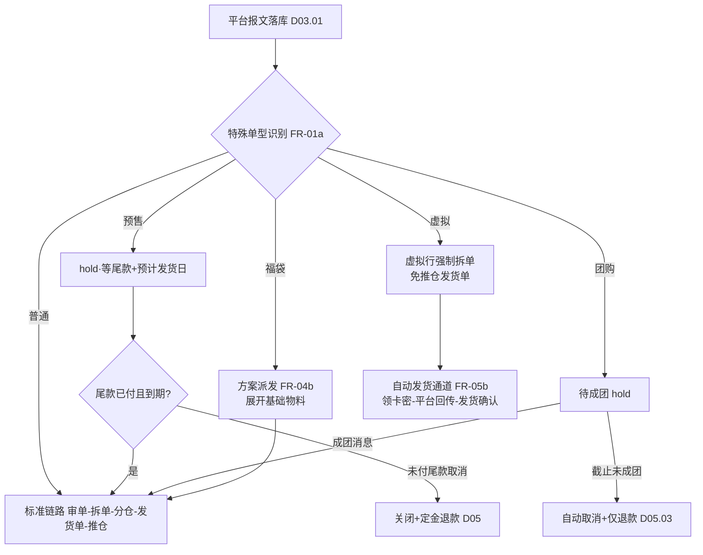
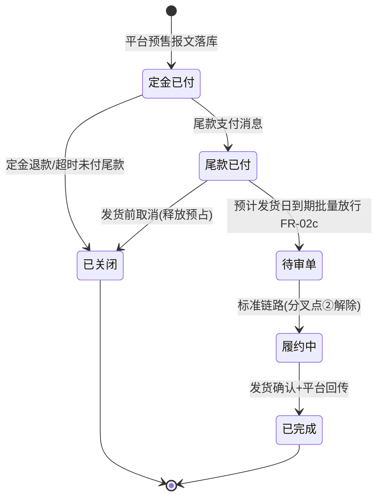
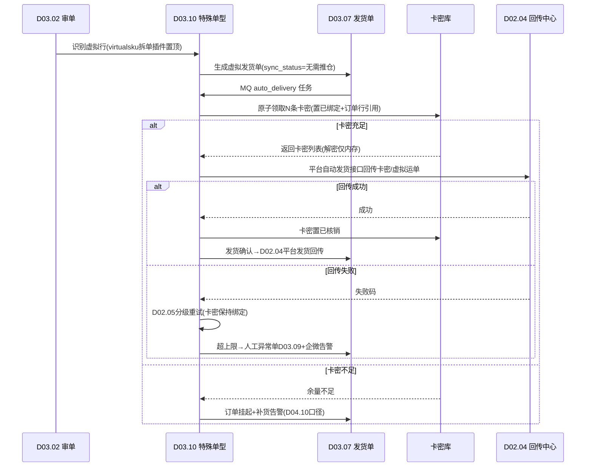

# SRS-D03.10 特殊单型模块 需求规格说明书

> 文档编号：SRS-D03.10 · 版本 V1.0 · 2026-10-23 · 编写：小凯 · 状态：待审阅（批次②）
> 所属域：D03 订单履约域 · 分期：**虚拟商品自动发货 P0（M1）；预售/团购/福袋 P1（M3）**
> 上游依据：SRS-D03.01（订单状态机契约）· SRS-D03.02/03.06/03.07（标准履约链路）· SRS-D04.01 §FR-06a（福袋组合方案档案）· SRS-D04.03 §5.4（预售预占有效期）· 逆向文档 02 §order_type/presale/virtualsku · 逆向文档 01（luckybag_rules/order_groupon）

---

## 1. 模块概述

### 1.1 定位

特殊单型是标准订单履约链路（D03.01→07）之上的**四类分叉处理器**：预售单（定金/尾款两阶段支付与延迟履约）、团购单（成团/未成团状态驱动）、福袋单（组合方案派发与分配留痕）、虚拟商品单（免推仓自动发货）。本模块不重建订单模型，只在识别、准入、预占时机、履约通道、售后规则五个环节对标准流程做**可插拔干预**，订单主数据仍归 D03.01，拆单/审单/发货单机制仍归 D03.02-07。

### 1.2 职责边界

**做**：
- 平台报文识别与特殊单型标记（order_type / special_tags）；
- 各单型的准入与放行规则（何时可进审单池）；
- 预售两阶段支付状态机、预计发货日管理、到期批量转正常履约；
- 团购成团状态订阅与未成团自动取消退款；
- 福袋方案派发引擎（随机/规则）、分配日志、同订单多福袋不重样约束；
- 虚拟商品免推仓自动发货通道、卡密库管理（一卡一密核销）、失败重试。

**不做**：
- 订单创建与状态机定义（→ D03.01，本模块只扩展 special 子状态）；
- 库存记账与预占执行（→ D04.02/D04.03，本模块只决定**何时调用**）；
- 福袋组合方案档案维护（→ D04.01 §FR-06a）；
- 退款执行与售后单模型（→ D05.01/D05.03，本模块只提供单型专属售后规则）；
- 平台消息通道本身（→ D02.02/D02.03，本模块订阅其解析后的业务事件）。

### 1.3 与其他模块关系

| 模块 | 关系 |
|---|---|
| D02.02 适配器 | 预售（step_trade_status）、团购（成团消息）、平台自动发货接口的报文映射来源 |
| D03.01 订单创建 | 落库时识别特殊单型，初始化 special 扩展字段与子状态 |
| D03.02 审单引擎 | 审单插件链前置「特殊单型准入插件」：预售未到期 hold、团购未成团 hold、虚拟行强制拆单 |
| D03.04 拆单 | 虚拟商品行拆出独立发货单（复用虚拟拆单策略）；福袋行按派发结果展开为基础物料 |
| D03.07 发货单 | 虚拟发货单免推仓（sync_status=无需推仓）；福袋/预售/团购发货单走标准推仓 |
| D04.03 预占 | 预售按配置预占（有效期=预计发货日+缓冲）；虚拟物料不预占实物库存，预占卡密库 |
| D05 售后 | 福袋售后规则（不退部分/整套退）注入售后申请单校验；未成团团购自动仅退款 |
| D10.05 OA 审批 | 福袋派发方案变更、卡密批量作废等敏感操作推 OA |

---

## 2. 业务场景

**SC-D03.10-01 预售定金/尾款（P1）**
双 11 预售期，消费者付定金 50 元锁定商品，平台报文带 `step_trade_status=FRONT_PAID_FINAL_NOPAID`（定金已付尾款未付）。OMS 落库标记 order_type=presale，按对象级 `estimate_con_time`（平台预计发货时间）自动 hold，不进审单池；尾款支付后平台消息更新 pay_status=已支付，订单解除 hold；到达预计发货日（含缓冲）后批量转正常履约。抖音定金膨胀场景：定金 50 抵 100，订单金额按平台报文的双口径（客户实付/平台承担）落库，OMS 不改写。

**SC-D03.10-02 预售配置提前预占（P1）**
品牌方要求预售期即锁库防止超卖：店铺级配置 `presale_reserve_mode=立即预占`，定金支付后订单即调 D04.03 预占（有效期=预计发货日+缓冲天数，不适用默认 72h）；未付尾款取消时释放。默认模式=不预占（尾款付清审单时才占）。

**SC-D03.10-03 团购成团履约（P1）**
平台团购活动订单，OMS 落库标记 order_type=groupon，状态=待成团，hold 不审单。平台成团消息到达 → 订单转待审单进入标准链路；活动截止未成团 → 平台消息/定时对账触发自动取消，生成仅退款申请（D05.03 原路退回定金/全款）。

**SC-D03.10-04 福袋派发（P1）**
大促福袋 SKU（D04.01 类型=福袋组合）关联 3 个组合方案（A/B/C，各含不同基础物料）。消费者购 2 件福袋：审单时本模块按方案派发——随机模式按方案权重抽签，规则模式按会员等级/店铺指定；同订单 2 件福袋**不重样**（A+B）；派发结果展开为基础物料明细行参与拆单预占，分配日志留痕（订单/件/方案/时间/操作者=system）。售后时福袋按店铺配置「整套退」：退其中一件基础物料须整方案退回。

**SC-D03.10-05 虚拟商品自动发货（P0）**
品牌卡券类商品（type=虚拟，D04.01）：消费者下单支付后，审单识别虚拟行 → 强制拆出独立虚拟发货单 → 免推仓 → 自动发货通道：从卡密库按 SKU+货主领取 N 条未核销卡密（一卡一密，领取即核销绑定订单行）→ 调平台自动发货接口回传卡密（或虚拟运单号）→ 订单发货确认。全程无人工、不产生实物出库。卡密不足时订单挂起并告警运营补录。

**SC-D03.10-06 卡密补录与失败重试（P0）**
自动发货调平台接口失败（限流/网络）：进 api_fail 分级重试（D02.05 通道），卡密保持绑定不回滚；重试 3 次仍失败 → 订单转人工异常队列（D03.09），企微告警。运营新采购一批卡密，导入中心（D01.06）批量导入卡密库，校验重复卡号并跳过。

---

## 3. 功能需求

### FR-D03.10-01 特殊单型识别与标记
- FR-01a 落库识别：按平台报文字段映射 order_type（presale/groupon/luckybag/virtual）与 special_tags（可多标签并存，如预售+虚拟）；识别规则表按平台可配（适配器提供原始字段，本模块维护映射字典）。
- FR-01b 手工建单/导入建单支持指定特殊单型（限有权限账户）。
- FR-01c 混合订单：一单同时含实物行与虚拟行 → 打 virtual 部分标记，实物部分走标准链路，虚拟行强制拆单（FR-04a）。

### FR-D03.10-02 预售单管理
- FR-02a 两阶段支付状态机：定金已付/尾款未付（hold）→ 尾款已付（待审单）→ 转正常履约；定金退款（未付尾款取消）→ 订单关闭。
- FR-02b 预计发货日管理：对象级 estimate_con_time 落库；平台改期消息同步更新；发货日看板（按日聚合待发量，供仓内备货）。
- FR-02c 到期批量转正常履约：调度任务（D01.02）扫描「尾款已付 且 当前时间 ≥ estimate_con_time - 提前量」的预售单，批量解除 hold 进审单池；提前量店铺级可配（默认 0=到期日当天放行）。
- FR-02d 预售预占模式（店铺级配置）：不预占（默认）/ 定金后立即预占（有效期=预计发货日+缓冲，见 SRS-D04.03 §5.4）；立即预占失败（库存不足）不阻断订单，记缺货预警（预售允许超卖由品牌方承担时配置放行）。
- FR-02e 平台差异适配：淘系 step_trade_status 报文、抖音定金膨胀（膨胀金额入双口径字段）、京东预售尾款期消息——差异收敛在适配器（D02.02），本模块消费统一后的内部事件。

### FR-D03.10-03 团购单管理
- FR-03a 成团状态机：待成团（hold）→ 已成团（转待审单）→ 履约中 → 完成；待成团 → 未成团取消 → 退款中 → 关闭。
- FR-03b 成团消息驱动：订阅平台成团/失败事件（经 D02.03）；消息丢失兜底：定时任务按活动截止时间反查平台订单状态（D02.05 对账通道）。
- FR-03c 未成团自动取消：触发订单关闭 + 自动生成仅退款申请（D05.03，退款方式=原路退回，原因=团购未成团）+ 释放预占（若有）；全程无人工介入，处理结果企微通知店铺运营。
- FR-03d 成团后履约：进标准审单链路，无特殊 hold；成团时间距活动发货承诺期不足阈值（可配）时打「时效紧张」标签供审单加急。

### FR-D03.10-04 福袋单管理
- FR-04a 虚拟/实物福袋拆分：福袋行独立成发货单组（不与其他实物行合拆），派发展开后按基础物料参与分仓拆单。
- FR-04b 方案派发引擎：审单通过前调用；模式=随机（按方案权重抽签）/ 规则（条件→方案映射：会员等级/店铺/下单时段）；模式与参数店铺级配置，方案档案读 D04.01 §FR-06a。
- FR-04c 不重样约束：同订单多件福袋派发结果不允许重复方案（方案数不足时报「派发失败」转人工，人工可强制指定并留痕）；约束开关店铺级可配（默认开）。
- FR-04d 分配日志：每件福袋记录（订单号/行/件序号/方案 ID/派发模式/结果/时间/操作者），不可修改只可追加；品牌方门户可见本货主分配日志。
- FR-04e 库存联动：派发展开后的基础物料行走标准预占（D04.03）；任一物料预占失败 → 整件福袋改派下一可行方案（重试上限=方案数），全部失败转缺货（D03.09）。
- FR-04f 福袋售后规则（注入 D05）：店铺级配置 整套退（默认，退任一基础物料须整套退）/ 部分退（允许按基础物料退，退款额=方案分摊价）；售后申请单校验插件按配置拦截。

### FR-D03.10-05 虚拟商品自动发货（P0）
- FR-05a 虚拟行识别与免推仓：物料 type=虚拟（D04.01）→ 不记实物库存、不推仓；发货单 sync_status=无需推仓（逆向文档 02 §推仓 forbid 机制的新栈实现）。
- FR-05b 自动发货通道：发货单生成 → MQ 投递 auto_delivery 任务 → 领卡密（FR-05c）→ 平台回传（FR-05d）→ 发货确认（联动 D02.04/D03.07）；任务白名单声明并发与超时（D01.01）。
- FR-05c 卡密库管理：卡密=特殊批次库存（branch=卡密虚拟仓 × SKU × owner_id 三元行记数量，明细存卡密表）；字段：卡号/卡密（加密存储，PIPL 同 D01.05）/状态（未核销/已绑定/已核销/已作废）/有效期/批次；一卡一密：领取=原子置已绑定并写订单行引用，发货确认后置已核销；发货前订单取消 → 卡密回滚为未核销（未外泄前提下，已回传平台的卡密作废不回滚，走补发/退款）。
- FR-05d 平台回传方式（按平台/店铺配置）：① 平台自动发货接口带卡密内容回传；② 虚拟运单号回传 + 卡密经平台留言/短信通道下发；③ 无接口平台仅记发货状态（人工补发）。
- FR-05e 失败重试：平台接口失败进 D02.05 分级重试（退避），卡密绑定保持；超上限转人工异常单（D03.09）+ 企微告警；卡密不足 → 订单挂起 + 补货告警（联动 D04.10 预警口径）。
- FR-05f 卡密导入与作废：批量导入（D01.06，重复卡号跳过并出报告）；批量作废推 OA 审批（D10.05）；卡密台账查询（按 SKU/货主/批次/状态）。
- FR-05g 无卡密型虚拟商品（如电子凭证由品牌方系统直发）：发货确认由品牌方回调/导入触发（OpenAPI 预留 D02.07），P1 实现，P0 仅占位。

### FR-D03.10-06 特殊单型工作台
- FR-06a 特殊单列表：按单型/状态/店铺/货主/预计发货日筛选；预售发货日看板、团购成团率、福袋派发成功率、虚拟发货成功率四组指标（供 D11 汇总）。
- FR-06b 人工干预操作（全部留痕 + 按权限）：预售单强制放行/继续 hold；团购单手工标记成团/取消；福袋改派方案；虚拟单人工重发/换卡密。敏感操作（强制放行、批量取消）推 OA。

---

## 4. 业务流程

### 4.1 特殊单型总览（与标准流程的分叉点）



> 分叉点说明：① **识别分叉**在 D03.01 落库（打标记不改主流程）；② **准入分叉**在 D03.02 审单插件链最前置（预售/团购 hold 插件、虚拟拆单插件置顶——沿袭逆向文档 02 virtualsku 强制置顶教训）；③ **预占分叉**在 D04.03 调用时机（预售按配置、虚拟占卡密不占实物）；④ **履约分叉**在 D03.07/D09.02（虚拟免推仓、其余标准推仓）；⑤ **售后分叉**在 D05.01 申请校验（福袋整套退、团购自动仅退款）。

### 4.2 预售单两阶段状态机



### 4.3 虚拟商品自动发货流程



### 4.4 福袋派发与改派流程

```mermaid
flowchart TD
    A[审单通过前·福袋行] --> B[读方案档案 D04.01 FR-06a]
    B --> C{派发模式}
    C -- 随机 --> D[按权重抽签]
    C -- 规则 --> E[条件匹配:会员等级/店铺/时段]
    D --> F{同订单已用方案?}
    E --> F
    F -- 重样且不重样开关=开 --> G[剔除重样方案重抽]
    G --> F
    F -- 可行 --> H[展开基础物料明细]
    H --> I[标准预占 D04.03]
    I -- 失败 --> J{还有未试方案?}
    J -- 是 --> D
    J -- 否 --> K[派发失败→人工工作台 FR-06b]
    I -- 成功 --> L[写分配日志(追加不可改)]
    L --> M[进入拆单分仓]
```

---

## 5. 处理逻辑

### 5.1 特殊单型识别规则（伪代码）

```
function detectSpecialType(platformOrder):
    tags = []
    if platformOrder.step_trade_status in [FRONT_PAID_*, *PRESALE*]
       or platformOrder.order_type == 'presale':  tags << PRESCALE
    if platformOrder.groupon_id or 平台团购消息标记: tags << GROUPON
    if 行内任一物料.type == 福袋组合(D04.01):      tags << LUCKYBAG
    if 行内任一物料.type == 虚拟(D04.01):          tags << VIRTUAL
    # 标签可并存；VIRTUAL 行级标记到 order_item，其余订单级
    return tags
```

识别在落库事务内完成；物料档案后改类型不回溯已落库订单（以订单行快照类型为准）。

### 5.2 预售放行判定（调度任务，每 10 分钟）

```
放行条件 = pay_status==已支付(尾款付清)
        AND now >= estimate_con_time - 店铺级提前量
        AND special_status==HOLD_PRESCALE
批量放行 → 事件 order.presale.released → 审单池
无 estimate_con_time 的异常预售单 → 转人工工作台并告警
```

预售预占（FR-02d=立即预占模式）：定金支付事件触发 `FreezeService::reserveBatch`，expire_time = estimate_con_time + 缓冲天数（店铺级配置，默认 7 天）；改期消息到达时同步顺延 expire_time（先 release 后按新期 reserve，幂等键含期次防重）。

### 5.3 团购未成团取消（补偿顺序）

```
1. 订单状态 → 已关闭（幂等：已关闭直接返回）
2. FreezeService::release(orderRef)（若曾预占）
3. 生成仅退款申请（D05.03，原因=团购未成团，自动审核直通）
4. 事件 order.groupon.failed → D02.04 平台退款状态回传核对
5. 企微通知店铺运营（汇总级：每活动一条，含单量/金额）
失败任一步 → 进补偿重试队列（D01.01），不静默；步骤 3 失败人工兜底。
```

### 5.4 福袋派发算法

```
输入: order_items(福袋件数 n), 方案集合 S(权重/条件/物料明细), 店铺配置
1. 候选过滤: 规则模式按条件匹配；随机模式全量
2. 循环 n 次: 从候选中按权重抽取 → 不重样开关开启则从候选剔除已抽方案
3. 逐方案展开基础物料 → 试算预占(reserve dry-run 或直接 reserve+失败改派)
4. 预占失败 → 该件回候选池换方案重试(已试方案计数≤|S|)
5. 全部成功 → 写分配日志(每件一行) → 返回展开后明细给拆单
6. 失败 → special_status=派发失败, 转人工(人工指定方案同样走 3-5 并留痕 operator)
并发防护: 订单级分布式锁(同 D04.03 §5.2 粒度), 防重复审单双派发
```

福袋展开后的基础物料行继承原福袋行的分摊金额（按方案内物料成本占比分摊，供 D08 财务与部分退场景退款计算）。

### 5.5 卡密领取原子性（Redis + DB）

```
领取 = Redis Lua: 从 sku:owner:batch 未核销队列 LPOP N 条 → 返回卡密ID列表
     → DB 事务: 卡密行 status=已绑定 + order_item_id + 绑定时间
     → DB 失败: 卡密 RPUSH 回滚 Redis + 领取整体失败(可重试)
核销 = 发货确认事件 → status=已核销 + 核销时间
回滚 = 发货前取消 → status=未核销(仅当未回传平台)
作废 = OA 审批通过 → status=已作废(不可再领取, 台账留痕)
对账: 每 5 分钟 Redis 队列长度 vs DB 未核销计数(同 D04.03 对账机制)
```

卡密有效期校验：领取时过滤已过期卡密（过期卡密自动置已作废）；临期（<30 天）卡密优先派发（FIFO by 有效期）。

### 5.6 售后规则注入点

| 单型 | 注入模块 | 规则 |
|---|---|---|
| 预售 | D05.01 | 未付尾款取消=定金按平台规则处理（OMS 不判定定金退否，以平台退款单为准）；已发货预售单退货走标准链路 |
| 团购 | D05.03 | 未成团自动仅退款直通；已成团后退货=标准链路 |
| 福袋 | D05.01 校验插件 | 整套退模式：申请单含福袋展开行任一物料 → 强制扩展为整方案物料行；部分退模式：按分摊价退款 |
| 虚拟 | D05.01 | 卡密已核销默认不可退（店铺可配「未使用可退」：需品牌方卡密系统核销状态回调，P1）；退款不回滚卡密 |

---

## 6. 数据字段（业务字段描述）

### 6.1 订单特殊单型扩展（order_special，1:1 挂 orders）

| 字段 | 业务含义 | 取值/校验 |
|---|---|---|
| order_id | 关联订单 | 必填，唯一 |
| special_type | 单型标签集 | presale/groupon/luckybag/virtual 多值 |
| special_status | 子状态 | HOLD_PRESCALE/HOLD_GROUPON/DISPATCHING/AUTO_DELIVERING/DISPATCH_FAIL 等 |
| estimate_con_time | 预计发货日（预售，对象级存 order_item 扩展） | 平台报文同步，可改期 |
| presale_reserve_mode | 预售预占模式快照 | 不预占/立即预占（落店铺配置快照） |
| groupon_id / groupon_deadline | 团购活动号/成团截止 | 团购单必填 |
| dispatch_deadline | 活动发货承诺期 | 团购/预售时效标签计算用 |
| auto_delivery_channel | 虚拟回传方式 | 接口带卡密/虚拟运单号/仅记状态 |
| tenant_id / owner_id / shop_id | 租户/货主/店铺 | 全单据贯穿必填 |

### 6.2 福袋分配日志（luckybag_dispatch_log）

| 字段 | 业务含义 | 取值/校验 |
|---|---|---|
| log_id / order_id / order_item_id / piece_no | 订单/行/件序号 | 一件一行 |
| scheme_id | 派发方案（D04.01 福袋方案档案引用） | 必填 |
| dispatch_mode | 派发模式 | 随机/规则/人工指定 |
| operator | 操作者 | system 或账户 ID |
| dispatch_time | 派发时间 | 追加不可改（无 update 通道） |

### 6.3 卡密库（virtual_card）

| 字段 | 业务含义 | 取值/校验 |
|---|---|---|
| card_id / card_no | 卡密 ID / 卡号 | 卡号+SKU+货主唯一（导入去重键） |
| card_secret | 卡密内容 | 加密存储（D01.05 组件），展示脱敏 |
| sku_id / owner_id / branch_id | 三元键 | branch=卡密虚拟仓（专用 branch 类型） |
| batch_no / expire_date | 批次 / 卡密有效期 | 导入必填 |
| status | 状态 | 未核销/已绑定/已核销/已作废 |
| order_id / order_item_id / bind_time / settle_time | 绑定引用与时间 | 已绑定起必填 |
| tenant_id / shop_id | 租户/店铺（回传用） | |

---

## 7. 接口

### 7.1 内部接口

| 编号 | 接口 | 消费方 | 说明 |
|---|---|---|---|
| IF-D03.10-01 | `SpecialOrderService::detect(platformOrder)` | D03.01 | 落库识别，返回标签集与初始化扩展 |
| IF-D03.10-02 | `SpecialOrderService::admitCheck(order)` | D03.02 审单插件链 | 准入判定（hold/放行/拆单指令），插件形式注册（D01.03） |
| IF-D03.10-03 | `LuckybagService::dispatch(orderId)` | D03.02 | 福袋派发，返回展开后物料明细；幂等（订单锁+已派发返回原结果） |
| IF-D03.10-04 | `VirtualCardService::fetch(orderItemId, n)` / `settle` / `rollback` | 自动发货任务 | 卡密领取/核销/回滚，原子操作 |
| IF-D03.10-05 | `SpecialOrderService::afterSaleRule(order)` | D05.01 | 返回单型售后规则（整套退/自动仅退款/不可退） |
| IF-D03.10-06 | 事件 `order.presale.released` / `order.groupon.succeed` / `order.groupon.failed` / `order.virtual.delivered` | D03.02/D05/D02.04/D11 | 状态联动 |
| IF-D03.10-07 | 订阅 `payment.step.paid`（尾款）/ `platform.groupon.result`（成团） | 经 D02.03 | 状态驱动输入 |

### 7.2 外部接口

| 编号 | 接口 | 方向 | 说明 |
|---|---|---|---|
| EF-D03.10-01 | 平台自动发货接口（经 D02.04） | 出 | 卡密回传/虚拟运单号回传，按平台适配器实现 |
| EF-D03.10-02 | 平台预售/团购消息（经 D02.03） | 入 | step_trade 状态、成团结果 |
| EF-D03.10-03 | OA 审批（经 D10.05） | 双向 | 卡密批量作废、预售强制放行、批量取消 |
| EF-D03.10-04 | 企微告警 | 出 | 卡密不足/自动发货失败/派发失败/未成团汇总 |

---

## 8. 非功能需求

| 项 | 要求 |
|---|---|
| 性能 | 自动发货任务端到端（领卡密+回传）P95 ≤ 3s；预售批量放行 1 万单 ≤ 5 分钟；福袋单订单派发 ≤ 200ms |
| 幂等 | 成团消息/尾款消息重复投递安全；auto_delivery 任务重投不重复领卡密（订单行级幂等键） |
| 一致性 | 卡密 Redis 队列与 DB 台账 5 分钟对账；派发日志与预占流水可交叉核对 |
| 安全/PIPL | 卡密内容加密存储、界面脱敏、导出需审批；卡密明文仅存在于回传报文的瞬时内存与 api_log（api_log 中卡密字段脱敏落库） |
| 审计 | 人工干预操作（强制放行/改派/作废）字段级留痕（D10.06）；敏感操作含 OA 审批链 |
| 降级 | 平台自动发货接口不可用：任务积压 MQ 不丢，恢复后自动消化；卡密库 Redis 故障降级 DB 行锁领取（限流保护） |

---

## 9. 验收标准

| 编号 | 验收条件 |
|---|---|
| AC-01 | 淘系预售报文（step_trade_status=FRONT_PAID_FINAL_NOPAID）落库后 order_type=presale、状态=hold，不进审单池；尾款支付消息后转待审单 |
| AC-02 | 预计发货日到期的预售单被调度批量放行，放行前不进审单池；无 estimate_con_time 的预售单转人工并告警 |
| AC-03 | 立即预占模式下预售预占有效期=预计发货日+缓冲，超 72h 不被默认过期回收误释放（联动 AC-D04.03-10） |
| AC-04 | 平台改期消息到达后，预计发货日与预占 expire_time 同步顺延，无重复预占流水 |
| AC-05 | 团购成团消息驱动订单进标准链路；重复投递同一成团消息只生效一次 |
| AC-06 | 活动截止未成团：订单自动关闭、预占释放、仅退款申请自动生成、企微汇总通知；补偿链路任一步失败进重试队列且不产生半途状态 |
| AC-07 | 福袋随机派发 100 单（每单 2 件、3 方案）：分配日志逐件留痕，同订单两件方案不重样率 100%（不重样开关开启时） |
| AC-08 | 福袋首选方案物料预占失败自动改派次选方案；全部方案失败转人工，人工指定方案留痕 operator=账户 ID |
| AC-09 | 整套退配置下，售后申请退福袋内单件物料被强制扩展为整方案退回；部分退配置下退款额=方案分摊价 |
| AC-10 | 虚拟商品订单全程无推仓指令（发货单 sync_status=无需推仓），支付到平台回传卡密端到端 ≤ 3s（P95） |
| AC-11 | 卡密一卡一密：并发 50 任务领取同一 SKU 余量 30，恰好 30 成功无重复卡号；订单发货前取消，未回传卡密回滚为未核销可再领取 |
| AC-12 | 平台回传失败按 D02.05 重试 3 次，期间卡密保持已绑定不重复领取；超限转人工异常单并企微告警 |
| AC-13 | 卡密批量导入重复卡号跳过并出报告；批量作废经 OA 审批后生效，作废卡密不可再领取 |
| AC-14 | 品牌方门户仅可见本货主的福袋分配日志与卡密台账（租户行隔离） |

---

## 变更记录

| 日期 | 版本 | 变更 | 原因 |
|---|---|---|---|
| 2026-10-23 | V1.0 | 首版 | — |

---

*参考实现溯源：商派 order_type 枚举（presale/gift/zerobuy 等 15 型，逆向文档 01 §orders.php:743）+ step_trade_status 两阶段支付放行（逆向文档 02 §审单 pay_status='3' 特例）+ estimate_con_time 对象级 hold 与 misc_task 定时唤醒（combine.php:293-296）+ virtualsku 拆单强制置顶与 base_queue ome_order.auto_delivery 自动发货（item.php:742-773）+ luckybag_rules/material_luckybag_log 福袋方案与分配日志表 + order_groupon/order_groupon_items 团购批次关联。关键差异：① 单型收敛为标签集而非 15 值枚举（可并存）；② 卡密库纳入三元记账口径（卡密虚拟仓 branch）且卡密加密（商派明文）；③ 福袋不重样约束与改派重试产品化（商派仅规则表无重样控制）；④ 团购未成团取消补偿链路显式 Saga 化（逆向文档 02 §11 就地改内存教训）；⑤ 全单据 owner_id/tenant_id 贯穿。*
