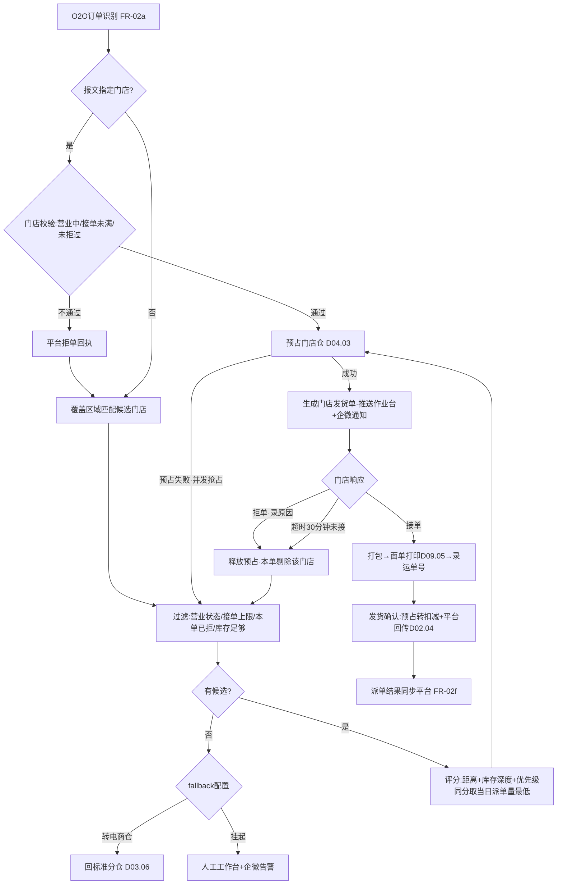
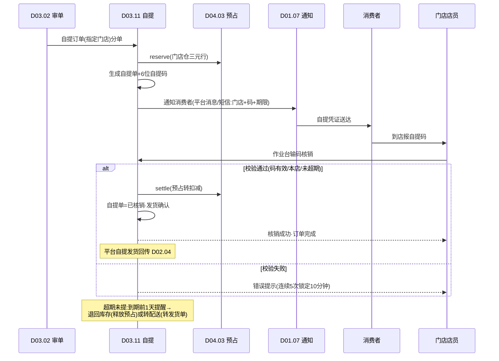
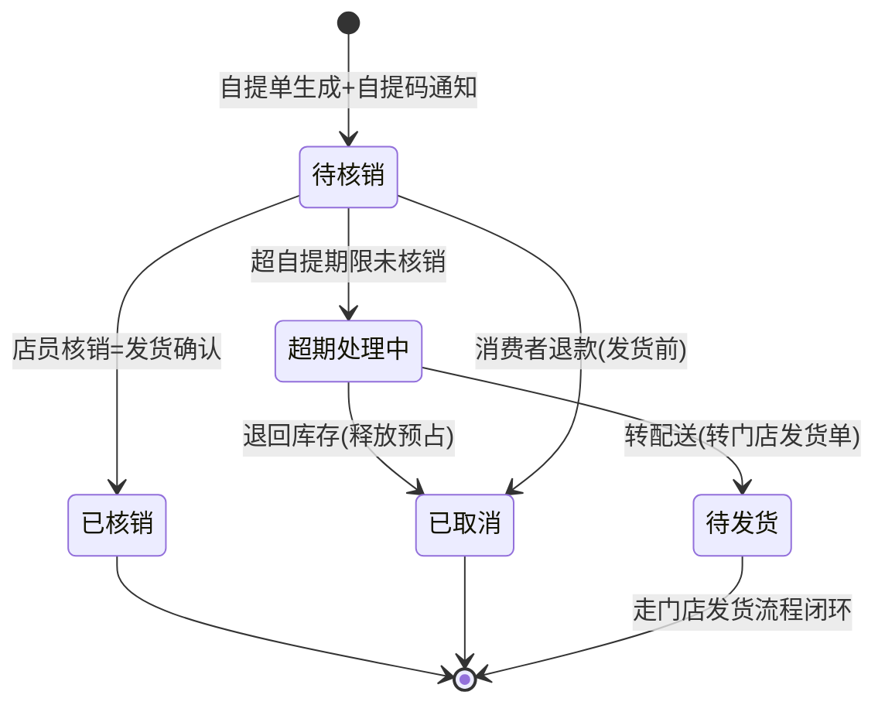

# SRS-D03.11 O2O 门店履约模块 需求规格说明书

> 文档编号：SRS-D03.11 · 版本 V1.0 · 2026-10-23 · 编写：小凯 · 状态：待审阅（批次②）
> 所属域：D03 订单履约域 · 分期：**门店发货 P1（M3）· 门店自提 P1（M3，PC/企微通知）· 自提 wap 移动端 P2 · 同城配送 P2 预留**
> 上游依据：SRS-D04.02（三元记账契约）· SRS-D04.08（可售计算与店铺同步策略）· SRS-D03.06（配货分仓）· SRS-D09.05（电子面单）· SRS-D04.06（盘点）· 逆向文档 02 §全渠道/门店仓路由 · 逆向文档 05 §5.3（tbo2o 奇门接口族）

---

## 1. 模块概述

### 1.1 定位

O2O 门店履约让**门店成为一种可履约的仓**：门店仓是库存记账行（仓×SKU×货主）中 branch 类型=门店仓的一种，与电商仓同构记账、同构预占、同构可售计算。本模块覆盖四条能力线：① 门店仓模型与库存来源；② 平台订单路由到门店发货（分单/接单/打包/发货）；③ 门店自提（自提码全生命周期）；④ 门店库存同步与简化盘点。目标是支撑「线上下单、门店发货/自提」的全渠道业务（淘系全渠道、抖音本地生活等），并为同城即时配送预留扩展位。

### 1.2 职责边界

**做**：
- 门店档案的履约属性（营业状态/接单上限/覆盖区域/经纬度/自提能力）；
- 门店仓分单规则（距离/库存深度/门店优先级/负载均衡）与拒单重分；
- 门店接单确认流（通知/接单/拒单/超时处理）；
- 门店打包发货操作台（面单打印、发货确认）与自提核销（自提码生成/通知/核销即发货）；
- 超期未提处理（退回库存/转配送）；
- 门店库存同步到平台（联动 D04.08）与门店简化盘点（联动 D04.06）。

**不做**：
- 库存记账口径与预占执行（→ D04.02/D04.03，门店仓只是 branch 类型之一，无特殊记账规则）；
- 门店档案主数据（组织归属/货主关联 → D10.01，本模块扩展履约属性）；
- 电子面单账号与打印队列（→ D09.05，本模块调用）；
- 平台全渠道接口通道（奇门 store.*/omniorder.* → D02.02 适配器实现，本模块消费统一事件）；
- 同城配送商对接（达达/顺丰同城，**P2 只写预留设计**不实现）。

### 1.3 与其他模块关系

| 模块 | 关系 |
|---|---|
| D10.01 组织 | 门店=组织树节点+branch 类型=门店仓；门店-货主-店铺关联 |
| D04.02 记账 | 门店仓三元行（branch=门店 × SKU × owner_id）；调拨入店/直送入库记流水 |
| D04.03 预占 | 门店分单成功即预占门店仓行；拒单/超时释放 |
| D04.05 调拨 | 电商仓→门店调拨（入店库存主要来源） |
| D04.06 盘点 | 门店简化盘点（人工模式：只录实盘数，差异自动生成调整单走审批） |
| D04.08 可售 | 门店可售参与店铺可售计算（店铺策略可配门店范围与占比） |
| D03.06 分仓 | 门店仓进入分仓候选集（O2O 订单专属规则链） |
| D03.07 发货单 | 门店发货单（推门店作业台而非 WMS）；自提核销=发货确认 |
| D09.05 面单 | 门店打包打印电子面单（快递直客/平台系账号） |
| D02.02/04 | 全渠道平台派单消息接收、门店发货/自提状态回传 |

---

## 2. 业务场景

**SC-D03.11-01 门店仓建档与备货（P1）**
品牌方新开 3 家直营门店接入 OMS：门店建档（D10.01）并标记 branch 类型=门店仓，配置营业状态、日接单上限、覆盖区域（行政区/电子围栏）、经纬度、是否支持自提。电商仓向门店调拨备货（D04.05 调拨单，出库仓=电商仓、入库仓=门店仓），到货确认后门店仓三元行实际库存+N，参与可售计算。

**SC-D03.11-02 平台订单路由门店发货（P1）**
淘系全渠道店铺订单（平台报文带全渠道标记或店铺配置 O2O 模式）：审单时进入门店分单规则链——订单指定门店（平台派单 store_bn）优先；否则按收货地址匹配覆盖区域 → 过滤（营业中/接单未满/本单未拒过/库存足够）→ 按「距离最近 + 库存深度 + 门店优先级」综合评分选定门店 → 预占门店仓 → 生成门店发货单 → 通知门店接单。门店 30 分钟内确认接单开始打包；拒单或超时 → 释放门店预占，回退分单规则链剔除该门店重选；无可用门店 → 转电商仓履约（fallback 店铺级可配：转仓/挂起人工）。

**SC-D03.11-03 门店打包发货（P1）**
门店店员在 PC 作业台（企微通知触达，wap 移动端 P2）看到已接单发货单：核对商品 → 打包 → 打印电子面单（D09.05，店铺绑定快递账号）→ 录入/扫描运单号 → 点击发货确认 → 出库回传（门店仓实际库存-N、预占核销）→ D02.04 平台发货回传（全渠道订单同步平台派单结果状态）。

**SC-D03.11-04 门店自提（P1）**
消费者平台下单选自提（报文 shipping=门店自提 + 自提点）：订单落库带自提标记与指定门店，分单固定为指定门店（不跑距离规则）→ 预占 → 生成自提单 → 系统生成 6 位自提码 → 通知消费者（平台消息/短信，含门店地址/营业时间/自提码）→ 消费者到店报码 → 店员作业台输入自提码核销 → 核销即发货确认（库存扣减+平台自提状态回传）→ 订单完成。

**SC-D03.11-05 超期未提（P1）**
自提单生成后 7 天（店铺级可配）未核销：到期前 1 天自动提醒（短信+平台消息）；仍超期 → 按店铺配置处理：退回库存（自提单取消、预占释放、触发平台退款流程提示人工）或 转配送（自提单转门店发货单，联系消费者补运费规则由店铺线下约定，P1 仅做转单动作+留痕）。

**SC-D03.11-06 门店简化盘点（P1）**
门店月末盘点：店员发起盘点单（联动 D04.06 人工模式，只录门店仓实盘数，不要求盲盘双人）→ 系统比对账面 → 差异生成库存调整单 → 超阈值调整推 OA 审批（D10.05）→ 审批通过调整记账 → 门店可售自动重算并同步平台。

---

## 3. 功能需求

### FR-D03.11-01 门店仓模型
- FR-01a 门店仓=branch 类型枚举新增「门店仓」；库存记账、预占、流水、成本完全复用三元契约（D04.02），**无门店特殊记账逻辑**；一个门店可服务多货主（货主维度天然隔离）。
- FR-01b 门店履约属性（扩展档案）：营业状态（营业中/停业/暂停接单）、日接单上限、覆盖区域（行政区编码集/电子围栏 GeoJSON，P1 行政区、围栏 P2）、经纬度、自提能力开关、营业时间、联系人。
- FR-01c 门店库存来源：① 调拨入店（D04.05 调拨单，在途→到店确认入库）；② 供应商直送门店（采购单收货地址=门店，D06.03 入库回传记门店仓）；③ 门店间调拨（P2 预留）；④ 盘盈调整（FR-04c）。
- FR-01d 门店可售参与 D04.08：店铺同步策略新增「门店范围」配置（参与可售的门店集合 + 门店可售占比/预留安全量）；门店可售变动触发店铺可售重算与平台回写（走 D04.08 既有任务，本模块只供给门店口径）。

### FR-D03.11-02 门店发货分单
- FR-02a O2O 订单识别：平台报文全渠道标记/店铺 O2O 模式配置 → 审单进入门店分单规则链（D03.06 的 O2O 分支插件）。
- FR-02b 指定门店优先：报文带 store_bn（平台派单）→ 校验门店（营业中/接单未满/本单未拒过）→ 直选；校验不过按平台规则回执拒单并重分。
- FR-02c 自动分单规则链（顺序过滤+评分）：覆盖区域匹配 → 过滤（营业状态/接单上限/本单已拒门店剔除/库存足够——查门店仓可用量含预占）→ 评分=距离权重×距离分 + 库存深度权重×深度分 + 门店优先级权重×优先级分（权重店铺级可配）→ 同分取当日派单量最低（负载均衡，沿袭逆向文档 02 pickBranchByLowestDispatch）。
- FR-02d 分单即预占：选定门店 → FreezeService::reserve（门店仓三元行）→ 生成门店发货单；预占失败（并发抢占）→ 剔除该门店重评分。
- FR-02e 拒单/超时重分：门店拒单（须录原因）或超时未接单（默认 30 分钟，店铺级可配）→ 释放预占 → 回规则链重选（已拒门店本单内剔除）；无可用门店 → fallback（转电商仓/挂起人工，店铺级配置）。
- FR-02f 平台派单结果同步：分单/接单/拒单/发货状态经 D02.04 回传平台（全渠道派单结果同步接口，tbo2o OMNIORDER_ALLOCATEDINFO_SYNC 语义的新栈实现）。

### FR-D03.11-03 门店作业台（接单/打包/发货）
- FR-03a 接单确认：门店发货单推送作业台待接单队列 + 企微通知（P1；wap 移动端 P2）；接单/拒单操作留痕（操作人/时间/原因）。
- FR-03b 打包发货：核对明细 → 面单打印（D09.05，店铺-快递账号绑定；打印记录回写）→ 运单号录入（手输/扫码）→ 发货确认 → 触发标准出库回传链路（预占转扣减 + 平台发货回传）。
- FR-03c 门店发货单不推 WMS（sync_status=无需推仓，门店自作业）；指令状态机复用 D03.07（叫回=通知门店停止作业，门店已发货则叫回失败转售后）。
- FR-03d 同城配送对接（**P2 预留**）：发货方式枚举预留「同城配送」；配送商适配层接口占位（下单/取消/状态回调，达达/顺丰同城）；P1 门店发货仅支持快递面单与自提。

### FR-D03.11-04 门店自提
- FR-04a 自提单生成：订单 shipping=门店自提 → 分单固定指定门店 → 预占 → 生成自提单（关联发货单，履约方式=自提）；自提单状态机：待核销/已核销(完成)/已取消/超期处理中。
- FR-04b 自提码：核销凭证 6 位数字码（店铺内当日唯一性+防猜测：随机生成，校验位可选）；生成即通知消费者（平台消息通道优先，短信兜底 D01.07）；码有效期=自提期限。
- FR-04c 核销即发货：店员作业台输码（或扫消费者出示码，P2）→ 校验（码有效/未核销/属本门店/未超期）→ 核销 = 发货确认（预占转扣减 + 平台自提发货回传 + 订单完成事件）；核销留痕（操作店员/时间/设备）。错误码连续 5 次锁定 10 分钟（防暴力尝试）。
- FR-04d 超期未提：自提期限（默认 7 天，店铺级可配）到期前 1 天自动提醒；超期按配置：退回库存（取消自提单+释放预占+提示人工发起平台退款）/ 转配送（自提单转门店发货单，转单留痕）；处理结果通知消费者。
- FR-04e 自提改期/改门店（P2 预留）：消费者申请改自提门店 → 库存跨门店转移（释放+重占）；P1 不支持，客服走取消重下。

### FR-D03.11-05 门店库存同步与盘点
- FR-05a 门店库存查询：作业台/品牌方门户按门店×SKU×货主查五口径（D04.02 只读视图）；门店维度库存报表供 D11。
- FR-05b 门店简化盘点（联动 D04.06 人工模式）：门店发起盘点单（可全场/按 SKU 圈选）→ 录实盘数 → 系统算差异 → 差异生成调整单 → 阈值内自动过账、超阈值推 OA（D10.05）→ 调整记账 + 可售重算；盘点期间门店仓不锁库（允许继续卖，以盘点快照时间点对账）。
- FR-05c 平台门店库存回写：全渠道平台要求的门店库存同步（初始化/增量，奇门 storeinventory 语义）经 D04.08 同步任务执行，本模块提供门店范围与占比策略输入；同步失败告警走 D04.08 既有机制。

---

## 4. 业务流程

### 4.1 门店发货路由全流程



### 4.2 门店自提核销流程



### 4.3 自提单状态机



---

## 5. 处理逻辑

### 5.1 门店评分算法（FR-02c）

```
输入: 候选门店集合 S(过滤后), 收货地址 geo, 店铺权重配置 W
for store in S:
    dist_score  = 1 - min(距离(store.geo, geo) / 店铺最大半径, 1)
    depth_score = min(门店可用量 / 订单需求量, 3) / 3   # 库存深度,封顶3倍
    prio_score  = store.priority / 100                  # 门店优先级档案值
    load_score  = 1 - store.当日已派单量 / store.日接单上限
score = W.dist*dist_score + W.depth*depth_score + W.prio*prio_score
选取: max(score); 并列取 load_score 最高(负载均衡)
权重默认: dist=0.4, depth=0.3, prio=0.3 (店铺级可配, 和=1 校验)
距离计算 P1: 行政区同区=近/邻区=中/其他=远 三档(不依赖地图API);
         P2: 经纬度球面距离或地图路径距离
结果缓存: (area_id → 候选门店集) 缓存10分钟(沿袭逆向文档02 area缓存),
         门店档案变更/停业事件主动失效
```

### 5.2 接单超时与重分（补偿顺序）

```
门店发货单推送 → 启动超时定时器(MQ延迟消息, 默认30min店铺可配)
接单 → 取消定时器, 状态=待打包
拒单/超时 → 1) FreezeService::release(门店预占)  [幂等]
           2) 发货单状态=已叫回, 记录拒单原因/超时
           3) 本单已拒门店集 << store_id
           4) 重入规则链(§5.1) → 无候选走 fallback
           5) 平台拒单回执回传(D02.04)
并发防护: 发货单级分布式锁; 接单与超时消息竞争以先到者为准,
         后到者校验状态机非法流转直接丢弃(留痕)
```

### 5.3 自提码生成与核销校验

```
生成: 6位数字随机; 唯一约束=(shop_id, 生效日期, code) 冲突重生成(上限10次);
     有效期 = 自提单生成时间 + 自提期限
核销校验链(顺序短路):
  1. 码存在且属本门店 → 2. 状态=待核销 → 3. 未超期 → 4. 锁定检查
校验通过: 订单级分布式锁内执行 settle+状态流转(核销与超期处理互斥);
错误计数: Redis INCR(门店+设备维度), 5次锁定10分钟, 核销成功清零
安全: 自提码通知含脱敏订单号; 核销操作绑定店员账户(作业台登录态)
```

### 5.4 超期未提处理

```
调度任务(每日2次)扫描: 待核销 AND now > 到期时间-1天 → 发提醒(每单一次,留痕防重)
now > 到期时间 → 状态=超期处理中 → 按店铺配置:
  退回库存: 自提单取消 + release预占 + 事件 order.pickup.expired_return
           → 人工工作台提示发起平台退款(不自动退,平台自提单退款需人工确认)
  转配送:   自提单关闭 + 生成门店发货单(复用原预占,变更履约方式留痕)
           → 通知消费者转配送 + 门店作业台待发货
```

### 5.5 门店可售供给（与 D04.08 分工）

```
D03.11 供给: 店铺同步策略中的门店范围配置(门店集合+每店占比/预留安全量)
D04.08 执行: 店铺可售 = 电商仓口径 + Σ(参与门店可用量 × 占比 − 门店预留)
门店库存变动(调拨入库/发货扣减/盘点调整) → D04.08 既有可售重算事件驱动
本模块不做可售公式,只保证门店三元行口径正确与策略配置输入
```

### 5.6 门店简化盘点差异处理

```
盘点单创建 → 快照门店仓账面数(快照时间点记账)
录实盘数 → 差异 = 实盘 − 账面
|差异| ≤ 店铺阈值(金额或件数) → 自动生成调整单直接过账(D04.02)
超阈值 → 调整单推 OA 审批(D10.05) → 通过过账/驳回留痕关闭
过账后 → 发布库存变动事件 → D04.08 可售重算 → 平台门店库存回写
盘点期间不锁库: 快照后至过账前发生的销售, 以流水回放校正差异
(校正后仍差异超阈值 → 强制人工复核, 不允许静默过账)
```

---

## 6. 数据字段（业务字段描述）

### 6.1 门店履约属性（store_profile，1:1 挂 branch）

| 字段 | 业务含义 | 取值/校验 |
|---|---|---|
| branch_id | 门店仓 ID（branch 类型=门店仓） | 必填唯一 |
| store_name / contact / phone | 门店名/联系人/电话 | 电话脱敏展示 |
| biz_status | 营业状态 | 营业中/停业/暂停接单（停业即时分单候选剔除） |
| daily_order_limit | 日接单上限 | >0；当日派单量达上限自动暂停接单 |
| cover_area_codes | 覆盖区域行政区编码集 | JSON 数组；与围栏二选一（P1 行政区） |
| geo_fence / lng / lat | 电子围栏（P2）/经纬度 | 经纬度必填（评分用） |
| pickup_enabled | 自提能力开关 | 关闭则不参与自提分单 |
| biz_hours | 营业时间 | 通知文案与超期提醒时段判断用 |
| priority | 门店优先级 | 0-100，评分输入 |
| accept_timeout | 接单超时分钟 | 空取店铺默认 30 |
| tenant_id / owner_id / shop_scope | 租户/归属货主/服务店铺集 | 全单据贯穿；一店多货主时 owner 记记账行不记档案 |

### 6.2 门店发货单扩展（挂 delivery）

| 字段 | 业务含义 | 取值/校验 |
|---|---|---|
| fulfill_mode | 履约方式 | 门店发货/门店自提（P2 预留同城配送） |
| store_branch_id | 履约门店仓 | 必填 |
| accept_status | 接单状态 | 待接单/已接单/已拒单/超时转派 |
| accept_operator / accept_time / refuse_reason | 接单人/时间/拒因 | 拒单必填原因 |
| rejected_store_ids | 本单已拒门店集 | 重分剔除输入 |
| dispatch_round | 分单轮次 | ≥1，监控重分次数（>3 告警） |
| waybill_no / print_time | 运单号/面单打印时间 | 发货确认前必填运单号 |

### 6.3 自提单（pickup_order）

| 字段 | 业务含义 | 取值/校验 |
|---|---|---|
| pickup_bn / order_id / delivery_id | 自提单号/关联订单/发货单 | 必填 |
| store_branch_id / shop_id | 自提门店/店铺 | 必填 |
| pickup_code | 自提码 | 6 位数字；(shop_id,日期,code) 唯一 |
| status | 状态 | 待核销/已核销/已取消/超期处理中（§4.3） |
| expire_time | 自提期限 | 生成时间+期限（店铺级默认 7 天） |
| verify_operator / verify_time | 核销店员/时间 | 核销必填 |
| overdue_action | 超期处理方式快照 | 退回库存/转配送 |
| remind_sent | 到期提醒已发标记 | 防重发 |
| tenant_id / owner_id | 租户/货主 | 必填 |

---

## 7. 接口

### 7.1 内部接口

| 编号 | 接口 | 消费方 | 说明 |
|---|---|---|---|
| IF-D03.11-01 | `StoreRouteService::match(order, geo)` | D03.06 分仓（O2O 插件） | 返回评分排序的候选门店集；含过滤与缓存 |
| IF-D03.11-02 | `StoreRouteService::reject(deliveryId, storeId, reason)` | 作业台/超时定时器 | 拒单重分：释放预占+剔除+重选（§5.2），幂等 |
| IF-D03.11-03 | `PickupService::create(order)` / `verify(code, storeId, operator)` / `cancel(pickupBn)` | D03.07/作业台/调度 | 自提单生成/核销即发货/取消，核销幂等 |
| IF-D03.11-04 | `StoreStockService::supplyStrategy(shopId)` | D04.08 | 门店范围+占比策略输入 |
| IF-D03.11-05 | `StoreStockService::snapshotCount(branchId)` | D04.06 | 门店简化盘点快照与差异回传 |
| IF-D03.11-06 | 事件 `store.order.dispatched` / `store.order.accepted` / `store.order.refused` / `pickup.verified` / `pickup.expired` | D02.04/D11/D01.07 | 平台回传、监控与通知联动 |
| IF-D03.11-07 | 订阅 `platform.omniorder.assigned`（平台派单）/ `delivery.timeout.accept`（延迟消息） | 经 D02.03/D01.01 | 指定门店分单与超时驱动 |

### 7.2 外部接口

| 编号 | 接口 | 方向 | 说明 |
|---|---|---|---|
| EF-D03.11-01 | 全渠道平台接口（经 D02.02 适配器） | 双向 | 门店建档同步、派单结果同步、接单/拒单/发货/自提状态回传（奇门 store/omniorder 语义） |
| EF-D03.11-02 | 平台门店库存同步（经 D04.08/D02.04） | 出 | 初始化/增量门店库存回写 |
| EF-D03.11-03 | 企微/短信通知（经 D01.07） | 出 | 门店接单提醒、消费者自提码与到期提醒 |
| EF-D03.11-04 | OA 审批（经 D10.05） | 双向 | 门店盘点超阈值调整审批 |
| EF-D03.11-05 | 同城配送商 API（达达/顺丰同城） | 双向 | **P2 预留**：适配层接口占位（下单/取消/状态回调），P1 不实现 |

---

## 8. 非功能需求

| 项 | 要求 |
|---|---|
| 性能 | 门店评分分单单次 ≤ 100ms（候选缓存命中）；自提核销端到端 ≤ 500ms；接单超时定时器精度 ±1 分钟 |
| 并发 | 同一订单分单/拒单/接单操作以发货单级锁串行化；多订单并发抢同一门店库存以预占原子性兜底（D04.03） |
| 幂等 | 核销/接单/拒单/超期处理全部幂等（状态机非法流转丢弃留痕）；延迟消息重投安全 |
| 一致性 | 预占-发货单-自提单三者状态联动在同一事务或补偿链内闭环；盘点差异过账以流水回放校正，不允许静默吞差 |
| 安全/PIPL | 消费者收货 geo 仅用于分单，展示脱敏；自提码通知不含明文订单全号；店员操作绑定账户审计（D10.06） |
| 可用性 | 作业台不可用时门店可电话报单，客服代操作（留痕 operator=客服+备注门店）；通知通道降级顺序：平台消息→短信→企微人工 |
| 租户隔离 | 门店数据按 tenant/owner 行隔离；品牌方门户仅见本货主门店库存与履约单 |

---

## 9. 验收标准

| 编号 | 验收条件 |
|---|---|
| AC-01 | 门店仓建档后，调拨入店到货确认，门店三元行（门店×SKU×货主）实际库存正确增加，流水可追溯至调拨单 |
| AC-02 | 店铺同步策略配置门店范围与占比后，D04.08 店铺可售含门店口径；门店发货扣减后平台可售同步回写 |
| AC-03 | 平台指定门店订单：门店校验通过直选并预占；校验不过（停业/接单满）回执拒单并自动重分 |
| AC-04 | 自动分单按距离/库存深度/优先级权重评分选店，同分取当日派单量最低门店；权重修改后新订单即生效 |
| AC-05 | 门店拒单（录原因）或 30 分钟超时未接单：预占释放、本单剔除该门店、自动重选下一门店；重分 3 次仍失败触发告警转人工 |
| AC-06 | 无可用门店时按 fallback 配置转电商仓履约或挂起人工，两条路径均有留痕与通知 |
| AC-07 | 门店打包发货闭环：面单打印记录回写、运单号必填校验、发货确认后预占转扣减且平台收到发货回传；门店发货单全程无 WMS 推仓指令 |
| AC-08 | 自提单生成后消费者收到含门店信息与 6 位自提码的通知；店员输码核销成功即完成发货确认（库存扣减+订单完成+平台自提状态回传），全程 ≤ 500ms |
| AC-09 | 自提码错误连续 5 次锁定 10 分钟；重复核销同一码幂等返回首次结果不重复扣库存 |
| AC-10 | 超期未提：到期前 1 天收到提醒（每单仅一次）；超期后按店铺配置走退回库存（预占释放+人工退款提示）或转配送（转门店发货单留痕），状态机流转符合 §4.3 |
| AC-11 | 门店简化盘点：差异阈值内自动过账、超阈值推 OA 审批后过账；盘点期间销售流水回放校正，校正后仍超阈值强制人工复核 |
| AC-12 | 品牌方门户仅见本货主门店的库存、发货单、自提单与盘点结果（租户行隔离） |

---

## 变更记录

| 日期 | 版本 | 变更 | 原因 |
|---|---|---|---|
| 2026-10-23 | V1.0 | 首版 | — |

---

*参考实现溯源：商派 o2o/logisticsmanager 门店仓与覆盖区域模块 + tbo2o 阿里全渠道（逆向文档 05 §5.3：QIMEN_STORE_* 门店建档、QIMEN_STOREINVENTORY_* 门店库存四操作、OMNIORDER_ALLOCATEDINFO_SYNC 派单结果同步、店掌柜接单/拒单/发货）+ o2o_store::getBranchIdByStoreBn 指定门店校验（接单上限/已拒门店过滤，逆向文档 02 §618-629）+ o2o_autostore::matchStoreBranch 门店优选规则与 area_id 缓存 + pickBranchByLowestDispatch 当日派单量最低负载均衡 + checkStoreBranchStore 门店库存过滤（含 O2O 仓级冻结扣减）+ shipping=='STORE_SELF_FETCH' 自提不拆单约束。关键差异：① 门店仓纳入三元记账（商派门店库存独立表 sdb_ome_branch_product，货主维度缺失）；② 分单评分显式权重化（商派规则分散在 autostore/覆盖区域两套机制）；③ 自提码核销即发货产品化（商派依赖店掌柜手工发货确认，无码核销闭环）；④ 拒单/超时补偿链路显式 Saga 化；⑤ 同城配送适配层 P2 预留（商派无）。*
