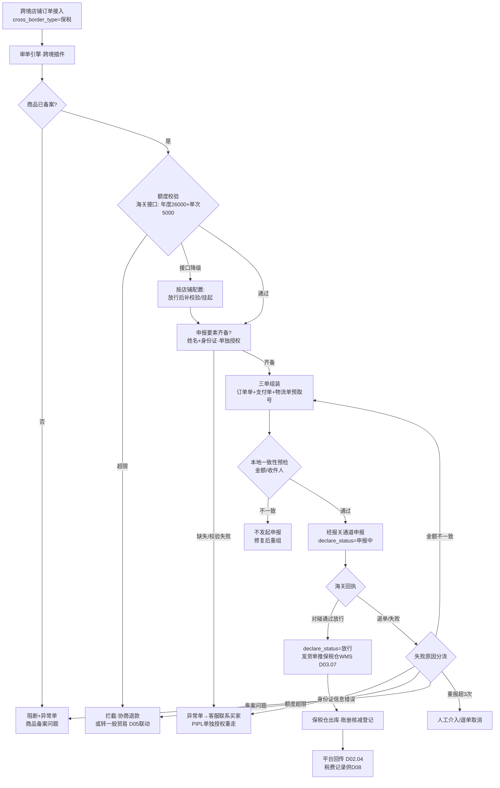
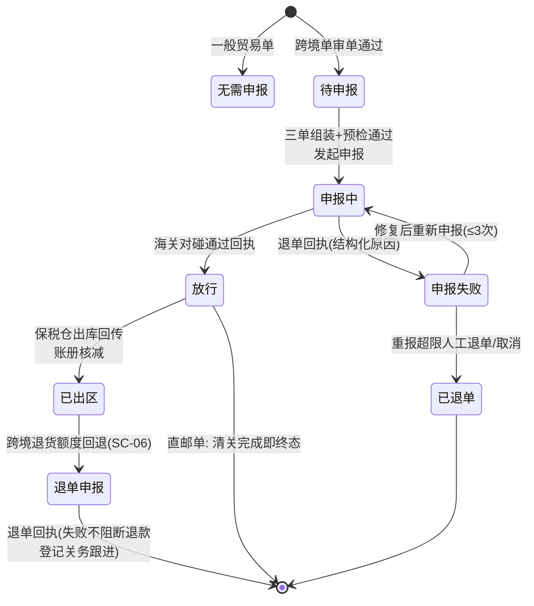

# SRS-D03.12 跨境申报模块 需求规格说明书

> 文档编号：SRS-D03.12 · 版本 V1.0 · 2026-10-23 · 编写：小凯 · 状态：待审阅（批次②·P2 占位）
> 所属域：D03 订单履约域 · 分期：**P2（M4 之后启动，本轮写完整需求；P0 期仅落数据模型预留）**
> 上游依据：SRS-00 §1.5 分期口径 · 逆向文档 02 §2.1.1（商派 process_status='is_declare' 跨境申报订单标记）· SRS-D03.01 订单接入 · SRS-D09.01 仓库档案 · SRS-D01.05 PIPL 组件
> ⚠️ 业务假设声明：凯淳跨境场景假设为「品牌方跨境商品代工运营」（保税进口为主、直邮进口为辅），**待业务确认**；海关对接细节（单一窗口版本、口岸通道、账册格式）以实际接入的报关服务商/平台接口为准，本文按行业通用规则编写。

---

## 1. 模块概述

### 1.1 定位

跨境订单的「合规关卡」：在正向履约链路（审单→推仓）中插入海关监管环节，实现**三单对碰申报**（订单/支付单/物流单）、**个人年度交易额度校验**、**商品备案要素管理**与**保税仓特殊库存管控**，确保跨境商品「先申报、后放行、再发货」的监管时序，并保证 OMS 库存账与海关账册可对照审计。

### 1.2 职责边界

**做**：跨境订单识别与流程分叉（申报→放行→发货）；三单信息组装与申报（经报关服务商/单一窗口通道）；申报状态机与失败处理（退单/重新申报）；个人年度额度（26000 元/年）校验编排；商品跨境备案档案（HS 编码/行邮税/申报要素）；保税仓 branch 类型管控规则（不可调拨出保税、账册对账）；跨境税费试算与记录（供 D08 财务）。
**不做**：报关通道对接的传输层实现细节（→ 报关服务商 SDK/奇门通道，经 D02.01 接入框架统一管理签名与日志）；支付单本体（→ 平台/支付机构，本模块只取三单对碰所需字段）；国际物流段运输管理（→ D09.04 物流档案扩展）；税费的财务记账（→ D08，本模块供数）；海关账册的申报主体资格管理（企业备案/保证金等线下事务，系统只登记结果）。

### 1.3 与其他模块关系

| 模块 | 关系 |
|---|---|
| D03.01 订单接入 | 跨境订单识别（店铺跨境标记+商品备案属性）；订单表报关字段位（P0 预留） |
| D03.02 审单引擎 | 跨境单审单插件：额度校验+申报前置检查；申报放行前不生成推仓指令 |
| D03.07 发货单管理 | 放行后才允许发货单推送 WMS（保税仓）；申报失败叫回已生成指令 |
| D04.01 商品物料 | 跨境备案档案挂物料（HS 编码/申报要素/行邮税率）；未备案商品阻断跨境履约 |
| D04.02/D04.05 库存 | 保税仓 branch 类型=保税：可用口径正常参与售卖，但**调拨出库方向禁止**（只允许保税→消费者出库、保税→退运出库） |
| D05 售后 | 跨境退货特殊性：已申报订单退款需向海关申报退单（额度回退）；保税仓退货入库联动账册核减 |
| D08 财务 | 跨境综合税试算记录供数（税金代收代缴对账） |
| D01.05 PIPL | 身份证信息（申报必需）加密存储、单独授权、脱敏展示——本模块是 PIPL 最高敏感场景 |
| D10.04 品牌方门户 | 品牌方跨境商品备案资料维护入口（P2） |
| D11.03 看板 | 申报成功率/放行时效/额度拒单率监控 |

---

## 2. 业务场景

**SC-D03.12-01 保税进口主流程（主场景）**
品牌方跨境商品入保税仓（海关账册备案）。买家在跨境店铺下单支付。OMS 识别为跨境保税单：审单时校验买家个人年度额度（调海关额度接口，本单应税金额 ≤ 剩余年度额度 26000 元内）→ 组装三单信息（订单单+支付单+物流运单预分配）→ 经报关通道向单一窗口申报 → 海关对碰通过放行 → 发货单推保税仓 WMS 出库 → 平台回传。申报到放行的正常时效为分钟级~小时级，订单在「已申报待放行」状态挂起等待。

**SC-D03.12-02 直邮进口**
境外仓直邮订单（无保税仓环节）：审单后组装三单申报（物流单为国际运单），海关放行后境外仓发货、国际段+清关+国内派送。OMS 跟踪申报状态与清关节点；直邮单个人额度同样校验，行邮税/跨境综合税按商品备案税率试算记录。

**SC-D03.12-03 申报失败处理**
三单对碰不一致（如支付单金额与订单实付不符——平台优惠分摊口径差异）被海关退单：申报状态=申报失败，退单原因结构化记录（对碰不一致/身份证信息校验失败/额度超限/商品备案问题）。系统按原因分流：金额不一致→自动重算三单金额重新申报；身份证信息错误→生成异常单（D03.09 类型扩展 CROSS_BORDER_DECLARE）派客服联系买家重新提供（PIPL 流程重走授权）；额度超限→引导转一般贸易渠道或协商退款（联动 D05）；重新申报次数超限（默认 3 次）→ 人工介入或退单取消。

**SC-D03.12-04 额度超限拦截**
买家年度剩余额度 200 元，本单跨境应税金额 500 元：审单额度校验不通过，订单拦截并告知原因（平台侧也有限额提示，OMS 侧兜底防平台漏拦）；处理路径=与买家协商（拆单降额不可行——海关按单对碰）→ 退款或换一般贸易商品。

**SC-D03.12-05 保税仓账册对账**
月末关务专员执行账册对账：海关账册（备案入册量/已出区量/结余）vs OMS 保税仓库存（D04.02 三元记账：实际/在途/出库流水）。差异清单（如海关已放行 OMS 未出库、退运未申报核减）逐项定位处理；对账报告归档供海关稽查与品牌方审计。

**SC-D03.12-06 跨境退货与额度回退**
买家退货已申报放行的跨境订单：退货入保税仓（或指定退货仓）后，除正常退款流程（D05）外，向海关申报退单——个人年度额度回退（26000 额度恢复）、账册核减。退单申报失败不阻断退款（业务容错：退款时效优先），但登记关务跟进任务。

---

## 3. 功能需求

### FR-D03.12-01 跨境订单识别与流程分叉
- FR-01a 识别规则：店铺跨境属性（cross_border_type：保税/直邮/无）+ 商品备案属性双重判定；店铺为跨境店但含未备案商品 → 阻断并生成异常（商品备案问题）。
- FR-01b 流程分叉：跨境单审单通过后不直接推仓，进入申报子流程（状态=待申报→已申报→放行/失败）；放行事件触发货单推送（D03.07）；一般贸易单不受影响。
- FR-01c 商派对照：继承 `process_status='is_declare'` 语义，但实现为**独立的申报状态字段**（declare_status），不混入订单流程状态机（对齐 SRS-00 §4.4 状态契约的收敛原则）。

### FR-D03.12-02 三单对碰申报
- FR-02a 三单组装：订单单（订单号/商品明细/数量/金额——**海关口径金额=商品实付+运费+保费-平台优惠分摊**，分摊规则可配置对齐 D08 双口径）、支付单（支付流水号/支付企业/支付金额/支付时间，取自平台支付信息或支付机构接口）、物流单（运单号/物流企业编码/收发件人——保税单在申报前预分配国内段运单号，经 D09.05 面单预取号）。
- FR-02b 申报通道：经报关服务商接口（可插拔适配器，接入框架 D02.01 管理签名/限流/报文日志）；支持多通道（不同口岸/服务商按保税仓路由）。
- FR-02c 申报状态机：待申报→申报中→已申报（对碰中）→放行/申报失败/退单；海关回执异步接收（回调+轮询兜底）；全部报文留痕（申报原文/回执原文，保存期 ≥3 年，海关稽查要求）。
- FR-02d 一致性预检：申报前本地校验三单金额一致性（订单单金额=支付单金额，容差=0；物流单收件人与订单收货人一致）——预检不通过不发起申报，直接走失败分流（减少海关退单率）。
- FR-02e 重新申报：失败单修复后重报（携带原申报流水号关联）；重报次数限制与超限人工介入（SC-03）。

### FR-D03.12-03 个人年度额度校验
- FR-03a 校验时机：审单插件（D03.02 跨境插件）同步调用海关额度接口（经报关通道代理），入参=身份证号+姓名（密文传输）；返回=剩余年度额度。
- FR-03b 判定：本单跨境应税金额 ≤ 剩余额度 → 通过；否则拦截（SC-04 路径）。单次交易限额（5000 元）同步校验。
- FR-03c 降级策略：额度接口不可用时按店铺配置决定「放行后补校验（申报环节海关兜底拦截）」或「挂起等待」；降级放行订单打标，申报失败率纳入监控。
- FR-03d 额度回退：跨境退货完成退单申报后，跟踪额度恢复回执（对账用）。

### FR-D03.12-04 申报要素与身份证信息（PIPL 特别处理）
- FR-04a 申报要素采集：跨境订单必须含收件人真实姓名+身份证号（平台加密下发或买家补填）；采集页/客服补录均走**单独授权**流程（明示用途=海关申报，D01.05 PIPL 组件：独立授权留痕，不与通用隐私协议合并勾选）。
- FR-04b 存储与展示：身份证号字段级加密（D01.05 信封加密），任何界面/导出全脱敏（仅显示前 1 后 1 位）；访问明文仅限申报组装服务账号，每次访问写审计（D10.06）；申报报文经加密通道传输，本地报文日志中身份证号同样脱敏（申报原文单独密文存储）。
- FR-04c 校验：身份证号格式与实名一致性校验（姓名-证号二要素，经报关通道或平台校验接口）；校验失败走 SC-03 客服联系买家路径。
- FR-04d 数据最小化：放行后 N 天（默认 90 天，可配）申报要素明文按需保留（海关稽查窗口），到期仅保留密文与脱敏索引。

### FR-D03.12-05 商品跨境备案档案
- FR-05a 备案字段（挂 D04.01 物料扩展）：HS 编码（海关商品编码）、商品名称（申报品名，可与销售名不同）、规格型号、申报单位/单位换算、行邮税率/跨境综合税率、原产国、备案口岸/账册号、备案状态（未备案/备案中/已备案/失效）。
- FR-05b 备案维护：品牌方门户提交备案资料（P2）→ 凯淳关务审核 → 报关服务商备案 → 回执更新状态；备案失效（海关政策调整）自动扫描在架跨境商品并告警。
- FR-05c 履约阻断：未备案/失效商品出现在跨境订单 → 审单阻断 + 异常单（商品备案问题类型）；税费试算按备案税率（记录到订单税费字段，供 D08 代收代缴对账）。

### FR-D03.12-06 保税仓特殊管控
- FR-06a branch 类型扩展（**P0 期预留**）：仓库档案（D09.01）类型枚举含「保税仓」；保税仓关联账册号/口岸/海关编码字段位。
- FR-06b 库存流向管控：保税仓库存**禁止调拨出保税**（D04.05 调拨单出库仓=保税时阻断，仅允许：保税→消费者出库（销售）、保税→境外退运、保税→海关销毁）；普通仓不可调入保税（入册需海关手续，走独立入册流程登记）。
- FR-06c 账册管理：账册档案（账册号/口岸/企业主体/有效期）；入册登记（采购入库联动：入库回传后登记入册量）；核减登记（销售出库/退运/销毁）；账册结余 = 入册 − 核减，系统内计算值供对账。
- FR-06d 账册对账（SC-05）：月度对账单生成——海关账册数据（经服务商接口或人工导入）vs OMS 保税仓三元记账（D04.02）vs 账册登记结余，三方对照差异清单；差异处理任务闭环；对账报告归档。

### FR-D03.12-07 P0 期数据模型预留（本模块唯一 P0 交付）
- FR-07a 订单表预留字段位：`cross_border_type`（无/保税/直邮）、`declare_status`（空/待申报/申报中/放行/失败/退单/无需申报）、`declare_id`（申报单引用，P2 建表前空置）——P0 期建表即含（默认值=无/无需申报），避免 P2 期改核心订单表。
- FR-07b branch 表类型枚举含「保税」+ 账册关联字段位（P0 建表预留，管控逻辑 P2 实现）。
- FR-07c 物料扩展表预留备案要素 JSON 字段位（hs_code/declare_name/tax_rate 等，P0 空置）。
- FR-07d 订单明细预留行级税费字段位（tax_amount，P0 空置）。

---

## 4. 业务流程

### 4.1 跨境订单申报流程（保税进口）



### 4.2 申报状态机



---

## 5. 处理逻辑

### 5.1 三单金额一致性口径（对碰失败最高频根因）

```
订单单申报金额 = Σ(商品行海关口径金额) + 运费 + 保费
商品行海关口径金额 = 行实付（客户实付口径，D08 双口径之一）
  ——平台优惠中「平台承担」部分是否计入境内/境外分摊，
    按口岸规则配置（配置项：deduct_platform_subsidy，默认按服务商指引）
支付单金额 = 支付机构回执实付金额（须=订单单金额，容差 0）
预检不通过 → 本地修复重组，禁止带病申报（海关退单率高会触发通道降级审查）
```

### 5.2 额度校验规则

- 年度额度 26000 元/人/年（跨境电商零售进口政策口径，政策调整时配置化更新）；单次 5000 元；
- 校验以**海关接口实时返回**为准，OMS 不做本地额度缓存记账（避免与海关不一致；仅缓存「接口不可用」降级状态）；
- 降级放行单的补校验：申报环节海关必校验，OMS 侧仅监控此类单的申报失败率（>阈值告警，提示关闭降级放行）。

### 5.3 保税库存流向管控矩阵（P2 生效，P0 仅预留类型）

| 流向 | 允许 | 说明 |
|---|---|---|
| 保税仓 → 消费者（销售出库） | ✅ | 放行后出库，账册核减 |
| 保税仓 → 境外（退运） | ✅ | 海关退运手续后出库，账册核减 |
| 保税仓 → 销毁 | ✅ | 海关监督销毁，账册核减凭销毁单 |
| 保税仓 → 普通仓（调拨） | ❌ | D04.05 出库仓=保税即阻断（完税手续非 OMS 范畴） |
| 普通仓 → 保税仓（调拨） | ❌ | 入册需一线进境手续，走独立入册登记 |
| 保税仓库存参与可售同步（D04.08） | ✅ | 仅限跨境店铺；一般贸易店铺可售计算排除保税仓（分仓规则约束） |

### 5.4 账册对账算法

```
OMS 侧应存 = 入册登记量 − 销售出库(已出区) − 退运 − 销毁
差异 = 海关账册结余 − OMS 侧应存
差异分类：时间性(申报在途/回执延迟，T+3 自动复核消除) /
         实质性(漏登记/多核减/WMS账实差异，生成差异处理任务闭环)
```

---

## 6. 数据字段（业务字段描述）

### 6.1 申报单（cross_border_declare，P2 建表）

| 字段 | 业务含义 | 取值/校验 |
|---|---|---|
| declare_bn | 申报流水号 | 唯一，关联海关回执号 |
| order_id / shop_id / owner_id / tenant_id | 归属 | 必填（全域契约） |
| declare_mode | 申报模式 | 保税/直邮 |
| channel_code | 报关通道 | 服务商×口岸（按保税仓路由） |
| order_bill / pay_bill / logistics_bill | 三单快照 | JSON 密文（含身份证脱敏索引） |
| total_amount / tax_amount | 申报金额/试算税费 | 海关口径（§5.1） |
| status | 申报状态 | §4.2 状态机 |
| retry_count / fail_reason_code / fail_reason | 重报次数/失败原因 | 结构化原因码（对碰不一致/身份证/额度/备案/其他） |
| receipt_raw / declare_raw | 回执/申报原文 | 密文存储 ≥3 年（稽查要求） |
| release_time / export_time | 放行/出区时间 | 时效监控依据 |

### 6.2 商品备案档案（goods_customs_record，P2 建表；P0 物料扩展 JSON 字段位预留）

| 字段 | 业务含义 |
|---|---|
| bm_id / owner_id | 归属物料与货主 |
| hs_code / declare_name / spec | HS 编码/申报品名/规格型号 |
| declare_unit / unit_ratio | 申报单位/与销售单位换算 |
| tax_rate（行邮/综合） / origin_country | 税率/原产国 |
| record_port / record_book_no / record_status | 备案口岸/账册号/备案状态 |
| record_receipt / effective_period | 备案回执/有效期 |

### 6.3 账册（customs_book）与账册流水（book_ledger_log，P2 建表）

| 字段 | 业务含义 |
|---|---|
| book_no / port / corp_entity / branch_id / valid_period | 账册号/口岸/企业主体/关联保税仓/有效期 |
| 流水：book_no/direction(入册·销售核减·退运·销毁)/ref_bill/num/occur_time | 每笔变动记流水（对齐 D04.04 流水思想），结余可追溯 |

### 6.4 P0 期预留字段位（随 P0 建表落地，FR-07）

| 表 | 预留字段 | P0 默认值 |
|---|---|---|
| orders | cross_border_type / declare_status / declare_id | 无 / 无需申报 / NULL |
| order_items | tax_amount | NULL |
| branch | branch_type 枚举含「保税」/ book_no 关联位 | 非保税 / NULL |
| material 扩展 | customs_record JSON 字段位 | NULL |

---

## 7. 接口

### 7.1 内部接口

| 编号 | 接口 | 消费方 | 说明 |
|---|---|---|---|
| IF-D03.12-01 | `DeclareService::prepare(orderId)` | D03.02 审单通过后编排 | 三单组装+预检+发起申报，幂等（declare_bn） |
| IF-D03.12-02 | `DeclareService::quotaCheck(idCardCipher, name, amount)` | D03.02 跨境审单插件 | 额度校验（同步，密文入参；返回剩余/拦截原因/降级态） |
| IF-D03.12-03 | `DeclareService::queryStatus(declareBn)` / 回调接收 | D03.07 推仓前置/回执处理 | 放行判定依据；回执异步（回调+轮询兜底） |
| IF-D03.12-04 | `RecordService::checkGoods(bmIds[], port)` | D03.02 审单插件 | 商品备案状态批量校验 |
| IF-D03.12-05 | `BookService::register(入册/核减流水)` | D06.03 入库回传/D09.02 出库回传 | 账册联动登记 |
| IF-D03.12-06 | 事件 `declare.released` / `declare.failed` / `declare.refund_reported` | D03.07（推仓放行）/D03.09（失败异常单）/D05（退货退单） | 状态联动 |

### 7.2 外部接口

| 编号 | 接口 | 方向 | 说明 |
|---|---|---|---|
| EF-D03.12-01 | 报关服务商/单一窗口通道（经 D02.01 适配层） | 双向 | 三单申报/回执/额度查询/退单申报；可插拔多通道 |
| EF-D03.12-02 | 平台跨境接口（淘/京/抖跨境订单标识与支付单信息） | 入 | 三单中支付单要素来源之一 |
| EF-D03.12-03 | OA 审批（经 D10.05） | 双向 | 申报要素人工修改/账册差异强制调整/降级放行开关变更 |
| EF-D03.12-04 | 企微告警（经 D01.07） | 出 | 申报失败激增/通道不可用/备案失效/账册实质差异 |

---

## 8. 非功能需求

| 项 | 要求 |
|---|---|
| 安全/PIPL（本模块最高优先） | 身份证号字段级信封加密（D01.05）；采集走单独授权且授权记录不可篡改；明文访问仅申报服务账号+逐次审计；展示/导出/日志全脱敏；申报报文加密通道传输 |
| 合规留存 | 申报/回执原文密文留存 ≥3 年；账册流水永久留存；数据出境评估（申报即涉个人信息出境场景）按 PIPL 出境合规路径执行 |
| 性能 | 额度校验 P99 ≤800ms（外部接口，审单异步化容忍：跨境单审单转异步队列不阻塞普通单）；申报发起 ≤2s；大促期申报吞吐 ≥100 单/分钟（通道并发按服务商配额配置） |
| 幂等一致性 | 申报以 declare_bn 幂等（重发=查询）；回执乱序容忍（状态机只进不退，终态回执覆盖中间态）；放行事件与推仓指令恰好一次（消费幂等） |
| 降级 | 报关通道不可用：待申报队列积压+告警，恢复后按付款时间顺序补报（平台发货时效预警联动 D03.09 履约停滞扫描） |

---

## 9. 验收标准

| 编号 | 验收条件 |
|---|---|
| AC-01 | 保税订单全链路：审单通过→额度校验通过→三单组装预检通过→申报→模拟放行回执→发货单自动推保税仓 WMS；declare_status 各节点正确流转，全程订单不进入普通推仓路径 |
| AC-02 | 三单金额不一致（构造支付单金额≠订单单金额）：本地预检拦截不发起申报；修复重组后申报成功；模拟海关退单（金额原因）自动回到重组环节，重报 3 次失败转人工 |
| AC-03 | 额度超限（模拟海关接口返回剩余额度<本单金额）：订单拦截并生成协商异常单；单次超 5000 同样拦截；额度接口不可用时按店铺配置降级（放行补校验单打标且失败率监控生效） |
| AC-04 | 身份证信息 PIPL：采集页展示单独授权勾选（不可与通用协议合并）；存储密文（DB 直查为密文）；全部界面/导出/日志脱敏（前1后1）；申报服务访问明文写审计记录；授权缺失时无法进入申报 |
| AC-05 | 未备案商品出现在跨境订单：审单阻断+异常单（备案问题类型）；备案完成后重审通过；备案失效扫描对存量在架跨境商品告警 |
| AC-06 | 保税仓管控：创建「保税仓→普通仓」调拨单被阻断（明确提示海关监管原因）；销售出库/退运出库正常且账册流水自动核减登记 |
| AC-07 | 账册对账：构造 3 类差异（时间性/漏登记/多核减），月度对账单正确分类，时间性差异 T+3 自动消除，实质性差异生成处理任务并可闭环；对账报告可导出归档 |
| AC-08 | 跨境退货：已出区订单退货完成→退款正常执行（不被退单申报阻断）→退单申报发起且额度回退回执登记；退单申报失败生成关务跟进任务 |
| AC-09 | P0 预留验证：P0 期订单表/branch/物料扩展含全部预留字段位且默认值正确；一般贸易订单全流程不触碰申报逻辑（declare_status=无需申报恒定） |

---

## 变更记录

| 日期 | 版本 | 变更 | 原因 |
|---|---|---|---|
| 2026-10-23 | V1.0 | 首版（P2 完整需求 + P0 数据模型预留） | — |

---

*参考实现溯源：商派 orders.process_status='is_declare'（跨境申报订单标记，逆向文档 02 §2.1.1）与 360buy 集运标签 SOMS_GNJY（02 §5.1 合单排除）是商派跨境能力的全部可见痕迹——商派 ONEX 无完整三单对碰/账册模型，本模块为凯淳全新设计。关键设计决策：① declare_status 独立于订单流程状态机（吸收商派 process_status 语义混用教训，逆向文档 02 §11.1）；② 身份证信息按 PIPL 最高敏感级处理（单独授权+信封加密+最小化留存，依赖 D01.05）；③ 保税库存流向管控矩阵（§5.3）与账册三方对账（§5.4）为海关监管合规的原创设计；④ 政策参数（26000/5000 额度、税率）全部配置化，避免政策调整改代码。业务假设「品牌方跨境商品代工运营」待 Jason 与业务方确认后修订。*
