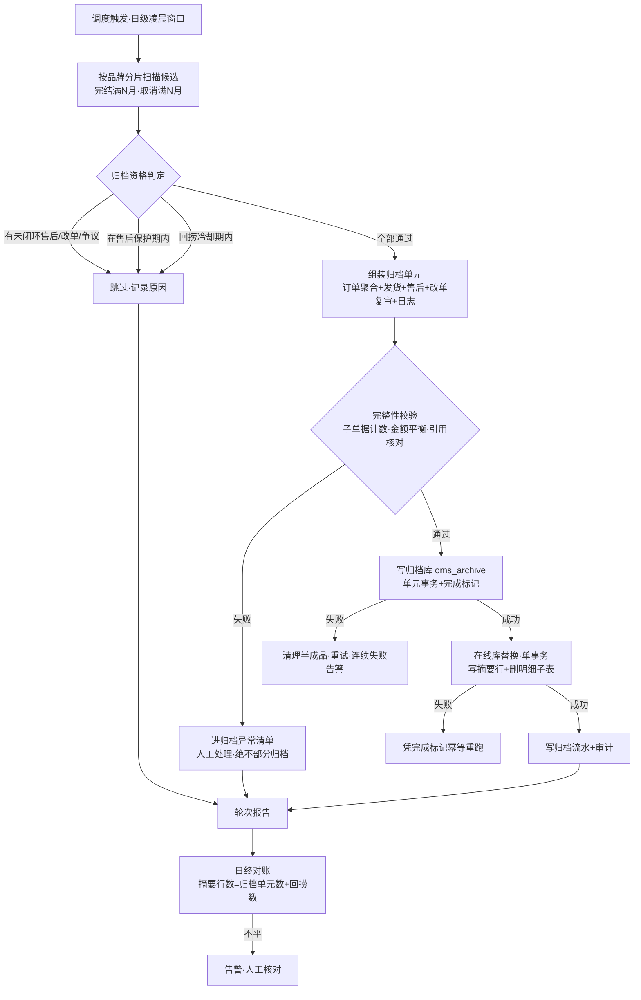
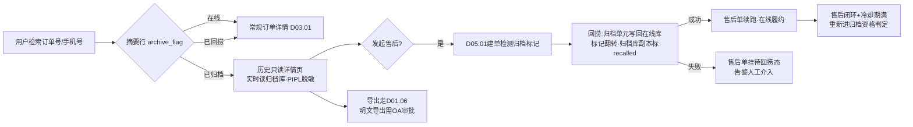
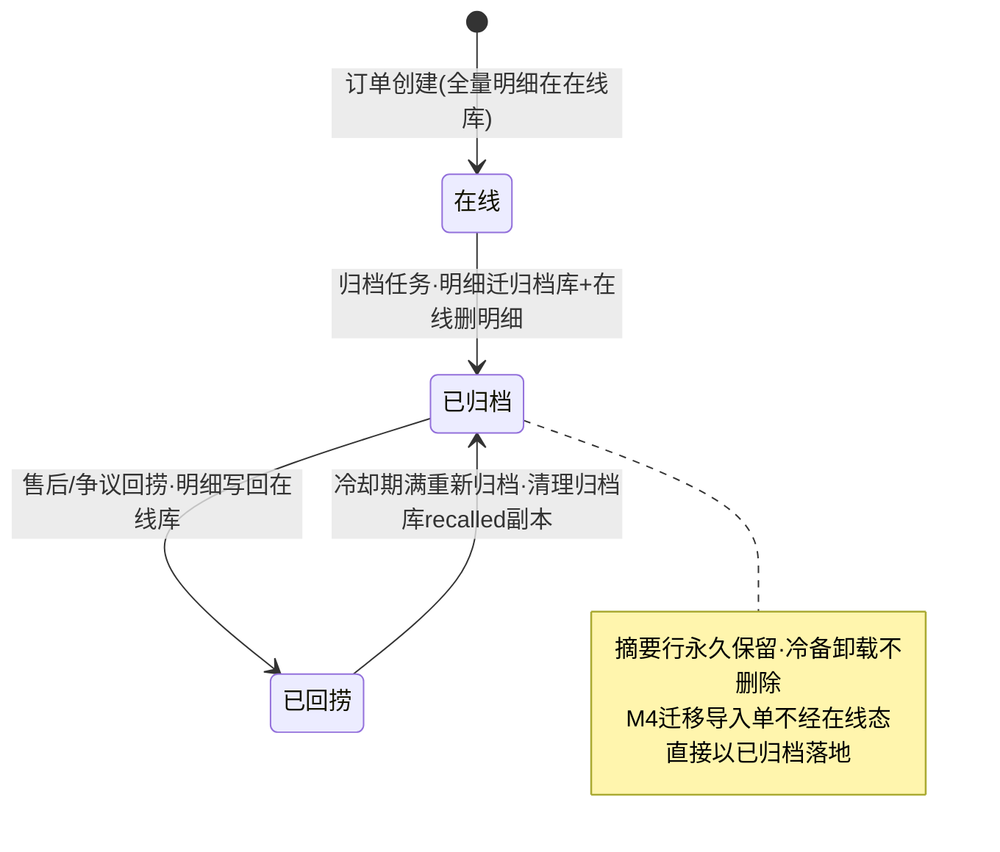

# SRS-D03.13 订单归档与历史查询模块 需求规格说明书

> 文档编号：SRS-D03.13 · 版本 V1.0 · 2026-10-23 · 编写：小凯 · 状态：待审阅
> 所属域：D03 订单履约域 · 分期：**P1（M3 机制就绪，M4 承接迁移导入）**
> 上游依据：SRS-00 §4.4 契约 · 逆向文档 02 §3.7/§9（archive=1 归档标记与历史库切换）· 逆向文档 00 §archive 模块（36 张归档镜像表，教训参考）· 逆向文档 06 差距分析表「archive 36 张 🔴 重写」· 逆向文档 08 M4（近 3 年订单迁移 330万-2200万单）
> 定位：近 3 年订单在线 + 历史订单归档的**冷热分离**统一机制：归档策略、归档单元一致性、归档库存储、在线摘要行、历史只读查询、售后回溯回捞、M4 迁移导入通道

---

## 1. 模块概述

### 1.1 定位

订单是全系统数据量最大的实体（迁移范围 330万-2200万单，上线后日均约 2 万单持续增长）。在线库若无限膨胀，审单缓冲池扫描、订单列表检索、报表查询都会持续劣化。本模块建立**冷热分离**机制：完结订单在售后保护期结束后，以「订单+全部关联单据」为一致性归档单元迁入独立归档库；在线库仅保留**摘要行**（订单号/状态/金额/归档标记）支撑列表检索与存在性判断；历史查询走只读归档界面；归档单在售后期内发起售后时提供回捞机制。同时本模块是 M4 里程碑「近 3 年历史订单迁移」的**落库目标通道**——迁移数据不占在线库，直接入归档库。

### 1.2 职责边界

**做**：归档策略配置（N 个月可配）与归档资格判定（含售后保护期约束）；归档单元组装与一致性校验；归档任务执行（在线库→归档库迁移+摘要行生成+在线明细删除）；归档库 schema 与容量管理；历史订单只读查询界面与导出；售后回捞（归档单临时回迁在线库）；M4 期初历史订单导入归档库的通道与对账。

**不做**：库存流水/操作日志等非订单域数据的归档（各域自管，本模块只归档订单聚合；跨域引用在归档单元内保留引用号不搬数据）；在线订单的常规查询（→ D03.01/订单列表）；售后流程本身（→ D05，本模块只提供回捞能力）；迁移工具的源端抽取与清洗（→ M4 迁移专项，本模块提供导入接口与校验规则）；BI 数仓供数（→ D11.02，归档库可作为其抽取源）。

### 1.3 与其他模块关系

| 模块 | 关系 |
|---|---|
| D03.01 订单创建 | 订单聚合根结构定义方；归档单元=订单主档+明细+收货人+扩展+优惠等子表 |
| D03.07 发货单管理 | 发货单及包裹/明细随归档单元一致性归档 |
| D03.08 改单复审 | 改单单/快照/复审单随订单归档（快照保留 ≥3 年审计要求由其承接） |
| D05 售后域 | 售后申请/退款单随归档；**售后期内订单不归档**约束的判定依据；归档单发起售后触发回捞 |
| D08 财务对账 | 归档单含双口径金额与应收引用；财务对账追溯走历史查询 |
| D10.03 数据权限 | 历史查询同样注入店铺/品牌/仓库/货主四维行级过滤 |
| D10.06 操作审计 | 归档/回捞动作本身写审计；归档单的字段级审计记录随归档单元迁移 |
| D01.02 统一调度 | 归档任务定时调度（日级批量） |
| D01.06 导入导出 | 历史订单批量导出走导入导出中心（异步大文件） |
| M4 迁移专项 | 期初历史订单经本模块导入通道直接入归档库 |

---

## 2. 业务场景

**SC-D03.13-01 到期订单批量归档**
配置 N=6（完结后 6 个月归档）。每日凌晨归档任务扫描在线库：`fulfill_status=完成 且 完结时间 ≤ 今天−6 个月 且 无未闭环售后 且 无进行中改单/复审 且 不在售后保护期内` 的订单，按品牌分片、每批 500 单组装归档单元（订单聚合+发货单+售后单+改单/复审单），校验完整性后写入归档库、生成在线摘要行、删除在线明细数据。取消单（dead）在取消满 N 个月后同规则归档。

**SC-D03.13-02 售后保护期约束（不归档）**
订单完结 6 个月已到，但消费者在平台发起了售后（D05.01 申请单状态=处理中），或订单完结时间距今天数 < 该品类最长售后期（如 90 天，货主级可配）。归档资格判定命中保护条件 → 本轮跳过，下轮重判。原则：**售后期内订单绝不归档**，避免售后处理跨库。

**SC-D03.13-03 客服查询历史订单**
客服接到消费者咨询一年前的订单。订单列表输入订单号/手机号检索：在线摘要行命中（归档标记=已归档）→ 点击进入**历史订单只读详情页**（从归档库实时读取完整单据，界面带「历史归档单·只读」水印标识，收货人信息按 PIPL 脱敏展示）。客服可导出该单全量单据 PDF/Excel（走 D01.06）。

**SC-D03.13-04 归档单发起售后（回捞）**
消费者对一个已归档订单（完结 8 个月，平台售后入口仍开放的特殊品类）申请退货。D05.01 建售后申请单时检测订单归档标记=已归档 → 调用本模块**回捞接口**：归档库该订单聚合完整回迁在线库（摘要行归档标记翻转=已回捞，明细数据恢复）、写回捞流水与审计 → D05 售后流程在在线库正常执行。售后闭环后订单重新进入归档候选（回捞单冷却期可配，默认闭环后 1 个月再归档，防反复搬迁）。

**SC-D03.13-05 财务跨年对账追溯**
财务对账（D08.03）发现一笔差异涉及 14 个月前的订单。对账工作台经历史查询接口（IF-04）按订单号取归档单的双口径金额、应收引用、发货单与退款单流水号，完成差异定位。归档数据只读，不产生任何回写。

**SC-D03.13-06 M4 近 3 年历史订单迁移导入**
M4 里程碑：商派老系统近 3 年订单（330万-2200万单，按品牌灰度批次）经迁移工具清洗转换后，调用本模块**期初导入通道**：按归档单元格式校验（必填四维、状态合法性、金额平衡校验：行实付合计=整单实付、引用完整性）→ 批量写入归档库 + 生成在线摘要行 → 逐批对账报告（源端条数/金额合计 vs 归档库落库结果）。迁移单直接以「已归档」态落地，**不进在线库明细、不参与在线归档任务**。

**SC-D03.13-07 归档库容量治理**
归档库按完结年月分表（orders_archive_202506 式）或分区，DBA 可监控各分片容量；超过 5 年的归档分片可导出冷备（对象存储 Parquet/SQL dump）后从归档库卸载，摘要行永久保留在线库（订单号存在性与金额检索不失效），冷备恢复为运维手工流程。

---

## 3. 功能需求

### FR-D03.13-01 归档策略与资格判定
- FR-01a 归档时滞 N 可配置：全局默认 6 个月，支持货主/品牌级覆盖（如高售后率品类 12 个月）。完结时间口径：fulfill_status 到达「完成」的时间（取消单=取消时间）。
- FR-01b 归档资格判定条件（全部满足才可归档）：① 完结满 N 个月；② 无未闭环售后申请单/退款单（D05 状态查询）；③ 完结时间距今 ≥ 售后保护期（货主级配置，默认 90 天，取 max(N, 保护期) 实际生效）；④ 无进行中改单/复审单（D03.08）；⑤ 无未闭环财务争议标记（D08.03 差异挂起标记）；⑥ 非回捞冷却期内（FR-05c）。
- FR-01c 判定结果留痕：每轮任务输出候选清单与跳过原因统计（按条件分类计数），供运维观察积压。

### FR-D03.13-02 归档单元与一致性
- FR-02a 归档单元 = 一张订单的完整聚合：订单主档、订单明细行、收货人（密文）、订单扩展、优惠明细、平台子单映射、发货单（含明细/包裹/指令记录）、售后申请单/退款单（已闭环）、改单单/快照/复审单、订单级操作日志与字段审计记录。**单据引用不搬数据**：库存流水（D04.04）、支付/应收流水（D08.01）、平台 api_log（D02.01）仅在归档单元中保留引用号（单号+域），原数据由各域自管生命周期。
- FR-02b 归档执行三段式（单元级事务边界）：① 组装+完整性校验（子单据计数与引用核对）→ ② 写归档库（单元级单事务或分片事务+完成标记）→ ③ 在线库替换（写摘要行 + 删除明细数据，单事务）。②成功③失败时凭完成标记幂等重跑③；②失败自动清理归档库半成品后重试。
- FR-02c 校验失败（如子单据缺失、金额不平衡）→ 该单元跳过并进入**归档异常清单**（人工处理），绝不部分归档。

### FR-D03.13-03 归档存储
- FR-03a 归档库为**独立 schema**（`oms_archive`，默认与在线库同实例不同 schema；容量超阈值可平滑迁独立实例，应用层经独立连接配置切换，代码无感）。
- FR-03b 归档表与在线表**同构**（同表名+`_archive` 后缀，字段结构一致，允许归档表省略在线态运行时字段如缓冲池标记）；按完结年月分表或 RANGE 分区。
- FR-03c 在线库摘要行：复用 orders 主表（`archive_flag` 字段区分），仅保留订单号/平台单号/店铺/品牌/货主/租户/四维过滤字段/三套状态终值/双口径金额/完结时间/归档时间/归档库定位键（分片表名+主键）/回捞标记；明细子表数据删除。摘要行**永久保留**（不随冷备卸载）。
- FR-03d 归档库只读：应用层账号仅授 SELECT（回捞通道使用专用高权限服务账号）；任何在线业务代码路径不得写归档库。

### FR-D03.13-04 历史查询
- FR-04a 历史订单查询界面（独立菜单）：按订单号/平台单号/手机号（密文匹配）/收货人/店铺/品牌/货主/时间范围检索，先查在线摘要行定位、再实时读归档库渲染详情；四维行级过滤（D10.03）在摘要行与归档详情两层都生效。
- FR-04b 历史订单详情页**只读**：完整展示订单聚合+发货+售后+改单/复审历史时间线；界面显著标识「历史归档单」；消费者敏感字段脱敏展示（PIPL，D01.05），明文查看需单独授权点并留痕。
- FR-04c 在线订单列表对已归档单显示归档标记，点击自动跳转历史详情（在线/历史对用户透明路由）。
- FR-04d 导出：单单导出（PDF/Excel 全量单据）与条件批量导出（≤10 万单/次），一律走 D01.06 异步导入导出中心；导出文件敏感字段默认脱敏，明文导出需审批（D10.05）。
- FR-04e 跨库聚合查询（如财务按品牌统计跨年销售额）不在线做：由 D11.02 BI 供数通道从归档库抽取，本模块提供抽取源视图。

### FR-D03.13-05 售后回溯与回捞
- FR-05a 回捞触发：① D05.01 售后建单检测到目标订单已归档（自动）；② 客服在历史详情页发起「回捞至在线」（人工，需填写理由）；③ 财务争议追溯需要（人工）。
- FR-05b 回捞执行 = 归档逆过程（单元级）：归档库读取完整单元 → 写回在线库明细（幂等：以订单号+回捞流水号防重）→ 摘要行归档标记翻转「已回捞」→ 归档库原数据保留（标记 recalled，冷却期后由归档任务重新判定并清理归档库旧副本）→ 写回捞流水+审计+通知触发方。回捞 P95 ≤10s（单元数据量小）。
- FR-05c 回捞冷却期：回捞单在售后/争议闭环后 1 个月内不再归档（可配）；冷却期满重新进入 FR-01 资格判定。
- FR-05d 回捞失败的售后单：D05 建单流程不得因回捞失败而丢单——售后申请单先落库（挂「待回捞」态），回捞成功后自动续跑，失败告警人工介入。

### FR-D03.13-06 归档任务执行与监控
- FR-06a 任务调度：日级批量（D01.02 注册，默认凌晨 2-5 点窗口），按品牌分片并行（灰度切换后各品牌数据独立分片），单元批 500 单，批间限速（在线库删除压力可控，可配 QPS 上限）。
- FR-06b 任务可暂停/恢复/重跑：暂停不影响已归档单元；重跑以归档完成标记幂等。
- FR-06c 监控与对账：每轮任务产出报告（归档成功/跳过/异常单元数、搬迁行数、在线库释放空间）；**日终对账**——摘要行数=归档库单元数+已回捞数，不平即告警；归档异常清单滞留 >7 天升级人工。
- FR-06d 灰度开关：按品牌可单独启停归档（迁移双跑期老品牌不归档）。

### FR-D03.13-07 M4 期初历史订单导入通道
- FR-07a 导入接口：`ArchiveImportService::batchImport(归档单元数组, 迁移批次号)`，供迁移工具调用；单元格式=FR-02a 归档单元 + 迁移元数据（源系统单号/源库定位/清洗规则版本）。
- FR-07b 导入校验：必填四维（owner/tenant/shop/brand）、状态合法性（仅接受终态：完成/取消）、金额平衡（行实付合计=整单实付、双口径勾稽）、引用完整性（发货单必挂订单）、源单号唯一防重（幂等键=源系统+源单号）。校验失败单元进导入异常清单（迁移工具修复后重导）。
- FR-07c 导入落地：直接写归档库（分片按源订单完结年月）+ 生成在线摘要行（archive_flag=已归档，来源=迁移）；**不写在线明细表、不进归档任务候选**。
- FR-07d 批次对账：每迁移批次出具对账报告（源端条数/金额合计 vs 落库条数/金额合计 vs 异常清单），作为 M4 出口标准「迁移数据对账一致」的组成部分；支持按批次回滚（删除该批次导入数据，凭迁移批次号）。
- FR-07e 吞吐要求：峰值导入 ≥5000 单/分钟（2200 万单在迁移窗口内分批完成）；导入期间在线业务无感（写归档库+摘要行批量插入，限速可配）。

---

## 4. 业务流程

### 4.1 归档主流程（日级批量任务）



### 4.2 历史查询与售后回捞流程



### 4.3 摘要行状态机



---

## 5. 处理逻辑

### 5.1 归档资格判定（伪代码）

```
eligible(order) -> (bool, skip_reason):
    N = config(货主/品牌级, 默认6个月)
    protect = config(售后保护期, 货主级, 默认90天)
    base_time = order.完结时间 (完成态) or order.取消时间 (dead态)
    if base_time == null: return (false, 未完结)
    if now - base_time < max(N, protect): return (false, 未满时滞或保护期)
    if exists 售后申请单(order) where status not in (闭环终态): return (false, 售后未闭环)
    if exists 改单单/复审单(order) where status in (进行中态): return (false, 改单复审未闭环)
    if order.财务争议标记 == 挂起: return (false, 财务争议)
    if order.回捞标记 == 已回捞 and now - 售后闭环时间 < 冷却期: return (false, 回捞冷却)
    if 品牌灰度开关(order.brand) == 停: return (false, 品牌未启用归档)
    return (true, -)
```

### 5.2 归档单元完整性校验规则表

| 校验项 | 规则 | 失败处理 |
|---|---|---|
| 主档存在性 | orders 行存在且状态=终态（完成/取消） | 异常清单 |
| 明细勾稽 | Σ行实付 = 整单客户实付；Σ行标价−Σ优惠 = 整单（双口径各自平衡） | 异常清单 |
| 子单据计数 | 发货单数 = 订单 splited 派生数；每发货单明细/包裹齐全 | 异常清单 |
| 售后闭环 | 关联售后单全部终态 | 跳过（下轮重判） |
| 收货人密文 | 密文可解密验证（抽样解密校验，防迁移脏数据） | 异常清单 |
| 四维完整 | owner_id/tenant_id/shop_id/brand_id 非空 | 异常清单 |
| 引用登记 | 库存流水/应收/api_log 引用号已登记（不校验对端存在，只留引用） | 告警不阻断 |

### 5.3 归档-回捞对称算法

```
archive(order_id):                       # FR-02b 三段式
    unit = assemble(order_id)            # 聚合读取+校验(§5.2)
    tx_archive: insert unit into oms_archive.*_archive(分片=完结年月); set 完成标记
    tx_online: upsert 摘要行(archive_flag=已归档, 定位键); delete 在线明细子表行; update orders 主档为摘要形态
    write 归档流水(unit_id, 行数, 耗时) + 审计

recall(order_id, reason, trigger):       # 逆过程
    unit = read from oms_archive by 定位键
    tx_online: 恢复在线明细子表; orders 主档恢复全量字段; 摘要行标记=已回捞
    update 归档库副本 status=recalled (保留, 冷却期满重新归档时覆盖清理)
    write 回捞流水+审计+通知
```

- 两方向的在线库事务均为**单库事务**（在线库内完成），跨库不做分布式事务：归档方向先写归档库（有完成标记幂等），回捞方向先写在线库（成功后才翻转标记）；中断重跑均幂等。
- 摘要行与明细删除同事务，保证「有摘要行必有归档库单元，在线明细存在必未归档」两个不变量。

### 5.4 商派 36 张镜像表方案的教训与本方案取舍

商派 archive 模块为 36 张主表做**全表镜像**（每张在线表配一张同构归档表，全字段搬迁），问题：① 在线表 schema 每次演进须同步改归档表+搬迁程序，36 张表维护成本极高（逆向文档 06 判为 🔴 重写）；② 全表镜像搬走了全部数据但在线库仍留全量行（archive=1 标记切换查询），在线库并未瘦身，只是查询路由分叉；③ 镜像表与主表结构漂移后历史数据不可读。

本方案取舍——「**同构归档表 + 在线摘要行**」：
- **同构归档表**保留商派"结构一致、读得懂"的优点，但收敛为**归档单元内的订单聚合表族**（约 15 张：订单 4 实体+发货 5+售后 2+改单复审 3+日志 1），跨域数据只留引用号不镜像（商派 36 张中大量是跨域全量镜像）；
- **在线摘要行**是商派缺失的关键：在线库真正删除明细数据只留摘要，实现在线库瘦身（2200 万单在线明细 ≈ 数十 GB 级，摘要行 ≈ 1-2 GB）；
- schema 演进策略：归档表按**归档时点结构快照**冻结（分片表带 schema_version），在线表演进不强制同步归档表，新字段归档时按映射规则落 JSON 扩展列——避免商派"双 schema 同步演进"的维护陷阱。

### 5.5 容量与性能设计
- 在线库稳态规模：3 年 × 日均 2 万单 ≈ 2200 万摘要行 + 未归档在线明细（滚动 6-12 个月 ≈ 400 万单全量），列表检索走摘要行索引（订单号/手机号密文哈希/四维+时间复合索引）P95 ≤200ms。
- 归档库规模：按年月分片，单分片 ≤100 万单元；历史详情单点读取（定位键直达分片）P95 ≤500ms。
- 归档任务窗口 3 小时/日，日归档量 ≤3 万单元（含回迁缓冲），批间限速保证在线库主从延迟 <1s。

---

## 6. 数据字段（业务字段描述）

### 6.1 订单摘要行（orders 主表归档形态，复用主表）

| 字段 | 业务含义 | 取值/校验 |
|---|---|---|
| order_bn / platform_tid | 订单号/平台单号 | 检索主键 |
| shop_id / brand_id / owner_id / tenant_id | 四维 | 必填，行级过滤与分片依据 |
| audit_status / fulfill_status / pay_status / ship_status | 三套状态+审核态终值 | 归档时冻结为终态 |
| total_amount / pay_amount / platform_bear_amount | 标价/客户实付/平台承担（双口径） | 归档冻结值，财务追溯依据 |
| finish_time / archive_time | 完结时间/归档时间 | |
| archive_flag | 归档标记 | 在线/已归档/已回捞 |
| archive_locator | 归档库定位键 | JSON：分片表名+单元主键 |
| archive_source | 归档来源 | 归档任务/迁移导入（M4） |
| recall_flag / recall_time | 回捞标记与时间 | 冷却期判定依据 |
| consumer_phone_hash | 手机号密文哈希 | 历史检索用（明文密文在归档库） |

### 6.2 归档单元头（archive_unit）

| 字段 | 业务含义 | 取值/校验 |
|---|---|---|
| unit_id | 归档单元号 | 唯一 |
| order_bn / 四维 | 关联订单 | |
| shard_key | 分片键 | 完结年月（YYYYMM） |
| schema_version | 归档时点结构版本 | 结构快照冻结依据（§5.4） |
| item_counts | 子单据计数清单 | JSON：明细行数/发货单数/包裹数/售后单数/改单数，完整性校验与对账依据 |
| amount_check | 金额勾稽结果 | 双口径平衡校验通过标记 |
| archive_status | 单元状态 | 完成/recalled（已回捞待清理） |
| migrate_batch | 迁移批次号 | 仅 M4 导入单必填；批次对账与回滚依据 |
| source_ref | 源系统引用 | 迁移单：源系统+源单号（幂等键） |
| archive_time | 归档时间 | |

### 6.3 归档流水（archive_log）

| 字段 | 业务含义 | 取值/校验 |
|---|---|---|
| log_type | 动作类型 | 归档/回捞/导入/冷备卸载/批次回滚 |
| unit_id / order_bn | 对象 | |
| trigger | 触发方 | 调度任务/售后建单/客服人工/财务/迁移工具 |
| rows_moved / duration_ms | 搬迁行数/耗时 | 监控依据 |
| operator | 操作人/系统 | 人工动作必填账号 |
| result / error_msg | 结果 | 失败必附原因 |

### 6.4 归档策略配置（archive_config）

| 字段 | 业务含义 | 取值/校验 |
|---|---|---|
| scope_level / scope_id | 配置粒度 | 全局/货主/品牌 |
| archive_months (N) | 完结后归档时滞 | 正整数，默认 6 |
| aftersale_protect_days | 售后保护期 | 默认 90，实际生效 max(N, 保护期) |
| recall_cooldown_months | 回捞冷却期 | 默认 1 |
| batch_size / qps_limit | 单元批大小/限速 | 默认 500/可配 |
| brand_switch | 品牌灰度开关 | 迁移双跑期控制 |
| cold_offload_years | 冷备卸载年限 | 默认 5，摘要行不受影响 |

---

## 7. 接口

### 7.1 内部接口（本模块提供）

| 编号 | 接口 | 消费方 | 说明 |
|---|---|---|---|
| IF-D03.13-01 | `ArchiveService::getOrderArchive(order_bn)` → 完整归档单元（只读 DTO） | 历史详情页/D05 售后建单预览/D08 对账追溯 | 实时读归档库；PIPL 字段按调用方授权级别返回脱敏或密文 |
| IF-D03.13-02 | `ArchiveService::recall(order_bn, reason, trigger)` | D05.01 售后建单（自动）/客服工作台（人工） | 回捞至在线库；返回回捞流水号；幂等（重复回捞返回首次结果） |
| IF-D03.13-03 | `ArchiveService::isArchived(order_bn)` → 摘要行状态 | D05/D08/订单列表 | 轻量判定（只查摘要行），高频调用走缓存 |
| IF-D03.13-04 | `ArchiveQueryService::search(条件, 分页)` | 历史查询界面 | 摘要行检索+归档库详情渲染；四维过滤注入 |
| IF-D03.13-05 | `ArchiveImportService::batchImport(units[], migrate_batch)` | M4 迁移工具 | 期初导入通道（FR-07）；返回批次校验/落库/异常清单结果 |
| IF-D03.13-06 | 事件 `order.archived` / `order.recalled`（订单号/单元/触发方） | D10.06 审计、D11.03 监控、D05（回捞后续跑） | 归档与回捞广播 |
| IF-D03.13-07 | 归档库抽取源视图（只读） | D11.02 BI 供数 | 跨年聚合分析走 BI，不在线做 |

### 7.2 依赖接口（本模块消费）

| 编号 | 接口 | 提供方 | 说明 |
|---|---|---|---|
| IF-D03.13-D1 | 售后单闭环状态批量查询 | D05.01 | 资格判定条件② |
| IF-D03.13-D2 | 改单/复审单进行中状态查询 | D03.08 | 资格判定条件④ |
| IF-D03.13-D3 | 财务争议挂起标记查询 | D08.03 | 资格判定条件⑤ |
| IF-D03.13-D4 | 任务注册/调度/失败告警 | D01.02 | 日级归档任务 |
| IF-D03.13-D5 | 异步导出任务 | D01.06 | 历史单导出 |
| IF-D03.13-D6 | 密文解密/脱敏渲染 | D01.05 | 摘要行手机号哈希检索与详情脱敏 |
| IF-D03.13-D7 | 行级权限过滤注入 | D10.03 | 历史查询四维过滤 |

### 7.3 外部接口

| 编号 | 接口 | 方向 | 说明 |
|---|---|---|---|
| EF-D03.13-01 | 冷备导出至对象存储（Parquet/SQL dump） | 出 | 5 年以上分片冷备卸载；恢复为运维手工流程 |
| EF-D03.13-02 | 明文导出审批（经 D10.05 泛微 OA） | 双向 | 历史单明文导出审批 |

---

## 8. 非功能需求

| 项 | 要求 |
|---|---|
| 性能 | 摘要行列表检索 P95 ≤200ms（2200 万摘要行规模）；历史详情单点读取 P95 ≤500ms；回捞端到端 P95 ≤10s；归档任务日窗口 ≤3h 完成 ≤3 万单元且在线库主从延迟 <1s；M4 导入峰值 ≥5000 单/分钟 |
| 一致性 | 两不变量强制：有摘要行必有归档库完成单元；在线明细存在必未归档。日终对账（摘要行数=归档单元数+回捞数）不平即告警；归档/回捞中断重跑幂等（完成标记+幂等键），绝不部分归档 |
| 幂等 | 归档以 unit 完成标记防重；回捞以订单号+回捞流水防重；迁移导入以源系统+源单号防重；事件消费方自行幂等 |
| 安全/PIPL | 归档库收货人字段保持密文（加密随 D01.05 组件，密钥不随数据搬迁）；历史查询默认脱敏，明文查看/导出单独授权+审批+留痕；归档库应用账号只读，回捞走专用服务账号并审计 |
| 可用性 | 归档任务失败不影响在线业务（纯旁路批量）；归档库故障时历史查询降级提示（在线业务无感）；回捞故障时售后单挂「待回捞」不丢单（FR-05d） |
| 可运维性 | 任务可暂停/恢复/重跑/按品牌灰度；归档异常清单与跳过原因统计每轮输出；分片容量监控与冷备卸载 SOP |
| 容量 | 归档库 5 年在线容量规划 ≤2200 万单元 ×（单元均值 30KB）≈ 660GB，分片+独立实例扩展路径预留；摘要行永久在线（≈1-2GB） |

---

## 9. 验收标准

| 编号 | 验收条件 |
|---|---|
| AC-01 | 完结满 N 月（默认 6）且无未闭环售后/改单/争议、过售后保护期的订单被日级任务归档：归档库存在完整单元（子单据计数与 item_counts 一致），在线库仅剩摘要行、明细子表行已删除；N 与保护期按货主/品牌配置分别生效 |
| AC-02 | 存在处理中售后单或完结未满保护期的订单连续多轮任务均被跳过且跳过原因正确记录；售后闭环+期满后自动进入归档 |
| AC-03 | 归档过程模拟中断（写归档库后杀进程/在线替换事务失败），重跑后数据一致，无重复单元、无「有摘要无单元」或「单元完成但在线明细未删」的中间态残留 |
| AC-04 | 完整性校验失败单元（人为构造金额不平衡/子单据缺失）进入异常清单且**未发生任何部分归档**（在线与归档库均无该单元数据） |
| AC-05 | 历史查询：按订单号/手机号哈希检索已归档单命中摘要行并渲染归档库完整详情（只读+水印+敏感字段脱敏）；四维数据权限过滤生效（无权限货主的归档单不可见）；明文查看需授权且留痕 |
| AC-06 | 回捞：对已归档订单发起售后建单，自动回捞 P95 ≤10s，在线库明细完整恢复、摘要行标记=已回捞、售后流程正常续跑；重复触发回捞幂等；回捞失败时售后单挂「待回捞」态且告警产生、不丢单；冷却期内该单不再被归档，冷却期满重新归档且归档库 recalled 旧副本被清理 |
| AC-07 | M4 导入通道：模拟批次导入 10 万单（含构造的校验失败样本），合法单元落归档库+摘要行（archive_source=迁移）、失败样本进导入异常清单；批次对账报告条数与金额合计与源端一致；按批次号回滚后该批次数据完全清除；导入期间在线订单列表与审单性能无劣化（P95 波动 <10%） |
| AC-08 | 日终对账任务验证不变量：人为在测试环境制造不平（删一条摘要行），对账任务当轮发现并告警 |
| AC-09 | 归档库应用账号写操作被数据库权限拒绝；回捞专用账号操作全部留审计 |
| AC-10 | 品牌灰度开关停用的品牌订单不进入归档候选；导出走异步中心，明文导出未经 OA 审批不可执行 |

---

## 变更记录

| 日期 | 版本 | 变更 | 原因 |
|---|---|---|---|
| 2026-10-23 | V1.0 | 首版 | — |

---

*参考实现溯源：商派 archive 模块（36 张主表全量镜像归档表，逆向文档 00 §archive/06 差距分析判 🔴 重写）+ orders.archive 标记（取消即 archive=1、完成单后台任务批量归档、ind_archive 索引支撑归档库查询切换，逆向文档 02 §3.7/§9）。关键差异：① 弃用 36 张全表镜像，收敛为订单聚合归档单元（约 15 张同构归档表，跨域数据只留引用号）——理由见 §5.4（schema 双演进维护成本、在线库未真正瘦身、结构漂移不可读三大教训）；② 新增在线**摘要行**机制（商派仅打标记不删数据），在线库真实瘦身至摘要级；③ 归档资格判定引入售后保护期/改单复审闭环/财务争议/回捞冷却四类商派缺失的约束；④ 回捞机制为全新设计（商派归档单向不可逆，售后回溯无通道）；⑤ 归档表 schema_version 冻结 + JSON 扩展列吸收在线表演进，替代商派双 schema 同步演进；⑥ 本模块兼作 M4 近 3 年历史订单迁移（330万-2200万单）的落库通道，迁移单直接以已归档态落地，与商派「迁移进在线库再等归档」路径不同——避免迁移洪峰冲击在线库。*
