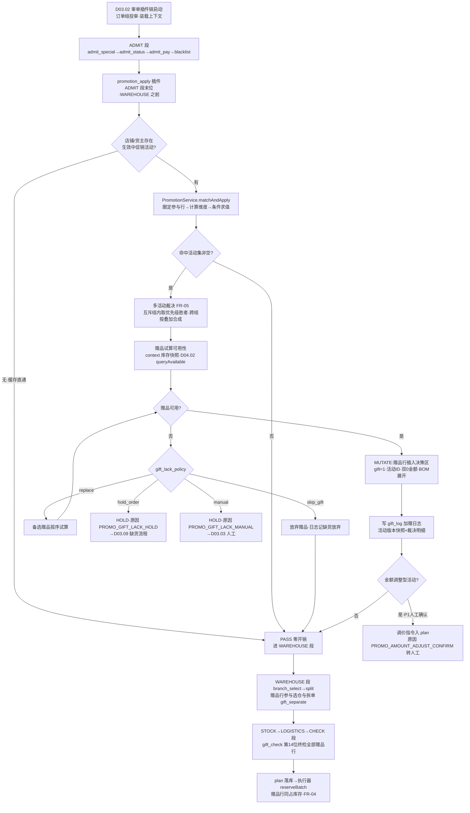
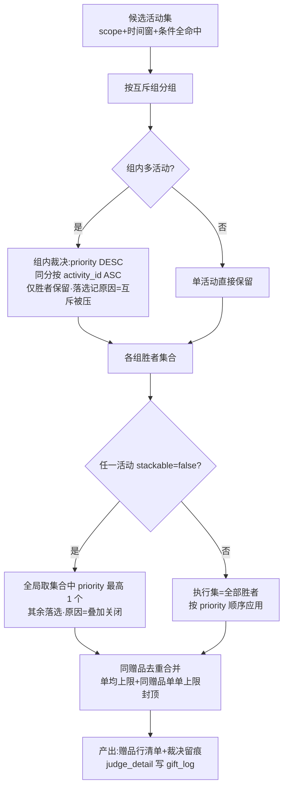
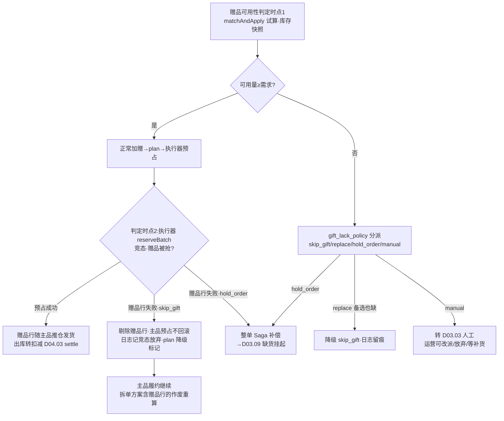
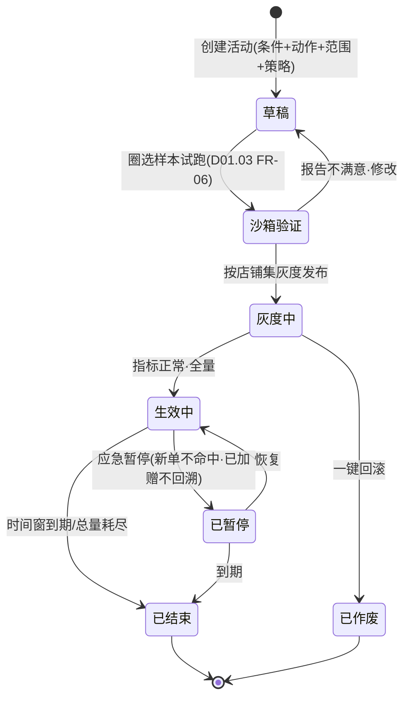

# SRS-D03.14 促销与赠品引擎模块 需求规格说明书

> 文档编号：SRS-D03.14 · 版本 V1.0 · 2026-10-24 · 编写：小凯 · 状态：待审阅（需求复查补充模块）
> 所属域：D03 订单履约域 · 分期：**P1（M3）· P0 期预留数据模型与审单插件位**
> 上游依据：SRS-D03.02 §FR-02（插件链 20 位，gift_check 第 14 位仅校验平台已带赠品）/§FR-01b（五段编排）· SRS-D01.03（规则模型/条件 DSL/插件注册/版本灰度/沙箱——本模块为其又一消费方）· SRS-D04.01（销售物料 type=赠品、bomExpand）· SRS-D03.04（gift_separate 按赠品拆分策略、仅赠品订单拒绝出单）· SRS-D04.03（reserveBatch Saga、赠品预占）· SRS-D08.01 §FR-01g（0 元赠品不生成应收只登记备查）· SRS-D03.01 §5.2（0 元行分摊边界：list_i=0→paid_i=0）· 逆向文档 02 §插件链 tbgift/crm 位 · 逆向文档 01（ome.gift_rule 19 列/gift_logs 17 列/gift_set_logs + crm.gift_rule_base/gift_rule_logs/snapshot）
>
> **全局决策（本模块承载，红线）**：① 促销加赠是 OMS **主动**行为——店铺配置促销活动，审单时按规则自动往订单插入赠品行（区别于 D03.02 gift_check 插件「校验平台报文已带赠品」的被动语义，二者互补共存）；② **赠品也占库存**（走 D04.03 预占），赠品缺货策略可配且不默认阻断主品；③ 赠品行**双口径金额恒 0**（不参与应收，但参与成本——买断赠品计凯淳存货成本 D04.07，代销赠品按货主归属）；④ 全单据 owner_id + tenant_id，**货主隔离**：品牌 A 的促销活动绝不影响品牌 B 的订单；⑤ 加赠全程日志留痕（对齐商派 gift_logs），可追溯可撤销。

---

## 1. 模块概述

### 1.1 定位

促销与赠品引擎是 OMS 侧的**主动促销加赠中心**：运营为店铺/品牌/货主配置促销活动（满赠/买赠/满件折/满减/阶梯满赠），订单进入审单时，本模块以插件形式嵌入 D03.02 审单链（**WAREHOUSE 选仓段之前**执行），按活动规则匹配订单、裁决多活动叠加互斥、自动向订单插入赠品行（或调整金额），赠品行随后与主品一起参与选仓、拆单（D03.04 gift_separate）、库存预占（D04.03）与推仓发货。美妆日化代运营中「满赠」是最高频促销手段（满 299 送小样、满 599 送正装+化妆包），本模块把商派散落在 `ome.gift_rule`（店铺赠品规则）与 `crm.gift_rule_base`（CRM 会员赠品）的两套机制收敛为**一套承载于 D01.03 统一规则框架的促销引擎**，并补齐商派缺失的赠品库存预占联动、货主隔离与多活动显式裁决。

**承载关系**：促销活动规则 = D01.03 `rule_group=promotion.activity` 的规则实例（条件 DSL + 动作 schema + 版本/灰度/沙箱试跑全套复用）；加赠执行 = D03.02 审单插件链新注册插件 `promotion_apply`（ADMIT 段末位，MUTATE 型）；赠品物料 = D04.01 销售物料 type=赠品（BOM 绑定赠送基础物料）。

### 1.2 职责边界

**做**：促销活动管理（活动档案/时间窗/生效范围/商品范围/优先级/互斥组/叠加规则）；促销规则条件与动作配置（满金额/满件数/买指定 SKU → 送赠品/调金额，阶梯档位）；加赠插件嵌入审单链（匹配→裁决→插入赠品行）；赠品缺货策略执行（四种处置）；多活动叠加互斥裁决；赠品行标记与金额口径落地（is_gift/活动 ID/双 0 金额）；加赠日志留痕与撤销；活动效果统计（命中单量/加赠件数/赠品成本）。

**不做**：平台侧促销工具（平台满减/官方立减由平台报文带入，D02.02 适配器映射双口径金额，OMS 不改写）；优惠券（平台券/店铺券在 D03.01 落库时已进 order_pmt 优惠分摊，本模块不重复处理）；平台已带赠品的校验与库存联动（→ D03.02 gift_check 插件第 14 位，CHECK 段，本模块插件与其互补：先主动加赠、后校验赠品方案有效性）；赠品物料档案与 BOM 维护（→ D04.01）；赠品行拆单算法（→ D03.04 gift_separate 策略）；预占记账（→ D04.03）；赠品成本核算（→ D04.07）；规则引擎框架机制（→ D01.03）。

### 1.3 与其他模块关系

| 模块 | 关系 |
|---|---|
| D03.02 审单引擎 | `promotion_apply` 插件注册进 ADMIT 段末位（WAREHOUSE 之前）；调 `PromotionService::matchAndApply(order, context)`；加赠失败按结构化原因 `order_audit_reason`（code=PROMO_*）路由 |
| D01.03 规则框架 | 促销活动承载于 rule_group=`promotion.activity`：条件 DSL/维度字典/版本快照/灰度发布/沙箱试跑/`rule.config.changed` 缓存失效全套复用 |
| D04.01 商品物料 | 赠品=销售物料 type=赠品，`MaterialService::bomExpand(smId)`（IF-D04.01-02）展开赠送基础物料；赠品行同走物料解析与货主校验 |
| D03.01 订单创建 | 赠品行插入 order_items：`gift=1`、活动 ID、双口径金额 0（§5.2 边界「0 元行 list_i=0→paid_i=0」）；订单金额恒等式不被赠品行破坏 |
| D03.04 拆单 | 赠品行参与拆单；「按赠品分离」策略 gift_separate（split_type=10）处置赠品与主品分仓/分包；仅赠品订单拒绝出单口径不变 |
| D04.03 预占 | 赠品行走 `FreezeService::reserveBatch`（IF-D04.03-02）统一预占；赠品预占失败按缺货策略处置（§5.5 Saga 变体） |
| D08.01 应收 | 赠品行不生成应收（FR-01g 0 元单口径），只登记备查明细（结算件数统计）；双口径均 0 不参与分摊回冲 |
| D04.07 成本 | 赠品出库结转成本：买断赠品计凯淳存货成本、代销赠品按货主（发货单 owner_id 分账，D03.04 FR-05c 口径） |
| D10.03/D10.04 | 活动配置权限点；品牌方门户只见本货主活动与加赠日志（租户行隔离） |
| D11 报表 | 活动效果统计供数（命中率/加赠量/赠品成本/带动客单价） |

---

## 2. 业务场景

**SC-D03.14-01 满赠（美妆日化最高频）**
品牌 A 天猫旗舰店配置活动「双 11 满赠」：活动期内订单**参与商品实付满 299 元**送小样礼盒×1（销售物料 type=赠品，BOM=3 片面膜小样）。消费者下单 350 元面霜。审单时 `promotion_apply` 插件（ADMIT 段）调本模块：命中活动 → 插入赠品行（gift=1、activity_id、金额双 0）→ 赠品行随主品参与选仓（华东仓）、拆单（不分离，随主品同包）、预占（礼盒 BOM 展开 3 行基础物料各占 1）→ 正常发货。加赠日志记录：订单/活动/赠品 SKU/数量/规则版本快照。财务：赠品行不生成应收（D08.01），出库时按品牌 A 货主结转代销成本（D04.07）。

**SC-D03.14-02 阶梯满赠（赠品升级）**
活动「满 299 送 A、满 599 送 A+B」：两档 ladder 配置。订单实付 620 元 → 命中最高满足档（599 档）→ 加赠 A×1 + B×1；订单 400 元 → 命中 299 档 → 只加赠 A×1。档位裁决取**满足门槛的最高档**（不叠加低档）；每档赠品清单、数量独立配置；同档多赠品全部加赠。档位计算基数可配：参与商品实付金额（客户实付口径，扣除平台承担与商家优惠后）或件数。

**SC-D03.14-03 买赠（买指定 SKU 送赠品）**
活动「买正装精华送同款小样×2」：条件=订单含指定 SKU（ bm_id 清单），动作=每买 1 件送 2 件（比例可配，上限可配）。订单含精华×2 → 加赠小样×4（2×2，达上限 4 封顶）。指定 SKU 支持清单/分类/品牌三种圈选方式；买赠比例 `gift_num = min( floor(主品件数 × 比例), 活动单均上限 )`。

**SC-D03.14-04 赠品缺货处理（四策略可配）**
活动赠品小样库存告急：订单加赠后预占阶段赠品 BOM 行可用不足。按活动级配置 `gift_lack_policy` 处置——① `skip_gift`（默认）：放弃赠品行，主品正常履约，日志记「缺货放弃」，不阻断审单；② `hold_order`：整单挂起转 D03.09 缺货流程等补货；③ `replace`：换等价赠品（活动配置的备选赠品清单按序尝试）；④ `manual`：转人工审单（D03.03）由运营决定。主品预占永不受赠品拖累（skip_gift 时赠品行从预占清单剔除并重跑拆单）。

**SC-D03.14-05 多活动互斥与叠加裁决**
订单同时命中：活动 X（满 299 送 A，优先级 100，互斥组 G1）、活动 Y（满 2 件送 B，优先级 90，互斥组 G1）、活动 Z（买精华送小样，优先级 80，互斥组 G2，叠加规则=可叠加）。裁决：同互斥组内取优先级最高者（X 胜出，Y 落选）；跨组按叠加规则可并行（X+Z 都执行）。裁决结果（命中/落选/原因）全量写日志，运营可查「为什么这单没送 B」。

**SC-D03.14-06 满件折/满减（金额调整型促销）**
店铺配置「满 3 件 9 折」「满 500 减 50」——平台侧未做该促销（私域/线下单或平台工具未覆盖场景），由 OMS 主动调价。插件命中后按动作调整订单行金额（走 D03.08 改单通道：快照+复审，调价后触发 price_check 复核）并登记商家优惠口径（shop_discount，D08.01 不入应收只留档）。P1 首期仅支持整单级调整+人工确认模式（autoConfirm 联动），防资损。

**SC-D03.14-07 活动生效范围与货主隔离**
品牌 A 与品牌 B 共用代运营店铺 S（多货主店铺）。活动配置 scope=货主 A + 店铺 S：只有订单中**货主 A 的参与商品行**计入活动基数、只加赠货主 A 的赠品物料；货主 B 的行既不触发活动也不被加赠。跨货主加赠被保存期校验拒绝（赠品 BOM 货主必须 ∈ 活动 scope 货主，同 D04.01 §6.1 同货主 BOM 约束）。

**SC-D03.14-08 加赠撤销与订单取消联动**
订单加赠后发货前买家申请退款整单取消（D05.03/D03.09）：取消释放预占时赠品行一并释放（D04.03 release 按单据引用全覆盖）；加赠日志标记 `revoked`（撤销原因=订单取消），活动消耗额度回补（活动配置总量上限时）。改单减少主品致不再满足门槛（D03.08 复审重跑审单链）：插件重算 → 原赠品行按撤销流程移除（未发货前提），重跑拆单与预占，日志留痕撤销+再加赠两条记录。

---

## 3. 功能需求

### FR-D03.14-01 促销活动管理
- FR-01a 活动档案：活动编号/名称/类型（满赠 full_gift / 买赠 buy_gift / 阶梯满赠 ladder_gift / 满件折 qty_discount / 满减 amount_reduce）/状态机（草稿→待生效→生效中→已暂停→已结束→已作废）；活动时间窗（start_time/end_time，精确到秒）；活动总量上限（限量赠品：总件数封顶，消耗计数原子扣减）与单均上限（一单最多加赠件数）。
- FR-01b 生效范围 scope（对齐 D01.03 FR-01a scope 构件）：店铺集/品牌/货主/平台多维组合；货主必填（货主隔离红线，全局默认=配置人所属货主）；多货主店铺按行归属判定（SC-07）。
- FR-01c 商品范围 promotion_scope：参与商品（include：SKU 清单/分类/品牌/全部）与排除商品（exclude 优先于 include）；买赠的「主品范围」与满赠的「基数商品范围」同构承载；范围快照随规则版本固化（D01.03 FR-05c）。
- FR-01d 活动优先级 priority（数值大者优先）与互斥组 mutex_group（同组互斥、跨组按叠加规则）；叠加规则 stackable=true/false（false 时全局仅执行裁决胜出的 1 个活动）。
- FR-01e 活动生命周期操作：启停（暂停即时无新单命中，已加赠订单不回溯）、复制（大促模板复用）、作废；变更全走 D01.03 版本机制（草稿→沙箱试跑→灰度→全量）+审计（D10.06）。
- FR-01f 活动上线前沙箱验证：复用 D01.03 FR-06 沙箱——圈选近 7 天店铺订单样本试跑，输出预计命中单量/加赠件数/赠品成本估算报告，防止门槛配错导致资损（如满 29.9 误配成满 299 送正装）。

### FR-D03.14-02 促销规则条件与动作
- FR-02a 条件层（承载于 D01.03 条件 DSL，rule_group=promotion.activity 注册维度字典）：静态维度直接走 DSL（shop_id/brand_id/owner_id/platform/order.createway/买家标签…）；**计算维度由本模块预计算注入**（D01.03 FR-02f 口径）：`promo.eligible_amount`（参与商品实付金额，客户实付口径）、`promo.eligible_qty`（参与商品件数）、`promo.contains_bm`（是否含指定 SKU）——引擎装载上下文时按 promotion_scope 圈定行集合后计算。
- FR-02b 动作层（actions schema 按活动类型注册，保存期校验）：
  - 满赠：`{threshold_type: amount|qty, threshold: N, gifts: [{sm_id, num}]}`；
  - 阶梯满赠：`{ladders: [{threshold_type, threshold, gifts[]}], ladder_mode: highest}`（P1 仅 highest=取满足的最高档；accumulate 叠加档 P2 预留）；
  - 买赠：`{main_scope, gift_per: 比例, gifts: [{sm_id, num_per_unit}], order_limit}`；
  - 满件折/满减：`{discount_type: rate|reduce, value, adjust_level: order, confirm_mode: manual}`（P1 强制人工确认模式）。
- FR-02c 赠品明细 promotion_gift：赠品=销售物料（type=赠品，D04.01 FR-01b）引用 + 数量 + 备选序（replace 策略换赠顺序）+ 货主校验（赠品 BOM 展开后基础物料货主必须 ∈ 活动 scope 货主，保存期强校验）；赠品物料未绑定 BOM → 保存报错（继承 D04.01 待绑定清单机制）。
- FR-02d 赠品缺货策略 gift_lack_policy（活动级配置）：skip_gift（默认）/hold_order/replace/manual（SC-04 四策略）；replace 时备选赠品清单按序尝试，全部缺货降级为 skip_gift 并记日志。
- FR-02e 原因码登记（D01.03 FR-08 枚举字典 `audit_reason_code` 扩展）：PROMO_GIFT_UNBOUND（赠品未绑定物料）/PROMO_GIFT_LACK_HOLD（赠品缺货整单挂起）/PROMO_GIFT_LACK_MANUAL（赠品缺货转人工）/PROMO_AMOUNT_ADJUST_CONFIRM（调价待人工确认）/PROMO_CONFIG_INVALID（活动配置异常）——各码绑定默认路由（D03.02 §5.4 路由表扩展）。

### FR-D03.14-03 加赠插件嵌入审单链（promotion_apply）
- FR-03a 插件注册：实现 D03.02 `AuditPluginInterface`（name=promotion_apply，phase=**ADMIT**，order=90——段内末位，**确保在 WAREHOUSE 选仓段之前执行**），经 `PluginRegistry::register`（IF-D03.02-07）注册；P0 期插件位预留（注册但恒 PASS 直通），P1 启用。
- FR-03b 执行语义：调 `PromotionService::matchAndApply(order, context)`（IF-D03.14-01）→ 命中活动并裁决 → 返回 MUTATE（赠品行插入上下文决策区 + 金额调整指令），随 plan 落库由 D03.02 执行器统一执行（决策与执行分离，本插件不直接改库）；无命中 → PASS 零开销直通。
- FR-03c 赠品行插入规格：写入 order_items——`gift=1`、`promo_activity_id`、`promo_gift_log_id`（日志回链）、sm_id/bm_id 走 D04.01 bomExpand 展开快照（与普通行同构，D03.01 §6.2 行结构复用）、双口径金额全 0、owner_id=赠品货主；插入后订单行集合对下游（选仓/拆单/预占/推仓）透明——下游按普通行处理，靠 gift 标记识别特殊语义。
- FR-03d 与 gift_check 插件（第 14 位，CHECK 段）的分工：promotion_apply 主动加赠在前（ADMIT），gift_check 对**全部赠品行**（平台带入+本模块加赠）做终检在后（CHECK）——赠品方案有效性/仅赠品订单拦截（GIFT_ONLY，D03.04 gift_separate 口径）/赠品与主品一致性；本模块加赠的订单若被 gift_check 拦截，原因码 GIFT_INVALID 附 promo_activity_id 便于活动治理。
- FR-03e 重审幂等：订单打回重审/改单复审（D03.08）重跑插件链时，先按 gift_log 撤销旧加赠（未发货前提，FR-06c）再重算——保证多次审单不重复加赠；幂等键=(order_id, plan_version)。
- FR-03f 时间窗判定基准=订单 pay_time（付款时间落窗即享活动，大促尾款单以尾款支付时间为准，D03.10 预售联动）；判定在插件执行时刻读活动缓存快照，活动暂停/结束后重审的订单按「原审单轮次已加赠不撤销、新轮次不再加赠」口径（防大促结束瞬间在途单权益抖动，可配置为严格模式=按重审时刻判定）。

### FR-D03.14-04 赠品库存预占联动
- FR-04a 赠品占库存：赠品行 BOM 展开的基础物料随主品一起进 D03.02 执行器 `FreezeService::reserveBatch`（IF-D04.03-02），三元键（branch×bm×owner）与主品同规则；赠品预占台账 obj_item 带 gift 标记（供 D04.03 台账查询区分）。
- FR-04b 预占时点库存试算：matchAndApply 阶段以 D04.02 `queryAvailable` 时点快照试算赠品可用性（引擎统一预取注入 context，同 D03.04 §5.3 思想，本模块不自行查库）；试算不足即按 gift_lack_policy 提前处置（不等到执行器预占失败）。
- FR-04c 执行期预占失败（试算到执行的竞态，赠品被抢）：reserveBatch Saga 中赠品行失败**不回滚主品行**（skip_gift 策略时）——引擎将赠品行从预占清单剔除、日志记「竞态放弃」、plan 附赠品降级标记，主品履约继续；hold_order/manual 策略时按 D04.03 §SC-01 整单 Saga 补偿转缺货/人工。
- FR-04d 赠品不纳入可售回写：赠品 BOM 展开的基础物料若同时是普通在售商品，其可售计算（D04.08）不区分用途——赠品预占正常扣减可用量（占库存的完整语义）；活动限量由 FR-01a 总量上限独立控制，不与库存混算。
- FR-04e 低值易耗赠品（is_ctrl_store=0 不记账物料，D04.01 §6.2）：跳过预占直接加赠（无库存账），日志标记 no_stock_ctrl；此类赠品缺货策略失效（无库存概念）。

### FR-D03.14-05 多活动叠加互斥裁决
- FR-05a 裁决算法（§5.3）：候选收集（scope+时间窗+条件全命中的活动集）→ 互斥组内按 priority DESC 取胜者 → 跨组按 stackable 合成执行集 → 执行集内按 priority 顺序依次应用（赠品全部插入；金额调整型互斥，最多 1 个）。
- FR-05b 同赠品去重：多活动加赠同一赠品物料时数量累加，但受活动单均上限与「同赠品单单上限」（全局配置，默认 5）双重封顶。
- FR-05c 裁决留痕：命中集/胜出集/落选集（含落选原因：互斥被压/叠加关闭/上限封顶）全量写 gift_log 的 judge_detail JSON——运营可解释「为什么送 A 不送 B」。
- FR-05d 裁决确定性：同订单同活动集同配置下裁决结果唯一可重放（priority 相同时按 activity_id ASC 稳定排序，继承 D01.03 FR-01b 命中语义）；沙箱试跑与在线执行共用同一裁决代码路径。

### FR-D03.14-06 加赠日志与撤销
- FR-06a 加赠日志 gift_log（对齐商派 ome.gift_logs 17 列机制）：每次加赠逐赠品逐行记录——订单/行/活动 ID+版本快照/赠品 sm_id+bm 展开/数量/规则命中依据（基数金额或件数快照）/裁决明细/操作者（auto=system）/时间；不可变只追加（无 update 通道，同 D03.10 福袋分配日志口径）。
- FR-06b 撤销记录：撤销=追加一条 revoke 型日志（原日志 ID 回链+撤销原因：订单取消/改单降档/人工撤销/重审重算），原日志状态视图派生为已撤销（不改原行）。
- FR-06c 撤销执行 `PromotionService::revokeGift(order_id, log_id, reason, operator)`：校验前置——赠品行未发货（split_num=0 且无发货单行引用）才可撤销；撤销动作=移除赠品行（或标记作废）+ 释放其预占（D04.03 release 按 obj_item 定位）+ 活动总量额度回补 + 重跑拆单进度回退（D03.04 IF-D03.04-07 rollbackProgress 同源机制）；已发货赠品**不可撤销**（走售后 D05 或不追回，业务决定）。
- FR-06d 人工撤销入口：人工审单工作台（D03.03）订单详情「撤销加赠」（独立权限点）；批量撤销（活动配置错误的应急止损）走 OA 审批（D10.05）+导入中心（D01.06）逐单校验逐单留痕。
- FR-06e 日志查询：按订单/活动/店铺/货主/时间多维检索；品牌方门户（D10.04）本货主只读；订单详情「促销加赠」时间线（与拆单历史 D03.04 FR-08b 同构展示）。

### FR-D03.14-07 活动效果统计
- FR-07a 实时计数：活动维度——命中单量/加赠件数/赠品成本额（按 D04.07 货主成本口径估算）/总量上限消耗进度（消耗≥80% 企微提醒 D01.07）；基于 D01.03 FR-07 命中流水（rule_hit_log）扩展促销业务字段聚合。
- FR-07b 效果分析（日聚合，D01.02 任务）：活动期订单客单价 vs 活动前基线、赠品带动件数（含赠品订单的主品件数均值）、缺货放弃率（skip_gift 占比——赠品备货不足信号，联动 D04.10 补货建议）、档位分布（阶梯活动各档命中占比）。
- FR-07c 报表供给 D11.01（促销活动报表）与品牌方门户（本货主活动效果只读）。

---

## 4. 业务流程

### 4.1 加赠插件在审单链中的位置与执行流程



### 4.2 多活动裁决流程



### 4.3 赠品缺货处理流程（试算与执行双时点）



### 4.4 促销活动生命周期（配置→沙箱→灰度→执行→撤销/结束）



---

## 5. 处理逻辑

### 5.1 促销规则匹配算法（伪代码）

```
matchAndApply(order, context):                    # IF-D03.14-01, 插件 promotion_apply 调用
    key = (order_id, plan_version)                # 幂等键(FR-03e)
    if GiftLog.existsApplied(key): return 首次结果  # 重审幂等
    acts = PromotionCache.candidates(             # 静态缓存(D01.03 FR-09), 变更事件失效
             shop=order.shop_id, owner_set=行货主集,
             window=order.pay_time, status=生效中) # 时间窗基准=付款时间(FR-03f)
    if acts.empty(): return PASS                  # 无活动零开销直通
    ctxDims = {}
    for act in acts:                              # 逐活动圈定参与行并预计算维度
        lines = scopeFilter(order.items, act.promotion_scope)   # include−exclude, 货主隔离(SC-07)
        ctxDims[act] = {
            promo.eligible_amount: Σ lines.paid_amount,          # 客户实付口径(D03.01 §5.2)
            promo.eligible_qty:    Σ lines.nums,
            promo.contains_bm:     lines.bm_id 集 }
    hits = [act for act in acts
            if RuleMatchService.evaluate(act.conditions, ctxDims[act]) == HIT]  # D01.03 IF-01 求值
    if hits.empty(): return PASS
    exec_set = adjudicate(hits)                   # §5.3 裁决
    giftLines = []; judgeDetail = {}
    for act in exec_set.sorted(priority DESC):
        g = computeGifts(act, ctxDims[act])       # §5.2 按类型计算赠品清单
        g = dedupAndCap(g, act.order_limit, GLOBAL_SAME_GIFT_CAP)   # FR-05b
        g = checkAvailability(g, context.stock_view)  # FR-04b 试算, 缺货走 gift_lack_policy(§5.5)
        giftLines += g; judgeDetail[act] = {命中依据快照, 落选清单与原因}
    if giftLines.empty() and 无金额调整: return PASS
    writeGiftLog(order, key, giftLines, judgeDetail, act.rule_snapshot_id)   # FR-06a, 与决策同事务
    return MUTATE({gift_lines: giftLines, amount_adjust?: 调价指令})          # 入 plan 决策区
```

### 5.2 各活动类型赠品/金额计算

```
computeGifts(act, dims):
    match act.type:
    full_gift:                                    # 满赠
        门槛满足(dims 已在 hits 过滤)? → act.gifts 原样输出 [{sm_id, num}]
    ladder_gift:                                  # 阶梯满赠
        满足档 = [l for l in act.ladders if dims[l.threshold_type] >= l.threshold]
        取 threshold 最大档(ladder_mode=highest, 不叠加低档)
        return 该档 gifts  # SC-02: 620元→599档 A+B; 400元→299档仅A
    buy_gift:                                     # 买赠
        main_qty = Σ(主品范围行.nums)
        gift_num_per = min(floor(main_qty × gift_per), order_limit)
        return [{sm_id, num: num_per_unit × gift_num_per} for 每个赠品]   # SC-03: 精华×2→小样×4
    qty_discount / amount_reduce:                 # 满件折/满减(P1 人工确认)
        return 调价指令 {adjust: rate|reduce, value, 落 shop_discount 口径}
赠品 sm_id → bomExpand(D04.01 IF-02) 展开基础物料行, 货主=赠品物料 owner_id
赠品行金额: list=0, shop_discount=0, platform_subsidy=0, paid=0   # 双口径恒0
    → D03.01 §5.2 分摊天然跳过(0元行边界), D08.01 FR-01g 不生成应收只备查
```

### 5.3 多活动叠加互斥裁决算法

```
adjudicate(hits):
    groups = hits.groupBy(mutex_group)            # 无组者各自独立成组
    winners = []
    for g in groups:
        winners += g.sorted(priority DESC, activity_id ASC).first()   # 组内唯一胜者(FR-05d 确定性)
        落选者记原因 = 互斥被压(胜者ID)
    if any(w.stackable == false for w in winners):
        winners = [winners.sorted(priority DESC, activity_id ASC).first()]  # 全局仅1个
        其余落选记原因 = 叠加关闭
    return winners
# 应用顺序: winners 按 priority DESC 依次加赠(赠品并集, 同物料合并数量后统一封顶)
# 金额调整型: 执行集内至多保留 1 个(按 priority), 与赠品类活动可共存
# 裁决全程零随机零查库, judge_detail 完整落 gift_log(FR-05c)
```

### 5.4 赠品行金额与双口径处理（契约级）

```
赠品行(order_items, gift=1):
  list_price=list_amount=0; shop_discount=platform_subsidy=paid_amount=0   # 双口径恒0
  订单头金额恒等式不变: 赠品行不参与 Σpaid_i 勾稽(D03.01 FR-06a 校验基数剔除 gift 行)
  应收: D08.01 FR-01g——0元赠品行不生成应收明细, 登记备查(结算件数统计含赠品件数)
  成本: 出库转扣减(D04.03 settle)后按行 owner_id 结转(D04.07):
        买断赠品 → 凯淳存货成本(销售费用-促销赠品口径由金蝶科目承载, OMS 只供数)
        代销赠品 → 品牌方货主成本(D08.02 结算单扣减项参考)
  退款回冲: 主品退款不触发赠品行回冲(金额0无冲减基数);
        主品整单退 → 赠品行随单取消(预占释放); 部分退致降档 → 重审判定(FR-03e)
  分摊快照: allocation_snapshot 中赠品行占位0额, 审计可解释(D08.01 §6.2 口径)
```

### 5.5 赠品预占失败 Saga（D04.03 整单 Saga 的赠品变体）

```
执行器 reserveBatch(plan.groups 含赠品行):
    主品行与赠品行统一送预占(赠品行带 gift 标记)
    赠品行失败:
        policy == skip_gift  → 不回滚主品; 剔除赠品行; gift_log 追加 revoke(原因=竞态放弃);
                               plan 附 gift_degraded 标记; 拆单方案若含赠品行 → 作废重算
                               (D03.02 FR-05c STOCK_RACE 同款回待审通道, 但仅重算拆单不重跑促销)
        policy == hold_order → 整单 Saga 补偿(D04.03 §SC-01): 已占主品释放 → D03.09 缺货挂起
        policy == manual     → 整单转 D03.03, 运营决定放弃赠品(手工撤销 FR-06c)或等补货
    主品行失败: 按 D04.03 既有 Saga 全补偿(赠品行已占的一并释放), 与促销无关
    一致性: 赠品预占台账(stock_freeze_log) obj_item 回链 gift_log_id,
            日终对账任务核验「gift_log 已应用 ⇔ 赠品行存在 ⇔ 预占/核销/释放闭环」三方一致
```

### 5.6 活动缓存与性能（审单热路径）

```
活动集缓存: 进程内静态缓存(D01.03 FR-09a 同款)——按 shop_id 索引生效活动(含 scope/条件/动作/快照ID)
失效: 活动任何变更 → rule.config.changed(rule_group=promotion.activity) → 全 worker ≤5s 重载
热路径开销分解(目标 ≤10ms/单, §8):
    无活动店铺: 缓存查空 → ≤0.1ms(绝大多数订单直通)
    有活动: scope 圈行 O(items×scope) + 维度预计算 O(items) + DSL 求值(D01.03 ≤1ms/规则)
           + 裁决 O(hits·log hits) + 试算读 context.stock_view(零额外查询, 引擎预取)
    gift_log 写库随 plan 决策事务合并(不单独开事务)
降级: 缓存故障 → 实时查库+限流(D01.03 FR-09c 同款); 促销服务超时(插件级 500ms, D01.03 FR-03d)
    → 按 D03.02 FR-01f 异常策略: 严格=整单 HOLD 转人工; 宽松=跳过加赠并告警(店铺级配置, 默认宽松
    ——促销失败不应阻断发货主链路, 资损方向为少送赠品可事后补)
```

---

## 6. 数据字段（业务字段描述）

> 物理 DDL 见 DB-D03 数据字典增补；活动/规则版本快照复用 D01.03 oms_base 的 rule_version_snapshot 结构。

### 6.1 促销活动（promotion_activity）

| 字段 | 业务含义 | 取值/校验 |
|---|---|---|
| activity_id / activity_bn | 活动主键/编号 | 编号租户内唯一，规则 PA+日期+序列 |
| activity_name / activity_type | 名称/类型 | full_gift/buy_gift/ladder_gift/qty_discount/amount_reduce |
| rule_id / rule_version_snapshot | 承载规则引用（D01.03） | 条件 DSL+动作 schema 存 rule 表，本表存业务档案；快照 ID 决策留痕 |
| start_time / end_time | 活动时间窗 | 精确到秒；判定基准=订单 pay_time（FR-03f） |
| scope_shops / scope_brands / scope_owners | 生效范围 | 货主必填（隔离红线）；店铺集/品牌多维 AND |
| priority | 优先级 | 数值大者优先；同分按 activity_id ASC |
| mutex_group | 互斥组 | 同组互斥取胜者；空=独立组 |
| stackable | 叠加规则 | false 时全局仅执行 1 个活动 |
| total_limit / total_consumed | 活动总量上限/已消耗 | 限量赠品封顶；消耗计数原子扣减；≥80% 提醒 |
| gift_lack_policy | 赠品缺货策略 | skip_gift（默认）/hold_order/replace/manual |
| status | 活动状态 | 草稿/待生效/生效中/已暂停/已结束/已作废（§4.4） |
| owner_id / tenant_id | 货主/租户 | 必填（SRS-00 契约） |
| creator / auditor / create_time | 创建/审核/时间 | 活动上线双人复核（防门槛配错资损） |

### 6.2 促销规则动作与赠品明细（promotion_rule / promotion_gift）

| 字段 | 业务含义 | 取值/校验 |
|---|---|---|
| ——promotion_rule（活动 1:1，动作结构化冗余供查询）—— | | |
| threshold_type / threshold | 门槛类型/值 | amount（实付金额）/qty（件数）；阶梯活动存 ladders JSON |
| ladders | 阶梯档位 | JSON：[{threshold_type, threshold, gifts[]}]，档位 threshold 严格递增（保存期校验） |
| gift_per / order_limit | 买赠比例/单均上限 | 买赠必填；上限防单单薅赠 |
| discount_type / discount_value / confirm_mode | 调价参数/确认模式 | 满减折专用；P1 confirm_mode 恒 manual |
| ——promotion_gift（活动 1:N 赠品明细）—— | | |
| gift_id / activity_id / ladder_no | 归属活动/档位 | 满赠 ladder_no=0 |
| sm_id | 赠品销售物料 | 必须 type=赠品（D04.01）且已绑定 BOM，保存期校验 |
| num / num_per_unit | 固定数量/按主品件数倍率 | 满赠用 num；买赠用 num_per_unit |
| backup_seq | 备选序 | replace 策略换赠顺序；0=主赠品 |
| gift_owner_id | 赠品货主 | =BOM 展开货主；必须 ∈ 活动 scope 货主（强校验） |

### 6.3 活动商品范围（promotion_scope）

| 字段 | 业务含义 | 取值/校验 |
|---|---|---|
| scope_id / activity_id | 归属活动 | |
| direction | 方向 | include（参与）/exclude（排除，优先于 include） |
| scope_type | 圈选方式 | sku（bm_id 清单）/category（分类树节点）/brand/all |
| scope_value | 圈选值 | JSON；sku 清单上限 5000（超限强制转 category/all） |
| role | 范围角色 | base（满赠基数商品）/main（买赠主品）——同活动可两条 |
| owner_id / tenant_id | 货主/租户 | 范围行级货主过滤依据（SC-07 多货主店铺按行归属） |

### 6.4 加赠日志（gift_log，对齐商派 ome.gift_logs）

| 字段 | 业务含义 | 取值/校验 |
|---|---|---|
| log_id / order_id / order_item_id | 日志/订单/赠品行 | 一赠品行一日志；行未生成时（放弃场景）item_id 空 |
| activity_id / rule_snapshot_id | 活动/规则版本快照 | 回放依据（不受活动后续变更影响） |
| log_type | 类型 | applied（加赠）/revoke（撤销，回链原 log_id）/skipped（缺货放弃/落选备查） |
| sm_id / bm_expand | 赠品物料/BOM 展开快照 | JSON：[{bm_id, num, owner_id}]（D04.01 §5.3 快照口径） |
| gift_num | 加赠数量 | >0 |
| hit_basis | 命中依据快照 | JSON：基数金额/件数/档位/买赠比例计算过程 |
| judge_detail | 裁决明细 | JSON：命中集/胜出集/落选集与原因（FR-05c） |
| revoke_reason | 撤销原因 | 订单取消/改单降档/竞态放弃/人工撤销/重审重算 |
| idempotent_key | 幂等键 | (order_id, plan_version) 唯一（FR-03e） |
| operator / create_time | 操作者/时间 | auto=system；人工撤销=真实账号；追加不可改 |
| owner_id / shop_id / tenant_id | 归属维度 | 必填，行级过滤 |

---

## 7. 接口

### 7.1 内部接口（本模块提供）

| 编号 | 接口 | 消费方 | 说明 |
|---|---|---|---|
| IF-D03.14-01 | `PromotionService::matchAndApply(order, context)` | D03.02 promotion_apply 插件 | 统一入口：匹配+裁决+试算+日志，返回 MUTATE 决策（赠品行清单/调价指令）或 PASS/HOLD（原因码）；幂等键=(order_id, plan_version)；context 含 stock_view（引擎预取，本模块零查库） |
| IF-D03.14-02 | `PromotionService::revokeGift(order_id, log_id, reason, operator)` | D03.03 人工工作台/D03.08 改单/取消编排 | 撤销加赠（FR-06c）：校验未发货→移除赠品行→释放预占（D04.03）→额度回补→拆单进度回退 |
| IF-D03.14-03 | `PromotionActivityService::save/validate/publish/pause/disable(activity)` | 活动配置后台 | 活动 CRUD+保存期校验（赠品 BOM/货主/档位递增/scope 上限）+走 D01.03 版本发布流 |
| IF-D03.14-04 | `GiftLogService::queryByOrder(order_id)` / `stat(activity_id, 维度)` | 订单详情/D11/品牌方门户 | 加赠时间线与活动效果统计（FR-07） |
| IF-D03.14-05 | 事件 `promotion.gift_applied`（order_id/activity_id/gift_lines/log_ids/judge_digest） | D11 统计/D04.10 赠品备货参考/品牌方门户推送 | 加赠成功广播（DB-00 事件字典登记） |
| IF-D03.14-06 | 事件 `promotion.gift_revoked`（order_id/log_id/reason） | D11/D04.03 对账 | 撤销广播 |
| IF-D03.14-07 | `PromotionPlugin::register()`（AuditPluginInterface 实现） | D03.02 PluginRegistry（IF-D03.02-07） | ADMIT 段 order=90 注册；P0 预留位恒 PASS，P1 启用（配置开关，D03.02 FR-01d 插件启停机制） |

### 7.2 依赖接口（本模块消费）

| 编号 | 接口 | 提供方 | 说明 |
|---|---|---|---|
| IF-D03.14-D1 | `RuleMatchService::match/evaluate`（IF-D01.03-01）+ 条件 DSL/版本/灰度/沙箱/缓存失效广播 | D01.03 | 促销规则承载框架（rule_group=promotion.activity） |
| IF-D03.14-D2 | `MaterialService::bomExpand(smId)`（IF-D04.01-02）/ `getProfile(bmId)`（IF-D04.01-04） | D04.01 | 赠品 BOM 展开、货主/管控开关判定（FR-04e） |
| IF-D03.14-D3 | `StockLedgerService::queryAvailable`（IF-D04.02-03，经审单引擎预取注入 context） | D04.02 | 赠品可用性试算（零自行查库） |
| IF-D03.14-D4 | `FreezeService::reserveBatch/release`（IF-D04.03-02/03） | D04.03 | 赠品行预占（执行器统一调用）与撤销释放 |
| IF-D03.14-D5 | `SplitService::rollbackProgress`（IF-D03.04-07）；gift_separate 策略（split_type=10） | D03.04 | 撤销时拆单进度回退；赠品与主品分仓/分包处置 |
| IF-D03.14-D6 | 订单行写入/金额恒等式口径（D03.01 §6.2 gift 标记、§5.2 0 元行边界）；改单通道（D03.08，调价型） | D03.01/D03.08 | 赠品行落库与金额调整执行 |
| IF-D03.14-D7 | 原因码字典登记（IF-D01.03-05）/审计（D10.06）/OA 审批（D10.05，批量撤销）/导入导出（D01.06）/告警（D01.07，总量提醒） | D01/D10 底座 | 横向能力 |

### 7.3 外部接口

| 编号 | 接口 | 方向 | 说明 |
|---|---|---|---|
| EF-D03.14-01 | 无直接外部接口 | — | 促销加赠为纯 OMS 内部行为；平台侧促销/优惠券报文由 D02.02 适配器映射双口径落 D03.01，本模块不感知平台 API |

---

## 8. 非功能需求

| 项 | 要求 |
|---|---|
| 性能 | 加赠计算位于审单热路径：无活动店铺直通 ≤0.1ms；有活动订单 matchAndApply P99 **≤10ms/单**（缓存命中+零额外查库，库存试算复用引擎预取 stock_view）；不拖累 D03.02 单组决策 P95 ≤500ms 与 500 单/分钟吞吐目标 |
| 缓存 | 活动集进程内静态缓存，变更广播全 worker ≤5s 生效（D01.03 FR-09b SLA）；TTL 60s 兜底；故障降级实时查库+限流 |
| 幂等/并发 | 幂等键=(order_id, plan_version) 唯一索引兜底；重审/改单复审先撤销再加赠（FR-03e）；活动总量消耗用 Redis 原子扣减+DB 台账对账（同 D04.03 双写口径）；同单并发审单由 D03.02 订单级锁（order:lock:{order_id}）天然互斥 |
| 一致性 | gift_log ⇔ 赠品行 ⇔ 预占台账三方日终对账（§5.5）；撤销与预占释放、拆单进度回退同事务；活动暂停不回溯已加赠订单（决策以 plan 快照为准） |
| 资损防护 | 活动上线双人复核+沙箱试跑强制提示（FR-01f）；同赠品单单上限全局封顶；调价型 P1 强制人工确认；插件异常默认宽松降级（少送可补、多送资损——降级方向选择少送）；批量撤销走 OA |
| 安全/权限 | 活动配置/人工撤销独立权限点（D10.03）；品牌方门户只见本货主活动与日志（租户行隔离）；配置变更全审计（D10.06） |
| 可观测 | 活动命中率/加赠件数/缺货放弃率/裁决落选分布上报 D11.03；总量消耗 ≥80% 企微提醒；插件耗时进 plugin_perf（TOP 慢插件监控，超 10ms P99 告警） |
| 容量 | 活动总量 ≤2000 个生效活动（缓存内存可控）；gift_log 日均 ≈3 万条（按 30% 订单命中、均 1.5 赠品行估）随订单归档（D03.13）；快照 JSON 单份 ≤50KB |

---

## 9. 验收标准

| 编号 | 验收条件 |
|---|---|
| AC-01 | 满赠主链路（SC-01）：活动期内满 299 订单审单后自动插入赠品行（gift=1、活动 ID、双口径金额全 0），赠品行 BOM 正确展开、参与选仓拆单预占推仓；gift_log 含命中依据与规则版本快照；订单头金额恒等式勾稽不受赠品行影响 |
| AC-02 | 阶梯满赠（SC-02）：620 元订单命中 599 档加赠 A+B、400 元命中 299 档仅加赠 A；档位取满足的最高档不叠加低档；档位 threshold 非递增配置保存被拒 |
| AC-03 | 买赠（SC-03）：精华×2 按比例 1:2 加赠小样×4；达单均上限封顶；主品范围外商品不触发 |
| AC-04 | 插件位与执行顺序：promotion_apply 在 ADMIT 段末位执行（WAREHOUSE 之前），plugin_perf 可查证执行顺序；P0 预留期插件恒 PASS 直通零影响；停用插件（D03.02 FR-01d 配置热生效）后订单不再加赠 |
| AC-05 | 赠品缺货四策略（SC-04）：skip_gift 主品正常发货+日志记放弃；hold_order 整单转 D03.09；replace 按备选序换赠、备选全缺降级 skip；manual 转 D03.03——四策略分别验证，主品预占在 skip_gift 下零回滚 |
| AC-06 | 执行期竞态：试算通过后人为清空赠品库存再触发执行器，reserveBatch 赠品行失败按 skip_gift 剔除赠品行、主品履约继续、拆单方案含赠品行的作废重算、日志记竞态放弃 |
| AC-07 | 多活动裁决（SC-05）：同互斥组两活动仅 priority 高者执行、落选原因=互斥被压；跨组 stackable=true 并行加赠；stackable=false 时全局仅 1 活动；同 priority 按 activity_id ASC 稳定裁决（重复执行结果一致） |
| AC-08 | 货主隔离（SC-07）：多货主店铺中货主 A 活动仅按 A 的行计算基数、仅加赠 A 货主赠品；跨货主赠品配置保存被拒；货主 B 订单零命中（品牌方门户行隔离验证） |
| AC-09 | 财务口径：赠品行不生成应收明细（D08.01 FR-01g 备查登记存在）；双口径分摊快照中赠品行 0 额占位；赠品出库按行货主结转成本（买断计凯淳/代销按货主分别验证） |
| AC-10 | 撤销闭环（SC-08）：未发货订单取消→赠品预占释放、日志追加 revoke、活动额度回补；已发货订单撤销被拒并提示走售后；改单降档重审→旧加赠撤销+新档位再加赠，两条日志可追溯 |
| AC-11 | 重审幂等：同订单同 plan_version 重复调用 matchAndApply 10 次只加赠一次（幂等键唯一索引验证）；打回重审重算正确撤销旧赠品行不重复插入 |
| AC-12 | 性能：500 单/分钟审单洪峰压测下，无活动订单插件开销 ≤0.1ms、有活动订单 matchAndApply P99 ≤10ms，D03.02 整体吞吐与 P95 不劣化；活动变更广播后全 worker ≤5s 缓存生效 |
| AC-13 | 沙箱与资损防护：活动草稿沙箱试跑 2000 历史样本输出命中/加赠/成本估算报告且零副作用；活动上线后总量消耗达上限即停止加赠（新单落选原因=总量耗尽）；同赠品单单上限封顶生效 |
| AC-14 | gift_check 协同：本模块加赠订单经 CHECK 段 gift_check 终检；构造仅赠品订单（主品全退后重审）被 GIFT_ONLY 拦截不出发货单（D03.04 口径），原因附 promo_activity_id |

---

## 变更记录

| 日期 | 版本 | 变更 | 原因 |
|---|---|---|---|
| 2026-10-24 | V1.0 | 首版 | 需求复查确认补充代运营高频刚需能力（美妆日化满赠） |

---

*参考实现溯源：商派赠品促销散落两套机制——① `ome.gift_rule`（赠品规则表 19 列：店铺维度满赠规则）+ `gift_logs`（赠品发送日志 17 列，加赠留痕）+ `gift_set_logs`（赠品设置日志）+ snapshot（赠品设置快照）；② `crm.gift_rule_base`（8 列）/`gift_rule_logs`（13 列）CRM 会员赠品规则；审单链以 tbgift 位（0x2000 淘宝优惠赠品）+ crm 位（0x8000 CRM 赠品出错）+ checksplitgift 位（0x200000 仅赠品不生成发货单）三个位标记表达赠品状态（逆向文档 02 §插件链/位图）；订单行 item_type=gift/giftpackage、is_wms_gift 标记（逆向文档 01 §order_items）；赠品出入库类型 F 赠品出库/G 赠品入库（逆向文档 03 §单据类型）。关键差异：① 两套规则（ome+crm）收敛为**一套承载于 D01.03 统一规则框架**的促销活动（条件 DSL/版本快照/灰度发布/沙箱试跑/缓存失效广播全套复用，商派改规则即生效无版本无试算——门槛配错即资损）；② **赠品库存预占联动**（商派赠品行库存处置粗放，凯淳赠品同占三元库存、缺货四策略产品化、执行期竞态 Saga 显式化）；③ **货主隔离**（商派 gift_rule 仅店铺维度，多货主店铺混赠；凯淳活动 scope 货主必填+按行归属判定+跨货主配置保存期拒绝）；④ **多活动裁决显式化**（priority/互斥组/叠加规则/裁决留痕 judge_detail，商派多规则命中行为隐式不可解释）；⑤ 位标记 → 结构化原因码族（PROMO_* 入 D01.03 枚举字典，路由与统计复用 D03.02 机制）；⑥ 加赠日志对齐 gift_logs 追加不可改语义，并补齐**撤销通道**（revoke 型日志+预占释放+额度回补+拆单进度回退闭环，商派无系统化撤销）；⑦ 插件位从商派 CHECK 段被动校验（tbgift/crm）升级为 ADMIT 段末位**主动加赠**（WAREHOUSE 之前，赠品行完整参与选仓/拆单/预占下游链路），与保留的 gift_check 终检互补；⑧ 全单据 owner_id/tenant_id 贯穿，活动效果统计产品化（商派仅日志表无效果分析）。*
