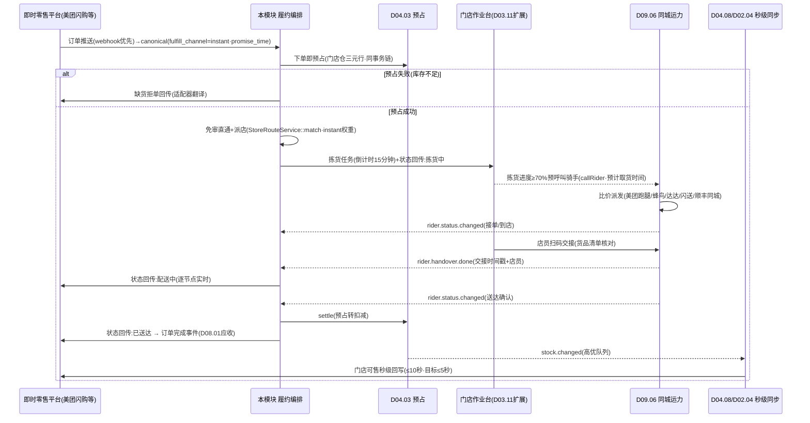
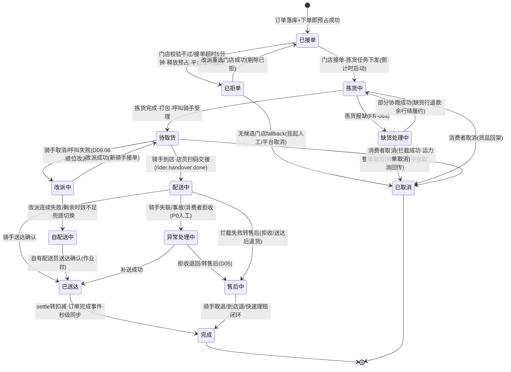
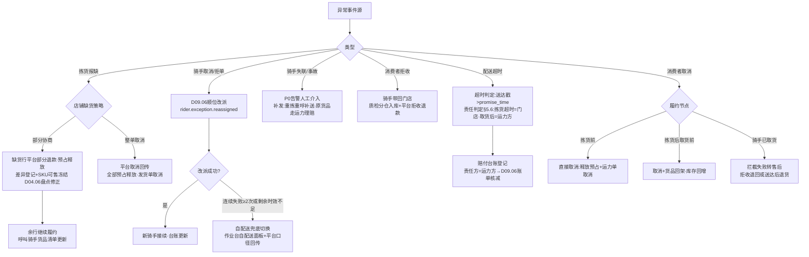

# SRS-D03.15 即时零售履约模块 需求规格说明书

> 文档编号：SRS-D03.15 · 版本 V1.0 · 2026-10-24 · 编写：小凯 · 状态：待审阅（V1.2 友商对标增补，G1 决策）
> 所属域：D03 订单履约域 · 分期：**P1（M2-M3，随 O2O 门店履约同批）**
> 上游依据：SRS-D03.11（门店仓模型/门店分单/接单超时改派——本模块复用其门店路由契约）· SRS-D02.02（适配器注册机制——即时零售平台=新适配器）· SRS-D04.08（门店库存同步——本模块要求秒级高频通道）· SRS-D03.07（发货单指令状态机契约）· SRS-D09.06（同城配送运力对接——骑手呼叫/改派/轨迹/交接的执行方）· SRS-D01.07（超时告警分级）· 《友商 OMS 对标与缺口分析》§G1（Jason 决策：有业务，补完整能力）

---

## 1. 模块概述

### 1.1 定位

即时零售履约是**分钟级时效的特殊履约通道**：消费者在美团闪购/饿了么零售/京东到家秒送/抖音小时达/淘宝小时达下单，期望 30-60 分钟送达。订单由门店仓发货（复用 D03.11 门店仓三元记账与门店路由），但履约执行体是**骑手而非快递**——全链路（接单→门店拣货→呼叫骑手→交接→配送→送达确认）以分钟为刻度编排与监控。

与 D03.11 O2O 门店履约的关系（契约级区分）：

| 维度 | D03.11 门店发货 | D03.15 即时零售（本模块） |
|---|---|---|
| 履约执行体/时效 | 快递（电子面单 D09.05），天级 | **骑手（同城运力 D09.06），分钟级（30-60 分钟送达承诺）** |
| 审单缓冲 | 标准审单链（可合单/缓冲窗） | **下单即预占、免审单直通**（无合单无缓冲窗） |
| 库存同步 | 常规 ≤10 秒（D04.08） | **秒级高频通道（售出即同步防超卖）** |
| 门店分单 | `StoreRouteService::match`（D03.11 IF-01） | **复用同一服务**，评分权重侧重时效（距离权重上调） |
| 平台交互 | 全渠道派单结果同步 | **状态实时回传**（拣货中/待取货/配送中/已送达逐节点） |

本模块是履约**编排层**：门店拣货作业复用 D03.11 门店作业台（扩展倒计时），骑手呼叫/改派/轨迹/交接全部委托 D09.06 执行，平台报文翻译委托 D02.02 即时零售适配器，库存扣减与同步委托 D04 域。本模块只负责把六方能力串成一条分钟级不断链的流水线，并对全链路时效负责。

### 1.2 职责边界

**做**：即时零售订单识别与直通路由（免人工审单、下单即预占、无合单缓冲）；履约编排状态机（接单→拣货→呼叫骑手→交接→配送→送达/异常）与节点时间戳采集；门店拣货任务下发与**拣货时效倒计时**（复用 D03.11 作业台扩展超时升级预警）；呼叫骑手编排（预呼叫时机、经 D09.06 比价派发、失败改派、自配送兜底切换）；配送状态逐节点实时回传平台编排；全链路分钟级时效监控与超时预警分级（联动 D01.07）；门店库存秒级同步联动（触发 D04.08 高频通道）；异常处理编排（缺货协商/整单取消、骑手异常改派、超时赔付登记）；即时零售售后编排（骑手取退/到店退、餐损货损快速理赔）。

**不做**：即时零售平台报文映射与 API 调用（→ D02.02 新增 5 适配器，本模块消费 canonical 订单模型）；骑手运力方对接/比价算法/呼叫改派执行/交接扫码/运力账单（→ D09.06，本模块下发指令消费事件）；门店仓记账/预占执行/可售计算（→ D04.02/D04.03/D04.08，本模块只是触发方与时序约束方）；门店档案与分单评分算法（→ D03.11，复用 `StoreRouteService::match` 传即时零售权重上下文）；发货单指令状态机定义（→ D03.07 契约，本模块是其裁剪分支）；快递履约链路（→ D03.07/D09.02 标准链路，两通道互斥）。

### 1.3 与其他模块关系

| 模块 | 关系 |
|---|---|
| D02.02/D02.03/D02.04 | 5 即时零售平台适配器（注册机制纯增量）；报文含配送时效约束落 `platform_extra`；**推送为主**（水位轮询仅对账兜底），缓冲投递 `gateway.order.buffered` 高优队列；配送状态逐节点回传平台 |
| D03.01 订单 | canonical 订单落库带即时零售标记（`fulfill_channel=instant`）；期望送达时间字段 |
| D03.11 O2O 门店 | 复用门店仓模型/门店履约属性/`StoreRouteService::match` 分单/门店作业台；拒单超时改派机制同款 |
| D04.03/D04.08 | **下单即预占**（订单落库同事务触发 `FreezeService::reserve`，预占失败=平台缺货拒单）；门店库存秒级同步高频通道（FR-05），即时零售店铺策略强制「实时回写+售罄熔断」 |
| D03.07 发货单 | 即时零售发货单=指令状态机裁剪分支（免推仓，sync_status=无需推仓，状态由履约编排状态机驱动映射） |
| D09.06 同城运力 | `InstantDeliveryService::callRider` 呼叫指令；订阅 `rider.status.changed`/`rider.handover.done`/`rider.exception.*` 事件 |
| D05 售后 | 即时零售售后单（骑手取退/到店退）走 D05.01 申请单模型扩展履约方式；快速理赔通道 |
| D01.07/D08/D11.03 | 拣货超时升级/骑手异常/配送超时告警（P0/P1 分级）；订单完成事件供应收、赔付台账供财务口径；即时履约看板数据源 |

---

## 2. 业务场景

**SC-D03.15-01 即时零售订单直通履约（主流程）**
消费者 20:10 在美团闪购某美妆门店下单（期望 21:00 前送达）。平台推送报文经美团闪购适配器转 canonical（含期望送达时间/收货地经纬度/配送费）→ 订单落库标记 `fulfill_channel=instant` → **同事务下单即预占**门店仓三元行 → 免人工审单直通 → `StoreRouteService::match`（平台已指定门店则校验直选，同 D03.11 FR-02b）→ 生成即时零售发货单 → 拣货任务推门店作业台（倒计时 15 分钟）→ 拣货中即触发**预呼叫骑手**（D09.06，预计拣货完成时间前 5 分钟下单呼叫）→ 店员打包完成 → 骑手到店 → 店员扫码交接（D09.06）→ 配送中状态逐节点回传美团 → 20:52 骑手送达确认 → 发货确认（settle 预占转扣减）→ 门店库存变动触发秒级同步 → 订单完成。全链路 42 分钟，各节点时间戳落时效台账。

**SC-D03.15-02 拣货超时升级**
门店 20:15 接单后店员忙于线下顾客，拣货倒计时 15 分钟走到 12 分钟未开始拣货：作业台倒计时变黄（≥80% 阈值）+ 企微提醒店长；15 分钟超时 → P1 告警升级（D01.07，通知门店负责人+履约值班）+ 平台侧「拣货中」状态延迟风险预警；20 分钟仍未拣货 → P0 升级（电话值班）+ 编排器评估改派：邻近门店有货则整单改派（释放本店预占→重占邻店→重下拣货任务→骑手呼叫改取货地址）；无邻店可改 → 与消费者协商（平台消息：延迟/取消退款）。

**SC-D03.15-03 门店部分缺货协商**
拣货中发现 3 件商品缺 1 件（账面 2 实物 1，账实差异）：店员作业台报缺 → 编排器按店铺配置分支：① 部分缺货协商——平台部分退款通道发起（缺货行退款，其余继续履约），缺货行预占释放、门店库存差异登记（联动 D04.06 盘点修正）；② 整单取消——平台取消回传、全部预占释放、发货单取消。协商结果回传平台，履约继续（拣货完成→呼叫骑手，配送费按平台规则处理）。

**SC-D03.15-04 骑手异常改派与自配送兜底**
骑手接单后 10 分钟取消（运力方回传骑手取消事件）：D09.06 自动顺位改派（次优运力方重呼）；连续 2 次改派失败或距期望送达时间不足 20 分钟 → 门店自配送兜底切换（品牌自有配送员接单，D09.06 FR-06 模式，作业台转「自配送」面板：配送员手机号+送达确认按钮）→ 平台状态按自配送口径回传。全程异常留痕，超时责任登记（运力方/门店）供赔付与账单核减。

**SC-D03.15-05 配送超时赔付**
订单 21:00 期望送达，21:10 骑手仍未送达（配送中节点超时）：超时预警 P1 → 21:15 判定超时成立（平台时效承诺口径）→ 自动登记超时赔付（平台规则赔付由平台扣款承接，OMS 登记赔付台账：订单/超时时长/责任方/赔付金额/承担方=运力方或平台或商家）→ 责任方=运力方时联动 D09.06 运费结算台账核减；消费者安抚通知经平台通道。

**SC-D03.15-06 即时零售售后（骑手取退/到店退/快速理赔）**
消费者收到商品发现货损（挤压破损），平台发起售后：D05.01 申请单同步（即时零售标记）→ 按售后类型路由：① 骑手取退——呼叫运力反向单（D09.06 取退模式：骑手上门取件送回门店），取回确认即退款（D05.03 快速通道，货损件入次品库存 D04.02）；② 到店退——消费者到店退货，店员作业台退货核销（同自提核销交互），核销即退款；③ 餐损货损快速理赔——低值（阈值店铺级可配，默认 100 元）货损凭证（照片）审核通过**免退货直接退款**（D05.05 自动审核规则扩展即时零售白名单），全程目标 ≤30 分钟闭环。

**SC-D03.15-07 门店库存秒级同步防超卖**
门店某 SKU 库存 3，20:30:00 即时零售售出 1 件（下单即预占成功）→ 预占流水触发 `stock.changed` → D04.08 高频通道（即时零售店铺强制实时模式，跳过节流合并窗）→ 20:30:05 前平台可售回写为 2；20:30:10 线下 POS 售出 1 件（门店库存变动接入，事件源=POS/手工调整）→ 同样秒级回写为 1；库存=0 触发售罄熔断（回写 0+暂停抖动）。多即时零售平台共享同一门店库存池时按 D04.08 店铺策略（比例分配/安全库存）各自换算回写，任一平台售出其余平台可售同步下调（≤10 秒，目标 ≤5 秒）。

---

## 3. 功能需求

### FR-D03.15-01 即时零售平台接入（经 D02.02 适配器注册机制）
- FR-01a 新增 5 即时零售平台适配器（D02.02 FR-03a 目录约定纯增量）：**美团闪购（meituan_shangou）/ 饿了么零售（ele_retail）/ 京东到家秒送（jddj）/ 抖音小时达（douyin_hour）/ 淘宝小时达（taobao_hour）**；各适配器实现 D02.02 五能力接口（订单下载/发货回传/库存回写/售后同步/商品查询）+ `parseInbound` 消息解析；能力白名单声明各平台差异（如抖音小时达复用抖店凭证体系、淘宝小时达走奇门即时零售接口族）。
- FR-01b 订单报文必含**配送时效约束**：期望送达时间（promise_time）/平台时效承诺类型（30 分钟达/1 小时达/定时达）/配送费与承担方/收货地经纬度——canonical 落 `platform_extra.instant` 扩展列 + 主表冗余 promise_time（时效监控查询高频字段）；报文缺时效约束 → 按店铺默认时效兜底（默认 60 分钟）+转换告警（D02.02 convert_warnings 机制）。
- FR-01c 消息通道优先级：即时零售平台**推送为主**（webhook/长连接），拉单水位轮询仅作对账兜底（间隔缩短至 5 分钟）；推送延迟监控（平台推送时间 vs 接收时间差 >2 分钟告警 D11.03）。
- FR-01d 平台状态回传映射：履约编排状态机节点 → 各平台配送状态枚举（拣货中/待取货/配送中/已送达/已取消），映射表落 D02.02 enum_mapping（map_type=instant_delivery_status）；回传失败按 D02.05 重试且**提级处理**（即时零售状态回传失败=P1 告警，非常规 P2）。

### FR-D03.15-02 订单直通与下单即预占
- FR-02a 即时零售订单识别：平台标识 ∈ 即时零售适配器集合 → 订单 `fulfill_channel=instant`；该通道订单**跳过人工审单与合单**（D03.05 合单指纹不计算、D03.02 审单插件链裁剪为最小校验集：地址可达/黑名单/限购——秒级完成，无缓冲窗）。
- FR-02b 下单即预占：订单落库同事务链触发 `FreezeService::reserve`（门店仓三元行，D04.03 IF-01，幂等键=订单行）；预占成功→直通派店；**预占失败（库存不足）→ 平台缺货拒单回传**（各平台拒单语义由适配器翻译），订单关闭留痕；无「先接单后找货」缓冲（即时零售超卖=履约事故，口径严于常规电商的缺货挂起 D03.09）。
- FR-02c 自动派店：平台指定门店（报文 store 标识）优先校验直选（复用 D03.11 FR-02b：营业中/接单未满/本单未拒过）；未指定 → `StoreRouteService::match(order, geo, context={channel:instant})`，评分权重上下文覆盖：距离权重上调（默认 dist=0.6, depth=0.25, prio=0.15，店铺级可配）、距离计算强制经纬度球面距离（分钟级时效不容忍行政区三档粗粒度）；候选门店须开通即时零售能力（门店履约属性扩展 `instant_enabled`，D03.11 store_profile 增列）。
- FR-02d 接单超时改派复用 D03.11 FR-02e 机制，**超时阈值缩短**：即时零售门店接单超时默认 **5 分钟**（常规 30 分钟，店铺级可配）；超时/拒单 → 释放预占 → 剔除重选 → 无候选走 fallback（即时零售 fallback 仅「挂起+人工协调/平台取消」，**不转电商仓**——快递时效无法满足分钟级承诺）。
- FR-02e 即时零售发货单：复用 D03.07 模型与指令状态机裁剪分支（同虚拟发货单免推仓语义：sync_status=无需推仓）；状态映射见 §5.1；发货单扩展字段见 §6.2。

### FR-D03.15-03 门店拣货协同（复用 D03.11 作业台扩展）
- FR-03a 拣货任务下发：门店接单成功 → 拣货任务推门店作业台待拣货队列 + 企微/门店端通知（D01.07，模板 `instant.pick.task`）；任务含明细（SKU/数量/货位建议可选）、**拣货倒计时**（时限=店铺配置，默认 15 分钟，且 ≤ promise_time − 配送预计时长 − 交接缓冲，编排器自动取小）。
- FR-03b 倒计时与超时升级预警：作业台实时倒计时展示；阈值分级——≥60% 时限变黄提醒、≥80% 变橙+企微催办店长、100% 超时 P1 告警（D01.07：门店负责人+履约值班）、130% P0 升级（电话值班+改派评估触发，§5.3）；倒计时状态随节点回传平台（拣货中→拣货完成）。
- FR-03c 拣货操作：逐行拣货确认（扫码/点选）；**报缺**入口（行级缺货数量+原因：账面差异/破损/临期下架）→ 触发 FR-06a 缺货分支；拣货完成 → 打包 → 「拣货完成」确认（时间戳落台账）→ 触发呼叫骑手（FR-04）；拣货完成前预呼叫已发生时（FR-04b）仅更新取货就绪状态。
- FR-03d 拣货绩效与差异联动：拣货耗时/报缺率按门店-店员维度落台账（D11 报表）；报缺=账面差异 → 差异登记联动 D04.06 门店盘点修正建议（同 D03.11 §5.6 口径，不强制即时盘点）。

### FR-D03.15-04 呼叫骑手编排（委托 D09.06 执行）
- FR-04a 标准呼叫：拣货完成 → `InstantDeliveryService::callRider(deliveryReq)`（D09.06 IF-01：取货门店/收货地址经纬度/重量体积/期望送达时间/货品价值）→ D09.06 智能比价派发（多运力方价格/时效/接单率）→ 呼叫受理回执（运力方单号）落发货单扩展；受理失败 → D09.06 顺位改派编排接管，本模块消费其 `rider.call.failed` 事件做兜底决策（FR-06b）。
- FR-04b **预呼叫**（缩短骑手等待，店铺级开关默认开）：拣货进度 ≥70%（或拣货完成后置 0 分钟场景直接标准呼叫）时提前呼叫，运力方接单后骑手按「预计取货时间」节奏到店；预呼叫后拣货报缺 → 呼叫单变更（货品清单/重量更新，D09.06 IF-04 变更接口）或取消重呼；预呼叫骑手到店但拣货未完成 → 骑手等待超时（运力方规则）自动取消重呼，等待费登记（D09.06 账单联动，责任=门店）。
- FR-04c 交接确认：骑手到店取货，**店员扫码交接**（D09.06 FR-04：扫骑手取货码/交接码，货品清单核对确认）→ `rider.handover.done` 事件 → 本模块记录交接时间戳+交接人（店员账户）→ 平台状态回传「配送中」；未扫码交接但运力方回传已取货 → 交接补录入口（店员确认+备注）+ 差异留痕（货损纠纷时举证链缺口标记）。
- FR-04d 配送状态消费：订阅 D09.06 `rider.status.changed`（接单/到店/取货/配送中/送达/异常全状态）→ 更新履约编排状态机 → 逐节点回传平台（FR-01d）+ 时间戳落时效台账；送达确认（骑手 App 送达/消费者确认）→ 触发发货确认（FR-05c）。
- FR-04e 骑手位置轨迹（P2 可选）：D09.06 轨迹能力就绪后，作业台/门户展示骑手实时位置（消费者侧展示走平台自有轨迹，OMS 不重复建设 C 端）。

### FR-D03.15-05 库存联动（秒级同步与扣减时序）
- FR-05a 秒级同步通道：即时零售店铺在 D04.08 同步策略上强制「实时回写模式+节流合并窗 ≤2 秒+售罄熔断」（覆盖 D04.08 FR-03b 常规节流参数）；库存变动（预占/扣减/释放/POS 售出/盘点调整）→ `stock.changed` 高优队列 → 可售重算 → `SyncService::submitStockSync`（D02.04 IF-02）→ 平台回写；**端到端目标 ≤5 秒、SLA ≤10 秒**（D04.08 §8 常规口径的加严版）；回写失败重试提级（即时零售店铺连续失败 3 次=P1 告警，防平台侧超卖窗口拉长）。
- FR-05b 多平台共享门店池：同一门店库存供多个即时零售平台+常规 O2O 渠道售卖时，按 D04.08 店铺策略换算各平台可售（比例分配/安全库存）；任一渠道售出全渠道可售联动下调（秒级）；线下 POS 库存变动接入为事件源（POS 对接经门店作业台手工录入或 POS 系统 webhook，P1 手工+webhook 预留）。
- FR-05c 扣减时序：下单即预占（FR-02b）→ 送达确认后 settle 转扣减（`FreezeService::settle`，D04.03 IF-04）→ 实际库存-N 触发可售重算回写；取消/缺货释放走 `FreezeService::release`；**预占期间可售已扣**（预占即可售减项，D04.02 五口径契约），秒级同步保证平台侧可售与 OMS 预占一致，防「预占了但平台还在卖」。
- FR-05d 账实差异防线：报缺（FR-03c）即时冻结该 SKU 该门店可售（差异量），盘点修正后恢复——防「账面 2 实物 1」连续超卖。

### FR-D03.15-06 异常处理
- FR-06a 门店缺货：拣货报缺 → 分支（店铺级配置）：① **部分缺货协商**——缺货行平台部分退款（适配器翻译各平台部分退语义）、缺货行预占释放、其余行继续履约、差异登记；② **整单取消**——平台取消回传、全部预占释放、发货单取消、取消原因结构化（缺货）；协商发起至消费者确认的等待窗（默认 10 分钟，平台规则优先）超时按整单取消兜底。
- FR-06b 骑手异常：① 骑手取消/拒单 → D09.06 自动顺位改派（本模块消费 `rider.exception.reassigned` 更新台账）；② 改派连续失败（≥2 次）或剩余时效不足（promise_time − now < 运力方预计送达时长）→ **自配送兜底切换**（D09.06 FR-06：作业台转自配送面板+平台自配送口径回传）；③ 骑手取货后异常（交通事故/失联，`rider.exception.lost`）→ P0 告警人工介入（联系运力方/补发决策：重拣重呼新骑手补送，原单货品追回走运力方理赔）；④ 消费者拒收 → 骑手带回门店 → 退货入库（次品/正品质检分仓 D05.02 口径）+ 平台拒收退款联动。
- FR-06c 配送超时赔付：超时判定（送达时间戳 > promise_time，平台口径优先）→ 赔付台账登记（订单/超时时长/责任方判定规则：拣货超时=门店、取货后超时=运力方、呼叫失败延误=系统/运力、不可抗力=商家承担）→ 责任方=运力方时推送 D09.06 结算台账核减；赔付金额按平台规则/运力方协议（D09.06 运力方档案协议字段）；台账供 D08 财务口径与 D11 分析。
- FR-06d 取消与拦截：消费者取消（平台取消消息）→ 按履约节点分级处理：拣货前=直接取消（释放预占+发货单取消+运力呼叫取消 D09.06 IF-03）；拣货后取货前=取消+货品回架（预占释放+库存回增）；**骑手已取货=拦截失败转售后**（拒收退回或送达后退货，平台规则口径回执）。

### FR-D03.15-07 即时零售售后
- FR-07a 售后单同步与路由：平台售后单经 D02.02 适配器同步（D05.01 申请单模型，扩展 `return_mode=骑手取退/到店退/仅退款`）；即时零售售后默认**免退货快速处理优先**（低值货损理赔 FR-07c）。
- FR-07b 骑手取退：需退货场景呼叫运力**反向单**（D09.06 取退模式：消费者地址取件→送回门店）→ 门店收货质检（良品回架可售+预占口径恢复/不良入次品 D04.02）→ 质检确认触发退款（D05.03）→ 平台退款状态回传；取退时效监控同正向（默认 60 分钟取回）。
- FR-07c 餐损货损快速理赔：低值（≤店铺阈值默认 100 元）+ 凭证（照片）+ 原因白名单（破损/洒漏/错发）→ D05.05 自动审核规则扩展即时零售白名单 → **免退货直接退款**，闭环目标 ≤30 分钟；超阈值/非白名单转人工（D05.01 工作台，即时零售队列置顶——平台售后时效考核）。
- FR-07d 到店退：消费者到店退货，店员作业台退货核销（交互同 D03.11 自提核销：输单号/扫码）→ 质检 → 退款触发；核销留痕。

### FR-D03.15-08 时效监控与看板
- FR-08a 节点时间戳台账：全链路 8 节点（平台下单/OMS 接单/门店接单/拣货开始/拣货完成/骑手取货交接/送达确认/平台状态回传成功）逐单落时间戳（instant_track 表，§6.3）；节点间隔耗时派生（派店耗时/拣货耗时/等骑手耗时/配送耗时）。
- FR-08b 超时预警分级（联动 D01.07，全链路分钟级）：

| 预警项 | 阈值（默认，店铺级可配） | 级别 | 动作 |
|---|---|---|---|
| 门店未接单 / 骑手到店后未交接 | 3 分钟 / 10 分钟 | P2 提醒 / P1 | 企微催办门店；催办门店+运力方 |
| 拣货倒计时 | 60%/80%/100%/130% | 提醒/催办/P1/P0 | FR-03b 分级升级+改派评估 |
| 呼叫骑手未受理 | 5 分钟 | P1 | D09.06 改派联动 |
| 配送超时（>promise_time）/ 全链路预测超时（剩余节点预估耗时>剩余时效） | 0 分钟即判定 / 动态 | P1→赔付台账 / P1 | FR-06c；提前干预（加急拣货/升级运力） |

- FR-08c 即时履约看板（D11.03 数据源）：在途单量/各节点平均耗时/超时单率/运力呼叫成功率/改派率/自配送兜底率/秒级同步延迟 P95，按门店/平台/货主维度。

---

## 4. 业务流程

### 4.1 履约全链路时序（SC-01 主流程）



### 4.2 即时零售履约编排状态机



### 4.3 异常分支流程（缺货/骑手异常/超时）



---

## 5. 处理逻辑

### 5.1 编排状态机 ↔ 发货单指令状态机映射（D03.07 契约裁剪分支）

```
即时零售发货单 sync_status=无需推仓(同虚拟发货单免推仓语义)
编排状态(本模块·权威定义源) → D03.07 发货单状态(经 DeliveryStateMachine::transit
映射驱动·不跳态校验仍生效·映射表配置化):
  已接单/拣货中/待取货 → processing(作业中·门店自作业无WMS指令)
  配送中 → outbound(货已离店=出库语义)
  已送达→完成 → shipped→finished(送达确认=发货确认·settle触发点)
  已取消 → cancelled(预占release+split_num回退·D03.07 FR-08a口径)
平台取消拦截窗口: outbound(配送中)后取消=D03.07「outbound及之后不可取消」
契约的即时零售实例化 → 转售后拦截(FR-06d③)
```

### 5.2 直通路由与预占时序（伪代码）

```
handleInstantOrder(canonical_order):
    # ① 落库+预占同事务链(下单即预占·无审单缓冲)
    tx: order = 落库(fulfill_channel=instant, promise_time)
        store = 平台指定门店 ?? 候选预判(覆盖区域+instant_enabled)
        FreezeService::reserve(order.lines, 门店仓三元行)       # 幂等
        预占失败(库存不足) → rollback → 平台缺货拒单回传 → CLOSED
    # ② 最小校验集(秒级·非人工审单)
    校验: 地址可达(经纬度在门店配送范围)/黑名单(D03.09)/限购(G2增补插件)
    校验不过 → 平台拒单(原因结构化) + 预占release
    # ③ 派店(未指定门店时)
    store = StoreRouteService::match(order, geo,
              context={channel:instant, weights:{dist:0.6,depth:0.25,prio:0.15}})
    无候选 → fallback: 挂起人工+P1告警 / 平台取消(店铺配置)   # 不转电商仓
    # ④ 发货单+拣货任务
    delivery = createFromPlan(即时零售裁剪·免推仓)
    拣货时限 = min(店铺配置15min, promise_time − 配送预计 − 交接缓冲5min)
    推作业台 + 倒计时定时器(MQ延迟消息·分级阈值60/80/100/130%)
    # ⑤ 接单超时(5分钟·D03.11 FR-02e同款补偿链)
    超时/拒单 → release → 剔除重选(③) → 无候选fallback
并发防护: 订单级分布式锁; 状态机非法流转丢弃留痕(D03.11 §5.2同款)
```

### 5.3 拣货超时改派评估（SC-02）

```
倒计时130%触发 或 P0升级时评估:
  候选 = StoreRouteService::match(重选·剔除本店·instant权重)
  if 候选非空 且 预测送达(now+新店拣货时限+运力预计送达时长) ≤ promise_time:
      整单改派: release本店预占 → reserve邻店 → 拣货任务重下(新倒计时)
        → 已呼叫骑手则变更取货地址(D09.06 IF-04)/未呼叫则待新拣货完成
      留痕: 改派原因=拣货超时·原门店责任登记(赔付台账输入)
  else: 消费者协商(平台消息:延迟至T/取消退款) → 等待窗10分钟 → 超时按取消
```

### 5.4 预呼叫时机与变更（FR-04b）

```
触发: 拣货进度≥70%(逐行确认计数) 或 拣货完成(立即·标准呼叫)
callRider(req): 携带 expected_pickup_time = now + 剩余拣货预估(近7日同店均值)
预呼叫后事件处理:
  拣货报缺 → 货品清单/重量变更(D09.06 IF-04); 整单取消 → cancelCall
  骑手到店且拣货未完成 → 等待计时; 等待超运力方阈值被取消 → 重呼(等待费登记·责任=门店)+作业台强提醒
呼叫幂等: (delivery_id + 呼叫轮次) 唯一; 改派轮次+1(D09.06 承接顺位逻辑)
```

### 5.5 秒级同步时序约束（与 D04.08 分工）

```
D04.08 职责: 可售计算策略链/回写执行/节流/熔断(既有机制)
本模块职责: ① 即时零售店铺策略参数强制覆盖(实时模式·合并窗≤2秒·失败提级)
  ② 高优队列标记(stock.changed 携带 channel=instant → MQ 优先级)
  ③ 报缺差异量即时冻结可售(FR-05d·冻结指令经 SellableService)
  ④ 同步延迟监控(变动时间戳→平台回执时间戳·P95≤5s告警线10s)
时序: 预占成功即触发(不等发货) → 平台可售秒级下调 → 防「预占了平台还在卖」
POS线下售出: 作业台录入/webhook → 门店仓记账(D04.02) → stock.changed同链路
```

### 5.6 超时责任判定规则（FR-06c）

```
输入: instant_track 8节点时间戳 + promise_time
判定链(顺序短路):
  1. 门店接单耗时>5min 或 拣货耗时>拣货时限 → 责任=门店(接单/拣货环节)
  2. 呼叫受理耗时>5min 或 改派≥2次 → 责任=运力方/系统(细分:运力方接单率数据)
  3. 交接后配送耗时>运力方承诺时长 → 责任=运力方(配送环节)
  4. 天气/管制等不可抗力标记(人工登记) → 责任=商家承担(平台规则口径)
赔付台账: (order_id, 超时时长, 责任方, 赔付金额, 承担方, 依据快照=节点时间戳)
责任方=运力方 → 事件 instant.compensation.created → D09.06 结算台账核减
```

---

## 6. 数据字段（业务字段描述）

> 物理表落 `oms_order` schema（D03 域）；运力侧表落 `oms_fulfill`（见 SRS-D09.06 §6）；DDL 见 DB-D03 增补。

### 6.1 即时零售订单扩展（挂 orders，canonical 主表冗余+扩展列）

| 字段 | 业务含义 | 取值/校验 |
|---|---|---|
| fulfill_channel | 履约通道 | express（常规）/store（D03.11）/**instant**（本模块）；落单即定不可变 |
| promise_time / promise_type | 期望送达时间/时效承诺类型 | 平台报文优先，缺失按店铺默认 60 分钟兜底+转换告警；30 分钟达/1 小时达/定时达（平台字典映射） |
| receiver_lng / receiver_lat | 收货地经纬度 | 必填（派店球面距离+运力呼叫）；PIPL 加密存储 |
| delivery_fee / fee_bearer | 配送费/承担方 | 平台/商家/消费者；platform_extra.instant 存明细 |
| instant_platform | 即时零售平台标识 | meituan_shangou/ele_retail/jddj/douyin_hour/taobao_hour |

### 6.2 即时零售发货单扩展（挂 delivery）

| 字段 | 业务含义 | 取值/校验 |
|---|---|---|
| fulfill_mode | 履约方式 | 即时配送（D03.11 fulfill_mode 枚举启用其 P2 预留值「同城配送」） |
| orchestrate_status | 编排状态 | §4.2 状态机枚举（本模块权威；映射驱动 D03.07 状态） |
| store_branch_id | 履约门店仓 | 必填；改派时变更留痕（原店/新店/原因） |
| pick_deadline / pick_progress | 拣货时限/进度 | 时限=min(配置, 倒推公式)；进度=已确认行/总行 |
| rider_order_no / carrier_code | 运力方单号/运力方编码 | D09.06 呼叫受理回执落库；改派历史存子表 |
| pre_call_flag / call_round | 预呼叫标记/呼叫轮次 | 轮次 ≥1，>3 告警（对齐 D03.11 dispatch_round 口径） |
| handover_operator / handover_time | 交接店员/时间 | 扫码交接落库；补录走差异标记 |
| self_delivery_flag / courier_info / promise_risk_flag | 自配送标记/配送员信息/时效风险标记 | 兜底切换时启用（D09.06 联动）；预测超时（FR-08b）置位看板过滤 |

### 6.3 时效台账（instant_track）

| 字段 | 业务含义 |
|---|---|
| delivery_id / order_id / store_branch_id | 关联键 |
| ts_platform_order / ts_oms_accept / ts_store_accept / ts_pick_start / ts_pick_done / ts_handover / ts_delivered / ts_sync_done | 8 节点时间戳（FR-08a；毫秒级） |
| dur_dispatch / dur_pick / dur_wait_rider / dur_deliver | 派生耗时（秒） |
| overtime_flag / overtime_minutes / liability | 超时标记/时长/责任方（§5.6） |
| compensation_amount / bearer | 赔付金额/承担方（赔付台账关联） |
| tenant_id / owner_id | 必填（SRS-00 契约） |

### 6.4 门店即时零售属性（store_profile 增列，D03.11 §6.1 扩展）

| 字段 | 业务含义 | 取值/校验 |
|---|---|---|
| instant_enabled / instant_platforms | 即时零售能力开关/开通平台集 | 关闭不参与 instant 派店；JSON，与店铺授权（D02.06）联动校验 |
| pick_time_limit / accept_timeout_instant | 拣货时限/即时接单超时（分钟） | 默认 15（倒推公式取小，§5.2④）/默认 5（常规单仍走 30 分钟字段） |
| self_delivery_enabled / courier_pool | 自配送开关/配送员池 | D09.06 FR-06 数据源 |

### 6.5 售后扩展（挂 D05.01 return_apply）

| 字段 | 业务含义 | 取值/校验 |
|---|---|---|
| return_mode / reverse_rider_no | 退货方式/取退运力单号 | 骑手取退/到店退/仅退款；取退时 D09.06 反向单回执 |
| fast_claim_flag / evidence_urls | 快速理赔标记/凭证 | ≤阈值+白名单原因免退货直退（FR-07c） |
| store_verify_operator / store_verify_time | 到店退核销店员/时间 | 核销留痕 |

---

## 7. 接口

### 7.1 内部接口（本模块提供）

| 编号 | 接口 | 消费方 | 说明 |
|---|---|---|---|
| IF-D03.15-01 | `InstantFulfillService::orchestrate(order)` | D03.01 落库后编排入口 | 直通路由主编排（预占→派店→拣货任务→呼叫编排，§5.2）；订单级锁幂等 |
| IF-D03.15-02 | `InstantFulfillService::pickAction(deliveryId, 动作, 明细)` | 门店作业台 | 拣货确认/报缺/拣货完成（倒计时联动+预呼叫触发） |
| IF-D03.15-03 | `InstantFulfillService::handoverConfirm(deliveryId, operator)` | D09.06 交接事件消费/作业台补录 | 交接确认落库+状态推进（配送中） |
| IF-D03.15-04 | `InstantFulfillService::handleException(deliveryId, 异常类型, payload)` | D09.06 事件/作业台/客服工作台 | 异常分支统一入口（缺货/改派/兜底/拦截，§4.3）；幂等 |
| IF-D03.15-05 | `InstantTrackService::get/list(条件)` | 工作台/D11.03 看板/D08 赔付口径 | 时效台账查询（8 节点+耗时+责任） |
| IF-D03.15-06 | 事件 `instant.order.dispatched` / `instant.pick.done` / `instant.delivered` / `instant.cancelled` / `instant.compensation.created` | D02.04 回传/D09.06/D08/D11/D01.07 | 编排节点广播（DB-00 附录 A 事件字典登记增补） |
| IF-D03.15-07 | 订阅 `gateway.order.buffered`（高优队列）/ `rider.status.changed` / `rider.handover.done` / `rider.exception.*` / `rider.call.failed`（D09.06）/ `platform.aftersale.*`（D02.03） | 经 D01.01 | 编排驱动事件源 |

### 7.2 依赖接口（本模块消费）

| 编号 | 接口 | 提供方 | 说明 |
|---|---|---|---|
| IF-D03.15-D1 | `StoreRouteService::match(order, geo, context)` / `reject(deliveryId, storeId, reason)` | D03.11（IF-D03.11-01/02） | 派店与拒单改派（instant 权重上下文） |
| IF-D03.15-D2 | `FreezeService::reserve/release/settle` | D04.03（IF-01/03/04） | 下单即预占/取消释放/送达转扣减 |
| IF-D03.15-D3 | `InstantDeliveryService::callRider/cancelCall/updateCall` + 事件族 | D09.06（IF-D09.06-01/03/04） | 骑手呼叫编排执行方 |
| IF-D03.15-D4 | `SellableService::triggerRecalc` / 同步策略参数 | D04.08（IF-02） | 秒级同步触发与策略覆盖输入 |
| IF-D03.15-D5 | `DeliveryService::createFromPlan` / `DeliveryStateMachine::transit` / `cancel` | D03.07（IF-01/04） | 发货单生成与状态映射驱动 |
| IF-D03.15-D6 | `AlertService::alert(alert_key, 级别, vars)` | D01.07（IF-02） | 超时分级告警（FR-08b 阈值表） |
| IF-D03.15-D7 | 售后申请单/自动审核/退款 | D05.01/D05.03/D05.05 | FR-07 售后路由（return_mode 扩展） |
| IF-D03.15-D8 | `AdapterFactory::get(platform)` / `MappingService::mapEnum` | D02.02（IF-01/04） | 5 即时零售适配器与状态映射 |

### 7.3 外部接口

| 编号 | 接口 | 方向 | 说明 |
|---|---|---|---|
| EF-D03.15-01 | 5 即时零售平台 API（经 D02.02 适配器/D02.01 框架） | 双向 | 订单推送接收/状态逐节点回传/部分退款/取消/售后同步/库存秒级回写 |
| EF-D03.15-02 | 运力方 API（经 D09.06，本模块不直连）/ POS 库存变动 webhook（P1 预留） | 双向/入 | 骑手呼叫通道；线下售出秒级同步事件源（P1 作业台手工录入兜底） |

---

## 8. 非功能需求

| 项 | 要求 |
|---|---|
| 时效 | 订单推送接收→拣货任务下发端到端 ≤30 秒；状态节点→平台回传 ≤10 秒；库存变动→平台可售回写 ≤10 秒（目标 ≤5 秒）；全链路送达达成率（≤promise_time）≥95% |
| 性能 | 直通路由（预占+派店+发货单生成）P95 ≤500ms；秒级同步高优队列洪峰（门店批量变动）削峰不降级常规队列；倒计时定时器精度 ±10 秒 |
| 并发/幂等 | 订单级分布式锁；预占/呼叫/交接/送达确认全幂等（幂等键见 §5.2/§5.4）；平台推送与拉单兜底重复订单去重（D02.03 契约）；状态机非法流转丢弃留痕 |
| 一致性 | 预占-发货单-编排状态-运力单四者联动在补偿链内闭环；settle 失败补偿队列+对账兜底（D03.07 §5.3 同款）；秒级同步最终一致（回写失败重试提级+延迟监控） |
| 可用性 | 运力方全故障→自配送兜底（FR-06b②）；作业台不可用→电话报单客服代操作（D03.11 §8 同款口径）；平台回传通道故障→状态缓冲重传（时效台账不缺节点） |
| 安全/PIPL | 收货人姓名/电话/经纬度加密存储脱敏展示（D01.05）；骑手仅见配送必需信息（平台隐私号口径由适配器透传）；交接/核销操作绑定店员账户审计（D10.06） |
| 租户隔离 | 全单据 owner_id+tenant_id（SRS-00 契约）；品牌方门户仅见本货主即时零售单与台账（D10.03 行级过滤） |
| 容量 | 台账=单量×8 节点，随订单归档（D03.13）；即时单量按门店日均 ≤500 单/店规划，看板聚合分钟级刷新 |

---

## 9. 验收标准

| 编号 | 验收条件 |
|---|---|
| AC-01 | 主流程（SC-01）：美团闪购模拟订单推送→30 秒内拣货任务下发作业台；拣货完成→呼叫骑手受理→扫码交接→送达确认全链路状态机按 §4.2 流转，8 节点时间戳完整落台账 |
| AC-02 | 下单即预占：订单落库同事务链预占成功；构造库存不足→预占失败→平台收到缺货拒单回传（适配器翻译正确），订单关闭无残留预占 |
| AC-03 | 5 平台适配器（沙箱）：订单报文含 promise_time 正确落库；缺失时效约束按店铺默认 60 分钟兜底+转换告警；配送状态逐节点回传各平台枚举映射正确，回传失败 P1 告警且重试成功 |
| AC-04 | 派店复用与权重：平台指定门店校验直选；未指定按 instant 权重（dist=0.6）球面距离评分选店；门店接单超时 5 分钟自动释放预占改派（剔除已拒门店），无候选走 fallback 挂起+告警（不转电商仓） |
| AC-05 | 拣货倒计时分级：60% 变黄/80% 企微催办店长/100% P1 告警/130% P0 电话+改派评估触发（SC-02 全链路演练）；改派成功后原门店责任登记入赔付台账 |
| AC-06 | 部分缺货协商（SC-03）：报缺 1 件→缺货行平台部分退款+预占释放+差异登记+SKU 可售冻结，余行继续履约呼叫骑手（货品清单更新）；整单取消路径预占全释放+平台取消回传 |
| AC-07 | 预呼叫：拣货进度 70% 触发预呼叫携带预计取货时间；预呼叫后报缺→运力单变更成功；骑手到店拣货未完成被取消→自动重呼+等待费登记责任=门店 |
| AC-08 | 交接确认：扫码交接落交接店员+时间戳+平台「配送中」回传；未扫码但运力回传已取货→补录入口+差异标记（举证链缺口） |
| AC-09 | 骑手异常（SC-04）：骑手取消→D09.06 顺位改派接续；连续 2 次失败→自配送兜底切换（作业台面板+平台自配送口径回传）；骑手失联→P0 告警+补发决策入口 |
| AC-10 | 秒级同步（SC-07）：预占成功→平台可售回写 ≤10 秒（压测 P95 ≤5 秒）；库存 3 售出 1 即时回写 2；售罄熔断回写 0；共享门店池多渠道售出联动下调；回写连续失败 3 次 P1 告警 |
| AC-11 | 配送超时赔付（SC-05）：送达戳>promise_time 自动判定+责任方按 §5.6 规则链判定；责任=运力方时赔付台账推送 D09.06 结算核减；台账含节点时间戳依据快照可回放 |
| AC-12 | 售后三通道（SC-06）：骑手取退（反向单呼叫→门店质检→退款触发）/到店退（核销即退款）/低值货损快速理赔（≤100 元+凭证+白名单→免退货直退）闭环 ≤30 分钟；超阈值转人工且即时队列置顶 |
| AC-13 | 消费者取消分级：拣货前直接取消（预占释放+运力单取消）；拣货后取货前取消+货品回架库存回增；骑手已取货拦截失败转售后——三路径状态机与库存动作均正确 |
| AC-14 | 权限与合规：全单据 owner_id+tenant_id 落库；品牌方门户仅见本货主即时零售单/台账/售后；收货人字段脱敏；交接/核销/兜底切换操作审计可查 |

---

## 变更记录

| 日期 | 版本 | 变更 | 原因 |
|---|---|---|---|
| 2026-10-24 | V1.0 | 首版 | 友商对标 G1 缺口，Jason 决策「有业务，补完整能力」（V1.2 增补） |

---

*参考实现溯源：商派 meituan4sg/meituan4medicine/meituan4flash/meituan4group/meituan4wm 等 5 个美团适配目录（矩阵中心 platform 目录族的即时零售分支：美团闪购/医药/闪送/团购/外卖报文映射，订单拉取+发货回传+库存同步的矩阵协议实现）+ 商派 o2o 模块（店掌柜接单/拒单/发货作业台、门店库存同步 storeinventory 族，逆向文档 05 §5.3）+ 万里牛即时零售方案公开资料（多平台订单统一接入/门店拣货/骑手协同/库存实时联动四环节形态；美团跑腿/蜂鸟/达达/闪送/顺丰同城多运力聚合与比价派单；分钟级履约时效监控看板）。关键差异：① 商派美团系适配经矩阵中心代理且各目录独立无统一即时零售编排层，本设计收敛为 5 适配器（D02.02 注册机制纯增量）+ 统一履约编排状态机（本模块权威定义，映射驱动 D03.07 发货单状态）；② 商派 o2o 门店发货为快递履约（面单+运单号），本模块骑手分钟级履约独立通道（fulfill_channel=instant，接单超时 30 分钟→5 分钟、拣货倒计时分级升级、预呼叫编排均为新增）；③ 下单即预占+免审直通+秒级同步（≤10 秒加严至目标 ≤5 秒）严于商派「拉单-审单-预占」常规链与万里牛公开口径；④ 超时责任判定规则链+赔付台账产品化（商派无，责任细分至节点耗时依据快照）；⑤ 骑手异常改派/自配送兜底/拒收质检分仓的异常分支显式 Saga 化；⑥ 即时零售售后三通道（骑手取退反向单/到店退核销/低值货损免退货快速理赔 ≤30 分钟闭环）为商派 o2o 与 D05 常规售后之外的新增编排；⑦ 运力对接整体下沉 D09.06 独立模块（商派散落各适配目录，无聚合比价层）。*
