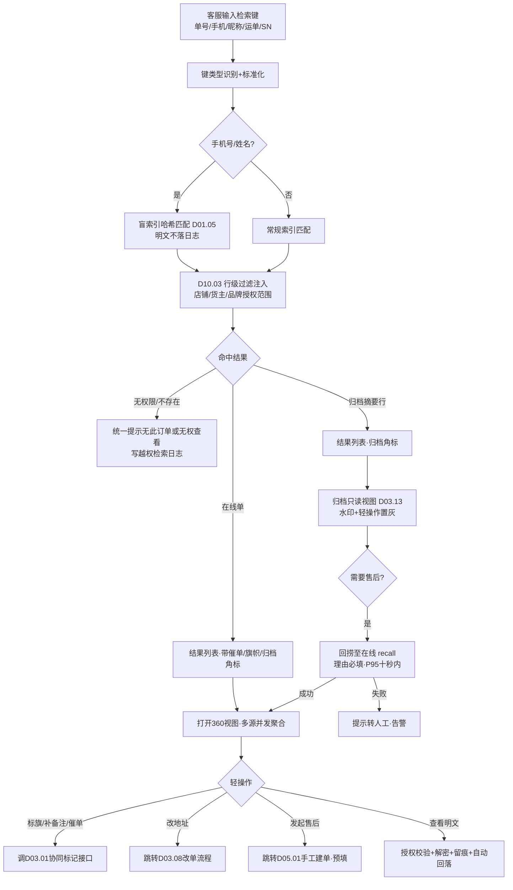
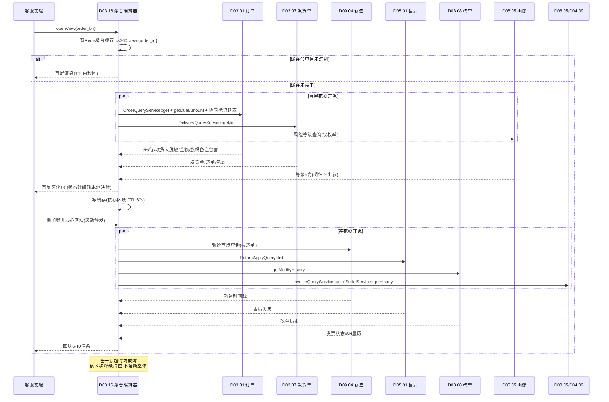
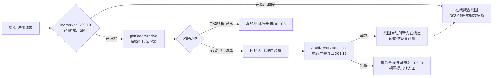

# SRS-D03.16 客服订单360视图模块 需求规格说明书

> 文档编号：SRS-D03.16 · 版本 V1.0 · 2026-10-24 · 编写：小凯 · 状态：待审阅（V1.4 业务仿真增补）
> 所属域：D03 订单履约域 · 分期：**P1（M3）**
> 上游依据：天猫代运营业务完整性仿真决策 **S2-A**（Jason 拍板）· SRS-00 §4.4 契约「订单状态机」「货主维度」· SRS-D03.01 V1.1/V1.4（订单聚合根/查询视图/协同标记）· SRS-D03.08（改单入口）· SRS-D03.13（归档历史查询）· SRS-D05.01/D05.05 V1.3（售后历史/跨店铺退货画像）· SRS-D09.04（物流轨迹 P1）· SRS-D04.09（SN/批次）· SRS-D08.05（发票）· SRS-D10.03（行级数据权限）
> 定位：面向客服岗位的**统一查单工作台**——只读聚合 + 轻操作入口：多维检索定位订单，单页 360 聚合十大信息区块（并发拉取多模块数据），常见操作一键跳转既有模块执行，**不重复建设任何业务逻辑**

---

## 1. 模块概述

### 1.1 定位

凯淳是电商代运营公司（TP），客服接到买家咨询/投诉时需要在秒级内查清一笔订单的全部信息并做常见处置。当前查单能力**分散在三处**：改单在 D03.08、售后在 D05.01、历史查询在 D03.13，客服需要跨菜单反复跳转拼装信息，大促期查单效率与响应时效（客服 KPI 核心项）受损。本模块在既有能力之上建一个**客服视角的聚合前台**：

- **多维检索**：订单号/平台单号/手机号（PIPL 哈希盲索引）/收货人/旺旺买家昵称/运单号/SN 七类入口一次定位；
- **单页 360 聚合**：订单基本信息、四套状态时间轴、商品行（BOM 展开/SN）、双口径金额、收货人（脱敏）、物流轨迹、支付信息、发票状态、售后历史、改单历史、旗帜/备注/留言、买家风险等级提示，一页看全；
- **轻操作入口**：加催单标记、补备注、标旗（调 D03.01 协同标记接口）、改地址（跳 D03.08）、发起售后（跳 D05.01）、归档单回捞（调 D03.13），只做入口与跳转，**执行逻辑全部归属被调模块**。

### 1.2 职责边界

**做**：多维检索（含盲索引匹配与在线/归档透明路由）；单页 360 视图的多源数据**并发聚合编排**（调各模块查询接口 + 缓存 + 懒加载）；四套状态到时间轴的映射渲染；旗帜/备注/留言/催单标记展示与快捷操作入口；买家风险等级脱敏提示展示；明文查看授权点校验与留痕；归档单查询的回捞入口；客服检索日志（审计与热点分析）。

**不做**：改单的校验/快照/冻结/叫回逻辑（→ D03.08，本模块只提供跳转入口）；售后建单/审核/退款逻辑（→ D05.01/D05.03/D05.05）；归档机制与回捞执行（→ D03.13，本模块只调 `isArchived/recall`）；物流轨迹订阅与节点回流（→ D09.04 FR-07）；订单查询视图的通用能力（→ D03.01 FR-10，本模块是其客服场景的聚合增强）；买家风险画像的计算与明细管理（→ D05.05 FR-04g，本模块只取**风险等级枚举**展示）；协同标记（旗帜/备注/催单）的存储与状态维护（→ D03.01 V1.4 协同标记接口）。

### 1.3 与其他模块关系（尤其与 D03.13 的分工）

**D03.16 是客服前台聚合视图，D03.13 是归档底层机制**：D03.13 定义归档策略、归档库存储、历史只读详情与回捞执行；D03.16 面向客服提供统一检索入口，命中归档标记时调用 D03.13 的 `isArchived/getOrderArchive/recall` 完成在线摘要→归档库回捞的透明路由，客服无需感知订单在哪个库。

| 模块 | 关系（D03.16 视角） |
|---|---|
| D03.01 订单接入与创建 | 主数据源：`OrderQueryService::get/list`（IF-D03.01-03）订单头/行/收货人；`OrderAmountService::getDualAmount`（IF-D03.01-05）双口径金额；**协同标记接口（IF-D03.01 占位，接口定义见 D03.01 V1.4）**：旗帜/卖家备注/买家留言/催发货标记的读取与「标旗/补备注/加催单」写入 |
| D03.07 发货单管理 | `DeliveryQueryService::get/list/trace`（IF-D03.07-08）发货单/运单/包裹，物流轨迹区块的运单锚点 |
| D03.08 改单复审 | `OrderModifyService::getModifyHistory`（IF-D03.08-07）改单/复审/回滚时间线；改地址操作跳转入口 |
| D03.13 归档历史 | `ArchiveService::isArchived/getOrderArchive/recall`（IF-D03.13-03/01/02）、`ArchiveQueryService::search`（IF-D03.13-04）归档单透明路由与回捞 |
| D05.01 售后申请单 | `ReturnApplyQuery::get/list/trace`（IF-D05.01-05）售后历史；`createManual`（IF-D05.01-02）手工建单跳转入口 |
| D05.05 售后自动审核 | 跨店铺退货画像（FR-04g，aft_buyer_profile V1.3）：**只取风险等级枚举**（低/中/高）供客服提示，明细不可见（PIPL） |
| D09.04 物流分单 | 轨迹节点数据（§6.7 fulfill_trace_node，P1）+ 事件 `logistics.trace.updated`（IF-D09.04-07）触发视图缓存失效 |
| D04.09 批次序列号 | `SerialService::getHistory(sn)`（IF-D04.09-06）SN 履历，消电/奢品客服核验；SN 反查订单 |
| D08.05 发票管理 | `InvoiceQueryService::get/list/trace`（IF-D08.05-05）发票状态区块 |
| D10.03 数据权限 | 数据权限中间件（IF-D10.03-01）无感知注入行级过滤；`PermissionService::can`（IF-D10.03-02）明文查看等功能点判定 |
| D01.05 PIPL | `PiplCrypto::mask`（IF-D01.05-02）脱敏渲染；`BlindIndexService::build`（IF-D01.05-03）手机号盲索引检索；`ConsentService::record` + 事件 `pipl.plain.accessed`（IF-D01.05-04/09）明文查看留痕 |
| D10.06 操作审计 | `AuditService::businessEvent`（IF-D10.06-03）客服查单/明文查看/轻操作动作投递审计 |

---

## 2. 业务场景

**SC-D03.16-01 买家咨询「我的货到哪了」**
客服接旺旺咨询，买家报手机号。客服在 360 工作台输入手机号 → 盲索引哈希匹配定位订单（PIPL，明文不落地）→ 打开 360 视图：物流轨迹区块展示最新节点（已到达本市分拨中心），发货单区块展示运单号与物流公司。客服直接话术回复，全程 ≤30 秒，无需跳转任何菜单。

**SC-D03.16-02 买家投诉漏发**
买家称三件只收到两件。客服按订单号查 360 视图：商品行区块（BOM 展开后 3 行基础物料）对照发货单包裹明细与称重，确认少发一行 → 点击「发起售后」入口跳转 D05.01 手工建单（`createManual`），预填订单号与缺失行；高值品类同时核验 SN 区块（D04.09 履历：出库绑定记录存在与否即漏发证据）。

**SC-D03.16-03 买家要求改地址**
客服按旺旺昵称检索订单，360 视图状态时间轴显示「已审核未推仓」→ 点击「改地址」入口跳转 D03.08 改单流程（校验/快照/叫回全由 D03.08 执行）。若时间轴显示已发货，视图直接提示「已发货不可改单，请引导买家走物流拦截或售后」，客服无需进入 D03.08 即知不可操作。

**SC-D03.16-04 买家咨询一年前订单**
买家报订单号询问历史订单发票。检索命中摘要行归档标记（D03.13 `isArchived`=已归档）→ 360 视图自动切换归档数据源（`getOrderArchive` 实时读归档库），界面带「历史归档单·只读」水印，轻操作入口全部置灰；买家若要对该单发起售后，客服点击「回捞至在线」（D03.13 `recall`），回捞成功后视图自动刷新为在线态。

**SC-D03.16-05 客服核验高值退货**
奢品买家申请退货前咨询。客服打开 360 视图：买家风险等级区块显示「高风险」提示（D05.05 跨店铺画像风险分映射的**等级枚举**，客服看不到明细指标，PIPL 合规）→ 客服按提示走加强核验话术，调 SN 区块核对该单出库 SN 与防伪扣记录，退货收货时对照。

**SC-D03.16-06 大促期批量标催单**
大促爆仓，买家集中催发货。客服在检索结果列表勾选多笔「已审核未出库」订单 → 批量点击「加催单标记」（调 D03.01 协同标记接口，接口定义见 D03.01 V1.4），催单标记同步至审单/发货优先级队列；360 视图订单头部展示催单角标与催单次数。

**SC-D03.16-07 收货人明文查看（授权留痕）**
快递派送异常需与买家电话确认。客服在收货人区块点击「查看明文」→ 系统校验授权点（D10.03 `can`）→ 有权限则解密展示（D01.05）并写审计事件 `pipl.plain.accessed` + 检索日志；无权限则拒绝并提示申请授权。明文展示 60 秒后自动回落脱敏态。

**SC-D03.16-08 跨货主隔离验证**
货主 A 品牌客服查询货主 B 的订单号（从买家处误得）：检索结果直接「无此订单或无权查看」（行级过滤 D10.03 在检索与详情两层生效），不泄露订单存在性；越权尝试写检索日志供安全审计。

---

## 3. 功能需求

### FR-D03.16-01 多维检索
- FR-01a 七类检索键：OMS 订单号（order_bn）/平台单号（platform_order_bn）/手机号（PIPL 哈希盲索引，D01.05 `BlindIndexService`，明文不落日志）/收货人姓名（密文匹配）/旺旺买家昵称（buyer_nick）/运单号（waybill_no，经 D03.07 发货单反查订单）/SN（经 D04.09 `SerialService` 反查订单）。检索框自动识别键类型（长度/前缀规则）或手动选类型。
- FR-01b 检索范围=客服授权范围内店铺/货主（D10.03 行级过滤无感知注入）；无权限订单**不返回且不提示存在**（SC-08）。
- FR-01c 在线/归档透明路由：检索先查在线库（含 D03.13 摘要行），命中 archive_flag=已归档 → 结果行带归档角标，点击进入归档只读视图；已回捞单按在线单处理。用户不感知库切换。
- FR-01d 辅助筛选：店铺/品牌/货主/时间范围/订单状态/售后状态；结果列表默认展示订单号/店铺/状态/金额/下单时间/归档角标/催单角标/旗帜颜色，分页 ≤2 秒。
- FR-01e 每次检索写客服检索日志（cs_query_log，§6.2）：账号/键类型/键哈希/命中数/耗时，供审计与热点分析。

### FR-D03.16-02 单页 360 聚合视图
- FR-02a 十大信息区块单页聚合（区块清单与数据源映射见 §6.1）：①订单基本信息（含旗帜/催单角标/推广来源）②四套状态时间轴 ③商品行（BOM 展开/赠品/SN）④金额（双口径+优惠分摊明细）⑤收货人（脱敏+明文入口）⑥物流轨迹（运单/节点时间线）⑦支付信息（支付状态/退款流水）⑧发票状态 ⑨售后历史 ⑩改单历史；外加买家风险等级提示条与旗帜/备注/留言面板。
- FR-02b 聚合方式=**多源并发拉取**（协程并发调用各模块查询接口，§5.2），首屏核心区块（①②③④⑤）优先返回，非核心区块（⑥-⑩）懒加载（滚动到可视区再拉取）。
- FR-02c 单区块数据源故障**降级不阻断**：故障区块显示「数据暂不可用·重试」占位，其余区块正常渲染；降级事件记检索日志（§5.2）。
- FR-02d 归档单视图：数据源切换 D03.13 `getOrderArchive`，全区块只读+水印，轻操作入口置灰（仅保留「回捞」「导出」）。

### FR-D03.16-03 四套状态时间轴
- FR-03a 将 audit/fulfill/pay/ship 四套状态（契约源 SRS-D03.01 §4.1）+ order_status 的历次变迁（状态变迁日志，D03.01 FR-05b）映射为**单一时间轴**：每节点=时间+状态域+变迁（如 10-24 09:00 pay:未支付→已支付），并标注触发源（平台消息/审单/出库回传/客服操作）。
- FR-03b 关键业务节点高亮：付款/审单通过/推仓/出库/签收/完成/取消/售后发起，客服话术常用锚点。
- FR-03c 当前四套状态以状态卡横排展示（枚举中文化+颜色语义），改单/复审/暂停/催单等干预态叠加角标。

### FR-D03.16-04 物流轨迹区块
- FR-04a 展示订单全部发货单（D03.07 `DeliveryQueryService`）：运单号/物流公司/包裹数/称重；每运单渲染轨迹节点时间线（D09.04 fulfill_trace_node，P1）：揽收/运输/派送/签收/退签/异常。
- FR-04b 异常态提示：轨迹断更（超 M 小时无节点）、签收超时预警（D09.04 FR-07c 口径）在区块头部红色提示，引导客服主动介入。
- FR-04c 订阅 `logistics.trace.updated`（IF-D09.04-07）失效对应订单的视图缓存；未订阅轨迹服务商的运单显示「轨迹未接入」占位。

### FR-D03.16-05 售后历史与发起入口
- FR-05a 售后历史区块：D05.01 `ReturnApplyQuery::list`（IF-D05.01-05）拉取该订单全部申请单（类型/状态/金额/原因/时间），可下钻 trace 查看流转明细；未闭环售后单（`hasOpenAftersale`）在视图头部黄条提示。
- FR-05b 「发起售后」入口：跳转 D05.01 手工建单界面（`createManual` 消费方=客服工作台），预填订单号/买家/商品行；建单校验与流程全归 D05.01。归档单点击入口先触发回捞（FR-09）。

### FR-D03.16-06 改单历史与改单入口
- FR-06a 改单历史区块：D03.08 `getModifyHistory`（IF-D03.08-07）时间线（改单/复审/回滚），可下钻快照 diff（敏感字段脱敏）。
- FR-06b 「改地址/改备注」入口：跳转 D03.08 改单流程；视图按 §5.4 前置状态提示可改性（已发货直接提示转售后，避免无效跳转）。

### FR-D03.16-07 旗帜/备注/留言展示与快捷操作
- FR-07a 展示：订单旗帜颜色（红/黄/绿/蓝/紫，商派旗语沿用）、卖家备注（warehouse_memo）、买家留言（buyer_memo，敏感词打标联动展示）、催发货标记与催单次数/最近催单时间——数据源=D03.01 协同标记接口（IF-D03.01 占位，**接口定义见 D03.01 V1.4**）。
- FR-07b 快捷操作：「标旗」（选色+旗语备注）、「补备注」（追加卖家备注，不改仓内作业备注）、「加催单标记」（单单+检索结果批量两种入口，SC-06）——全部调用 D03.01 V1.4 协同标记接口写入，本模块不存储标记数据。
- FR-07c 备注输入校验：不得含消费者敏感信息明文（PIPL 校验口径同 D03.08 FR-04 改备注）；轻操作动作写审计（D10.06）与检索日志。

### FR-D03.16-08 买家风险等级脱敏提示
- FR-08a 视图头部提示条：读取 D05.05 跨店铺退货画像（FR-04g）风险分映射的**风险等级枚举**（低/中/高，阈值全局可配），高风险显示橙色提示「买家售后风险较高·建议加强核验」；无画像（新买家冷启动）不显示。
- FR-08b **PIPL 边界**：客服只看等级不看明细——风险分具体值、退货次数、调包嫌疑等画像明细仅风控/售后主管角色可见（D05.05 §PIPL 边界 + D10.03 字段级权限），本模块接口出参只含等级枚举；等级判定逻辑与申诉清除通道归 D05.05，本模块零复制。

### FR-D03.16-09 归档单查询与回捞入口
- FR-09a 检索/详情命中归档标记自动走 D03.13 历史只读视图（在线摘要行 → 归档库实时读取），FR-02d 只读约束生效。
- FR-09b 「回捞至在线」入口（人工触发，理由必填）：调 D03.13 `ArchiveService::recall`（IF-D03.13-02），回捞期间视图显示进度态（P95 ≤10s），成功后自动刷新在线视图；失败提示转人工（回捞执行与幂等归 D03.13）。
- FR-09c 售后期内订单不归档（D03.13 FR-01b 保护期约束）保证客服可查：本模块无需特殊处理，仅在帮助文案中说明。

### FR-D03.16-10 轻操作入口跳转矩阵
- FR-10a 入口清单：改地址→D03.08；发起售后→D05.01；加催单/标旗/补备注→D03.01 协同标记接口；回捞→D03.13；明文查看→D01.05 授权流程；导出单据→D01.06 异步导出（脱敏默认，明文导出需 OA 审批，口径同 D03.13 FR-04d）。
- FR-10b 跳转携带上下文（订单号/预填字段/来源=cs360），被调模块可区分来源做审计；跳转不复制业务校验——按钮可用性仅作 UX 提示（§5.4），**最终校验以被调模块为准**。
- FR-10c 按钮可见性受 D10.03 功能权限点控制（如「明文查看」「回捞」独立授权点）。

### FR-D03.16-11 明文查看授权与留痕
- FR-11a 收货人姓名/手机/地址默认脱敏（D01.05 `PiplCrypto::mask`）；点击明文 → 校验授权点（D10.03）→ 解密展示 + 自动回落（默认 60s，可配）+ 写审计事件 `pipl.plain.accessed`（D01.05→D10.06 全链路留痕）。
- FR-11b 高频明文查看异常探测归 D01.05（`pipl.access.anomaly`），本模块配合提供检索日志数据源。

### FR-D03.16-12 客服绩效数据（可选，P1 后置位）
- FR-12a 检索日志聚合供数：客服查单量/平均查单耗时/明文查看次数，供客服绩效与热点分析（D11 取数，本模块只留日志不做报表）。

---

## 4. 业务流程

### 4.1 客服查单主流程



### 4.2 360 数据聚合时序图（多源并发拉取）



### 4.3 归档单透明路由与回捞流程



---

## 5. 处理逻辑

### 5.1 多维检索的键识别与盲索引匹配

```
search(key, type?, filter, account):
    type = type or recognize(key)          # 17位数字→order_bn; 纯数字长串→platform_tid;
                                           # 1开头11位→mobile; SF/JD等前缀+数字→waybill; 其余→nick/姓名
    scope = PermissionService.getScope(account)   # D10.03 店铺/品牌/货主授权集
    switch type:
        mobile:  h = BlindIndexService.build(receiver.mobile, salt=租户级)   # D01.05 FR-02d
                 ids = 盲索引表等值匹配(h) → 交集 scope 过滤
                 # 检索日志只记 key_hash，不记明文手机号（PIPL）
        name:    密文标识匹配（D01.05 确定性加密辅助列）
        waybill: DeliveryQueryService.list(waybill_no) → order_ids（D03.07）
        sn:      SerialService 反查绑定记录 → delivery_item → order（D04.09）
        default: orders/摘要行 常规索引（order_bn/platform_tid/buyer_nick）
    results = 在线库命中 ∪ 摘要行命中(archive_flag=已归档)     # 透明路由 FR-01c
    return 分页结果(≤2s) + 写 cs_query_log(账号/类型/key_hash/命中数/耗时)
```

- 无权限订单在 SQL 层即被 D10.03 全局 Scope 过滤（中间件注入，业务代码无感知），「不存在」与「无权限」统一话术，不泄露存在性。

### 5.2 360 多源并发聚合与缓存策略

```
openView(order_id, account):
    cache_key = "cs360:view:{order_id}"
    if hit = Redis.get(cache_key) and 权限指纹一致: return hit      # 权限指纹=scope哈希，防越权读缓存
    首屏 = asyncio.gather(                                           # FastAPI asyncio 并发
        D03.01 get(order_id),              # 头/行/收货人(脱敏)/状态日志
        D03.01 getDualAmount(order_id),    # 双口径金额+分摊
        D03.01 协同标记读取(order_id),      # 旗帜/备注/留言/催单(V1.4)
        D03.07 DeliveryQuery.list(order),  # 发货单/运单
        D05.05 风险等级查询(buyer_key),     # 仅枚举出参
    )  each with timeout=300ms, retry=1
    非核心 = 懒加载(前端滚动触发, 同样并发+超时):
        D09.04 轨迹节点 / D05.01 售后list / D03.08 改单history /
        D08.05 发票get / D04.09 SN history(仅消电奢品货主开启)
    任一源失败 → 区块降级占位 + 降级日志(cs_query_log.degraded)     # 不阻断整体 FR-02c
    Redis.setex(cache_key, TTL=60s, 首屏聚合结果)                   # 只缓存首屏,脱敏态
缓存失效: 订阅 logistics.trace.updated / order.modify.effective / aftersale.apply.* /
          order.archived / order.recalled / 协同标记变更事件 → DEL cache_key(订单粒度)
```

- **缓存三原则**：① 只缓存脱敏态数据（明文永不入缓存，PIPL）；② 缓存键携带权限指纹，scope 变更即失效（防调岗越权）；③ TTL 短（60s）+ 事件失效双保险，容忍最多 60s 陈旧（客服话术场景可接受，改单等操作前视图强制刷新）。
- 热点订单（大促爆品/舆情单）：检索日志统计热点 → 热点 TTL 延长至 300s + 主动预热（订阅状态事件重建缓存）。

### 5.3 四套状态到时间轴的映射

```
timeline(order):
    events = D03.01 状态变迁日志(audit/fulfill/pay/ship/order_status 五域)
           + 发货单关键节点(D03.07: 生成/推仓/出库/签收)
           + 售后节点(D05.01 trace: 发起/审核/退款完成)
           + 改单节点(D03.08: 生效/复审/回滚)
           + 轨迹关键节点(D09.04: 揽收/派送/签收, 懒加载段)
    merge by time ASC → 节点{时间, 域, 变迁描述, 触发源, 高亮标记}
    高亮规则: 付款/审单通过/推仓/出库/签收/完成/取消/售后发起 = 话术锚点(FR-03b)
```

- 时间轴是**纯派生视图**：不落任何新表，节点全部来自源模块既有日志/trace 接口；映射规则表配置化（新增域只加映射不改代码）。

### 5.4 轻操作按钮可用性提示（UX 层预判，最终校验归被调模块）

| 订单状态组合（D03.01 §5.1 契约） | 改地址入口 | 发起售后入口 | 标旗/备注/催单 | 回捞入口 |
|---|---|---|---|---|
| 待审核 / 已审核未推仓 | ✅ 可点 | ✅ | ✅ | —（在线） |
| 已推仓未出库 | ⚠️ 提示需叫回（D03.08 编排） | ✅ | ✅ | — |
| 已发货 / 部分发货 | ❌ 提示转售后 | ✅ | ✅ | — |
| 完成（在线，售后期内） | ❌ | ✅ | ✅ | — |
| 已取消 | ❌ | ⚠️ 提示退款类售后 | ✅ 只读备注 | — |
| 已归档 | 置灰 | 先回捞 | 置灰 | ✅ |

### 5.5 PIPL 脱敏与明文授权
- 视图内全部消费者敏感字段以 D01.05 脱敏中间件统一渲染（张*/138****0000/地址掩码），聚合编排器出参即脱敏态；
- 明文查看=独立授权点（D10.03 注册 `cs360.reveal_receiver`）+ 单次单字段解密 + 自动回落 + `pipl.plain.accessed` 审计（D01.05→D10.06）；
- 买家风险等级：出参白名单只含 level 枚举字段，画像明细字段在 D05.05 侧即被字段级权限拦截，本模块不接触明文风险分。

### 5.6 性能优化组合（懒加载+分页+热点缓存）
- **懒加载**：首屏 5 区块（订单/时间轴/商品/金额/收货人）同步并发 ≤1s；轨迹/售后/改单/发票/SN 5 区块滚动懒加载（客服 60% 会话只需首屏+轨迹）；
- **分页**：检索结果/售后历史/轨迹节点均分页（默认 20 条），商品行 >50 行折叠分页；
- **热点缓存**：§5.2 聚合缓存 + 检索层 `isArchived` 判定缓存（D03.13 IF-03 口径）+ 风险等级缓存（buyer_key 粒度 TTL 10min，画像更新事件失效）。

---

## 6. 数据字段

### 6.1 360 视图区块 → 数据源映射表（聚合视图字段映射，本模块核心"数据结构"）

| 区块 | 展示字段（要点） | 来源模块 · 表/接口 |
|---|---|---|
| ①订单基本信息 | order_bn/platform_tid、店铺/品牌/货主、createway、order_type、下单/付款时间、旗帜颜色、催单角标、推广来源 | D03.01 · orders + order_extend；协同标记接口（D03.01 V1.4） |
| ②状态时间轴 | 四套状态当前值+历次变迁节点+触发源 | D03.01 · 状态变迁日志（FR-05b）；D03.07/D05.01/D03.08/D09.04 节点合并（§5.3） |
| ③商品行 | 行 SKU/名称/数量、BOM 展开子行、赠品/虚拟标记、行分摊、SN 列表 | D03.01 · order_items（BOM 快照）；D04.09 · 序列号绑定（SN 出库记录） |
| ④金额 | 双口径五字段（原价/商家优惠/平台承担/客户实付/运费）+行级分摊明细 | D03.01 · orders/order_pmt，`OrderAmountService::getDualAmount`（IF-D03.01-05） |
| ⑤收货人 | 姓名/手机/省市区/详址（脱敏态），密文单标识 | D03.01 · order_receiver（加密存储），D01.05 mask/reveal |
| ⑥物流轨迹 | 发货单列表、运单号/物流公司/包裹/称重、轨迹节点时间线 | D03.07 · delivery 表族 `DeliveryQueryService`；D09.04 · fulfill_trace_sub/node（P1） |
| ⑦支付信息 | pay_status、支付流水引用、退款状态与退款单号 | D03.01 · orders.pay_status；D05.03 退款单（经售后历史区块下钻） |
| ⑧发票状态 | 开票申请/状态/发票号/冲红标记 | D03.01 · order_invoice 要素；D08.05 · `InvoiceQueryService::get/trace`（IF-D08.05-05） |
| ⑨售后历史 | 申请单列表（类型/状态/金额/原因）、未闭环提示 | D05.01 · return_apply，`ReturnApplyQuery::list/trace`（IF-D05.01-05） |
| ⑩改单历史 | 改单/复审/回滚时间线+快照 diff 下钻 | D03.08 · order_modify/order_retrial/snapshot，`getModifyHistory`（IF-D03.08-07） |
| 旗帜/备注/留言面板 | 旗帜颜色+旗语、卖家备注、买家留言（敏感词标记）、催单次数/最近催单时间 | D03.01 · orders.warehouse_memo/buyer_memo + 协同标记接口（D03.01 V1.4） |
| 买家风险提示条 | 风险等级枚举（低/中/高）+建议话术提示 | D05.05 · aft_buyer_profile（FR-04g V1.3），仅 level 出参 |
| 归档态标识 | archive_flag/归档时间/回捞标记/只读水印 | D03.13 · orders 摘要行（archive_flag/archive_time/recall_flag） |

### 6.2 客服检索日志（cs_query_log，本模块唯一新增表，可选）

| 字段 | 业务含义 | 取值/校验 |
|---|---|---|
| log_id / tenant_id | 主键/租户 | 必填（全单据 tenant_id 契约） |
| cs_account_id | 客服账号 | 必填，绩效与审计主体 |
| query_type | 检索键类型 | order_bn/platform_tid/mobile/name/nick/waybill/sn/view（打开视图）/action（轻操作） |
| key_hash | 检索键哈希 | 手机号/姓名只记哈希（PIPL），单号记原值 |
| hit_count / degraded | 命中数/降级区块数 | 聚合故障观测（§5.2） |
| duration_ms | 耗时 | 性能监控与热点分析 |
| scope_snapshot | 权限指纹 | 越权尝试分析（D10.03 scope 哈希） |
| action_ref | 轻操作引用 | 标旗/催单/回捞/明文查看动作关联（明文查看另走 D01.05 审计，此处冗余索引） |
| create_time | 时间 | 保留 180 天滚动（PIPL 最小留存），供 D11 绩效取数 |

> 除 cs_query_log 外本模块**不新增业务存储表**：旗帜/备注/催单数据归 D03.01（V1.4），聚合视图为运行态派生数据（Redis 缓存，非事实源）。

---

## 7. 接口

### 7.1 内部接口（本模块提供，客服工作台前端消费）

| 编号 | 接口 | 消费方 | 说明 |
|---|---|---|---|
| IF-D03.16-01 | `CsSearchService::search(key, type?, filter, page)` | 客服工作台前端 | 多维检索（FR-01）；盲索引匹配+透明路由+行级过滤；返回结果列表（含归档/催单/旗帜角标） |
| IF-D03.16-02 | `Cs360ViewService::openView(order_bn)` | 客服工作台前端 | 首屏核心区块并发聚合（FR-02）；脱敏态出参；权限指纹缓存 |
| IF-D03.16-03 | `Cs360ViewService::lazyBlock(order_bn, block)` | 客服工作台前端 | 非核心区块懒加载（轨迹/售后/改单/发票/SN 按 block 枚举） |
| IF-D03.16-04 | `Cs360ViewService::timeline(order_bn)` | 客服工作台前端 | 四套状态时间轴（§5.3 派生视图） |
| IF-D03.16-05 | `CsActionService::flag/remark/urge(order_bn, payload)` | 客服工作台前端 | 标旗/补备注/加催单快捷操作——**透传 D03.01 协同标记接口（IF-D03.01 占位，接口定义见 D03.01 V1.4）**，本模块不落数据；批量催单入口 `urgeBatch(order_bns[])` |
| IF-D03.16-06 | `CsActionService::reveal(order_bn, field)` | 客服工作台前端 | 明文查看：授权点校验+D01.05 解密+审计留痕+回落计时（FR-11） |
| IF-D03.16-07 | `CsActionService::recallFromArchive(order_bn, reason)` | 客服工作台前端 | 回捞入口透传 D03.13 `ArchiveService::recall`（IF-D03.13-02），返回进度态 |
| IF-D03.16-08 | 订阅 `logistics.trace.updated` / `order.modify.effective` / `aftersale.apply.created` / `order.archived` / `order.recalled` / 协同标记变更（D03.01 V1.4） | — | 聚合缓存订单粒度失效（§5.2） |

### 7.2 依赖接口（本模块消费，全部为既有模块真实接口）

| 编号 | 接口 | 提供方 | 用途 |
|---|---|---|---|
| IF-D03.16-D1 | `OrderQueryService::get/list`（IF-D03.01-03）+ `OrderAmountService::getDualAmount`（IF-D03.01-05） | D03.01 | 订单聚合根+双口径金额 |
| IF-D03.16-D2 | 协同标记接口：旗帜/备注/留言/催单标记读取与写入（IF-D03.01 占位，**接口定义见 D03.01 V1.4**） | D03.01 | FR-07 展示与快捷操作 |
| IF-D03.16-D3 | `DeliveryQueryService::get/list/trace`（IF-D03.07-08） | D03.07 | 发货单/运单/包裹区块 |
| IF-D03.16-D4 | 轨迹节点查询（fulfill_trace_node，§6.7 P1）+ 事件 `logistics.trace.updated`（IF-D09.04-07） | D09.04 | 物流轨迹区块与缓存失效 |
| IF-D03.16-D5 | `ReturnApplyQuery::get/list/trace/hasOpenAftersale`（IF-D05.01-05）+ `createManual`（IF-D05.01-02，跳转消费方） | D05.01 | 售后历史+发起售后入口 |
| IF-D03.16-D6 | `OrderModifyService::getModifyHistory`（IF-D03.08-07） | D03.08 | 改单历史区块 |
| IF-D03.16-D7 | `ArchiveService::isArchived/getOrderArchive/recall`（IF-D03.13-03/01/02）+ `ArchiveQueryService::search`（IF-D03.13-04） | D03.13 | 归档判定/只读视图/回捞 |
| IF-D03.16-D8 | 跨店铺退货画像风险等级查询（aft_buyer_profile FR-04g，**仅 level 枚举出参**，接口口径见 D05.05 V1.3） | D05.05 | 买家风险提示条 |
| IF-D03.16-D9 | `SerialService::getHistory(sn)`（IF-D04.09-06）+ SN 反查 | D04.09 | SN 核验与 SN 检索键 |
| IF-D03.16-D10 | `InvoiceQueryService::get/list/trace`（IF-D08.05-05） | D08.05 | 发票状态区块 |
| IF-D03.16-D11 | 数据权限中间件（IF-D10.03-01）+ `PermissionService::can/getScope`（IF-D10.03-02/03） | D10.03 | 行级过滤+功能权限点+权限指纹 |
| IF-D03.16-D12 | `PiplCrypto::mask`（IF-D01.05-02）+ `BlindIndexService::build`（IF-D01.05-03）+ `ConsentService::record`（IF-D01.05-04） | D01.05 | 脱敏/盲索引/明文留痕 |
| IF-D03.16-D13 | `AuditService::businessEvent`（IF-D10.06-03） | D10.06 | 查单/轻操作/越权尝试审计 |
| IF-D03.16-D14 | 异步导出（D01.06） | D01.06 | 单据导出（脱敏默认，明文导出走 OA 审批，口径同 D03.13 FR-04d） |

### 7.3 外部接口

本模块无直接外部接口（平台/物流商交互全部经 D02/D09.04 既有通道；本模块纯内部聚合前台）。

---

## 8. 非功能需求

| 项 | 要求 |
|---|---|
| 性能 | 单订单 360 首屏聚合 P95 **≤1s**（协程并发拉取+缓存命中 ≤100ms）；懒加载区块单块 P95 ≤500ms；多维检索 P95 **≤2s**（盲索引等值匹配 ≤200ms，运单/SN 反查 ≤1s）；源接口单块超时 300ms+降级，绝不因单源故障拖垮整页 |
| 并发 | 支撑客服坐席并发 500 人（凯淳客服规模+大促外包扩容余量）；大促期查单峰值 ≥100 QPS 视图打开；聚合编排器无状态可水平扩展 |
| 缓存 | Redis 聚合缓存 TTL 60s+事件失效；权限指纹隔离防越权读缓存；**只缓存脱敏态**，明文永不入缓存；热点订单 TTL 延长+主动预热 |
| 数据权限 | D10.03 行级过滤无感知注入检索与详情两层；跨货主严格隔离（不泄露存在性）；明文查看/回捞/导出独立功能权限点；权限变更事件即时失效缓存 |
| 安全/PIPL | 消费者敏感字段全视图脱敏（D01.05）；手机号检索走盲索引、日志只记哈希；明文查看=授权点+单次解密+自动回落+`pipl.plain.accessed` 审计；风险等级只出枚举不出明细；检索日志 180 天滚动留存 |
| 审计 | 查单打开/轻操作/明文查看/越权尝试/回捞全部投递 D10.06（businessEvent）+ 本地 cs_query_log 双写；审计链完整性归 D10.06 hash 链机制 |
| 可用性 | 单源降级不阻断（FR-02c）；D03.13 归档库故障时归档单提示暂不可查（在线单无感）；聚合缓存故障穿透 DB（限流保护源模块查询接口）；本模块故障不影响任何业务写链路（纯只读前台+透传轻操作） |
| 一致性 | 视图为最终一致（TTL+事件失效），改单/售后等操作前强制刷新（前端动作触发 DEL 缓存重拉）；时间轴为派生视图，以源模块日志为事实源，本模块零状态存储（除检索日志） |

---

## 9. 验收标准

| 编号 | 验收条件 |
|---|---|
| AC-01 | 七类检索键（订单号/平台单号/手机号/收货人/旺旺昵称/运单号/SN）各自命中正确订单；手机号检索走盲索引且全链路日志无明文手机号；检索 P95 ≤2s |
| AC-02 | 360 视图十大区块+风险提示条+旗帜备注留言面板完整渲染，字段值与各源模块详情页逐项一致（抽样 50 单比对）；首屏聚合 P95 ≤1s、缓存命中 ≤100ms |
| AC-03 | 四套状态时间轴与 D03.01 状态变迁日志逐节点一致，关键节点（付款/审单/推仓/出库/签收/售后发起）高亮正确；改单/售后/轨迹节点合并按时间排序无遗漏 |
| AC-04 | 单源故障降级：模拟 D09.04 轨迹接口超时，轨迹区块显示降级占位、其余区块正常渲染、整体响应仍 ≤1s；降级事件写入 cs_query_log |
| AC-05 | 归档单透明路由：检索命中已归档单带归档角标，详情自动切换归档只读视图（水印+轻操作置灰）；点击回捞（理由必填）后 P95 ≤10s 刷新为在线态且售后入口恢复；归档库故障时在线单查询无感 |
| AC-06 | 轻操作透传：标旗/补备注/加催单调用 D03.01 V1.4 协同标记接口成功写入，360 视图与订单列表角标同步刷新（事件失效缓存）；批量催单 50 单一次提交全部生效；本模块数据库无任何标记数据落库（验证零复制） |
| AC-07 | 跳转入口：改地址跳 D03.08 携带订单上下文、发起售后跳 D05.01 预填订单与商品行；已发货订单改地址按钮按 §5.4 矩阵提示转售后；被调模块的校验拒绝不因视图预判而绕过（构造预判通过但源校验失败用例） |
| AC-08 | 买家风险等级：高风险买家订单显示橙色提示条且出参仅含 level 枚举（抓包验证无风险分明细/退货次数/调包标记字段）；无画像新买家不显示提示条 |
| AC-09 | PIPL 明文查看：无授权点账号点击被拒且写越权日志；有授权账号查看后 `pipl.plain.accessed` 审计可检索（账号/字段/订单/时间），60s 自动回落脱敏态；明文数据不出现在 Redis 缓存与 cs_query_log |
| AC-10 | 数据权限：货主 A 客服以货主 B 订单号检索返回统一「无此订单或无权查看」话术（不泄露存在性）且越权尝试留痕；客服调岗后原授权订单缓存立即失效不可读 |
| AC-11 | 并发压测：500 坐席并发、100 QPS 打开视图持续 30 分钟，首屏 P95 ≤1s、错误率 <0.1%、源模块查询接口无过载告警（限流与缓存穿透保护生效） |
| AC-12 | 检索日志与绩效供数：每次检索/视图打开/轻操作写 cs_query_log（键哈希/命中数/耗时/降级数）；180 天滚动清理任务生效；D11 可按账号聚合查单量与平均耗时 |

---

## 变更记录

| 日期 | 版本 | 变更 | 原因 |
|---|---|---|---|
| 2026-10-24 | V1.0 | 首版 | 业务完整性仿真决策 S2-A：查单能力分散于 D03.08/D05.01/D03.13 三处，补客服统一 360 聚合工作台 |

---

*参考实现溯源：商派 ONEX desktop「订单详情/客服查单」（逆向文档 02 §3.1 订单详情多 Tab 聚合 + 旗帜/备注/催单标记机制 + 手机号定位订单）+ archive 历史查询界面（逆向文档 00 §archive）。关键差异：① 商派订单详情是**单库多 Tab 直查**，本模块是**跨模块服务化并发聚合**（十大区块来自 8 个模块的真实接口，协程并发+懒加载+降级，首屏 ≤1s 契约商派无）；② 新增**买家风险等级提示条**（消费 D05.05 V1.3 跨店铺退货画像，商派无跨店画像能力，且 PIPL 约束"只看等级不看明细"为商派缺失的合规设计）；③ **归档单回捞统一入口**：商派 archive 单向不可逆，本模块把 D03.13 回捞能力前置到客服视图（在线/归档透明路由，客服零感知库切换）；④ 手机号检索升级为 **PIPL 盲索引**（商派明文列直查）；⑤ 轻操作透传 D03.01 V1.4 协同标记接口，本模块**零业务存储**（仅可选检索日志表），彻底避免商派 desktop 与订单模块双写标记的状态漂移问题；⑥ 数据权限行级过滤在检索/详情/缓存三层贯穿（权限指纹），商派仅菜单级权限。*
