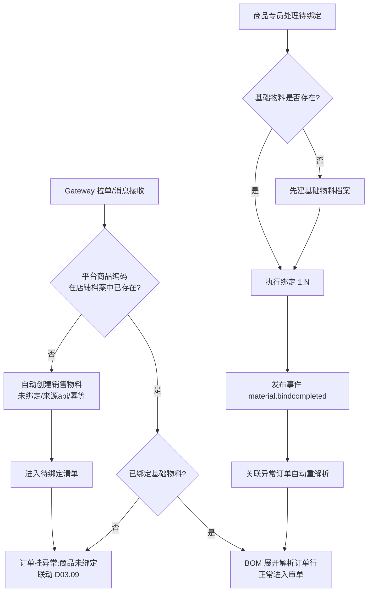
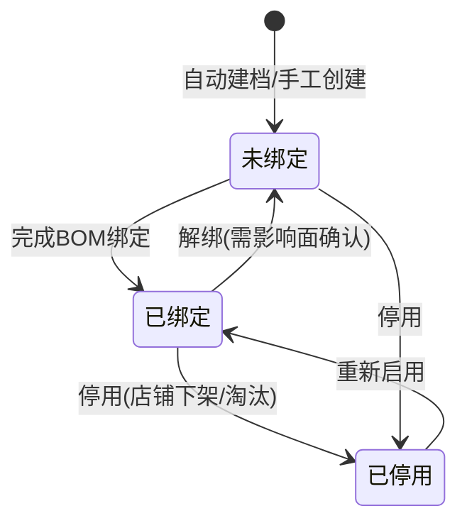

# SRS-D04.01 商品与物料管理模块 需求规格说明书

> 文档编号：SRS-D04.01 · 版本 V1.0 · 2026-10-23 · 编写：小凯 · 状态：待 Jason 审阅
> 所属域：D04 库存域 · 分期：**P0（M1）**
> 上游依据：SRS-00 总纲 · 逆向文档 03（库存与仓储）· 商派 material 模块（32 表）参考实现
> 已确认决策：拉单自动建档+人工绑定（Q·建档方式A）· 基础物料 OMS 自建+金蝶编码映射（Q·买断源A）· 一品多码（Q·条码A）

---

## 1. 模块概述

### 1.1 定位

商品与物料管理是库存域的**主数据地基**：定义「卖什么」（销售物料）、「管什么」（基础物料）、「怎么组合」（BOM），为订单匹配、库存记账、成本核算、平台同步提供统一的商品档案与映射关系。

### 1.2 职责边界

**本模块做：**
- 销售物料（店铺维度商品）档案：拉单自动建档、人工维护、平台商品映射
- 基础物料（SKU 维度管理单元）档案：自建维护、分类、品牌、货主归属
- 销售物料 ↔ 基础物料绑定（1:N，即 BOM 关系），含组合装/礼盒/赠品/多选一/福袋
- 条码管理（一品多码）
- 开票属性（税率/开票名称/税收分类编码）
- 金蝶物料编码映射（买断经销商品）

**本模块不做：**
- 库存数量记账（→ D04.02）；批次/效期/序列号的库存维度管理（→ D04.09，本模块只维护「是否启用 SN/效期」开关属性）
- 平台商品资料的主动下载与发布（→ D02 平台 Gateway 的商品接口，本模块消费其数据）
- 商品价格体系（订单价格以平台成交价为准；批发价 → D07 P2）

### 1.3 与其他模块的关系

| 相关模块 | 关系 |
|---|---|
| D02.03 拉单 | 拉单遇未知平台商品编码 → 调本模块「自动建档」服务；订单商品行按映射解析为基础物料 |
| D03.01 订单创建 | 订单行关联销售物料与解析后的基础物料；未绑定物料 → 订单进异常（联动 D03.09） |
| D04.02 库存记账 | 三元记账键的 SKU 维度 = 基础物料；本模块提供物料档案与货主归属 |
| D04.08 可售同步 | 按销售物料↔基础物料 BOM 展开计算组合装可售 |
| D08 财务 | 开票属性供发票模块使用 |
| D10.01 组织权限 | 基础物料挂组织节点与货主；数据权限过滤 |
| D01.06 导入导出 | 物料批量导入/导出 |

---

## 2. 业务场景

**SC-D04.01-01 新店铺首单自动建档（代运营，主场景）**
运营新接一个天猫店铺并授权。首笔订单拉入 OMS 时，订单中的平台商品（如"娇韵诗双萃精华 50ml"，平台编码 `iid_skuId`）在 OMS 无档案。系统自动创建销售物料（未绑定状态）并落入「待绑定清单」，该订单进异常单等待处理。商品专员在待绑定清单中看到新物料，判断其对应已有基础物料"娇韵诗双萃精华50ml"（品牌方货主），执行绑定（数量 1）。绑定成功后异常订单自动重新解析、继续审单流程。

**SC-D04.01-02 组合装（礼盒）销售**
品牌方在天猫销售"中秋礼盒"（1 个销售物料），实物由 3 个基础物料组成：面霜×1 + 精华×1 + 化妆包×1。商品专员建档销售物料（类型=组合）并绑定 3 条 BOM 明细。订单进来后按 BOM 展开：库存预占、拆单、推仓、发货均按 3 个基础物料执行；平台库存回写按 BOM 展开后的最小可售套数计算（→ D04.08）。

**SC-D04.01-03 买断经销商品建档**
凯淳买断某品牌一批货品。商品专员在 OMS 手工创建基础物料（货主=凯淳买断），录入货号、品牌、分类、成本相关属性、金蝶物料编码（映射字段），并维护厂商条码。后续采购入库（D06）、库存记账（D04.02）、成本核算（D04.07）均以此档案为准；财务推送金蝶时携带金蝶物料编码。

**SC-D04.01-04 赠品与多选一**
店铺配置"满赠"活动：订单含赠品销售物料（类型=赠品），绑定赠送的基础物料。多选一场景（类型=多选一）：一个销售物料绑定 N 个候选基础物料，按规则（库存深度优先等）在审单时择一分配（分配规则在 D03.02 审单引擎执行，本模块提供候选关系与规则参数）。

**SC-D04.01-05 一品多码**
同一基础物料存在厂商条码（69 码）、店铺自编码、WMS 内部码。WMS 出库回传或门店扫码上报任一条码，系统通过条码表反查唯一基础物料。

**SC-D04.01-06 福袋（P1）**
大促福袋商品：销售物料（类型=福袋组合）关联多个福袋组合方案（每方案含若干基础物料），订单分配时按方案随机/规则派发（分配日志留痕）。MVP 期只预留类型枚举与关联表，分配逻辑 P1 实现。

---

## 3. 功能需求

### FR-D04.01-01 销售物料档案
- FR-01a 拉单自动建档：接收 gateway 传入的平台商品要素（店铺、平台商品编码、名称、规格文本），自动创建销售物料，状态=未绑定、来源=api；幂等（同店铺同编码只建一次）。
- FR-01b 手工建档/编辑：类型（普通/组合/赠品/多选一/礼盒/福袋）、所属店铺、客户分类、开票属性、运营组织、上下架状态、停用。
- FR-01c 待绑定清单：未绑定销售物料的独立工作台视图，支持按店铺/时间筛选，绑定后自动移出；绑定成功触发关联异常订单重解析（发事件）。
- FR-01d 批量导入/导出（走 D01.06）。

### FR-D04.01-02 基础物料档案
- FR-02a 手工建档/编辑：货号（material_bn，全局唯一）、名称、SPU、物料属性（成品/半成品/普通/礼盒/虚拟）、分类（树形）、品牌、颜色/尺码、**货主归属（owner_id，必填）**、组织节点、SN 码开关、效期管理开关、库存管控开关、O2O 可售开关、开票属性、停用。
- FR-02b 金蝶编码映射：`kingdee_material_code` 字段（买断货主建议必填，代销可空）；供 D08.06 推送金蝶使用。
- FR-02c 虚拟物料：type=虚拟 的基础物料不参与实物库存记账（D04.02 不为其开记账行），用于虚拟商品自动发货（D03.10）。
- FR-02d 批量导入/导出。

### FR-D04.01-03 销售物料↔基础物料绑定（BOM）
- FR-03a 绑定关系 1:N：一条销售物料绑定多条基础物料明细（数量、价格贡献占比 rate、固定价 fixed_price）。
- FR-03b 组合装校验：绑定合计数量>1 或含礼盒类型时视为组合装；同一销售物料绑定关系变更需留痕（旧版本可查）。
- FR-03c 解绑/换绑：已产生在途订单的绑定关系变更时，提示影响面（未审单订单将按新 BOM 解析；已审单/已发货不受影响）。
- FR-03d 自动绑定建议：按名称/规格相似度给出候选基础物料推荐，人工确认（降低首单绑定工作量）。

### FR-D04.01-04 条码管理（一品多码）
- FR-04a 条码登记表：条码 ↔ 基础物料 N:1；条码类型（厂商码/店铺码/WMS码/其他）；同一条码全局唯一（冲突时拒绝并提示归属物料）。
- FR-04b 条码反查服务：供 WMS 回传解析、门店扫码、售后核销调用。

### FR-D04.01-05 商品分类与品牌
- FR-05a 基础物料分类树（增删改、移动节点、路径维护）。
- FR-05b 品牌档案（名称、英文名、归属货主可空=公共品牌）；品牌与组织树品牌节点（D10.01）的关联映射。

### FR-D04.01-06 特殊商品规则档案（P1 占位）
- FR-06a 福袋组合方案档案（方案↔基础物料明细）。
- FR-06b 多选一候选规则参数（候选集、择一策略：库存深度优先/成本优先/指定顺序）。

---

## 4. 业务流程

### 4.1 拉单自动建档与绑定主流程



### 4.2 销售物料生命周期状态机



> 停用约束：存在未完结订单（履约中/售后中）的销售物料不可停用，只能下架（visibled=0）。

---

## 5. 处理逻辑

### 5.1 自动建档幂等逻辑（伪代码）

```
on PlatformOrderReceived(order):
  for line in order.items:
    key = (shop_id, platform_sku_code)          # 店铺+平台商品编码
    sm = SELECT ... FROM sales_material WHERE key FOR UPDATE
    if not sm:
      sm = create_sales_material(key, name=line.title, spec=line.props,
                                 status=未绑定, source=api)
    if sm.bind_status == 未绑定:
      mark_order_exception(order, EXC_GOODS_UNBOUND, sm_id)
    else:
      order.line.materials = bom_expand(sm)      # BOM 展开
```

### 5.2 BOM 展开规则
- 普通物料：1 销售物料 → 1 基础物料 × number
- 组合/礼盒：1 → N（按绑定明细逐条展开，数量相乘）
- 赠品：展开赠送基础物料，价格贡献=0
- 多选一：展开为候选集，**审单时择一**（本模块只给候选，不做选择）
- 虚拟物料：展开后标记 `virtual=true`，履约走虚拟发货分支（不推仓）
- 嵌套约束：**BOM 只允许一层**（销售物料→基础物料；基础物料之间不递归组合）。组合装的基础物料不得再作为另一组合装成员——如需，先在档案层拆平。校验在绑定时执行。

### 5.3 绑定变更影响面
- 变更生成新版本（version+1），旧版本只读留档；
- 未审单订单：按新版本重新解析；
- 已审单/已生成发货单/已发货：不受影响（快照已固化 BOM 展开结果到订单行）；
- **订单行必须冗余存储解析时刻的 BOM 展开结果**（bm_id、数量），保证事后追溯不受档案变更影响（审计要求）。

### 5.4 条码冲突校验
录入条码时全局唯一性校验（跨货主、跨店铺）；导入时冲突行整批标错输出错误报告。

---

## 6. 数据字段（业务字段描述）

> 物理 DDL（类型/索引/约束）见 DB-D04 数据字典，此处只定义业务含义与规则。

### 6.1 销售物料（sales_material）

| 字段 | 业务含义 | 取值/校验 |
|---|---|---|
| shop_id | 所属店铺 | 必填，关联店铺档案（D02.06） |
| sales_material_bn | 平台商品编码（sku 级） | 必填；店铺内唯一；来源=api 时为平台原始编码 |
| sales_material_name | 平台商品标题 | 自动建档时取平台原文，可人工修正 |
| sales_material_type | 物料类型 | 普通/组合/赠品/多选一/礼盒/福袋 |
| bind_status | 绑定状态 | 未绑定/已绑定（生命周期见 §4.2） |
| class_id | 客户分类 | 关联客户分类档案（审单/拆单策略可用其做维度） |
| tax_rate / tax_name / tax_code | 开票税率/名称/分类编码 | 发票模块（D08.05）取用 |
| org_id | 运营组织 | 关联 D10.01 组织树 |
| visibled | 销售状态（上/下架） | 停用约束见 §4.2 |
| source | 数据来源 | local（手工）/ api（自动建档） |
| owner_id | **货主（冗余自绑定的基础物料）** | 绑定后回填；多货主 BOM 不允许（校验：一条销售物料的全部 BOM 明细必须同货主，跨货主组合走拆单，见 D03.04 按货主拆） |
| tenant_id | 租户 | 全局必填（SRS-00 契约） |

### 6.2 基础物料（basic_material）

| 字段 | 业务含义 | 取值/校验 |
|---|---|---|
| material_bn | 货号 | 必填，**全局唯一**；建议规则：品牌缩写+品类+规格 |
| material_name / material_spu | 名称 / SPU | 必填 / 选填 |
| type | 物料属性 | 成品/半成品/普通/礼盒/虚拟 |
| cat_id / cat_path | 分类及路径 | 树形；路径冗余便于按子树查询 |
| brand_id | 品牌 | 关联品牌档案 |
| color / size | 颜色/尺码 | 服饰美妆类常用规格属性 |
| **owner_id** | **货主归属** | 必填；凯淳买断 / 品牌代销（枚举预留经销商）；**建档后不可改**（改货主=资产转移，必须走调拨/购销流程，P1 提供「货主转移」功能） |
| kingdee_material_code | 金蝶物料编码 | 买断货主建议必填；D08.06 推送用 |
| serial_number | SN 码管理开关 | 开启后出入库必须录序列号（→ D04.09） |
| storage_life_flag | 效期管理开关 | 开启后批次/效期必填（→ D04.09） |
| is_ctrl_store | 库存管控开关 | 否=不记账（如赠品包装袋等低值易耗） |
| omnichannel / is_o2o_sales | 全渠道/O2O 可售开关 | O2O 门店履约（D03.11）取用 |
| tax_rate / tax_name / tax_code | 开票属性 | 同销售物料 |
| cos_id / org_id | 组织架构节点 | 数据权限过滤维度 |
| tenant_id | 租户 | 全局必填 |

### 6.3 绑定关系（sales_basic_material，BOM 明细）

| 字段 | 业务含义 | 取值/校验 |
|---|---|---|
| sm_id / bm_id | 销售物料 / 基础物料 | 联合唯一（同版本内）；同货主校验（§6.1） |
| number | 基础物料数量 | ≥1（赠品可为赠送数量） |
| rate | 价格贡献占比 | 组合装金额分摊用（财务双口径分摊 → D08）；同销售物料下合计=100% |
| fixed_price | 固定价 | 与 rate 二选一（分摊方式） |
| version / status | BOM 版本 / 生效状态 | 变更留痕（§5.3） |

### 6.4 条码（material_barcode）

| 字段 | 业务含义 | 取值/校验 |
|---|---|---|
| barcode | 条码值 | **全局唯一** |
| bm_id | 归属基础物料 | 必填 |
| barcode_type | 类型 | 厂商码/店铺码/WMS码/其他 |
| shop_id | 关联店铺（店铺码时） | 选填 |

---

## 7. 接口

### 7.1 内部接口（本模块提供）

| 编号 | 接口 | 消费方 | 说明 |
|---|---|---|---|
| IF-D04.01-01 | `MaterialService::autoCreate(shopId, platformSku, name, spec)` | D02.03 | 自动建档，幂等，返回 sm_id + bind_status |
| IF-D04.01-02 | `MaterialService::bomExpand(smId)` | D03.01 | BOM 展开：返回 [(bm_id, number, virtual, owner_id)] |
| IF-D04.01-03 | `MaterialService::getByBarcode(barcode)` | D09.02 / D05.02 | 条码反查基础物料 |
| IF-D04.01-04 | `MaterialService::getProfile(bmId)` | 全域 | 物料档案（货主/SN开关/效期开关/虚拟标记/管控开关） |
| IF-D04.01-05 | 事件 `material.bind_completed`（sm_id, order_ids） | D03.09 | 绑定完成 → 异常订单重解析 |
| IF-D04.01-06 | 事件 `material.created` / `material.updated` | D04.08 | 档案变更 → 可售计算缓存失效 |

### 7.2 外部接口

| 编号 | 接口 | 方向 | 说明 |
|---|---|---|---|
| EF-D04.01-01 | 平台商品查询（经 D02 gateway） | 出 | 按平台商品编码拉取标题/规格/价格，辅助建档与绑定推荐（P1，首期用订单报文自带信息） |
| EF-D04.01-02 | 金蝶物料编码校验 | 出 | 买断物料保存时可选调用金蝶接口校验编码存在性（P1，待金蝶接口确认后启用；首期人工保证） |

---

## 8. 非功能需求

| 项 | 要求 |
|---|---|
| 性能 | bomExpand 为审单热路径：单物料展开 ≤5ms（缓存 BOM，事件驱动失效）；自动建档在拉单事务外异步执行，不阻塞落单 |
| 幂等 | 自动建档以 (shop_id, platform_sku_code) 唯一键 + 行锁防并发重复建档（大促首单洪峰场景） |
| 一致性 | 绑定变更与订单重解析之间用事件最终一致；订单行固化 BOM 快照（§5.3） |
| 数据权限 | 销售物料按店铺、基础物料按货主/组织过滤（D10.03 注入）；品牌方门户只见本货主基础物料与其店铺销售物料 |
| PIPL | 本模块无消费者个人数据；操作人信息进审计（D10.06） |
| 容量 | 基础物料按 10 万级、销售物料按 50 万级设计（店铺×SKU 展开），编码索引含 crc32 整型辅助列（沿用商派做法，提升大表查询性能） |

---

## 9. 验收标准

| 编号 | 验收条件 |
|---|---|
| AC-01 | 新店铺首笔订单拉入后 1 分钟内，待绑定清单出现自动建档的销售物料，订单同步挂「商品未绑定」异常 |
| AC-02 | 并发 100 笔含同一未知商品的订单同时拉入，只创建 1 条销售物料档案（幂等验证） |
| AC-03 | 组合装（1 销售物料→3 基础物料）绑定后，测试订单行正确展开为 3 条基础物料明细且数量正确；订单行留存展开快照 |
| AC-04 | 绑定完成后，关联异常订单在 1 分钟内自动重解析并进入审单，无需人工干预 |
| AC-05 | 跨货主 BOM 绑定被拒绝并给出明确提示（凯淳买断物料与品牌代货物料不可组合在同一销售物料下） |
| AC-06 | 同一条码重复登记（跨店铺/跨货主）被拒绝；WMS 回传任一条码可正确反查基础物料 |
| AC-07 | 虚拟物料不出现在库存记账行；含虚拟物料的订单履约走虚拟发货分支标记 |
| AC-08 | BOM 变更后：未审单订单按新 BOM 解析，已生成发货单的订单不受影响 |
| AC-09 | 品牌方门户账号只能查看/维护本货主的基础物料，越权访问被行级过滤拦截 |
| AC-10 | 5 万条基础物料批量导入 ≤10 分钟完成，错误行输出错误报告且不阻塞正确行 |

---

## 变更记录

| 日期 | 版本 | 变更 | 原因 |
|---|---|---|---|
| 2026-10-23 | V1.0 | 首版 | — |

---

*参考实现溯源：商派 material 模块（sales_material 17 列 / basic_material 24 列 / sales_basic_material 绑定表 / codebase 条码表 / fukubukuro 福袋系列），见逆向文档 01 §3、03 §0；本 SRS 的关键差异：① 基础物料增加 owner_id 货主必填且不可改；② 销售物料增加 tenant_id 与货主冗余+同货主 BOM 校验；③ BOM 版本化与订单行快照固化；④ 金蝶编码映射字段；⑤ 福袋/多选一分配逻辑剥离到审单引擎。*
