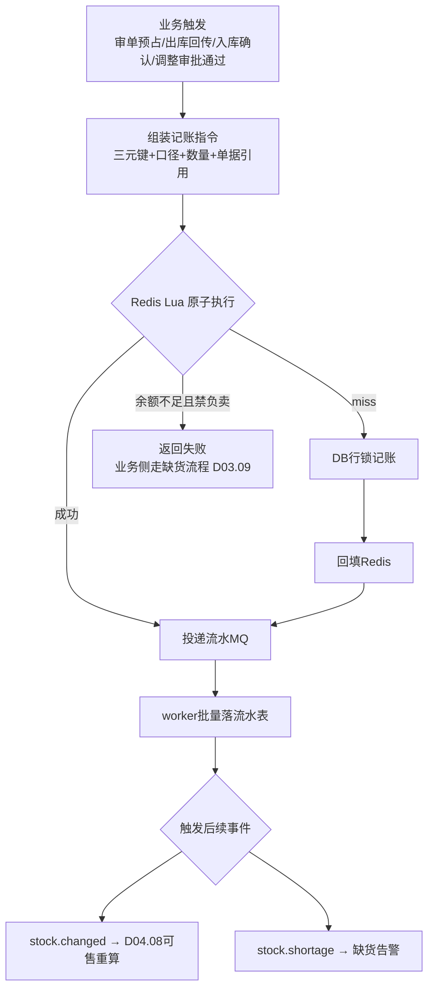
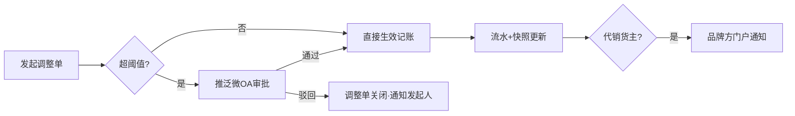
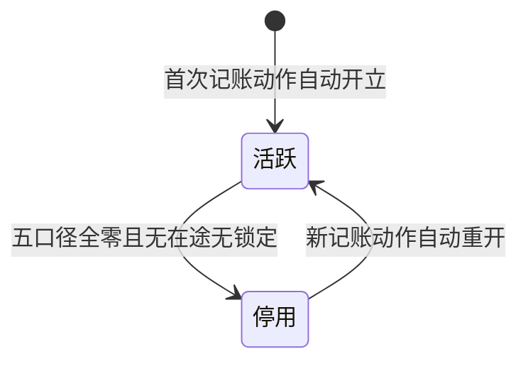

# SRS-D04.02 库存记账模块 需求规格说明书

> 文档编号：SRS-D04.02 · 版本 V1.0 · 2026-10-23 · 编写：小凯 · 状态：待审阅（批次①随库存域整体交审）
> 所属域：D04 库存域 · 分期：**P0（M1）**
> 上游依据：SRS-00 契约「三元记账键」「五口径定义」· 逆向文档 03 · 商派 branch_product/basic_material_stock 参考实现
> 定位：本模块是 SRS-00 §4.4 两条全局契约的**唯一定义源**，其他模块只引用不重复定义

---

## 1. 模块概述

### 1.1 定位

库存记账维护全系统唯一的库存账本：以 **仓 × 基础物料 × 货主** 三元组为记账行（SRS-00 契约），承载**五口径库存**（实际/可用/锁定/在途/次品）的余额与每一次变动的流水，是审单预占、发货扣减、可售计算、成本核算、盘点对账的公共地基。

### 1.2 职责边界

**做**：记账行开立与生命周期、五口径余额维护、库存变动流水（账实追溯）、人工库存调整（走审批）、Redis 缓存账本（读写加速）、定时对账兜底。
**不做**：预占/释放的业务触发（→ D04.03，但预占的记账动作在本模块执行）；出入库单据（→ D04.04，单据驱动本模块记账）；调拨（→ D04.05）；成本金额核算（→ D04.07，本模块只记数量与成本字段的存储）；可售计算（→ D04.08）。

### 1.3 与其他模块关系

| 模块 | 关系 |
|---|---|
| D04.01 物料 | 记账行按基础物料开立；物料档案（管控开关/货主）决定记账行为 |
| D04.03 预占 | 调用本模块执行锁定口径变动（Redis Lua 原子） |
| D04.04 出入库 | 单据确认后驱动实际/在途/次品口径记账 + 流水 |
| D04.05 调拨借调 | 出库仓减/入库仓加/借调台账 |
| D04.06 盘点 | 盘盈盘亏调整走人工调整通道 |
| D04.07 成本 | 记账行携带 unit_cost/inventory_cost 字段，由成本模块回写 |
| D04.08 可售同步 | 读取五口径计算可售 |
| D09.02 WMS 回传 | 出库回传驱动发货扣减；WMS 库存快照对账 |
| D10.05 审批 | 人工调整超阈值走审批 |

---

## 2. 业务场景

**SC-D04.02-01 记账行开立**
凯淳与品牌方 A 签约代销，货入通天晓华东仓。品牌 A 的 SKU「面霜50ml」（基础物料 bm_1001，货主=品牌A）首次入库时，系统自动开立记账行 `(华东仓, bm_1001, 品牌A)`。同一 SKU 若凯淳也买断自营（bm_1001 货主=凯淳——注意：**不同货主是不同的基础物料档案**，见 D04.01 §6.2 owner 建档后不可改），则开立另一行 `(华东仓, bm_1002, 凯淳)`，两行物理隔离互不可见对方余额。

> ⚠️ 设计澄清：货主维度在**物料档案层**已区分（一个货号只属一个货主），记账行的三元组中 owner_id 冗余存储用于查询过滤与防错。同货号跨货主 = 两条物料档案（可加关联字段 `same_code_group` 供报表合并视角）。

**SC-D04.02-02 五口径联动（一笔订单的库存足迹）**
订单审单通过：可用 -2、锁定 +2（预占，D04.03 触发）→ 发货单推 WMS 出库回传：锁定 -2、实际 -2（扣减）→ 若订单取消（发货前）：锁定 -2、可用 +2（释放）。全程每笔变动写流水（谁/何时/何单据/变动前后余额）。

**SC-D04.02-03 人工调整（盘亏/报损/纠错）**
仓库反馈某 SKU 实物比账面少 3 件。库存专员发起人工调整（-3），填写调整类型（盘亏）与原因；超过阈值（如绝对值>10 或货值>5000 元，可配置）自动推泛微 OA 审批（D10.05），审批通过后记账生效并写流水；代销货主的调整同步通知品牌方门户（可见本货主账）。

**SC-D04.02-04 次品口径**
退货入库质检为不良品（D05.02）：实际 +1 记入**次品口径**（可用不加），次品不参与可售计算；次品可走退仓（还品牌方）或报废（人工调整出账）。

**SC-D04.02-05 在途口径**
采购单审核通过（D06.02）：在途 +N；到货入库确认：在途 -N、实际 +N。调拨同理（D04.05）。

**SC-D04.02-06 大促高并发记账**
大促峰值审单 500+ 单/分钟，每单预占/释放均命中 Redis Lua 原子脚本（余额缓存于 Redis Hash），DB 账本经流水异步落库；Redis miss 时自动降级 DB 行锁记账并回填缓存；每 5 分钟定时对账任务比对 Redis 与 DB 余额，不一致即告警并以 DB 流水重算修复。

---

## 3. 功能需求

### FR-D04.02-01 记账行管理
- FR-01a 自动开立：入库/调拨/盘点等任何记账动作遇 `(branch, bm, owner)` 无行时自动开立（初始全口径 0）。
- FR-01b 行档案：仓库、基础物料、货主（三元唯一键）、安全库存 safe_store、是否锁定安全库存 is_locked、成本字段（unit_cost/inventory_cost，D04.07 回写）、停用标记（清零且无在途后可停用）。
- FR-01c 查询视图：按仓/货主/品牌/分类多维查询五口径余额（数据权限过滤）。

### FR-D04.02-02 五口径余额维护（本模块=全局契约定义源）

| 口径 | 字段 | 定义 | 增加触发 | 减少触发 |
|---|---|---|---|---|
| 实际库存 | store | 仓内实物总量（含锁定与次品） | 入库确认（采购/退货良品/调拨入/盘盈） | 出库确认（销售发货/退仓/调拨出/盘亏/报废） |
| 可用库存 | available（=store-freeze-defective-safe_locked，**计算值不落库**） | 当前可售余量 | 随各口径联动 | 随各口径联动 |
| 锁定库存 | freeze | 已预占未出库 | 审单预占/人工预占 | 发货扣减/取消释放/预占过期释放 |
| 在途库存 | arrive_store | 采购/调拨未入库 | 采购审核/调拨出库 | 入库确认/采购取消 |
| 次品库存 | defective | 不良品实物 | 退货不良质检/入库残损 | 退仓/报废/返修转出 |

- FR-02a **可用库存为派生计算值**（公式唯一，缓存于 Redis 供高频读），任何模块不得自行另算（SRS-00 契约）。
- FR-02b 安全库存：safe_store 参与可用计算（锁定安全库存开关开启时）；按店铺同步策略可另行加回（→ D04.08）。
- FR-02c 负库存开关：全局默认禁止负库存（预占/扣减不足即失败）；支持按仓+货主配置允许负卖（如预售场景），负卖时记录负余额并告警。

### FR-D04.02-03 库存变动流水
- FR-03a 每笔口径变动写一条流水：三元键、变动口径、变动数量、变动前后余额快照、业务单据（类型+单号+行）、操作人/来源系统、时间。
- FR-03b 流水只增不改不删（审计要求）；按三元键+时间检索；支持任意时点余额重算（对账基础）。
- FR-03c 流水异步落库：Redis Lua 记账成功后投递 MQ，worker 批量落 DB；MQ 积压告警。

### FR-D04.02-04 人工库存调整
- FR-04a 调整类型字典：盘盈/盘亏/报损/退货修正/系统纠错/其他（可扩展）。
- FR-04b 调整单：三元键+调整数量（±）+类型+原因（必填）+附件；提交后按阈值路由：阈值内直接生效，超阈值推 OA 审批（阈值按货主/仓/调整类型可配置）。
- FR-04c 生效即记账+流水（单据号=调整单号）；代销货主调整生成品牌方门户通知。

### FR-D04.02-05 Redis 缓存账本与对账
- FR-05a 缓存结构：Redis Hash，key=`stock:{branch}:{bm}:{owner}`，field=store/freeze/arrive/defective（沿用商派 Lua 脚本族设计：incr/decr/freeze_incr/freeze_decr/get/set 六类原子脚本）。
- FR-05b miss 降级：Redis 无缓存时脚本返回特定错误码 → 应用层走 DB 行锁（SELECT FOR UPDATE）记账 → 回填 Redis。
- FR-05c 定时对账：每 5 分钟抽样+每小时全量比对 Redis vs DB（按流水重算），差异告警并自动以 DB 流水为准修复 Redis；连续差异升级人工。
- FR-05d 缓存重建：支持按仓/货主/物料手动触发全量重建（发布、故障恢复用）。

### FR-D04.02-06 库存快照与对账报告
- FR-06a 日终库存快照（每日 0 点，三元键全量余额）供报表与品牌方门户账单。
- FR-06b WMS 对账：定期拉取 WMS 库存快照与 OMS 账面比对，差异清单输出（人工处理，走调整单闭环）。

---

## 4. 业务流程

### 4.1 记账主流程（任何口径变动统一路径）



### 4.2 人工调整流程



### 4.3 记账行状态机



---

## 5. 处理逻辑

### 5.1 可用库存公式（全局唯一，SRS-00 契约）

```
available = store − freeze − defective − (is_locked ? safe_store : 0)
```
- 负卖开启的行：available 允许为负（记负值，告警）；
- 借调场景（D04.05）：借入货主的 available 另加借调额度，公式在 D04.08 可售计算层扩展，**本模块基础公式不含借调**（保持记账纯粹，借调是分配策略）。

### 5.2 Redis Lua 预占扣减脚本（核心算法，继承商派 branch_store_freeze_incr 设计）

```lua
-- KEYS[1]=stock:{branch}:{bm}:{owner}  ARGV[1]=数量 ARGV[2]=允许负卖(0/1)
local store, freeze = redis.call('HMGET', KEYS[1], 'store', 'freeze')
if not store then return -1 end              -- miss → 应用层降级 DB
store = tonumber(store); freeze = tonumber(freeze)
local num = tonumber(ARGV[1])
if store - freeze - num < 0 and ARGV[2] == '0' then
    return -2                                 -- 余额不足
end
redis.call('HINCRBY', KEYS[1], 'freeze', num)
return freeze + num                           -- 返回新冻结值
```
- 释放=freeze_decr（校验 freeze≥num）；实际扣减=store_decr+freeze_decr 原子组合（发货确认时一次脚本完成，防中间态）。
- 幂等：应用层以流水唯一键（单据+行+动作）先查后写，Lua 脚本本身不幂等，**幂等责任在调用方**（各模块 SRS 明确）。

### 5.3 流水重算（对账修复算法）

```
rebalance(branch, bm, owner):
    取最近日终快照余额 S0
    按时间序回放 S0 之后全部流水 → 得各口径应有余额 S1
    比对 Redis 当前值 vs S1：不一致则 HSET 覆盖为 S1 并告警记录
```

### 5.4 并发与一致性设计
- 同一三元键的记账在 Redis 单 key 上天然串行（Lua 原子）；DB 降级路径用行锁串行。
- 流水落库与余额缓存为**最终一致**（MQ 异步）；对账兜底窗口 ≤5 分钟。
- 禁止跨行事务扣减的强一致诉求：一单多物料预占采用「逐行预占 + 全部失败则逐行回滚」的补偿模式（Saga），不做分布式事务；预占流水记录补偿状态。

---

## 6. 数据字段（业务字段描述）

### 6.1 库存记账行（stock_ledger）

| 字段 | 业务含义 | 取值/校验 |
|---|---|---|
| branch_id | 仓库 | 三元键①，必填 |
| bm_id | 基础物料 | 三元键②，必填 |
| owner_id | 货主 | 三元键③，必填（冗余自物料档案，写入时校验一致） |
| store | 实际库存 | ≥0（负卖行允许<0 并告警） |
| freeze | 锁定库存 | ≥0；恒 ≤ store（对账校验项） |
| arrive_store | 在途库存 | ≥0 |
| defective | 次品库存 | ≥0 |
| safe_store / is_locked | 安全库存及锁定开关 | 参与可用公式 |
| unit_cost / inventory_cost | 单位成本/库存成本 | D04.07 回写，本模块只存储 |
| status | 行状态 | 活跃/停用（§4.3） |
| tenant_id | 租户 | 必填 |
| version | 乐观锁版本 | DB 路径并发控制 |

### 6.2 库存变动流水（stock_change_log）

| 字段 | 业务含义 | 取值/校验 |
|---|---|---|
| branch_id / bm_id / owner_id | 三元键 | 必填 |
| change_field | 变动口径 | store/freeze/arrive/defective |
| change_num | 变动数量 | ±整数 |
| before_balance / after_balance | 变动前后该口径余额 | 快照，审计与重算基础 |
| bill_type / bill_bn / bill_item_id | 业务单据（类型/单号/行） | 必填；幂等唯一键成分 |
| action | 动作 | 预占/释放/扣减/入库/调整/调拨/盘点/补偿回滚 |
| operator / source | 操作人/来源系统 | 人工/OMS自动/WMS回传/迁移 |
| create_time | 变动时间 | 毫秒级 |
| idempotent_key | 幂等键 | (bill_type, bill_item_id, action) 唯一索引 |

### 6.3 人工调整单（stock_adjust）

| 字段 | 业务含义 | 取值/校验 |
|---|---|---|
| adjust_bn | 调整单号 | 唯一 |
| 三元键 + adjust_num | 调整对象与数量 | ±整数 |
| adjust_type | 类型 | 盘盈/盘亏/报损/退货修正/系统纠错/其他 |
| reason / attachment | 原因（必填）/附件 | |
| approval_status | 审批状态 | 免审/待审（OA）/通过/驳回 |
| status | 单据状态 | 草稿/生效/关闭 |

---

## 7. 接口

### 7.1 内部接口（本模块提供，全系统库存记账唯一入口）

| 编号 | 接口 | 消费方 | 说明 |
|---|---|---|---|
| IF-D04.02-01 | `StockLedgerService::change(三元键, 口径, 数量, 单据引用, action)` | D04.03/04/05/06、D03、D05 | 统一记账入口；Redis Lua→流水 MQ；余额不足返回失败码 |
| IF-D04.02-02 | `StockLedgerService::getBalance(三元键)` / `batchGet` | 全域 | 五口径余额（含派生 available） |
| IF-D04.02-03 | `StockLedgerService::queryAvailable(branch, bmIds[])` | D03.06 配货分仓 | 批量可用查询（热路径，走 Redis） |
| IF-D04.02-04 | 事件 `stock.changed`（三元键、口径、单据） | D04.08/D11 | 可售重算与监控 |
| IF-D04.02-05 | 事件 `stock.shortage`（三元键、缺口） | D03.09/D04.10 | 缺货处理与补货建议 |
| IF-D04.02-06 | `StockLedgerService::rebalance(三元键)` | 运维/对账 | 流水重算修复 |

### 7.2 外部接口

| 编号 | 接口 | 方向 | 说明 |
|---|---|---|---|
| EF-D04.02-01 | WMS 库存快照拉取（经 D09.01 路由） | 入 | 对账用；通天晓 RESTful 库存查询 |
| EF-D04.02-02 | OA 审批推送/回调（经 D10.05） | 双向 | 超阈值调整审批 |

---

## 8. 非功能需求

| 项 | 要求 |
|---|---|
| 性能 | 单行记账（Redis 路径）P99 ≤10ms；批量查询 500 SKU ≤50ms；支撑审单 ≥500 单/分钟（每单平均 3 行预占） |
| 一致性 | Redis 与 DB 最终一致，对账窗口 ≤5 分钟；流水不可变；任意时点可重算 |
| 幂等 | 调用方以 idempotent_key 保证；重复调用返回首次结果不重复记账 |
| 可用性 | Redis 故障 → 自动降级 DB 行锁模式（吞吐下降但不停摆）；MQ 故障 → 流水本地文件暂存重投 |
| 审计 | 全部流水含操作人/来源；调整单审批留痕；PIPL 无涉 |
| 容量 | 记账行 = 仓(≤20) × 活跃SKU(≤5万) × 货主(≤50) 稀疏组合，预估 ≤50 万行；流水按 3 年在线+归档（日均 2 万单×3 行×3 动作 ≈ 18 万条/日 → 分表按月） |

---

## 9. 验收标准

| 编号 | 验收条件 |
|---|---|
| AC-01 | 同一 SKU 两个货主的记账行完全隔离：货主 A 预占不影响货主 B 可用；查询按权限过滤 |
| AC-02 | 并发 200 线程预占同一行（余额 100），恰好 100 成功 100 失败，无超卖无负值（Redis Lua 原子性验证） |
| AC-03 | 审单预占→发货扣减→（取消场景）释放，三条路径的口径变动与流水完全符合 §4.2 足迹，前后余额快照连续 |
| AC-04 | 人为删除 Redis key 后下一次记账自动降级 DB 并回填缓存，业务无感；对账任务 5 分钟内发现并修复人为篡改的 Redis 值 |
| AC-05 | 人工调整超阈值自动推 OA，审批通过才记账；阈值内直接生效；全部写流水含操作人 |
| AC-06 | 次品入库后可用库存不增加；次品退仓出库后次品口径减少且流水可溯 |
| AC-07 | 重复投递同一出库回传消息（幂等键相同），只记账一次 |
| AC-08 | 日终快照与按流水重算结果一致（连续 7 天无人工干预验证） |
| AC-09 | 负卖开关开启的行允许负余额并触发告警；关闭的行预占不足即失败并联动缺货流程 |
| AC-10 | 压测：模拟大促 2000 单/分钟持续 10 分钟，记账 P99 ≤10ms，流水零丢失，对账零差异 |

---

## 变更记录

| 日期 | 版本 | 变更 | 原因 |
|---|---|---|---|
| 2026-10-23 | V1.0 | 首版 | — |

---

*参考实现溯源：商派 ome_branch_product（13 列记账行）+ material_basic_material_stock（货主维度缺失——本 SRS 补 owner_id 入三元键）+ ome/lua 11 个原子脚本族（incr/decr/freeze_incr/freeze_decr/get/set，Redis Hash 结构、miss 降级）+ ome_stock_change_log。关键差异：① 三元记账键（商派为 仓×SKU 二元）；② available 明确为派生计算值不落库；③ 流水幂等键与前后余额快照强制；④ 负卖/安全库存按行配置化。*
