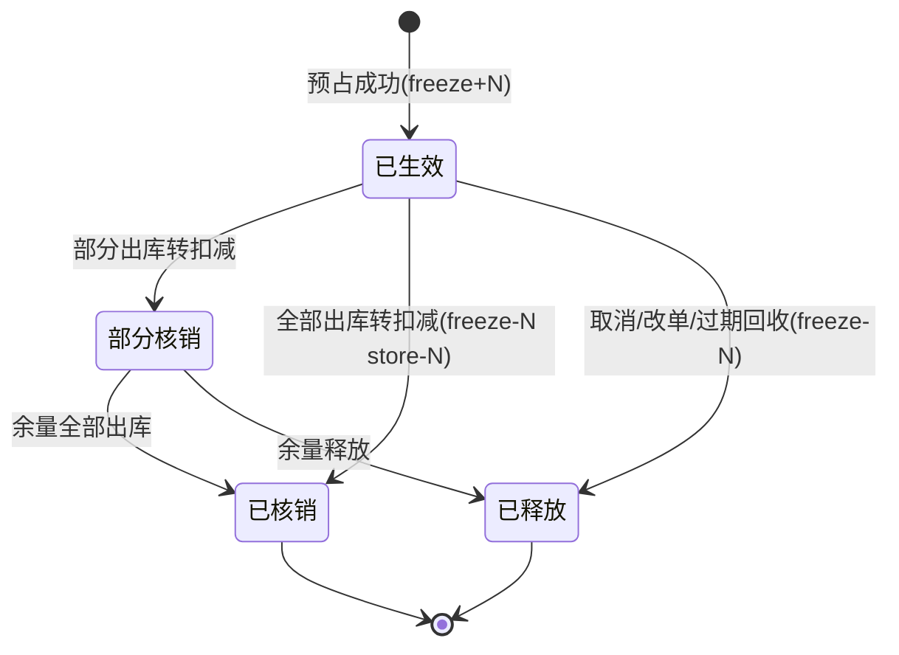
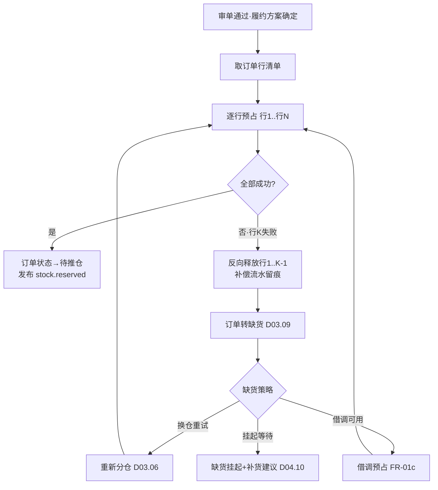

# SRS-D04.03 预占与释放模块 需求规格说明书

> 文档编号：SRS-D04.03 · 版本 V1.0 · 2026-10-23 · 编写：小凯 · 状态：待审阅（批次①）
> 所属域：D04 库存域 · 分期：**P0（M1）**
> 上游依据：SRS-D04.02（记账与 Lua 脚本契约）· 逆向文档 03 §预占机制 · 商派 basic_material_stock_freeze 参考实现

---

## 1. 模块概述

### 1.1 定位

预占与释放管理「库存的承诺」：订单从审单通过到发货扣减之间，库存被锁定但未出库。本模块维护**预占流水台账**（独立表，不落记账行主字段——商派验证过的高并发关键设计），提供预占、释放、转扣减、过期回收、人工预占五类能力，是所有「先占后发」业务的统一通道。

### 1.2 职责边界

**做**：预占台账（对象维度：订单/售后/调拨/人工）、预占生命周期（生效→转扣减/释放/过期）、与 D04.02 记账的原子衔接（freeze 口径变动）、预占过期自动回收、超卖补偿协调。
**不做**：口径余额与 Lua 脚本（→ D04.02）；预占的业务决策——何时占、占哪个仓（→ D03.02 审单/D03.06 分仓）；借调额度判定（→ D04.05，本模块执行其结果）。

### 1.3 与其他模块关系

| 模块 | 关系 |
|---|---|
| D03.02 审单 | 审核通过 → 调本模块预占；预占失败 → 订单转缺货（D03.09） |
| D03.07 发货单 | 推仓前预占保持；出库回传 → 预占转扣减 |
| D03.08 复审/改单 | 改单前冻结快照，改单差异 → 补占/释放 |
| D03.09 取消/暂停 | 取消 → 全量释放；暂停 → 预占保持（挂起） |
| D05 售后 | 换货补发 0 元单预占；退货在途预占（可选配置） |
| D04.05 调拨借调 | 调拨出库预占；借调额度内的跨货主预占 |
| D04.02 记账 | 所有 freeze 口径变动的执行方 |

---

## 2. 业务场景

**SC-D04.03-01 审单预占（主流程）**
订单审核通过，履约方案确定仓库与物料明细后，逐行调用预占（对象=订单，单据=order_id+行号）。全部行成功 → 订单进入待推仓；任一行失败 → 已成功的行**补偿回滚**（Saga 模式），订单转缺货流程（D03.09 生成缺货标记，可触发补货建议或人工改仓）。

**SC-D04.03-02 发货转扣减**
WMS 出库回传（发货确认），按发货单行找到对应预占流水，执行「转扣减」：freeze -N 且 store -N 原子完成（D04.02 组合脚本），预占流水状态=已核销。部分发货（一单多包裹）按包裹行部分核销，余量保持预占。

**SC-D04.03-03 取消释放**
订单发货前取消（平台退款/客服取消）：全部未核销预占释放（freeze -N），流水状态=已释放，订单库存足迹闭环。

**SC-D04.03-04 预占过期回收**
配置预占有效期（默认 72h，可按店铺/货主配置）。异常场景（推仓失败长期挂起、流程 bug）导致的僵尸预占，到期由调度任务自动释放并告警（提示人工核查根因），防止库存被长期无效占用。

**SC-D04.03-05 人工预占（活动锁库）**
大促前运营为大客户团购单锁定 500 件（对象=人工预占单，走 OA 审批），锁定期间该量不可售；活动结束后未消耗部分释放。

**SC-D04.03-06 借调预占**
品牌 A 货主缺货但凯淳买断同货号有货（same_code_group 关联），且借调规则允许（D04.05）：审单时按借调策略生成借调预占（台账记录借出货主/借入货主/额度来源），结算时区分归属（D08）。

---

## 3. 功能需求

### FR-D04.03-01 预占
- FR-01a 统一预占入口：对象类型（订单/售后换货/调拨/人工/借调）+ 单据引用 + 三元键 + 数量；幂等键=（对象类型,单据,行,动作）。
- FR-01b 逐行预占 + Saga 补偿：一单多行顺序预占，失败即反向释放已成功行（补偿流水留痕）。
- FR-01c 借调预占：额度校验（D04.05 规则）→ 记借调台账 → 对借出货主行执行 freeze。
- FR-01d 人工预占单：申请（数量/期间/原因）→ 阈值审批（OA）→ 生效；到期自动释放或手动释放。

### FR-D04.03-02 释放
- FR-02a 业务释放：取消/改单减量/审核驳回触发，按单据引用定位未核销流水全额或部分释放。
- FR-02b 过期回收：调度任务扫描超期未核销预占 → 自动释放 + 告警（企微通知库存专员，含订单/仓库/时长明细）。
- FR-02c 释放校验：释放数 ≤ 未核销余量；重复释放幂等返回。

### FR-D04.03-03 转扣减
- FR-03a 出库回传触发：按发货单行匹配预占流水，原子执行 freeze-N & store-N（D04.02 组合脚本）。
- FR-03b 部分核销：支持多次部分转扣减（多包裹），流水记录累计核销量。
- FR-03c 超发处理：WMS 实发 > 预占（仓库多发）：差额直接扣 store（无预占扣减），记差异流水并告警对账。

### FR-D04.03-04 预占台账查询
- FR-04a 多维查询：按订单/物料/仓/货主/状态/时间；在途预占账龄分析（>24h/>48h/>72h 分级）。
- FR-04b 品牌方门户视图：本货主预占明细（只读）。

---

## 4. 业务流程

### 4.1 预占-核销-释放全景状态机（预占流水生命周期）



### 4.2 审单预占 Saga 流程



### 4.3 过期回收流程


---

## 5. 处理逻辑

### 5.1 预占台账数据流（Redis 与 DB 双写关系）

```
预占请求 → D04.02 Lua freeze_incr（Redis 原子，实时口径）
        → 写预占台账 DB（freeze_log 行，状态=已生效）
        → 台账写失败？→ Redis 已加冻结：投递补偿 MQ 重试台账；
          重试仍失败 → freeze_decr 回滚 Redis + 预占整体失败
（Redis 为实时口径权威，DB 台账为业务追溯权威，二者以幂等键对账）
```

### 5.2 幂等与并发
- 幂等键唯一索引兜底：同键重复请求返回首次结果；
- 同订单并发预占（重复审单触发）：订单级分布式锁（Redis SETNX，粒度=order_id）串行化；
- 转扣减与释放互斥：按预占流水行锁（状态机校验：已释放不可再核销，已核销不可再释放）。

### 5.3 借调额度计算（与 D04.05 的分工）
```
可借调量 = min( 借出方available − 借出方保留底线,
               借调规则上限 − 已借未还量 )
本模块执行预占时实时调用 D04.05 额度服务；额度不足 → 按普通缺货处理
```

### 5.4 账龄与过期参数
- 默认有效期 72h；覆盖配置优先级：货主级 > 店铺级 > 全局；
- 人工预占以申请期间为准（期间外自动释放）；
- 预售订单（D03.10）预占有效期=预计发货日+缓冲（不适用默认 72h）。

---

## 6. 数据字段（业务字段描述）

### 6.1 预占台账（stock_freeze_log）

| 字段 | 业务含义 | 取值/校验 |
|---|---|---|
| freeze_id | 台账 ID | 唯一 |
| obj_type | 对象类型 | 订单/售后换货/调拨/人工/借调 |
| obj_bn / obj_item_id | 对象单号 / 行 ID | 幂等键成分 |
| branch_id / bm_id / owner_id | 三元键 | 必填 |
| num | 预占数量 | >0 |
| settled_num | 已核销数量 | 累计，≤num |
| status | 状态 | 已生效/部分核销/已核销/已释放（§4.1） |
| expire_time | 过期时间 | 按 §5.4 规则计算 |
| lend_owner_id | 借出货主（借调时） | 借调预占必填 |
| shop_id | 关联店铺 | 订单预占必填 |
| source | 调用来源 | 审单/人工/系统补偿 |
| idempotent_key | 幂等键 | (obj_type,obj_item_id,action) 唯一 |
| create_time / last_modified | 时间戳 | |

### 6.2 人工预占单（manual_freeze）

| 字段 | 业务含义 |
|---|---|
| freeze_bn | 单号 |
| 三元键 + num + 期间(start/end) | 锁定对象与窗口 |
| reason / attachment | 原因（必填）/附件 |
| approval_status | OA 审批状态 |
| status | 草稿/生效/部分消耗/已释放/已过期 |

---

## 7. 接口

### 7.1 内部接口

| 编号 | 接口 | 消费方 | 说明 |
|---|---|---|---|
| IF-D04.03-01 | `FreezeService::reserve(obj, 三元键, num)` | D03.02/D05/D04.05 | 单行预占，幂等；返回台账 ID 或失败码（不足/额度不足） |
| IF-D04.03-02 | `FreezeService::reserveBatch(orderId, lines[])` | D03.02 | 整单预占（内含 Saga 补偿） |
| IF-D04.03-03 | `FreezeService::release(objRef, num?)` | D03.08/09、D05 | 按单据释放（全部/指定量），幂等 |
| IF-D04.03-04 | `FreezeService::settle(deliveryItemId, num)` | D09.02 回传处理 | 转扣减（部分核销支持） |
| IF-D04.03-05 | `FreezeService::queryByOrder(orderId)` | D03 全域 | 订单预占足迹 |
| IF-D04.03-06 | 事件 `stock.reserved` / `stock.released` / `stock.freeze_expired` | D03/D04.08/D11 | 状态联动与监控 |

### 7.2 外部接口

| 编号 | 接口 | 方向 | 说明 |
|---|---|---|---|
| EF-D04.03-01 | OA 审批（经 D10.05） | 双向 | 人工预占/借调超阈值审批 |
| EF-D04.03-02 | 企微告警 | 出 | 过期回收/超发差异/账龄超期通知 |

---

## 8. 非功能需求

| 项 | 要求 |
|---|---|
| 性能 | 单行预占 P99 ≤15ms（含台账写）；整单（5 行）≤50ms；支撑 500 单/分钟审单洪峰 |
| 一致性 | Redis 口径与 DB 台账以幂等键每 5 分钟对账；补偿路径必须留痕 |
| 幂等 | 全部接口幂等（重复调用=首次结果）；MQ 重投安全 |
| 死锁防护 | Saga 补偿失败进入人工处理队列并告警，不静默吞错 |
| 审计 | 台账状态变迁全留痕；人工预占含审批链 |

---

## 9. 验收标准

| 编号 | 验收条件 |
|---|---|
| AC-01 | 审单预占成功的订单，可用库存即时减少；取消后 1 分钟内可用恢复，台账状态=已释放 |
| AC-02 | 5 行订单第 3 行预占失败：前 2 行自动补偿释放，无残留冻结，订单正确转缺货流程 |
| AC-03 | 部分发货（3 件发 2 件）：台账部分核销 settled_num=2，余 1 件保持冻结，后续补发核销闭环 |
| AC-04 | 超发场景（预占 2 实发 3）：差额 1 直接扣实际库存，差异流水+告警生成 |
| AC-05 | 僵尸预占（推仓失败挂起）72h 后自动释放并企微告警，含订单与仓明细 |
| AC-06 | 并发 200 预占同一行余额 100：恰好 100 成功；重复提交同一订单预占请求 10 次只生效 1 次（幂等） |
| AC-07 | 借调预占：额度内成功且台账记录借出/借入货主；额度不足按普通缺货处理；归还后可用额度恢复 |
| AC-08 | 人工预占经 OA 审批生效，期间外自动释放；品牌方门户可见本货主预占台账 |
| AC-09 | Redis 台账对账任务：人为制造 3 条 Redis-DB 不一致，5 分钟内检出并修复 |
| AC-10 | 预售订单预占有效期=预计发货日+缓冲，不被 72h 默认规则误回收 |

---

## 变更记录

| 日期 | 版本 | 变更 | 原因 |
|---|---|---|---|
| 2026-10-23 | V1.0 | 首版 | — |

---

*参考实现溯源：商派 material_basic_material_stock_freeze（17 列预占流水：obj_type/bill_type/num/预选仓/原单行/调用来源）+ ome/lua freeze_incr/freeze_decr 脚本 + order_objects_freeze 模型。关键差异：① 台账带 owner_id 与借调字段（lend_owner_id）；② 显式状态机（商派靠 num 余量隐式表达）；③ 过期回收与账龄告警产品化；④ Saga 补偿显式化（商派就地修改内存订单组，调试困难——逆向文档 02 §11 教训）。*
