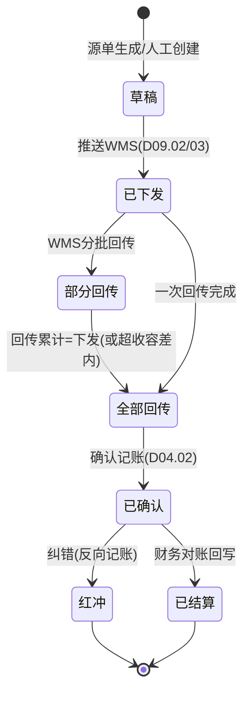
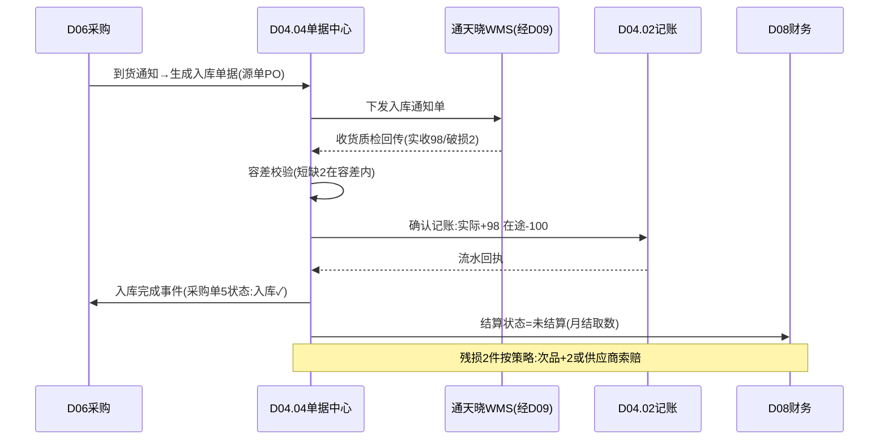

# SRS-D04.04 出入库单据与流水模块 需求规格说明书

> 文档编号：SRS-D04.04 · 版本 V1.0 · 2026-10-23 · 编写：小凯 · 状态：待审阅（批次①）
> 所属域：D04 库存域 · 分期：**P0（M1）**
> 上游依据：SRS-D04.02（记账契约）· 逆向文档 03 §出入库流水机制 · 商派 ome_iostock（43 列）/siso/iostock 模块参考实现

---

## 1. 模块概述

### 1.1 定位

出入库单据中心是所有**实物移动**的统一单据化入口：任何导致「实际/在途/次品」口径变动的业务（采购入库、销售出库、退货入库、调拨、盘盈盘亏、报废、退仓、无头件），都必须先生成出入库单据、经确认后驱动 D04.02 记账。单据是 OMS 与 WMS 之间、业务与财务之间的对账凭证。

### 1.2 职责边界

**做**：单据类型体系、单据生命周期（创建→下发 WMS→回传→确认记账→结算标记）、单据与业务源单的关联追溯、出库成本快照携带、结算状态管理（供财务取数）。
**不做**：口径记账与流水（→ D04.02，本模块是其最大调用方）；预占类冻结变动（→ D04.03，非实物移动）；采购/售后/调拨的业务规则（→ D06/D05/D04.05，本模块只做单据化执行）。

### 1.3 与其他模块关系

| 模块 | 关系 |
|---|---|
| D06.03 采购入库 | 采购单 → 生成入库单据 → 推 WMS → 回传确认 |
| D03.07 发货单 | 发货单 → 出库单据（或 WMS 直接执行，回传时补记出库单据） |
| D05.02 退货入库 | 退货预报 → 入库单据（良/不良分流到实际/次品口径） |
| D04.05 调拨 | 调拨单 → 出库+入库双单据配对 |
| D04.06 盘点 | 盘盈盘亏 → 调整类出入库单据 |
| D09.01/02 WMS | 单据下发与回传的通道 |
| D04.07 成本 | 出库单据携带成本快照（移动加权单价×数量） |
| D08 财务 | 单据结算状态（未结算/已结算/结算单号）供应付/应收取数 |

---

## 2. 业务场景

**SC-D04.04-01 采购入库**
采购单 PO2026001（凯淳买断货，供应商 S，基础物料 bm_1002×100）到货。OMS 生成入库单据（类型=采购入库，源单=PO2026001），推送通天晓华东仓。WMS 收货质检后回传实收 98（2 件破损）。OMS 确认：实际库存 +98（记入凯淳货主行）、在途 -100、破损 2 走残损处理（次品 +2 或与供应商索赔后直接不入账——按采购残损策略，D06.03）；单据结算状态=未结算，月结时财务按实收 98 对账（D08.04/D06.04）。

**SC-D04.04-02 销售出库**
发货单 DL2026001（订单 O1，预占已生效）推仓后 WMS 拣货出库，回传运单号+实发数量。OMS 生成出库单据（类型=销售出库，源单=DL2026001），确认记账：调用 D04.03 转扣减（freeze-N & store-N），单据携带出库成本快照（unit_cost×N，D04.07 口径）；结算状态=未结算 → 订单完成后进入应收（D08.01）。

**SC-D04.04-03 退货入库（良/不良分流）**
售后单 RA2026001 退货 3 件到仓，WMS 质检回传：良品 2、不良 1。OMS 生成入库单据（类型=退货入库）两行：良品行 → 实际+2（可用恢复，联动 D05.02 触发退款）；不良行 → 次品+2 口径修正（defective+1）。单据关联售后单可双向追溯。

**SC-D04.04-04 无头件/差异入库**
仓库收到无对应单据的包裹（无头件）或退货差异（多货），WMS 上报，OMS 生成入库单据（类型=无头件入库/差异退货入库），暂挂待认领：人工关联原单据后转正，超期未认领按货主规则处理（通知品牌方/充公流程）。

**SC-D04.04-05 单据红冲纠错**
已确认单据发现错误（如数量录错）：不允许改单/删单，只能生成**红冲单据**（负向数量，类型=原类型+红冲标记，引用原单据号），再补正确单据。全程流水可溯，财务对账口径一致。

---

## 3. 功能需求

### FR-D04.04-01 单据类型体系
- FR-01a 类型字典（初始集，可扩展）：

| 大类 | 类型 | 口径影响 | 源单 |
|---|---|---|---|
| 入库 | 采购入库 | 实际+/在途- | 采购单 |
| 入库 | 退货入库-良品 | 实际+ | 售后单 |
| 入库 | 退货入库-不良 | 次品+ | 售后单 |
| 入库 | 调拨入库 | 实际+/在途- | 调拨单 |
| 入库 | 盘盈入库 | 实际+ | 盘点单 |
| 入库 | 无头件入库 | 实际+（暂挂） | WMS 上报 |
| 入库 | 差异退货入库 | 实际+（暂挂） | WMS 上报 |
| 入库 | 换货入库 | 同退货（联动 D05.04） | 换货单 |
| 出库 | 销售出库 | 实际-（含预占转扣减） | 发货单 |
| 出库 | 调拨出库 | 实际-/在途+ | 调拨单 |
| 出库 | 盘亏出库 | 实际- | 盘点单 |
| 出库 | 报损出库 | 实际-/次品- | 调整单 |
| 出库 | 退仓出库（还品牌方） | 实际-/次品- | 退仓单（D05/P1） |
| 出库 | 样品/领用出库 | 实际- | 人工单据（OA 审批） |

- FR-01b 类型可扩展（新增类型=字典配置+口径影响模板，不改代码）；每类型绑定：口径影响模板、是否需 WMS 执行、是否需审批、结算相关性（应付/应收/无）。

### FR-D04.04-02 单据生命周期
- FR-02a 状态机：草稿→已确认（本地记账类）或 草稿→已下发 WMS→部分回传→全部回传→已确认（仓执行类）→已结算/无需结算；红冲单据独立状态。
- FR-02b 确认即记账：确认动作调用 D04.02 `change()`，单据行与流水一一对应（bill_type+bill_bn+bill_item_id 幂等）。
- FR-02c 部分回传：支持多次回传累积（分批收货/分批拣货），行级回传数量累计校验 ≤ 下发数量（超收按容差配置：拒绝或允许+告警）。

### FR-D04.04-03 单据创建通道
- FR-03a 业务源单自动生成（采购/发货/售后/调拨/盘点各模块调用）。
- FR-03b 人工创建（无头件认领、样品领用等，走审批）。
- FR-03c WMS 主动上报生成（无头件/差异，经 D09 通道）。
- FR-03d 导入生成（期初迁移专用，见 §5.4）。

### FR-D04.04-04 红冲与纠错
- FR-04a 已确认单据不可修改/删除，仅可红冲（负向单据引用原单）；红冲需原因+超阈值审批。
- FR-04b 红冲自动反向记账；已结算单据红冲需财务联动（生成结算差异记录 → D08.03）。

### FR-D04.04-05 结算状态管理
- FR-05a 结算相关单据（采购入库/退仓出库等）带结算状态：未结算/部分结算/已结算 + 结算单号 + 结算数量/金额；由 D08/D06.04 对账流程回写。
- FR-05b 结算锁定：已结算单据禁止红冲（需先在财务侧解锁）。

### FR-D04.04-06 追溯查询
- FR-06a 双向追溯：源单→单据→流水→记账行余额；单据行→WMS 回传报文（经 D09 日志）。
- FR-06b 单据台账多维查询与导出（D01.06）。

---

## 4. 业务流程

### 4.1 单据生命周期状态机（仓执行类）



> 本地记账类（盘盈盘亏/调整）：草稿→（审批）→已确认，无 WMS 环节。

### 4.2 采购入库全流程（示例泳道）



---

## 5. 处理逻辑

### 5.1 口径影响模板（类型驱动记账）

每单据类型配置口径影响模板，确认时按模板逐行生成记账指令：

```
模板(采购入库) = [ {口径:实际, 方向:+, 数量:回传实收},
                  {口径:在途, 方向:-, 数量:下发数量} ]
模板(销售出库) = [ {动作:转扣减, 经D04.03 settle()},   # freeze-&store-
                  {口径:成本快照, 取D04.07当时unit_cost} ]
模板(退货入库) = [ 良品行:{实际+}, 不良品行:{次品+} ]
```
- 差异处理：回传≠下发时的差额按类型策略（短缺=按实收记+差异登记；超收=容差内按实收、容差外拒绝）。

### 5.2 单据号规则
`{类型码}{YYYYMMDD}{6位序列}`，全局唯一；红冲单据号=原单号+R 后缀。类型码字典随类型扩展。

### 5.3 WMS 回传与单据的匹配
- 匹配键：WMS 单号（下发时携带的 OMS 单据号回填）优先；缺失时按（仓+源单号+物料）模糊匹配进人工匹配队列。
- 回传幂等：以（单据号+WMS 回传批次号）唯一约束防重。

### 5.4 期初迁移专用逻辑（M4 支撑）
- 期初入库单据（类型=期初建账）：按「仓×物料×货主」导入期初余额（含五口径拆分：实际/锁定/在途/次品），生成单据+流水（source=迁移），作为流水重算的起点快照（SRS-D04.02 §5.3 的 S0）。
- 期初单据不参与结算。

### 5.5 与预占的衔接边界
- 销售出库**必须**经 D04.03 转扣减（settle）而非直接扣 store——保证 freeze 台账闭环；
- 非销售出库（调拨/报损/退仓）直接扣 store，但需校验 `store - freeze ≥ 扣减量`（不可动用已预占量），不足即失败转人工。

---

## 6. 数据字段（业务字段描述）

### 6.1 出入库单据主表（io_bill）

| 字段 | 业务含义 | 取值/校验 |
|---|---|---|
| bill_bn | 单据号 | 全局唯一（§5.2） |
| bill_type | 单据类型 | 类型字典（FR-01a） |
| direction | 出入方向 | 入库/出库（类型派生，冗余存储便于查询） |
| branch_id | 仓库 | 必填 |
| owner_id | 货主 | 必填（行级可覆盖——退仓混货主场景） |
| source_bill_type / source_bill_bn | 源单类型/单号 | 采购单/发货单/售后单/调拨单/盘点单/调整单/空（人工） |
| wms_bill_no | WMS 侧单号 | 下发后回填，回传匹配键 |
| status | 单据状态 | §4.1 状态机 |
| red_flush_of | 红冲引用 | 红冲单据必填原单号 |
| settle_status / settle_bn / settle_num / settle_money | 结算状态/单号/数量/金额 | FR-05；结算锁定标记 |
| approval_status | 审批状态 | 需审批类型必填（OA） |
| operator / create_time / confirm_time | 经手人/创建/确认时间 | |
| memo / attachment | 备注/附件 | |
| tenant_id | 租户 | 必填 |

### 6.2 单据明细行（io_bill_item）

| 字段 | 业务含义 | 取值/校验 |
|---|---|---|
| bill_id / item_id | 主表/行 ID | |
| bm_id / owner_id | 基础物料/货主 | 行级货主（默认继承主表） |
| issued_num | 下发数量 | >0 |
| returned_num | 累计回传数量 | 容差校验（§5.1） |
| confirmed_num | 确认记账数量 | =最终记账量 |
| defect_num | 不良数量 | 退货/采购入库适用（入次品口径） |
| batch_no / expire_date | 批次/效期 | 效期管理物料必填（→D04.09） |
| serial_nos | 序列号清单 | SN 物料必填（→D04.09） |
| unit_cost / amount | 成本快照/金额 | 出库携带（D04.07 口径）；入库为采购价或暂估 |
| source_item_id | 源单行 ID | 追溯链 |

---

## 7. 接口

### 7.1 内部接口

| 编号 | 接口 | 消费方 | 说明 |
|---|---|---|---|
| IF-D04.04-01 | `IoBillService::create(type, 源单引用, lines[])` | D06/D03/D05/D04.05/06 | 生成单据（草稿） |
| IF-D04.04-02 | `IoBillService::dispatch(billBn)` | 本模块调度/D09 | 下发 WMS（需执行类型） |
| IF-D04.04-03 | `IoBillService::receive(billBn, wmsBatch, lines[])` | D09.02/03 回传处理 | 回传登记（部分回传累积） |
| IF-D04.04-04 | `IoBillService::confirm(billBn)` | 自动/人工 | 确认记账（调 D04.02/D04.03） |
| IF-D04.04-05 | `IoBillService::redFlush(billBn, reason)` | 纠错流程 | 红冲 |
| IF-D04.04-06 | `IoBillService::markSettled(billBns[], settleBn)` | D08 | 结算回写 |
| IF-D04.04-07 | 事件 `iobill.confirmed`（类型/源单/金额） | D06/D03/D05/D08/D11 | 源单状态联动与财务取数 |

### 7.2 外部接口

| 编号 | 接口 | 方向 | 说明 |
|---|---|---|---|
| EF-D04.04-01 | WMS 入库通知/出库通知下发（经 D09） | 出 | 通天晓 RESTful/奇门报文 |
| EF-D04.04-02 | WMS 入库/出库回传接收（经 D09） | 入 | 含质检结果（良/不良）、批次、SN |
| EF-D04.04-03 | OA 审批（经 D10.05） | 双向 | 样品领用/红冲/无头件处理超阈值审批 |
| EF-D04.04-04 | 金蝶单据供给（经 D08.06） | 出 | 已确认单据明细（P1） |

---

## 8. 非功能需求

| 项 | 要求 |
|---|---|
| 性能 | 单据创建 ≤50ms；回传处理（含记账）P99 ≤200ms；大促日 5 万单据行无积压 |
| 一致性 | 确认记账与单据状态变更同事务（本地）；WMS 回传幂等防重 |
| 可追溯 | 源单↔单据↔流水↔余额四级追溯链完整；红冲链可溯 |
| 审计 | 单据不可删改（红冲机制）；操作全留痕 |
| 容量 | 单据按 3 年在线（日均 2 万单≈2 万出库单据+入库/退货 ≈4 万单/日 → 按月分表，历史归档） |

---

## 9. 验收标准

| 编号 | 验收条件 |
|---|---|
| AC-01 | 采购入库全流程（SC-01）跑通：在途-100、实际+98、次品+2（或索赔路径），采购单入库状态联动，结算状态=未结算 |
| AC-02 | 销售出库确认走预占转扣减路径：freeze 与 store 同步减，预占台账状态=已核销（不允许绕过 D04.03 直扣） |
| AC-03 | 非销售出库在 `store-freeze` 不足时被拒绝并转人工（预占量不可被调拨/报损动用） |
| AC-04 | 退货入库良/不良分流正确：良品恢复可用、不良入次品且不影响可用 |
| AC-05 | 分批回传（下发100，回传 60+40）累计正确；超收容差外拒绝并告警 |
| AC-06 | 已确认单据修改/删除入口不存在；红冲生成负向单据+反向记账+原单标记；已结算单据红冲被阻止 |
| AC-07 | 无头件入库暂挂：不关联源单不影响可售（可选配置），认领后转正 |
| AC-08 | WMS 回传重复投递（同批次号）只处理一次 |
| AC-09 | 四级追溯链验证：从任一流水能反查到源单与当时单据行；从采购单能正查全部关联单据与流水 |
| AC-10 | 期初建账导入（1 万行三元余额）生成期初单据与流水，作为对账 S0 基线，重算一致 |

---

## 变更记录

| 日期 | 版本 | 变更 | 原因 |
|---|---|---|---|
| 2026-10-23 | V1.0 | 首版 | — |

---

*参考实现溯源：商派 ome_iostock（43 列，含结算字段族 settle_*、成本快照族 now_unit_cost/now_inventory_cost、外部仓 extrabranch_bn）+ iostock_type 类型字典 + siso 流水控件 + 无头件/差异退货类型（siso.iostock_type.sql 初始数据 oms_headless/oms_reship_diff）。关键差异：① 单据头/行两级拆分（商派单表平铺）；② 货主维度入单据头与行；③ 口径影响模板配置化（商派硬编码在类型逻辑中）；④ 红冲机制显式化（商派靠反向单据无强约束）；⑤ 出库必须经预占转扣减的衔接边界。*
